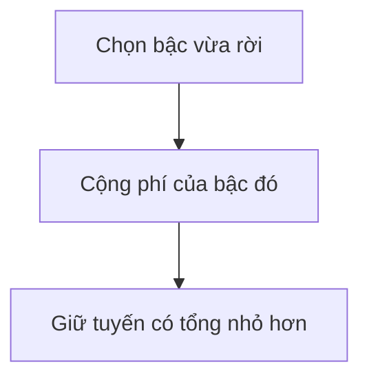

> [!tldr] Đọc nhanh
> - Mình đặt `d[i]` là phí đã trả khi vừa tới bậc i, trước khi trả phí tại i.
> - Nếu bước tới i từ j, cộng phí `cost[j]`. Hai lựa chọn trước i cạnh tranh bằng phép lấy nhỏ nhất.
> - Đích có chỉ số n và đứng ngoài mảng giá. Hai điểm xuất phát 0, 1 có phí đã trả bằng 0.

> [!info] Bối cảnh
> Đây là bài LeetCode 746 tại [[posts/2026-11-27-neetcode-linear-dp|ga DP-01: Truy hồi một chiều]]. Cầu thang trong kho bây giờ có một máy thu tiền ở mỗi bậc. Mình chỉ cần biết mảng và cách tính tổng.

> [!abstract]- Từ điển nhanh cho bài này (bấm để mở)
> - [[concepts/dp-state|Trạng thái DP]] quy định rõ khoản phí thuộc trước hay sau một lần di chuyển.
> - `min(a,b)` giữ phương án có tổng phí nhỏ hơn.
> - Một bước hợp lệ tiến một hoặc hai chỉ số.

## Hình dung trước: máy thu tiền lúc rời bậc

Có hai lối vào miễn phí ở bậc 0 và 1. Đứng tại một bậc chưa phát sinh phí của bậc đó. Mình trả tiền ở máy bên cạnh rồi đi tiếp. Tới cửa ra thì hết hành trình.

| Đời thường | Khái niệm |
|---|---|
| Hai lối vào miễn phí | Cơ sở d[0], d[1] |
| Tiền trả trước khi đi tiếp | Phí của bậc xuất phát |
| Chỉ ghi tuyến rẻ nhất tới một bậc | Giá trị nhỏ nhất d[i] |
| Cửa ra sau bậc cuối | Đích n ngoài mảng |



## Vấn đề: tối thiểu phí trước khi tới cửa ra

Mảng có n giá, 2 ≤ n ≤ 1.000, mỗi giá là số nguyên từ 0 đến 999. Sau khi chọn xuất phát ở 0 hoặc 1, mỗi lần rời bậc j mình trả `cost[j]` rồi tiến 1 hoặc 2 bậc. Cửa ra ở n. Với `[6,2,8,1]`, lộ trình `1 → 3 → 4` trả `2 + 1 = 3`. [Đề gốc LeetCode 746](https://leetcode.com/problems/min-cost-climbing-stairs/)

## Cơ chế

Mình nhìn vào bậc đến i, với i ≥ 2. Bậc vừa rời chỉ có thể là i−1 hoặc i−2. Thay một đoạn đầu đắt hơn bằng đường rẻ nhất tới cùng bậc xuất phát vẫn giữ được bước cuối, nên `d[i] = min(d[i−1] + cost[i−1], d[i−2] + cost[i−2])`. Vì có thể tới 0 hoặc 1 miễn phí ở đầu và mọi giá không âm, đặt `d[0] = d[1] = 0`.

| i | Đi từ i−1 | Đi từ i−2 | d[i] |
|---|---:|---:|---:|
| 2 | 0 + 2 | 0 + 6 | 2 |
| 3 | 2 + 8 | 0 + 2 | 2 |
| 4 | 2 + 1 | 2 + 8 | 3 |

Vét cạn tính cả hai nhánh cho từng tiền tố và lặp lại nhiều trạng thái, tốn Θ(φⁿ) thời gian với O(n) ngăn xếp. Memoization và điền bảng giảm còn O(n) thời gian, O(n) bộ nhớ phụ. Hai biến cuộn giữ đúng `d[i−2]`, `d[i−1]` trước mỗi lượt, dùng O(1) bộ nhớ phụ. Muốn in lộ trình thì dùng bảng và lưu lựa chọn trước đó ở từng i.

## Ví dụ chạy được

[TypeScript](../code/neetcode-min-cost-climbing-stairs/stairs.ts) · [Python](../code/neetcode-min-cost-climbing-stairs/stairs.py) · [Go](../code/neetcode-min-cost-climbing-stairs/stairs.go) · [Java](../code/neetcode-min-cost-climbing-stairs/stairs.java) · [JavaScript](../code/neetcode-min-cost-climbing-stairs/stairs.js) · [PHP](../code/neetcode-min-cost-climbing-stairs/stairs.php) · [Rust](../code/neetcode-min-cost-climbing-stairs/stairs.rs)

```ts
function candidates(n: number, add: (i: number) => number, choose: (a: number, b: number) => number, base: number) {
    function brute(i: number): number {
        return i < 2 ? base : choose(brute(i - 1) + add(i - 1), brute(i - 2) + add(i - 2))
    }

    const cache: Map<number, number> = new Map<number, number>()
    function memoized(i: number): number {
        if (i < 2) return base
        const saved = cache.get(i)
        if (saved !== undefined) return saved
        const answer = choose(memoized(i - 1) + add(i - 1), memoized(i - 2) + add(i - 2))
        cache.set(i, answer)
        return answer
    }

    function tabulated() {
        const dp = [base, base]
        for (let i = 2; i <= n; i++) {
            dp[i] = choose(dp[i - 1] + add(i - 1), dp[i - 2] + add(i - 2))
        }
        return dp[n]
    }

    function rolling() {
        let twoBack = base
        let oneBack = base
        for (let i = 2; i <= n; i++) {
            const next = choose(oneBack + add(i - 1), twoBack + add(i - 2))
            twoBack = oneBack
            oneBack = next
        }
        return oneBack
    }

    return { brute: () => brute(n), memoized: () => memoized(n), tabulated, rolling }
}
```

```python
def check(n, add, choose, base, expected, small):
    def brute(i):
        if i < 2:
            return base
        return choose(brute(i - 1) + add(i - 1), brute(i - 2) + add(i - 2))

    # Tránh giới hạn đệ quy Python khi đề cho n tới 1000.
    def table():
        dp = [base, base]
        for i in range(2, n + 1):
            dp.append(choose(dp[i - 1] + add(i - 1), dp[i - 2] + add(i - 2)))
        return dp[n]

    def rolling():
        two_back = one_back = base
        for i in range(2, n + 1):
            two_back, one_back = one_back, choose(one_back + add(i - 1), two_back + add(i - 2))
        return one_back

    if small:
        assert brute(n) == expected
    assert table() == expected
    assert rolling() == expected
```

```go
package main

import "fmt"

func check(n int, add func(int) int, choose func(int, int) int, base, expected int, small bool) {
	var brute func(int) int
	brute = func(i int) int {
		if i < 2 {
			return base
		}
		return choose(brute(i-1)+add(i-1), brute(i-2)+add(i-2))
	}
	if small && brute(n) != expected {
		panic("vét cạn sai")
	}

	dp := make([]int, n+1)
	dp[0], dp[1] = base, base
	twoBack, oneBack := base, base
	for i := 2; i <= n; i++ {
		dp[i] = choose(dp[i-1]+add(i-1), dp[i-2]+add(i-2))
		twoBack, oneBack = oneBack, choose(oneBack+add(i-1), twoBack+add(i-2))
	}
	if dp[n] != expected || oneBack != expected {
		panic("quy hoạch động sai")
	}
}
```

```java
import java.util.Arrays;
import java.util.function.IntBinaryOperator;
import java.util.function.IntUnaryOperator;

class Stairs {
    static int brute(int i, IntUnaryOperator add, IntBinaryOperator choose, int base) {
        if (i < 2) return base;
        return choose.applyAsInt(brute(i-1, add, choose, base) + add.applyAsInt(i-1),
                                 brute(i-2, add, choose, base) + add.applyAsInt(i-2));
    }

    static void check(int n, IntUnaryOperator add, IntBinaryOperator choose, int base, int expected, boolean small) {
        if (small && brute(n, add, choose, base) != expected) throw new AssertionError();
        int[] dp = new int[n+1];
        dp[0] = dp[1] = base;
        int twoBack = base;
        int oneBack = base;
        for (int i = 2; i <= n; i++) {
            dp[i] = choose.applyAsInt(dp[i-1] + add.applyAsInt(i-1), dp[i-2] + add.applyAsInt(i-2));
            int next = choose.applyAsInt(oneBack + add.applyAsInt(i-1), twoBack + add.applyAsInt(i-2));
            twoBack = oneBack;
            oneBack = next;
        }
        if (dp[n] != expected || oneBack != expected) throw new AssertionError();
    }
}
```

```js
function candidates(n, add, choose, base) {
    function brute(i) {
        return i < 2 ? base : choose(brute(i - 1) + add(i - 1), brute(i - 2) + add(i - 2))
    }

    const cache = new Map()
    function memoized(i) {
        if (i < 2) return base
        const saved = cache.get(i)
        if (saved !== undefined) return saved
        const answer = choose(memoized(i - 1) + add(i - 1), memoized(i - 2) + add(i - 2))
        cache.set(i, answer)
        return answer
    }

    function tabulated() {
        const dp = [base, base]
        for (let i = 2; i <= n; i++) {
            dp[i] = choose(dp[i - 1] + add(i - 1), dp[i - 2] + add(i - 2))
        }
        return dp[n]
    }

    function rolling() {
        let twoBack = base
        let oneBack = base
        for (let i = 2; i <= n; i++) {
            const next = choose(oneBack + add(i - 1), twoBack + add(i - 2))
            twoBack = oneBack
            oneBack = next
        }
        return oneBack
    }

    return { brute: () => brute(n), memoized: () => memoized(n), tabulated, rolling }
}
```

```php
<?php
declare(strict_types=1);

function brute(int $i, callable $add, callable $choose, int $base): int {
    if ($i < 2) return $base;
    return $choose(brute($i - 1, $add, $choose, $base) + $add($i - 1),
                   brute($i - 2, $add, $choose, $base) + $add($i - 2));
}

function check(int $n, callable $add, callable $choose, int $base, int $expected, bool $small): void {
    if ($small && brute($n, $add, $choose, $base) !== $expected) {
        throw new RuntimeException('vét cạn sai');
    }
    $dp = [$base, $base];
    $twoBack = $oneBack = $base;
    for ($i = 2; $i <= $n; $i++) {
        $dp[$i] = $choose($dp[$i - 1] + $add($i - 1), $dp[$i - 2] + $add($i - 2));
        [$twoBack, $oneBack] = [$oneBack, $choose($oneBack + $add($i - 1), $twoBack + $add($i - 2))];
    }
    if ($dp[$n] !== $expected || $oneBack !== $expected) {
        throw new RuntimeException('quy hoạch động sai');
    }
}
```

```rust
fn brute(
    i: usize,
    add: &impl Fn(usize) -> i32,
    choose: &impl Fn(i32, i32) -> i32,
    base: i32,
) -> i32 {
    if i < 2 {
        return base;
    }
    choose(
        brute(i - 1, add, choose, base) + add(i - 1),
        brute(i - 2, add, choose, base) + add(i - 2),
    )
}

fn check(
    n: usize,
    add: impl Fn(usize) -> i32,
    choose: impl Fn(i32, i32) -> i32,
    base: i32,
    expected: i32,
    small: bool,
) {
    if small {
        assert_eq!(brute(n, &add, &choose, base), expected);
    }
    let mut dp = vec![base; n + 1];
    let (mut two_back, mut one_back) = (base, base);
    for i in 2..=n {
        dp[i] = choose(dp[i - 1] + add(i - 1), dp[i - 2] + add(i - 2));
        (two_back, one_back) = (
            one_back,
            choose(one_back + add(i - 1), two_back + add(i - 2)),
        );
    }
    assert_eq!(dp[n], expected);
    assert_eq!(one_back, expected);
}
```

Các file kiểm 5 ca gồm phí bằng 0, chỉ có hai bậc và 1.000 bậc giá 999. File Node.js có cả memo. Các file còn lại kiểm vét cạn trên ca nhỏ, bảng và hai biến. Một phép gộp là một lần so hai phương án đến cùng một bậc.

```text
5/5 ca đúng
n=18: vét cạn 4180, memo 17 lần gộp
```

## Hiểu lầm và bẫy hay gặp

- Dùng `cost[i]` trong trạng thái phí **khi tới i** làm sai thời điểm trả tiền và đọc ngoài mảng ở đích.
- Dùng `0` làm dấu hiệu chưa có trong memo sẽ tính lại các đoạn miễn phí. Kiểm tra sự có mặt của khóa.
- Chọn bậc kế tiếp chỉ vì giá của nó nhỏ có thể chặn bước nhảy qua một bậc đắt hơn về sau. Với `[0,1,2,100]`, xuất phát 0 và chọn bậc 1 theo giá có thể tốn 3. Đường `0 → 2 → 4` chỉ tốn 2.

## Câu hỏi tự kiểm tra

> [!question]- Có cần trả phí khi đứng tại đích n?
> Không. Giá chỉ nằm ở các bậc 0 đến n−1 và được trả lúc rời bậc.

> [!question]- Hai biến có lưu được chính đường đi không?
> Chúng chỉ giữ tổng phí. Có thể lưu bước trước khi điền bảng để lần ngược đường đi từ n.

## Tham khảo

- [LeetCode 746](https://leetcode.com/problems/min-cost-climbing-stairs/)
- [MIT 6.006, bài giảng về bài toán con và thứ tự điền bảng](https://ocw.mit.edu/courses/6-006-introduction-to-algorithms-fall-2011/resources/mit6_006f11_lec19/)
