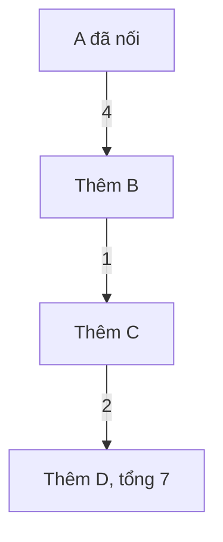

> [!tldr] Đọc nhanh
> - Mỗi điểm là một đỉnh, mỗi cặp điểm có một cạnh nặng bằng khoảng cách Manhattan. Bài hỏi tổng trọng số của [[concepts/minimum-spanning-tree|cây khung nhỏ nhất]].
> - Kruskal sắp tất cả các cạnh rồi thêm cạnh nối hai thành phần khác nhau.
> - Prim giữ giá nối tốt nhất của từng điểm ngoài cây và tính cạnh tại chỗ. Với đồ thị đầy đủ, bản quét mảng dùng O(n²) thời gian và O(n) bộ nhớ.

> [!info] Bối cảnh
> Bài LeetCode 1584 ở [[posts/2026-11-27-neetcode-spanning-tree-itinerary|ga 6 về cây khung và hành trình]] trên tuyến NeetCode Đồ thị. Bạn chỉ cần biết mảng và các vòng lặp để theo Prim. Phần Kruskal dùng [[concepts/disjoint-set-union|Union-Find]] từ ga 4.

> [!abstract]- Từ điển nhanh cho bài này (bấm để mở)
> - Khoảng cách Manhattan cộng chênh lệch tuyệt đối của hai tọa độ.
> - [[concepts/cut-property|Lát cắt]] chia các đỉnh làm hai phía. Cạnh bắc qua có một đầu ở mỗi phía.
> - Cây khung là tập cạnh nối mọi đỉnh mà không tạo vòng.

## Hình dung trước: nối cảm biến bằng dây

Mình có bốn cảm biến A(0,0), B(4,0), C(5,0) và D(5,2). Dây đi dọc trục, nên giá nối A với D là 7. Có thể nối dây qua B và C để dùng lại đoạn đã đặt. Dây A–B, B–C và C–D có tổng 7.

| Đời thường | Khái niệm |
|---|---|
| Nhóm cảm biến đã nối | Phía trong cây của lát cắt |
| Giá dây rẻ nhất để kéo ra một cảm biến | Khóa `best[i]` của Prim |
| Dây nối hai cảm biến đã thông nhau | Cạnh tạo vòng, Kruskal bỏ qua |



## Vấn đề: nối toàn bộ điểm với tổng giá nhỏ nhất

Đề cho 1 đến 1.000 tọa độ đôi một khác nhau với mỗi trục nằm trong [−10⁶, 10⁶]. Nối hai điểm p và q tốn `|p.x - q.x| + |p.y - q.y|`. Kết cấu cuối cùng phải có đúng một đường đơn giữa mọi cặp đỉnh, nên bài toán là tìm cây khung nhỏ nhất. Trả giá, không cần trả danh sách dây. Một điểm tốn 0.

## Cơ chế

### Kruskal dựng mọi cạnh

Dựng n(n−1)/2 cạnh, sắp từ nhẹ đến nặng. Dùng Union-Find để bỏ cạnh có hai đầu cùng thành phần. Khi đã nhận n−1 cạnh thì xong. Đây là một rừng trong suốt quá trình, rồi trở thành một cây. Sắp cạnh tốn O(n² log n) thời gian và cả mảng cạnh tốn O(n²) bộ nhớ.

### Prim giữ chi phí nối tốt nhất

Khởi tạo mọi khóa nối là vô cùng. Gán điểm đầu khóa 0 để chọn nó miễn phí. Mỗi vòng quét tìm điểm chưa chọn có khóa nhỏ nhất, cộng khóa vào tổng rồi thử giảm khóa của tất cả điểm còn ngoài bằng cạnh vừa mở ra. Sau khi chọn A, khóa của B, C, D là 4, 5, 7. Chọn B giảm hai khóa sau còn 1 và 3. Chọn C giảm D còn 2.

Bất biến là `best[i]` chỉ chứa **cạnh** tốt nhất từ một đỉnh trong cây tới `i`. Theo tính chất lát cắt, có thể thêm cạnh nhẹ nhất bắc qua lát cắt và vẫn có một MST chứa những cạnh đã chọn. Nếu một MST tương thích chưa dùng cạnh đó, chèn nó tạo một vòng. Vòng có một cạnh bắc qua lát cắt khác nên ta bỏ cạnh ấy và tổng giá không tăng. Hòa giá chỉ thay cấu trúc cây, không thay tổng.

Quét n khóa và cập nhật trong mỗi vòng, tổng O(n²) thời gian. Hai mảng dài n nên bộ nhớ phụ O(n). [Ví dụ đếm số cạnh lưu](../code/neetcode-spanning-tree-itinerary/compare.ts) cho n = 1.000: Kruskal lưu 499.500 cạnh và Prim lưu 1.000 khóa `best` cùng 1.000 cờ. Cả hai đều cần tính khoảng cách cho mọi cặp trong các bản này; khác biệt nằm ở sắp xếp và dữ liệu còn giữ.

## Ví dụ chạy được

Tab cho đoạn Prim. Mỗi file đầy đủ chạy cả Prim lẫn Kruskal trên sáu ca gồm một điểm, hòa trọng số, tọa độ âm và khoảng cách cực đại 4.000.000.

[TypeScript](../code/neetcode-min-cost-to-connect-all-points/connect.ts) · [Python](../code/neetcode-min-cost-to-connect-all-points/connect.py) · [Go](../code/neetcode-min-cost-to-connect-all-points/connect.go) · [Java](../code/neetcode-min-cost-to-connect-all-points/connect.java) · [JavaScript](../code/neetcode-min-cost-to-connect-all-points/connect.js) · [PHP](../code/neetcode-min-cost-to-connect-all-points/connect.php) · [Rust](../code/neetcode-min-cost-to-connect-all-points/connect.rs)

```typescript
type Point = [number, number];

function distance([x, y]: Point, [a, b]: Point): number {
  return Math.abs(x - a) + Math.abs(y - b);
}

function prim(points: Point[]): number {
  const n = points.length;
  const inTree = Array<boolean>(n).fill(false);
  const best = Array<number>(n).fill(Infinity);
  best[0] = 0;
  let total = 0;

  for (let step = 0; step < n; step++) {
    let next = -1;
    for (let i = 0; i < n; i++) {
      if (!inTree[i] && (next === -1 || best[i] < best[next])) next = i;
    }
    inTree[next] = true;
    total += best[next];
    for (let i = 0; i < n; i++) {
      if (!inTree[i]) best[i] = Math.min(best[i], distance(points[next], points[i]));
    }
  }
  return total;
}
```

```python
def distance(p, q):
    return abs(p[0] - q[0]) + abs(p[1] - q[1])


def prim(points):
    n = len(points)
    in_tree = [False] * n
    best = [float("inf")] * n
    best[0] = 0
    total = 0

    for _ in points:
        next_point = min((i for i in range(n) if not in_tree[i]), key=best.__getitem__)
        in_tree[next_point] = True
        total += best[next_point]
        for i in range(n):
            if not in_tree[i]:
                best[i] = min(best[i], distance(points[next_point], points[i]))
    return total
```

```go
package main

import "math"

type point [2]int
type edge struct{ weight, a, b int }

func distance(p, q point) int {
	x, y := p[0]-q[0], p[1]-q[1]
	if x < 0 {
		x = -x
	}
	if y < 0 {
		y = -y
	}
	return x + y
}

func prim(points []point) int64 {
	n := len(points)
	inTree := make([]bool, n)
	best := make([]int, n)
	for i := 1; i < n; i++ {
		best[i] = math.MaxInt
	}

	var total int64
	for range n {
		next := -1
		for i := range n {
			if !inTree[i] && (next == -1 || best[i] < best[next]) {
				next = i
			}
		}
		inTree[next] = true
		total += int64(best[next])
		for i := range n {
			if !inTree[i] {
				best[i] = min(best[i], distance(points[next], points[i]))
			}
		}
	}
	return total
}
```

```java
import java.util.Arrays;

class Connect {
    static int distance(int[] p, int[] q) {
        return Math.abs(p[0] - q[0]) + Math.abs(p[1] - q[1]);
    }

    static long prim(int[][] points) {
        int n = points.length;
        boolean[] inTree = new boolean[n];
        int[] best = new int[n];
        Arrays.fill(best, Integer.MAX_VALUE);
        best[0] = 0;
        long total = 0;

        for (int step = 0; step < n; step++) {
            int next = -1;
            for (int i = 0; i < n; i++) {
                if (!inTree[i] && (next == -1 || best[i] < best[next])) next = i;
            }
            inTree[next] = true;
            total += best[next];
            for (int i = 0; i < n; i++) {
                if (!inTree[i]) best[i] = Math.min(best[i], distance(points[next], points[i]));
            }
        }
        return total;
    }
}
```

```javascript
function distance([x, y], [a, b]) {
    return Math.abs(x - a) + Math.abs(y - b);
}
function prim(points) {
    const n = points.length;
    const inTree = Array(n).fill(false);
    const best = Array(n).fill(Infinity);
    best[0] = 0;
    let total = 0;
    for(let step = 0; step < n; step++){
        let next = -1;
        for(let i = 0; i < n; i++){
            if (!inTree[i] && (next === -1 || best[i] < best[next])) next = i;
        }
        inTree[next] = true;
        total += best[next];
        for(let i = 0; i < n; i++){
            if (!inTree[i]) best[i] = Math.min(best[i], distance(points[next], points[i]));
        }
    }
    return total;
}
```

```php
<?php
declare(strict_types=1);

function distance(array $p, array $q): int
{
    return abs($p[0] - $q[0]) + abs($p[1] - $q[1]);
}

function prim(array $points): int
{
    $n = count($points);
    $inTree = array_fill(0, $n, false);
    $best = array_fill(0, $n, PHP_INT_MAX);
    $best[0] = 0;
    $total = 0;

    for ($step = 0; $step < $n; $step++) {
        $next = -1;
        for ($i = 0; $i < $n; $i++) {
            if (!$inTree[$i] && ($next === -1 || $best[$i] < $best[$next])) {
                $next = $i;
            }
        }
        $inTree[$next] = true;
        $total += $best[$next];
        for ($i = 0; $i < $n; $i++) {
            if (!$inTree[$i]) {
                $best[$i] = min($best[$i], distance($points[$next], $points[$i]));
            }
        }
    }
    return $total;
}
```

```rust
type Point = (i32, i32);

fn distance(p: Point, q: Point) -> i32 {
    (p.0 - q.0).abs() + (p.1 - q.1).abs()
}

fn prim(points: &[Point]) -> i64 {
    let n = points.len();
    let mut in_tree = vec![false; n];
    let mut best = vec![i32::MAX; n];
    best[0] = 0;
    let mut total = 0;

    for _ in points {
        let next = (0..n)
            .filter(|&i| !in_tree[i])
            .min_by_key(|&i| best[i])
            .unwrap();
        in_tree[next] = true;
        total += i64::from(best[next]);
        for i in 0..n {
            if !in_tree[i] {
                best[i] = best[i].min(distance(points[next], points[i]));
            }
        }
    }
    total
}
```

```text
6/6 ca đúng
```

## Hiểu lầm và bẫy hay gặp

- Cập nhật bằng tổng giá từ điểm đầu biến Prim thành một thuật toán khác. Chỉ dùng giá của cạnh mới.
- Cây đường ngắn nhất từ một đỉnh có mục tiêu khác MST. Hai cây có thể chọn các cạnh khác nhau.
- So với giá vô cùng bằng một hằng nhỏ hơn khoảng cách tối đa có thể làm mất cập nhật. Dùng `Infinity` hoặc giá trị lớn nhất của kiểu phù hợp.
- Ưu tiên kiểu đủ rộng cho tổng. Java và Rust trong ví dụ dùng số 64 bit cho phép cộng; PHP dùng `int` trên môi trường 64 bit.

## Câu hỏi tự kiểm tra

> [!question]- Vì sao Kruskal có thể dừng ở n−1 cạnh?
> Nó chỉ nhập hai thành phần khác nhau. Mỗi lần nhận cạnh làm số thành phần giảm một, nên n−1 lần đưa n thành phần về một.

> [!question]- Sau khi thêm B, vì sao D chỉ còn khóa 3?
> Cạnh B–D giá 3, rẻ hơn cạnh A–D giá 7. Hai lựa chọn đều nối từ bên trong lát cắt.

## Tham khảo

- [Đề bài LC-1584](https://leetcode.com/problems/min-cost-to-connect-all-points/)
- [Princeton Algorithms, minimum spanning trees](https://algs4.cs.princeton.edu/43mst/)
