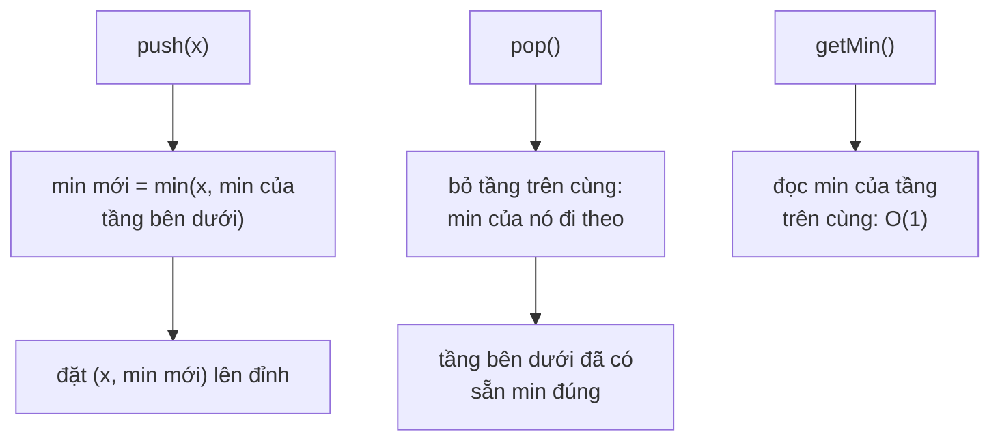

> [!tldr] Đọc nhanh
> - Đề: một ngăn xếp có `push`, `pop`, `top` như thường, thêm `getMin` trả phần tử nhỏ nhất. **Mọi thao tác O(1).**
> - Duyệt cả ngăn xếp mỗi lần `getMin` là O(n): 0,8 giây với 40 000 lần push xen getMin, gần nghìn lần chậm hơn các cách O(1).
> - Mấu chốt: min của một ngăn xếp chỉ đổi khi push hoặc pop, và pop luôn trả ngăn xếp về **đúng trạng thái trước đó**. Nên mỗi tầng nhớ luôn "min tính tới tầng này" là đủ ([[concepts/auxiliary-min-stack|ngăn xếp phụ cho min]]).
> - Cách hai ngăn xếp phải đẩy khi `x <= min`, **có dấu bằng**. Thiếu dấu bằng, hai số min bằng nhau, pop một cái là mất min.
> - Java có hai bẫy riêng: so `peek()` của hai `Deque<Integer>` bằng `==` (sai từ 128 trở lên), và lưu hiệu `x − min` bằng `int` (tràn ở biên 32 bit).

> [!info] Bối cảnh
> Bài LeetCode 155, thuộc [[posts/2026-11-23-neetcode-stack|ga 6: Ngăn xếp]] trên **tuyến NeetCode: Mảng và chuỗi**. Đây là bài **thiết kế**: viết một lớp, không phải một hàm. Lời giải có đủ TypeScript, Python, Go, Java và JavaScript. Bạn cần biết [[concepts/stack|ngăn xếp]] (push, pop) và cách viết một lớp có phương thức.

> [!abstract]- Từ điển nhanh cho bài này (bấm để mở)
> - **Ngăn xếp**: thêm và lấy ở cùng một đầu (đỉnh), vào sau ra trước. Xem [[concepts/stack|Stack]].
> - **Ngăn xếp phụ (auxiliary stack)**: một ngăn xếp thứ hai chạy song song, ghi thông tin phụ cho ngăn chính. Xem [[concepts/auxiliary-min-stack|Auxiliary Min Stack]].
> - **Đóng hộp (boxing)**: Java bọc `int` thành object `Integer` để bỏ vào `Deque`. Hai `Integer` cùng giá trị có thể là hai object khác nhau.
> - **Tràn số (overflow)**: kết quả vượt khỏi số bit của kiểu. `int` của Java và `int32` của Go quay vòng lặng lẽ, không báo lỗi.

## Hình dung trước: chồng đĩa có ghi chú

Bạn xếp đĩa thành chồng, mỗi đĩa ghi một số. Ai đó hỏi liên tục "số nhỏ nhất trong chồng là bao nhiêu?". Nhấc từng đĩa lên xem thì chậm. Mẹo: mỗi khi đặt một đĩa mới, bạn dán lên nó một mẩu giấy ghi "số nhỏ nhất từ đáy tới đĩa này". Câu trả lời luôn nằm trên mẩu giấy của đĩa trên cùng.

| Đời thường | Khái niệm |
|---|---|
| Đặt một đĩa lên chồng | `push(x)` |
| Nhấc đĩa trên cùng đi | `pop()` |
| Nhấc từng đĩa ra xem số nhỏ nhất | `getMin` duyệt cả ngăn xếp, O(n) |
| Mẩu giấy "nhỏ nhất từ đáy tới đây" dán trên mỗi đĩa | mỗi tầng nhớ cặp (giá trị, min tới tầng này) |
| Nhấc đĩa đi thì mẩu giấy đi theo; đĩa bên dưới vẫn giữ mẩu giấy đúng của nó | pop trả về đúng trạng thái trước |
| Chỉ dán giấy lên đĩa nào làm số nhỏ nhất thay đổi (hoặc bằng) | hai ngăn xếp: ngăn phụ chỉ nhận x khi `x <= min` |



## Vấn đề

**Đề (tóm tắt bằng lời của mình):** cài lớp `MinStack` với `push(val)`, `pop()`, `top()` và `getMin()`. Mỗi thao tác phải chạy O(1). Giá trị nằm trong khoảng số nguyên 32 bit có dấu; `pop`, `top`, `getMin` luôn được gọi trên ngăn xếp không rỗng; tối đa 3·10⁴ lần gọi. Đề gốc: [LeetCode 155](https://leetcode.com/problems/min-stack/).

| Thao tác | Ngăn xếp (đáy → đỉnh) | Trả về |
|---|---|---|
| `push(-2)`, `push(0)`, `push(-3)` | `-2, 0, -3` | |
| `getMin()` | `-2, 0, -3` | `-3` |
| `pop()` | `-2, 0` | |
| `top()` | `-2, 0` | `0` |
| `getMin()` | `-2, 0` | `-2` |

Mình từng nghĩ chỉ cần một biến `min`: push số nhỏ hơn thì cập nhật. Hóa ra khó là lúc **pop**: lấy số nhỏ nhất ra rồi, min mới là số nào? Một biến không nhớ được câu trả lời đó.

## Cơ chế

<figure class="figure-map" style="--ar: 3 / 4">
<div class="frame"><iframe data-archify="../diagrams/neetcode-min-stack/worked-example.html" title="Lấy lại min cũ khi bỏ đỉnh" loading="lazy"></iframe></div>
<figcaption><span><b>Hình 1.</b> Lấy lại min cũ khi bỏ đỉnh.</span><a href="../diagrams/neetcode-min-stack/worked-example.html" target="_blank" rel="noopener">Mở toàn màn hình</a></figcaption>
</figure>

<details>
<summary>Đọc từng bước</summary>
<ol>
<li>Đẩy 5 và lưu min là 5. <code>(5, 5)</code></li>
<li>Đẩy 2 rồi đẩy 4. <code>(2, 2), (4, 2)</code></li>
<li>Bỏ 4 thì min vẫn là 2. <code>(2, 2)</code></li>
<li>Bỏ 2 thì min quay về 5. <code>(5, 5)</code></li>
</ol>
</details>

### Cách 1, duyệt: getMin O(n)

Một mảng thường, `getMin` duyệt hết. Đúng, nhưng vi phạm yêu cầu O(1).

### Cách 2, mỗi tầng một cặp

Push `(x, min(x, min của tầng dưới))`. Pop bỏ cả cặp. Vì ngăn xếp chỉ đổi ở đỉnh, mọi tầng bên dưới không bao giờ đổi, nên min ghi ở mỗi tầng luôn đúng cho phần từ đáy tới tầng đó. Bộ nhớ gấp đôi, mọi thao tác O(1).

### Cách 3, hai ngăn xếp

Ngăn chính giữ mọi giá trị. Ngăn phụ chỉ nhận x khi `x <= đỉnh ngăn phụ`. Khi pop, nếu giá trị lấy ra **bằng** đỉnh ngăn phụ thì pop cả ngăn phụ. Ngăn phụ thường ngắn hơn nhiều (dữ liệu tăng dần thì nó chỉ có một phần tử).

**Vì sao phải có dấu bằng.** Push `0, 1, 0`. Với `<`, số 0 thứ hai không vào ngăn phụ, ngăn phụ là `[0]`. Pop số 0 thứ hai: nó bằng đỉnh ngăn phụ, nên ngăn phụ bị pop thành rỗng, trong khi ngăn chính vẫn còn số 0 đầu tiên. `getMin` lúc này đọc một ngăn rỗng: JS trả `undefined`, Python ném `IndexError`.

### Cách 4, lưu hiệu

Chỉ một ngăn xếp và một biến `min`. Push x thì lưu `x − min` (min **trước** khi push), rồi cập nhật min. Hiệu âm nghĩa là tầng này đã hạ min xuống; khi pop tầng đó, khôi phục `min cũ = min − hiệu`. Ít bộ nhớ hơn, nhưng hiệu của hai số 32 bit cần **33 bit**: `2147483647 − (−2147483648) = 4294967295`. Java phải lưu bằng `long`; Go với `int` (64 bit) thì ổn, với `int32` thì tràn; JS dùng số thực 64 bit nên vẫn chính xác; Python không tràn.

| | Bộ nhớ | `getMin` | Bẫy |
|---|---|---|---|
| duyệt | n | O(n) | chậm |
| cặp | 2n | O(1) | |
| hai ngăn xếp | n tới 2n | O(1) | dấu `<=`; Java so `Integer` |
| lưu hiệu | n | O(1) | tràn 32 bit |

### Đo

n lần push số ngẫu nhiên, mỗi lần push gọi `getMin` một lần, TypeScript, trung vị:

| n | duyệt | cặp | hai ngăn xếp | lưu hiệu |
|---|---|---|---|---|
| 5 000 | 13,2 ms | 0,47 ms | 0,26 ms | 0,32 ms |
| 10 000 | 154,5 ms | 0,22 ms | 0,28 ms | 0,19 ms |
| 20 000 | 206,6 ms | 1,04 ms | 0,66 ms | 0,61 ms |
| 40 000 | 812,4 ms | 0,92 ms | 0,49 ms | 0,53 ms |
| 10⁶ | (không chạy) | 64,55 ms | 17,11 ms | 16,83 ms |

Từ 20 000 lên 40 000, n gấp đôi thì cách duyệt chậm gấp 3,9 lần: dáng n² của n lần `getMin` O(n). Hai bước đầu lệch dáng (gấp 12 lần rồi chỉ 1,3 lần, cả ba lần chạy đều vậy); mình đoán là do bộ biên dịch JIT tối ưu vòng duyệt giữa chừng, không đo riêng. Ở 10⁶, cách cặp chậm hơn hai cách kia gần 4 lần vì mỗi tầng cấp phát một mảng `[x, min]` mới.

Bản trước của trang ghi cách duyệt mất 4 giây ở 40 000. Số đó đo trên dữ liệu của bộ sinh ngẫu nhiên cũ (`seed * 1103515245` tính bằng số thực), vốn mất chính xác và lặp lại sau khoảng 10 nghìn giá trị; vì sao dữ liệu lặp lại làm vòng duyệt chậm thêm 5 lần thì mình chưa đo. File giờ dùng bộ sinh mulberry32 (mọi phép nhân qua `Math.imul`).

### Bên dưới năm ngôn ngữ

| | Một tầng của cách cặp | Bẫy riêng |
|---|---|---|
| TypeScript / JavaScript | mảng `[x, min]` (một object mỗi tầng) | ngăn phụ rỗng thì `mins[mins.length - 1]` trả `undefined`, không báo lỗi |
| Python | tuple `(x, min)` | `min(self.a)` gọn nhưng là O(n); int không tràn |
| Go | struct `pair{val, min}`, nằm liền trong slice | `int32` tràn quay vòng lặng lẽ; `int` là 64 bit trên máy 64 bit |
| Java | `int[2]` trong `ArrayDeque<int[]>` | `a.pop() == mins.peek()` so **tham chiếu** hai `Integer`; hiệu `int` tràn |

## Ví dụ chạy được

[TypeScript](../code/neetcode-min-stack/min-stack.ts) · [Python](../code/neetcode-min-stack/min_stack.py) · [Go](../code/neetcode-min-stack/min_stack.go) · [Java](../code/neetcode-min-stack/min-stack.java) · [JavaScript](../code/neetcode-min-stack/min-stack.js)

Mỗi file chạy 6 chuỗi thao tác, gồm min lặp lại, hai biên 32 bit và giá trị lớn hơn 127. Dưới đây là cách cặp và cách hai ngăn xếp.

```ts
// Cách 2: mỗi tầng nhớ cặp [giá trị, min tới tầng này].
class PairMinStack implements MinStackLike {
  private a: [number, number][] = [];
  push(x: number) {
    const m = this.a.length === 0 ? x : Math.min(x, this.a[this.a.length - 1][1]);
    this.a.push([x, m]);
  }
  pop() { this.a.pop(); }
  top() { return this.a[this.a.length - 1][0]; }
  getMin() { return this.a[this.a.length - 1][1]; }
}

// Cách 3: hai ngăn xếp; ngăn phụ chỉ nhận x khi x <= min hiện tại (phải có dấu =).
class TwoStackMinStack implements MinStackLike {
  private a: number[] = [];
  private mins: number[] = [];
  push(x: number) {
    this.a.push(x);
    if (this.mins.length === 0 || x <= this.mins[this.mins.length - 1]) this.mins.push(x);
  }
  pop() {
    const x = this.a.pop();
    if (x === this.mins[this.mins.length - 1]) this.mins.pop();
  }
  top() { return this.a[this.a.length - 1]; }
  getMin() { return this.mins[this.mins.length - 1]; }
}
```

```python
class PairMinStack:  # mỗi tầng là tuple (giá trị, min tới tầng này)
    def __init__(self):
        self.a = []

    def push(self, x):
        self.a.append((x, min(x, self.a[-1][1]) if self.a else x))

    def pop(self):
        self.a.pop()

    def top(self):
        return self.a[-1][0]

    def getMin(self):
        return self.a[-1][1]

class TwoStackMinStack:
    def __init__(self):
        self.a, self.mins = [], []

    def push(self, x):
        self.a.append(x)
        if not self.mins or x <= self.mins[-1]:  # phải là <=, không phải <
            self.mins.append(x)

    def pop(self):
        if self.a.pop() == self.mins[-1]:
            self.mins.pop()

    def top(self):
        return self.a[-1]

    def getMin(self):
        return self.mins[-1]
```

```go
// Mỗi tầng nhớ cặp (giá trị, min tới tầng này).
type pair struct{ val, min int }
type PairMinStack struct{ a []pair }

func (s *PairMinStack) Push(x int) {
	m := x
	if len(s.a) > 0 {
		m = min(x, s.a[len(s.a)-1].min)
	}
	s.a = append(s.a, pair{x, m})
}
func (s *PairMinStack) Pop()        { s.a = s.a[:len(s.a)-1] }
func (s *PairMinStack) Top() int    { return s.a[len(s.a)-1].val }
func (s *PairMinStack) GetMin() int { return s.a[len(s.a)-1].min }

type TwoStackMinStack struct{ a, mins []int }

func (s *TwoStackMinStack) Push(x int) {
	s.a = append(s.a, x)
	if len(s.mins) == 0 || x <= s.mins[len(s.mins)-1] {
		s.mins = append(s.mins, x)
	}
}
func (s *TwoStackMinStack) Pop() {
	x := s.a[len(s.a)-1]
	s.a = s.a[:len(s.a)-1]
	if x == s.mins[len(s.mins)-1] {
		s.mins = s.mins[:len(s.mins)-1]
	}
}
func (s *TwoStackMinStack) Top() int    { return s.a[len(s.a)-1] }
func (s *TwoStackMinStack) GetMin() int { return s.mins[len(s.mins)-1] }
```

```java
// Mỗi tầng là một mảng int[2] {giá trị, min tới tầng này}: không đóng hộp từng số.
static class PairMinStack implements MinStackLike {
    private final ArrayDeque<int[]> a = new ArrayDeque<>();
    public void push(int x) { a.push(new int[] {x, a.isEmpty() ? x : Math.min(x, a.peek()[1])}); }
    public void pop() { a.pop(); }
    public int top() { return a.peek()[0]; }
    public int getMin() { return a.peek()[1]; }
}

static class TwoStackMinStack implements MinStackLike {
    private final ArrayDeque<Integer> a = new ArrayDeque<>(), mins = new ArrayDeque<>();
    public void push(int x) {
        a.push(x);
        if (mins.isEmpty() || x <= mins.peek()) mins.push(x); // x là int, nên <= mở hộp mins.peek() và so giá trị
    }
    public void pop() {
        if (a.pop().equals(mins.peek())) mins.pop(); // equals so GIÁ TRỊ
    }
    public int top() { return a.peek(); }
    public int getMin() { return mins.peek(); }
}
```

```js
class PairMinStack {
  constructor() { this.a = []; }
  push(x) {
    const m = this.a.length === 0 ? x : Math.min(x, this.a[this.a.length - 1][1]);
    this.a.push([x, m]);
  }
  pop() { this.a.pop(); }
  top() { return this.a[this.a.length - 1][0]; }
  getMin() { return this.a[this.a.length - 1][1]; }
}

class TwoStackMinStack {
  constructor() { this.a = []; this.mins = []; }
  push(x) {
    this.a.push(x);
    if (this.mins.length === 0 || x <= this.mins[this.mins.length - 1]) this.mins.push(x);
  }
  pop() {
    if (this.a.pop() === this.mins[this.mins.length - 1]) this.mins.pop();
  }
  top() { return this.a[this.a.length - 1]; }
  getMin() { return this.mins[this.mins.length - 1]; } // ngăn rỗng thì trả undefined, không ném lỗi
}
```


File TypeScript chạy cả bốn cách, bản thiếu dấu bằng, rồi đo:

```text
$ node min-stack.ts
ScanMinStack        6/6 ca đúng
PairMinStack        6/6 ca đúng
TwoStackMinStack    6/6 ca đúng
DiffMinStack        6/6 ca đúng
StrictLessMinStack  5/6 ca đúng; sai ở: min lặp lại

n          duyệt    cặp     hai ngăn  hiệu    (ms, trung vị)
5000         13.2    0.47     0.26    0.32
10000       154.5    0.22     0.28    0.19
20000       206.6    1.04     0.66    0.61
40000       812.4    0.92     0.49    0.53
1000000         —   64.55    17.11   16.83
```

File Java tái hiện hai bẫy riêng của nó:

```text
$ java min-stack.java
PairMinStack       6/6 ca đúng
TwoStackMinStack   6/6 ca đúng
DiffMinStack       6/6 ca đúng
IntegerEqMinStack  4/6 ca đúng; sai ở: biên 32 bit → [-2147483648, -2147483648, -2147483648, 2147483647], số lớn hơn 127 → [500]
IntDiffMinStack    5/6 ca đúng; sai ở: biên 32 bit → [-2147483648, -2147483647, -2147483648, -2147483648]
```

`IntegerEqMinStack` push 500, pop: `a.pop() == mins.peek()` so hai object `Integer` khác nhau, ra `false`, nên ngăn phụ giữ lại 500. Push 700 rồi `getMin` vẫn trả 500. Với số nhỏ như 5 và 7 thì bản này đúng, vì Java dùng chung object cho −128..127. `IntDiffMinStack` tính `−2147483648 − 2147483647` bằng `int`, ra 1 thay vì −4294967295, nên tầng đó không bị coi là đã hạ min.

Python có cùng bản thiếu dấu bằng, và nó ném lỗi thay vì trả `undefined`. Go tái hiện chuyện tràn với `int32`:

```text
$ python3 min_stack.py
ScanMinStack        6/6 ca đúng
PairMinStack        6/6 ca đúng
TwoStackMinStack    6/6 ca đúng
DiffMinStack        6/6 ca đúng
StrictLessMinStack  5/6 ca đúng; sai ở: min lặp lại (IndexError)

$ go run min_stack.go
PairMinStack      6/6 ca đúng
TwoStackMinStack  6/6 ca đúng
DiffMinStack      6/6 ca đúng
Diff32MinStack    5/6 ca đúng; sai ở: [biên 32 bit → [-2147483648 -2147483647 -2147483648 -2147483648]]
```

JavaScript in `6/6 ca đúng` cho cả ba cách.

## Hiểu lầm và bẫy hay gặp

- **"Một biến min là đủ."** Đúng khi chỉ push. Pop mất số nhỏ nhất thì biến đó không biết min mới là gì.
- **Thiếu dấu bằng ở ngăn phụ.** `x < min` thay cho `x <= min`: hỏng ngay khi số nhỏ nhất xuất hiện hai lần.
- **Java: so `Integer` bằng `==`.** Đúng với mọi test dùng số nhỏ, sai từ 128. Dùng `equals`, hoặc so sau khi gán ra `int`.
- **Lưu hiệu bằng kiểu 32 bit.** Hiệu của hai số 32 bit cần 33 bit. Java dùng `long`; Go dùng `int` (64 bit); C/C++ cũng phải dùng kiểu rộng hơn.
- **"Cách lưu hiệu luôn tốt hơn vì ít bộ nhớ."** Nó khó đọc hơn, dễ tràn, và đo ở trên không nhanh hơn rõ rệt so với hai ngăn xếp.

## Câu hỏi tự kiểm tra

> [!question]- Với cách cặp, ghi ngăn xếp sau `push(3)`, `push(5)`, `push(2)`, `push(2)`, `pop()`.
> `(3,3)` → `(3,3),(5,3)` → thêm `(2,2)` → thêm `(2,2)` → pop: `(3,3),(5,3),(2,2)`. `getMin` = 2.

> [!question]- Với cách hai ngăn xếp và dấu `<`, chuỗi nào ngắn nhất làm `getMin` sai?
> `push(0)`, `push(0)`, `pop()`, `getMin()`: ngăn phụ chỉ có một số 0, pop làm nó rỗng trong khi ngăn chính còn một số 0.

> [!question]- Vì sao pop không bao giờ làm min ghi ở các tầng bên dưới sai đi?
> Ngăn xếp chỉ đổi ở đỉnh. Min ghi ở tầng k chỉ phụ thuộc các tầng 0..k, và pop không đụng tới chúng.

> [!question]- Trong Java, `TwoStackMinStack` dùng `x <= mins.peek()` với `x` là `int` thì có bị bẫy so tham chiếu không?
> Không. Một vế là `int` nên Java mở hộp `mins.peek()` và so giá trị. Bẫy chỉ xảy ra khi **cả hai** vế của `==` là `Integer`.

## Tham khảo

- [LeetCode 155: Min Stack](https://leetcode.com/problems/min-stack/) (đề gốc)
- [Java Language Specification SE 21, §5.1.7 Boxing Conversion](https://docs.oracle.com/javase/specs/jls/se21/html/jls-5.html#jls-5.1.7) (giá trị đóng hộp trong −128..127 phải là cùng một object)
- [JLS SE 21, §15.18.2 Additive Operators](https://docs.oracle.com/javase/specs/jls/se21/html/jls-15.html#jls-15.18.2) (cộng trừ số nguyên tràn thì lấy các bit thấp, không báo lỗi)
- [Go spec: Integer overflow](https://go.dev/ref/spec#Integer_overflow) (số nguyên có dấu tràn thì quay vòng)
- [Python tutorial: Using lists as stacks](https://docs.python.org/3/tutorial/datastructures.html#using-lists-as-stacks)
