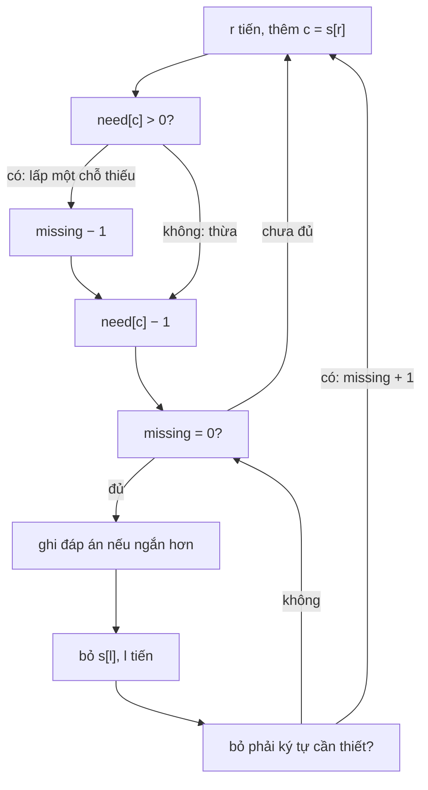

> [!tldr] Đọc nhanh
> - Đề: đoạn con **ngắn nhất** của `s` chứa mọi ký tự của `t`, **kể cả số lần lặp** (`t = "aa"` cần hai chữ a). Không có thì trả `""`.
> - Đây là hướng "tìm ngắn nhất" của [[concepts/sliding-window|cửa sổ trượt]]: đầu phải mở rộng tới khi cửa sổ **đủ**, rồi đầu trái co **chừng nào còn đủ**, và đáp án được ghi **trong** lúc co.
> - Biết "đủ chưa" bằng cách so cả bảng đếm mỗi bước tốn O(128) một lần. Một biến `missing` (số ký tự còn thiếu) trả lời trong O(1): nhanh hơn khoảng **45 lần** ở 10⁶ ký tự.
> - Vét cạn trông ổn trên dữ liệu ngẫu nhiên (mỗi lần kéo dừng sớm), nhưng thành O(n²) khi không có đáp án: 732 ms ở n = 8 000.
> - Bẫy: chỉ xét t có **chữ nào** mà quên số lần (6/8 ca); trong Java, so hai `Integer` đếm bằng `==` sai khi t cần từ 128 chữ giống nhau.

> [!info] Bối cảnh
> Bài LeetCode 76, thuộc [[posts/2026-11-23-neetcode-sliding-window|ga 5: Cửa sổ trượt]] trên **tuyến NeetCode: Mảng và chuỗi**. Post của ga dùng bài này làm ví dụ cho hướng "tìm ngắn nhất"; trang này đi sâu vào cách biết cửa sổ đã đủ và đo các cách. Lời giải có đủ TypeScript, Python, Go, Java và JavaScript. Bạn nên đọc trước [[problems/longest-substring-without-repeating-characters|Longest Substring Without Repeating Characters]] (hướng "tìm dài nhất") và [[problems/valid-anagram|Valid Anagram]] (bảng đếm).

> [!abstract]- Từ điển nhanh cho bài này (bấm để mở)
> - **Cửa sổ đủ (cover)**: đoạn `s[l..r]` có mỗi ký tự c ít nhất bằng số lần c xuất hiện trong t.
> - **Bảng còn thiếu `need`**: `need[c]` = số chữ c t cần trừ số chữ c cửa sổ đang có. Dương là còn thiếu, âm là thừa.
> - **`missing`**: tổng số ký tự còn thiếu, tức tổng các `need[c]` dương. Cửa sổ đủ khi `missing = 0`.
> - **Bất biến**: điều đúng sau mỗi bước. Xem [[concepts/window-invariant|Window Invariant]].
> - **Integer cache (Java)**: Java dùng chung object `Integer` cho các giá trị −128..127; ngoài khoảng đó, hai số bằng nhau có thể là hai object khác nhau.

## Hình dung trước: gom đủ nguyên liệu trên băng chuyền

Một băng chuyền chạy qua các nguyên liệu nối tiếp nhau. Công thức (t) cần 1 trứng, 2 cà chua, 1 hành. Bạn đứng ở cuối băng và muốn một **đoạn băng ngắn nhất** chứa đủ công thức.

| Đời thường | Khái niệm |
|---|---|
| Tờ công thức: cần gì, bao nhiêu | bảng đếm của t |
| Tờ "còn thiếu", gạch dần khi nhặt được | bảng `need` |
| Con số "còn thiếu tổng cộng 4 món" | `missing` |
| Kéo mép phải băng thêm một món | `r++` |
| Đủ rồi thì thử bỏ món ở mép trái, chừng nào vẫn đủ | co `l` khi `missing = 0` |
| Bỏ phải một quả cà chua cần thiết: lại thiếu, quay về kéo mép phải | `need[c] > 0` sau khi bỏ → `missing++` |
| "2 cà chua" khác "có cà chua" | phải đếm số lần, không chỉ có hay không |



## Vấn đề

**Đề (tóm tắt bằng lời của mình):** cho hai chuỗi `s` và `t` (độ dài m, n tới 10⁵, chỉ gồm chữ cái tiếng Anh hoa và thường), trả về đoạn con ngắn nhất của `s` sao cho mọi ký tự của `t`, **tính cả ký tự lặp**, đều có trong đoạn đó. Không có đoạn nào thì trả `""`. Đề bảo đảm đáp án (nếu có) là duy nhất. Đề gốc: [LeetCode 76](https://leetcode.com/problems/minimum-window-substring/).

| s | t | Output |
|---|---|---|
| `"ADOBECODEBANC"` | `"ABC"` | `"BANC"` |
| `"a"` | `"a"` | `"a"` |
| `"a"` | `"aa"` | `""` (cần hai chữ a) |
| `"cabwefgewcwaefgcf"` | `"cae"` | `"cwae"` |

Mình từng nghĩ "tìm ngắn nhất" phải ngược hẳn với "tìm dài nhất". Hóa ra cùng một khuôn cửa sổ, chỉ đổi chỗ ghi đáp án: tìm dài nhất ghi khi cửa sổ **hợp lệ sau khi co**, tìm ngắn nhất ghi **trong lúc co**, khi cửa sổ còn đủ.

## Cơ chế

### Cách 1, vét cạn

Từ mỗi đầu trái l, kéo r tới khi đoạn `s[l..r]` đủ, rồi dừng (kéo tiếp chỉ làm đoạn dài hơn). Trên dữ liệu ngẫu nhiên mỗi lần kéo dừng sớm, nên trông nhanh. Nhưng khi **không có đáp án**, không lần kéo nào dừng: n lần kéo, mỗi lần tới n bước, O(n²).

### Vì sao không cần quay lui

Nếu `s[l..r]` đủ thì mọi đoạn `s[l..r']` với `r' > r` cũng đủ nhưng dài hơn, nên với đầu trái l không cần xét thêm. Và nếu đoạn ngắn nhất bắt đầu ở l là `s[l..r]`, thì đoạn ngắn nhất bắt đầu ở l + 1 kết thúc ở r' ≥ r. Cả hai đầu chỉ đi tới, mỗi đầu tối đa n bước.

### Cách 2, cửa sổ, so cả bảng đếm

Giữ bảng `have` của cửa sổ. Sau mỗi bước, kiểm "đủ chưa" bằng cách so `have[c] ≥ need[c]` cho cả 128 ký tự. Đúng và O(n), nhưng hằng số là 128 phép so mỗi bước.

### Cách 3, bảng còn thiếu và biến `missing`

Ghép hai bảng thành một: `need[c]` bắt đầu bằng số chữ c trong t, giảm khi c vào cửa sổ, tăng khi c ra. `missing` bắt đầu bằng độ dài t.
- Thêm c: nếu `need[c] > 0` **trước khi giảm**, ký tự này lấp một chỗ thiếu: `missing − 1`. Nếu `need[c] ≤ 0`, nó là đồ thừa, `missing` giữ nguyên.
- Bỏ c: tăng `need[c]`; nếu **sau khi tăng** `need[c] > 0`, vừa bỏ một ký tự cần thiết: `missing + 1`.

`missing = 0` đúng khi và chỉ khi cửa sổ đủ, và mỗi bước cập nhật nó trong O(1). Tổng O(m + n).

Truy vết `s = "ADOBECODEBANC"`, `t = "ABC"`: cửa sổ đủ lần đầu ở `"ADOBEC"` (r = 5, ghi độ dài 6); bỏ chữ A thì thiếu A. Đầu phải đi tới chữ A thứ hai (r = 10): `"DOBECODEBA"` đủ lại; co bỏ `D`, `O`, `B`, `E` vẫn đủ (còn chữ B thứ hai), bỏ tiếp `C` thì thiếu C. Tới chữ C cuối (r = 12), `"ODEBANC"` đủ; co tới `"BANC"`, dài 4: đáp án.

### Đo

TypeScript, `s` ngẫu nhiên trên 52 chữ hoa và thường, `t` gồm 20 chữ ngẫu nhiên, trung vị:

| n | vét cạn | so cả bảng | biến `missing` |
|---|---|---|---|
| 2 000 | 10,3 ms | 2,1 ms | 0,11 ms |
| 8 000 | 41,2 ms | 8,4 ms | 0,05 ms |
| 10⁵ | (không chạy) | 20,7 ms | 0,45 ms |
| 10⁶ | (không chạy) | 208,2 ms | 4,54 ms |

Thêm vào t một ký tự không có trong s (không có đáp án):

| n | vét cạn | biến `missing` |
|---|---|---|
| 2 000 | 49,1 ms | 0,01 ms |
| 4 000 | 181,1 ms | 0,01 ms |
| 8 000 | 732,1 ms | 0,02 ms |

Ở ca này vét cạn đúng dáng n² (gấp đôi n, gấp 4 thời gian). Biến `missing` nhanh hơn so cả bảng khoảng 45 lần ở 10⁶: cùng O(n), khác hằng số 128.

### Bên dưới năm ngôn ngữ

| | Bảng đếm | Bẫy riêng |
|---|---|---|
| TypeScript / JavaScript | mảng 128 ô theo `charCodeAt`, hoặc `Map` | `map.get(c) - 1` với khóa chưa có ra `NaN`, không báo lỗi; phải viết `?? 0` |
| Python | `Counter` | `Counter` trả 0 cho khóa chưa có, nên `need[c] -= 1` an toàn; `dict` thường thì ném `KeyError` |
| Go | mảng `[128]int` | cắt chuỗi `s[a:b]` không sao chép: đáp án nhỏ giữ cả `s` lớn trong bộ nhớ |
| Java | `int[128]` | với `HashMap<Character, Integer>`, `window.get(c) == need.get(c)` so **tham chiếu**: sai khi số lần ≥ 128 |

## Ví dụ chạy được

[TypeScript](../code/neetcode-minimum-window-substring/min-window.ts) · [Python](../code/neetcode-minimum-window-substring/min_window.py) · [Go](../code/neetcode-minimum-window-substring/min_window.go) · [Java](../code/neetcode-minimum-window-substring/min-window.java) · [JavaScript](../code/neetcode-minimum-window-substring/min-window.js)

Mỗi file có vét cạn và cách biến `missing`, chạy 8 ca gồm `t` dài hơn `s`, `t` có chữ lặp và không có đáp án. Dưới đây là cách biến `missing`.

```ts
// Cách 3, cửa sổ với bảng "còn thiếu" và một biến missing: biết cửa sổ đủ hay chưa trong O(1). O(n + m).
function windowMissing(s: string, t: string): string {
  const need = new Array(128).fill(0); // need[c] > 0: còn thiếu c; < 0: cửa sổ có thừa c
  for (let i = 0; i < t.length; i++) need[t.charCodeAt(i)]++;
  let missing = t.length, l = 0, bestL = 0, bestLen = Infinity;
  for (let r = 0; r < s.length; r++) {
    if (need[s.charCodeAt(r)]-- > 0) missing--; // ký tự này lấp một chỗ thiếu
    while (missing === 0) { // đủ: co từ trái chừng nào còn đủ, ghi đáp án TRONG lúc co
      if (r - l + 1 < bestLen) { bestL = l; bestLen = r - l + 1; }
      if (++need[s.charCodeAt(l++)] > 0) missing++; // bỏ đi một ký tự cần thiết: lại thiếu
    }
  }
  return bestLen === Infinity ? "" : s.slice(bestL, bestL + bestLen);
}
```

```python
def window_missing(s: str, t: str) -> str:
    need = Counter(t)
    missing, l = len(t), 0
    best_l, best_len = 0, float("inf")
    for r, c in enumerate(s):
        if need[c] > 0:
            missing -= 1
        need[c] -= 1
        while missing == 0:  # đủ: co chừng nào còn đủ, ghi đáp án trong lúc co
            if r - l + 1 < best_len:
                best_l, best_len = l, r - l + 1
            need[s[l]] += 1
            if need[s[l]] > 0:
                missing += 1
            l += 1
    return "" if best_len == float("inf") else s[best_l : best_l + best_len]
```

```go
func windowMissing(s, t string) string {
	var need [128]int // đề chỉ có chữ cái tiếng Anh: mảng 128 ô, chỉ số là byte
	for i := 0; i < len(t); i++ {
		need[t[i]]++
	}
	missing, l, bestL, bestLen := len(t), 0, 0, len(s)+1
	for r := 0; r < len(s); r++ {
		if need[s[r]] > 0 {
			missing--
		}
		need[s[r]]--
		for missing == 0 {
			if r-l+1 < bestLen {
				bestL, bestLen = l, r-l+1
			}
			need[s[l]]++
			if need[s[l]] > 0 {
				missing++
			}
			l++
		}
	}
	if bestLen > len(s) {
		return ""
	}
	return s[bestL : bestL+bestLen] // cắt chuỗi Go không sao chép: kết quả dùng chung bộ nhớ với s
}
```

```java
static String windowMissing(String s, String t) {
    int[] need = new int[128];
    for (char c : t.toCharArray()) need[c]++;
    int missing = t.length(), l = 0, bestL = 0, bestLen = Integer.MAX_VALUE;
    for (int r = 0; r < s.length(); r++) {
        if (need[s.charAt(r)]-- > 0) missing--;
        while (missing == 0) {
            if (r - l + 1 < bestLen) { bestL = l; bestLen = r - l + 1; }
            if (++need[s.charAt(l++)] > 0) missing++;
        }
    }
    return bestLen == Integer.MAX_VALUE ? "" : s.substring(bestL, bestL + bestLen);
}
```

```js
function windowMissing(s, t) {
  const need = new Array(128).fill(0);
  for (let i = 0; i < t.length; i++) need[t.charCodeAt(i)]++;
  let missing = t.length, l = 0, bestL = 0, bestLen = Infinity;
  for (let r = 0; r < s.length; r++) {
    if (need[s.charCodeAt(r)]-- > 0) missing--;
    while (missing === 0) {
      if (r - l + 1 < bestLen) { bestL = l; bestLen = r - l + 1; }
      if (++need[s.charCodeAt(l++)] > 0) missing++;
    }
  }
  return bestLen === Infinity ? "" : s.slice(bestL, bestL + bestLen);
}
```


File TypeScript chạy thêm cách so cả bảng và bản quên số lần lặp, rồi đo:

```text
$ node min-window.ts
bruteForce         8/8 ca đúng
windowCompareAll   8/8 ca đúng
windowMissing      8/8 ca đúng
ignoreMultiplicity 6/8 ca đúng; sai ở ("a", "aa") → "a" ("aa", "aa") → "a"

n          vét cạn   so cả bảng   biến missing   (ms, trung vị)
2000          10.3          2.1           0.11
8000          41.2          8.4           0.05
100000           —         20.7           0.45
1000000          —        208.2           4.54

t có ký tự không có trong s (ms, trung vị)
2000          49.1                          0.01
4000         181.1                          0.01
8000         732.1                          0.02
```

Bản quên số lần coi `t = "aa"` như `t = "a"`, nên `("a", "aa")` ra `"a"` thay vì `""`. File Java chạy thêm bản `HashMap` đếm số chữ "đã đủ" và so bằng `==`, với một ca 9 có `t` gồm 200 chữ a:

```text
$ java min-window.java
bruteForce             9/9 ca đúng
windowMissing          9/9 ca đúng
windowFormedIntegerEq  8/9 ca đúng; sai ở t = "a" × 200 → ""
```

Khi cửa sổ có đủ 200 chữ a, `window.get('a')` và `need.get('a')` là hai object `Integer` khác nhau cùng giá trị 200, nên `==` ra false và chữ a không bao giờ được tính là đủ. Với mọi ca có số lần ≤ 127 bản này lại đúng, nên test nhỏ không bắt được. Python, Go và JavaScript in `8/8 ca đúng` cho cả hai cách.

## Hiểu lầm và bẫy hay gặp

- **Quên số lần lặp.** `t = "aa"` cần hai chữ a. Dùng Set thay cho bảng đếm qua được mọi ví dụ của đề trừ những ca có chữ lặp.
- **Ghi đáp án sau vòng co.** Khi vòng `while` thoát, cửa sổ **đã thiếu**. Đáp án phải ghi bên trong vòng, trước khi bỏ ký tự.
- **Giảm `missing` cho cả ký tự thừa.** Chỉ giảm khi `need[c] > 0` trước khi giảm. Nếu giảm cho mọi ký tự có trong t, cửa sổ `"AA"` với `t = "AB"` bị coi là đủ.
- **Java: so `Integer` bằng `==`.** Đúng tới 127, sai từ 128. Dùng mảng `int[]`, hoặc `.equals`, hoặc `.intValue()`.
- **"Vét cạn qua được vì dữ liệu ngẫu nhiên chạy nhanh."** Ca không có đáp án là O(n²); với n = 10⁵ của đề, đó là khoảng 10¹⁰ bước.
- **"Cùng O(n) thì như nhau."** So cả bảng 128 ô mỗi bước chậm hơn biến `missing` khoảng 45 lần trong phép đo trên.

## Câu hỏi tự kiểm tra

> [!question]- Vì sao đáp án được ghi bên trong vòng co, không phải sau đó?
> Vòng co chạy chừng nào cửa sổ còn đủ. Khi nó thoát, ký tự vừa bỏ đã làm cửa sổ thiếu. Cửa sổ đủ và ngắn nhất là cửa sổ ngay trước lần bỏ cuối, tức bên trong vòng.

> [!question]- Với `t = "AB"`, cửa sổ hiện là `"AAB"` và `need['A'] = −1`. Bỏ chữ A bên trái thì `missing` có tăng không?
> Không. `need['A']` tăng từ −1 lên 0, không dương, nghĩa là chữ A vừa bỏ là đồ thừa. Cửa sổ `"AB"` vẫn đủ.

> [!question]- Ca nào làm vét cạn chậm nhất, và vì sao?
> Ca không có đáp án (hoặc đáp án rất dài): không lần kéo nào dừng sớm, nên mỗi đầu trái kéo tới hết chuỗi. Tổng khoảng n²/2 bước.

> [!question]- Trong Java, vì sao `window.get(c) < need.get(c)` vẫn đúng còn `==` thì không?
> `<` chỉ định nghĩa cho số, nên Java mở hộp cả hai `Integer` rồi so giá trị. `==` định nghĩa được cho object, nên Java so tham chiếu, và chỉ các giá trị −128..127 mới chắc chắn dùng chung object.

## Tham khảo

- [LeetCode 76: Minimum Window Substring](https://leetcode.com/problems/minimum-window-substring/) (đề gốc)
- [Java Language Specification SE 21, §5.1.7 Boxing Conversion](https://docs.oracle.com/javase/specs/jls/se21/html/jls-5.html#jls-5.1.7) (giá trị đóng hộp −128..127 phải dùng chung object)
- [JLS SE 21, §15.21.3 Reference Equality Operators](https://docs.oracle.com/javase/specs/jls/se21/html/jls-15.html#jls-15.21.3) (`==` giữa hai object so tham chiếu)
- [Python: `collections.Counter`](https://docs.python.org/3/library/collections.html#collections.Counter) (khóa thiếu trả 0)
- [Go spec: Slice expressions](https://go.dev/ref/spec#Slice_expressions) (cắt chuỗi dùng chung dữ liệu nền)
