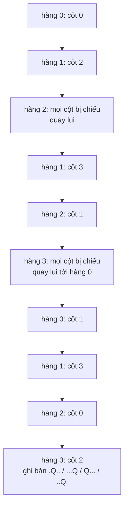
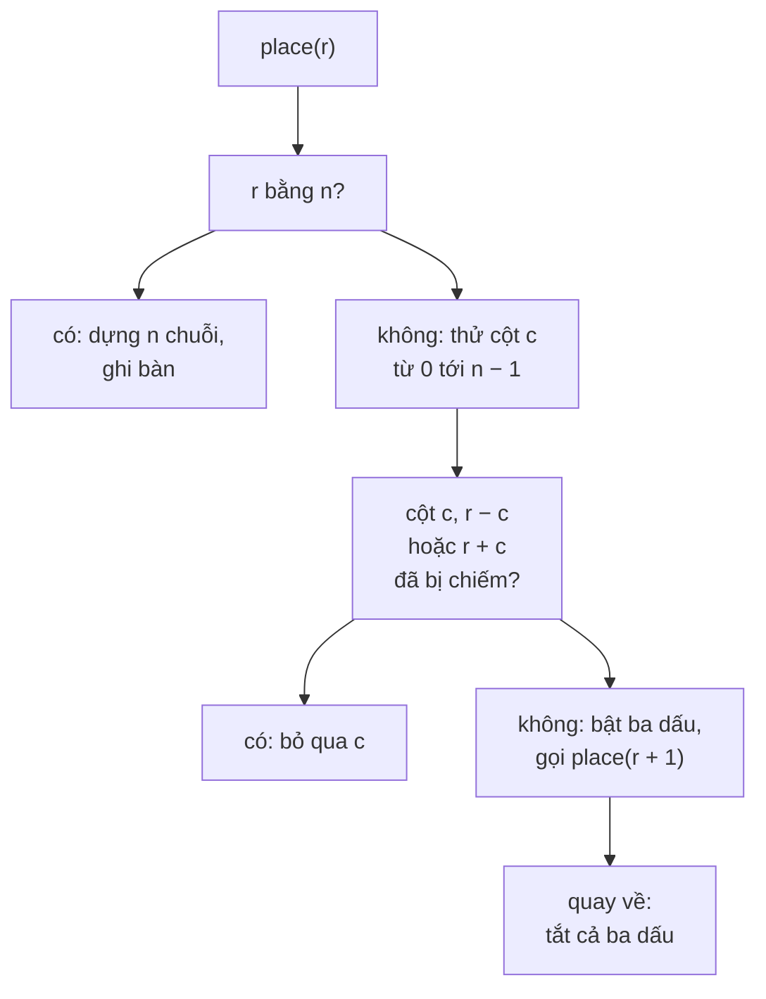

> [!tldr] Đọc nhanh
> - Mỗi hàng có đúng một quân hậu, nên mình đặt lần lượt từng hàng và chỉ còn phải chọn cột. Lời giải là một hoán vị cột thỏa thêm điều kiện về đường chéo.
> - Hai ô cùng chéo chính khi `r − c` bằng nhau, cùng chéo phụ khi `r + c` bằng nhau. Ba [[concepts/conflict-sets|tập xung đột]] (cột, `r − c`, `r + c`) trả lời "ô này có bị chiếu không" trong O(1).
> - Kiểm tra ngay khi đặt, không đợi đặt đủ n quân mới xét. Với n = 8, vét mọi hoán vị gọi đệ quy 109.601 lần, còn đặt từng hàng có cắt nhánh chỉ gọi 2.057 lần.
> - Khi quay lui phải gỡ cả ba dấu. Quên gỡ dấu chéo phụ thì n = 8 ra 0 bàn thay vì 92.

> [!info] Bối cảnh
> Đây là bài LeetCode 51 tại [[posts/2026-11-28-neetcode-permutations-search|ga MISC-02: Quay lui: hoán vị và tìm kiếm]] trên **tuyến NeetCode: Kỹ thuật tổng hợp**. Mình hình dung một giám thị xếp thí sinh vào phòng thi kê bàn thành lưới vuông, sao cho không ai liếc được bài ai. Bạn chỉ cần biết mảng, vòng lặp và hàm đệ quy.

> [!abstract]- Từ điển nhanh cho bài này (bấm để mở)
> - Quân hậu ăn được mọi quân cùng hàng, cùng cột hoặc cùng một đường chéo, bất kể xa gần.
> - Chéo chính đi từ góc trên trái xuống góc dưới phải; chéo phụ đi từ góc trên phải xuống góc dưới trái.
> - [[concepts/backtracking|Quay lui]] đặt một lựa chọn, đi sâu, rồi gỡ lựa chọn đó ra để thử cái khác.
> - [[concepts/choice-tree|Cây lựa chọn]] có gốc là bàn trống; mỗi tầng là một hàng, mỗi nhánh là một cột được đặt hậu.
> - Bitmask là một số nguyên dùng từng bit làm một ô cờ: bit thứ c bằng 1 nghĩa là cột c đã bị chiếm.

## Hình dung trước: xếp thí sinh vào phòng thi

Phòng thi có n dãy bàn, mỗi dãy n chỗ. Giám thị xếp đúng n thí sinh, mỗi dãy một người. Hai người ngồi cùng cột thì người sau nhìn thấy bài người trước; hai người cùng một đường chéo cũng vậy. Giám thị xếp từ dãy đầu, ghi lại cột và hai đường chéo nào đã có người, rồi sang dãy sau chỉ xét những chỗ còn sạch. Nếu một dãy không còn chỗ nào, giám thị mời người ở dãy trước đổi chỗ.

| Đời thường | Khái niệm |
|---|---|
| Phòng thi n × n | Bàn cờ n × n |
| Mỗi dãy bàn đúng một thí sinh | Mỗi hàng `r` đúng một quân hậu |
| Chỗ ngồi được chọn ở dãy r | Cột `cols[r]` |
| Sổ ghi cột và hai đường chéo đã có người | Ba [[concepts/conflict-sets\|tập xung đột]] |
| Dãy không còn chỗ sạch | Nhánh cụt, quay lui |
| Mời người dãy trước đổi chỗ | Gỡ dấu, thử cột kế tiếp |
| Xếp đủ n dãy | Một lời giải, dựng thành bàn chuỗi |

Với n = 4, lần thử đầu đặt hậu ở cột 0 rồi kẹt ở hàng 2. Lần thử thứ hai đặt ở cột 1 và đi trọn:



## Vấn đề: liệt kê mọi cách đặt n quân hậu

Cho số nguyên n từ 1 đến 9. Hãy liệt kê mọi cách đặt n quân hậu lên bàn n × n sao cho không có hai quân nào cùng hàng, cùng cột hoặc cùng đường chéo. Mỗi cách đặt trả về dưới dạng n chuỗi dài n, chữ `Q` là quân hậu, dấu `.` là ô trống; thứ tự các cách không quan trọng. Ví dụ với n = 5 có 10 cách, một trong số đó là `Q....`, `..Q..`, `....Q`, `.Q...`, `...Q.`. Với n = 2 và n = 3 không có cách nào. [Đề gốc LeetCode 51](https://leetcode.com/problems/n-queens/)

Mình từng nghĩ cứ thử đặt n quân vào mọi tổ hợp n ô trong n² ô rồi lọc. Với n = 8 đó là C(64, 8), hơn 4 tỉ bàn. Chỉ riêng luật "mỗi hàng một quân" đã cắt con số đó xuống 8⁸ = 16.777.216, và "mỗi cột một quân" xuống 8! = 40.320.

## Cơ chế

### Vét mọi hoán vị cột

Mỗi hàng một quân, mỗi cột một quân, nên một lời giải là một hoán vị: `cols[r]` là cột của quân ở hàng r. Mình sinh mọi hoán vị bằng quay lui với mảng `used`, rồi ở lá mới kiểm tra đường chéo: hai quân ở hàng a, b cùng chéo khi `|cols[a] − cols[b]| = b − a`.

Cây hoán vị có 1 + n + n(n−1) + … + n! nút; với n = 8 là 109.601 nút, trong đó 40.320 lá, mỗi lá tốn O(n²) để kiểm tra. Tổng thời gian O(n!·n²), bộ nhớ phụ O(n) cho đường đi. Cách này đúng và dùng làm trọng tài để đối chiếu, nhưng nó đi sâu xuống cả những nhánh đã hỏng từ hàng thứ hai.

### Đặt từng hàng với ba tập xung đột

Thay vì đợi tới lá, mình kiểm tra ngay khi đặt. Ô (r, c) bị chiếu khi đã có quân cùng cột c, cùng chéo chính hoặc cùng chéo phụ. Trên một chéo chính, đi xuống một hàng thì cũng sang phải một cột, nên `r − c` không đổi. Trên chéo phụ, đi xuống một hàng thì sang trái một cột, nên `r + c` không đổi.

| Đường | Giá trị không đổi | Khoảng giá trị | Chỉ số mảng |
|---|---|---|---|
| Cột | `c` | 0 … n − 1 | `c` |
| Chéo chính | `r − c` | −(n − 1) … n − 1 | `r − c + n − 1` |
| Chéo phụ | `r + c` | 0 … 2n − 2 | `r + c` |

Ba mảng boolean đóng vai [[concepts/conflict-sets|tập xung đột]]. `r − c` có thể âm, nên cộng thêm n − 1 để chỉ số rơi vào 0 … 2n − 2. Mỗi lần đặt quân, bật cả ba dấu; quay lui thì tắt cả ba.



Số nút của cây giảm mạnh: với n = 8 chỉ còn 2.057 lượt gọi. Cận trên vẫn là O(n!) vì hàng r có tối đa n − r cột trống, nhưng ba tập cắt bỏ phần lớn nhánh. Dựng chuỗi chỉ ở lá tốn O(n²) cho mỗi lời giải. Bộ nhớ phụ O(n) cho ba mảng và ngăn xếp đệ quy.

### Bitmask: ba tập là ba số nguyên

Khi chỉ cần đếm, mình gói ba tập vào ba số nguyên. `cols` có bit c bằng 1 khi cột c đã có quân. `left` và `right` đánh dấu các cột ở hàng hiện tại bị chiếu bởi một chéo. Khi xuống hàng sau, mỗi đường chéo dịch đi một cột, nên `left` dịch trái một bit, `right` dịch phải một bit.

- `free = full & ~(cols | left | right)` là các cột còn đặt được ở hàng này.
- `bit = free & −free` tách bit 1 thấp nhất, tức một cột trống.
- Gọi tiếp với `cols | bit`, `((left | bit) << 1) & full` và `(right | bit) >> 1`.

Bitmask đi qua đúng 2.057 nút như ba mảng, vì nó cắt cùng những nhánh đó. Cái lợi là mỗi nút chỉ tốn vài phép toán bit thay vì một vòng lặp n cột, và không cần bước gỡ dấu: trạng thái được truyền theo giá trị.

### Đo số nút

| Cách | Lượt gọi với n = 8 | Ghi chú |
|---|---|---|
| Vét mọi hoán vị | 109.601 | 40.320 lá, mỗi lá kiểm O(n²) |
| Ba tập xung đột | 2.057 | Trả về 92 bàn |
| Bitmask | 2.057 | Chỉ đếm, không dựng bàn |

Số lời giải với n = 1 … 9 lần lượt là 1, 0, 0, 2, 10, 4, 40, 92, 352, khớp dãy A000170 trên OEIS.

## Ví dụ chạy được

[TypeScript](../code/neetcode-n-queens/queens.ts) · [Python](../code/neetcode-n-queens/queens.py) · [Go](../code/neetcode-n-queens/queens.go) · [Java](../code/neetcode-n-queens/queens.java) · [JavaScript](../code/neetcode-n-queens/queens.js) · [PHP](../code/neetcode-n-queens/queens.php) · [Rust](../code/neetcode-n-queens/n_queens.rs)

```ts
function solveNQueens(n: number): string[][] {
    const result: string[][] = []
    const cols: number[] = []
    const colUsed = Array(n).fill(false)
    const diag = Array(2 * n - 1).fill(false)
    const anti = Array(2 * n - 1).fill(false)
    const place = (r: number) => {
        counter.calls++
        if (r === n) {
            result.push(toBoard(cols)) // chỉ dựng chuỗi ở lá
            return
        }
        for (let c = 0; c < n; c++) {
            const d = r - c + n - 1
            const a = r + c
            if (colUsed[c] || diag[d] || anti[a]) continue
            colUsed[c] = diag[d] = anti[a] = true
            cols.push(c)
            place(r + 1)
            cols.pop()
            colUsed[c] = diag[d] = anti[a] = false // gỡ cả ba dấu
        }
    }
    place(0)
    return result
}
```

```python
def solve_n_queens(n):
    result, cols = [], []
    col_used = [False] * n
    diag = [False] * (2 * n - 1)
    anti = [False] * (2 * n - 1)

    def place(r):
        counter["calls"] += 1
        if r == n:
            result.append(to_board(cols))  # chỉ dựng chuỗi ở lá
            return
        for c in range(n):
            d, a = r - c + n - 1, r + c
            if col_used[c] or diag[d] or anti[a]:
                continue
            col_used[c] = diag[d] = anti[a] = True
            cols.append(c)
            place(r + 1)
            cols.pop()
            col_used[c] = diag[d] = anti[a] = False  # gỡ cả ba dấu

    place(0)
    return result
```

```go
func solveNQueens(n int) [][]string {
	result := [][]string{}
	cols := []int{}
	colUsed := make([]bool, n)
	diag := make([]bool, 2*n-1)
	anti := make([]bool, 2*n-1)
	var place func(r int)
	place = func(r int) {
		calls++
		if r == n {
			result = append(result, toBoard(cols)) // chỉ dựng chuỗi ở lá
			return
		}
		for c := 0; c < n; c++ {
			d, a := r-c+n-1, r+c
			if colUsed[c] || diag[d] || anti[a] {
				continue
			}
			colUsed[c], diag[d], anti[a] = true, true, true
			cols = append(cols, c)
			place(r + 1)
			cols = cols[:len(cols)-1]
			colUsed[c], diag[d], anti[a] = false, false, false // gỡ cả ba dấu
		}
	}
	place(0)
	return result
}
```

```java
static List<List<String>> solveNQueens(int n) {
    List<List<String>> result = new ArrayList<>();
    place(0, n, new ArrayList<>(), new boolean[n], new boolean[2 * n - 1], new boolean[2 * n - 1], result);
    return result;
}

static void place(int r, int n, List<Integer> cols, boolean[] colUsed, boolean[] diag, boolean[] anti,
                  List<List<String>> result) {
    calls++;
    if (r == n) {
        result.add(toBoard(cols)); // chỉ dựng chuỗi ở lá
        return;
    }
    for (int c = 0; c < n; c++) {
        int d = r - c + n - 1, a = r + c;
        if (colUsed[c] || diag[d] || anti[a]) continue;
        colUsed[c] = diag[d] = anti[a] = true;
        cols.add(c);
        place(r + 1, n, cols, colUsed, diag, anti, result);
        cols.remove(cols.size() - 1);
        colUsed[c] = diag[d] = anti[a] = false; // gỡ cả ba dấu
    }
}
```

```js
function solveNQueens(n) {
    const result = []
    const cols = []
    const colUsed = Array(n).fill(false)
    const diag = Array(2 * n - 1).fill(false)
    const anti = Array(2 * n - 1).fill(false)
    const place = (r) => {
        counter.calls++
        if (r === n) {
            result.push(toBoard(cols)) // chỉ dựng chuỗi ở lá
            return
        }
        for (let c = 0; c < n; c++) {
            const d = r - c + n - 1
            const a = r + c
            if (colUsed[c] || diag[d] || anti[a]) continue
            colUsed[c] = diag[d] = anti[a] = true
            cols.push(c)
            place(r + 1)
            cols.pop()
            colUsed[c] = diag[d] = anti[a] = false // gỡ cả ba dấu
        }
    }
    place(0)
    return result
}
```

```php
function solveNQueens(int $n): array {
    $result = [];
    $cols = [];
    $colUsed = array_fill(0, $n, false);
    $diag = array_fill(0, 2 * $n - 1, false);
    $anti = array_fill(0, 2 * $n - 1, false);
    $place = function (int $r) use (&$place, &$result, &$cols, &$colUsed, &$diag, &$anti, $n) {
        global $calls;
        $calls++;
        if ($r === $n) {
            $result[] = toBoard($cols); // chỉ dựng chuỗi ở lá
            return;
        }
        for ($c = 0; $c < $n; $c++) {
            $d = $r - $c + $n - 1;
            $a = $r + $c;
            if ($colUsed[$c] || $diag[$d] || $anti[$a]) continue;
            $colUsed[$c] = $diag[$d] = $anti[$a] = true;
            $cols[] = $c;
            $place($r + 1);
            array_pop($cols);
            $colUsed[$c] = $diag[$d] = $anti[$a] = false; // gỡ cả ba dấu
        }
    };
    $place(0);
    return $result;
}
```

```rust
fn solve_n_queens(n: usize, calls: &mut u64) -> Vec<Vec<String>> {
    struct State {
        n: usize,
        cols: Vec<usize>,
        col_used: Vec<bool>,
        diag: Vec<bool>,
        anti: Vec<bool>,
        result: Vec<Vec<String>>,
    }
    fn place(r: usize, s: &mut State, calls: &mut u64) {
        *calls += 1;
        if r == s.n {
            s.result.push(to_board(&s.cols)); // chỉ dựng chuỗi ở lá
            return;
        }
        for c in 0..s.n {
            let (d, a) = (r + s.n - 1 - c, r + c); // cộng n - 1 trước khi trừ: usize không âm
            if s.col_used[c] || s.diag[d] || s.anti[a] {
                continue;
            }
            s.col_used[c] = true;
            s.diag[d] = true;
            s.anti[a] = true;
            s.cols.push(c);
            place(r + 1, s, calls);
            s.cols.pop();
            s.col_used[c] = false; // gỡ cả ba dấu
            s.diag[d] = false;
            s.anti[a] = false;
        }
    }
    let mut s = State {
        n,
        cols: Vec::new(),
        col_used: vec![false; n],
        diag: vec![false; 2 * n - 1],
        anti: vec![false; 2 * n - 1],
        result: Vec::new(),
    };
    place(0, &mut s, calls);
    s.result
}
```

Các tab trích hàm đặt từng hàng với ba tập xung đột. File tải về còn có bản vét mọi hoán vị, bản bitmask, một bản cố tình quên gỡ dấu chéo phụ và bộ kiểm tra độc lập đọc lại bàn từ chuỗi. 12 ca gồm số lời giải với n = 1 … 9 (kiểm cả ba tập lẫn bitmask), một bàn mẫu cho n = 5, mọi bàn của n = 6 hợp lệ và không trùng. Dòng thứ hai so tập bàn của cách ba tập với cách vét hoán vị cho n = 1 … 7.

```text
12/12 ca đúng
7/7 ca đúng (đối chiếu vét mọi hoán vị)
n = 8: vét hoán vị 109601 lượt gọi, ba tập 2057 lượt gọi, bitmask 2057 lượt gọi
Quên gỡ chéo phụ: n = 8 ra 0 bàn, đúng là 92
```

Cả bảy ngôn ngữ in đúng bốn dòng trên. Chạy bằng `node queens.ts`, `python3 queens.py`, `go run queens.go`, `java queens.java`, `node queens.js`, `php -d xdebug.mode=off queens.php` hoặc `rustc --edition 2021 -O n_queens.rs -o /tmp/n_queens && /tmp/n_queens`.

## Hiểu lầm và bẫy hay gặp

- Đặt đủ n quân rồi mới kiểm tra. Cách này đúng nhưng đi hết 109.601 nút với n = 8, gấp hơn 50 lần cách kiểm tra ngay khi đặt.
- Quên gỡ một trong ba dấu khi quay lui. Dấu chéo phụ còn sót chặn oan các nhánh sau, và n = 8 ra 0 bàn thay vì 92.
- Dùng thẳng `r − c` làm chỉ số mà không cộng n − 1. Mình đã thử với `r = 0, c = 2`:
  - Java ném `ArrayIndexOutOfBoundsException: Index -2 out of bounds for length 7`; Go dừng với `index out of range [-2]`.
  - Rust tính `r − c` trên `usize`: bản debug dừng với "attempt to subtract with overflow", bản `-O` báo chỉ số 18446744073709551614 vượt độ dài mảng. File Rust cộng `n − 1` trước khi trừ.
  - Python, JavaScript và PHP vẫn ra đúng 1, 0, 0, 2, 10, 4, 40, 92, 352, nhưng chỉ là may. Python đọc chỉ số âm từ cuối mảng, và với mảng dài 2n − 1 các ô âm tình cờ không đụng ô dương. JavaScript coi `diag[-2]` là một thuộc tính tên `"-2"`. PHP tạo khóa `-2` mới trong mảng, và lần đọc đầu tiên mỗi khóa âm in cảnh báo "Undefined array key" (36 cảnh báo cho n = 1 … 9).
- Dựng chuỗi bàn cờ ở mọi nút thay vì chỉ ở lá. Mỗi nút tốn thêm O(n²) cho những bàn rồi sẽ bị bỏ.
- PHP đã có hàm dựng sẵn `key()`; đặt tên hàm của mình là `key` sẽ gặp "Cannot redeclare key()". File PHP dùng tên `boardsKey`.
- Bitmask trong JavaScript chạy trên số nguyên 32 bit, đủ cho n ≤ 9. Rust dùng `free & free.wrapping_neg()` vì `u32` không có số âm; Go có toán tử `&^` (AND NOT) cho `full &^ (cols | left | right)`.

## Câu hỏi tự kiểm tra

> [!question]- Vì sao hai ô (r₁, c₁) và (r₂, c₂) cùng chéo chính khi và chỉ khi r₁ − c₁ = r₂ − c₂?
> Đi dọc chéo chính, mỗi bước xuống một hàng cũng sang phải một cột, nên r và c tăng cùng lượng và hiệu r − c giữ nguyên. Ngược lại, nếu hiệu bằng nhau thì r₂ − r₁ = c₂ − c₁, tức đi bao nhiêu hàng thì sang bấy nhiêu cột: hai ô nằm trên cùng một chéo chính.

> [!question]- Mảng cho chéo chính cần bao nhiêu ô, và vì sao cộng n − 1?
> r − c chạy từ −(n − 1) (hàng 0, cột n − 1) tới n − 1 (hàng n − 1, cột 0), tức 2n − 1 giá trị. Cộng n − 1 dời khoảng này về 0 … 2n − 2 để làm chỉ số mảng.

> [!question]- Bản bitmask không có bước gỡ dấu. Vì sao nó vẫn đúng?
> Ba số `cols`, `left`, `right` được truyền theo giá trị vào lời gọi con. Lời gọi con nhận bản đã thêm `bit`, còn biến của lời gọi cha không đổi, nên khi quay về cha vẫn thấy trạng thái cũ.

## Tham khảo

- [LeetCode 51](https://leetcode.com/problems/n-queens/)
- [Jeff Erickson, Algorithms, chương 2: Backtracking, mục n quân hậu](https://jeffe.cs.illinois.edu/teaching/algorithms/book/02-backtracking.pdf)
- [OEIS A000170, số lời giải bài n quân hậu](https://oeis.org/A000170)
- [Python: chỉ số âm của dãy](https://docs.python.org/3/library/stdtypes.html#common-sequence-operations) · [Go spec: index expressions](https://go.dev/ref/spec#Index_expressions) · [Java ArrayIndexOutOfBoundsException](https://docs.oracle.com/en/java/javase/21/docs/api/java.base/java/lang/ArrayIndexOutOfBoundsException.html) · [PHP key()](https://www.php.net/manual/en/function.key.php) · [Rust Book: integer overflow](https://doc.rust-lang.org/book/ch03-02-data-types.html#integer-overflow)
