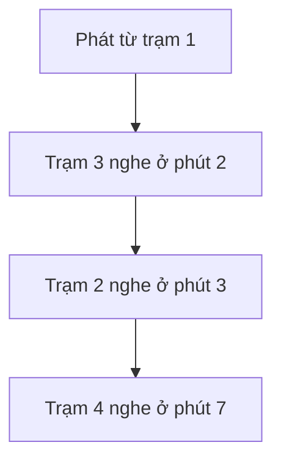

> [!tldr] Đọc nhanh
> - Tính thời gian nhận sớm nhất của từng trạm rồi lấy giá trị lớn nhất. Một trạm không tới được làm kết quả bằng −1.
> - Trọng số cạnh không âm cho phép [[concepts/dijkstra|Dijkstra]] chốt luôn trạm có thời gian nhỏ nhất khi bản ghi còn khớp với sổ.
> - Một bản ghi cũ có thể vẫn nằm trong heap sau khi cập nhật khoảng cách. Kiểm tra lại lúc lấy ra.

> [!info] Bối cảnh
> Bài LeetCode 743, thuộc [[posts/2026-11-27-neetcode-shortest-path|ga 5: Đường đi ngắn nhất]] trên tuyến NeetCode Đồ thị. Bạn chỉ cần biết vòng lặp và mảng để bắt đầu.

> [!abstract]- Từ điển nhanh cho bài này (bấm để mở)
> - [[concepts/adjacency-list|Danh sách kề]] lưu các cạnh đi ra từ mỗi đỉnh.
> - [[concepts/heap|Min-heap]] lấy bản ghi có chi phí nhỏ nhất đang chờ.
> - Relax một cạnh là thử thay khoảng cách hiện có của đích bằng một đường tốt hơn qua cạnh đó.

## Hình dung trước: bốn trạm báo mưa

Trạm 1 gửi cảnh báo đến trạm 2 qua kênh chậm mất 9 phút. Nó cũng gửi đến trạm 3 mất 2 phút, rồi trạm 3 chuyển tiếp sang trạm 2 mất 1 phút. Trạm 2 chuyển tiếp sang trạm 4 mất 4 phút. Trạm 2 nghe ở phút 3 và trạm cuối nghe ở phút 7.

| Đời thường | Khái niệm |
| --- | --- |
| Trạm báo mưa | Đỉnh |
| Kênh chuyển tiếp một chiều | Cạnh có trọng số |
| Trạm nghe đầu tiên trong hàng chờ | Lần lấy giá nhỏ nhất còn hiệu lực |



## Vấn đề: tín hiệu đến trạm cuối lúc nào

Trạm được đánh số từ 1 đến n. Mỗi cạnh có hướng `u → v` mất `w` đơn vị thời gian. Nguồn là `k`. Trả thời gian cả mạng đã nhận tín hiệu, hoặc −1 khi một trạm không nhận được. Đề có tối đa 100 trạm, 6.000 cạnh và trọng số từ 0 đến 100.

## Cơ chế

### Từ quét cạnh đến lấy chi phí nhỏ nhất

Quét đồng bộ các cạnh trong V−1 lượt là cách đối chiếu O(V(V + E)) thời gian và O(V) bộ nhớ phụ. Sau mỗi lượt, sổ ghi đường tốt nhất dùng thêm tối đa một cạnh. Một đường ngắn nhất có thể chọn không lặp đỉnh vì mọi cạnh đều không âm.

Dijkstra xét các đường hứa hẹn trước. Cho chi phí nguồn bằng 0 và các trạm khác bằng vô cực. Khi lấy bản ghi `(d, u)`, bỏ qua nếu `d` khác `best[u]`. Với bản ghi còn hiệu lực, thử `d + w` cho từng cạnh từ `u`. Nếu tốt hơn, cập nhật sổ và đẩy bản mới.

### Vì sao lấy ra là chốt được

Giả sử có đường ngắn hơn đến `u`. Cạnh đầu tiên của đường đó đi từ phần đã chốt sang đỉnh chưa chốt phải cho đỉnh mới một giá tạm không lớn hơn chi phí đường đến `u`. Cạnh không âm giữ bất đẳng thức này. Heap sẽ lấy giá nhỏ hơn trước, mâu thuẫn với việc đã lấy `u`.

Trên mạng ví dụ, `(9, 2)` vẫn ở trong heap khi `(3, 2)` được lấy. Lúc lấy bản 9, `best[2]` đã là 3 nên bỏ qua. `max(best)` là 7 vì các đường gửi có thể chạy đồng thời. Máy chỉ cần cộng thời gian dọc một đường.

Dùng heap đẩy bản ghi mới khi cải thiện nên chi phí là O(V + E log(E + 1)) thời gian và O(V + E) bộ nhớ. Trên chuỗi 100 trạm, Dijkstra xét 99 cạnh, còn cách quét lớp không dừng sớm xét `99 × 99 = 9.801` cạnh. File TypeScript đối chiếu hai cách trên 200 đồ thị nhỏ và chuỗi này.

## Ví dụ chạy được

[TypeScript](../code/neetcode-network-delay-time/signal-time.ts) · [Python](../code/neetcode-network-delay-time/signal_time.py) · [Go](../code/neetcode-network-delay-time/signal_time.go) · [Java](../code/neetcode-network-delay-time/signal-time.java) · [JavaScript](../code/neetcode-network-delay-time/signal-time.js) · [PHP](../code/neetcode-network-delay-time/signal-time.php) · [Rust](../code/neetcode-network-delay-time/signal_time.rs)

Tab hiển thị hàm chính. File tải về còn chạy các cách so sánh trên những ca nhỏ. File TypeScript chạy thêm phép đối chiếu ngẫu nhiên.

```ts
function networkDelay(edges: number[][], n: number, start: number): number {
  const graph = Array.from({ length: n }, (): Neighbor[] => [])
  for (const [from, to, time] of edges) graph[from - 1].push([to - 1, time])
  const lastArrival = Math.max(...leastCosts(graph, start - 1, 0, (cost, time) => cost + time))
  return lastArrival === Infinity ? -1 : lastArrival
}
```

```python
def network_delay(edges, n, start):
    graph = [[] for _ in range(n)]
    for source, target, time in edges:
        graph[source - 1].append((target - 1, time))
    last_arrival = max(least_costs(graph, start - 1, 0, lambda cost, time: cost + time))
    return -1 if last_arrival == float("inf") else last_arrival
```

```go
func networkDelay(edges [][3]int, n, start int) int {
	graph := make([][]neighbor, n)
	for _, edge := range edges {
		from, to, time := edge[0]-1, edge[1]-1, edge[2]
		graph[from] = append(graph[from], neighbor{to, time})
	}
	lastArrival := 0
	for _, time := range leastCosts(graph, start-1, 0, func(cost, time int) int { return cost + time }) {
		if time == infinity {
			return -1
		}
		lastArrival = max(lastArrival, time)
	}
	return lastArrival
}
```

```java
static int networkDelay(int[][] edges, int n, int start) {
    var graph = emptyGraph(n);
    for (int[] edge : edges) {
        graph.get(edge[0] - 1).add(new int[]{edge[1] - 1, edge[2]});
    }
    int lastArrival = Arrays.stream(leastCosts(graph, start - 1, 0, Integer::sum)).max().orElseThrow();
    return lastArrival == Integer.MAX_VALUE ? -1 : lastArrival;
}
```

```js
function networkDelay(edges, n, start) {
  const graph = Array.from({ length: n }, () => [])
  for (const [from, to, time] of edges) graph[from - 1].push([to - 1, time])
  const lastArrival = Math.max(...leastCosts(graph, start - 1, 0, (cost, time) => cost + time))
  return lastArrival === Infinity ? -1 : lastArrival
}
```

```php
function networkDelay(array $edges, int $n, int $start): int {
    $graph = array_fill(0, $n, []);
    foreach ($edges as [$from, $to, $time]) {
        $graph[$from - 1][] = [$to - 1, $time];
    }
    $lastArrival = max(leastCosts($graph, $start - 1, 0, fn($cost, $time) => $cost + $time));
    return $lastArrival === PHP_INT_MAX ? -1 : $lastArrival;
}
```

```rust
fn network_delay(edges: &[(usize, usize, i32)], n: usize, start: usize) -> i32 {
    let mut graph = vec![Vec::new(); n];
    for &(from, to, time) in edges {
        graph[from - 1].push((to - 1, time));
    }
    let last_arrival = least_costs(&graph, start - 1, 0, |cost, time| cost + time)
        .into_iter()
        .max()
        .unwrap();
    if last_arrival == i32::MAX {
        -1
    } else {
        last_arrival
    }
}
```

```text
5/5 ca đúng
201/201 ca đối chiếu; cạnh chuỗi: Dijkstra 99, quét lớp 9801
```

## Hiểu lầm và bẫy hay gặp

- **Đếm số cạnh như BFS.** Đường qua hai cạnh có thể nhanh hơn một cạnh.
- **Đánh dấu xong khi đưa vào heap.** Bản ghi 9 của trạm 2 còn có thể giảm xuống 3.
- **Đảo chiều cạnh khi dựng danh sách kề.** Tín hiệu có thể chỉ truyền từ `u` sang `v`.
- **Chọn nhầm min-heap.** `SplPriorityQueue` của PHP và `BinaryHeap` của Rust là max-heap mặc định. Mã dùng ưu tiên âm và `Reverse` tương ứng.

## Câu hỏi tự kiểm tra

> [!question]- Nếu trạm 3 chuyển sang trạm 2 mất 7 phút thì sao?
> Hai đường cùng đưa trạm 2 tới 9 và trạm 4 nghe lúc 13. Không cần thêm bản ghi cho giá bằng nhau.

> [!question]- Có lúc nào lấy giá bằng 0 cho trạm ngoài nguồn không?
> Có. Nhiều cạnh có thời gian 0 vẫn có thể nối đến trạm khác.

## Tham khảo

- [LeetCode 743 · Network Delay Time](https://leetcode.com/problems/network-delay-time/)
- [Dijkstra (1959)](https://doi.org/10.1007/BF01386390)
