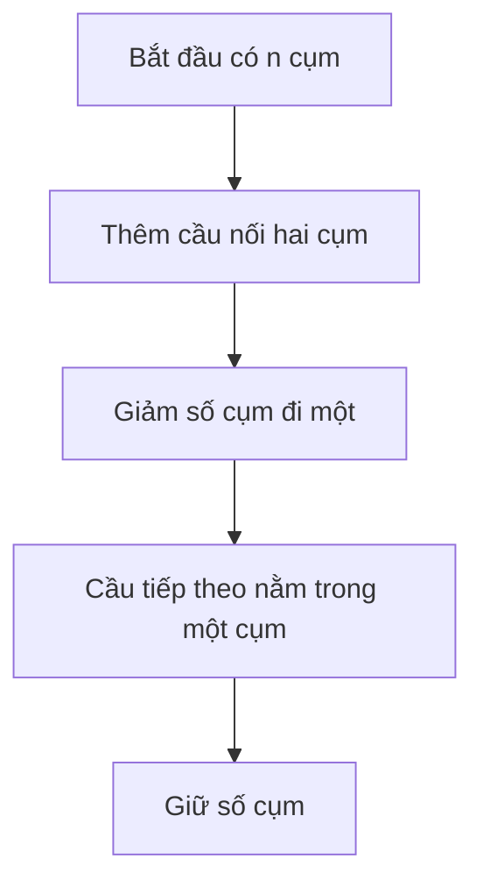

> [!tldr] Đọc nhanh
> - Mỗi lần DFS khởi hành từ một đỉnh chưa thấy cho đúng một [[concepts/connected-component|thành phần liên thông]].
> - [[concepts/disjoint-set-union|Union-Find]] bắt đầu với `n` nhóm và chỉ giảm đếm khi gộp hai nhóm khác nhau.
> - Cạnh nằm trong một nhóm và đỉnh cô lập là hai ca cần thử.

> [!info] Bối cảnh
> Bài LeetCode 323, thuộc [[posts/2026-11-27-neetcode-union-find|ga 4: Union-Find]] trên [[series/neetcode-grph|tuyến NeetCode: Đồ thị]]. Ví dụ dùng đồ thị nhỏ; bạn chỉ cần biết mảng và vòng lặp.

> [!abstract]- Từ điển nhanh cho bài này (bấm để mở)
> - Cạnh vô hướng nối hai đỉnh theo cả hai chiều.
> - [[concepts/connected-component|Thành phần liên thông]] là một nhóm tối đa các đỉnh đi tới được nhau.
> - [[concepts/disjoint-set-union|DSU]] duy trì các nhóm bằng phép tìm gốc và phép gộp. DFS là duyệt theo chiều sâu.

## Hình dung trước: các cụm đảo có cầu

Mình có bảy đảo và một sổ các cây cầu. Một cụm gồm mọi đảo đi tới được với nhau qua vài cây cầu. Một hòn đảo đứng riêng vẫn tạo thành một cụm.

| Đời thường | Khái niệm |
|---|---|
| Hòn đảo | Đỉnh |
| Cầu hai chiều | Cạnh vô hướng |
| Cụm đảo đi tới nhau | Thành phần liên thông |
| Cầu mới nối hai cụm | Một lần gộp thành công |



## Vấn đề: đếm nhóm sau khi đọc các cạnh

Đầu vào gồm `n` đỉnh đánh số từ 0 tới `n−1` và danh sách cạnh vô hướng. Phiên bản công khai trên NeetCode dùng `1 ≤ n ≤ 2000`, có tối đa 5.000 cạnh, mỗi cạnh nối hai đỉnh khác nhau và không có cạnh lặp. Các file cũng thử danh sách cạnh rỗng để kiểm tra cách tính đỉnh cô lập.

Với `n=7` và `[[0,2],[2,4],[0,4],[1,3]]`, bốn nhóm là `{0,2,4}`, `{1,3}`, `{5}` và `{6}`. Đáp án là 4.

## Cơ chế

### Cách 1. Khởi hành một lần cho mỗi cụm

Dựng danh sách kề theo cả hai hướng. Quét đủ `n` đỉnh, kể cả đỉnh không xuất hiện ở cạnh nào. Khi gặp một đỉnh chưa đánh dấu, tăng đếm rồi DFS để đánh dấu toàn bộ cụm của nó. Mỗi đỉnh được đẩy vào ngăn xếp đúng một lần vì mình đánh dấu ngay khi đẩy. Thời gian O(V + E), bộ nhớ phụ O(V + E) tính cả danh sách kề.

### Cách 2. Đếm lần gộp thành công

Ban đầu mỗi đỉnh đứng riêng, đếm `n`. Với mỗi cạnh, tìm gốc của hai đầu. Nếu khác gốc, hợp hai nhóm và giảm đếm đúng một lần. Nếu gốc giống nhau, cạnh nằm trong nhóm có sẵn. Theo bất biến này, số trong DSU luôn bằng số thành phần của các cạnh đã đọc.

Chi phí O(V + E α(V)) thời gian khấu hao và O(V) bộ nhớ phụ. Khi các cạnh đã nằm sẵn trong danh sách kề và chỉ cần một kết quả, DFS đơn giản và có cận tuyến tính. Khi nhận cạnh dần, DSU cho số nhóm sau mỗi lần gộp, dùng hai mảng dài `V` và không cần giữ danh sách kề.

## Ví dụ chạy được

[TypeScript](../code/neetcode-number-of-connected-components-in-an-undirected-graph/solve.ts) · [Python](../code/neetcode-number-of-connected-components-in-an-undirected-graph/solve.py) · [Go](../code/neetcode-number-of-connected-components-in-an-undirected-graph/solve.go) · [Java](../code/neetcode-number-of-connected-components-in-an-undirected-graph/solve.java) · [JavaScript](../code/neetcode-number-of-connected-components-in-an-undirected-graph/solve.js) · [PHP](../code/neetcode-number-of-connected-components-in-an-undirected-graph/solve.php) · [Rust](../code/neetcode-number-of-connected-components-in-an-undirected-graph/solve.rs)

Các tab hiện phần lời giải. File tải về có đủ các cách và bộ kiểm tra tự chạy.

```ts
import assert from "node:assert/strict";

type Edge = readonly [number, number];

class DisjointSet {
  private parent: number[];
  private size: number[];
  count: number;

  constructor(n: number) {
    this.parent = Array.from({ length: n }, (_, i) => i);
    this.size = new Array<number>(n).fill(1);
    this.count = n;
  }

  find(node: number): number {
    while (node !== this.parent[node]) {
      this.parent[node] = this.parent[this.parent[node]];
      node = this.parent[node];
    }
    return node;
  }

  union(a: number, b: number): boolean {
    let ra = this.find(a);
    let rb = this.find(b);
    if (ra === rb) return false;
    if (this.size[ra] < this.size[rb]) [ra, rb] = [rb, ra];
    this.parent[rb] = ra;
    this.size[ra] += this.size[rb];
    this.count--;
    return true;
  }
}

function componentsByDsu(n: number, edges: readonly Edge[]): number {
  const ds = new DisjointSet(n);
  for (const [a, b] of edges) ds.union(a, b);
  return ds.count;
}
```

```python
class DisjointSet:
    def __init__(self, n):
        self.parent = list(range(n))
        self.size = [1] * n
        self.count = n

    def find(self, node):
        while node != self.parent[node]:
            self.parent[node] = self.parent[self.parent[node]]
            node = self.parent[node]
        return node

    def union(self, a, b):
        ra, rb = self.find(a), self.find(b)
        if ra == rb:
            return False
        if self.size[ra] < self.size[rb]:
            ra, rb = rb, ra
        self.parent[rb] = ra
        self.size[ra] += self.size[rb]
        self.count -= 1
        return True


def components_by_dsu(n, edges):
    ds = DisjointSet(n)
    for a, b in edges:
        ds.union(a, b)
    return ds.count
```

```go
package main

import "fmt"

type edge [2]int

type disjointSet struct {
	parent, size []int
	count        int
}

func newDisjointSet(n int) *disjointSet {
	ds := &disjointSet{make([]int, n), make([]int, n), n}
	for i := range ds.parent {
		ds.parent[i], ds.size[i] = i, 1
	}
	return ds
}

func (ds *disjointSet) find(node int) int {
	for node != ds.parent[node] {
		ds.parent[node] = ds.parent[ds.parent[node]]
		node = ds.parent[node]
	}
	return node
}

func (ds *disjointSet) union(a, b int) bool {
	ra, rb := ds.find(a), ds.find(b)
	if ra == rb {
		return false
	}
	if ds.size[ra] < ds.size[rb] {
		ra, rb = rb, ra
	}
	ds.parent[rb] = ra
	ds.size[ra] += ds.size[rb]
	ds.count--
	return true
}

func componentsByDsu(n int, edges []edge) int {
	ds := newDisjointSet(n)
	for _, e := range edges {
		ds.union(e[0], e[1])
	}
	return ds.count
}
```

```java
class Solve {
    static final class DisjointSet {
        private final int[] parent;
        private final int[] size;
        int count;

        DisjointSet(int n) {
            parent = new int[n];
            size = new int[n];
            count = n;
            for (int i = 0; i < n; i++) {
                parent[i] = i;
                size[i] = 1;
            }
        }

        int find(int node) {
            while (node != parent[node]) {
                parent[node] = parent[parent[node]];
                node = parent[node];
            }
            return node;
        }

        boolean union(int a, int b) {
            int ra = find(a), rb = find(b);
            if (ra == rb) return false;
            if (size[ra] < size[rb]) {
                int swap = ra;
                ra = rb;
                rb = swap;
            }
            parent[rb] = ra;
            size[ra] += size[rb];
            count--;
            return true;
        }
    }

    static int componentsByDsu(int n, int[][] edges) {
        var ds = new DisjointSet(n);
        for (int[] e : edges) ds.union(e[0], e[1]);
        return ds.count;
    }
}
```

```javascript
import assert from "node:assert/strict";

class DisjointSet {
  parent;
  size;
  count;

  constructor(n) {
    this.parent = Array.from({ length: n }, (_, i) => i);
    this.size = new Array(n).fill(1);
    this.count = n;
  }

  find(node) {
    while (node !== this.parent[node]) {
      this.parent[node] = this.parent[this.parent[node]];
      node = this.parent[node];
    }
    return node;
  }

  union(a, b) {
    let ra = this.find(a);
    let rb = this.find(b);
    if (ra === rb) return false;
    if (this.size[ra] < this.size[rb]) [ra, rb] = [rb, ra];
    this.parent[rb] = ra;
    this.size[ra] += this.size[rb];
    this.count--;
    return true;
  }
}

function componentsByDsu(n, edges) {
  const ds = new DisjointSet(n);
  for (const [a, b] of edges) ds.union(a, b);
  return ds.count;
}
```

```php
<?php
declare(strict_types=1);

final class DisjointSet
{
    private array $parent;
    private array $size;
    public int $count;

    public function __construct(int $n)
    {
        $this->parent = range(0, $n - 1);
        $this->size = array_fill(0, $n, 1);
        $this->count = $n;
    }

    public function find(int $node): int
    {
        while ($node !== $this->parent[$node]) {
            $this->parent[$node] = $this->parent[$this->parent[$node]];
            $node = $this->parent[$node];
        }
        return $node;
    }

    public function union(int $a, int $b): bool
    {
        [$ra, $rb] = [$this->find($a), $this->find($b)];
        if ($ra === $rb) {
            return false;
        }
        if ($this->size[$ra] < $this->size[$rb]) {
            [$ra, $rb] = [$rb, $ra];
        }
        $this->parent[$rb] = $ra;
        $this->size[$ra] += $this->size[$rb];
        $this->count--;
        return true;
    }
}

function componentsByDsu(int $n, array $edges): int
{
    $ds = new DisjointSet($n);
    foreach ($edges as [$a, $b]) {
        $ds->union($a, $b);
    }
    return $ds->count;
}
```

```rust
type Edge = [usize; 2];

struct DisjointSet {
    parent: Vec<usize>,
    size: Vec<usize>,
    count: usize,
}

impl DisjointSet {
    fn new(n: usize) -> Self {
        Self {
            parent: (0..n).collect(),
            size: vec![1; n],
            count: n,
        }
    }

    fn find(&mut self, mut node: usize) -> usize {
        while node != self.parent[node] {
            self.parent[node] = self.parent[self.parent[node]];
            node = self.parent[node];
        }
        node
    }

    fn union(&mut self, a: usize, b: usize) -> bool {
        let mut ra = self.find(a);
        let mut rb = self.find(b);
        if ra == rb {
            return false;
        }
        if self.size[ra] < self.size[rb] {
            std::mem::swap(&mut ra, &mut rb);
        }
        self.parent[rb] = ra;
        self.size[ra] += self.size[rb];
        self.count -= 1;
        true
    }
}

fn components_by_dsu(n: usize, edges: &[Edge]) -> usize {
    let mut ds = DisjointSet::new(n);
    for &[a, b] in edges {
        ds.union(a, b);
    }
    ds.count
}
```

Kết quả chạy của mỗi file:

```text
10/10 ca đúng
```

## Hiểu lầm và bẫy hay gặp

- Duyệt đủ `n` đỉnh. Dựng tập đỉnh chỉ từ các cạnh làm biến mất đảo cô lập.
- Cạnh `[0,4]` khép vòng sau `[0,2]` và `[2,4]`. Giảm đếm cả ba lần sẽ cho kết quả thiếu một nhóm.
- Nếu quét mảng `parent` để đếm, đếm ô tự trỏ hoặc các gốc sau `find`. Các con trỏ cha trung gian có thể khác nhau trong cùng một nhóm.
- PHP cần truyền `$seen` theo tham chiếu trong hàm duyệt, để đỉnh đánh dấu ở lần duyệt trước vẫn còn dấu khi vòng ngoài tiếp tục.

## Câu hỏi tự kiểm tra

> [!question]- Bảy đảo chưa có cầu cho kết quả nào?
> Có bảy nhóm, mỗi nhóm đúng một đảo.

> [!question]- Thêm cầu 3–5 vào ví dụ cho kết quả nào?
> Cầu này nối `{1,3}` với `{5}`. Số nhóm giảm từ 4 còn 3.

## Tham khảo

- [LeetCode](https://leetcode.com/problems/number-of-connected-components-in-an-undirected-graph/)
- [NeetCode](https://neetcode.io/problems/count-connected-components/question)
- [Sedgewick and Wayne, Weighted Quick Union](https://github.com/kevin-wayne/algs4/blob/master/src/main/java/edu/princeton/cs/algs4/WeightedQuickUnionUF.java)
- [Robert Tarjan, Efficiency of a Good But Not Linear Set Union Algorithm](https://doi.org/10.1145/321879.321884)
