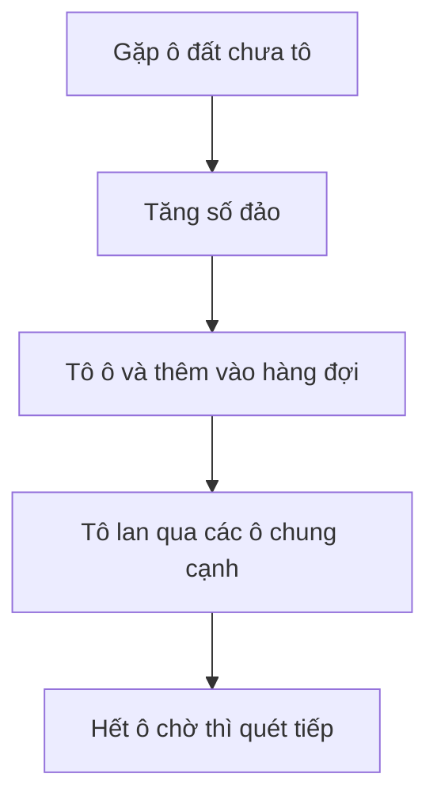

> [!tldr] Đọc nhanh
> - Mỗi đảo là một [[concepts/connected-component|thành phần liên thông]] của các ô đất kề cạnh.
> - Quét lưới theo hàng. Khi gặp đất chưa đánh dấu, tăng bộ đếm đúng một lần rồi [[concepts/flood-fill|duyệt lan]] hết đảo đó.
> - [[concepts/mark-on-enqueue|Đánh dấu lúc đưa vào danh sách chờ]] giúp mỗi ô đất xuất hiện đúng một lần trong hàng đợi hoặc ngăn xếp.
> - Hai cách chạy trong `O(mn)`. BFS giữ nguyên lưới bằng một mảng dấu. DFS lặp dùng chính lưới để đánh dấu.

> [!info] Bối cảnh
> Bài LeetCode 200, thuộc [[posts/2026-11-26-neetcode-grid-traversal|ga 1: Duyệt lưới]] trên **tuyến NeetCode: Đồ thị**. Mình cần đếm các mảnh đất trên một bản đồ gồm các ô vuông. Bạn chỉ cần biết vòng lặp, hàng đợi và ngăn xếp. [[problems/max-area-of-island|LC-0695]] dùng cùng lượt duyệt để đo đảo lớn nhất.

> [!abstract]- Từ điển nhanh cho bài này (bấm để mở)
> - [[concepts/grid-graph|Đồ thị lưới]]: ô đất là đỉnh và hai ô đất chung cạnh có một cạnh nối.
> - **Ô gốc**: ô đất chưa đánh dấu làm điểm bắt đầu của một lượt duyệt đảo.
> - [[concepts/breadth-first-search|BFS]] xử lý ô vào trước. DFS với ngăn xếp xử lý ô vào sau.
> - **Duyệt tại chỗ**: dùng một giá trị sẵn có trong lưới để cất dấu đã thăm.

## Hình dung trước: tô màu từng khu phố

Mình rà một bản đồ theo từng hàng. Mỗi lần gặp một ngôi nhà chưa tô, mình mở một lọ màu mới rồi chuyển màu qua các cửa giữa hai nhà chung tường. Một người cạnh đường chéo cần đi theo cửa vòng qua các nhà khác. Khi đã tô đến hết lối đi, mình mới tiếp tục rà bản đồ.

| Đời thường | Khái niệm |
|---|---|
| Ô nhà chung tường | Hai đỉnh kề theo một trong bốn hướng |
| Mở lọ màu mới | Tăng số thành phần thêm một |
| Tô nhà ngay khi đưa vào danh sách | Đánh dấu cùng lúc đưa vào hàng đợi hoặc ngăn xếp |
| Dùng hết danh sách | Đã duyệt hết đảo hiện tại |



## Vấn đề: lần quét nào được tính là một đảo?

Mỗi ô nhận giá trị ký tự `'1'` hoặc `'0'`, lần lượt biểu diễn đất và nước. Lưới có `m × n` ô và mỗi chiều nằm trong khoảng 1 đến 300. Đếm các nhóm đất nối được bằng những bước ngang hoặc dọc. Có thể coi ngoài biên là nước. [Đề LC-0200](https://leetcode.com/problems/number-of-islands/)

```text
1 0 0 1 1
0 0 0 1 1
0 1 0 1 0
1 1 0 0 0
```

Dùng tọa độ từ 0, lần quét mở lượt duyệt ở `(0,0)`, `(0,3)` và `(2,1)`. Ba đảo có 1, 5 và 3 ô. Ô `(0,4)` thuộc cùng đảo với `(0,3)`, nên tới lượt quét ô đó mình bỏ qua. Kết quả là **3**. Hai ô chỉ chạm góc vẫn thuộc hai đảo riêng nếu giữa chúng thiếu một đường nối theo cạnh.

## Cơ chế

<figure class="figure-map" style="--ar: 3 / 4">
<div class="frame"><iframe data-archify="../diagrams/neetcode-number-of-islands/worked-example.html" title="Đếm đảo bằng số lần mở lượt tô" loading="lazy"></iframe></div>
<figcaption><span><b>Hình 1.</b> Đếm đảo bằng số lần mở lượt tô.</span><a href="../diagrams/neetcode-number-of-islands/worked-example.html" target="_blank" rel="noopener">Mở toàn màn hình</a></figcaption>
</figure>

<details>
<summary>Đọc từng bước</summary>
<ol>
<li>Quét theo hàng, gặp mầm đầu tiên. <code>(0,0) → 1</code></li>
<li>Tô đảo thứ hai từ (0,3). <code>2; area = 5</code></li>
<li>Gặp đất đã đánh dấu thì bỏ qua. <code>(1,3), (1,4)</code></li>
<li>Mở lượt thứ ba tại (2,1). <code>3; area = 3</code></li>
<li>Hết lưới, đã mở đúng ba lượt. <code>count = 3</code></li>
</ol>
</details>

### Quét ngoài, duyệt lan bên trong

Một lượt duyệt bắt đầu từ một ô gốc và chỉ đi tới đất chung cạnh. Do đó mọi ô được duyệt đều thuộc đảo của ô gốc. Nếu còn một ô cùng đảo chưa được duyệt, trên đường từ ô gốc đến ô đó sẽ có một cặp gồm ô đã xử lý và ô chưa được thêm. Bước kiểm hàng xóm ở ô đã xử lý sẽ thêm ô kế tiếp. Vì vậy khi danh sách chờ rỗng, cả đảo đã được đánh dấu.

Lần quét đầu tiên chạm một đảo sẽ gặp đất chưa đánh dấu. Lượt duyệt vừa chứng minh đảm bảo mọi lần quét sau trong đảo đều gặp dấu. Bộ đếm tăng đúng một lần cho mỗi đảo.

### Cách 1 — BFS với mảng dấu

Mảng `seen` có một phần tử cho mỗi ô. Đổi `(r,c)` thành chỉ số `r*n+c` để cất trong mảng và hàng đợi. Với thứ tự kiểm trên, dưới, trái, phải, lượt bắt đầu tại `(0,3)` làm việc như sau.

| Ô lấy ra | Ô đất mới được thêm | Hàng đợi còn chờ |
|---|---|---|
| `(0,3)` | `(1,3)`, `(0,4)` | `(1,3)`, `(0,4)` |
| `(1,3)` | `(2,3)`, `(1,4)` | `(0,4)`, `(2,3)`, `(1,4)` |
| `(0,4)` | `(1,4)` đã có dấu | `(2,3)`, `(1,4)` |
| `(2,3)`, rồi `(1,4)` | Không có | Rỗng |

Đánh dấu `(1,4)` ngay lúc thêm đảm bảo nó có một mục trong hàng đợi dù hai hàng xóm đều tìm thấy nó. Python dùng `deque.popleft()`, Java dùng `ArrayDeque.removeFirst()`. TypeScript, JavaScript và Go giữ một chỉ số đầu để tránh dời mọi phần tử sau lần lấy đầu. Mảng hoặc slice của ba bản này giữ cả phần đã xử lý đến khi xong một đảo.

### Cách 2 — DFS lặp, đánh dấu trong lưới

Dùng ngăn xếp để đổi thứ tự xử lý. Ngay khi đưa một ô vào ngăn xếp, đổi ô đó thành `0`. Lần kiểm hàng xóm tiếp theo sẽ bỏ qua nó. Sau khi duyệt một đảo, toàn bộ đảo đã biến thành nước và phép quét ngoài tiếp tục. Dùng cách này khi được phép sửa lưới. Muốn giữ đầu vào, chọn BFS với mảng dấu hoặc sao chép từng hàng trước khi gọi DFS.

DFS đệ quy có cùng ý tưởng. Một dải đất dài hoặc đường đi ngoằn ngoèo có thể buộc độ sâu lời gọi tăng theo số ô. Hai bản chạy ở đây dùng vòng lặp và danh sách chờ tường minh. [Giới hạn đệ quy của Python](https://docs.python.org/3/library/sys.html#sys.getrecursionlimit)

### Đo số lượt thêm và bộ nhớ

Mình chạy hai lịch đánh dấu trên lưới `50 × 50` toàn đất, bắt đầu ở góc trên trái. Bản đánh dấu khi lấy ra vẫn bỏ qua mục trùng sau khi lấy, và chỉ thêm các hàng xóm chưa đánh dấu tại thời điểm kiểm. Hai bản đều thăm 2.500 ô khác nhau.

| Lịch đánh dấu BFS | Tổng lượt thêm, kể cả ô gốc | Số mục đang chờ lớn nhất |
|---|---:|---:|
| Khi thêm | 2.500 | 50 |
| Khi lấy ra | 4.901 | 99 |

Đây là số lượng thao tác và mục đang chờ trên lưới này. Chúng giúp giải thích vì sao đánh dấu sớm giảm công việc. Cột mục đang chờ không tính các phần tử đã xử lý mà bản dùng chỉ số đầu vẫn giữ trong mảng.

Quét ngoài mất `O(mn)`. Mỗi ô đất vào danh sách đúng một lần trong hai lời giải, và mỗi lượt lấy kiểm bốn hướng. Thời gian tổng là `O(mn)`. BFS giữ `O(mn)` dấu và hàng đợi có cận trên `O(L)`, với `L` là số ô của đảo lớn nhất. DFS tại chỗ chỉ cần ngăn xếp, tối đa `O(L)`. Trong trường hợp xấu nhất cả hai dùng `O(mn)` bộ nhớ phụ. Lưới toàn nước vẫn phải được đọc hết vì bất kỳ ô chưa đọc nào cũng có thể là một đảo.

## Ví dụ chạy được

Các file đọc hàng chữ số thành lưới số nguyên 0/1 rồi chạy hai cách. Khi nộp LC-0200, có thể giữ đầu vào ký tự và so với `'1'`, đổi dấu thành `'0'`. Bản chạy có sáu ca, gồm lưới trên, đường chéo, toàn nước, một hàng đất, hình vuông có chu trình và lưới toàn đất ở giới hạn `300 × 300`. Mỗi ca còn kiểm BFS giữ nguyên từng ô và DFS xóa hết đất.

[TypeScript](../code/neetcode-number-of-islands/count-islands.ts) · [Python](../code/neetcode-number-of-islands/count_islands.py) · [Go](../code/neetcode-number-of-islands/count_islands.go) · [Java](../code/neetcode-number-of-islands/count-islands.java) · [JavaScript](../code/neetcode-number-of-islands/count-islands.js)

```ts
const directions = [[-1, 0], [1, 0], [0, -1], [0, 1]]

function floodBfs(grid: number[][]): number {
  const rows = grid.length, cols = grid[0].length
  const seen = new Uint8Array(rows * cols)
  let result = 0

  for (let start = 0; start < seen.length; start++) {
    if (grid[Math.floor(start / cols)][start % cols] !== 1 || seen[start]) continue

    result++
    const queue = [start]
    seen[start] = 1
    for (let head = 0; head < queue.length; head++) {
      const cell = queue[head]
      const row = Math.floor(cell / cols), col = cell % cols
      for (const [dr, dc] of directions) {
        const r = row + dr, c = col + dc
        if (r < 0 || r >= rows || c < 0 || c >= cols || grid[r][c] !== 1) continue
        const next = r * cols + c
        if (seen[next]) continue
        seen[next] = 1
        queue.push(next)
      }
    }
  }
  return result
}

function floodDfsInPlace(grid: number[][]): number {
  const rows = grid.length, cols = grid[0].length
  let result = 0

  for (let start = 0; start < rows * cols; start++) {
    const row = Math.floor(start / cols), col = start % cols
    if (grid[row][col] !== 1) continue

    result++
    const stack = [start]
    grid[row][col] = 0
    while (stack.length > 0) {
      const cell = stack.pop()!
      const cr = Math.floor(cell / cols), cc = cell % cols
      for (const [dr, dc] of directions) {
        const r = cr + dr, c = cc + dc
        if (r < 0 || r >= rows || c < 0 || c >= cols || grid[r][c] !== 1) continue
        grid[r][c] = 0
        stack.push(r * cols + c)
      }
    }
  }
  return result
}

const cases = [
  {grid: ["10011", "00011", "01010", "11000"], want: 3},
  {grid: ["100", "010", "001"], want: 3},
  {grid: ["000", "000"], want: 0},
  {grid: ["11111"], want: 1},
  {grid: ["11", "11"], want: 1},
  {grid: Array.from({length: 300}, () => "1".repeat(300)), want: 1},
]
for (const {grid, want} of cases) {
  const cells = grid.map(row => Array.from(row, Number))
  if (floodBfs(cells) !== want || cells.some((row, i) => row.join("") !== grid[i])) {
    throw new Error("BFS sai")
  }
  if (floodDfsInPlace(cells) !== want || cells.some(row => row.some(value => value !== 0))) {
    throw new Error("DFS sai")
  }
}
console.log(`${cases.length}/${cases.length} ca đúng`)
```
```python
from collections import deque

DIRECTIONS = ((-1, 0), (1, 0), (0, -1), (0, 1))


def flood_bfs(grid):
    rows, cols = len(grid), len(grid[0])
    seen = bytearray(rows * cols)
    result = 0
    for start in range(len(seen)):
        row, col = divmod(start, cols)
        if grid[row][col] != 1 or seen[start]:
            continue
        result += 1
        queue = deque([start])
        seen[start] = 1
        while queue:
            row, col = divmod(queue.popleft(), cols)
            for dr, dc in DIRECTIONS:
                r, c = row + dr, col + dc
                if not (0 <= r < rows and 0 <= c < cols) or grid[r][c] != 1:
                    continue
                index = r * cols + c
                if seen[index]:
                    continue
                seen[index] = 1
                queue.append(index)
    return result


def flood_dfs_in_place(grid):
    rows, cols = len(grid), len(grid[0])
    result = 0
    for start in range(rows * cols):
        row, col = divmod(start, cols)
        if grid[row][col] != 1:
            continue
        result += 1
        stack = [start]
        grid[row][col] = 0
        while stack:
            row, col = divmod(stack.pop(), cols)
            for dr, dc in DIRECTIONS:
                r, c = row + dr, col + dc
                if not (0 <= r < rows and 0 <= c < cols) or grid[r][c] != 1:
                    continue
                grid[r][c] = 0
                stack.append(r * cols + c)
    return result


cases = [
    (["10011", "00011", "01010", "11000"], 3),
    (["100", "010", "001"], 3),
    (["000", "000"], 0),
    (["11111"], 1),
    (["11", "11"], 1),
    (["1" * 300] * 300, 1),
]
for grid, want in cases:
    cells = [list(map(int, row)) for row in grid]
    assert flood_bfs(cells) == want and ["".join(map(str, row)) for row in cells] == grid
    assert flood_dfs_in_place(cells) == want and not any(map(any, cells))
print(f"{len(cases)}/{len(cases)} ca đúng")
```
```go
package main

import (
	"fmt"
	"strings"
)

var directions = [][2]int{{-1, 0}, {1, 0}, {0, -1}, {0, 1}}

func floodBFS(grid [][]int) int {
	rows, cols := len(grid), len(grid[0])
	seen := make([]bool, rows*cols)
	result := 0
	for start := range seen {
		row, col := start/cols, start%cols
		if grid[row][col] != 1 || seen[start] {
			continue
		}

		result++
		queue := []int{start}
		seen[start] = true
		for head := 0; head < len(queue); head++ {
			cell := queue[head]
			row, col := cell/cols, cell%cols
			for _, d := range directions {
				r, c := row+d[0], col+d[1]
				if r < 0 || r >= rows || c < 0 || c >= cols || grid[r][c] != 1 {
					continue
				}
				next := r*cols + c
				if seen[next] {
					continue
				}
				seen[next] = true
				queue = append(queue, next)
			}
		}
	}
	return result
}

func floodDFSInPlace(grid [][]int) int {
	rows, cols := len(grid), len(grid[0])
	result := 0
	for start := 0; start < rows*cols; start++ {
		row, col := start/cols, start%cols
		if grid[row][col] != 1 {
			continue
		}

		result++
		stack := []int{start}
		grid[row][col] = 0
		for len(stack) > 0 {
			top := len(stack) - 1
			cell := stack[top]
			stack = stack[:top]
			row, col := cell/cols, cell%cols
			for _, d := range directions {
				r, c := row+d[0], col+d[1]
				if r < 0 || r >= rows || c < 0 || c >= cols || grid[r][c] != 1 {
					continue
				}
				grid[r][c] = 0
				stack = append(stack, r*cols+c)
			}
		}
	}
	return result
}

func main() {
	full := make([]string, 300)
	for i := range full {
		full[i] = strings.Repeat("1", 300)
	}
	cases := []struct {
		grid []string
		want int
	}{
		{[]string{"10011", "00011", "01010", "11000"}, 3},
		{[]string{"100", "010", "001"}, 3},
		{[]string{"000", "000"}, 0},
		{[]string{"11111"}, 1},
		{[]string{"11", "11"}, 1},
		{full, 1},
	}
	for _, example := range cases {
		cells := make([][]int, len(example.grid))
		for r, row := range example.grid {
			cells[r] = make([]int, len(row))
			for c := range row {
				cells[r][c] = int(row[c] - '0')
			}
		}
		if floodBFS(cells) != example.want {
			panic("BFS sai")
		}
		for r, row := range cells {
			for c, value := range row {
				if value != int(example.grid[r][c]-'0') {
					panic("BFS sai")
				}
			}
		}
		if floodDFSInPlace(cells) != example.want {
			panic("DFS sai")
		}
		for _, row := range cells {
			for _, value := range row {
				if value != 0 {
					panic("DFS sai")
				}
			}
		}
	}
	fmt.Printf("%d/%d ca đúng\n", len(cases), len(cases))
}
```
```java
import java.util.ArrayDeque;
import java.util.Arrays;

class CountIslands {
    static final int[][] DIRECTIONS = {{-1, 0}, {1, 0}, {0, -1}, {0, 1}};

    static int floodBfs(int[][] grid) {
        int rows = grid.length, cols = grid[0].length;
        boolean[] seen = new boolean[rows * cols];
        int result = 0;
        for (int start = 0; start < seen.length; start++) {
            int row = start / cols, col = start % cols;
            if (grid[row][col] != 1 || seen[start]) continue;

            result++;
            var queue = new ArrayDeque<Integer>();
            seen[start] = true;
            queue.addLast(start);
            while (!queue.isEmpty()) {
                int cell = queue.removeFirst();
                for (int[] d : DIRECTIONS) {
                    int r = cell / cols + d[0], c = cell % cols + d[1];
                    if (r < 0 || r >= rows || c < 0 || c >= cols || grid[r][c] != 1) continue;
                    int next = r * cols + c;
                    if (seen[next]) continue;
                    seen[next] = true;
                    queue.addLast(next);
                }
            }
        }
        return result;
    }

    static int floodDfsInPlace(int[][] grid) {
        int rows = grid.length, cols = grid[0].length;
        int result = 0;
        for (int start = 0; start < rows * cols; start++) {
            int row = start / cols, col = start % cols;
            if (grid[row][col] != 1) continue;

            result++;
            var stack = new ArrayDeque<Integer>();
            grid[row][col] = 0;
            stack.addLast(start);
            while (!stack.isEmpty()) {
                int cell = stack.removeLast();
                for (int[] d : DIRECTIONS) {
                    int r = cell / cols + d[0], c = cell % cols + d[1];
                    if (r < 0 || r >= rows || c < 0 || c >= cols || grid[r][c] != 1) continue;
                    grid[r][c] = 0;
                    stack.addLast(r * cols + c);
                }
            }
        }
        return result;
    }

    record Case(String[] grid, int want) {}

    public static void main(String[] args) {
        String[] full = new String[300];
        Arrays.fill(full, "1".repeat(300));
        Case[] cases = {
            new Case(new String[]{"10011", "00011", "01010", "11000"}, 3),
            new Case(new String[]{"100", "010", "001"}, 3),
            new Case(new String[]{"000", "000"}, 0),
            new Case(new String[]{"11111"}, 1),
            new Case(new String[]{"11", "11"}, 1),
            new Case(full, 1),
        };
        for (Case example : cases) {
            int[][] cells = Arrays.stream(example.grid)
                .map(row -> row.chars().map(ch -> ch - '0').toArray()).toArray(int[][]::new);
            if (floodBfs(cells) != example.want) throw new AssertionError("BFS sai");
            for (int r = 0; r < cells.length; r++) {
                for (int c = 0; c < cells[r].length; c++) {
                    if (cells[r][c] != example.grid[r].charAt(c) - '0') throw new AssertionError("BFS sai");
                }
            }
            if (floodDfsInPlace(cells) != example.want) throw new AssertionError("DFS sai");
            for (int[] row : cells) {
                for (int cell : row) {
                    if (cell != 0) throw new AssertionError("DFS sai");
                }
            }
        }
        System.out.printf("%d/%d ca đúng%n", cases.length, cases.length);
    }
}
```
```js
const directions = [[-1, 0], [1, 0], [0, -1], [0, 1]]

function floodBfs(grid) {
  const rows = grid.length, cols = grid[0].length
  const seen = new Uint8Array(rows * cols)
  let result = 0

  for (let start = 0; start < seen.length; start++) {
    if (grid[Math.floor(start / cols)][start % cols] !== 1 || seen[start]) continue

    result++
    const queue = [start]
    seen[start] = 1
    for (let head = 0; head < queue.length; head++) {
      const cell = queue[head]
      const row = Math.floor(cell / cols), col = cell % cols
      for (const [dr, dc] of directions) {
        const r = row + dr, c = col + dc
        if (r < 0 || r >= rows || c < 0 || c >= cols || grid[r][c] !== 1) continue
        const next = r * cols + c
        if (seen[next]) continue
        seen[next] = 1
        queue.push(next)
      }
    }
  }
  return result
}

function floodDfsInPlace(grid) {
  const rows = grid.length, cols = grid[0].length
  let result = 0

  for (let start = 0; start < rows * cols; start++) {
    const row = Math.floor(start / cols), col = start % cols
    if (grid[row][col] !== 1) continue

    result++
    const stack = [start]
    grid[row][col] = 0
    while (stack.length > 0) {
      const cell = stack.pop()
      const cr = Math.floor(cell / cols), cc = cell % cols
      for (const [dr, dc] of directions) {
        const r = cr + dr, c = cc + dc
        if (r < 0 || r >= rows || c < 0 || c >= cols || grid[r][c] !== 1) continue
        grid[r][c] = 0
        stack.push(r * cols + c)
      }
    }
  }
  return result
}

const cases = [
  {grid: ["10011", "00011", "01010", "11000"], want: 3},
  {grid: ["100", "010", "001"], want: 3},
  {grid: ["000", "000"], want: 0},
  {grid: ["11111"], want: 1},
  {grid: ["11", "11"], want: 1},
  {grid: Array.from({length: 300}, () => "1".repeat(300)), want: 1},
]
for (const {grid, want} of cases) {
  const cells = grid.map(row => Array.from(row, Number))
  if (floodBfs(cells) !== want || cells.some((row, i) => row.join("") !== grid[i])) {
    throw new Error("BFS sai")
  }
  if (floodDfsInPlace(cells) !== want || cells.some(row => row.some(value => value !== 0))) {
    throw new Error("DFS sai")
  }
}
console.log(`${cases.length}/${cases.length} ca đúng`)
```

```text
6/6 ca đúng
```

## Hiểu lầm và bẫy hay gặp

- **Tăng số đảo khi lấy từng ô ra.** Bộ đếm ở vòng quét ngoài, ngay khi bắt đầu một lượt duyệt thành phần. Tăng trong lượt duyệt sẽ đếm ô đất.
- **Thêm ô trước, đợi lấy ra mới đánh dấu.** Trên ô vuông 2 × 2, hai hàng xóm đều có thể đưa góc đối diện vào hàng đợi. Đánh dấu ngay khi thêm để chặn lần thứ hai.
- **Dùng `shift()` hoặc `pop(0)` với mảng động.** Dời các phần tử còn lại gây thêm công việc. Dùng chỉ số đầu hoặc deque.
- **Gọi hai hàm trên cùng lưới sau DFS tại chỗ.** Truyền bản sao theo từng hàng nếu cần tái sử dụng. Chỉ chép mảng ngoài vẫn chia sẻ các hàng.
- **Trộn ký tự và số.** JavaScript phân biệt `'1'` với `1` khi so nghiêm ngặt. Các ví dụ nhất quán dùng số sau bước đọc dữ liệu.

## Câu hỏi tự kiểm tra

> [!question]- Hai ô đất chỉ chung một góc, xung quanh đều là nước. Có mấy đảo?
> Hai đảo. Chỉ các bước qua cạnh ngang hoặc dọc tạo đường nối.

> [!question]- Vì sao có thể tăng bộ đếm ngay lúc bắt đầu duyệt một ô gốc?
> Ô này chưa có dấu nên lượt quét chưa đếm đảo của nó. Sau lượt duyệt, mọi ô cùng đảo đều có dấu.

> [!question]- Nếu cần dùng lại lưới để chạy LC-0695, nên gọi cách nào trước?
> Gọi BFS giữ nguyên lưới, hoặc đưa cho DFS một bản sao theo hàng.

## Tham khảo

- [LeetCode · Number of Islands](https://leetcode.com/problems/number-of-islands/) — quy tắc kề cạnh và giới hạn đầu vào.
- [Princeton · Connected components](https://github.com/kevin-wayne/algs4/blob/master/src/main/java/edu/princeton/cs/algs4/CC.java) — duyệt từ mỗi đỉnh chưa đánh dấu và tăng bộ đếm thành phần.
- [Princeton · Breadth-first paths](https://github.com/kevin-wayne/algs4/blob/master/src/main/java/edu/princeton/cs/algs4/BreadthFirstPaths.java) — đánh dấu đỉnh trước khi đưa vào hàng đợi.
- [Python · Giới hạn đệ quy](https://docs.python.org/3/library/sys.html#sys.getrecursionlimit) và [Java · ArrayDeque](https://docs.oracle.com/en/java/javase/21/docs/api/java.base/java/util/ArrayDeque.html).
