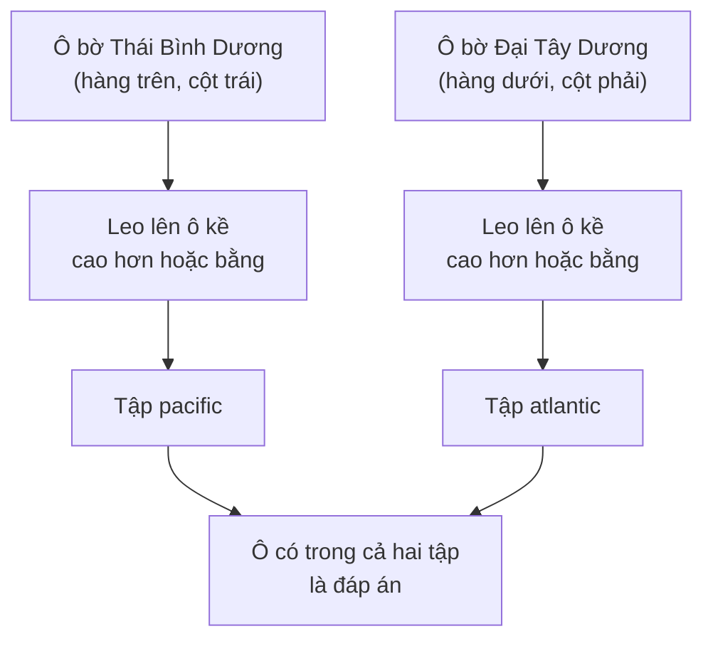
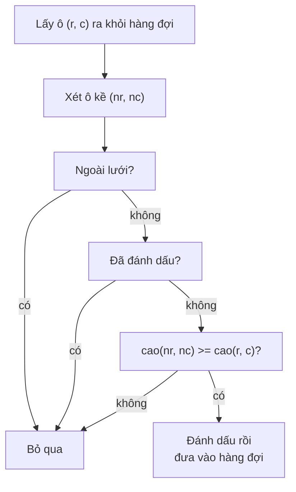

> [!tldr] Đọc nhanh
> - Mỗi ô có một độ cao. Nước đi từ ô này sang ô kề cạnh nếu ô kề **thấp hơn hoặc bằng**. Cần tìm các ô mà nước ra được **cả** Thái Bình Dương (cạnh trên, cạnh trái) **lẫn** Đại Tây Dương (cạnh dưới, cạnh phải).
> - Cách ngây thơ thả nước từ từng ô rồi theo dõi nó: mỗi ô tốn một lượt duyệt, cả bài tốn `O((mn)²)`.
> - Cách tốt là [[concepts/reverse-reachability|đi ngược]]: bắt đầu từ bờ biển, **leo lên** ô cao hơn hoặc bằng. Ô nào leo tới được thì nước từ ô đó chảy về được bờ ấy.
> - Làm hai lượt [[concepts/multi-source-bfs|BFS nhiều nguồn]], một cho mỗi đại dương, rồi lấy phần chung. Tổng cộng `O(mn)`.
> - Ba bẫy: đi ngược mà quên đổi chiều phép so, dùng `>` thay cho `>=`, và chỉ gieo một cạnh cho mỗi đại dương.

> [!info] Bối cảnh
> Bài LeetCode 417 (Medium), thuộc [[posts/2026-11-26-neetcode-graph-bfs|ga 2: Duyệt đồ thị và BFS]] trên **tuyến NeetCode: Đồ thị**. Ở [[posts/2026-11-26-neetcode-grid-traversal|ga 1]], mình đã [[concepts/flood-fill|duyệt lan]] trên lưới để đếm đảo. Bài này dùng đúng lượt duyệt đó, chỉ thêm hai ý: bắt đầu từ cả một dãy ô cùng lúc, và đi theo chiều ngược với chiều nước chảy. Bạn chỉ cần biết vòng lặp, mảng hai chiều và hàng đợi; mọi thứ khác được giải thích ngay dưới. Lời giải có đủ TypeScript, Python, Go, Java và JavaScript.

> [!abstract]- Từ điển nhanh cho bài này (bấm để mở)
> - [[concepts/grid-graph|Đồ thị lưới]]: mỗi ô là một đỉnh, hai ô chung cạnh (trên, dưới, trái, phải) là hai đỉnh kề nhau. Ô chéo không kề.
> - **Ô bờ**: ô nằm ở hàng hoặc cột ngoài cùng. Ô ở hàng trên hoặc cột trái chạm Thái Bình Dương; ô ở hàng dưới hoặc cột phải chạm Đại Tây Dương. Góc trên phải và góc dưới trái chạm cả hai.
> - [[concepts/breadth-first-search|BFS]] (duyệt theo chiều rộng): xử lý các ô theo thứ tự vào hàng đợi, vào trước ra trước.
> - [[concepts/multi-source-bfs|BFS nhiều nguồn]]: thay vì một ô xuất phát, đưa cả một nhóm ô vào hàng đợi ngay từ đầu.
> - [[concepts/reverse-reachability|Đi ngược]]: muốn biết "những ô nào tới được đích", hãy bắt đầu từ đích và đi theo các cạnh ngược chiều.
> - **Tập với tới** (`seen`): mảng đánh dấu những ô mà lượt duyệt đã chạm.

## Hình dung trước: đi ngược dòng suối từ cửa biển

Tưởng tượng một hòn đảo đồi núi. Biển phía tây bắc là Thái Bình Dương, biển phía đông nam là Đại Tây Dương. Mưa rơi xuống một ô, nước lăn sang ô bên cạnh nếu ô đó không cao hơn.

Cách thứ nhất là đứng ở từng ô, đổ một xô nước và chạy theo dòng chảy để xem nó ra biển nào. Đảo có 40 000 ô thì phải đổ 40 000 xô.

Cách thứ hai là đứng ở cửa biển và **đi ngược dòng suối lên núi**. Mình chỉ bước lên chỗ cao hơn hoặc bằng chỗ đang đứng. Mọi chỗ mình leo tới được, nước từ đó lăn ngược đúng con đường mình vừa đi để về biển. Hai nhóm người leo, mỗi nhóm xuất phát từ một bờ, là đủ cho cả đảo.

| Đời thường | Khái niệm |
|---|---|
| Ô đất với độ cao | Ô `(r, c)` có giá trị `heights[r][c]` |
| Nước lăn sang chỗ không cao hơn | Đi từ ô sang ô kề có độ cao `<=` |
| Đổ một xô ở từng ô | Vét cạn: một lượt duyệt cho mỗi ô |
| Đứng ở cửa biển, leo ngược lên | Đi ngược: từ ô bờ sang ô kề có độ cao `>=` |
| Cả đoàn người đứng dọc bờ cùng xuất phát | BFS nhiều nguồn, mọi ô bờ vào hàng đợi từ đầu |
| Hai đoàn, hai bờ | Hai tập với tới: `pacific`, `atlantic` |
| Chỗ cả hai đoàn đều đặt chân | Đáp án: phần giao của hai tập |



## Vấn đề: thả nước từ từng ô quá chậm

Đề cho một lưới `m × n` các số nguyên không âm, mỗi số là độ cao của một ô. Nước ở một ô chảy được sang ô kề cạnh khi ô kề có độ cao nhỏ hơn hoặc bằng. Nước ra Thái Bình Dương khi tới một ô ở hàng trên cùng hoặc cột trái cùng, ra Đại Tây Dương khi tới một ô ở hàng dưới cùng hoặc cột phải cùng. Trả về tọa độ mọi ô mà nước từ đó ra được cả hai đại dương, thứ tự nào cũng được. Giới hạn: `1 ≤ m, n ≤ 200`, độ cao từ `0` tới `10⁵`. [Đề LC-0417](https://leetcode.com/problems/pacific-atlantic-water-flow/)

Mình dùng một lưới `3 × 3` có độ cao tăng dần theo hình xoắn ốc, từ góc trên trái đi theo chiều kim đồng hồ:

```text
        cột 0  cột 1  cột 2
hàng 0    1      2      3
hàng 1    8      9      4
hàng 2    7      6      5
```

Thử từng ô bằng tay:

| Ô | Độ cao | Ra Thái Bình Dương? | Ra Đại Tây Dương? |
|---|---:|---|---|
| `(0,0)` | 1 | Có, ô bờ trên | Không: hai ô kề (2 và 8) đều cao hơn, nước kẹt lại |
| `(0,1)` | 2 | Có, ô bờ trên | Không: chỉ chảy được sang 1, mà 1 cũng kẹt |
| `(0,2)` | 3 | Có, ô bờ trên | Có, ô bờ phải |
| `(1,1)` | 9 | Có: 9 → 2 (bờ trên) | Có: 9 → 4 (bờ phải) |
| `(2,1)` | 6 | Có: 6 → 5 → 4 → 3 (bờ trên) | Có, ô bờ dưới |

Làm tiếp như vậy, đáp án có **7 ô**: mọi ô trừ `(0,0)` và `(0,1)`. Cách làm tay này chính là vét cạn. Nó đúng, nhưng mỗi ô lại đi một vòng riêng, và các vòng đó lặp lại cùng những con đường.

## Cơ chế

<figure class="figure-map" style="--ar: 3 / 4">
<div class="frame"><iframe data-archify="../diagrams/neetcode-pacific-atlantic-water-flow/worked-example.html" title="Đi ngược từ hai bờ rồi lấy phần giao" loading="lazy"></iframe></div>
<figcaption><span><b>Hình 1.</b> Đi ngược từ hai bờ trên lưới xoắn ốc 3 × 3: Thái Bình Dương leo tới cả 9 ô, Đại Tây Dương leo tới 7 ô, phần giao là đáp án.</span><a href="../diagrams/neetcode-pacific-atlantic-water-flow/worked-example.html" target="_blank" rel="noopener">Mở toàn màn hình</a></figcaption>
</figure>

<details>
<summary>Đọc từng bước</summary>
<ol>
<li>Gieo bờ Thái Bình Dương: hàng trên và cột trái. <code>1 2 3 | 1 8 7</code></li>
<li>Leo lên ô cao hơn hoặc bằng. <code>2→9, 3→4→5→6</code></li>
<li>Thái Bình Dương với tới cả 9 ô. <code>pac = 9</code></li>
<li>Gieo bờ Đại Tây Dương: hàng dưới và cột phải. <code>7 6 5 | 3 4 5</code></li>
<li>Leo tiếp từ 7 và 6. <code>7→8, 6→9; atl = 7</code></li>
<li>Ô 1 và 2 thấp hơn bờ đông, không leo tới được. <code>3→2: 2 &lt; 3, dừng</code></li>
<li>Giao hai tập được 7 ô. <code>mọi ô trừ (0,0), (0,1)</code></li>
</ol>
</details>

### Cách 1: vét cạn, thả nước từ từng ô

Với mỗi ô, chạy một lượt BFS **xuôi dốc**: từ ô đang xét sang ô kề có độ cao `<=`. Trong lúc duyệt, ghi lại đã chạm bờ trên trái chưa, đã chạm bờ dưới phải chưa. Chạm đủ cả hai thì dừng sớm và đưa ô vào đáp án.

Một lượt có thể đi khắp lưới, tức `mn` ô. Có `mn` lượt, nên tổng là `O((mn)²)`. Trường hợp tệ nhất là lưới phẳng, mọi ô cao bằng nhau: nước từ ô nào cũng loang ra cả lưới. Với `200 × 200`, đó là khoảng `40 000 × 40 000 = 1,6 tỉ` bước.

### Cách 2: đi ngược từ bờ (BFS nhiều nguồn)

Đảo ngược câu hỏi. Thay vì "từ ô này nước tới được bờ nào?", hỏi "từ bờ này, đi ngược dòng thì tới được những ô nào?".

Nước đi từ ô `A` sang ô kề `B` khi `cao(B) <= cao(A)`. Đi ngược nghĩa là từ `B` quay về `A`, tức là bước từ ô đang đứng sang ô kề **cao hơn hoặc bằng**. Nếu từ ô bờ mình leo tới được ô `X`, thì nước ở `X` chảy theo đúng con đường đó, đảo chiều, về tới bờ.

Các bước:

| Bước | Việc làm | Trên lưới xoắn ốc |
|---|---|---|
| 1 | Đưa mọi ô hàng trên và cột trái vào hàng đợi, đánh dấu vào `pacific` | 1, 2, 3, 8, 7 |
| 2 | Lấy từng ô ra, thêm ô kề chưa đánh dấu có độ cao `>=` | 2 → 9; 3 → 4 → 5 → 6 |
| 3 | Hết hàng đợi: `pacific` là mọi ô nước chảy về Thái Bình Dương | đủ 9 ô |
| 4 | Lặp lại với hàng dưới và cột phải, ra `atlantic` | 7 → 8; 6 → 9; được 7 ô |
| 5 | Ô có dấu trong cả hai mảng là đáp án | 7 ô, thiếu 1 và 2 |



Mỗi ô vào hàng đợi tối đa một lần cho mỗi đại dương, mỗi lần lấy ra kiểm bốn hướng. Thời gian `O(mn)`, bộ nhớ `O(mn)` cho hai mảng đánh dấu và hàng đợi. Mình [[concepts/mark-on-enqueue|đánh dấu ngay lúc đưa vào hàng đợi]], giống bài đếm đảo, để một ô không vào hàng đợi hai lần.

Vì sao không chạy **một** lượt duyệt từ cả bốn cạnh? Vì khi đó mình chỉ biết "ô này chảy ra được *một* đại dương nào đó", không biết là đại dương nào. Hai mảng đánh dấu riêng giữ được thông tin ấy.

### Cách 3 và 4: cùng ý, đổi sang DFS

Thay hàng đợi bằng ngăn xếp (lấy ô vào sau ra trước) thì được DFS lặp. Thứ tự thăm khác, nhưng tập ô với tới y hệt, vì câu hỏi chỉ là "tới được hay không", không hỏi đường ngắn nhất.

DFS đệ quy là bản ngắn nhất: hàm `visit(r, c)` đánh dấu ô rồi gọi chính nó cho từng ô kề hợp lệ. Cái giá là [[concepts/recursion-depth-limit|độ sâu lời gọi]]. Trên lưới phẳng `200 × 200`, mình đo được chuỗi gọi lồng nhau dài đúng **40 000** tầng: DFS đi một mạch qua mọi ô trước khi quay lui.

### Đo: vét cạn và đi ngược

Lưới phẳng (mọi ô cùng độ cao) là trường hợp tệ nhất của vét cạn. Cạnh lưới gấp đôi thì số ô gấp bốn, thời gian vét cạn gấp khoảng mười sáu.

| Lưới phẳng | TypeScript: vét cạn | TypeScript: đi ngược | Go: vét cạn | Go: đi ngược | Java: vét cạn | Java: đi ngược |
|---|---:|---:|---:|---:|---:|---:|
| `20 × 20` | 1,6 ms | 0,03 ms | 1,1 ms | 0,02 ms | 0,8 ms | 0,02 ms |
| `40 × 40` | 22,7 ms | 0,09 ms | 14,4 ms | 0,11 ms | 11,5 ms | 0,10 ms |
| `80 × 80` | 348,5 ms | 0,36 ms | 262,5 ms | 0,71 ms | 143,0 ms | 0,29 ms |

Python chậm hơn nhiều nên mình chỉ đo tới `40 × 40`: vét cạn 19,5 ms và 300,1 ms, đi ngược 0,28 ms và 1,02 ms. Ngoại suy theo hệ số 16 cho mỗi lần gấp đôi cạnh, vét cạn trên `200 × 200` phẳng sẽ mất cỡ mười giây trở lên ở TypeScript. Đi ngược trên cùng lưới đó mất 3,1 ms. Số đo đổi theo máy; hãy đọc tỉ lệ, đừng đọc chữ số lẻ.

## Ví dụ chạy được

Mỗi file chạy cả bốn cách đúng và ba cách sai trên 10 ca chung: một ô, một hàng, một cột, mặt phẳng, cái chén (ô giữa trũng), góc trũng, lưới xoắn ốc ở trên, bậc bằng nhau, lưới tăng dần `200 × 200` và mặt phẳng `200 × 200`. Vét cạn bỏ hai ca `200 × 200` vì quá chậm. Mỗi file còn so ba cách đi ngược với vét cạn trên lưới ngẫu nhiên. Đoạn dưới là phần lõi của cách 2; file đầy đủ có mọi cách.

[TypeScript](../code/neetcode-pacific-atlantic-water-flow/pacific-atlantic.ts) · [Python](../code/neetcode-pacific-atlantic-water-flow/pacific_atlantic.py) · [Go](../code/neetcode-pacific-atlantic-water-flow/pacific_atlantic.go) · [Java](../code/neetcode-pacific-atlantic-water-flow/pacific-atlantic.java) · [JavaScript](../code/neetcode-pacific-atlantic-water-flow/pacific-atlantic.js) · [PHP](../code/neetcode-pacific-atlantic-water-flow/pacific-atlantic.php) · [Rust](../code/neetcode-pacific-atlantic-water-flow/pacific_atlantic.rs)

```ts
// Cách 2: đi ngược từ bờ. BFS nhiều nguồn, leo lên ô cao hơn hoặc bằng. O(mn).
function climbBfs(heights: Grid, seeds: number[]): Uint8Array {
  const m = heights.length, n = heights[0].length
  const seen = new Uint8Array(m * n)
  const queue: number[] = []
  for (const s of seeds) {
    if (!seen[s]) { seen[s] = 1; queue.push(s) }
  }
  for (let head = 0; head < queue.length; head++) {
    const cr = Math.floor(queue[head] / n), cc = queue[head] % n
    for (const [dr, dc] of DIRS) {
      const nr = cr + dr, nc = cc + dc
      if (nr < 0 || nr >= m || nc < 0 || nc >= n) continue
      if (seen[nr * n + nc] || heights[nr][nc] < heights[cr][cc]) continue
      seen[nr * n + nc] = 1
      queue.push(nr * n + nc)
    }
  }
  return seen
}

function borders(m: number, n: number): { pacific: number[]; atlantic: number[] } {
  const pacific: number[] = [], atlantic: number[] = []
  for (let c = 0; c < n; c++) { pacific.push(c); atlantic.push((m - 1) * n + c) }
  for (let r = 0; r < m; r++) { pacific.push(r * n); atlantic.push(r * n + n - 1) }
  return { pacific, atlantic }
}

function intersect(a: Uint8Array, b: Uint8Array, n: number): Cell[] {
  const result: Cell[] = []
  for (let i = 0; i < a.length; i++) if (a[i] && b[i]) result.push([Math.floor(i / n), i % n])
  return result
}

function reverseBfs(heights: Grid): Cell[] {
  const m = heights.length, n = heights[0].length
  const { pacific, atlantic } = borders(m, n)
  return intersect(climbBfs(heights, pacific), climbBfs(heights, atlantic), n)
}
```
```python
def borders(m, n):
    pacific = [(0, c) for c in range(n)] + [(r, 0) for r in range(m)]
    atlantic = [(m - 1, c) for c in range(n)] + [(r, n - 1) for r in range(m)]
    return pacific, atlantic


# Cách 2: đi ngược từ bờ. BFS nhiều nguồn, leo lên ô cao hơn hoặc bằng. O(mn).
def climb_bfs(heights, seeds):
    m, n = len(heights), len(heights[0])
    seen = [[False] * n for _ in range(m)]
    queue = deque()
    for r, c in seeds:
        if not seen[r][c]:
            seen[r][c] = True
            queue.append((r, c))
    while queue:
        cr, cc = queue.popleft()
        for dr, dc in DIRS:
            nr, nc = cr + dr, cc + dc
            if 0 <= nr < m and 0 <= nc < n and not seen[nr][nc] \
                    and heights[nr][nc] >= heights[cr][cc]:
                seen[nr][nc] = True
                queue.append((nr, nc))
    return seen


def intersect(a, b):
    return [[r, c] for r in range(len(a)) for c in range(len(a[0])) if a[r][c] and b[r][c]]


def reverse_bfs(heights):
    pacific, atlantic = borders(len(heights), len(heights[0]))
    return intersect(climb_bfs(heights, pacific), climb_bfs(heights, atlantic))
```
```go
func borders(m, n int) (pacific, atlantic []int) {
	for c := 0; c < n; c++ {
		pacific = append(pacific, c)
		atlantic = append(atlantic, (m-1)*n+c)
	}
	for r := 0; r < m; r++ {
		pacific = append(pacific, r*n)
		atlantic = append(atlantic, r*n+n-1)
	}
	return
}

// climb là BFS nhiều nguồn; ok(cao mới, cao cũ) quyết định có đi tiếp không.
func climb(heights Grid, seeds []int, ok func(next, cur int) bool) []bool {
	m, n := len(heights), len(heights[0])
	seen := make([]bool, m*n)
	queue := []int{}
	for _, s := range seeds {
		if !seen[s] {
			seen[s] = true
			queue = append(queue, s)
		}
	}
	for head := 0; head < len(queue); head++ {
		cr, cc := queue[head]/n, queue[head]%n
		for _, d := range dirs {
			nr, nc := cr+d[0], cc+d[1]
			if nr < 0 || nr >= m || nc < 0 || nc >= n {
				continue
			}
			if seen[nr*n+nc] || !ok(heights[nr][nc], heights[cr][cc]) {
				continue
			}
			seen[nr*n+nc] = true
			queue = append(queue, nr*n+nc)
		}
	}
	return seen
}

func uphill(next, cur int) bool { return next >= cur }

func intersect(a, b []bool, n int) [][]int {
	result := [][]int{}
	for i := range a {
		if a[i] && b[i] {
			result = append(result, []int{i / n, i % n})
		}
	}
	return result
}

// Cách 2: đi ngược từ bờ, BFS nhiều nguồn leo lên ô cao hơn hoặc bằng. O(mn).
func reverseBfs(heights Grid) [][]int {
	m, n := len(heights), len(heights[0])
	pacific, atlantic := borders(m, n)
	return intersect(climb(heights, pacific, uphill), climb(heights, atlantic, uphill), n)
}
```
```java
static int[][] borders(int m, int n) {
    int[] pacific = new int[m + n], atlantic = new int[m + n];
    for (int c = 0; c < n; c++) { pacific[c] = c; atlantic[c] = (m - 1) * n + c; }
    for (int r = 0; r < m; r++) { pacific[n + r] = r * n; atlantic[n + r] = r * n + n - 1; }
    return new int[][] {pacific, atlantic};
}

// BFS nhiều nguồn; ok trả 1 nếu được đi từ ô cao "cur" sang ô cao "next".
static boolean[] climb(int[][] heights, int[] seeds, IntBinaryOperator ok) {
    int m = heights.length, n = heights[0].length;
    boolean[] seen = new boolean[m * n];
    ArrayDeque<Integer> queue = new ArrayDeque<>();
    for (int s : seeds) if (!seen[s]) { seen[s] = true; queue.addLast(s); }
    while (!queue.isEmpty()) {
        int cur = queue.removeFirst(), cr = cur / n, cc = cur % n;
        for (int[] d : DIRS) {
            int nr = cr + d[0], nc = cc + d[1];
            if (nr < 0 || nr >= m || nc < 0 || nc >= n) continue;
            if (seen[nr * n + nc] || ok.applyAsInt(heights[nr][nc], heights[cr][cc]) == 0) continue;
            seen[nr * n + nc] = true;
            queue.addLast(nr * n + nc);
        }
    }
    return seen;
}

static final IntBinaryOperator UPHILL = (next, cur) -> next >= cur ? 1 : 0;

static List<List<Integer>> intersect(boolean[] a, boolean[] b, int n) {
    List<List<Integer>> result = new ArrayList<>();
    for (int i = 0; i < a.length; i++) if (a[i] && b[i]) result.add(List.of(i / n, i % n));
    return result;
}

// Cách 2: đi ngược từ bờ, leo lên ô cao hơn hoặc bằng. O(mn).
static List<List<Integer>> reverseBfs(int[][] heights) {
    int n = heights[0].length;
    int[][] b = borders(heights.length, n);
    return intersect(climb(heights, b[0], UPHILL), climb(heights, b[1], UPHILL), n);
}
```
```js
// Cách 2: đi ngược từ bờ. BFS nhiều nguồn, leo lên ô cao hơn hoặc bằng. O(mn).
function climbBfs(heights, seeds) {
    const m = heights.length, n = heights[0].length;
    const seen = new Uint8Array(m * n);
    const queue = [];
    for (const s of seeds) {
        if (!seen[s]) {
            seen[s] = 1;
            queue.push(s);
        }
    }
    for (let head = 0; head < queue.length; head++) {
        const cr = Math.floor(queue[head] / n), cc = queue[head] % n;
        for (const [dr, dc] of DIRS) {
            const nr = cr + dr, nc = cc + dc;
            if (nr < 0 || nr >= m || nc < 0 || nc >= n)
                continue;
            if (seen[nr * n + nc] || heights[nr][nc] < heights[cr][cc])
                continue;
            seen[nr * n + nc] = 1;
            queue.push(nr * n + nc);
        }
    }
    return seen;
}
function borders(m, n) {
    const pacific = [], atlantic = [];
    for (let c = 0; c < n; c++) {
        pacific.push(c);
        atlantic.push((m - 1) * n + c);
    }
    for (let r = 0; r < m; r++) {
        pacific.push(r * n);
        atlantic.push(r * n + n - 1);
    }
    return { pacific, atlantic };
}
function intersect(a, b, n) {
    const result = [];
    for (let i = 0; i < a.length; i++)
        if (a[i] && b[i])
            result.push([Math.floor(i / n), i % n]);
    return result;
}
function reverseBfs(heights) {
    const m = heights.length, n = heights[0].length;
    const { pacific, atlantic } = borders(m, n);
    return intersect(climbBfs(heights, pacific), climbBfs(heights, atlantic), n);
}
```

```php
<?php
// Cách 2: đi ngược từ bờ. BFS nhiều nguồn, leo lên ô cao hơn hoặc bằng. O(mn).
function climbBfs(array $heights, array $seeds): array
{
    $m = count($heights);
    $n = count($heights[0]);
    $seen = array_fill(0, $m * $n, false);
    $queue = [];
    foreach ($seeds as $s) {
        if (!$seen[$s]) { $seen[$s] = true; $queue[] = $s; }
    }
    for ($head = 0; $head < count($queue); $head++) {
        $cr = intdiv($queue[$head], $n);
        $cc = $queue[$head] % $n;
        foreach (DIRS as [$dr, $dc]) {
            $nr = $cr + $dr;
            $nc = $cc + $dc;
            if ($nr < 0 || $nr >= $m || $nc < 0 || $nc >= $n) continue;
            if ($seen[$nr * $n + $nc] || $heights[$nr][$nc] < $heights[$cr][$cc]) continue;
            $seen[$nr * $n + $nc] = true;
            $queue[] = $nr * $n + $nc;
        }
    }
    return $seen;
}

function borders(int $m, int $n): array
{
    $pacific = [];
    $atlantic = [];
    for ($c = 0; $c < $n; $c++) { $pacific[] = $c; $atlantic[] = ($m - 1) * $n + $c; }
    for ($r = 0; $r < $m; $r++) { $pacific[] = $r * $n; $atlantic[] = $r * $n + $n - 1; }
    return [$pacific, $atlantic];
}

function intersect(array $a, array $b, int $n): array
{
    $result = [];
    foreach ($a as $i => $hit) {
        if ($hit && $b[$i]) $result[] = [intdiv($i, $n), $i % $n];
    }
    return $result;
}

function reverseBfs(array $heights): array
{
    $n = count($heights[0]);
    [$pacific, $atlantic] = borders(count($heights), $n);
    return intersect(climbBfs($heights, $pacific), climbBfs($heights, $atlantic), $n);
}
```

```rust
// Hàng xóm trong lưới m×n của ô (r, c), đã lọc ô ra ngoài biên.
fn neighbors(m: usize, n: usize, r: usize, c: usize) -> impl Iterator<Item = (usize, usize)> {
    DIRS.iter().filter_map(move |&(dr, dc)| {
        let (nr, nc) = (r as i32 + dr, c as i32 + dc);
        if nr < 0 || nr >= m as i32 || nc < 0 || nc >= n as i32 {
            None
        } else {
            Some((nr as usize, nc as usize))
        }
    })
}

// Cách 2: đi ngược từ bờ. BFS nhiều nguồn, leo lên ô cao hơn hoặc bằng. O(mn).
fn climb_bfs(heights: &Grid, seeds: &[usize]) -> Vec<bool> {
    let (m, n) = (heights.len(), heights[0].len());
    let mut seen = vec![false; m * n];
    let mut queue = Vec::new();
    for &s in seeds {
        if !seen[s] { seen[s] = true; queue.push(s); }
    }
    let mut head = 0;
    while head < queue.len() {
        let (cr, cc) = (queue[head] / n, queue[head] % n);
        head += 1;
        for (nr, nc) in neighbors(m, n, cr, cc) {
            if seen[nr * n + nc] || heights[nr][nc] < heights[cr][cc] { continue; }
            seen[nr * n + nc] = true;
            queue.push(nr * n + nc);
        }
    }
    seen
}

fn borders(m: usize, n: usize) -> (Vec<usize>, Vec<usize>) {
    let (mut pacific, mut atlantic) = (Vec::new(), Vec::new());
    for c in 0..n { pacific.push(c); atlantic.push((m - 1) * n + c); }
    for r in 0..m { pacific.push(r * n); atlantic.push(r * n + n - 1); }
    (pacific, atlantic)
}

fn intersect(a: &[bool], b: &[bool], n: usize) -> Vec<Cell> {
    (0..a.len()).filter(|&i| a[i] && b[i]).map(|i| (i / n, i % n)).collect()
}

fn reverse_bfs(heights: &Grid) -> Vec<Cell> {
    let (m, n) = (heights.len(), heights[0].len());
    let (pacific, atlantic) = borders(m, n);
    intersect(&climb_bfs(heights, &pacific), &climb_bfs(heights, &atlantic), n)
}
```

Kết quả chạy `node pacific-atlantic.ts`:

```text
bruteForce           8/8 ca đúng (bỏ hai ca 200×200)
reverseBfs           10/10 ca đúng
reverseDfsIterative  10/10 ca đúng
reverseDfsRecursive  9/10 ca đúng; sai ở mặt phẳng 200×200 → ném RangeError
wrongDirection       6/10 ca đúng; sai ở cái chén, sống núi giữa, bậc bằng nhau, lưới tăng 200×200
wrongStrict          5/10 ca đúng; sai ở mặt phẳng 3×3, cái chén, góc trũng, bậc bằng nhau, mặt phẳng 200×200
wrongOneEdge         6/10 ca đúng; sai ở một cột, góc trũng, sống núi giữa, lưới tăng 200×200
ngẫu nhiên: 2000/2000 lưới, ba cách đi ngược khớp vét cạn
mặt phẳng 20×20: vét cạn 1.6 ms, đi ngược 0.03 ms
mặt phẳng 40×40: vét cạn 22.7 ms, đi ngược 0.09 ms
mặt phẳng 80×80: vét cạn 348.5 ms, đi ngược 0.36 ms
mặt phẳng 200×200: đi ngược BFS 3.1 ms
```

Python (`python3 pacific_atlantic.py`) cho cùng số ca đúng; bản đệ quy ném `RecursionError` ở mặt phẳng `200 × 200`. Ngoài ra nó đo hai cách lưu tập với tới:

```text
brute_force            8/8 ca đúng (bỏ hai ca 200×200)
reverse_bfs            10/10 ca đúng
reverse_dfs_iterative  10/10 ca đúng
reverse_dfs_recursive  9/10 ca đúng; sai ở mặt phẳng 200×200 → ném RecursionError
reverse_bfs_sets       10/10 ca đúng
wrong_direction        6/10 ca đúng; sai ở cái chén, sống núi giữa, bậc bằng nhau, lưới tăng 200×200
wrong_strict           5/10 ca đúng; sai ở mặt phẳng 3×3, cái chén, góc trũng, bậc bằng nhau, mặt phẳng 200×200
wrong_one_edge         6/10 ca đúng; sai ở một cột, góc trũng, sống núi giữa, lưới tăng 200×200
ngẫu nhiên: 1000/1000 lưới, các cách đi ngược khớp vét cạn
mặt phẳng 20×20: vét cạn 19.5 ms, đi ngược 0.28 ms
mặt phẳng 40×40: vét cạn 300.1 ms, đi ngược 1.02 ms
mặt phẳng 200×200: mảng hai chiều 28.7 ms, set các tuple 54.4 ms
```

Trong năm ngôn ngữ đầu, Go (`go run pacific_atlantic.go`) là ngôn ngữ duy nhất mà DFS đệ quy qua đủ 10/10, vì stack của goroutine tự nới rộng:

```text
bruteForce           8/8 ca đúng (bỏ hai ca 200×200)
reverseBfs           10/10 ca đúng
reverseDfsIterative  10/10 ca đúng
reverseDfsRecursive  10/10 ca đúng
wrongDirection       6/10 ca đúng; sai ở cái chén, sống núi giữa, bậc bằng nhau, lưới tăng 200×200
wrongStrict          5/10 ca đúng; sai ở mặt phẳng 3×3, cái chén, góc trũng, bậc bằng nhau, mặt phẳng 200×200
wrongOneEdge         6/10 ca đúng; sai ở một cột, góc trũng, sống núi giữa, lưới tăng 200×200
ngẫu nhiên: 2000/2000 lưới, ba cách đi ngược khớp vét cạn
mặt phẳng 20×20: vét cạn 1.1 ms, đi ngược 0.02 ms
mặt phẳng 40×40: vét cạn 14.4 ms, đi ngược 0.11 ms
mặt phẳng 80×80: vét cạn 262.5 ms, đi ngược 0.71 ms
mặt phẳng 200×200: đi ngược BFS 5.7 ms, DFS đệ quy 9.7 ms
```

Java (`java pacific-atlantic.java`) tràn stack trên luồng chính, nhưng chạy được khi cho DFS đệ quy một luồng có stack 64 MB:

```text
bruteForce           8/8 ca đúng (bỏ hai ca 200×200)
reverseBfs           10/10 ca đúng
reverseDfsIterative  10/10 ca đúng
reverseDfsRecursive  9/10 ca đúng; sai ở mặt phẳng 200×200 → ném StackOverflowError
wrongDirection       6/10 ca đúng; sai ở cái chén, sống núi giữa, bậc bằng nhau, lưới tăng 200×200
wrongStrict          5/10 ca đúng; sai ở mặt phẳng 3×3, cái chén, góc trũng, bậc bằng nhau, mặt phẳng 200×200
wrongOneEdge         6/10 ca đúng; sai ở một cột, góc trũng, sống núi giữa, lưới tăng 200×200
ngẫu nhiên: 2000/2000 lưới, ba cách đi ngược khớp vét cạn
mặt phẳng 20×20: vét cạn 0.8 ms, đi ngược 0.02 ms
mặt phẳng 40×40: vét cạn 11.5 ms, đi ngược 0.10 ms
mặt phẳng 80×80: vét cạn 143.0 ms, đi ngược 0.29 ms
mặt phẳng 200×200, DFS đệ quy trên luồng stack 64 MB: 40000 ô
```

PHP (`php pacific-atlantic.php`) cũng qua đủ 10/10: lời gọi hàm PHP nằm trên vùng nhớ heap của máy ảo, không phải stack của luồng, nên 40 000 tầng chỉ tốn bộ nhớ. Máy nào bật Xdebug thì Xdebug tự chặn ở 512 tầng; lần chạy dưới tắt nó bằng `php -d xdebug.mode=off`:

```text
bruteForce           8/8 ca đúng (bỏ hai ca 200×200)
reverseBfs           10/10 ca đúng
reverseDfsIterative  10/10 ca đúng
reverseDfsRecursive  10/10 ca đúng
wrongDirection       6/10 ca đúng; sai ở cái chén, sống núi giữa, bậc bằng nhau, lưới tăng 200×200
wrongStrict          5/10 ca đúng; sai ở mặt phẳng 3×3, cái chén, góc trũng, bậc bằng nhau, mặt phẳng 200×200
wrongOneEdge         6/10 ca đúng; sai ở một cột, góc trũng, sống núi giữa, lưới tăng 200×200
ngẫu nhiên: 2000/2000 lưới, ba cách đi ngược khớp vét cạn
mặt phẳng 20×20: vét cạn 13.2 ms, đi ngược 0.17 ms
mặt phẳng 40×40: vét cạn 222.1 ms, đi ngược 0.71 ms
mặt phẳng 80×80: vét cạn 3648.2 ms, đi ngược 2.88 ms
mặt phẳng 200×200: đi ngược BFS 19.2 ms
```

Rust (`rustc --edition 2021 -O pacific_atlantic.rs`) cũng qua 10/10: luồng chính có stack 8 MB, mỗi khung `visit` chỉ vài chục byte. Vét cạn chạy nhanh hơn Node khoảng ba lần:

```text
brute_force            8/8 ca đúng (bỏ hai ca 200×200)
reverse_bfs            10/10 ca đúng
reverse_dfs_iterative  10/10 ca đúng
reverse_dfs_recursive  10/10 ca đúng
wrong_direction        6/10 ca đúng; sai ở cái chén, sống núi giữa, bậc bằng nhau, lưới tăng 200×200
wrong_strict           5/10 ca đúng; sai ở mặt phẳng 3×3, cái chén, góc trũng, bậc bằng nhau, mặt phẳng 200×200
wrong_one_edge         6/10 ca đúng; sai ở một cột, góc trũng, sống núi giữa, lưới tăng 200×200
ngẫu nhiên: 2000/2000 lưới, ba cách đi ngược khớp vét cạn
mặt phẳng 20×20: vét cạn 0.5 ms, đi ngược 0.01 ms
mặt phẳng 40×40: vét cạn 7.1 ms, đi ngược 0.03 ms
mặt phẳng 80×80: vét cạn 110.0 ms, đi ngược 0.10 ms
mặt phẳng 200×200: đi ngược BFS 0.7 ms
```

## Hiểu lầm và bẫy hay gặp

- **Đi ngược mà quên đổi chiều phép so.** Khi đi từ bờ vào, phải leo lên (`>=`). Giữ phép so của nước chảy xuôi (`<=`) là đi xuống dốc từ bờ, tức trả lời một câu hỏi khác hẳn. Bản `wrongDirection` sai 4/10 ca, kể cả cái chén và lưới xoắn ốc.
- **Dùng `>` thay cho `>=`.** Đề cho nước chảy qua ô cao **bằng** nhau. Bản so ngặt `wrongStrict` sai ở mọi ca có mặt phẳng hoặc bậc bằng nhau, chỉ đúng 5/10 ca.
- **Chỉ gieo một cạnh cho mỗi đại dương.** Thái Bình Dương là hàng trên **và** cột trái; Đại Tây Dương là hàng dưới **và** cột phải. Bản `wrongOneEdge` chỉ gieo hàng trên và hàng dưới, nên bỏ sót những ô chỉ chạm biển qua cột, như ô trũng ở góc trên phải của ca "góc trũng". Nó chỉ đúng 6/10 ca.
- **Quên rằng hai góc thuộc cả hai bờ.** Góc trên phải `(0, n−1)` vừa ở hàng trên vừa ở cột phải, nên luôn nằm trong đáp án. Góc dưới trái cũng vậy. Lưới một hàng hoặc một cột thì mọi ô đều là đáp án.
- **Một lượt duyệt chung cho cả bốn cạnh.** Như trên, bạn mất thông tin "đại dương nào". Cần hai mảng đánh dấu.
- **Đệ quy trên lưới lớn.** Mặt phẳng `200 × 200` đẩy DFS đệ quy tới 40 000 tầng. Python dừng ở khoảng 1 000 tầng (`RecursionError`), Java tràn stack của luồng chính (`StackOverflowError`), Node ném `RangeError`. Go chạy được vì stack của goroutine tự nới tới giới hạn 1 GB. PHP chạy được vì lời gọi hàm nằm trên heap (trừ khi bật Xdebug, chặn ở 512 tầng), Rust chạy được nhờ stack 8 MB của luồng chính và khung gọi nhỏ. Dùng BFS hoặc DFS với ngăn xếp tự quản lý thì không có giới hạn này.
- **Python: set các tuple thay cho mảng hai chiều.** `(r, c) in seen` phải tạo tuple và băm nó mỗi lần kiểm. Trên mặt phẳng `200 × 200`, bản set chạy 54,4 ms, bản mảng `[[False] * n for _ in range(m)]` chạy 28,7 ms. Cả hai đúng; mảng nhanh gần gấp đôi.
- **JavaScript và TypeScript: `queue.shift()`.** Lấy đầu mảng bằng `shift()` có thể phải dời mọi phần tử còn lại. Các file ở đây giữ một chỉ số `head` và không xóa gì khỏi mảng.
- **PHP: hàng đợi bằng `array_shift`.** `array_shift` đánh lại chỉ số cho cả mảng nên mỗi lần lấy ra tốn O(độ dài hàng đợi); trên lưới `200 × 200` gieo 800 ô bờ, BFS thành bậc hai. Bản PHP giữ chỉ số `$head` và chỉ nối thêm vào cuối, như bản TypeScript.
- **Rust: tính hàng xóm bằng `usize`.** `r - 1` khi `r = 0` làm panic ở bản debug và quay vòng thành số rất lớn ở bản `-O`. Hàm `neighbors` trong bản Rust cộng hướng đi trên `i32`, lọc ô ra ngoài biên rồi mới đổi về `usize`.

## Câu hỏi tự kiểm tra

> [!question]- Khi đi ngược từ bờ, vì sao điều kiện là `cao(ô kề) >= cao(ô hiện tại)`?
> Nước đi từ `A` sang `B` khi `cao(B) <= cao(A)`. Đi ngược là từ `B` về `A`, nên ô sắp bước tới (`A`) phải cao hơn hoặc bằng ô đang đứng (`B`).

> [!question]- Lưới chỉ có một hàng `[4, 1, 6]`. Đáp án là những ô nào?
> Cả ba ô. Mỗi ô vừa ở hàng trên (Thái Bình Dương) vừa ở hàng dưới (Đại Tây Dương), nên không cần chảy đi đâu.

> [!question]- Vì sao không chạy một lượt BFS duy nhất từ cả bốn cạnh?
> Một lượt chỉ cho biết ô nào chảy ra được *ít nhất một* đại dương. Đề cần *cả hai*, nên phải giữ hai tập riêng rồi lấy giao.

> [!question]- Vét cạn trên lưới phẳng `200 × 200` cần cỡ bao nhiêu bước?
> Khoảng `(200 × 200)² = 1,6 · 10⁹`: mỗi ô trong 40 000 ô loang ra cả 40 000 ô.

> [!question]- DFS đệ quy và BFS có cho cùng một tập ô với tới không?
> Có. Hai cách chỉ khác thứ tự thăm. Câu hỏi là "tới được hay không", nên tập cuối cùng như nhau; file chạy thử xác nhận trên 2 000 lưới ngẫu nhiên.

## Tham khảo

- [LeetCode · Pacific Atlantic Water Flow](https://leetcode.com/problems/pacific-atlantic-water-flow/): quy tắc chảy và giới hạn đầu vào.
- [Princeton · Breadth-first paths](https://github.com/kevin-wayne/algs4/blob/master/src/main/java/edu/princeton/cs/algs4/BreadthFirstPaths.java): BFS bắt đầu từ một tập đỉnh nguồn, đánh dấu đỉnh trước khi đưa vào hàng đợi.
- [Python · Giới hạn đệ quy](https://docs.python.org/3/library/sys.html#sys.getrecursionlimit), [Java · Thread với kích thước stack](https://docs.oracle.com/en/java/javase/21/docs/api/java.base/java/lang/Thread.html#%3Cinit%3E(java.lang.ThreadGroup,java.lang.Runnable,java.lang.String,long)), [Go · runtime/debug.SetMaxStack](https://pkg.go.dev/runtime/debug#SetMaxStack).
