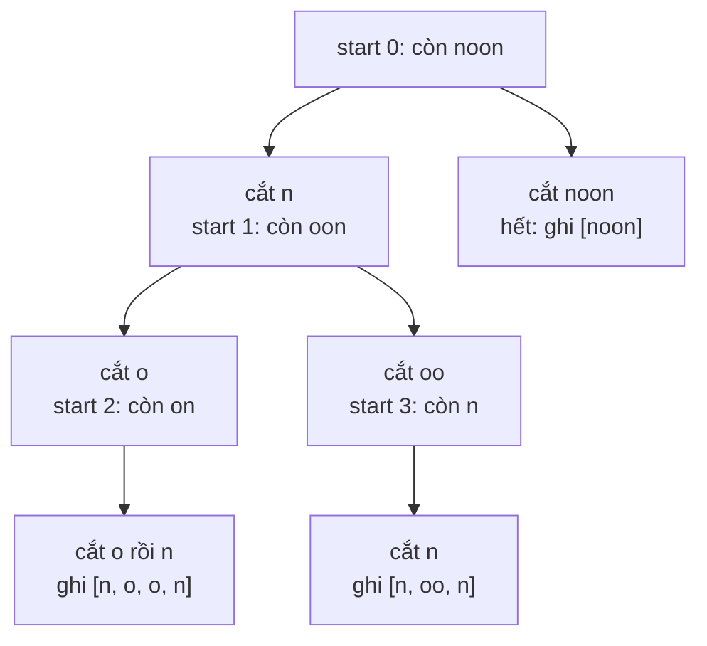

> [!tldr] Đọc nhanh
> - Mỗi nút của [[concepts/choice-tree|cây lựa chọn]] là một vị trí `start`. Các nhánh con là các tiền tố đối xứng của phần còn lại `s[start..]`; cắt xong một mảnh thì đi tiếp từ ngay sau mảnh đó.
> - Chạm cuối chuỗi là có một cách chia. Không có gì để bỏ trùng: hai nhánh khác nhau luôn khác nhau ở một vết cắt.
> - Kiểm tra đối xứng bằng hai con trỏ mỗi lần thì đúng, nhưng lặp lại rất nhiều. Bảng `isPal[i][j]` dựng một lần trong O(n²) biến mỗi lần kiểm tra thành một lần tra.
> - Trường hợp xấu nhất là mọi ký tự giống nhau: mọi vết cắt đều hợp lệ, 2ⁿ⁻¹ cách chia. Chuỗi 16 chữ `a` có 32.768 cách.

> [!info] Bối cảnh
> Đây là bài LeetCode 131 tại [[posts/2026-11-28-neetcode-permutations-search|ga MISC-02: Quay lui: hoán vị và tìm kiếm]] trên **tuyến NeetCode: Kỹ thuật tổng hợp**. Mình hình dung một dải ruy băng in chữ cần cắt thành các mảnh, mỗi mảnh đọc từ hai đầu đều giống nhau. Bạn chỉ cần biết chuỗi, vòng lặp và hàm đệ quy; bảng đối xứng nhắc lại ý của [[posts/2026-11-27-neetcode-palindrome-centers|ga DP-02: Palindrome mở từ tâm]].

> [!abstract]- Từ điển nhanh cho bài này (bấm để mở)
> - Palindrome là chuỗi đọc xuôi và đọc ngược như nhau: `noon`, `level`, `a`. Một ký tự luôn là palindrome.
> - Một cách chia (partition) là một dãy các mảnh liền nhau, ghép lại đúng bằng chuỗi gốc.
> - Tiền tố của `s[start..]` là một đoạn bắt đầu đúng tại `start`.
> - [[concepts/backtracking|Quay lui]] thêm một mảnh vào `path`, đi sâu, rồi gỡ mảnh đó ra để thử mảnh dài hơn.

## Hình dung trước: cắt dải ruy băng in chữ

Dải ruy băng in chữ `noon`. Mình cầm kéo ở đầu trái và hỏi: mảnh đầu tiên có thể dài bao nhiêu mà vẫn đọc xuôi ngược như nhau? `n` được, `no` và `noo` không, `noon` được. Mỗi lựa chọn hợp lệ để lại một khúc ruy băng ngắn hơn, và mình hỏi lại đúng câu đó cho khúc còn lại. Cắt hết dải là có một cách chia. Để khỏi phải đọc lại từng mảnh mỗi lần, mình lập sẵn một bảng tra ghi đoạn nào là palindrome.

| Đời thường | Khái niệm |
|---|---|
| Vị trí đang cầm kéo | `start` |
| Mảnh đầu đọc xuôi ngược như nhau | Tiền tố đối xứng `s[start..end]` |
| Cắt mảnh đó, chuyển kéo tới sau nó | Đi sâu với `end + 1` |
| Dán lại mảnh vừa cắt để thử mảnh dài hơn | `path.pop()` |
| Cắt hết dải | `start == n`: ghi một cách chia |
| Bảng tra đoạn nào đối xứng | `isPal[i][j]` |

Cây của `noon` có ba lá, ứng với ba cách chia. Mỗi nút có không quá hai nhánh:



## Vấn đề: mọi cách cắt thành các mảnh đối xứng

Cho chuỗi `s` dài 1–16, chỉ gồm chữ thường tiếng Anh. Trả về mọi cách chia `s` thành các mảnh liền nhau sao cho mảnh nào cũng là palindrome, theo thứ tự nào cũng được. Ví dụ `noon` có ba cách: `[n, o, o, n]`, `[n, oo, n]` và `[noon]`. [Đề gốc LeetCode 131](https://leetcode.com/problems/palindrome-partitioning/)

Mình từng nghĩ chỉ cần tìm palindrome dài nhất rồi cắt. Cách đó cho đúng một cách chia, trong khi đề đòi tất cả. Ngay cả câu hỏi "có cách chia nào không" cũng luôn có đáp án là có, vì cắt từng ký tự một luôn hợp lệ. Cái khó là liệt kê đủ mà không sót, và không đọc lại cùng một đoạn quá nhiều lần.

## Cơ chế

### Vét cạn: mọi cách đặt vết cắt

Chuỗi dài n có n − 1 khe giữa các ký tự, mỗi khe cắt hoặc không. Có 2ⁿ⁻¹ cách đặt vết cắt; với mỗi cách, mình kiểm tra từng mảnh có đọc ngược bằng chính nó không. Đây là trọng tài trong file chạy, vì nó không dùng chung dòng nào với lời giải.

### Quay lui trên tiền tố đối xứng

Hàm `walk(start)` thử mọi `end` từ `start` tới n − 1. Nếu `s[start..end]` là palindrome, thêm nó vào `path`, gọi `walk(end + 1)`, rồi gỡ ra. Khi `start == n`, toàn bộ chuỗi đã được cắt hết và `path` là một cách chia. Một tiền tố không đối xứng bị bỏ cùng cả nhánh bên dưới nó, nên cây chỉ chứa các cách chia đang hợp lệ.

Hai lá khác nhau luôn khác nhau ở ít nhất một vết cắt, nên không cần bỏ trùng như [[problems/subsets-ii|Subsets II]]. Mỗi nút cũng không cần [[concepts/start-index|chỉ số bắt đầu]] riêng: chính `start` đã là chỗ cắt tiếp theo.

### Kiểm tra lại mỗi lần hay tra bảng

Kiểm tra `s[start..end]` bằng hai con trỏ tốn tới (end − start + 1)/2 phép so. Cùng một đoạn bị hỏi lại ở nhiều nhánh: `s[2..5]` được hỏi lại mỗi khi một nhánh cắt tới vị trí 2. Bảng `isPal[i][j]` trả lời trước cho mọi cặp (i, j):

- `isPal[i][j]` đúng khi `s[i] == s[j]` và phần bên trong `s[i+1..j-1]` cũng đối xứng (đoạn dài 1 hoặc 2 thì chỉ cần hai đầu bằng nhau);
- phần bên trong ngắn hơn và bắt đầu ở i + 1, nên phải điền i từ phải sang trái;
- bảng có n(n + 1)/2 ô, mỗi ô một phép so ký tự.

Đây là cùng ý với [[concepts/palindrome-center|tâm palindrome]] ở ga DP-02, chỉ khác là điền theo hai đầu thay vì mở từ tâm.

Với 16 chữ `a`, kiểm tra lại mỗi lần tốn 43.682 phép so ký tự, còn dựng bảng tốn 136. Bảng không làm cây nhỏ đi: cây vẫn có 32.768 lá, mỗi lá chép một danh sách tối đa 16 mảnh, và vòng lặp ở mỗi nút vẫn tra từng `end`. Cả hai cách đều O(n·2ⁿ) trong trường hợp xấu nhất, vì riêng đầu ra đã lớn cỡ đó. Bảng chỉ biến mỗi lần kiểm tra từ O(n) thành O(1).

| Cách | Thời gian xấu nhất | Bộ nhớ phụ (chưa kể đầu ra) | Ghi chú |
|---|---|---|---|
| Vét mọi cách đặt vết cắt | O(n·2ⁿ) | O(n) | Trọng tài; luôn đi hết 2ⁿ⁻¹ cách |
| Quay lui, kiểm tra lại mỗi lần | O(n²·2ⁿ) | O(n) | Mỗi lần kiểm tra tốn O(n) |
| Quay lui, tra bảng `isPal` | O(n·2ⁿ) | O(n²) | Bảng dựng một lần trong O(n²) |

## Ví dụ chạy được

[TypeScript](../code/neetcode-palindrome-partitioning/cuts.ts) · [Python](../code/neetcode-palindrome-partitioning/cuts.py) · [Go](../code/neetcode-palindrome-partitioning/cuts.go) · [Java](../code/neetcode-palindrome-partitioning/cuts.java) · [JavaScript](../code/neetcode-palindrome-partitioning/cuts.js) · [PHP](../code/neetcode-palindrome-partitioning/cuts.php) · [Rust](../code/neetcode-palindrome-partitioning/cuts.rs)

```ts
// Cách chính: dựng bảng isPal[i][j] một lần (i đi từ phải sang trái), rồi quay lui chỉ tra bảng
function partition(s: string, counter = { compares: 0 }): string[][] {
    const n = s.length
    const isPal: boolean[][] = Array.from({ length: n }, () => Array(n).fill(false))
    for (let i = n - 1; i >= 0; i--) {
        for (let j = i; j < n; j++) {
            counter.compares++
            // đối xứng khi hai đầu bằng nhau và phần bên trong (ngắn hơn, đã tính) cũng đối xứng
            isPal[i][j] = s[i] === s[j] && (j - i < 2 || isPal[i + 1][j - 1])
        }
    }
    const result: string[][] = []
    const path: string[] = []
    const walk = (start: number) => {
        if (start === n) {
            result.push([...path]) // cắt hết chuỗi: ghi một cách chia
            return
        }
        for (let end = start; end < n; end++) {
            if (!isPal[start][end]) continue // mảnh đầu không đối xứng: bỏ cả nhánh
            path.push(s.slice(start, end + 1))
            walk(end + 1)
            path.pop()
        }
    }
    walk(0)
    return result
}
```

```python
# Cách chính: dựng bảng is_pal[i][j] một lần (i đi từ phải sang trái), rồi quay lui chỉ tra bảng
def partition(s, counter=None):
    n = len(s)
    is_pal = [[False] * n for _ in range(n)]
    for i in range(n - 1, -1, -1):
        for j in range(i, n):
            if counter is not None:
                counter["compares"] += 1
            # đối xứng khi hai đầu bằng nhau và phần bên trong (ngắn hơn, đã tính) cũng đối xứng
            is_pal[i][j] = s[i] == s[j] and (j - i < 2 or is_pal[i + 1][j - 1])
    result, path = [], []

    def walk(start):
        if start == n:
            result.append(path[:])  # cắt hết chuỗi: ghi một cách chia
            return
        for end in range(start, n):
            if not is_pal[start][end]:
                continue  # mảnh đầu không đối xứng: bỏ cả nhánh
            path.append(s[start : end + 1])
            walk(end + 1)
            path.pop()

    walk(0)
    return result
```

```go
// Cách chính: dựng bảng isPal[i][j] một lần (i đi từ phải sang trái), rồi quay lui chỉ tra bảng
func partition(s string, compares *int) [][]string {
	n := len(s)
	isPal := make([][]bool, n)
	for i := range isPal {
		isPal[i] = make([]bool, n)
	}
	for i := n - 1; i >= 0; i-- {
		for j := i; j < n; j++ {
			*compares++
			// đối xứng khi hai đầu bằng nhau và phần bên trong (ngắn hơn, đã tính) cũng đối xứng
			isPal[i][j] = s[i] == s[j] && (j-i < 2 || isPal[i+1][j-1])
		}
	}
	result := [][]string{}
	path := []string{}
	var walk func(start int)
	walk = func(start int) {
		if start == n {
			result = append(result, slices.Clone(path)) // cắt hết chuỗi: ghi một cách chia
			return
		}
		for end := start; end < n; end++ {
			if !isPal[start][end] {
				continue // mảnh đầu không đối xứng: bỏ cả nhánh
			}
			path = append(path, s[start:end+1])
			walk(end + 1)
			path = path[:len(path)-1]
		}
	}
	walk(0)
	return result
}

func reverse(p string) string {
	b := []byte(p)
	slices.Reverse(b)
	return string(b)
}
```

```java
// Cách chính: dựng bảng isPal[i][j] một lần (i đi từ phải sang trái), rồi quay lui chỉ tra bảng
static List<List<String>> partition(String s) {
    int n = s.length();
    boolean[][] isPal = new boolean[n][n];
    for (int i = n - 1; i >= 0; i--) {
        for (int j = i; j < n; j++) {
            compares++;
            // đối xứng khi hai đầu bằng nhau và phần bên trong (ngắn hơn, đã tính) cũng đối xứng
            isPal[i][j] = s.charAt(i) == s.charAt(j) && (j - i < 2 || isPal[i + 1][j - 1]);
        }
    }
    List<List<String>> result = new ArrayList<>();
    walk(s, isPal, 0, new ArrayList<>(), result);
    return result;
}

static void walk(String s, boolean[][] isPal, int start, List<String> path, List<List<String>> result) {
    if (start == s.length()) {
        result.add(new ArrayList<>(path)); // cắt hết chuỗi: ghi một cách chia
        return;
    }
    for (int end = start; end < s.length(); end++) {
        if (!isPal[start][end]) continue; // mảnh đầu không đối xứng: bỏ cả nhánh
        path.add(s.substring(start, end + 1));
        walk(s, isPal, end + 1, path, result);
        path.remove(path.size() - 1);
    }
}
```

```js
// Cách chính: dựng bảng isPal[i][j] một lần (i đi từ phải sang trái), rồi quay lui chỉ tra bảng
function partition(s, counter = { compares: 0 }) {
    const n = s.length
    const isPal = Array.from({ length: n }, () => Array(n).fill(false))
    for (let i = n - 1; i >= 0; i--) {
        for (let j = i; j < n; j++) {
            counter.compares++
            // đối xứng khi hai đầu bằng nhau và phần bên trong (ngắn hơn, đã tính) cũng đối xứng
            isPal[i][j] = s[i] === s[j] && (j - i < 2 || isPal[i + 1][j - 1])
        }
    }
    const result = []
    const path = []
    const walk = (start) => {
        if (start === n) {
            result.push([...path]) // cắt hết chuỗi: ghi một cách chia
            return
        }
        for (let end = start; end < n; end++) {
            if (!isPal[start][end]) continue // mảnh đầu không đối xứng: bỏ cả nhánh
            path.push(s.slice(start, end + 1))
            walk(end + 1)
            path.pop()
        }
    }
    walk(0)
    return result
}
```

```php
// Cách chính: dựng bảng isPal[i][j] một lần (i đi từ phải sang trái), rồi quay lui chỉ tra bảng
function partition(string $s): array {
    global $compares;
    $n = strlen($s);
    $isPal = array_fill(0, $n, array_fill(0, $n, false));
    for ($i = $n - 1; $i >= 0; $i--) {
        for ($j = $i; $j < $n; $j++) {
            $compares++;
            // đối xứng khi hai đầu bằng nhau và phần bên trong (ngắn hơn, đã tính) cũng đối xứng
            $isPal[$i][$j] = $s[$i] === $s[$j] && ($j - $i < 2 || $isPal[$i + 1][$j - 1]);
        }
    }
    $result = [];
    $path = [];
    $walk = function (int $start) use (&$walk, &$result, &$path, $s, $n, $isPal) {
        if ($start === $n) {
            $result[] = $path; // cắt hết chuỗi: ghi một cách chia
            return;
        }
        for ($end = $start; $end < $n; $end++) {
            if (!$isPal[$start][$end]) continue; // mảnh đầu không đối xứng: bỏ cả nhánh
            $path[] = substr($s, $start, $end - $start + 1);
            $walk($end + 1);
            array_pop($path);
        }
    };
    $walk(0);
    return $result;
}
```

```rust
// Cách chính: dựng bảng is_pal[i][j] một lần (i đi từ phải sang trái), rồi quay lui chỉ tra bảng
fn partition(s: &str, compares: &mut usize) -> Vec<Vec<String>> {
    let b = s.as_bytes();
    let n = b.len();
    let mut is_pal = vec![vec![false; n]; n];
    for i in (0..n).rev() {
        for j in i..n {
            *compares += 1;
            // đối xứng khi hai đầu bằng nhau và phần bên trong (ngắn hơn, đã tính) cũng đối xứng
            is_pal[i][j] = b[i] == b[j] && (j - i < 2 || is_pal[i + 1][j - 1]);
        }
    }
    fn walk(s: &str, is_pal: &[Vec<bool>], start: usize, path: &mut Vec<String>, result: &mut Vec<Vec<String>>) {
        if start == s.len() {
            result.push(path.clone()); // cắt hết chuỗi: ghi một cách chia
            return;
        }
        for end in start..s.len() {
            if !is_pal[start][end] {
                continue; // mảnh đầu không đối xứng: bỏ cả nhánh
            }
            path.push(s[start..=end].to_string());
            walk(s, is_pal, end + 1, path, result);
            path.pop();
        }
    }
    let mut result = Vec::new();
    walk(s, &is_pal, 0, &mut Vec::new(), &mut result);
    result
}
```

Các tab trích cách dựng bảng rồi quay lui; dòng tăng `compares` chỉ để đếm cho phép đo. File tải về còn có bản kiểm tra lại mỗi lần và trọng tài vét mọi cách đặt vết cắt. Tám ca kiểm tra gồm một ký tự, `noon`, `level`, `racecar`, 16 chữ cái khác nhau (một cách chia) và 16 chữ `a` (32.768 cách). Với mỗi ca, cả hai cách quay lui phải khớp trọng tài khi so không kể thứ tự, và không cách chia nào lặp.

Dòng thứ hai đối chiếu trên mọi chuỗi chỉ gồm `a` và `b`, dài 1–9: 1.022 chuỗi. Dòng cuối là phép đo số phép so ký tự trên 16 chữ `a`.

```text
8/8 ca đúng
1022/1022 ca đúng (đối chiếu vét mọi cách đặt vết cắt)
16 chữ a: 32768 cách chia; kiểm tra lại mỗi lần 43682 phép so, bảng isPal 136 phép so
```

Cả bảy ngôn ngữ in đúng ba dòng này.

## Hiểu lầm và bẫy hay gặp

- Chỉ cắt palindrome dài nhất. Cách đó cho một cách chia, trong khi đề đòi mọi cách.
- Điền bảng với i tăng dần. Khi tính `isPal[i][j]`, ô `isPal[i+1][j-1]` chưa được điền và vẫn là sai, nên mọi palindrome dài từ 3 trở lên bị bỏ sót. Với `level`, kết quả chỉ còn `[l, e, v, e, l]` thay vì ba cách.
- Lệch một khi cắt chuỗi. `end` ở đây là chỉ số cuối **có** trong mảnh, nên TypeScript, JavaScript và Python viết `slice(start, end + 1)` hay `s[start:end + 1]`, Java viết `substring(start, end + 1)`.
- PHP: `substr($s, $start, $length)` nhận **độ dài**, không nhận chỉ số cuối. Phải viết `substr($s, $start, $end - $start + 1)`.
- Go: `s[start:end+1]` dùng chung byte với `s`, không chép. Lưu mảnh vào kết quả vẫn an toàn vì chuỗi Go không đổi được. Chỉ số là chỉ số byte, nên chuỗi có ký tự nhiều byte sẽ bị cắt giữa ký tự; đề chỉ dùng chữ thường tiếng Anh nên không gặp.
- Rust: `&s[start..=end]` cũng cắt theo byte và panic nếu rơi vào giữa một ký tự UTF-8. Với đầu vào ASCII như đề thì an toàn; với chuỗi bất kỳ, dùng `s.get(start..=end)` để nhận `None` thay vì panic.
- Ghi chính `path` thay vì bản chép. Hậu quả giống [[problems/subsets|Subsets]]: mọi cách chia trong kết quả cùng trỏ vào một danh sách đã bị gỡ hết.

## Câu hỏi tự kiểm tra

> [!question]- Chuỗi `abc` có bao nhiêu cách chia, và vì sao?
> Một cách, `[a, b, c]`. Không đoạn nào dài hơn 1 là palindrome, nên chỉ cắt từng ký tự một được.

> [!question]- Vì sao chuỗi n chữ `a` có đúng 2ⁿ⁻¹ cách chia?
> Mọi đoạn đều là palindrome, nên mỗi khe trong n − 1 khe giữa các ký tự được tự do cắt hoặc không.

> [!question]- Bảng `isPal` có làm thời gian xấu nhất tốt hơn O(n·2ⁿ) không?
> Không. Đầu ra đã có tới 2ⁿ⁻¹ cách chia, mỗi cách dài tới n mảnh. Bảng chỉ bỏ phần O(n) của mỗi lần kiểm tra.

> [!question]- Ô `isPal[2][6]` cần ô nào được điền trước?
> Ô `isPal[3][5]`, tức phần bên trong. Vì nó có hàng 3 lớn hơn 2, vòng i phải đi từ phải sang trái.

## Tham khảo

- [LeetCode 131](https://leetcode.com/problems/palindrome-partitioning/)
- [Jeff Erickson, Algorithms, chương 2: quay lui](https://jeffe.cs.illinois.edu/teaching/algorithms/book/02-backtracking.pdf)
- [PHP substr](https://www.php.net/manual/en/function.substr.php) · [Go spec, biểu thức cắt](https://go.dev/ref/spec#Slice_expressions) · [Rust str::get](https://doc.rust-lang.org/std/primitive.str.html#method.get)
