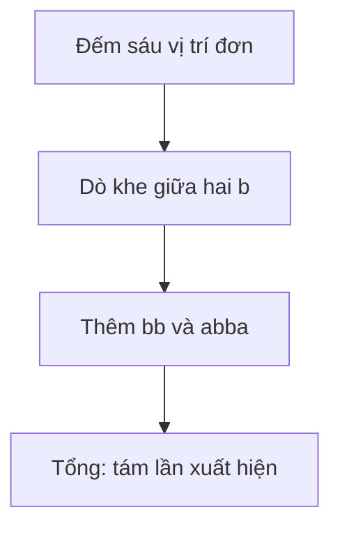

> [!tldr] Đọc nhanh
> - Hai đoạn có nội dung giống nhau nhưng khác vị trí được đếm riêng.
> - Mỗi đoạn đối xứng có đúng một [[concepts/palindrome-center|tâm]]. Cộng số lần hai đầu khớp tại từng tâm.
> - Khi dùng tọa độ ảo, [[concepts/palindrome-radius|bán kính]] lớn nhất `r` của một tâm đóng góp `⌊(r+1)/2⌋` đoạn.

> [!info] Bối cảnh
> Bài LeetCode 647 thuộc [[posts/2026-11-27-neetcode-palindrome-centers|ga 2: Palindrome mở từ tâm]] trên tuyến NeetCode Quy hoạch động. [[problems/longest-palindromic-substring|Bài 5]] giữ một đoạn lớn nhất. Bài này cộng tất cả đoạn mà cùng một vòng mở phát hiện. Bạn chỉ cần biết mảng và khoảng chỉ số.

> [!abstract]- Từ điển nhanh cho bài này (bấm để mở)
> - **Một lần xuất hiện** là một cặp chỉ số đầu và cuối. Hai vị trí khác nhau có thể mang cùng chữ.
> - **Tâm lẻ** đặt trên một ký tự, **tâm chẵn** đặt giữa hai ký tự.
> - **Bán kính ảo** tính số bước từ tâm đến biên trong dãy xen khe, tương ứng độ dài đoạn gốc mở hết.

## Hình dung trước: khoanh từng mẫu trên dải băng

Dải băng `xabbaq` có sáu đoạn một chữ. Khe giữa hai b cho hai đoạn nữa, `bb` và `abba`. Mình khoanh từng vị trí rồi cộng được 8. Hai chữ a ở hai nơi đều được khoanh riêng.

| Đời thường | Khái niệm |
|---|---|
| Chỗ đặt đầu dò | Tâm chẵn hoặc lẻ |
| Vòng khoanh trên cùng một tâm | Một lần xuất hiện có đầu và cuối riêng |
| Tổng số vòng khoanh | Tổng đóng góp của các tâm |



## Vấn đề: đếm theo vị trí

Đề cho 1 đến 1.000 ký tự tiếng Anh viết thường. Trả số đoạn liên tiếp đọc xuôi ngược giống nhau, tính cả đoạn một ký tự. `zzzz` có mười đoạn, với bốn đoạn dài 1, ba đoạn dài 2, hai đoạn dài 3 và một đoạn dài 4.

## Cơ chế

### Đếm bằng hai đầu mút hoặc bằng một tâm

Vét hết hai đầu rồi kiểm từng đoạn có thể tốn O(n³). Dùng bảng DP để lưu câu trả lời của đoạn bên trong giảm thời gian còn O(n²) và dùng O(n²) bộ nhớ. Một cách trực tiếp hơn là thử mọi tâm, mở đến khi hai chữ khác nhau hoặc chạm biên. Khi một cặp ký tự khớp, tăng số đếm. Tâm có thể là một ký tự, nên bước đầu ở tâm lẻ phải tính chính ký tự đó. Mỗi đoạn có tâm `(L+R)/2`, nên cách đếm không bỏ sót hay lặp lại. Mở độc lập tốn O(n²) thời gian và O(1) bộ nhớ phụ.

### Cộng bằng bán kính lớn nhất

Trong tọa độ xen khe, một tâm chỉ sinh độ dài cùng tính chẵn lẻ. Tâm lẻ có các độ dài 1, 3, ..., r. Tâm chẵn có các độ dài 2, 4, ..., r. Cả hai dãy chứa `⌊(r+1)/2⌋` số hạng. Có thể tính r bằng Manacher và lấy tổng ngay, với O(n) thời gian và bộ nhớ. Đọc phần chứng minh sao chép bị chặn ở [[problems/longest-palindromic-substring|bài tìm đoạn dài nhất]].

[Bản đếm lượt dò](../code/neetcode-palindrome-centers/compare.ts) cho chuỗi 1.000 chữ a ghi 1.000.000 lượt dò của mở từ tâm và 1.999 của Manacher, tính cả khe ảo. Cả hai cho 500.500 đoạn, đúng theo tổng 1+2+…+1.000. Bộ đếm không cần tạo ra 500.500 xâu để trả kết quả.

## Ví dụ chạy được

Tám ca kiểm cả mở độc lập và Manacher. Ca dài 1.000 ký tự giúp bắt lỗi đếm thiếu các đoạn chẵn hoặc dùng kiểu số quá nhỏ.

[TypeScript](../code/neetcode-palindromic-substrings/count.ts) · [Python](../code/neetcode-palindromic-substrings/count.py) · [Go](../code/neetcode-palindromic-substrings/count.go) · [Java](../code/neetcode-palindromic-substrings/count.java) · [JavaScript](../code/neetcode-palindromic-substrings/count.js) · [PHP](../code/neetcode-palindromic-substrings/count.php) · [Rust](../code/neetcode-palindromic-substrings/count.rs)

```typescript
type Stats = { start: number; length: number; count: number };

function palindromes(text: string, reuseMirror: boolean): Stats {
  const last = 2 * text.length;
  const radius = reuseMirror ? Array<number>(last + 1).fill(0) : [];
  let center = 0, right = 0;
  const answer: Stats = { start: 0, length: 0, count: 0 };

  for (let i = 0; i <= last; i++) {
    let length = reuseMirror && i < right ? Math.min(radius[2 * center - i], right - i) : 0;
    while (i - length > 0 && i + length < last) {
      const left = i - length - 1;
      const next = i + length + 1;
      if (left % 2 && text[(left - 1) / 2] !== text[(next - 1) / 2]) break;
      length++;
    }
    if (reuseMirror) {
      radius[i] = length;
      if (i + length > right) {
        center = i;
        right = i + length;
      }
    }
    if (length > answer.length) {
      answer.start = (i - length) / 2;
      answer.length = length;
    }
    answer.count += Math.floor((length + 1) / 2);
  }
  return answer;
}

function countSubstrings(text: string, reuseMirror = false): number {
  return palindromes(text, reuseMirror).count;
}
```

```python
def palindromes(text, reuse_mirror):
    last = 2 * len(text)
    radius = [0] * (last + 1) if reuse_mirror else []
    center = right = start = best = count = 0

    for i in range(last + 1):
        length = min(radius[2 * center - i], right - i) if reuse_mirror and i < right else 0
        while i - length > 0 and i + length < last:
            left, next_pos = i - length - 1, i + length + 1
            if left % 2 and text[left // 2] != text[next_pos // 2]:
                break
            length += 1
        if reuse_mirror:
            radius[i] = length
            if i + length > right:
                center, right = i, i + length
        if length > best:
            start, best = (i - length) // 2, length
        count += (length + 1) // 2
    return start, best, count


def count_substrings(text, reuse_mirror=False):
    return palindromes(text, reuse_mirror)[2]
```

```go
package main

import (
	"fmt"
	"strings"
)

type stats struct{ start, length, count int }

func palindromes(text string, reuseMirror bool) stats {
	last := 2 * len(text)
	var radius []int
	if reuseMirror {
		radius = make([]int, last+1)
	}
	center, right := 0, 0
	answer := stats{}

	for i := 0; i <= last; i++ {
		length := 0
		if reuseMirror && i < right {
			length = min(radius[2*center-i], right-i)
		}
		for i-length > 0 && i+length < last {
			left, next := i-length-1, i+length+1
			if left%2 != 0 && text[left/2] != text[next/2] {
				break
			}
			length++
		}
		if reuseMirror {
			radius[i] = length
			if i+length > right {
				center, right = i, i+length
			}
		}
		if length > answer.length {
			answer.start, answer.length = (i-length)/2, length
		}
		answer.count += (length + 1) / 2
	}
	return answer
}

func countSubstrings(text string, reuseMirror bool) int {
	return palindromes(text, reuseMirror).count
}
```

```java
class Centers {
    record Stats(int start, int length, int count) {}

    static Stats palindromes(String text, boolean reuseMirror) {
        int last = 2 * text.length();
        int[] radius = reuseMirror ? new int[last + 1] : new int[0];
        int center = 0, right = 0, start = 0, best = 0, count = 0;

        for (int i = 0; i <= last; i++) {
            int length = reuseMirror && i < right ? Math.min(radius[2 * center - i], right - i) : 0;
            while (i - length > 0 && i + length < last) {
                int left = i - length - 1, next = i + length + 1;
                if (left % 2 != 0 && text.charAt(left / 2) != text.charAt(next / 2)) break;
                length++;
            }
            if (reuseMirror) {
                radius[i] = length;
                if (i + length > right) {
                    center = i;
                    right = i + length;
                }
            }
            if (length > best) {
                start = (i - length) / 2;
                best = length;
            }
            count += (length + 1) / 2;
        }
        return new Stats(start, best, count);
    }

    static int countSubstrings(String text, boolean reuseMirror) {
        return palindromes(text, reuseMirror).count();
    }
}
```

```javascript
function palindromes(text, reuseMirror) {
    const last = 2 * text.length;
    const radius = reuseMirror ? Array(last + 1).fill(0) : [];
    let center = 0, right = 0;
    const answer = {
        start: 0,
        length: 0,
        count: 0
    };
    for(let i = 0; i <= last; i++){
        let length = reuseMirror && i < right ? Math.min(radius[2 * center - i], right - i) : 0;
        while(i - length > 0 && i + length < last){
            const left = i - length - 1;
            const next = i + length + 1;
            if (left % 2 && text[(left - 1) / 2] !== text[(next - 1) / 2]) break;
            length++;
        }
        if (reuseMirror) {
            radius[i] = length;
            if (i + length > right) {
                center = i;
                right = i + length;
            }
        }
        if (length > answer.length) {
            answer.start = (i - length) / 2;
            answer.length = length;
        }
        answer.count += Math.floor((length + 1) / 2);
    }
    return answer;
}
function countSubstrings(text, reuseMirror = false) {
    return palindromes(text, reuseMirror).count;
}
const cases = [
    [
        "",
        0
    ],
    [
        "c",
        1
    ],
    [
        "xabbaq",
        8
    ],
    [
        "tacocatx",
        11
    ],
    [
        "abab",
        6
    ],
    [
        "zzzz",
        10
    ],
    [
        "xyz",
        3
    ],
    [
        "a".repeat(1000),
        500500
    ]
];
for (const [text, expected] of cases){
    if (countSubstrings(text) !== expected || countSubstrings(text, true) !== expected) {
        throw new Error("Sai số đoạn đối xứng");
    }
}
console.log(`${cases.length}/${cases.length} ca đúng`);
```

```php
<?php
declare(strict_types=1);

function palindromes(string $text, bool $reuseMirror): array
{
    $last = 2 * strlen($text);
    $radius = $reuseMirror ? array_fill(0, $last + 1, 0) : [];
    $center = $right = $start = $best = $count = 0;

    for ($i = 0; $i <= $last; $i++) {
        $length = $reuseMirror && $i < $right ? min($radius[2 * $center - $i], $right - $i) : 0;
        while ($i - $length > 0 && $i + $length < $last) {
            $left = $i - $length - 1;
            $next = $i + $length + 1;
            if ($left % 2 && $text[intdiv($left, 2)] !== $text[intdiv($next, 2)]) {
                break;
            }
            $length++;
        }
        if ($reuseMirror) {
            $radius[$i] = $length;
            if ($i + $length > $right) {
                [$center, $right] = [$i, $i + $length];
            }
        }
        if ($length > $best) {
            [$start, $best] = [intdiv($i - $length, 2), $length];
        }
        $count += intdiv($length + 1, 2);
    }
    return [$start, $best, $count];
}

function countSubstrings(string $text, bool $reuseMirror = false): int
{
    return palindromes($text, $reuseMirror)[2];
}
```

```rust
#[derive(Default)]
struct Stats {
    start: usize,
    length: usize,
    count: usize,
}

fn palindromes(text: &str, reuse_mirror: bool) -> Stats {
    let bytes = text.as_bytes();
    let last = 2 * bytes.len();
    let mut radius = if reuse_mirror {
        vec![0; last + 1]
    } else {
        Vec::new()
    };
    let (mut center, mut right) = (0, 0);
    let mut answer = Stats::default();

    for i in 0..=last {
        let mut length = if reuse_mirror && i < right {
            radius[2 * center - i].min(right - i)
        } else {
            0
        };
        while i > length && i + length < last {
            let (left, next) = (i - length - 1, i + length + 1);
            if left % 2 != 0 && bytes[left / 2] != bytes[next / 2] {
                break;
            }
            length += 1;
        }
        if reuse_mirror {
            radius[i] = length;
            if i + length > right {
                (center, right) = (i, i + length);
            }
        }
        if length > answer.length {
            (answer.start, answer.length) = ((i - length) / 2, length);
        }
        answer.count += (length + 1) / 2;
    }
    answer
}

fn count_substrings(text: &str, reuse_mirror: bool) -> usize {
    palindromes(text, reuse_mirror).count
}
```

```text
8/8 ca đúng
```

## Hiểu lầm và bẫy hay gặp

- Tập hợp các chuỗi sẽ gộp hai lần xuất hiện ở các vị trí khác nhau. Đề đếm từng cặp đầu mút.
- Lấy tổng các bán kính ảo đếm thừa vì các vòng mở qua khe không tạo một đoạn mới. Đổi về số độ dài hợp lệ trước khi cộng.
- `/ 2` của JavaScript thường ra số thực, tương tự `/` của PHP. Bản code dùng `Math.floor` hoặc `intdiv`.
- Chỉ số byte của Go, PHP và Rust hợp với bảng chữ cái của đề. Nếu bài khác dùng ký tự đa byte, chọn đơn vị đếm và so sánh riêng.

## Câu hỏi tự kiểm tra

> [!question]- Bán kính ảo 5 ở tâm lẻ đóng góp bao nhiêu đoạn?
> Ba đoạn có độ dài 1, 3 và 5. Tính `⌊(5+1)/2⌋ = 3`.

> [!question]- Vì sao n ký tự giống hệt nhau có n(n+1)/2 đoạn?
> Mọi đoạn đều đối xứng. Có n vị trí bắt đầu cho đoạn dài 1, n−1 vị trí cho đoạn dài 2 và cứ thế tới một vị trí cho đoạn dài n.

## Tham khảo

- [Đề bài LC-0647](https://leetcode.com/problems/palindromic-substrings/)
- [Princeton Algorithms, bán kính của Manacher](https://algs4.cs.princeton.edu/53substring/Manacher.java.html)
