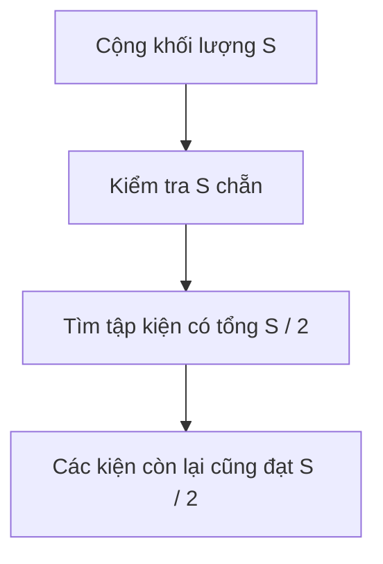

> [!tldr] Đọc nhanh
> - Gọi S là tổng mảng. S phải chẵn, và việc chia đều tương đương tìm một tập vị trí có tổng đúng T = S / 2.
> - Bảng hai chiều đọc hai khả năng lấy hoặc bỏ từ hàng trước. Khi giữ một hàng, quét tổng giảm dần để mỗi vị trí chỉ được lấy tối đa một lần.
> - Một tập bit biểu diễn cùng các tổng có thể đạt. Dịch trái x rồi OR với tập cũ để gộp khả năng lấy và bỏ phần tử x.

> [!info] Bối cảnh
> Bài LeetCode 416, thuộc [[posts/2026-11-27-neetcode-knapsack|ga 3 – Ba lô và đổi tiền]] trên [[series/neetcode-dp|tuyến NeetCode – Quy hoạch động]]. Mình đi từ một câu hỏi về cân nặng đến bất biến của vòng lặp để thấy vì sao chiều quét làm đổi đáp án.

> [!abstract]- Từ điển nhanh cho bài này (bấm để mở)
> - [[concepts/knapsack-state|Trạng thái ba lô]] ghi câu hỏi cho một phạm vi vật và một tổng hoặc sức chứa.
> - [[concepts/zero-one-knapsack|Ba lô 0/1]] cho lấy mỗi vị trí tối đa một lần. Hai vị trí bằng giá trị vẫn là hai lựa chọn riêng.
> - [[concepts/knapsack-update-order|Thứ tự cập nhật]] quyết định ô nguồn còn thuộc hàng cũ hay đã thuộc hàng mới.
> - Tập bit (bitset) dùng bit thứ s để ghi liệu có tổng s.

## Hình dung trước: chia hàng lên hai bàn cân

Mình có bốn kiện nặng 3, 6, 7 và 10. Nếu một bàn cân nhận 3 và 10, bàn còn lại nhận 6 và 7. Cả hai nặng 13. Vì cân nào nhận kiện nào cũng được, mình chỉ cần tìm cách làm đầy đúng một bàn đến 13.

| Đời thường | Khái niệm |
|---|---|
| Tổng cân nặng của các kiện | S |
| Số cần hiện trên mỗi bàn | T = S / 2 khi S chẵn |
| Phiếu đánh dấu các mức cân đạt được | Mảng boolean hoặc tập bit |
| Lấy một kiện từ số kiện chưa xét | Chuyển trạng thái 0/1 |
| Khối lượng của các kiện còn lại | S − T = T |



## Vấn đề: hai nửa bằng tổng

Cho mảng gồm từ 1 đến 200 số nguyên dương, mỗi số từ 1 đến 100. Hỏi có thể chia toàn bộ các **vị trí** vào hai nhóm sao cho tổng hai nhóm bằng nhau hay không. Với `[3,6,7,10]`, hai nhóm `[3,10]` và `[6,7]` đều có tổng 13. Với `[2,3,7]`, tổng là 12 nhưng không có tập con tổng 6. [Đề bài LeetCode 416](https://leetcode.com/problems/partition-equal-subset-sum/)

Nếu S lẻ, hai tổng nguyên bằng nhau không thể cộng thành S. Nếu S = 2T, một nhóm hợp lệ phải có tổng T. Ngược lại, tìm được tập vị trí tổng T thì phần bù của nó có tổng S − T = T. Nhờ đó bài chia hai nhóm trở thành bài tìm một tổng đích. Do các số dương, mọi tổng vượt T đều có thể bỏ khỏi trạng thái, vì thêm số không làm tổng giảm lại.

## Cơ chế

### Thử lấy hoặc bỏ

Hàm đệ quy giữ vị trí i và tổng còn thiếu r. Nhánh lấy `nums[i]` giảm r đi giá trị đó, nhánh bỏ giữ nguyên r, và cả hai đi tiếp i + 1. Nếu r bằng 0, đã tìm được một nhóm. Nếu r âm hoặc hết mảng khi r vẫn dương, nhánh thất bại. Cách này tốn O(2ⁿ) thời gian trong trường hợp xấu nhất và O(n) ngăn xếp. Mình dùng nó làm bộ đối chiếu trên đầu vào nhỏ.

### Lập bảng từ hàng trước

`D[i][s]` nghĩa là có tập con từ **i vị trí đầu tiên** đạt tổng chính xác s. Hàng 0 chỉ có `D[0][0] = true`, ứng với tập rỗng. Xét phần tử x ở vị trí i, ô `D[i+1][s]` nhận giá trị của `D[i][s]`, hoặc của `D[i][s−x]` khi s ≥ x. Hai nguồn cùng ở hàng i vì cả hai đều bắt đầu từ những vị trí đã xét.

| Kiện vừa xét | Các tổng không vượt 13 đạt được |
|---|---|
| Chưa có | 0 |
| 3 | 0, 3 |
| 6 | 0, 3, 6, 9 |
| 7 | 0, 3, 6, 7, 9, 10, 13 |
| 10 | 0, 3, 6, 7, 9, 10, 13 |

Khi thêm 7, tổng 13 có được từ tổng 6 của hàng trước. Bảng có (n + 1)(T + 1) ô, thời gian và bộ nhớ phụ đều O(nT). T được đo theo **giá trị số**, nên đây là thời gian giả đa thức theo kích thước biểu diễn đầu vào. Giới hạn đề cho T ≤ 10.000. [MIT 6.006, bài giảng Subset Sum và thời gian giả đa thức](https://ocw.mit.edu/courses/6-006-introduction-to-algorithms-spring-2020/resources/lecture-18-dynamic-programming-part-4-rods-subset-sum-pseudopolynomial/)

### Giữ một hàng và đi từ lớn xuống nhỏ

Trước khi xử lý x, `reachable[s]` là kết quả sau những vị trí trước x. Để giữ bất biến đó ở ô nguồn `reachable[s−x]`, mình duyệt s từ T xuống x. Vì s−x < s, ô nguồn chưa được ghi đè trong lượt này. Ô s giữ được cả trường hợp bỏ x lẫn trường hợp lấy x đúng một lần.

Với `[2,3,7]` và T = 6, đi từ nhỏ lên lớn sẽ bật lần lượt các ô 2, 4 và 6 trong **cùng lượt của số 2**. Tổng 6 xuất hiện từ ba lần dùng một vị trí. Đi giảm dần, lượt đó chỉ bật ô 2. Thời gian vẫn O(nT) và bộ nhớ phụ còn O(T).

### Gói các tổng vào bit

Bit s của B bằng 1 khi có tổng s. B bắt đầu ở 1 để bật riêng bit 0. Dịch B cũ sang trái x đặt mỗi tổng s vào vị trí s+x. OR với B cũ giữ các tổng từ nhánh bỏ x cũng như nhánh lấy x. Mỗi phép cập nhật đọc ảnh chụp trước khi thêm x.

Với biểu diễn mảng từ rộng w bit, cần ⌈(T + 1)/w⌉ từ. Việc dịch và OR tốn O(n⌈(T + 1)/w⌉) phép trên từ và O(⌈(T + 1)/w⌉) từ nhớ. Khi tự dịch theo từng khối, duyệt từ chỉ số khối lớn xuống nhỏ. Một khối đích có thể nhận bit từ hai khối nguồn liền nhau. Phần dịch nguyên khối và phần dư phải được tính riêng để xử lý đúng các số như 32 trong phiên bản dùng từ 32 bit.

## Ví dụ chạy được

[TypeScript](../code/neetcode-partition-equal-subset-sum/solve.ts) · [Python](../code/neetcode-partition-equal-subset-sum/solve.py) · [Go](../code/neetcode-partition-equal-subset-sum/solve.go) · [Java](../code/neetcode-partition-equal-subset-sum/solve.java) · [JavaScript](../code/neetcode-partition-equal-subset-sum/solve.js) · [PHP](../code/neetcode-partition-equal-subset-sum/solve.php) · [Rust](../code/neetcode-partition-equal-subset-sum/solve.rs)

```ts
type Allocation = { cells: number };

function descending(nums: number[], target: number, allocation?: Allocation): boolean {
  const reachable = new Uint8Array(target + 1);
  reachable[0] = 1;
  for (const x of nums) {
    for (let sum = target; sum >= x; sum--) {
      reachable[sum] |= reachable[sum - x];
    }
  }
  if (allocation) allocation.cells = reachable.length;
  return reachable[target] === 1;
}

function bitset(nums: number[], target: number): boolean {
  const goal = 1n << BigInt(target);
  const mask = (goal << 1n) - 1n;
  let reachable = 1n;
  for (const x of nums) {
    reachable = (reachable | (reachable << BigInt(x))) & mask;
  }
  return (reachable & goal) !== 0n;
}
```

```python
def descending(nums, target):
    reachable = bytearray(target + 1)
    reachable[0] = 1
    for x in nums:
        for s in range(target, x - 1, -1):
            reachable[s] |= reachable[s - x]
    return bool(reachable[target])


def bitset(nums, target):
    goal = 1 << target
    mask = (goal << 1) - 1
    reachable = 1
    for x in nums:
        reachable = (reachable | (reachable << x)) & mask
    return bool(reachable & goal)
```

```go
func descending(nums []int, target int) bool {
	reachable := make([]bool, target+1)
	reachable[0] = true
	for _, x := range nums {
		for sum := target; sum >= x; sum-- {
			reachable[sum] = reachable[sum] || reachable[sum-x]
		}
	}
	return reachable[target]
}

func bitset(nums []int, target int) bool {
	words := make([]uint32, target/32+1)
	words[0] = 1
	for _, x := range nums {
		offset, shift := x/32, x%32
		for dst := len(words) - 1; dst >= offset; dst-- {
			src := dst - offset
			moved := words[src] << shift
			if shift != 0 && src > 0 {
				moved |= words[src-1] >> (32 - shift)
			}
			words[dst] |= moved
		}
	}
	return words[target/32]&(uint32(1)<<(target%32)) != 0
}
```

```java
import java.math.BigInteger;

class Solve {
    static boolean descending(int[] nums, int target) {
        boolean[] reachable = new boolean[target + 1];
        reachable[0] = true;
        for (int x : nums) {
            for (int sum = target; sum >= x; sum--) {
                reachable[sum] |= reachable[sum - x];
            }
        }
        return reachable[target];
    }

    static boolean bitset(int[] nums, int target) {
        BigInteger goal = BigInteger.ONE.shiftLeft(target);
        BigInteger mask = goal.shiftLeft(1).subtract(BigInteger.ONE);
        BigInteger reachable = BigInteger.ONE;
        for (int x : nums) {
            reachable = reachable.or(reachable.shiftLeft(x)).and(mask);
        }
        return reachable.testBit(target);
    }
}
```

```js
function descending(nums, target, allocation) {
  const reachable = new Uint8Array(target + 1);
  reachable[0] = 1;
  for (const x of nums) {
    for (let sum = target; sum >= x; sum--) {
      reachable[sum] |= reachable[sum - x];
    }
  }
  if (allocation) allocation.cells = reachable.length;
  return reachable[target] === 1;
}

function bitset(nums, target) {
  const goal = 1n << BigInt(target);
  const mask = (goal << 1n) - 1n;
  let reachable = 1n;
  for (const x of nums) {
    reachable = (reachable | (reachable << BigInt(x))) & mask;
  }
  return (reachable & goal) !== 0n;
}
```

```php
<?php

function descending(array $nums, int $target): bool
{
    $reachable = array_fill(0, $target + 1, false);
    $reachable[0] = true;
    foreach ($nums as $x) {
        for ($sum = $target; $sum >= $x; $sum--) {
            $reachable[$sum] = $reachable[$sum] || $reachable[$sum - $x];
        }
    }
    return $reachable[$target];
}

function bitset(array $nums, int $target): bool
{
    // Dịch một nhóm 16 bit vẫn vừa int có dấu 32 bit.
    $words = array_fill(0, intdiv($target, 16) + 1, 0);
    $words[0] = 1;
    foreach ($nums as $x) {
        $offset = intdiv($x, 16);
        $shift = $x % 16;
        for ($dst = count($words) - 1; $dst >= $offset; $dst--) {
            $src = $dst - $offset;
            $moved = ($words[$src] << $shift) & 0xffff;
            if ($shift !== 0 && $src > 0) {
                $moved |= $words[$src - 1] >> (16 - $shift);
            }
            $words[$dst] |= $moved;
        }
    }
    return ($words[intdiv($target, 16)] & (1 << ($target % 16))) !== 0;
}
```

```rust
fn descending(nums: &[usize], target: usize) -> bool {
    let mut reachable = vec![false; target + 1];
    reachable[0] = true;
    for &x in nums {
        for sum in (x..=target).rev() {
            reachable[sum] |= reachable[sum - x];
        }
    }
    reachable[target]
}

fn bitset(nums: &[usize], target: usize) -> bool {
    let mut words = vec![0u32; target / 32 + 1];
    words[0] = 1;
    for &x in nums {
        let (offset, shift) = (x / 32, x % 32);
        for dst in (offset..words.len()).rev() {
            let src = dst - offset;
            let mut moved = words[src] << shift;
            if shift != 0 && src > 0 {
                moved |= words[src - 1] >> (32 - shift);
            }
            words[dst] |= moved;
        }
    }
    words[target / 32] & (1 << (target % 32)) != 0
}
```

Mỗi file chạy vét cạn trên ca nhỏ rồi kiểm bảng hai chiều, một hàng duyệt giảm và tập bit. TypeScript, JavaScript và Python còn đối chiếu với vét cạn trên toàn bộ mảng độ dài 1–6 gồm các số từ 1 đến 4. Hai ca 200 phần tử kiểm T = 10.000 có nghiệm và T = 9.999 vô nghiệm.

Đầu ra khi chạy TypeScript hoặc JavaScript.

```text
16/16 ca đúng
Đối chiếu vét cạn: 5460 mảng
T=9999: bảng 2010000 ô, một hàng 10000 ô
```

Python in hai dòng đầu. Go, Java, PHP và Rust in dòng `16/16 ca đúng`.

Ở ca T = 9.999, phép đo đếm **số ô cấp phát** trong hai cách, gồm hàng khởi tạo của bảng, và chưa tính chi phí quản lý mảng. Nén hàng giảm số ô 201 lần. Với từ 32 bit, cùng miền tổng từ 0 đến 9.999 cần 313 từ. Đây là phép đếm dung lượng trạng thái, còn tốc độ thực tế tùy cách runtime triển khai mảng và phép toán bit.

## Hiểu lầm và bẫy hay gặp

- **Thấy S chẵn rồi trả true.** S chẵn chỉ cho biết T là số nguyên. `[2,3,7]` vẫn không tạo được tổng 6.
- **Loại số trùng để giảm đầu vào.** `[2,2]` chia được vì hai số 2 nằm ở hai vị trí. Xóa một vị trí làm thay đổi bài toán.
- **Dùng phép dịch trên `Number` trong TypeScript hoặc JavaScript.** Phép dịch bit trên `Number` hoạt động trên 32 bit. Ví dụ dùng `BigInt` cho cả tập bit và số bước dịch. [Đặc tả ECMAScript](https://tc39.es/ecma262/multipage/ecmascript-data-types-and-values.html)
- **Nhân bản hàng trong Python bằng phép nhân danh sách ngoài.** Viết `[row] * (n + 1)` làm các hàng dùng chung một đối tượng. Tạo hàng riêng trong comprehension. Python dùng luôn `int` cho tập bit. [Kiểu dựng sẵn trong Python](https://docs.python.org/3/library/stdtypes.html)
- **Quên gán lại trong Java.** `BigInteger` bất biến, nên `or` và `shiftLeft` tạo giá trị để gán lại. Go và Rust minh họa mảng khối không dấu 32 bit, bỏ phép dịch chéo khi dư bằng 0. PHP dùng khối 16 bit để giá trị trung gian trước khi cắt vẫn nằm trong miền số nguyên 32 bit có dấu. [Oracle Java `BigInteger`](https://docs.oracle.com/en/java/javase/21/docs/api/java.base/java/math/BigInteger.html)

## Câu hỏi tự kiểm tra

> [!question]- Vì sao chỉ cần tìm một nhóm tổng T?
> Tổng hai nhóm bị khóa ở S, nên phần bù của nhóm tổng T có tổng S − T = T.

> [!question]- Ở lượt x = 2, vì sao quét giảm dần bảo vệ ô nguồn 4 khi xét tổng 6?
> Chỉ số 4 nhỏ hơn 6 nên lượt hiện tại chưa viết ô 4. Nếu 4 chưa từng đạt trước x, ô 6 không thể được bật từ hai lần dùng lại x.

> [!question]- Nếu muốn giữ cả cách chọn, bảng hai chiều giúp gì?
> Bắt đầu ở `D[n][T]` rồi đi ngược các hàng. Nếu hàng trước vẫn đạt tổng s, có thể bỏ phần tử cuối. Nếu chỉ ô s−x của hàng trước đạt, lấy x và tiếp tục với s−x.

## Tham khảo

- [LeetCode 416 – Partition Equal Subset Sum](https://leetcode.com/problems/partition-equal-subset-sum/)
- [MIT 6.006 – Subset Sum và thời gian giả đa thức](https://ocw.mit.edu/courses/6-006-introduction-to-algorithms-spring-2020/resources/lecture-18-dynamic-programming-part-4-rods-subset-sum-pseudopolynomial/)
