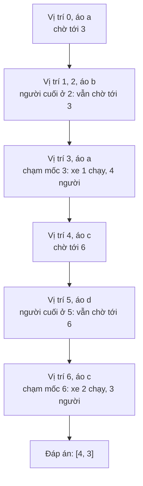
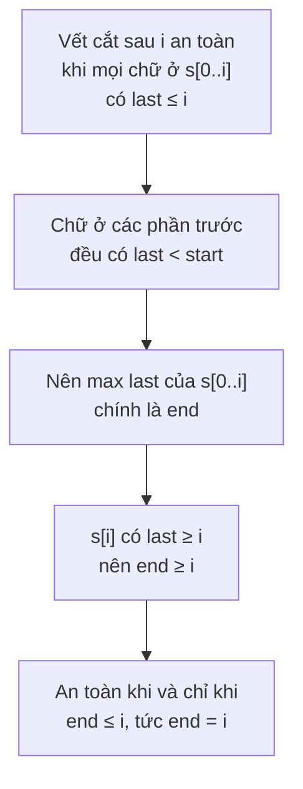
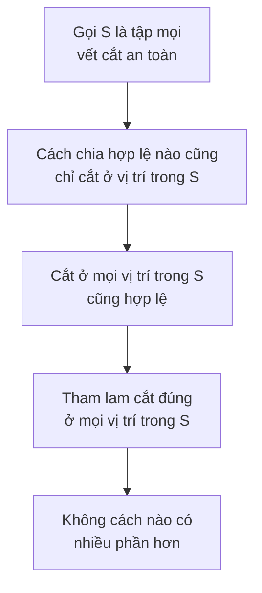

> [!tldr] Đọc nhanh
> - Mỗi chữ phải nằm gọn trong một phần, nên một phần chứa chữ c thì phải kéo tới tận lần xuất hiện cuối của c. Bài xoay quanh bảng `last[c]` gồm 26 ô.
> - Đi từ trái sang phải, đẩy mốc `end = max(end, last[c])`. Khi `i == end`, không chữ nào trong phần còn xuất hiện về sau: cắt ngay. Đây là [[concepts/last-occurrence-boundary|mốc lần xuất hiện cuối]].
> - Cắt sớm nhất có thể cho nhiều phần nhất, vì nó cắt ở **mọi** vị trí cắt hợp lệ, và cách chia nào cũng chỉ dùng được các vị trí đó.
> - Nhìn theo khoảng: mỗi chữ là một khoảng [lần đầu, lần cuối], và các phần chính là các khoảng sau khi gộp những khoảng chồng nhau.
> - Vét cạn O(n²) mất 100.000.000 bước khi n = 10.000; tham lam O(n) mất 20.000 bước.

> [!info] Bối cảnh
> Đây là bài LeetCode 763 tại [[posts/2026-11-28-neetcode-greedy-grouping|ga MISC-04: Tham lam theo nhóm]] trên **tuyến NeetCode: Kỹ thuật tổng hợp**. Mình hình dung một hàng người xếp lên xe buýt, mỗi nhóm bạn mặc áo cùng màu và nhất định đi chung một xe. Bạn chỉ cần biết chuỗi, mảng và vòng lặp; đọc [[problems/jump-game|Jump Game]] trước sẽ thấy ngay nước "nhớ chỗ xa nhất" quen thuộc.

> [!abstract]- Từ điển nhanh cho bài này (bấm để mở)
> - Phần (partition): một đoạn liên tiếp của chuỗi. Ghép các phần theo thứ tự thì ra lại đúng chuỗi ban đầu.
> - [[concepts/counting-array|Mảng đếm]] 26 ô: dùng `c - 'a'` làm chỉ số cho chữ thường, không cần hash map. Ở bài này mỗi ô giữ vị trí cuối của một chữ thay vì số lần đếm.
> - [[concepts/greedy-choice|Lựa chọn tham lam]]: ở mỗi bước chọn ngay một quyết định cục bộ, không quay lại, rồi chứng minh quyết định đó không làm mất đáp án.
> - Vết cắt sau vị trí i: chỗ ngăn giữa ký tự i và ký tự i + 1. Vết cắt **an toàn** khi không chữ nào xuất hiện ở cả hai bên.

## Hình dung trước: lên xe buýt theo nhóm áo

Một hàng người đứng chờ xe buýt. Mỗi người mặc áo một màu; những người cùng màu là một nhóm bạn và nhất định phải lên cùng một xe. Xe đón người theo đúng thứ tự trong hàng, chỉ đón một đoạn liền nhau. Nhà xe muốn chạy nhiều chuyến nhất có thể, mỗi chuyến chở ít người thôi cũng được.

Người soát vé có sẵn một tờ danh sách: với mỗi màu áo, người cuối cùng mặc màu đó đứng ở vị trí nào. Cho từng người lên xe, anh ghi nhớ "phải chờ tới vị trí end mới cho xe chạy được", và mỗi người mới lên có thể đẩy con số đó ra xa hơn. Đúng lúc người ở vị trí end lên xe, mọi nhóm trên xe đã đủ mặt: xe chạy ngay, không chờ thêm ai.

| Đời thường | Khái niệm |
|---|---|
| Hàng người chờ xe | chuỗi `s` |
| Màu áo của một người | một chữ `s[i]` |
| Một nhóm bạn đi chung xe | mỗi chữ chỉ nằm trong một phần |
| Một chuyến xe đón một đoạn liền nhau | một phần là đoạn liên tiếp |
| Tờ danh sách "người cuối của mỗi màu" | bảng `last[c]` |
| "Phải chờ tới vị trí end" | `end = max(end, last[c])` |
| Người ở vị trí end vừa lên, xe chạy | `i == end`: cắt |
| Chạy nhiều chuyến nhất | nhiều phần nhất |

Với hàng `abbacdc`, tờ danh sách ghi a → 3, b → 2, c → 6, d → 5:



## Vấn đề: chia chuỗi thành nhiều phần nhất

Cho một chuỗi `s` gồm chữ thường tiếng Anh, độ dài từ 1 đến 500. Hãy cắt `s` thành nhiều đoạn liên tiếp nhất có thể sao cho mỗi chữ xuất hiện trong tối đa một đoạn, tức mọi lần xuất hiện của một chữ đều rơi vào cùng một đoạn. Ghép các đoạn theo thứ tự phải ra lại `s`. Trả về danh sách độ dài các đoạn, theo thứ tự. Ví dụ của mình: `qwqeer` cho `[3, 2, 1]` (các đoạn `qwq`, `ee`, `r`). [Đề gốc LeetCode 763](https://leetcode.com/problems/partition-labels/)

Lần đầu mình nghĩ chỉ cần cắt ngay khi chữ đang xét đã hết, tức khi `last[s[i]] == i`. Với `abab` cách đó cắt sau vị trí 2 (chữ a hết ở đó) và cho `[3, 1]`, nhưng chữ b nằm ở cả `aba` lẫn `b`. Đáp án đúng là `[4]`. Một phần phải chờ **mọi** chữ trong nó hết, không chỉ chữ vừa gặp. Đó là lý do cần `max`.

## Cơ chế

### Vét cạn: thử từng vết cắt

Mỗi vị trí i từ 0 tới n − 1 là một vết cắt ứng viên (vết cắt sau ký tự cuối luôn có). Với mỗi i, quét `s[0..i]` để lấy tập chữ bên trái, quét `s[i+1..n)` để lấy tập chữ bên phải, rồi so 26 ô: không chữ nào có ở cả hai bên thì vết cắt an toàn. Cắt ở mọi vết cắt an toàn là ra đáp án (phần dưới giải thích vì sao). Mỗi vị trí quét đúng n ký tự, nên tổng là O(n²) thời gian và O(26) bộ nhớ phụ. Với giới hạn n ≤ 500 của đề, con số đó là 250.000 bước, vẫn chạy được. Mình giữ nó làm trọng tài trong file chạy.

Cái phí của vét cạn: tập chữ bên phải của vết cắt i và của vết cắt i + 1 gần như giống hệt nhau, vậy mà mỗi lần nó lại quét lại từ đầu. Toàn bộ thông tin "chữ c còn xuất hiện sau vị trí i không" gói gọn trong một con số: `last[c] > i`.

### Gộp khoảng: mỗi chữ là một khoảng

Ghi lần đầu và lần cuối của từng chữ: chữ c chiếm khoảng `[first[c], last[c]]`. Hai khoảng chồng lên nhau thì hai chữ đó buộc phải chung một phần, vì một vết cắt nằm giữa sẽ tách ít nhất một chữ ra hai bên. Vậy các phần chính là kết quả của việc gộp các khoảng chồng nhau, đúng bài toán gộp khoảng (Merge Intervals, LeetCode 56) quen thuộc: sắp các khoảng theo đầu trái, đi lần lượt, khoảng mới bắt đầu sau `hi` thì chốt một phần, còn không thì nới `hi`. Với `abbacdc`: a [0, 3], b [1, 2], c [4, 6], d [5, 5] gộp thành [0, 3] và [4, 6], tức `[4, 3]`.

Có nhiều nhất 26 khoảng, nên việc sắp xếp chỉ tốn O(26 log 26), coi như hằng số. Tổng là O(n) thời gian và O(26) bộ nhớ.

### Tham lam một lượt: kéo mốc end, cắt khi chạm mốc

Cách gộp khoảng có một bước thừa. Đi qua chuỗi theo i tăng dần, mình gặp lần đầu của các chữ theo đúng thứ tự đầu trái của chúng, tức là các khoảng đã tự xếp sẵn. Nên không cần dựng danh sách khoảng: chỉ cần bảng `last`, một biến `end` và một biến `start`.

Một lượt đầu ghi `last[c]` (gán đè, nên ô cuối cùng giữ lần cuối). Lượt thứ hai, ở mỗi i đặt `end = max(end, last[s[i]])`; nếu `i == end` thì ghi độ dài `end − start + 1` và đặt `start = i + 1`. Thời gian O(n), bộ nhớ phụ O(26), không tính danh sách kết quả.

Truy vết với `xyzzyxw` (last: x → 5, y → 4, z → 3, w → 6):

| i | chữ | last | end | cắt? |
|---|---|---|---|---|
| 0 | x | 5 | 5 | không |
| 1 | y | 4 | 5 | không |
| 2 | z | 3 | 5 | không |
| 3 | z | 3 | 5 | không |
| 4 | y | 4 | 5 | không |
| 5 | x | 5 | 5 | có, độ dài 6 |
| 6 | w | 6 | 6 | có, độ dài 1 |

Đáp án `[6, 1]`. Để ý ở i = 3, chữ z vừa hết (`last = i`), nhưng `end` vẫn là 5 vì x và y chưa hết. Bản sai "bỏ max" sẽ cắt nhầm ở đây.

### Vì sao cắt sớm nhất cho nhiều phần nhất

Hai điều cần thấy. Thứ nhất, `i == end` đúng khi và chỉ khi vết cắt sau i an toàn. Thứ hai, cắt ở mọi vết cắt an toàn là cách chia nhiều phần nhất.





Bước B: một cách chia hợp lệ không để chữ nào nằm hai bên một vết cắt của nó, nên mỗi vết cắt của nó đều an toàn. Bước C: giữa hai vết cắt an toàn liền nhau, không chữ nào lọt qua vết bên trái hay vết bên phải, nên mỗi chữ chỉ ở một phần. Vậy số phần nhiều nhất là |S|, và tham lam đạt đúng con số đó. Nói theo kiểu xe buýt: cho xe chạy sớm hơn lúc đủ mặt là phạm luật, còn chờ thêm sau lúc đủ mặt thì chỉ gộp hai chuyến thành một.

Cách này cùng họ với [[concepts/farthest-reach|chỗ xa nhất]] ở [[problems/jump-game|Jump Game]]: cả tập ràng buộc "chữ nào chưa hết" được gói vào một con số `end`, và chỉ cần so i với nó.

| Cách | Thời gian | Bộ nhớ phụ | Ghi chú |
|---|---|---|---|
| Vét cạn từng vết cắt | O(n²) | O(26) | Trọng tài; 250.000 bước khi n = 500 |
| Gộp khoảng [đầu, cuối] | O(n + 26 log 26) | O(26) | Cùng đáp án, dựng danh sách khoảng rồi sắp |
| Tham lam một lượt | O(n) | O(26) | Cách chính; cắt khi `i == end` |

### Đo: vét cạn và tham lam

Giới hạn của đề nhỏ (n ≤ 500), nên ở đó cả hai cách đều nhanh. Để thấy khác biệt, mình dựng chuỗi n = 10.000 ký tự gồm 5 khối 2.000 ký tự, khối k chỉ dùng 5 chữ của riêng nó, nên đáp án là năm phần 2.000. Vét cạn quét đúng n ký tự ở mỗi vị trí: n² = 100.000.000 bước. Tham lam đi hai lượt: 2n = 20.000 bước. Mỗi ngôn ngữ đo một lần trên máy mình:

| Ngôn ngữ | Vét cạn | Tham lam |
|---|---|---|
| TypeScript (Node) | 107,6 ms | 0,03 ms |
| Python | 2.926,0 ms | 1,44 ms |
| Go | 40,3 ms | 0,01 ms |
| Java | 86,1 ms | 0,03 ms |
| JavaScript (Node) | 105,0 ms | 0,03 ms |
| PHP | 1.272,1 ms | 0,47 ms |
| Rust | 31,1 ms | 0,01 ms |

Số bước tăng theo bình phương: gấp đôi n thì vét cạn gấp bốn lần, còn tham lam chỉ gấp đôi.

## Ví dụ chạy được

[TypeScript](../code/neetcode-partition-labels/labels.ts) · [Python](../code/neetcode-partition-labels/labels.py) · [Go](../code/neetcode-partition-labels/labels.go) · [Java](../code/neetcode-partition-labels/labels.java) · [JavaScript](../code/neetcode-partition-labels/labels.js) · [PHP](../code/neetcode-partition-labels/labels.php) · [Rust](../code/neetcode-partition-labels/labels.rs)

```ts
// Cách chính: bảng lần xuất hiện cuối, kéo end tới lần cuối xa nhất, cắt khi i chạm end
function partitionLabels(s: string, counter = { steps: 0 }): number[] {
    const last = new Array(26).fill(0)
    for (let i = 0; i < s.length; i++) {
        last[s.charCodeAt(i) - 97] = i
        counter.steps++
    }
    const sizes: number[] = []
    let start = 0
    let end = 0 // phần hiện tại phải kéo ít nhất tới đây
    for (let i = 0; i < s.length; i++) {
        end = Math.max(end, last[s.charCodeAt(i) - 97])
        counter.steps++
        if (i === end) {
            sizes.push(end - start + 1) // mọi chữ trong phần đã hết: cắt sớm nhất có thể
            start = i + 1
        }
    }
    return sizes
}
```

```python
# Cách chính: bảng lần xuất hiện cuối, kéo end tới lần cuối xa nhất, cắt khi i chạm end
def partition_labels(s, counter=None):
    last = {ch: i for i, ch in enumerate(s)}  # gán đè: giữ lại lần cuối
    if counter is not None:
        counter["steps"] += len(s)
    sizes = []
    start = 0
    end = 0  # phần hiện tại phải kéo ít nhất tới đây
    for i, ch in enumerate(s):
        end = max(end, last[ch])
        if counter is not None:
            counter["steps"] += 1
        if i == end:
            sizes.append(end - start + 1)  # mọi chữ trong phần đã hết: cắt sớm nhất có thể
            start = i + 1
    return sizes
```

```go
// Cách chính: bảng lần xuất hiện cuối, kéo end tới lần cuối xa nhất, cắt khi i chạm end
func partitionLabels(s string, steps *int64) []int {
	var last [26]int
	for i := 0; i < len(s); i++ {
		last[s[i]-'a'] = i // s[i] là byte, không phải rune
		*steps++
	}
	sizes := []int{}
	start, end := 0, 0 // phần hiện tại phải kéo ít nhất tới end
	for i := 0; i < len(s); i++ {
		end = max(end, last[s[i]-'a'])
		*steps++
		if i == end {
			sizes = append(sizes, end-start+1) // mọi chữ trong phần đã hết: cắt sớm nhất có thể
			start = i + 1
		}
	}
	return sizes
}
```

```java
// Cách chính: bảng lần xuất hiện cuối, kéo end tới lần cuối xa nhất, cắt khi i chạm end
static List<Integer> partitionLabels(String s) {
    int[] last = new int[26];
    for (int i = 0; i < s.length(); i++) {
        last[s.charAt(i) - 'a'] = i;
        steps++;
    }
    List<Integer> sizes = new ArrayList<>();
    int start = 0;
    int end = 0; // phần hiện tại phải kéo ít nhất tới đây
    for (int i = 0; i < s.length(); i++) {
        end = Math.max(end, last[s.charAt(i) - 'a']);
        steps++;
        if (i == end) {
            sizes.add(end - start + 1); // mọi chữ trong phần đã hết: cắt sớm nhất có thể
            start = i + 1;
        }
    }
    return sizes;
}
```

```js
// Cách chính: bảng lần xuất hiện cuối, kéo end tới lần cuối xa nhất, cắt khi i chạm end
function partitionLabels(s, counter = { steps: 0 }) {
    const last = new Array(26).fill(0)
    for (let i = 0; i < s.length; i++) {
        last[s.charCodeAt(i) - 97] = i
        counter.steps++
    }
    const sizes = []
    let start = 0
    let end = 0 // phần hiện tại phải kéo ít nhất tới đây
    for (let i = 0; i < s.length; i++) {
        end = Math.max(end, last[s.charCodeAt(i) - 97])
        counter.steps++
        if (i === end) {
            sizes.push(end - start + 1) // mọi chữ trong phần đã hết: cắt sớm nhất có thể
            start = i + 1
        }
    }
    return sizes
}
```

```php
// Cách chính: bảng lần xuất hiện cuối, kéo end tới lần cuối xa nhất, cắt khi i chạm end
function partitionLabels(string $s): array {
    global $steps;
    $n = strlen($s);
    $last = array_fill(0, 26, 0);
    for ($i = 0; $i < $n; $i++) {
        $last[ord($s[$i]) - 97] = $i;
        $steps++;
    }
    $sizes = [];
    $start = 0;
    $end = 0; // phần hiện tại phải kéo ít nhất tới đây
    for ($i = 0; $i < $n; $i++) {
        $end = max($end, $last[ord($s[$i]) - 97]);
        $steps++;
        if ($i === $end) {
            $sizes[] = $end - $start + 1; // mọi chữ trong phần đã hết: cắt sớm nhất có thể
            $start = $i + 1;
        }
    }
    return $sizes;
}
```

```rust
// Cách chính: bảng lần xuất hiện cuối, kéo end tới lần cuối xa nhất, cắt khi i chạm end
fn partition_labels(s: &str, steps: &mut u64) -> Vec<i32> {
    let b = s.as_bytes(); // &str không đánh chỉ số s[i] được: đi qua byte
    let mut last = [0usize; 26];
    for (i, &ch) in b.iter().enumerate() {
        last[(ch - b'a') as usize] = i;
        *steps += 1;
    }
    let mut sizes = Vec::new();
    let mut start = 0;
    let mut end = 0; // phần hiện tại phải kéo ít nhất tới đây
    for (i, &ch) in b.iter().enumerate() {
        end = end.max(last[(ch - b'a') as usize]);
        *steps += 1;
        if i == end {
            sizes.push((end - start + 1) as i32); // mọi chữ trong phần đã hết: cắt sớm nhất có thể
            start = i + 1;
        }
    }
    sizes
}
```

Các tab trích cách tham lam một lượt; dòng tăng `steps` chỉ để đếm cho phép đo. File tải về còn có vét cạn, cách gộp khoảng và bản sai "bỏ max" (cắt khi chữ hiện tại hết). Tám ca kiểm tra tự dựng gồm một ký tự, mọi chữ khác nhau, một chữ lặp lại, chữ đầu bằng chữ cuối, hai phần lồng khoảng, phần dài rồi phần một ký tự, ba phần dài 3, 2, 1, và một chuỗi mà khoảng của ba chữ móc nối nhau thành một phần. Mỗi ca, cả ba cách phải ra đúng danh sách mong đợi.

Dòng thứ hai đối chiếu trên mọi chuỗi dài 1 tới 7 ký tự lấy từ {a, b, c}: 3.279 chuỗi. Một chuỗi tính là đúng khi gộp khoảng và tham lam ra đúng danh sách của vét cạn. Dòng thứ ba chạy bản sai trên cùng 3.279 chuỗi. Dòng cuối là phép đo ở trên (đây là số của TypeScript).

```text
8/8 ca đúng
3279/3279 ca đúng (đối chiếu vét cạn)
Cắt khi chữ hiện tại hết (bỏ max): sai 2922/3279 ca
n = 10000, 5 phần (khớp): vét cạn 100000000 bước (107.6 ms), tham lam 20000 bước (0.03 ms)
```

Cả bảy ngôn ngữ in đúng ba dòng đầu và cùng số bước ở dòng cuối; chỉ thời gian khác nhau, như bảng ở phần Cơ chế.

## Hiểu lầm và bẫy hay gặp

- Cắt khi chữ hiện tại hết (`last[s[i]] == i`) thay vì khi `i == end`. Với `abab` nó cho `[3, 1]` thay vì `[4]`. Dòng thứ ba ở trên: sai 2.922/3.279 chuỗi, tức gần chín phần mười.
- Nghĩ rằng "nhiều phần nhất" cần thử nhiều cách chia hoặc quay lui. Không cần: các vết cắt an toàn không phụ thuộc nhau, cắt hết chúng là tốt nhất.
- Dùng lần xuất hiện đầu thay vì lần cuối. Lượt ghi bảng phải gán đè (`last[c] = i` ở mọi i), không dừng ở lần đầu.
- Tưởng phải dựng và sắp danh sách khoảng như Merge Intervals. Cách đó đúng, nhưng đi theo i tăng dần đã gặp các khoảng theo thứ tự đầu trái rồi.
- Lệch một khi tính độ dài: phần từ `start` tới `end` dài `end − start + 1`, và phần sau bắt đầu ở `i + 1`.
- Tìm lần cuối bằng hàm thư viện ngay trong vòng lặp chính: `s.lastIndexOf(ch)` (TS, JS, Java), `s.rindex(ch)` (Python), `strrpos` (PHP). Mỗi lần gọi quét từ cuối chuỗi về, nên trường hợp xấu là O(n) mỗi lần và O(n²) cả bài. Trên máy mình, một lần đo ngoài file với Python, n = 10⁵, chuỗi nửa a nửa b: `rindex` trong vòng lặp mất 28,6 ms, dựng dict một lần mất 3,7 ms. Hàm thư viện quét bằng C nên chưa chậm thảm hại, nhưng bảng 26 ô vẫn là cách đúng.
- Python: `{ch: i for i, ch in enumerate(s)}` tự giữ lần cuối vì khóa sau ghi đè khóa trước. Viết `s.index(ch)` là lấy lần đầu.
- Go: `for i, c := range s` cho rune và chỉ số **byte**. Với chữ thường ASCII thì giống nhau, nhưng chuỗi có `é` sẽ làm chỉ số nhảy cóc (`aéb` cho 0, 1, 3). File dùng `s[i]`, tức byte.
- Java: so hai `List<Integer>` bằng `==` là so tham chiếu, luôn sai với hai danh sách khác đối tượng. Dùng `equals`.
- PHP: `$s[$i]` là chuỗi một ký tự, `$s[$i] - 'a'` ném `TypeError: Unsupported operand types: string - string`. Phải dùng `ord($s[$i]) - 97`.
- Rust: `&str` không đánh chỉ số được, `s[0]` báo lỗi biên dịch `the type str cannot be indexed by {integer}`. Đi qua `s.as_bytes()`. LeetCode cho Rust ở bài này, chữ ký trả `Vec<i32>`, nên độ dài kiểu `usize` phải ép sang `i32`.

## Câu hỏi tự kiểm tra

> [!question]- Vì sao `i == end` nghĩa là vết cắt sau i an toàn?
> `end` là lần cuối xa nhất của mọi chữ trong phần hiện tại, và chữ ở các phần trước đều đã hết trước `start`. Nên `end == i` nghĩa là không chữ nào ở bên trái còn xuất hiện bên phải.

> [!question]- Vì sao cắt sớm nhất có thể lại cho nhiều phần nhất, chứ không phải ít phần hơn?
> Cách chia hợp lệ nào cũng chỉ cắt ở vết cắt an toàn, và cắt ở mọi vết cắt an toàn vẫn hợp lệ. Tham lam cắt đúng ở tất cả những chỗ đó, nên số phần của nó là lớn nhất.

> [!question]- Với `cabbcdee`, tham lam trả gì?
> last: c → 4, a → 1, b → 3, d → 5, e → 7. Mốc end: 4, 4, 4, 4, 4 (cắt, dài 5), 5 (cắt, dài 1), 7, 7 (cắt, dài 2). Đáp án `[5, 1, 2]`.

> [!question]- Cách gộp khoảng và cách tham lam liên hệ với nhau thế nào?
> Cùng một ý: các khoảng [lần đầu, lần cuối] chồng nhau phải chung một phần. Tham lam đi theo i tăng dần nên gặp các khoảng đã sắp theo đầu trái, và `end` chính là `hi` của khoảng đang gộp.

## Tham khảo

- [LeetCode 763: Partition Labels](https://leetcode.com/problems/partition-labels/)
