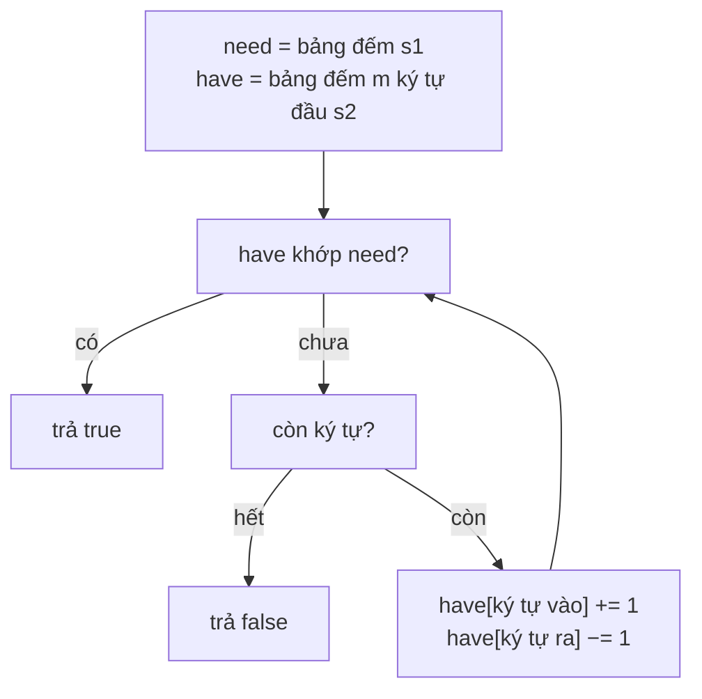

> [!tldr] Đọc nhanh
> - Đề: s2 có chứa một **đoạn con** là hoán vị của s1 không (`s1 = "ab"`, `s2 = "eidbaooo"` → có, đoạn `"ba"`).
> - Hoán vị của s1 = đoạn có **cùng bảng đếm** với s1, và dài đúng `|s1|`. Nên chỉ cần [[concepts/fixed-size-window|cửa sổ cố định]] dài `m = |s1|` trượt qua s2: mỗi bước một ký tự vào, một ký tự ra.
> - So hai bảng 26 ô mỗi bước là O(26·n). Đếm **số ô đang khớp** (0..26) và chỉ cập nhật hai ô đổi là O(n), nhanh hơn 3 lần khi mọi cửa sổ gần khớp, nhưng lại chậm hơn khi cửa sổ lệch ngay ô đầu, vì phép so dừng sớm.
> - Hai bẫy: so **tập** ký tự (bỏ qua số lần, 6/8 ca), và so hai mảng đếm bằng `===` hay `==` trong JS và Java (so tham chiếu, 4/8 ca).

> [!info] Bối cảnh
> Bài LeetCode 567, thuộc [[posts/2026-11-23-neetcode-sliding-window|ga 5: Cửa sổ trượt]] trên **tuyến NeetCode: Mảng và chuỗi**. Bài này là [[problems/valid-anagram|Valid Anagram]] đặt trong một cửa sổ trượt: thay vì so hai chuỗi một lần, so s1 với mọi đoạn dài `|s1|` của s2. Lời giải có đủ TypeScript, Python, Go, Java và JavaScript. Bạn cần biết vòng lặp, chuỗi và mảng đếm.

> [!abstract]- Từ điển nhanh cho bài này (bấm để mở)
> - **Hoán vị (permutation)**: cùng các ký tự với cùng số lần, chỉ khác thứ tự. `"ba"` là hoán vị của `"ab"`.
> - **Bảng đếm 26 ô**: số lần mỗi chữ a–z. Hai chuỗi là hoán vị của nhau khi và chỉ khi bảng đếm bằng nhau. Xem [[concepts/frequency-counting|Frequency Counting]].
> - **Cửa sổ cố định**: cửa sổ luôn dài đúng m; mỗi bước thêm bên phải và bỏ bên trái cùng lúc. Xem [[concepts/fixed-size-window|Fixed-size Window]].
> - **So theo tham chiếu**: hỏi "hai biến có trỏ cùng một object không", không hỏi "nội dung có giống không".

## Hình dung trước: tìm bộ bài trong một chồng bài

Bạn cầm một bộ m lá bài (s1) và nhìn một hàng dài các lá bài úp ngửa (s2). Câu hỏi: có m lá **liền nhau** nào trong hàng gồm đúng các lá trong tay, không quan tâm thứ tự không. Bạn đặt một cái khung rộng đúng m lá lên hàng và trượt nó.

| Đời thường | Khái niệm |
|---|---|
| Bộ bài trong tay, không quan tâm thứ tự | bảng đếm `need` của s1 |
| Khung rộng đúng m lá | cửa sổ cố định dài m |
| Trượt khung một lá: một lá mới vào, một lá cũ ra | `have[vào]++`, `have[ra]--` |
| Đối chiếu từng loại lá giữa khung và tay | so 26 ô |
| Bảng ghi "đã khớp bao nhiêu loại lá", chỉ sửa hai dòng vừa đổi | bộ đếm số ô khớp |
| Chỉ hỏi "có loại lá này không" mà quên đếm | so tập, sai khi có lá trùng |



## Vấn đề

**Đề (tóm tắt bằng lời của mình):** cho hai chuỗi chữ thường `s1`, `s2` (1 ≤ độ dài ≤ 10⁴). Trả `true` nếu s2 có một đoạn con liên tiếp là hoán vị của s1. Đề gốc: [LeetCode 567](https://leetcode.com/problems/permutation-in-string/).

| s1 | s2 | Output | Vì sao |
|---|---|---|---|
| `"ab"` | `"eidbaooo"` | true | đoạn `"ba"` |
| `"ab"` | `"eidboaoo"` | false | `b` và `a` không đứng liền |
| `"aab"` | `"abbab"` | false | mọi đoạn dài 3 chỉ có một `a` |
| `"abc"` | `"ab"` | false | s1 dài hơn s2 |

Mình từng định sinh mọi hoán vị của s1 rồi tìm từng cái trong s2. Với `|s1| = 10` đã có 3,6 triệu hoán vị. Hóa ra thứ tự không quan trọng, nên chỉ cần bảng đếm, và độ dài cố định nên chỉ cần một cửa sổ cố định.

## Cơ chế

<figure class="figure-map" style="--ar: 3 / 4">
<div class="frame"><iframe data-archify="../diagrams/neetcode-permutation-in-string/worked-example.html" title="So bộ đếm trong cửa sổ cố định" loading="lazy"></iframe></div>
<figcaption><span><b>Hình 1.</b> So bộ đếm trong cửa sổ cố định.</span><a href="../diagrams/neetcode-permutation-in-string/worked-example.html" target="_blank" rel="noopener">Mở toàn màn hình</a></figcaption>
</figure>

<details>
<summary>Đọc từng bước</summary>
<ol>
<li>Đếm ký tự của mẫu ab. <code>a: 1, b: 1</code></li>
<li>Cửa sổ đầu zz thiếu a và b. <code>&quot;zzba&quot;, length = 2</code></li>
<li>Bỏ z và thêm b. <code>&quot;zb&quot;</code></li>
<li>Bỏ z còn lại rồi thêm a. <code>&quot;ba&quot;</code></li>
<li>Bộ đếm trùng với mẫu. <code>&quot;ba&quot; → true</code></li>
</ol>
</details>

### Cách 1, sắp xếp mỗi cửa sổ: O(n · m log m)

Sắp xếp s1 một lần thành khóa. Với mỗi đoạn dài m của s2, sắp xếp rồi so với khóa. Đây là khóa sắp xếp của [[problems/group-anagrams|Group Anagrams]], áp lên n − m + 1 cửa sổ.

### Cách 2, bảng đếm trượt, so 26 ô

Lập `need` từ s1 và `have` từ m ký tự đầu của s2. Mỗi bước trượt: `have[s2[r]]++` (vào bên phải), `have[s2[r − m]]--` (ra bên trái), rồi so 26 ô. Mỗi bước O(26), tổng O(26·n), và không phụ thuộc m.

### Cách 3, bộ đếm số ô khớp

Giữ `diff[c] = have[c] − need[c]` và `matches` = số chữ c có `diff[c] = 0`. Mỗi bước chỉ **hai** ô đổi, nên chỉ cần sửa `matches` cho hai ô đó:
- trước khi đổi, ô đang bằng 0 thì `matches` giảm 1 (sắp lệch);
- sau khi đổi, ô về 0 thì `matches` tăng 1 (vừa khớp).

`matches = 26` nghĩa là cửa sổ là hoán vị của s1. Mỗi bước O(1), tổng O(n).

| Bước | `s2 = "eidbaooo"`, `s1 = "ab"` | cửa sổ | ô lệch | matches |
|---|---|---|---|---|
| đầu | | `"ei"` | a, b, e, i | 22 |
| 1 | vào d, ra e | `"id"` | a, b, d, i | 22 |
| 2 | vào b, ra i | `"db"` | a, d | 24 |
| 3 | vào a, ra d | `"ba"` | (không) | 26 → true |

### Đo: O(n) không luôn thắng O(26·n)

TypeScript, s2 ngẫu nhiên, s1 là `"zz…z"` nên không có hoán vị và mọi cách quét tới cuối, trung vị:

| n = \|s2\| | m = \|s1\| | sắp xếp | so 26 ô | đếm khớp |
|---|---|---|---|---|
| 10⁴ | 10 | 5,2 ms | 0,34 ms | 0,18 ms |
| 10⁴ | 1 000 | 908,0 ms | 0,12 ms | 0,04 ms |
| 10⁶ | 10 | 521,0 ms | 6,13 ms | 10,26 ms |
| 10⁶ | 1 000 | (không chạy) | 3,39 ms | 3,51 ms |
| 1 040 000 | 26, mọi cửa sổ gần khớp | (không chạy) | 18,08 ms | 6,05 ms |

So 26 ô thường **không** so đủ 26 ô: `every` dừng ở ô lệch đầu tiên, và với dữ liệu ngẫu nhiên ô `a` thường đã lệch. Hàng cuối dựng ca xấu nhất cho nó: mọi cửa sổ khớp 24 ô đầu, lệch ở ô `y`. Khi đó bộ đếm số ô khớp nhanh hơn 3 lần. Cách sắp xếp tăng theo m: m = 1 000 đã gần một giây với n = 10⁴.

### Bên dưới năm ngôn ngữ

| | So hai bảng đếm | Bẫy riêng |
|---|---|---|
| TypeScript / JavaScript | `need.every((x, c) => x === have[c])` | `need === have` so tham chiếu: luôn `false` |
| Python | `need == have` (list so theo giá trị) | không có bẫy so sánh; `Counter` cũng so được bằng `==` |
| Go | `need == have` với `[26]int` | mảng cố định so được bằng `==`; slice `[]int` thì không biên dịch |
| Java | `Arrays.equals(need, have)` | `need == have` với `int[]` so tham chiếu: luôn `false` |

## Ví dụ chạy được

[TypeScript](../code/neetcode-permutation-in-string/permutation-in-string.ts) · [Python](../code/neetcode-permutation-in-string/permutation_in_string.py) · [Go](../code/neetcode-permutation-in-string/permutation_in_string.go) · [Java](../code/neetcode-permutation-in-string/permutation-in-string.java) · [JavaScript](../code/neetcode-permutation-in-string/permutation-in-string.js)

Mỗi file có ba cách và chạy 8 ca. Dưới đây là bảng đếm trượt và bộ đếm số ô khớp.

```ts
// Cách 2: cửa sổ cố định dài m, trượt bảng đếm 26 ô, so cả 26 ô mỗi bước. O(26 · n).
function slideCompare26(s1: string, s2: string): boolean {
  const m = s1.length;
  if (m > s2.length) return false;
  const need = new Array(26).fill(0), have = new Array(26).fill(0);
  for (let i = 0; i < m; i++) { need[at(s1, i)]++; have[at(s2, i)]++; }
  const same = () => need.every((x, c) => x === have[c]);
  if (same()) return true;
  for (let r = m; r < s2.length; r++) {
    have[at(s2, r)]++;      // ký tự vào bên phải
    have[at(s2, r - m)]--;  // ký tự ra bên trái
    if (same()) return true;
  }
  return false;
}

// Cách 3: đếm số chữ cái đang khớp (0..26). Mỗi bước chỉ hai ô đổi, nên chỉ cập nhật hai ô đó. O(n).
function matchesCounter(s1: string, s2: string): boolean {
  const m = s1.length;
  if (m > s2.length) return false;
  const diff = new Array(26).fill(0); // diff[c] = số lần c trong cửa sổ − số lần c trong s1
  for (let i = 0; i < m; i++) { diff[at(s1, i)]--; diff[at(s2, i)]++; }
  let matches = diff.filter((d) => d === 0).length;
  const bump = (c: number, delta: number) => {
    if (diff[c] === 0) matches--;  // ô đang khớp sắp lệch
    diff[c] += delta;
    if (diff[c] === 0) matches++;  // ô vừa khớp lại
  };
  for (let r = m; r < s2.length && matches < 26; r++) {
    bump(at(s2, r), +1);
    bump(at(s2, r - m), -1);
  }
  return matches === 26;
}
```

```python
def slide_compare_26(s1: str, s2: str) -> bool:
    m = len(s1)
    if m > len(s2):
        return False
    need, have = [0] * 26, [0] * 26
    for i in range(m):
        need[ord(s1[i]) - 97] += 1
        have[ord(s2[i]) - 97] += 1
    if need == have:  # list so sánh theo giá trị bằng ==
        return True
    for r in range(m, len(s2)):
        have[ord(s2[r]) - 97] += 1
        have[ord(s2[r - m]) - 97] -= 1
        if need == have:
            return True
    return False

def matches_counter(s1: str, s2: str) -> bool:
    m = len(s1)
    if m > len(s2):
        return False
    diff = [0] * 26  # số lần trong cửa sổ − số lần trong s1
    for i in range(m):
        diff[ord(s1[i]) - 97] -= 1
        diff[ord(s2[i]) - 97] += 1
    matches = diff.count(0)
    for r in range(m, len(s2)):
        if matches == 26:
            return True
        for c, delta in ((ord(s2[r]) - 97, 1), (ord(s2[r - m]) - 97, -1)):
            if diff[c] == 0:
                matches -= 1
            diff[c] += delta
            if diff[c] == 0:
                matches += 1
    return matches == 26
```

```go
func slideCompare26(s1, s2 string) bool {
	m := len(s1)
	if m > len(s2) {
		return false
	}
	var need, have [26]int
	for i := 0; i < m; i++ {
		need[s1[i]-'a']++
		have[s2[i]-'a']++
	}
	if need == have { // mảng cố định so sánh được bằng == theo nội dung
		return true
	}
	for r := m; r < len(s2); r++ {
		have[s2[r]-'a']++
		have[s2[r-m]-'a']--
		if need == have {
			return true
		}
	}
	return false
}

func matchesCounter(s1, s2 string) bool {
	m := len(s1)
	if m > len(s2) {
		return false
	}
	var diff [26]int
	for i := 0; i < m; i++ {
		diff[s1[i]-'a']--
		diff[s2[i]-'a']++
	}
	matches := 0
	for _, d := range diff {
		if d == 0 {
			matches++
		}
	}
	bump := func(c byte, delta int) {
		if diff[c] == 0 {
			matches--
		}
		diff[c] += delta
		if diff[c] == 0 {
			matches++
		}
	}
	for r := m; r < len(s2) && matches < 26; r++ {
		bump(s2[r]-'a', 1)
		bump(s2[r-m]-'a', -1)
	}
	return matches == 26
}
```

```java
static boolean slideCompare26(String s1, String s2) {
    int m = s1.length();
    if (m > s2.length()) return false;
    int[] need = new int[26], have = new int[26];
    for (int i = 0; i < m; i++) { need[s1.charAt(i) - 'a']++; have[s2.charAt(i) - 'a']++; }
    if (Arrays.equals(need, have)) return true; // need == have so tham chiếu: luôn false
    for (int r = m; r < s2.length(); r++) {
        have[s2.charAt(r) - 'a']++;
        have[s2.charAt(r - m) - 'a']--;
        if (Arrays.equals(need, have)) return true;
    }
    return false;
}

static boolean matchesCounter(String s1, String s2) {
    int m = s1.length();
    if (m > s2.length()) return false;
    int[] diff = new int[26];
    for (int i = 0; i < m; i++) { diff[s1.charAt(i) - 'a']--; diff[s2.charAt(i) - 'a']++; }
    int matches = 0;
    for (int d : diff) if (d == 0) matches++;
    for (int r = m; r < s2.length() && matches < 26; r++) {
        int in = s2.charAt(r) - 'a', out = s2.charAt(r - m) - 'a';
        if (diff[in] == 0) matches--;
        if (++diff[in] == 0) matches++;
        if (diff[out] == 0) matches--;
        if (--diff[out] == 0) matches++;
    }
    return matches == 26;
}
```

```js
function slideCompare26(s1, s2) {
  const m = s1.length;
  if (m > s2.length) return false;
  const need = new Array(26).fill(0), have = new Array(26).fill(0);
  for (let i = 0; i < m; i++) { need[s1.charCodeAt(i) - 97]++; have[s2.charCodeAt(i) - 97]++; }
  const same = () => need.every((x, c) => x === have[c]); // need === have so tham chiếu: luôn false
  if (same()) return true;
  for (let r = m; r < s2.length; r++) {
    have[s2.charCodeAt(r) - 97]++;
    have[s2.charCodeAt(r - m) - 97]--;
    if (same()) return true;
  }
  return false;
}

function matchesCounter(s1, s2) {
  const m = s1.length;
  if (m > s2.length) return false;
  const diff = new Array(26).fill(0);
  for (let i = 0; i < m; i++) { diff[s1.charCodeAt(i) - 97]--; diff[s2.charCodeAt(i) - 97]++; }
  let matches = diff.filter((d) => d === 0).length;
  const bump = (c, delta) => {
    if (diff[c] === 0) matches--;
    diff[c] += delta;
    if (diff[c] === 0) matches++;
  };
  for (let r = m; r < s2.length && matches < 26; r++) {
    bump(s2.charCodeAt(r) - 97, 1);
    bump(s2.charCodeAt(r - m) - 97, -1);
  }
  return matches === 26;
}
```


File TypeScript chạy thêm hai bản sai rồi đo:

```text
$ node permutation-in-string.ts
sortEachWindow   8/8 ca đúng
slideCompare26   8/8 ca đúng
matchesCounter   8/8 ca đúng
wrongSetOnly     6/8 ca đúng; sai ở (aab, abbab) (hello, ooolleoooleh)
wrongArrayEquals 4/8 ca đúng; sai ở (ab, eidbaooo) (adc, dcda) (a, a) (aab, xxbaa)

n = |s2|    m = |s1|   sắp xếp   so 26 ô   đếm khớp   (ms, trung vị; không có hoán vị nên quét hết)
10000       10              5.2      0.34       0.18
10000       1000          908.0      0.12       0.04
1000000     10            521.0      6.13      10.26
1000000     1000              —      3.39       3.51
1040000     26                —     18.08       6.05   ← mọi cửa sổ gần khớp
```

`wrongSetOnly` nhận `"bab"` là hoán vị của `"aab"` vì cả hai có tập `{a, b}`. `wrongArrayEquals` sai đúng ở bốn ca có đáp án `true`: so tham chiếu không bao giờ bằng, nên nó luôn trả `false`. File Java tái hiện bẫy đó bằng `int[] == int[]`:

```text
$ java permutation-in-string.java
sortEachWindow   8/8 ca đúng
slideCompare26   8/8 ca đúng
matchesCounter   8/8 ca đúng
wrongArrayEquals 4/8 ca đúng
```

Python, Go và JavaScript in `8/8 ca đúng` cho cả ba cách.

## Hiểu lầm và bẫy hay gặp

- **Sinh mọi hoán vị của s1.** m! hoán vị; m = 10 đã là 3,6 triệu. Thứ tự không quan trọng, nên chỉ cần bảng đếm.
- **So tập ký tự thay vì bảng đếm.** Quên số lần: `"aab"` và `"bab"` cùng tập.
- **So hai mảng bằng `===` (JS) hay `==` (Java).** Không báo lỗi, chỉ luôn sai. Go và Python thì so theo giá trị.
- **Quên ca s1 dài hơn s2.** Phải trả `false` trước khi lập bảng đếm, nếu không chỉ số `s2[i]` vượt biên (Go, Java ném lỗi; JS ra `NaN`).
- **"O(n) luôn nhanh hơn O(26·n)."** Phép so 26 ô dừng ở ô lệch đầu tiên, nên với dữ liệu ngẫu nhiên nó thường nhanh hơn bộ đếm. Bộ đếm chỉ thắng rõ khi các cửa sổ gần khớp.

## Câu hỏi tự kiểm tra

> [!question]- Vì sao cửa sổ ở bài này luôn dài đúng `|s1|`, còn ở Longest Substring Without Repeating Characters thì co giãn?
> Một hoán vị của s1 có đúng `|s1|` ký tự, nên chỉ đoạn dài đúng chừng ấy mới có thể là đáp án. Bài kia tìm đoạn dài nhất nên độ dài là thứ phải tìm.

> [!question]- Khi trượt, ký tự vào và ký tự ra trùng nhau (cùng chữ c). `matches` thay đổi thế nào?
> `diff[c]` tăng 1 rồi giảm 1, quay về giá trị cũ. Hai lần cập nhật `matches` triệt tiêu nhau, nên `matches` không đổi, đúng như cửa sổ có cùng bảng đếm.

> [!question]- Vì sao Go so được `need == have` mà JS thì không?
> `[26]int` của Go là giá trị, và mảng cố định so sánh bằng `==` theo từng phần tử. Mảng JS là object, `===` so địa chỉ.

> [!question]- Nếu đề cho mọi ký tự Unicode thay vì a–z, cách 3 cần đổi gì?
> Dùng Map thay mảng 26 ô. Vì không biết trước có bao nhiêu khóa, đếm số khóa đang **lệch** (`diff ≠ 0`) thay vì số khóa khớp; cửa sổ là hoán vị khi số khóa lệch bằng 0.

## Tham khảo

- [LeetCode 567: Permutation in String](https://leetcode.com/problems/permutation-in-string/) (đề gốc)
- [Go spec: Comparison operators](https://go.dev/ref/spec#Comparison_operators) (mảng so sánh được, slice thì không)
- [Java 21 `Arrays.equals(int[], int[])`](https://docs.oracle.com/en/java/javase/21/docs/api/java.base/java/util/Arrays.html#equals(int%5B%5D,int%5B%5D)) (so nội dung; `==` trên mảng so tham chiếu)
- [MDN: Equality comparisons and sameness](https://developer.mozilla.org/en-US/docs/Web/JavaScript/Equality_comparisons_and_sameness) (object so bằng `===` theo tham chiếu)
- [Python: Comparisons](https://docs.python.org/3/reference/expressions.html#comparisons) (list so theo từng phần tử)
