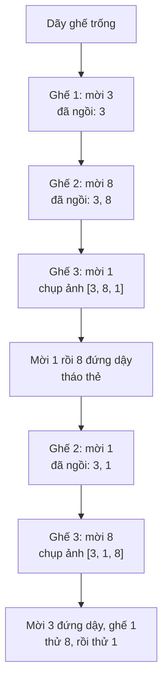

> [!tldr] Đọc nhanh
> - Hoán vị khác tổ hợp ở chỗ thứ tự có nghĩa: `[3, 8, 1]` và `[8, 3, 1]` là hai đáp án. Vì vậy [[concepts/start-index|chỉ số bắt đầu]] của ga trước không dùng được: nó chỉ cho đi sang phải, nên chỉ còn đúng một thứ tự.
> - Mỗi tầng của [[concepts/choice-tree|cây lựa chọn]] quét lại toàn bộ mảng và bỏ qua phần tử đã nằm trong `path`. Một mảng [[concepts/used-marker|đánh dấu đã dùng]] trả lời câu hỏi đó trong O(1).
> - Đánh dấu trước khi đi sâu, gỡ dấu khi quay lên. Quên gỡ dấu thì chỉ còn hoán vị đầu tiên.
> - Có n! hoán vị, mỗi bản dài n, nên không cách nào nhanh hơn O(n·n!). Với n = 6, cây có 1.957 nút để ra 720 hoán vị.

> [!info] Bối cảnh
> Đây là bài LeetCode 46 tại [[posts/2026-11-28-neetcode-permutations-search|ga MISC-02: Quay lui: hoán vị và tìm kiếm]] trên **tuyến NeetCode: Kỹ thuật tổng hợp**. Mình hình dung việc xếp vài vị khách vào một dãy ghế và muốn liệt kê mọi cách xếp. Bạn chỉ cần biết mảng, vòng lặp và hàm đệ quy; đọc [[problems/subsets|Subsets]] trước sẽ dễ thấy chỗ khác nhau hơn.

> [!abstract]- Từ điển nhanh cho bài này (bấm để mở)
> - Hoán vị (permutation) là một cách xếp tất cả phần tử theo một thứ tự. Mảng n phần tử khác nhau có n! = n × (n − 1) × … × 1 hoán vị.
> - n! đọc là "n giai thừa": 3! = 6, 6! = 720.
> - [[concepts/backtracking|Quay lui]] thêm một lựa chọn vào `path`, đi sâu, rồi gỡ nó ra để thử lựa chọn khác.
> - `used[i]` là cờ đúng hoặc sai cho biết phần tử thứ i đã nằm trong `path` hay chưa.

## Hình dung trước: xếp khách vào dãy ghế

Có ba vị khách và ba chiếc ghế xếp hàng ngang. Mình đi từ ghế trái sang ghế phải. Ở mỗi ghế, mình mời lần lượt từng vị còn đứng; ai đã ngồi thì đeo thẻ "đã ngồi". Khi cả ba ghế có người, mình chụp một tấm ảnh. Rồi mời người ở ghế cuối đứng dậy, tháo thẻ, và thử người khác. Không ai được ngồi hai ghế, nhưng ai cũng được ngồi ở bất kỳ ghế nào.

| Đời thường | Khái niệm |
|---|---|
| Dãy ghế xếp từ trái sang phải | `path`, hoán vị đang dựng |
| Mời một vị đang đứng ngồi vào ghế kế tiếp | Chọn `nums[i]` chưa dùng, đi sâu |
| Thẻ "đã ngồi" | `used[i] = true` |
| Mời đứng dậy và tháo thẻ | `path.pop()`, `used[i] = false` |
| Đủ người thì chụp ảnh | Ghi một bản chép của `path` |
| Ghế nào cũng có thể mời lại người ở bên trái danh sách | Mỗi tầng quét lại từ chỉ số 0 |

Với khách `3`, `8`, `1`, hai tấm ảnh đầu tiên ra đời như sau:



## Vấn đề: mọi thứ tự của một mảng

Cho mảng `nums` dài 1–6, các giá trị đôi một khác nhau, mỗi giá trị nằm trong khoảng −10 đến 10. Trả về mọi hoán vị của `nums`, theo thứ tự nào cũng được. Ví dụ `[4, 9]` có hai hoán vị: `[4, 9]` và `[9, 4]`. [Đề gốc LeetCode 46](https://leetcode.com/problems/permutations/)

Lần đầu mình chép nguyên khuôn của [[problems/subsets|Subsets]] với chỉ số bắt đầu, chỉ đổi chỗ ghi đáp án sang khi `path` đủ n phần tử. Với `[3, 8, 1]`, hàm trả về đúng một mảng là `[3, 8, 1]`. Chỉ số bắt đầu buộc mỗi lựa chọn sau phải đứng bên phải lựa chọn trước, nên chỉ còn đúng một thứ tự: thứ tự gốc. Đó là điều tổ hợp cần, nhưng là điều hoán vị phải tránh.

## Cơ chế

### Vét cạn: thử mọi bộ chỉ số

Cách thô nhất là sinh mọi bộ n chỉ số, mỗi chỉ số từ 0 đến n − 1, rồi giữ bộ có các chỉ số đôi một khác nhau. Có nⁿ bộ: với n = 6 là 46.656 bộ để giữ 720. Mình dùng cách này làm trọng tài trong file chạy, vì nó không dùng chung dòng nào với lời giải.

### Đánh dấu phần tử đã dùng

Cây lựa chọn của hoán vị có gốc là `path` rỗng. Ở tầng thứ k, mỗi nút có n − k con, mỗi con ứng với một phần tử chưa dùng. Mỗi lời gọi quét lại toàn bộ `nums` từ chỉ số 0 và bỏ qua `nums[i]` khi `used[i]` đúng. Trước khi đi sâu thì đặt `used[i] = true`, sau khi quay lên thì đặt lại `false`, để các nhánh anh em vẫn được dùng phần tử đó. Đây cũng là nhịp [[concepts/visit-and-restore|đánh dấu rồi trả lại]] mà Word Search dùng trên lưới.

Số nút ở tầng k là n!/(n − k)!. Với n = 6 là 1 + 6 + 30 + 120 + 360 + 720 + 720 = 1.957 nút, tức 1.957 lượt gọi. Mỗi lượt quét n phần tử, và mỗi lá chép một mảng dài n. Tổng thời gian là O(n·n!), bộ nhớ phụ O(n) cho `path`, `used` và ngăn xếp gọi hàm, chưa kể đầu ra.

### Đổi chỗ tại chỗ

Không cần mảng `used`: coi phần `a[0..k-1]` là các ghế đã có người, phần `a[k..n-1]` là những người còn đứng. Ghế k lần lượt nhận từng người ở `a[k..n-1]` bằng cách đổi chỗ `a[k]` với `a[i]`, đi sâu với k + 1, rồi đổi lại. Khi k = n thì chép cả mảng. Cách này tiết kiệm mảng phụ, nhưng thứ tự các hoán vị ra khác cách đánh dấu, và mảng bị đảo trộn trong lúc chạy.

### Chèn vào mọi khe

Cách lặp không dùng đệ quy: bắt đầu với `[[]]`. Với mỗi phần tử mới x, lấy từng hoán vị đã có (dài k) và chèn x vào k + 1 khe của nó. Sau phần tử thứ k có k! hoán vị. Cách này cũng O(n·n!), nhưng giữ cả tầng trước trong bộ nhớ.

| Cách | Thời gian | Bộ nhớ phụ (chưa kể đầu ra) | Ghi chú |
|---|---|---|---|
| Vét mọi bộ chỉ số | O(n·nⁿ) | O(n) | Trọng tài; 46.656 bộ khi n = 6 |
| Đánh dấu đã dùng | O(n·n!) | O(n) | Cách chính; thứ tự ra theo chỉ số |
| Đổi chỗ tại chỗ | O(n·n!) | O(n) | Không cần `used`; mảng bị đảo trong lúc chạy |
| Chèn vào mọi khe | O(n·n!) | O(n·n!) | Lặp, giữ cả tầng trước |

## Ví dụ chạy được

[TypeScript](../code/neetcode-permutations/arrange.ts) · [Python](../code/neetcode-permutations/arrange.py) · [Go](../code/neetcode-permutations/arrange.go) · [Java](../code/neetcode-permutations/arrange.java) · [JavaScript](../code/neetcode-permutations/arrange.js) · [PHP](../code/neetcode-permutations/arrange.php) · [Rust](../code/neetcode-permutations/arrange.rs)

```ts
// Cách chính: path cộng mảng used đánh dấu phần tử đã nằm trong path
function permute(nums: number[], counter = { calls: 0 }): number[][] {
    const result: number[][] = []
    const path: number[] = []
    const used: boolean[] = Array(nums.length).fill(false)
    const walk = () => {
        counter.calls++
        if (path.length === nums.length) {
            result.push([...path]) // chép path, vì path còn bị sửa tiếp
            return
        }
        for (let i = 0; i < nums.length; i++) {
            if (used[i]) continue // phần tử này đã nằm trong path
            used[i] = true
            path.push(nums[i])
            walk()
            path.pop()
            used[i] = false // gỡ dấu để nhánh anh em được dùng lại
        }
    }
    walk()
    return result
}
```

```python
# Cách chính: path cộng mảng used đánh dấu phần tử đã nằm trong path
def permute(nums, counter=None):
    result, path = [], []
    used = [False] * len(nums)

    def walk():
        if counter is not None:
            counter["calls"] += 1
        if len(path) == len(nums):
            result.append(path[:])  # chép path, vì path còn bị sửa tiếp
            return
        for i in range(len(nums)):
            if used[i]:
                continue  # phần tử này đã nằm trong path
            used[i] = True
            path.append(nums[i])
            walk()
            path.pop()
            used[i] = False  # gỡ dấu để nhánh anh em được dùng lại

    walk()
    return result
```

```go
// Cách chính: path cộng mảng used đánh dấu phần tử đã nằm trong path
func permute(nums []int, calls *int) [][]int {
	result := [][]int{}
	path := []int{}
	used := make([]bool, len(nums))
	var walk func()
	walk = func() {
		*calls++
		if len(path) == len(nums) {
			result = append(result, slices.Clone(path)) // chép path, vì mảng nền còn bị ghi đè
			return
		}
		for i := range nums {
			if used[i] {
				continue // phần tử này đã nằm trong path
			}
			used[i] = true
			path = append(path, nums[i])
			walk()
			path = path[:len(path)-1]
			used[i] = false // gỡ dấu để nhánh anh em được dùng lại
		}
	}
	walk()
	return result
}
```

```java
// Cách chính: path cộng mảng used đánh dấu phần tử đã nằm trong path
static List<List<Integer>> permute(int[] nums) {
    List<List<Integer>> result = new ArrayList<>();
    walk(nums, new boolean[nums.length], new ArrayList<>(), result);
    return result;
}

static void walk(int[] nums, boolean[] used, List<Integer> path, List<List<Integer>> result) {
    calls++;
    if (path.size() == nums.length) {
        result.add(new ArrayList<>(path)); // chép path, vì path còn bị sửa tiếp
        return;
    }
    for (int i = 0; i < nums.length; i++) {
        if (used[i]) continue; // phần tử này đã nằm trong path
        used[i] = true;
        path.add(nums[i]);
        walk(nums, used, path, result);
        path.remove(path.size() - 1);
        used[i] = false; // gỡ dấu để nhánh anh em được dùng lại
    }
}
```

```js
// Cách chính: path cộng mảng used đánh dấu phần tử đã nằm trong path
function permute(nums, counter = { calls: 0 }) {
    const result = []
    const path = []
    const used = Array(nums.length).fill(false)
    const walk = () => {
        counter.calls++
        if (path.length === nums.length) {
            result.push([...path]) // chép path, vì path còn bị sửa tiếp
            return
        }
        for (let i = 0; i < nums.length; i++) {
            if (used[i]) continue // phần tử này đã nằm trong path
            used[i] = true
            path.push(nums[i])
            walk()
            path.pop()
            used[i] = false // gỡ dấu để nhánh anh em được dùng lại
        }
    }
    walk()
    return result
}
```

```php
// Cách chính: path cộng mảng used đánh dấu phần tử đã nằm trong path
function permute(array $nums): array {
    global $calls;
    $n = count($nums);
    $result = [];
    $path = [];
    $used = array_fill(0, $n, false);
    $walk = function () use (&$walk, &$result, &$path, &$used, &$calls, $nums, $n) {
        $calls++;
        if (count($path) === $n) {
            $result[] = $path; // mảng PHP được chép khi gán, nên đây đã là bản chép
            return;
        }
        for ($i = 0; $i < $n; $i++) {
            if ($used[$i]) continue; // phần tử này đã nằm trong path
            $used[$i] = true;
            $path[] = $nums[$i];
            $walk();
            array_pop($path);
            $used[$i] = false; // gỡ dấu để nhánh anh em được dùng lại
        }
    };
    $walk();
    return $result;
}
```

```rust
// Cách chính: path cộng mảng used đánh dấu phần tử đã nằm trong path
fn permute(nums: &[i32], calls: &mut usize) -> Vec<Vec<i32>> {
    fn walk(nums: &[i32], used: &mut Vec<bool>, path: &mut Vec<i32>, result: &mut Vec<Vec<i32>>, calls: &mut usize) {
        *calls += 1;
        if path.len() == nums.len() {
            result.push(path.clone()); // chép path, vì path còn bị sửa tiếp
            return;
        }
        for i in 0..nums.len() {
            if used[i] {
                continue; // phần tử này đã nằm trong path
            }
            used[i] = true;
            path.push(nums[i]);
            walk(nums, used, path, result, calls);
            path.pop();
            used[i] = false; // gỡ dấu để nhánh anh em được dùng lại
        }
    }
    let mut result = Vec::new();
    walk(nums, &mut vec![false; nums.len()], &mut Vec::new(), &mut result, calls);
    result
}
```

Các tab trích cách đánh dấu đã dùng; dòng tăng `calls` chỉ để đếm cho phép đo. File tải về còn có bản đổi chỗ tại chỗ, bản chèn vào mọi khe, bản sai mượn chỉ số bắt đầu và trọng tài vét mọi bộ chỉ số. Bảy ca kiểm tra gồm một phần tử, số âm, số 0, năm số và sáu số (720 hoán vị). Với mỗi ca, cả ba cách đúng phải ra đúng n! hoán vị, không bản nào lặp, và khớp trọng tài khi so không kể thứ tự.

Dòng thứ hai đối chiếu trên mọi mảng dài 1–5 gồm các giá trị khác nhau lấy từ {1, 2, 3, 4, 5}: 325 mảng. Hai dòng cuối là phép đo: bản mượn chỉ số bắt đầu trên `[3, 8, 1]`, và số lượt gọi của cách đánh dấu khi n = 6.

```text
7/7 ca đúng
325/325 ca đúng (đối chiếu vét mọi bộ chỉ số)
Dùng chỉ số bắt đầu như bài tổ hợp với [3,8,1]: 1/6 hoán vị
n = 6: 720 hoán vị, 1957 lượt gọi
```

Cả bảy ngôn ngữ in đúng bốn dòng này.

## Hiểu lầm và bẫy hay gặp

- Mượn chỉ số bắt đầu của bài tổ hợp. Kết quả chỉ còn một hoán vị, như dòng thứ ba ở trên.
- Quên `used[i] = false` sau khi quay lên. Sau lá đầu tiên mọi cờ đều đúng mãi, không nhánh nào mở được nữa: `[3, 8, 1]` chỉ cho `[[3, 8, 1]]`.
- Ghi chính `path` thay vì bản chép. Mọi phần tử của kết quả cùng trỏ vào một mảng đã bị gỡ hết. Trang [[problems/subsets|Subsets]] có bảng hậu quả theo từng ngôn ngữ.
- Áp nguyên lời giải này cho mảng có giá trị lặp (LeetCode 47). Hai số bằng nhau ở hai vị trí khác nhau sinh hai nhánh giống nhau, nên `[5, 5]` cho `[5, 5]` hai lần. Bài đó cần sắp xếp và bỏ trùng cùng tầng như [[problems/subsets-ii|Subsets II]].
- Java: `path.remove(x)` với `x` là `int` gọi `remove(int index)`, xóa theo **vị trí** chứ không theo giá trị. Với `path = [3, 8, 1]`, `remove(1)` xóa số 8 và còn `[3, 1]`; `remove(8)` ném `IndexOutOfBoundsException`. Gỡ phần tử cuối thì viết `path.remove(path.size() - 1)`.
- PHP: closure phải bắt `$used` theo tham chiếu, `use (&$used)`. Viết `use ($used)` thì mỗi lời gọi nhận lại bản chép lúc tạo closure, mọi cờ luôn là `false`: `[3, 8, 1]` cho 27 kết quả như `[3, 3, 3]`, tức đủ 3³ bộ có lặp.
- JavaScript, TypeScript: dòng đổi chỗ `[a[k], a[i]] = [a[i], a[k]]` bắt đầu bằng `[`. Nếu dòng trước không có dấu chấm phẩy, JavaScript nối hai dòng thành một biểu thức truy cập phần tử. Code viết không chấm phẩy nên đặt `;` ở đầu dòng.
- Python có sẵn `itertools.permutations`, ra đúng các bộ theo thứ tự chỉ số. Dùng nó trong thực tế là hợp lý; viết tay là để hiểu cây.

## Câu hỏi tự kiểm tra

> [!question]- Vì sao Subsets dùng chỉ số bắt đầu được mà Permutations thì không?
> Tập con không quan tâm thứ tự, nên chỉ cần dựng mỗi tập theo một thứ tự duy nhất. Hoán vị chính là thứ tự, nên mỗi ghế phải được mời cả những người đứng bên trái trong mảng.

> [!question]- Với n = 4, cây đánh dấu có bao nhiêu nút?
> 1 + 4 + 12 + 24 + 24 = 65 nút: tầng k có 4!/(4 − k)! nút, và tầng cuối có 24 lá.

> [!question]- Bản đổi chỗ tại chỗ cần gì để mảng trở về như cũ sau mỗi nhánh?
> Đổi lại đúng cặp `a[k]`, `a[i]` vừa đổi, sau khi lời gọi đi sâu trả về.

> [!question]- Nếu chỉ cần đếm số hoán vị thì có cần quay lui không?
> Không. Với n phần tử khác nhau, đáp án là n!. Quay lui chỉ cần khi phải liệt kê từng hoán vị.

## Tham khảo

- [LeetCode 46](https://leetcode.com/problems/permutations/)
- [Jeff Erickson, Algorithms, chương 2: quay lui](https://jeffe.cs.illinois.edu/teaching/algorithms/book/02-backtracking.pdf)
- [Java List.remove(int)](https://docs.oracle.com/en/java/javase/21/docs/api/java.base/java/util/List.html#remove(int)) · [PHP anonymous functions](https://www.php.net/manual/en/functions.anonymous.php) · [MDN, tự chèn dấu chấm phẩy](https://developer.mozilla.org/en-US/docs/Web/JavaScript/Reference/Lexical_grammar#automatic_semicolon_insertion) · [Python itertools.permutations](https://docs.python.org/3/library/itertools.html#itertools.permutations)
