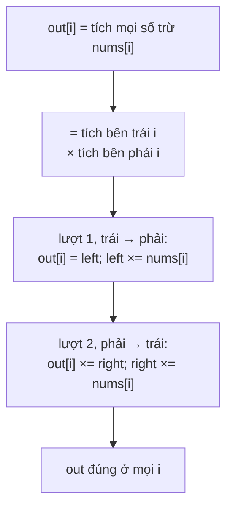

> [!tldr] Đọc nhanh
> - Đề: trả mảng `out` với `out[i]` là tích mọi phần tử trừ `nums[i]`. O(n), **không dùng phép chia**.
> - Mấu chốt: tích trừ i = (tích mọi số **bên trái** i) × (tích mọi số **bên phải** i). Hai nửa này là [[concepts/prefix-and-suffix-products|tích tiền tố và tích hậu tố]], tính được bằng hai lượt quét.
> - Chia tổng cho `nums[i]` hỏng ở **mọi** ca có số 0: JS ra `NaN`, Python, Go và Java ném lỗi chia cho 0. Muốn chia thì phải đếm số 0 riêng.
> - Lượt đầu ghi tích tiền tố thẳng vào `out`, lượt sau nhân tích hậu tố bằng một biến chạy: O(1) bộ nhớ phụ ngoài mảng kết quả.
> - Đo: vét cạn O(n²) mất 234 ms ở n = 16 000; hai lượt mất 7 ms ở n = 10⁶.

> [!info] Bối cảnh
> Bài LeetCode 238, bài neo của [[posts/2026-11-23-neetcode-prefix-suffix-encoding|ga 3: Tiền tố, hậu tố và mã hóa]] trên **tuyến NeetCode: Mảng và chuỗi**. Lời giải có đủ TypeScript, Python, Go, Java và JavaScript. Bạn chỉ cần biết vòng lặp, mảng và phép nhân.

> [!abstract]- Từ điển nhanh cho bài này (bấm để mở)
> - **Tiền tố (prefix)**: đoạn đầu của mảng, `nums[0..i-1]`. **Hậu tố (suffix)**: đoạn cuối, `nums[i+1..n-1]`.
> - **Tích chạy (running product)**: một biến nhân dồn từng phần tử khi đi qua mảng. Cùng ý với [[concepts/prefix-sum|tổng tiền tố]], đổi phép cộng thành phép nhân.
> - **Bộ nhớ phụ (extra space)**: bộ nhớ ngoài đầu vào và đầu ra. Đề coi mảng kết quả là không tính.
> - **`-0`**: số không âm của số thực dấu phẩy động (IEEE 754). `0 * -1` ra `-0` trong JS; `-0 === 0` vẫn đúng.

## Hình dung trước: chụp ảnh tập thể

Một hàng n người đứng chụp ảnh. Với mỗi người, nhiếp ảnh gia muốn biết "nếu bạn này bước ra, tích số áo của **những người còn lại** là bao nhiêu". Hỏi riêng từng người rồi nhân cả hàng thì mất n lần đi dọc hàng.

| Đời thường | Khái niệm |
|---|---|
| Hỏi từng người, mỗi lần nhân lại cả hàng | vét cạn O(n²) |
| Nhân cả hàng một lần rồi "chia bớt" người đó | phép chia, hỏng khi có người số áo 0 |
| Một trợ lý đi từ trái sang, ghi cho mỗi người tích của những người đứng **bên trái** | lượt tiền tố |
| Trợ lý thứ hai đi từ phải sang, nhân thêm tích của những người **bên phải** | lượt hậu tố |
| Trợ lý chỉ cần nhớ một con số đang nhân dồn | biến chạy `left`, `right` |



## Vấn đề

**Đề (tóm tắt bằng lời của mình):** cho mảng số nguyên `nums` (2 ≤ n ≤ 10⁵, mỗi số trong −30..30), trả mảng `out` cùng độ dài với `out[i]` bằng tích mọi phần tử trừ `nums[i]`. Đề bảo đảm tích của mọi tiền tố và hậu tố vừa số nguyên 32 bit. Phải chạy O(n) và không dùng phép chia. Đề gốc: [LeetCode 238](https://leetcode.com/problems/product-of-array-except-self/).

| Input | Output |
|---|---|
| `[1, 2, 3, 4]` | `[24, 12, 8, 6]` |
| `[-1, 1, 0, -3, 3]` | `[0, 0, 9, 0, 0]` |
| `[0, 0, 5]` | `[0, 0, 0]` |

Mình từng nghĩ "không cho chia" chỉ là luật để làm khó. Hóa ra phép chia vốn hỏng ở số 0, và cách không chia lại gọn hơn.

## Cơ chế

<figure class="figure-map" style="--ar: 3 / 4">
<div class="frame"><iframe data-archify="../diagrams/neetcode-product-of-array-except-self/worked-example.html" title="Tích bên trái nhân tích bên phải" loading="lazy"></iframe></div>
<figcaption><span><b>Hình 1.</b> Tích bên trái nhân tích bên phải.</span><a href="../diagrams/neetcode-product-of-array-except-self/worked-example.html" target="_blank" rel="noopener">Mở toàn màn hình</a></figcaption>
</figure>

<details>
<summary>Đọc từng bước</summary>
<ol>
<li>Ghi tích trước mỗi vị trí. <code>[2, 3, 5] → [1, 2, 6]</code></li>
<li>Đến vị trí 2 với tích phải 1. <code>6 × 1 = 6</code></li>
<li>Đến vị trí 1 với tích phải 5. <code>2 × 5 = 10</code></li>
<li>Đến vị trí 0 với tích phải 15. <code>1 × 15 = 15</code></li>
<li>Trả tích bỏ từng phần tử. <code>[15, 10, 6]</code></li>
</ol>
</details>

### Cách 1, vét cạn: O(n²)

Với mỗi i, nhân mọi `nums[j]` với `j ≠ i`. Đo ở dưới: n gấp đôi thì thời gian gấp khoảng 4 lần.

### Cách 2, chia: hỏng ở số 0

`total / nums[i]` đúng khi không có số 0. Có một số 0 thì ô của nó cần tích các số còn lại, nhưng `total = 0` đã làm mất thông tin đó; ô ấy thành `0 / 0`. Bản sửa đếm số 0:
- từ hai số 0 trở lên: mọi ô là 0;
- đúng một số 0: ô đó là tích các số khác 0, mọi ô khác là 0;
- không có số 0: chia như thường.

Bản sửa đúng, nhưng đề vẫn cấm phép chia, và trên số thực (không phải bài này) phép chia còn mang theo sai số làm tròn.

### Cách 3, tích tiền tố và hậu tố

`prefix[i]` = tích `nums[0..i-1]` (`prefix[0] = 1`, tích của không phần tử nào). `suffix[i]` = tích `nums[i+1..n-1]` (`suffix[n-1] = 1`). Khi đó `out[i] = prefix[i] · suffix[i]`. Hai mảng phụ, mỗi mảng một lượt: O(n) thời gian, O(n) bộ nhớ phụ.

### Cách 4, gộp vào mảng kết quả

`prefix` chỉ dùng một lần ở vị trí i, nên ghi thẳng vào `out`. `suffix` cũng vậy, và lượt hậu tố đi ngược nên chỉ cần một biến `right` nhân dồn. Kết quả: hai lượt, không mảng phụ nào.

| i | 0 | 1 | 2 | 3 |
|---|---|---|---|---|
| `nums` | 1 | 2 | 3 | 4 |
| sau lượt 1 (tích bên trái) | 1 | 1 | 2 | 6 |
| tích bên phải | 24 | 12 | 4 | 1 |
| `out` sau lượt 2 | 24 | 12 | 8 | 6 |

### Đo

TypeScript, giá trị ngẫu nhiên ±1 để tích không tràn và không về 0, trung vị:

| n | vét cạn | hai mảng phụ | gộp vào `out` |
|---|---|---|---|
| 2 000 | 4,1 ms | 0,15 ms | 0,09 ms |
| 4 000 | 16,8 ms | 0,09 ms | 0,04 ms |
| 8 000 | 65,4 ms | 0,11 ms | 0,09 ms |
| 16 000 | 234,1 ms | 0,20 ms | 0,09 ms |
| 10⁶ | (không chạy) | 23,42 ms | 7,28 ms |

Vét cạn đi đúng dáng n² (gấp đôi n, gấp khoảng 4 lần thời gian); với n = 10⁵ của đề, nó cần khoảng 10¹⁰ phép nhân. Ở n = 10⁶, bỏ hai mảng phụ nhanh hơn khoảng 3 lần vì bớt cấp phát và bớt đọc ghi bộ nhớ.

### Bên dưới năm ngôn ngữ

| | Phép chia cho 0 | Bẫy riêng |
|---|---|---|
| TypeScript / JavaScript | `0 / 0` ra `NaN`, `x / 0` ra `±Infinity`, không báo lỗi | tích có thể ra `-0`; `===` coi `-0` bằng `0` |
| Python | `ZeroDivisionError` | `/` ra float; chia hết phải dùng `//` |
| Go | `panic: integer divide by zero` | `int` 64 bit, không tràn với giới hạn của đề |
| Java | `ArithmeticException: / by zero` | so hai `int[]` bằng `Arrays.equals`, không bằng `==` |

## Ví dụ chạy được

[TypeScript](../code/neetcode-product-of-array-except-self/product-except-self.ts) · [Python](../code/neetcode-product-of-array-except-self/product_except_self.py) · [Go](../code/neetcode-product-of-array-except-self/product_except_self.go) · [Java](../code/neetcode-product-of-array-except-self/product-except-self.java) · [JavaScript](../code/neetcode-product-of-array-except-self/product-except-self.js)

Mỗi file có vét cạn, chia có đếm số 0, hai mảng phụ và bản gộp, chạy 6 ca. Dưới đây là hai bản tiền tố, hậu tố.

```ts
// Hai mảng phụ: prefix[i] = tích nums[0..i-1], suffix[i] = tích nums[i+1..n-1].
function prefixSuffixArrays(nums: number[]): number[] {
  const n = nums.length;
  const prefix = new Array(n).fill(1), suffix = new Array(n).fill(1);
  for (let i = 1; i < n; i++) prefix[i] = prefix[i - 1] * nums[i - 1];
  for (let i = n - 2; i >= 0; i--) suffix[i] = suffix[i + 1] * nums[i + 1];
  return nums.map((_, i) => prefix[i] * suffix[i]);
}

// O(1) bộ nhớ phụ: lượt 1 ghi tiền tố thẳng vào kết quả, lượt 2 nhân hậu tố bằng một biến chạy.
function prefixSuffixInPlace(nums: number[]): number[] {
  const n = nums.length;
  const out = new Array(n).fill(1);
  let left = 1;
  for (let i = 0; i < n; i++) { out[i] = left; left *= nums[i]; }
  let right = 1;
  for (let i = n - 1; i >= 0; i--) { out[i] *= right; right *= nums[i]; }
  return out;
}
```

```python
def prefix_suffix_arrays(nums: list[int]) -> list[int]:
    n = len(nums)
    prefix, suffix = [1] * n, [1] * n
    for i in range(1, n):
        prefix[i] = prefix[i - 1] * nums[i - 1]
    for i in range(n - 2, -1, -1):
        suffix[i] = suffix[i + 1] * nums[i + 1]
    return [p * s for p, s in zip(prefix, suffix)]

def prefix_suffix_in_place(nums: list[int]) -> list[int]:
    n = len(nums)
    out = [1] * n
    left = 1
    for i in range(n):
        out[i] = left
        left *= nums[i]
    right = 1
    for i in range(n - 1, -1, -1):
        out[i] *= right
        right *= nums[i]
    return out
```

```go
func prefixSuffixArrays(nums []int) []int {
	n := len(nums)
	prefix, suffix := make([]int, n), make([]int, n)
	prefix[0], suffix[n-1] = 1, 1
	for i := 1; i < n; i++ {
		prefix[i] = prefix[i-1] * nums[i-1]
	}
	for i := n - 2; i >= 0; i-- {
		suffix[i] = suffix[i+1] * nums[i+1]
	}
	out := make([]int, n)
	for i := range out {
		out[i] = prefix[i] * suffix[i]
	}
	return out
}

func prefixSuffixInPlace(nums []int) []int {
	n := len(nums)
	out := make([]int, n)
	left := 1
	for i := 0; i < n; i++ {
		out[i] = left
		left *= nums[i]
	}
	right := 1
	for i := n - 1; i >= 0; i-- {
		out[i] *= right
		right *= nums[i]
	}
	return out
}
```

```java
static int[] prefixSuffixArrays(int[] nums) {
    int n = nums.length;
    int[] prefix = new int[n], suffix = new int[n], out = new int[n];
    prefix[0] = 1; suffix[n - 1] = 1;
    for (int i = 1; i < n; i++) prefix[i] = prefix[i - 1] * nums[i - 1];
    for (int i = n - 2; i >= 0; i--) suffix[i] = suffix[i + 1] * nums[i + 1];
    for (int i = 0; i < n; i++) out[i] = prefix[i] * suffix[i];
    return out;
}

static int[] prefixSuffixInPlace(int[] nums) {
    int n = nums.length;
    int[] out = new int[n];
    int left = 1;
    for (int i = 0; i < n; i++) { out[i] = left; left *= nums[i]; }
    int right = 1;
    for (int i = n - 1; i >= 0; i--) { out[i] *= right; right *= nums[i]; }
    return out;
}
```

```js
function prefixSuffixArrays(nums) {
  const n = nums.length;
  const prefix = new Array(n).fill(1), suffix = new Array(n).fill(1);
  for (let i = 1; i < n; i++) prefix[i] = prefix[i - 1] * nums[i - 1];
  for (let i = n - 2; i >= 0; i--) suffix[i] = suffix[i + 1] * nums[i + 1];
  return nums.map((_, i) => prefix[i] * suffix[i]);
}

function prefixSuffixInPlace(nums) {
  const n = nums.length;
  const out = new Array(n).fill(1);
  let left = 1;
  for (let i = 0; i < n; i++) { out[i] = left; left *= nums[i]; }
  let right = 1;
  for (let i = n - 1; i >= 0; i--) { out[i] *= right; right *= nums[i]; }
  return out;
}
```


```text
$ node product-except-self.ts
bruteForce           6/6 ca đúng
naiveDivision        3/6 ca đúng; sai ở [-1,1,0,-3,3] → [0,0,NaN,0,0] [0,0,5] → [NaN,NaN,0] [0,4,5] → [NaN,0,0]
divisionZeroAware    6/6 ca đúng
prefixSuffixArrays   6/6 ca đúng
prefixSuffixInPlace  6/6 ca đúng

prefixSuffixInPlace([0, 0, -1]) = [-0, -0, 0]

n          vét cạn   hai mảng   tại chỗ   (ms, trung vị)
2000            4.1       0.15      0.09
4000           16.8       0.09      0.04
8000           65.4       0.11      0.09
16000         234.1       0.20      0.09
1000000           —      23.42      7.28
```

Chia thẳng hỏng ở cả ba ca có số 0, và JS không báo lỗi: nó trả `NaN` lặng lẽ. Python cùng bản chia thẳng thì ném lỗi:

```text
$ python3 product_except_self.py
brute_force             6/6 ca đúng
naive_division          3/6 ca đúng; lỗi ở [-1, 1, 0, -3, 3]: ZeroDivisionError, [0, 0, 5]: ZeroDivisionError, [0, 4, 5]: ZeroDivisionError
division_zero_aware     6/6 ca đúng
prefix_suffix_arrays    6/6 ca đúng
prefix_suffix_in_place  6/6 ca đúng
```

Dòng `[-0, -0, 0]` là chuyện riêng của số thực: `0 · (−1)` ra `-0`. Nó vẫn bằng `0` theo `===` và in ra `0` qua `JSON.stringify`, nên LeetCode chấp nhận. Go, Java và JavaScript chạy bốn cách đúng và in `6/6 ca đúng`.

## Hiểu lầm và bẫy hay gặp

- **"Chia tổng cho từng số là xong."** Hỏng ở mọi ca có số 0, và đề cấm.
- **Bắt đầu tiền tố bằng `nums[0]` thay vì 1.** `prefix[i]` là tích **trước** i, không gồm `nums[i]`. Tích của không phần tử nào là 1, như tổng của không phần tử nào là 0.
- **Cập nhật biến chạy trước khi ghi.** `left *= nums[i]; out[i] = left` đưa chính `nums[i]` vào tích. Phải ghi trước, nhân sau.
- **"O(1) bộ nhớ" tính cả mảng kết quả.** Đề quy ước không tính `out`; bản gộp chỉ dùng hai biến.
- **Tràn số.** Đề bảo đảm tích tiền tố và hậu tố vừa 32 bit. Với dữ liệu ngoài đề, Java `int` tràn lặng lẽ; dùng `long` hoặc `Math.multiplyExact` để có lỗi.

## Câu hỏi tự kiểm tra

> [!question]- Tính `out` cho `[2, 0, 3]` bằng cách gộp, ghi lại `out` sau mỗi lượt.
> Sau lượt 1 (tích bên trái): `[1, 2, 0]`. Lượt 2 nhân tích bên phải 0, 3, 1: `[1·0, 2·3, 0·1] = [0, 6, 0]`.

> [!question]- Vì sao `prefix[0]` và `suffix[n-1]` bằng 1?
> Bên trái phần tử đầu và bên phải phần tử cuối không có gì. Tích của tập rỗng là phần tử trung hòa của phép nhân, tức 1.

> [!question]- Mảng có đúng một số 0 ở vị trí k. Những ô nào của `out` khác 0?
> Chỉ ô k: nó bằng tích mọi số khác. Mọi ô khác đều có số 0 ở vị trí k trong tích của mình.

> [!question]- Đổi đề: trả tổng mọi số trừ chính nó. Có cần tiền tố, hậu tố không?
> Không: phép cộng đảo được, nên `total − nums[i]` luôn đúng. Phép nhân không đảo được khi có số 0, đó là lý do bài này cần tiền tố và hậu tố.

## Tham khảo

- [LeetCode 238: Product of Array Except Self](https://leetcode.com/problems/product-of-array-except-self/) (đề gốc)
- [ECMAScript 2025: Number::multiply](https://tc39.es/ecma262/2025/#sec-numeric-types-number-multiply) (dấu của tích khi một thừa số là 0, nguồn gốc của `-0`)
- [Python: Numeric types](https://docs.python.org/3/library/stdtypes.html#numeric-types-int-float-complex) (`/` ra float, `//` chia lấy nguyên, chia cho 0 ném `ZeroDivisionError`)
- [Go spec: Integer operators](https://go.dev/ref/spec#Integer_operators) (chia cho 0 gây panic lúc chạy)
- [Java 21 `Math.multiplyExact`](https://docs.oracle.com/en/java/javase/21/docs/api/java.base/java/lang/Math.html#multiplyExact(int,int)) (ném lỗi khi tràn thay vì quay vòng)
