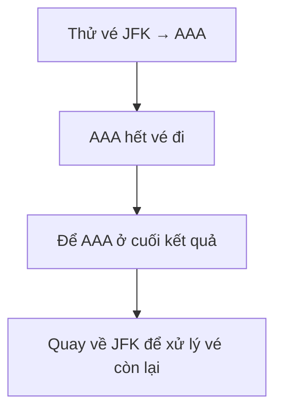

> [!tldr] Đọc nhanh
> - Một vé là một cạnh có hướng riêng. Hai vé trùng chặng vẫn là hai cạnh trong [[concepts/eulerian-trail|đường đi Euler]].
> - Sắp điểm đến giảm dần ở từng sân bay rồi lấy cuối mảng để thử mã nhỏ nhất.
> - Chỉ ghi sân bay vào đáp án ngược khi đã hết vé đi từ nó. Bước này để đoạn cụt nằm đúng ở cuối.

> [!info] Bối cảnh
> Bài LeetCode 332 thuộc [[posts/2026-11-27-neetcode-spanning-tree-itinerary|ga 6 về cây khung và hành trình]] trên tuyến NeetCode Đồ thị. Ga này có hai câu hỏi khác nhau về cạnh. Bài này dùng hết các cạnh đã có và bạn chỉ cần biết mảng, bảng băm và ngăn xếp.

> [!abstract]- Từ điển nhanh cho bài này (bấm để mở)
> - [[concepts/adjacency-list|Danh sách kề]] ghi những điểm đến của từng sân bay.
> - [[concepts/eulerian-trail|Đường đi Euler]] dùng mỗi cạnh đúng một lần. Một sân bay có thể xuất hiện lại.
> - Thứ tự từ điển so bằng mã đầu tiên khác nhau giữa hai hành trình.
> - [[concepts/hierholzers-algorithm|Hierholzer]] ghép các đoạn đường qua cạnh bằng cách chốt hậu tố trước.

## Hình dung trước: chồng vé đổi ở quầy

Mình có ba vé `JFK → AAA`, `JFK → BBB`, `BBB → JFK`. Nếu mình đi AAA trước và coi lựa chọn đó là bước đầu được chốt, mình kẹt ở AAA khi vẫn còn vé. Đường dùng hết vé phải đi qua BBB, quay về JFK rồi mới đi AAA.

| Đời thường | Khái niệm |
|---|---|
| Từng tấm vé có điểm đi, điểm đến | Một cạnh có hướng |
| Chồng vé của mỗi quầy | Danh sách kề giữ cả vé trùng |
| Khi hết vé tại quầy hiện tại | Ghi một đầu mút vào hậu tố |



## Vấn đề: dùng từng vé một lần

Đề có từ 1 đến 300 vé. Hai mã trên vé là các mã sân bay khác nhau gồm ba chữ cái tiếng Anh in hoa. Vé cùng chặng có thể lặp. Hành trình bắt đầu ở JFK và đề bảo đảm dùng được mọi vé. Khi có nhiều hành trình, chọn dãy nhỏ nhất theo thứ tự từ điển. Vì mã dài bằng nhau, so dãy mã tương đương so chuỗi nối của chúng.

## Cơ chế

### Quay lui làm mốc

Thử từng vé còn lại theo thứ tự điểm đến để tạo tiền tố. Nếu kẹt, trả vé rồi thử nhánh sau. Nhánh đầy đủ đầu tiên nhỏ nhất theo thứ tự từ điển. Cách này có thể lặp qua số thứ tự hoán vị theo cấp giai thừa. Ngăn xếp và dấu đã dùng tốn O(E) bộ nhớ.

### Chốt từ cuối với Hierholzer

1. Tạo danh sách điểm đến cho mỗi sân bay, sắp giảm dần để lấy mã nhỏ nhất với `pop`.
2. Đặt JFK trên ngăn xếp. Còn vé từ đỉnh ngăn xếp thì lấy một vé và đẩy sân bay đến.
3. Hết vé đi thì lấy sân bay khỏi ngăn xếp, thêm vào kết quả ngược. Đảo kết quả khi ngăn xếp rỗng.

Với ba vé ở trên, lần lấy `JFK → AAA` đầu tiên khiến AAA được ghi trước vào **kết quả ngược**. Lượt sau đi qua BBB và quay lại JFK. Khi đảo, vòng qua BBB đứng trước vé đến AAA. Việc ghi khi hết cạnh đi cho phép các vòng quay về quầy được ghép vào trước đoạn rời quầy lần cuối. Trong các nhánh có thể xuất hiện trước, thứ tự lấy mã nhỏ nhất ưu tiên điểm đến nhỏ nhất. Điều kiện bảo đảm có đường Euler là một phần của đề, nên ví dụ không cần bộ kiểm tra đồ thị tùy ý.

Với E vé, sắp xếp tốn O(E log E) ở cận trên, mỗi vé được lấy một lần và có E+1 lần lấy đỉnh. Bộ nhớ O(E). Bản [đo số lần thử vé](../code/neetcode-spanning-tree-itinerary/compare.ts) dựng 15 vé gồm sáu vòng ở AAA và một vòng riêng ở JFK. Quay lui thử 3.928 vé, còn Hierholzer lấy đúng 15 vé. Phép đo đếm lượt lấy vé, không tính việc sắp xếp.

## Ví dụ chạy được

Các file tự kiểm năm trường hợp gồm một tuyến thẳng, ngõ cụt từ lựa chọn nhỏ nhất, vé trùng và hai kiểu vòng cần ghép. Bản TypeScript dùng Node 24, Python dùng `python3`, Go dùng `go run`, Java dùng `java itinerary.java`, JavaScript dùng `node`, PHP dùng `php`, Rust biên dịch với `rustc --edition 2021 -O`.

[TypeScript](../code/neetcode-reconstruct-itinerary/itinerary.ts) · [Python](../code/neetcode-reconstruct-itinerary/itinerary.py) · [Go](../code/neetcode-reconstruct-itinerary/itinerary.go) · [Java](../code/neetcode-reconstruct-itinerary/itinerary.java) · [JavaScript](../code/neetcode-reconstruct-itinerary/itinerary.js) · [PHP](../code/neetcode-reconstruct-itinerary/itinerary.php) · [Rust](../code/neetcode-reconstruct-itinerary/itinerary.rs)

```typescript
function findItinerary(tickets: [string, string][]): string[] {
  const outgoing = new Map<string, string[]>();
  for (const [from, to] of tickets) {
    const list = outgoing.get(from) ?? [];
    list.push(to);
    outgoing.set(from, list);
  }
  for (const list of outgoing.values()) list.sort().reverse();

  const stack = ["JFK"];
  const suffix = [];
  while (stack.length) {
    const list = outgoing.get(stack.at(-1)!);
    if (list?.length) stack.push(list.pop()!);
    else suffix.push(stack.pop()!);
  }
  return suffix.reverse();
}
```

```python
def find_itinerary(tickets):
    outgoing = {}
    for start, end in tickets:
        outgoing.setdefault(start, []).append(end)
    for destinations in outgoing.values():
        destinations.sort(reverse=True)

    stack = ["JFK"]
    suffix = []
    while stack:
        destinations = outgoing.get(stack[-1])
        if destinations:
            stack.append(destinations.pop())
        else:
            suffix.append(stack.pop())
    return suffix[::-1]
```

```go
package main

import (
	"fmt"
	"slices"
	"strings"
)

func findItinerary(tickets [][2]string) []string {
	outgoing := make(map[string][]string)
	for _, ticket := range tickets {
		from, to := ticket[0], ticket[1]
		outgoing[from] = append(outgoing[from], to)
	}
	for _, destinations := range outgoing {
		slices.Sort(destinations)
		slices.Reverse(destinations)
	}

	stack := []string{"JFK"}
	suffix := make([]string, 0, len(tickets)+1)
	for len(stack) > 0 {
		last := len(stack) - 1
		current := stack[last]
		destinations := outgoing[current]
		if len(destinations) > 0 {
			end := len(destinations) - 1
			stack = append(stack, destinations[end])
			outgoing[current] = destinations[:end]
		} else {
			suffix = append(suffix, current)
			stack = stack[:last]
		}
	}
	slices.Reverse(suffix)
	return suffix
}
```

```java
import java.util.ArrayList;
import java.util.Collections;
import java.util.HashMap;
import java.util.ArrayDeque;
import java.util.List;

class Itinerary {
    static List<String> findItinerary(String[][] tickets) {
        var outgoing = new HashMap<String, ArrayList<String>>();
        for (String[] ticket : tickets) {
            outgoing.computeIfAbsent(ticket[0], key -> new ArrayList<>()).add(ticket[1]);
        }
        for (var destinations : outgoing.values()) {
            destinations.sort(Collections.reverseOrder());
        }

        var stack = new ArrayDeque<String>();
        var suffix = new ArrayList<String>(tickets.length + 1);
        stack.push("JFK");
        while (!stack.isEmpty()) {
            var destinations = outgoing.get(stack.peek());
            if (destinations != null && !destinations.isEmpty()) {
                stack.push(destinations.remove(destinations.size() - 1));
            } else {
                suffix.add(stack.pop());
            }
        }
        Collections.reverse(suffix);
        return suffix;
    }
}
```

```javascript
function findItinerary(tickets) {
    const outgoing = new Map();
    for (const [from, to] of tickets){
        const list = outgoing.get(from) ?? [];
        list.push(to);
        outgoing.set(from, list);
    }
    for (const list of outgoing.values())list.sort().reverse();
    const stack = [
        "JFK"
    ];
    const suffix = [];
    while(stack.length){
        const list = outgoing.get(stack.at(-1));
        if (list?.length) stack.push(list.pop());
        else suffix.push(stack.pop());
    }
    return suffix.reverse();
}
const cases = [
    [
        [
            [
                "BBB",
                "CCC"
            ],
            [
                "JFK",
                "AAA"
            ],
            [
                "AAA",
                "BBB"
            ]
        ],
        [
            "JFK",
            "AAA",
            "BBB",
            "CCC"
        ]
    ],
    [
        [
            [
                "JFK",
                "AAA"
            ],
            [
                "JFK",
                "BBB"
            ],
            [
                "BBB",
                "JFK"
            ]
        ],
        [
            "JFK",
            "BBB",
            "JFK",
            "AAA"
        ]
    ],
    [
        [
            [
                "JFK",
                "AAA"
            ],
            [
                "JFK",
                "AAA"
            ],
            [
                "AAA",
                "JFK"
            ]
        ],
        [
            "JFK",
            "AAA",
            "JFK",
            "AAA"
        ]
    ],
    [
        [
            [
                "JFK",
                "BBB"
            ],
            [
                "BBB",
                "JFK"
            ],
            [
                "JFK",
                "AAA"
            ],
            [
                "AAA",
                "JFK"
            ]
        ],
        [
            "JFK",
            "AAA",
            "JFK",
            "BBB",
            "JFK"
        ]
    ],
    [
        [
            [
                "JFK",
                "AAA"
            ],
            [
                "AAA",
                "CCC"
            ],
            [
                "CCC",
                "JFK"
            ],
            [
                "AAA",
                "BBB"
            ],
            [
                "BBB",
                "AAA"
            ]
        ],
        [
            "JFK",
            "AAA",
            "BBB",
            "AAA",
            "CCC",
            "JFK"
        ]
    ]
];
for (const [tickets, expected] of cases){
    if (findItinerary(tickets).join(",") !== expected.join(",")) throw new Error("Sai hành trình");
}
console.log(`${cases.length}/${cases.length} ca đúng`);
```

```php
<?php
declare(strict_types=1);

function findItinerary(array $tickets): array
{
    $outgoing = [];
    foreach ($tickets as [$from, $to]) {
        $outgoing[$from][] = $to;
    }
    foreach (array_keys($outgoing) as $airport) {
        rsort($outgoing[$airport], SORT_STRING);
    }

    $stack = ['JFK'];
    $suffix = [];
    while ($stack !== []) {
        $current = $stack[array_key_last($stack)];
        if (!empty($outgoing[$current])) {
            $stack[] = array_pop($outgoing[$current]);
        } else {
            $suffix[] = array_pop($stack);
        }
    }
    return array_reverse($suffix);
}
```

```rust
use std::collections::HashMap;

fn find_itinerary<'a>(tickets: &[(&'a str, &'a str)]) -> Vec<&'a str> {
    let mut outgoing: HashMap<&str, Vec<&str>> = HashMap::new();
    for &(from, to) in tickets {
        outgoing.entry(from).or_default().push(to);
    }
    for destinations in outgoing.values_mut() {
        destinations.sort_unstable_by(|a, b| b.cmp(a));
    }

    let mut stack = vec!["JFK"];
    let mut suffix = Vec::with_capacity(tickets.len() + 1);
    while let Some(&current) = stack.last() {
        if let Some(next) = outgoing.get_mut(current).and_then(Vec::pop) {
            stack.push(next);
        } else {
            suffix.push(stack.pop().unwrap());
        }
    }
    suffix.reverse();
    suffix
}
```

```text
5/5 ca đúng
```

## Hiểu lầm và bẫy hay gặp

- Tập sân bay đã thăm sẽ bỏ mất đường hợp lệ. Trạng thái cần xóa là từng vé.
- Giữ vé trong tập hợp cũng làm mất vé trùng. Dùng danh sách để giữ số bản sao.
- Dùng `shift` hoặc `pop(0)` ở đầu mảng có thể dịch các phần tử còn lại. Sắp giảm dần để lấy ở cuối. PHP dùng `SORT_STRING` rõ ràng, Go lưu lại lát cắt sau khi bỏ phần tử cuối.
- So theo collation tùy hệ thống là việc thừa với mã ASCII in hoa. Java so mã bằng thứ tự tự nhiên của `String`.

## Câu hỏi tự kiểm tra

> [!question]- Vì sao ngõ cụt được ghi ngay cả khi còn vé ở nơi khác?
> Ngõ cụt bắt đầu một đoạn cuối, còn ngăn xếp giữ đường để ghép các vòng chưa xử lý vào trước đoạn đó.

> [!question]- Đáp án có bao nhiêu sân bay nếu có E vé?
> E+1 lần ghé, tính cả JFK. Một sân bay có thể xuất hiện nhiều lần.

## Tham khảo

- [Đề bài LC-0332](https://leetcode.com/problems/reconstruct-itinerary/)
- [Princeton Algorithms, cài đặt đường đi Euler có hướng](https://algs4.cs.princeton.edu/42digraph/DirectedEulerianPath.java.html)
