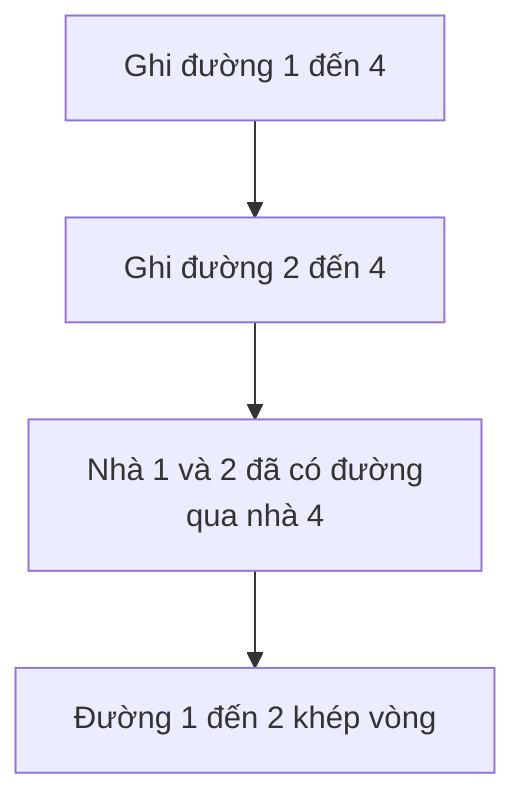

> [!tldr] Đọc nhanh
> - Một cạnh khép vòng khi hai đầu đã nối được trước khi thêm cạnh.
> - Duyệt lại từng tiền tố bằng DFS đúng nhưng lặp nhiều việc trên đường dài.
> - [[concepts/disjoint-set-union|Union-Find]] chỉ cần hỏi hai gốc, rồi gộp khi khác nhóm.

> [!info] Bối cảnh
> Bài LeetCode 684, thuộc [[posts/2026-11-27-neetcode-union-find|ga 4: Union-Find]] trên [[series/neetcode-grph|tuyến NeetCode: Đồ thị]]. Ví dụ dùng đồ thị nhỏ; bạn chỉ cần biết mảng và vòng lặp.

> [!abstract]- Từ điển nhanh cho bài này (bấm để mở)
> - Cạnh vô hướng nối hai đỉnh theo cả hai chiều.
> - [[concepts/connected-component|Thành phần liên thông]] là một nhóm tối đa các đỉnh đi tới được nhau.
> - [[concepts/disjoint-set-union|DSU]] duy trì các nhóm bằng phép tìm gốc và phép gộp. DFS là duyệt theo chiều sâu.

## Hình dung trước: bản đồ đường trong khu phố

Giả sử mọi nhà đều đi tới nhau qua các con đường hai chiều, với đúng một vòng. Mình nhận danh sách đường theo thứ tự đã ghi vào sổ. Muốn bỏ đường muộn nhất trên vòng mà vẫn giữ mọi nhà nối được với nhau, mình tìm con đường có hai đầu đã thuộc cùng một nhóm ngay lúc ghi.

| Đời thường | Khái niệm |
|---|---|
| Mỗi căn nhà | Đỉnh |
| Một đường hai chiều mới ghi | Cạnh trong thứ tự đầu vào |
| Hai nhà đã đi tới nhau | Cùng thành phần liên thông |
| Đường có hai đầu đã nối | Cạnh khép chu trình |



## Vấn đề: chọn cạnh loại bỏ

Có `n` đỉnh đánh số từ 1 đến `n`, với `3 ≤ n ≤ 1000`. Danh sách gồm `n` cạnh vô hướng, từng cặp đầu mút phân biệt, không có cạnh lặp. Đồ thị thu được khi thêm một cạnh vào một cây. Đề hỏi cạnh có vị trí muộn nhất trong số các cạnh bỏ được để lấy lại cây.

Ví dụ tự dựng `[[1,4],[2,4],[1,2],[4,5],[3,5]]`. Ba cạnh đầu lập vòng qua 1, 4 và 2. Hai cạnh cuối nối thêm nhà. Đáp án là `[1,2]`.

## Cơ chế

### Cách 1. Kiểm tra từng cạnh bằng DFS

Giữ danh sách kề của các cạnh đã đọc. Trước khi thêm `[a,b]`, chạy DFS từ `a`. Nếu chạm được `b` thì đường cũ cộng cạnh mới tạo chu trình. Nếu chưa chạm được, thêm cả hai hướng vào danh sách kề. Mỗi lượt có thể xem lại O(n) đỉnh và cạnh đã đọc, nên cả bài tốn O(n²) thời gian và O(n) bộ nhớ phụ.

### Cách 2. Kiểm tra hai gốc bằng DSU

Bắt đầu với mỗi đỉnh một nhóm. Trước mỗi lượt, hai đỉnh có cùng gốc khi và chỉ khi chúng có đường qua các cạnh đã đọc. Hai gốc khác nhau nghĩa là mình vừa nối hai thành phần, nên gộp chúng. Cùng gốc nghĩa là đã có đường, nên trả cạnh hiện tại ngay. Mảng có `n + 1` ô vì nhãn bắt đầu từ 1, và ô 0 để trống.

Tại sao trả cạnh đầu tiên bị từ chối lại đúng quy tắc “muộn nhất”? Trước khi đọc đủ mọi cạnh của chu trình duy nhất, phần đã đọc vẫn là rừng. Do đó cạnh **cuối trên chu trình theo thứ tự đầu vào** là cạnh đầu tiên thấy hai đầu đã nối. Bỏ một cạnh ngoài chu trình sẽ cắt mất một nhánh. Bỏ cạnh nào trên chu trình cũng giữ liên thông và hết vòng.

[[concepts/path-compression|Path Compression]] và [[concepts/union-by-size|Union by Size]] đưa chi phí của cả dãy xuống O(n α(n)) thời gian khấu hao với O(n) bộ nhớ. `α` là nghịch đảo Ackermann, tăng rất chậm. Kết quả đo trong file thử một đường dài 1.000 đỉnh rồi thêm cạnh nối hai đầu. DFS thăm 500.500 đỉnh cộng dồn, còn DSU thử gộp 1.000 lần. Hai con số đo hai loại thao tác khác nhau.

## Ví dụ chạy được

[TypeScript](../code/neetcode-redundant-connection/solve.ts) · [Python](../code/neetcode-redundant-connection/solve.py) · [Go](../code/neetcode-redundant-connection/solve.go) · [Java](../code/neetcode-redundant-connection/solve.java) · [JavaScript](../code/neetcode-redundant-connection/solve.js) · [PHP](../code/neetcode-redundant-connection/solve.php) · [Rust](../code/neetcode-redundant-connection/solve.rs)

Các tab hiện phần lời giải. File tải về có đủ các cách và bộ kiểm tra tự chạy.

```ts
import assert from "node:assert/strict";

type Edge = readonly [number, number];

class DisjointSet {
  private parent: number[];
  private size: number[];
  count: number;

  constructor(n: number) {
    this.parent = Array.from({ length: n }, (_, i) => i);
    this.size = new Array<number>(n).fill(1);
    this.count = n;
  }

  find(node: number): number {
    while (node !== this.parent[node]) {
      this.parent[node] = this.parent[this.parent[node]];
      node = this.parent[node];
    }
    return node;
  }

  union(a: number, b: number): boolean {
    let ra = this.find(a);
    let rb = this.find(b);
    if (ra === rb) return false;
    if (this.size[ra] < this.size[rb]) [ra, rb] = [rb, ra];
    this.parent[rb] = ra;
    this.size[ra] += this.size[rb];
    this.count--;
    return true;
  }
}

function redundantByDsu(n: number, edges: readonly Edge[]): Edge {
  const ds = new DisjointSet(n + 1);
  for (const edge of edges) {
    if (!ds.union(...edge)) return edge;
  }
  throw new Error("Cần đúng một cạnh dư");
}
```

```python
class DisjointSet:
    def __init__(self, n):
        self.parent = list(range(n))
        self.size = [1] * n
        self.count = n

    def find(self, node):
        while node != self.parent[node]:
            self.parent[node] = self.parent[self.parent[node]]
            node = self.parent[node]
        return node

    def union(self, a, b):
        ra, rb = self.find(a), self.find(b)
        if ra == rb:
            return False
        if self.size[ra] < self.size[rb]:
            ra, rb = rb, ra
        self.parent[rb] = ra
        self.size[ra] += self.size[rb]
        self.count -= 1
        return True


def redundant_by_dsu(n, edges):
    ds = DisjointSet(n + 1)
    for edge in edges:
        if not ds.union(*edge):
            return edge
    raise ValueError("Cần đúng một cạnh dư")
```

```go
package main

import "fmt"

type edge [2]int

type disjointSet struct {
	parent, size []int
	count        int
}

func newDisjointSet(n int) *disjointSet {
	ds := &disjointSet{make([]int, n), make([]int, n), n}
	for i := range ds.parent {
		ds.parent[i], ds.size[i] = i, 1
	}
	return ds
}

func (ds *disjointSet) find(node int) int {
	for node != ds.parent[node] {
		ds.parent[node] = ds.parent[ds.parent[node]]
		node = ds.parent[node]
	}
	return node
}

func (ds *disjointSet) union(a, b int) bool {
	ra, rb := ds.find(a), ds.find(b)
	if ra == rb {
		return false
	}
	if ds.size[ra] < ds.size[rb] {
		ra, rb = rb, ra
	}
	ds.parent[rb] = ra
	ds.size[ra] += ds.size[rb]
	ds.count--
	return true
}

func redundantByDsu(n int, edges []edge) edge {
	ds := newDisjointSet(n + 1)
	for _, e := range edges {
		if !ds.union(e[0], e[1]) {
			return e
		}
	}
	panic("Cần đúng một cạnh dư")
}
```

```java
class Solve {
    static final class DisjointSet {
        private final int[] parent;
        private final int[] size;
        int count;

        DisjointSet(int n) {
            parent = new int[n];
            size = new int[n];
            count = n;
            for (int i = 0; i < n; i++) {
                parent[i] = i;
                size[i] = 1;
            }
        }

        int find(int node) {
            while (node != parent[node]) {
                parent[node] = parent[parent[node]];
                node = parent[node];
            }
            return node;
        }

        boolean union(int a, int b) {
            int ra = find(a), rb = find(b);
            if (ra == rb) return false;
            if (size[ra] < size[rb]) {
                int swap = ra;
                ra = rb;
                rb = swap;
            }
            parent[rb] = ra;
            size[ra] += size[rb];
            count--;
            return true;
        }
    }

    static int[] redundantByDsu(int n, int[][] edges) {
        var ds = new DisjointSet(n + 1);
        for (int[] e : edges) {
            if (!ds.union(e[0], e[1])) return e;
        }
        throw new IllegalArgumentException("Cần đúng một cạnh dư");
    }
}
```

```javascript
import assert from "node:assert/strict";

class DisjointSet {
  parent;
  size;
  count;

  constructor(n) {
    this.parent = Array.from({ length: n }, (_, i) => i);
    this.size = new Array(n).fill(1);
    this.count = n;
  }

  find(node) {
    while (node !== this.parent[node]) {
      this.parent[node] = this.parent[this.parent[node]];
      node = this.parent[node];
    }
    return node;
  }

  union(a, b) {
    let ra = this.find(a);
    let rb = this.find(b);
    if (ra === rb) return false;
    if (this.size[ra] < this.size[rb]) [ra, rb] = [rb, ra];
    this.parent[rb] = ra;
    this.size[ra] += this.size[rb];
    this.count--;
    return true;
  }
}

function redundantByDsu(n, edges) {
  const ds = new DisjointSet(n + 1);
  for (const edge of edges) {
    if (!ds.union(...edge)) return edge;
  }
  throw new Error("Cần đúng một cạnh dư");
}
```

```php
<?php
declare(strict_types=1);

final class DisjointSet
{
    private array $parent;
    private array $size;
    public int $count;

    public function __construct(int $n)
    {
        $this->parent = range(0, $n - 1);
        $this->size = array_fill(0, $n, 1);
        $this->count = $n;
    }

    public function find(int $node): int
    {
        while ($node !== $this->parent[$node]) {
            $this->parent[$node] = $this->parent[$this->parent[$node]];
            $node = $this->parent[$node];
        }
        return $node;
    }

    public function union(int $a, int $b): bool
    {
        [$ra, $rb] = [$this->find($a), $this->find($b)];
        if ($ra === $rb) {
            return false;
        }
        if ($this->size[$ra] < $this->size[$rb]) {
            [$ra, $rb] = [$rb, $ra];
        }
        $this->parent[$rb] = $ra;
        $this->size[$ra] += $this->size[$rb];
        $this->count--;
        return true;
    }
}

function redundantByDsu(int $n, array $edges): array
{
    $ds = new DisjointSet($n + 1);
    foreach ($edges as [$a, $b]) {
        if (!$ds->union($a, $b)) {
            return [$a, $b];
        }
    }
    throw new InvalidArgumentException('Cần đúng một cạnh dư');
}
```

```rust
type Edge = [usize; 2];

struct DisjointSet {
    parent: Vec<usize>,
    size: Vec<usize>,
    count: usize,
}

impl DisjointSet {
    fn new(n: usize) -> Self {
        Self {
            parent: (0..n).collect(),
            size: vec![1; n],
            count: n,
        }
    }

    fn find(&mut self, mut node: usize) -> usize {
        while node != self.parent[node] {
            self.parent[node] = self.parent[self.parent[node]];
            node = self.parent[node];
        }
        node
    }

    fn union(&mut self, a: usize, b: usize) -> bool {
        let mut ra = self.find(a);
        let mut rb = self.find(b);
        if ra == rb {
            return false;
        }
        if self.size[ra] < self.size[rb] {
            std::mem::swap(&mut ra, &mut rb);
        }
        self.parent[rb] = ra;
        self.size[ra] += self.size[rb];
        self.count -= 1;
        true
    }
}

fn redundant_by_dsu(n: usize, edges: &[Edge]) -> Edge {
    let mut ds = DisjointSet::new(n + 1);
    for &[a, b] in edges {
        if !ds.union(a, b) {
            return [a, b];
        }
    }
    panic!("Cần đúng một cạnh dư");
}
```

Kết quả của TypeScript và JavaScript. Năm file còn lại kiểm 6/6 ca nhỏ.

```text
8/8 ca đúng
1000 cạnh: DFS thăm 500500 đỉnh; DSU thử 1000 lần gộp
```

## Hiểu lầm và bẫy hay gặp

- Đọc theo thứ tự đầu vào, vì đổi thứ tự có thể đổi cạnh cuối trên vòng.
- Trả lại cặp đầu mút của cạnh hiện tại. Gốc DSU chỉ là đại diện của nhóm.
- DSU luôn gắn một **gốc** vào một gốc khác. Nối hai phần tử bất kỳ có thể làm mất phần tử của một nhóm cũ.
- Python cần tạo từng hàng danh sách kề bằng list comprehension. `[[]] * n` dùng chung một danh sách con cho mọi đỉnh.

## Câu hỏi tự kiểm tra

> [!question]- Cạnh cuối của danh sách chắc chắn dư?
> Với ví dụ trên, cạnh cuối `[3,5]` là đường duy nhất nối nhà 3. Bỏ nó làm đồ thị mất liên thông.

> [!question]- Vì sao hai đầu cùng gốc báo chu trình?
> Các lần gộp trước chứng minh đã có đường giữa hai đỉnh. Cạnh hiện tại ghép thêm một đường trực tiếp, làm khép vòng.

## Tham khảo

- [LeetCode](https://leetcode.com/problems/redundant-connection/)
- [Sedgewick and Wayne, Weighted Quick Union](https://github.com/kevin-wayne/algs4/blob/master/src/main/java/edu/princeton/cs/algs4/WeightedQuickUnionUF.java)
- [Robert Tarjan, Efficiency of a Good But Not Linear Set Union Algorithm](https://doi.org/10.1145/321879.321884)
