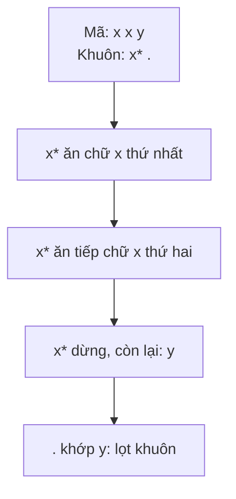
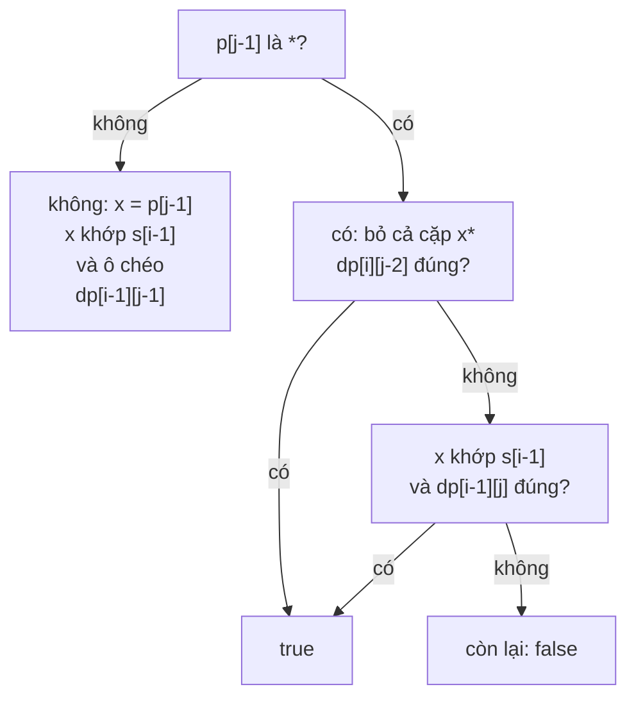

> [!tldr] Đọc nhanh
> - Đặt `dp[i][j]` là "tiền tố `s[0:i]` có khớp trọn mẫu `p[0:j]` không". Đây là một [[concepts/two-sequence-dp|bảng trên hai tiền tố]], chỉ khác ở chỗ chuỗi thứ hai là một mẫu.
> - Dấu `.` khớp đúng một ký tự bất kỳ. Dấu `*` không đứng một mình: nó đi cùng phần tử ngay trước, và cặp `x*` khớp 0, 1 hay nhiều chữ `x`.
> - Ô có `*` chỉ cần hai câu hỏi: bỏ cả cặp `x*` (ô `dp[i][j-2]`), hoặc cặp này ăn thêm ký tự cuối của chuỗi rồi vẫn còn nguyên (ô `dp[i-1][j]`).
> - Hàng 0 không toàn `false`: chuỗi rỗng khớp được `a*b*` vì mỗi cặp có thể lấy 0 lần.
> - Đệ quy thuần có thể nổ theo hàm mũ. Ghi nhớ hoặc bảng chỉ có (n+1)(m+1) trạng thái.

> [!info] Bối cảnh
> Đây là bài LeetCode 10 tại [[posts/2026-11-27-neetcode-interval-dp|ga DP-07: DP khoảng và khớp mẫu]] trên **tuyến NeetCode: Quy hoạch động**. Mình hình dung một cái khuôn dò mã hàng có vài ô "chữ gì cũng được" và vài ô "chữ này lặp bao nhiêu lần cũng được". Bạn chỉ cần biết chuỗi, mảng hai chiều và đệ quy; không cần biết gì về thư viện regex.

> [!abstract]- Từ điển nhanh cho bài này (bấm để mở)
> - Regex (biểu thức chính quy) là cách viết một mẫu chuỗi. Bài này chỉ dùng một phần rất nhỏ của nó: chữ thường, `.` và `*`.
> - Khớp trọn (full match) nghĩa là mẫu phủ hết chuỗi từ ký tự đầu tới ký tự cuối, không chỉ một đoạn ở giữa.
> - Neo (anchor) `^` và `$` buộc mẫu bắt đầu ở đầu chuỗi và kết thúc ở cuối chuỗi khi dùng thư viện regex thật.
> - [[concepts/pattern-matching-dp|DP khớp mẫu]] là tên mình gọi cách đặt bảng trên tiền tố của chuỗi và của mẫu.
> - [[concepts/dp-state|Trạng thái DP]] nói rõ một ô lưu điều gì; [[concepts/recurrence-relation|công thức truy hồi]] nói ô đó đọc những ô nào.
> - [[concepts/memoization|Ghi nhớ kết quả]] (memoization) lưu đáp án của một trạng thái ngay lần đầu tính.
> - Quay lui (backtracking) là thử một lựa chọn, thất bại thì lùi lại thử lựa chọn khác.

## Hình dung trước: khuôn dò mã hàng

Ở kho, mình có một cái khuôn để dò mã trên thùng hàng. Khuôn ghi `x*.`: ô đầu là "chữ x, bao nhiêu lần cũng được, kể cả không lần nào", ô sau là "đúng một chữ bất kỳ". Mã `xxy` lọt khuôn: hai chữ `x` rơi vào ô lặp, chữ `y` rơi vào ô bất kỳ. Mã `y` cũng lọt, vì ô lặp được phép trống. Mã `xyz` thì không: sau ô lặp chỉ còn chỗ cho một chữ.

| Đời thường | Khái niệm |
|---|---|
| Mã trên thùng | Chuỗi `s` |
| Khuôn dò | Mẫu `p` |
| Ô ghi một chữ cố định | Ký tự thường, khớp đúng chữ đó |
| Ô "chữ gì cũng được" | Dấu `.` |
| Ô "lặp chữ x bao nhiêu lần cũng được" | Cặp `x*` (0, 1 hay nhiều lần) |
| Mã phải lọt trọn khuôn, không thừa không thiếu | Khớp trọn, không phải khớp một đoạn |
| "Phần đầu của mã có lọt phần đầu của khuôn không?" | Ô `dp[i][j]` |



## Vấn đề: chuỗi có khớp trọn mẫu không

Cho chuỗi `s` dài 1–20 ký tự, chỉ gồm chữ thường tiếng Anh, và mẫu `p` dài 1–20 ký tự gồm chữ thường, `.` và `*`. Đề đảm bảo mỗi `*` luôn đứng sau một chữ hoặc một `.`, nên không có mẫu kiểu `*a` hay `a**`. Dấu `.` khớp đúng một ký tự bất kỳ. Cặp `x*` khớp 0 hoặc nhiều lần phần tử `x` ngay trước nó. Trả `true` nếu mẫu phủ **trọn** chuỗi. Ví dụ, `tomato` khớp `to*ma*to`, nhưng không khớp `t.m*a*t` vì mẫu này dừng trước chữ `o` cuối. Bài không cho dùng thư viện regex có sẵn. [Đề gốc LeetCode 10](https://leetcode.com/problems/regular-expression-matching/)

Mình từng nghĩ chỉ cần đi song song hai con trỏ: gặp `x*` thì ăn hết chữ `x` có thể ăn. Cách tham lam đó sai với `aaa` và mẫu `a*a`. Nếu `a*` ăn cả ba chữ `a`, chữ `a` cuối của mẫu không còn gì để khớp. Đáp án đúng là `true`, vì `a*` chỉ cần ăn hai chữ. Vấn đề là không biết trước `x*` nên ăn bao nhiêu, nên phải thử mọi số lần.

## Cơ chế

### Đệ quy trên hậu tố: thử mọi số lần cho `x*`

Gọi `go(i, j)` là câu hỏi "hậu tố `s[i:]` có khớp trọn `p[j:]` không". Nếu mẫu đã hết, chỉ đúng khi chuỗi cũng hết. Nếu không, xét `first`: còn ký tự ở `s[i]` và `p[j]` là chính chữ đó hoặc `.`.

- Nếu `p[j+1]` là `*`, cặp `p[j]*` có hai lựa chọn: lấy 0 lần, tức nhảy qua cả cặp sang `go(i, j+2)`; hoặc khi `first` đúng, ăn `s[i]` và **giữ nguyên** cặp ở chỗ cũ, tức `go(i+1, j)`, để lần sau còn ăn tiếp được.
- Nếu không, cần `first` đúng rồi đi tiếp `go(i+1, j+1)`.

Hai lựa chọn của dấu sao làm cây gọi phân nhánh. Với chuỗi 20 chữ `a` và mẫu `a*` lặp 7 lần rồi chữ `b`, mọi cách chia 20 chữ `a` cho 7 cặp đều được thử trước khi kết luận `false`. Hàm được gọi 2.072.069 lần. Trong trường hợp xấu nhất, số lần gọi tăng theo hàm mũ của độ dài; đây cũng là lý do các thư viện regex kiểu quay lui có thể bị treo với mẫu xấu (Russ Cox gọi đó là "catastrophic backtracking").

### Ghi nhớ: chỉ có (n+1)(m+1) câu hỏi

Mọi lời gọi chỉ phụ thuộc cặp (i, j), với 0 ≤ i ≤ n và 0 ≤ j ≤ m. Nhiều nhánh khác nhau quay về cùng cặp: "cặp thứ nhất ăn 3 chữ, cặp thứ hai ăn 2 chữ" và "cặp thứ nhất ăn 2, cặp thứ hai ăn 3" cùng dẫn tới i = 5 ở cặp thứ ba. Lưu đáp án của mỗi cặp ngay lần đầu tính, kể cả đáp án `false`. Cùng ví dụ trên, số lượt gọi còn 288, tính cả các lượt trả ngay từ bộ nhớ đệm. Thời gian O(nm) vì mỗi cặp làm O(1) việc ngoài các lời gọi con, bộ nhớ O(nm), ngăn xếp sâu tối đa n + m.

### Bảng trên tiền tố của chuỗi và của mẫu

Lật hướng: `dp[i][j]` là "tiền tố `s[0:i]` có khớp trọn `p[0:j]` không". Mình xét phần tử cuối của tiền tố mẫu.

- **Biên:** `dp[0][0] = true` (rỗng khớp rỗng). Cột 0 với i > 0 là `false`: mẫu rỗng không khớp chuỗi có chữ. Hàng 0 có thể có `true`: `dp[0][j] = (p[j-1] == '*') && dp[0][j-2]`, vì chuỗi rỗng chỉ qua được các cặp `x*` lấy 0 lần.
- **`p[j-1]` là chữ hoặc `.`:** nó phải khớp ký tự cuối `s[i-1]`, và phần trước phải khớp phần trước: `dp[i-1][j-1]`.
- **`p[j-1]` là `*`:** gọi `x = p[j-2]` là phần tử nó lặp.



Nhánh "ăn thêm" đọc `dp[i-1][j]`, tức **cùng cột j** ở hàng trên: tiền tố ngắn hơn một chữ vẫn khớp mẫu có nguyên cặp `x*`, và cặp này ăn thêm `s[i-1]`. Nhờ đọc lại cùng cột, một ô đã gói gọn mọi số lần lặp: ăn 3 chữ là ăn 2 chữ (ô hàng trên) cộng một chữ nữa. Đó là lý do bảng không cần vòng lặp thử k = 0, 1, 2… như bản đệ quy ngây thơ có thể viết.

Bảng cho `xxy` và mẫu `x*.` (T là đúng, chấm là sai):

| tiền tố của s | `""` | `x` | `x*` | `x*.` |
|---|---|---|---|---|
| `""` | T | · | T | · |
| `x` | · | T | T | T |
| `xx` | · | · | T | T |
| `xxy` | · | · | · | T |

- `dp[0][2]` đúng nhờ hàng 0: `x*` lấy 0 lần.
- `dp[2][2]` đúng nhờ nhánh "ăn thêm": `x` khớp chữ thứ hai và `dp[1][2]` đúng.
- `dp[3][3]` đúng nhờ `.` khớp `y` và ô chéo `dp[2][2]` đúng.

Mỗi ô đọc ô chéo, ô cùng hàng cách hai cột, hoặc ô cùng cột ở hàng trên. Điền hàng từ trên xuống, trong hàng từ trái sang là đủ thứ tự. Thời gian O(nm), bộ nhớ O(nm), không đệ quy. Có thể giữ hai hàng cho bộ nhớ O(m), nhưng với n, m ≤ 20 thì bảng 21 × 21 đủ nhỏ để giữ nguyên cho dễ đọc.

## Ví dụ chạy được

[TypeScript](../code/neetcode-regular-expression-matching/matcher.ts) · [Python](../code/neetcode-regular-expression-matching/matcher.py) · [Go](../code/neetcode-regular-expression-matching/matcher.go) · [Java](../code/neetcode-regular-expression-matching/matcher.java) · [JavaScript](../code/neetcode-regular-expression-matching/matcher.js) · [PHP](../code/neetcode-regular-expression-matching/matcher.php) · [Rust](../code/neetcode-regular-expression-matching/regex_matcher.rs)

```ts
function isMatch(s: string, p: string): boolean {
    // dp[i][j]: tiền tố s[0:i] có khớp trọn mẫu p[0:j] không.
    const n = s.length, m = p.length
    const dp = Array.from({ length: n + 1 }, () => Array(m + 1).fill(false))
    dp[0][0] = true
    for (let j = 2; j <= m; j++) {
        // chuỗi rỗng chỉ khớp được các cặp "x*" lấy 0 lần
        dp[0][j] = p[j - 1] === '*' && dp[0][j - 2]
    }
    for (let i = 1; i <= n; i++) {
        for (let j = 1; j <= m; j++) {
            if (p[j - 1] === '*') {
                const zero = dp[i][j - 2]
                const more = (p[j - 2] === s[i - 1] || p[j - 2] === '.') && dp[i - 1][j]
                dp[i][j] = zero || more
            } else {
                dp[i][j] = (p[j - 1] === s[i - 1] || p[j - 1] === '.') && dp[i - 1][j - 1]
            }
        }
    }
    return dp[n][m]
}
```

```python
def is_match(s, p):
    # dp[i][j]: tiền tố s[:i] có khớp trọn mẫu p[:j] không.
    n, m = len(s), len(p)
    dp = [[False] * (m + 1) for _ in range(n + 1)]
    dp[0][0] = True
    for j in range(2, m + 1):
        # chuỗi rỗng chỉ khớp được các cặp "x*" lấy 0 lần
        dp[0][j] = p[j - 1] == "*" and dp[0][j - 2]
    for i in range(1, n + 1):
        for j in range(1, m + 1):
            if p[j - 1] == "*":
                zero = dp[i][j - 2]
                more = p[j - 2] in (s[i - 1], ".") and dp[i - 1][j]
                dp[i][j] = zero or more
            else:
                dp[i][j] = p[j - 1] in (s[i - 1], ".") and dp[i - 1][j - 1]
    return dp[n][m]
```

```go
func isMatch(s, p string) bool {
	// dp[i][j]: tiền tố s[:i] có khớp trọn mẫu p[:j] không.
	n, m := len(s), len(p)
	dp := make([][]bool, n+1)
	for i := range dp {
		dp[i] = make([]bool, m+1)
	}
	dp[0][0] = true
	for j := 2; j <= m; j++ {
		// chuỗi rỗng chỉ khớp được các cặp "x*" lấy 0 lần
		dp[0][j] = p[j-1] == '*' && dp[0][j-2]
	}
	for i := 1; i <= n; i++ {
		for j := 1; j <= m; j++ {
			if p[j-1] == '*' {
				zero := dp[i][j-2]
				more := (p[j-2] == s[i-1] || p[j-2] == '.') && dp[i-1][j]
				dp[i][j] = zero || more
			} else {
				dp[i][j] = (p[j-1] == s[i-1] || p[j-1] == '.') && dp[i-1][j-1]
			}
		}
	}
	return dp[n][m]
}
```

```java
static boolean isMatch(String s, String p) {
    // dp[i][j]: tiền tố s[0:i] có khớp trọn mẫu p[0:j] không.
    int n = s.length(), m = p.length();
    boolean[][] dp = new boolean[n + 1][m + 1];
    dp[0][0] = true;
    for (int j = 2; j <= m; j++) {
        // chuỗi rỗng chỉ khớp được các cặp "x*" lấy 0 lần
        dp[0][j] = p.charAt(j - 1) == '*' && dp[0][j - 2];
    }
    for (int i = 1; i <= n; i++) {
        for (int j = 1; j <= m; j++) {
            char pc = p.charAt(j - 1);
            if (pc == '*') {
                char prev = p.charAt(j - 2);
                boolean zero = dp[i][j - 2];
                boolean more = (prev == s.charAt(i - 1) || prev == '.') && dp[i - 1][j];
                dp[i][j] = zero || more;
            } else {
                dp[i][j] = (pc == s.charAt(i - 1) || pc == '.') && dp[i - 1][j - 1];
            }
        }
    }
    return dp[n][m];
}
```

```js
function isMatch(s, p) {
    // dp[i][j]: tiền tố s[0:i] có khớp trọn mẫu p[0:j] không.
    const n = s.length, m = p.length
    const dp = Array.from({ length: n + 1 }, () => Array(m + 1).fill(false))
    dp[0][0] = true
    for (let j = 2; j <= m; j++) {
        // chuỗi rỗng chỉ khớp được các cặp "x*" lấy 0 lần
        dp[0][j] = p[j - 1] === '*' && dp[0][j - 2]
    }
    for (let i = 1; i <= n; i++) {
        for (let j = 1; j <= m; j++) {
            if (p[j - 1] === '*') {
                const zero = dp[i][j - 2]
                const more = (p[j - 2] === s[i - 1] || p[j - 2] === '.') && dp[i - 1][j]
                dp[i][j] = zero || more
            } else {
                dp[i][j] = (p[j - 1] === s[i - 1] || p[j - 1] === '.') && dp[i - 1][j - 1]
            }
        }
    }
    return dp[n][m]
}
```

```php
function isMatch(string $s, string $p): bool {
    // dp[i][j]: tiền tố s[0:i] có khớp trọn mẫu p[0:j] không.
    $n = strlen($s);
    $m = strlen($p);
    $dp = array_fill(0, $n + 1, array_fill(0, $m + 1, false));
    $dp[0][0] = true;
    for ($j = 2; $j <= $m; $j++) {
        // chuỗi rỗng chỉ khớp được các cặp "x*" lấy 0 lần
        $dp[0][$j] = $p[$j - 1] === '*' && $dp[0][$j - 2];
    }
    for ($i = 1; $i <= $n; $i++) {
        for ($j = 1; $j <= $m; $j++) {
            if ($p[$j - 1] === '*') {
                $zero = $dp[$i][$j - 2];
                $more = ($p[$j - 2] === $s[$i - 1] || $p[$j - 2] === '.') && $dp[$i - 1][$j];
                $dp[$i][$j] = $zero || $more;
            } else {
                $dp[$i][$j] = ($p[$j - 1] === $s[$i - 1] || $p[$j - 1] === '.') && $dp[$i - 1][$j - 1];
            }
        }
    }
    return $dp[$n][$m];
}
```

```rust
fn is_match(s: &str, p: &str) -> bool {
    // dp[i][j]: tiền tố s[..i] có khớp trọn mẫu p[..j] không.
    let (s, p) = (s.as_bytes(), p.as_bytes());
    let (n, m) = (s.len(), p.len());
    let mut dp = vec![vec![false; m + 1]; n + 1];
    dp[0][0] = true;
    for j in 2..=m {
        // chuỗi rỗng chỉ khớp được các cặp "x*" lấy 0 lần
        dp[0][j] = p[j - 1] == b'*' && dp[0][j - 2];
    }
    for i in 1..=n {
        for j in 1..=m {
            if p[j - 1] == b'*' {
                let zero = dp[i][j - 2];
                let more = (p[j - 2] == s[i - 1] || p[j - 2] == b'.') && dp[i - 1][j];
                dp[i][j] = zero || more;
            } else {
                dp[i][j] = (p[j - 1] == s[i - 1] || p[j - 1] == b'.') && dp[i - 1][j - 1];
            }
        }
    }
    dp[n][m]
}
```

Các tab trích hàm điền bảng. Mỗi file còn có bản đệ quy thuần và bản ghi nhớ, chạy cùng 15 ca, gồm chuỗi rỗng với `a*b*`, ca tham lam sai `aaa` với `a*a`, và ca 20 chữ `a` dài nhất đề cho phép. Phép vét thử mọi chuỗi a/b dài 0–4 với mọi mẫu 0–3 phần tử (`a`, `b`, `.`, mỗi phần tử có hoặc không có `*`): 31 chuỗi × 259 mẫu. Sáu ngôn ngữ đối chiếu cả ba cách với thư viện regex của chính ngôn ngữ đó, có neo hai đầu. Rust chỉ dùng thư viện chuẩn, không có regex, nên đối chiếu bảng và bản ghi nhớ với bản đệ quy thuần và in dòng thứ hai là `(đối chiếu đệ quy thuần)`. Bộ đếm lượt gọi tính cả lần trả về từ bộ nhớ đệm.

```text
15/15 ca đúng
8029/8029 ca đúng (đối chiếu regex của ngôn ngữ)
20 chữ a với (a*)×7 rồi b: vét cạn 2072069 lượt gọi, memo 288 lượt gọi
```

Chạy bằng `node matcher.ts`, `python3 matcher.py`, `go run matcher.go`, `java matcher.java`, `node matcher.js`, `php -d xdebug.mode=off matcher.php` hoặc `rustc --edition 2021 -O regex_matcher.rs -o /tmp/regex_matcher && /tmp/regex_matcher`. Bảy ngôn ngữ in cùng các con số.

## Hiểu lầm và bẫy hay gặp

- Coi `*` là "lặp ký tự bất kỳ" như ký tự đại diện trong tên tệp. Ở đây `*` lặp **phần tử ngay trước nó**. `a*` là chuỗi chữ `a`, còn "bất kỳ chuỗi nào" phải viết `.*`.
- Cho `x*` ăn tham lam càng nhiều càng tốt. `aaa` với `a*a` cho thấy có khi phải nhường bớt cho phần sau của mẫu.
- Khởi tạo cả hàng 0 bằng `false`. Chuỗi rỗng khớp `a*`, `a*b*`, `.*`, nên quên vòng lặp hàng 0 sẽ trả sai mọi ca mà mẫu mở đầu bằng cặp phải lấy 0 lần, như `kkd` với `z*k*d`.
- Ở ô có `*`, so `s[i-1]` với chính dấu `*` thay vì với `p[j-2]`. Phần tử được lặp nằm trước dấu sao một vị trí.
- Cache bằng giá trị truthy. Đa số ô của bài này là `false`; kiểm tra "có giá trị đúng trong cache không" sẽ tính lại chúng mãi. Python dùng `in`, TS và JS so với `undefined`, Java dùng `Boolean` để có `null`, Go dùng ba trạng thái `int8`, PHP dùng `array_key_exists`, Rust dùng `Option<bool>`.
- Dùng thư viện regex để tự kiểm tra mà quên khớp trọn:
  - JavaScript: `/a*/.test('bab')` là `true` vì `test` chỉ cần một đoạn khớp. Phải viết `^(?:…)$`.
  - Python: `re.match('a', 'ab')` khớp vì `match` chỉ neo đầu. Dùng `re.fullmatch`.
  - Go: `regexp.MatchString("a", "bab")` là `true`. Gói `regexp` dùng cú pháp RE2 và chạy trong thời gian tuyến tính nên không bị nổ như quay lui, nhưng vẫn phải tự neo.
  - Java: `Matcher.matches()` (và `String.matches`) đòi khớp trọn, còn `find()` thì không.
  - PHP: `preg_match('/^a$/', "a\n")` trả 1 vì `$` khớp được trước một dấu xuống dòng ở cuối. Thêm cờ `D` để `$` chỉ khớp ở cuối thật.
- Độ sâu đệ quy: mỗi lời gọi tăng i hoặc j, nên bản đệ quy sâu khoảng n + m ≤ 40 tầng, xa giới hạn của Python (1.000) và của Xdebug (512). Cái chậm của vét cạn là số nhánh, không phải độ sâu. Rust: dùng `as_bytes()` để so từng byte, vì đề chỉ có chữ thường ASCII.

## Câu hỏi tự kiểm tra

> [!question]- Vì sao nhánh "ăn thêm" đọc `dp[i-1][j]` chứ không phải `dp[i-1][j-2]`?
> Sau khi ăn `s[i-1]`, cặp `x*` vẫn còn đó và có thể ăn tiếp các chữ phía trước. `dp[i-1][j]` giữ nguyên cặp; `dp[i-1][j-2]` sẽ ép cặp ăn đúng một chữ.

> [!question]- `dp[0][j]` có thể đúng khi `p[j-1]` là chữ thường không?
> Không. Một chữ thường hay `.` phải khớp đúng một ký tự, mà chuỗi rỗng không có ký tự nào.

> [!question]- Vì sao bản đệ quy thuần có thể chậm dù đề chỉ cho chuỗi dài 20?
> Mỗi cặp `x*` cho phép chọn số lần ăn. Với 7 cặp `a*` và 20 chữ `a`, số cách chia rất lớn, và khi đuôi mẫu không khớp, mọi cách chia đều bị thử: hơn hai triệu lượt gọi so với 288 khi có ghi nhớ.

> [!question]- Bài này giống và khác [[problems/edit-distance|Edit Distance]] ở đâu?
> Giống: cùng một bảng trên tiền tố của hai chuỗi, cùng đọc ô chéo và ô trên. Khác: ô chứa `true/false` thay vì số bước, và một cột có `*` còn đọc ô cách hai cột về bên trái.

## Tham khảo

- [LeetCode 10](https://leetcode.com/problems/regular-expression-matching/)
- [Russ Cox, Regular Expression Matching Can Be Simple And Fast](https://swtch.com/~rsc/regexp/regexp1.html)
- [Jeff Erickson, Algorithms, chương 3: quy hoạch động](https://jeffe.cs.illinois.edu/teaching/algorithms/book/03-dynprog.pdf)
- [MDN RegExp.prototype.test](https://developer.mozilla.org/en-US/docs/Web/JavaScript/Reference/Global_Objects/RegExp/test) · [Python re.fullmatch](https://docs.python.org/3/library/re.html#re.fullmatch) · [Go regexp](https://pkg.go.dev/regexp) · [Java Matcher.matches](https://docs.oracle.com/en/java/javase/21/docs/api/java.base/java/util/regex/Matcher.html#matches()) · [PHP PCRE modifiers](https://www.php.net/manual/en/reference.pcre.pattern.modifiers.php)
