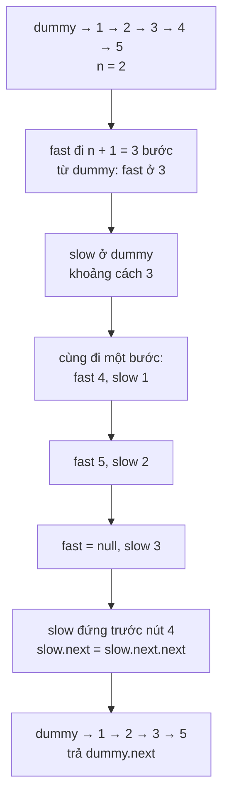

> [!tldr] Đọc nhanh
> - Đề: cho đầu một [[concepts/linked-list|danh sách liên kết]] và số n (1 ≤ n ≤ độ dài L), xóa nút thứ n **tính từ cuối**, trả về đầu mới.
> - Muốn xóa một nút trong danh sách đơn, phải đứng ở **nút ngay trước nó** rồi gán `prev.next = prev.next.next`. Bài toán thật là: tìm nút đứng trước nút thứ n từ cuối.
> - Hai lượt: đếm L, rồi đi L − n bước từ [[concepts/dummy-node|nút giả]]. Một lượt: con trỏ `fast` đi trước **n + 1** bước từ nút giả, rồi `fast` và `slow` cùng đi tới khi `fast` ra khỏi danh sách; lúc đó `slow` đứng ngay trước nút cần xóa ([[concepts/fast-slow-pointers|hai con trỏ nhanh chậm]] với khoảng cách cố định).
> - "Một lượt" **không** đi ít bước hơn: ở L = 10⁶, số lần theo `.next` của hai cách chỉ lệch nhau 1. Nó vẫn nhanh hơn tới 2 lần ở n nhỏ, vì `slow` đọc lại đúng các nút `fast` vừa đọc.
> - Hai bản sai chạy thật: không có nút giả thì xóa chính đầu (n = L) ném `TypeError` / `NullPointerException` / panic (5/8); `fast` đi trước n thay vì n + 1 thì xóa nhầm nút kế bên (0/8).

> [!info] Bối cảnh
> Bài LeetCode 19 của [[posts/2026-11-24-neetcode-linked-list|ga 1: Con trỏ trên danh sách liên kết]] trong **tuyến NeetCode: Cấu trúc liên kết**. Nó dùng cùng nút giả với [[problems/merge-two-sorted-lists|Merge Two Sorted Lists]], và cùng ý "hai con trỏ đi khác nhịp" với [[problems/linked-list-cycle|Linked List Cycle]] và bước tìm điểm giữa của [[problems/reorder-list|Reorder List]]; ở đây hai con trỏ đi **cùng tốc độ nhưng lệch nhau một khoảng cố định**. Lời giải có đủ TypeScript, Python, Go, Java và JavaScript. Bạn chỉ cần biết vòng lặp và con trỏ `next`.

> [!abstract]- Từ điển nhanh cho bài này (bấm để mở)
> - **Danh sách liên kết đơn**: mỗi nút chỉ biết nút **sau** nó, không biết nút trước. Xem [[concepts/linked-list|Linked List]].
> - **Nút giả (dummy node)**: nút không mang dữ liệu đặt trước đầu, để "nút đứng trước" luôn tồn tại, kể cả khi cần xóa chính đầu. Xem [[concepts/dummy-node|Dummy Node]].
> - **Hai con trỏ cách nhau k**: hai con trỏ cùng đi một bước mỗi vòng, con trước luôn hơn con sau k nút. Đây là một biến thể của [[concepts/two-pointers|Two Pointers]] và [[concepts/fast-slow-pointers|Fast and Slow Pointers]].
> - **Bỏ qua một nút (unlink)**: `prev.next = prev.next.next`; nút bị bỏ qua không còn ai trỏ tới và được bộ gom rác thu hồi.

## Hình dung trước: đo khoảng cách trên đường ray bằng một sợi dây dài n + 1

Bạn đi dọc một đường ray tàu không có biển số, chỉ có thanh tà vẹt nối tiếp nhau, và cần cắm cờ ở thanh **thứ n tính từ cuối**. Bạn không biết đường dài bao nhiêu. Cách thứ nhất: đi hết một lượt để đếm, rồi quay lại đầu và đi L − n bước. Cách thứ hai: hai người cầm hai đầu một sợi dây dài đúng n + 1 thanh. Người cầm đầu trước đi, người sau đi theo, sợi dây luôn căng. Khi người trước bước khỏi thanh cuối, người sau đang đứng ngay trước thanh cần cắm cờ.

| Đời thường | Khái niệm |
|---|---|
| Các thanh tà vẹt nối tiếp | các nút, nối bằng `next` |
| Chỉ nhìn được thanh phía trước | danh sách đơn: không đi lùi được |
| Thanh thứ n tính từ cuối | nút cần xóa |
| Đứng ngay trước thanh đó để tháo nó ra | `prev.next = prev.next.next` |
| Cái bục đứng trước thanh đầu tiên | nút giả `dummy` |
| Đi hết để đếm rồi quay lại | hai lượt |
| Sợi dây dài n + 1 thanh, hai người cùng đi | `fast` trước `slow` n + 1 bước |
| Người trước bước khỏi đường ray | `fast === null` |



## Vấn đề

"Thứ n từ cuối" là thứ L − n + 1 từ đầu, nên nếu biết L thì bài dễ. Cái khó có hai lớp. Thứ nhất, danh sách đơn không cho đi lùi, nên muốn xóa nút nào thì phải dừng ở nút **trước** nó; nếu nút cần xóa là chính đầu (n = L) thì không có nút nào đứng trước. Thứ hai, đề gợi ý "làm trong một lượt", và nhiều người hiểu nhầm rằng một lượt nghĩa là tốn ít công hơn.

## Cơ chế

### Hai lượt: đếm rồi đi

```ts
// Hai lượt: đếm độ dài L, rồi đi L − n bước từ nút giả để đứng ngay trước nút cần xóa.
function twoPass(head: ListNode | null, n: number): ListNode | null {
  let len = 0;
  for (let p = head; p; p = p.next) { len++; steps++; }
  const dummy = new ListNode(0, head);
  let prev = dummy;
  for (let i = 0; i < len - n; i++) { prev = prev.next!; steps++; }
  prev.next = prev.next!.next; // bỏ qua nút thứ n từ cuối
  return dummy.next;
}
```


Biến `steps` chỉ để đếm số lần theo `.next` cho phần đo bên dưới. Bắt đầu từ nút giả, đi L − n bước thì đứng ở nút thứ L − n tính từ 1, tức ngay trước nút thứ L − n + 1, đúng nút cần xóa. Khi n = L, số bước là 0 và `prev` chính là nút giả: xóa đầu không cần trường hợp riêng.

### Một lượt: khoảng cách n + 1

```ts
// Một lượt: fast đi trước n + 1 bước từ nút giả; rồi cả hai cùng đi tới khi fast ra khỏi danh sách.
// Lúc đó slow đứng ngay trước nút cần xóa, vì khoảng cách giữa chúng luôn là n + 1.
function onePass(head: ListNode | null, n: number): ListNode | null {
  const dummy = new ListNode(0, head);
  let fast: ListNode | null = dummy, slow = dummy;
  for (let i = 0; i <= n; i++) { fast = fast!.next; steps++; }
  while (fast) { fast = fast.next; slow = slow.next!; steps += 2; }
  slow.next = slow.next!.next;
  return dummy.next;
}
```


Bất biến của vòng `while`: **`fast` luôn đi trước `slow` đúng n + 1 nút**. Khi `fast` là `null` (đã đi qua nút cuối, tức "nút thứ L + 1"), `slow` ở vị trí L + 1 − (n + 1) = L − n tính từ nút giả, đúng chỗ của `prev` trong cách hai lượt. Vì sao n + 1 chứ không n? Vì ta cần dừng ở nút **trước** nút cần xóa, cách điểm cuối (`null`) n + 1 bước.

Bản sai `wrongGap` cho `fast` đi trước n bước:

```ts
// SAI: có nút giả nhưng fast chỉ đi trước n bước (thiếu 1): slow dừng ở chính nút cần xóa.
function wrongGap(head: ListNode | null, n: number): ListNode | null {
  const dummy = new ListNode(0, head);
  let fast: ListNode | null = dummy, slow = dummy;
  for (let i = 0; i < n; i++) fast = fast!.next;
  while (fast) { fast = fast.next; slow = slow.next!; }
  if (slow.next) slow.next = slow.next.next;
  return dummy.next;
}
```


`slow` dừng ở **chính** nút cần xóa, và dòng cuối xóa nút sau nó: nút thứ n − 1 từ cuối. Với n = 1 thì không có nút sau, không xóa gì. Kết quả 0/8 ca, sai ở mọi ca theo một cách nhất quán: luôn lệch một ô về phía cuối.

### Không có nút giả thì ca xóa đầu vỡ

```ts
// SAI: không có nút giả; fast đi n bước từ head. Khi n = L (xóa chính đầu), fast thành null.
function wrongNoDummy(head: ListNode | null, n: number): ListNode | null {
  let fast = head, slow = head!;
  for (let i = 0; i < n; i++) fast = fast!.next;
  while (fast!.next) { fast = fast!.next; slow = slow.next!; }
  slow.next = slow.next!.next;
  return head;
}
```


Bắt đầu cả hai con trỏ từ `head` và cho `fast` đi n bước. Khi n = L, `fast` đi hết danh sách thành `null`, và `fast.next` ném lỗi. Bản này qua 5/8 ca, sai đúng ba ca xóa đầu, ở cả năm ngôn ngữ: `TypeError` (TS, JS), `AttributeError` (Python), panic *nil pointer dereference* (Go), `NullPointerException` (Java). Sửa bằng một câu `if (!fast) return head.next` cũng được, nhưng nút giả bỏ hẳn trường hợp riêng đó.

### "Một lượt" có tiết kiệm bước không?

Mình đếm số lần theo `.next` ở L = 10⁶:

| n | Hai lượt | Một lượt |
|---|---|---|
| 1 | 1 999 999 | 2 000 000 |
| 500 000 | 1 500 000 | 1 500 001 |
| 1 000 000 | 1 000 000 | 1 000 001 |

Gần như bằng nhau, và một lượt còn nhiều hơn 1 bước (bước thêm để đi tới `null`). Lý do: hai lượt đi L bước rồi L − n bước; một lượt cho `fast` đi L + 1 bước và `slow` đi L − n bước. Cùng tổng, chỉ là **đan xen** thay vì nối tiếp. Cả hai đều O(L) thời gian, O(1) bộ nhớ.

Thời gian thì khác. TypeScript, 10⁶ nút, trung vị 5 lần:

| n | Hai lượt | Một lượt | Mảng các nút |
|---|---|---|---|
| 1 | 8,48 ms | 3,95 ms | 14,04 ms |
| 500 000 | 4,29 ms | 3,74 ms | 13,68 ms |
| 1 000 000 | 3,55 ms | 2,74 ms | 12,53 ms |

Ở n = 1, cùng 2·10⁶ bước mà một lượt nhanh hơn khoảng 2 lần. Cách giải thích mình tin nhất (chưa đo bằng bộ đếm phần cứng): ở cách hai lượt, lượt thứ hai đọc lại 10⁶ nút từ bộ nhớ, còn ở cách một lượt với n nhỏ, `slow` đọc đúng những nút `fast` vừa đọc, đang nằm trong cache. Khi n = L, cả hai cách chỉ đi qua danh sách một lần và thời gian gần nhau. Go và Java cho cùng dáng: ở n = 1, Go 3,82 so với 1,55 ms, Java 4,41 so với 2,23 ms.

Python cũng nhanh hơn ở một lượt (30,34 so với 12,22 ms ở n = 1) nhưng vì lý do khác: trình thông dịch tốn chi phí theo **số vòng lặp**. Hai lượt chạy 2·10⁶ vòng, một lượt chỉ 10⁶ vòng, mỗi vòng dời hai con trỏ.

Cách "mảng các nút" (một lượt, lưu mọi nút vào mảng rồi lấy chỉ số L − n − 1) chậm nhất, khoảng 13 ms, vì phải ghi 10⁶ phần tử vào một mảng lớn dần, và tốn O(L) bộ nhớ.

### Nút bị xóa đi đâu?

Sau `prev.next = prev.next.next`, nút bị bỏ qua không còn con trỏ nào từ danh sách trỏ tới. Ở JavaScript, Python, Go và Java, bộ gom rác sẽ thu hồi nó khi không còn tham chiếu nào khác (ví dụ một biến bạn còn giữ). Không cần `delete` hay `free`. Ở C hay C++ thì phải tự giải phóng nút đó, nếu không sẽ rò bộ nhớ.

### Bên dưới năm ngôn ngữ

| | Nút giả | Lỗi khi đọc `.next` của null | Ghi chú |
|---|---|---|---|
| TypeScript / JavaScript | `new ListNode(0, head)` | `TypeError` | `fast!.next` của TS chỉ tắt cảnh báo lúc biên dịch, không chặn lỗi lúc chạy |
| Python | `ListNode(0, head)` | `AttributeError: 'NoneType' object has no attribute 'next'` | `dummy = slow = fast = ListNode(0, head)`: ba tên cùng trỏ một nút, đúng ý muốn ở đây |
| Go | `&ListNode{0, head}` | panic: *nil pointer dereference* | trả `dummy.Next`, không phải `dummy` |
| Java | `new ListNode(0, head)` | `NullPointerException` | Java 14 trở lên in rõ biểu thức nào là null trong thông báo lỗi |

## Ví dụ chạy được

[TypeScript](../code/neetcode-remove-nth-node-from-end-of-list/remove-nth.ts) · [Python](../code/neetcode-remove-nth-node-from-end-of-list/remove_nth.py) · [Go](../code/neetcode-remove-nth-node-from-end-of-list/remove_nth.go) · [Java](../code/neetcode-remove-nth-node-from-end-of-list/remove-nth.java) · [JavaScript](../code/neetcode-remove-nth-node-from-end-of-list/remove-nth.js)

Mỗi file chạy 8 ca chung: ba ví dụ của đề, ba ca xóa đầu (n = L), một ca xóa đuôi (n = 1), và hai danh sách dài hơn.

Một lượt, khoảng cách n + 1:

```ts
// Một lượt: fast đi trước n + 1 bước từ nút giả; rồi cả hai cùng đi tới khi fast ra khỏi danh sách.
// Lúc đó slow đứng ngay trước nút cần xóa, vì khoảng cách giữa chúng luôn là n + 1.
function onePass(head: ListNode | null, n: number): ListNode | null {
  const dummy = new ListNode(0, head);
  let fast: ListNode | null = dummy, slow = dummy;
  for (let i = 0; i <= n; i++) { fast = fast!.next; steps++; }
  while (fast) { fast = fast.next; slow = slow.next!; steps += 2; }
  slow.next = slow.next!.next;
  return dummy.next;
}
```

```python
# Một lượt: fast đi trước n + 1 bước từ nút giả, rồi hai con trỏ cùng đi.
def one_pass(head: Optional[ListNode], n: int) -> Optional[ListNode]:
    dummy = slow = fast = ListNode(0, head)
    for _ in range(n + 1):
        fast = fast.next
    while fast:
        fast, slow = fast.next, slow.next
    slow.next = slow.next.next
    return dummy.next
```

```go
// Một lượt: fast đi trước n + 1 bước từ nút giả, rồi hai con trỏ cùng đi.
func onePass(head *ListNode, n int) *ListNode {
	dummy := &ListNode{0, head}
	fast, slow := dummy, dummy
	for i := 0; i <= n; i++ {
		fast = fast.Next
	}
	for fast != nil {
		fast, slow = fast.Next, slow.Next
	}
	slow.Next = slow.Next.Next
	return dummy.Next
}
```

```java
// Một lượt: fast đi trước n + 1 bước từ nút giả, rồi hai con trỏ cùng đi.
static ListNode onePass(ListNode head, int n) {
    ListNode dummy = new ListNode(0, head), fast = dummy, slow = dummy;
    for (int i = 0; i <= n; i++) fast = fast.next;
    while (fast != null) { fast = fast.next; slow = slow.next; }
    slow.next = slow.next.next;
    return dummy.next;
}
```

```js
// Một lượt: fast đi trước n + 1 bước từ nút giả, rồi hai con trỏ cùng đi.
function onePass(head, n) {
  const dummy = new ListNode(0, head);
  let fast = dummy, slow = dummy;
  for (let i = 0; i <= n; i++) fast = fast.next;
  while (fast) { fast = fast.next; slow = slow.next; }
  slow.next = slow.next.next;
  return dummy.next;
}
```


Hai lượt:

```ts
// Hai lượt: đếm độ dài L, rồi đi L − n bước từ nút giả để đứng ngay trước nút cần xóa.
function twoPass(head: ListNode | null, n: number): ListNode | null {
  let len = 0;
  for (let p = head; p; p = p.next) { len++; steps++; }
  const dummy = new ListNode(0, head);
  let prev = dummy;
  for (let i = 0; i < len - n; i++) { prev = prev.next!; steps++; }
  prev.next = prev.next!.next; // bỏ qua nút thứ n từ cuối
  return dummy.next;
}
```

```python
# Hai lượt: đếm độ dài, rồi đi L - n bước từ nút giả.
def two_pass(head: Optional[ListNode], n: int) -> Optional[ListNode]:
    length, p = 0, head
    while p:
        length, p = length + 1, p.next
    dummy = prev = ListNode(0, head)
    for _ in range(length - n):
        prev = prev.next
    prev.next = prev.next.next
    return dummy.next
```

```go
// Hai lượt: đếm độ dài, rồi đi L − n bước từ nút giả.
func twoPass(head *ListNode, n int) *ListNode {
	length := 0
	for p := head; p != nil; p = p.Next {
		length++
	}
	dummy := &ListNode{0, head}
	prev := dummy
	for i := 0; i < length-n; i++ {
		prev = prev.Next
	}
	prev.Next = prev.Next.Next
	return dummy.Next
}
```

```java
// Hai lượt: đếm độ dài, rồi đi L − n bước từ nút giả.
static ListNode twoPass(ListNode head, int n) {
    int len = 0;
    for (ListNode p = head; p != null; p = p.next) len++;
    ListNode dummy = new ListNode(0, head), prev = dummy;
    for (int i = 0; i < len - n; i++) prev = prev.next;
    prev.next = prev.next.next;
    return dummy.next;
}
```

```js
// Hai lượt: đếm độ dài, rồi đi L − n bước từ nút giả.
function twoPass(head, n) {
  let len = 0;
  for (let p = head; p; p = p.next) len++;
  const dummy = new ListNode(0, head);
  let prev = dummy;
  for (let i = 0; i < len - n; i++) prev = prev.next;
  prev.next = prev.next.next;
  return dummy.next;
}
```


Kết quả `node remove-nth.ts`:

```text
twoPass      8/8 ca đúng
onePass      8/8 ca đúng
nodeArray    8/8 ca đúng
wrongNoDummy 5/8 ca đúng; sai ở [1] n=1 → TypeError, [1,2] n=2 → TypeError, [1,2,3] n=3 → TypeError
wrongGap     0/8 ca đúng; sai ở [1,2,3,4,5] n=2 → [1,2,3,4], [1] n=1 → [1], [1,2] n=1 → [1,2], [1,2] n=2 → [1], [1,2,3] n=3 → [1,3], [1,2,3] n=1 → [1,2,3], [5,6,7,8] n=3 → [5,6,8], [1,2,3,4,5,6,7,8,9,10] n=5 → [1,2,3,4,5,6,8,9,10]

số bước theo .next, L = 1000000:
n          hai lượt     một lượt
1            1999999      2000000
500000       1500000      1500001
1000000      1000000      1000001

thời gian, L = 1000000:
n          hai lượt   một lượt   mảng nút
1            8.48 ms   3.95 ms  14.04 ms
500000       4.29 ms   3.74 ms  13.68 ms
1000000      3.55 ms   2.74 ms  12.53 ms
```

`python3 remove_nth.py`:

```text
two_pass        8/8 ca đúng
one_pass        8/8 ca đúng
wrong_no_dummy  5/8 ca đúng; sai ở [1] n=1 → AttributeError ('NoneType' object has no attribute 'next'), [1, 2] n=2 → AttributeError ('NoneType' object has no attribute 'next'), [1, 2, 3] n=3 → AttributeError ('NoneType' object has no attribute 'next')

thời gian, L = 1000000:
n          hai lượt     một lượt
1             30.34 ms     12.22 ms
500000        23.78 ms     12.97 ms
1000000       17.91 ms     12.35 ms
```

`go run remove_nth.go`:

```text
twoPass       8/8 ca đúng
onePass       8/8 ca đúng
wrongNoDummy  5/8 ca đúng; sai ở [1] n=1 → panic, [1 2] n=2 → panic, [1 2 3] n=3 → panic

thời gian, L = 1000000:
n          hai lượt   một lượt
1            3.82 ms    1.55 ms
500000       2.31 ms    1.60 ms
1000000      1.53 ms    1.61 ms
```

`java remove-nth.java`:

```text
twoPass       8/8 ca đúng
onePass       8/8 ca đúng
wrongNoDummy  5/8 ca đúng; sai ở [1] n=1 → NullPointerException, [1, 2] n=2 → NullPointerException, [1, 2, 3] n=3 → NullPointerException

thời gian, L = 1000000:
n          hai lượt   một lượt
1            4.41 ms    2.23 ms
500000       2.76 ms    1.94 ms
1000000      1.95 ms    1.65 ms
```

`node remove-nth.js`:

```text
twoPass      8/8 ca đúng
onePass      8/8 ca đúng
wrongNoDummy 5/8 ca đúng; sai ở [1] n=1 → TypeError, [1,2] n=2 → TypeError, [1,2,3] n=3 → TypeError
```

## Hiểu lầm và bẫy hay gặp

- **"Một lượt thì đi ít bước hơn hai lượt."** Số lần theo `.next` gần như bằng nhau (lệch 1 ở L = 10⁶). Một lượt chỉ đan xen hai lần đi; nó nhanh hơn trong thực tế vì cache (và vì số vòng lặp ở Python), không phải vì ít việc hơn.
- **Khoảng cách n thay vì n + 1.** `slow` dừng ở chính nút cần xóa thay vì nút trước nó; mọi ca đều lệch một ô.
- **Không có nút giả.** Xóa đầu (n = L) làm `fast` thành null; ba trong tám ca vỡ ở cả năm ngôn ngữ.
- **Trả `head` thay vì `dummy.next`.** Khi vừa xóa đầu, `head` vẫn trỏ nút cũ đã bị bỏ, nên kết quả sai. Luôn trả `dummy.next`.
- **"Phải giải phóng nút bị xóa."** Ở năm ngôn ngữ này thì không: bộ gom rác lo. Chỉ C, C++ mới cần.
- **Đếm vị trí từ 0 hay từ 1.** Đề đếm từ 1 ("nút thứ n từ cuối", n = 1 là nút cuối). Lệch một chỗ là ra bản `wrongGap`.

## Câu hỏi tự kiểm tra

> [!question]- Vì sao `fast` phải đi trước n + 1 bước mà không phải n?
> Ta cần `slow` dừng ở nút **trước** nút cần xóa. Nút cần xóa cách `null` (điểm sau nút cuối) n bước, nên nút trước nó cách `null` n + 1 bước. Khi `fast` chạm `null`, `slow` phải ở sau nó n + 1 bước.

> [!question]- Xóa nút đầu (n = L) thì cách một lượt có nút giả chạy thế nào?
> `fast` đi L + 1 bước từ nút giả và chạm `null` ngay, vòng `while` không chạy, `slow` vẫn là nút giả. `dummy.next = dummy.next.next` bỏ qua đầu cũ, và `dummy.next` là đầu mới.

> [!question]- Ở L = 10⁶, n = 1, cách một lượt đi bao nhiêu bước theo `.next`? Còn hai lượt?
> Một lượt: `fast` 2 bước trước vòng lặp rồi 999 999 bước, `slow` 999 999 bước, tổng 2 000 000. Hai lượt: 10⁶ bước đếm rồi 999 999 bước, tổng 1 999 999.

> [!question]- Nếu được phép dùng thêm O(L) bộ nhớ, có cách một lượt nào khác không?
> Có: lưu mọi nút vào mảng rồi lấy nút ở chỉ số L − n − 1 (hoặc trả `head.next` nếu L − n = 0). Đúng, nhưng chậm hơn và tốn bộ nhớ: khoảng 13 ms so với 4 ms ở 10⁶ nút.

> [!question]- Nút bị xóa có còn chiếm bộ nhớ không?
> Cho tới khi bộ gom rác chạy, có. Sau đó, nếu không còn tham chiếu nào tới nó, nó được thu hồi. Bạn không cần làm gì ở JS, Python, Go hay Java.

## Tham khảo

- [LeetCode 19: Remove Nth Node From End of List](https://leetcode.com/problems/remove-nth-node-from-end-of-list/) (đề gốc: 1 ≤ L ≤ 30, 1 ≤ n ≤ L, giá trị trong [0, 100]; follow-up: làm trong một lượt)
- [Go spec: Address operators](https://go.dev/ref/spec#Address_operators) (giải tham chiếu con trỏ nil là lỗi lúc chạy)
- [Java `NullPointerException`](https://docs.oracle.com/en/java/javase/21/docs/api/java.base/java/lang/NullPointerException.html) và JEP 358 (thông báo NPE có ích, từ Java 14)
- [Python data model: objects, values and types](https://docs.python.org/3/reference/datamodel.html#objects-values-and-types) (đối tượng không còn tham chiếu thì có thể bị thu hồi)
- Knuth, *The Art of Computer Programming*, tập 1, mục 2.2.3 (danh sách liên kết, xóa một nút bằng cách đổi liên kết của nút trước)
