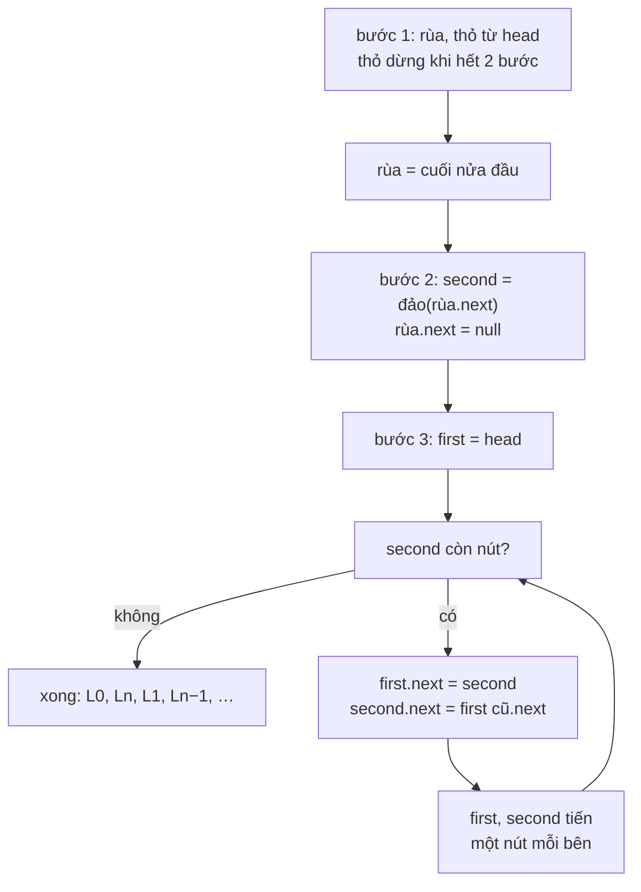

> [!tldr] Đọc nhanh
> - Đề: danh sách L0 → L1 → … → Ln; sắp lại **tại chỗ** (đổi các mũi tên `next`, không đổi giá trị) thành L0 → Ln → L1 → Ln−1 → L2 → …
> - Ba bước, O(n) thời gian, O(1) bộ nhớ: [[concepts/fast-slow-pointers|rùa và thỏ]] tìm điểm giữa, [[concepts/pointer-reversal|đảo]] nửa sau, rồi đan xen hai nửa.
> - Cách dễ nghĩ: chép các nút vào mảng (hoặc deque) rồi nối lại bằng hai chỉ số. Cũng O(n), nhưng tốn thêm bộ nhớ: 31 MB ở 10⁶ nút trong TypeScript, 45 MB trong Go.
> - Chỗ cắt quyết định đúng sai. Quên `slow.next = null` thì danh sách kết quả **có vòng** (sai 6/8 ca). Cắt sao cho nửa sau dài hơn nửa đầu thì đúng ở độ dài chẵn nhưng ném lỗi ở mọi độ dài lẻ (5/8). Nửa đầu dài hơn nửa sau 1 **hay 2** nút đều đúng; trang kiểm mọi độ dài 0..300.
> - Hai bẫy riêng của Python chạy thật: đảo bằng `prev, cur, cur.next = cur, cur.next, prev` (sai thứ tự gán, ném `AttributeError`) và gán lại `head` trong hàm (người gọi không thấy gì đổi).

> [!info] Bối cảnh
> Bài LeetCode 143 của [[posts/2026-11-24-neetcode-linked-list|ga 1: Con trỏ trên danh sách liên kết]] trong **tuyến NeetCode: Cấu trúc liên kết**. Bài này ghép ba kỹ thuật của ga thành một: tìm điểm giữa bằng hai con trỏ như [[problems/linked-list-cycle|Linked List Cycle]], đảo danh sách như [[problems/reverse-linked-list|Reverse Linked List]], và khâu hai danh sách như [[problems/merge-two-sorted-lists|Merge Two Sorted Lists]] (ở đây khâu xen kẽ chứ không theo thứ tự giá trị). Lời giải có đủ TypeScript, Python, Go, Java và JavaScript. Bạn chỉ cần biết vòng lặp và object.

> [!abstract]- Từ điển nhanh cho bài này (bấm để mở)
> - **Danh sách liên kết**: chuỗi nút, mỗi nút có giá trị và mũi tên `next`; nút cuối trỏ `null`. Xem [[concepts/linked-list|Linked List]].
> - **Tại chỗ (in-place)**: chỉ đổi các mũi tên `next` của nút có sẵn, không tạo nút mới, không chép giá trị.
> - **Rùa và thỏ**: hai con trỏ, một con đi 1 bước, một con đi 2 bước; khi thỏ tới cuối thì rùa ở giữa. Xem [[concepts/fast-slow-pointers|Fast and Slow Pointers]].
> - **Đảo danh sách**: đi một lượt, lật từng mũi tên `next` quay về nút trước. Xem [[concepts/pointer-reversal|Pointer Reversal]].
> - **Cắt (cut)**: gán `next = null` cho nút cuối nửa đầu để hai nửa thành hai danh sách riêng.
> - **Deque**: hàng đợi hai đầu, thêm và lấy ở cả hai đầu trong O(1).

## Hình dung trước: xáo bộ bài kiểu đan xen

Bạn có một chồng bài xếp theo thứ tự 1, 2, 3, …, n từ trên xuống, và muốn có thứ tự 1, n, 2, n − 1, … Không ai rút từng lá từ đáy chồng bài cả. Bạn **cắt** chồng bài làm đôi, **lật** nửa dưới lại để lá n nằm trên cùng, rồi **đan** hai nửa: một lá nửa trên, một lá nửa đã lật, cứ thế. Muốn biết chỗ cắt ở đâu mà không đếm lá, bạn nhờ hai người đếm: một người lật 1 lá mỗi nhịp, người kia lật 2 lá; người nhanh hết bài thì người chậm đang ở giữa.

| Đời thường | Khái niệm |
|---|---|
| Lá bài | một nút |
| Thứ tự lá trong chồng | các mũi tên `next` |
| Người lật 1 lá, người lật 2 lá | rùa và thỏ |
| Cắt chồng bài làm đôi | `slow.next = null` |
| Lật nửa dưới | đảo nửa sau |
| Đan từng lá một | đan xen hai nửa |
| Trải hết bài ra bàn rồi nhặt hai đầu | mảng hoặc deque các nút, O(n) bộ nhớ |



## Vấn đề

Với mảng, bài này là trò chơi chỉ số: phần tử thứ hai của kết quả là `a[n − 1]`. Danh sách liên kết không cho nhảy tới nút cuối; muốn lấy Ln phải đi từ đầu n bước. Làm thẳng ("mỗi lần tìm nút cuối, tháo nó ra, chèn vào sau nút hiện tại") tốn O(n²). Cần một cách để có các nút cuối theo thứ tự ngược mà không đi lại từ đầu mỗi lần: hoặc nhớ hết các nút (tốn bộ nhớ), hoặc lật ngược nửa sau một lần.

## Cơ chế

### Cách 1: ba bước tại chỗ

```ts
// Cách 1: ba bước, O(1) bộ nhớ thêm.
function reorderThreeSteps(head: ListNode | null): void {
  if (head === null || head.next === null) return;
  // bước 1: slow dừng ở cuối nửa đầu (nửa đầu dài hơn hoặc bằng nửa sau)
  let slow = head, fast = head;
  while (fast.next !== null && fast.next.next !== null) { slow = slow.next!; fast = fast.next.next; }
  // bước 2: cắt rồi đảo nửa sau
  let second = reverse(slow.next);
  slow.next = null;
  // bước 3: đan xen, mỗi vòng lấy một nút nửa đầu rồi một nút nửa sau
  let first: ListNode | null = head;
  while (second !== null) {
    const n1: ListNode | null = first!.next, n2: ListNode | null = second.next;
    first!.next = second;
    second.next = n1;
    first = n1;
    second = n2;
  }
}
```


**Bước 1, tìm giữa.** Thỏ đi 2 bước khi còn đủ hai nút phía trước (`fast.next && fast.next.next`). Khi thỏ dừng, rùa ở **cuối nửa đầu**: với 5 nút rùa ở nút thứ 3, với 4 nút rùa ở nút thứ 2. Nửa đầu luôn dài bằng hoặc hơn nửa sau đúng 1 nút.

**Bước 2, cắt và đảo.** `second = reverse(slow.next)` lật nửa sau, rồi `slow.next = null` cắt nửa đầu ra. Với `1 2 3 4 5` ta có hai danh sách `1 2 3` và `5 4`.

**Bước 3, đan xen.** Mỗi vòng lưu `first.next` và `second.next` vào hai biến tạm, rồi nối `first → second → first.next cũ`. Vòng dừng khi nửa sau hết; vì nửa đầu dài hơn hoặc bằng, nút thừa (nếu có) của nửa đầu đã nằm đúng chỗ ở cuối. Kết quả `1 5 2 4 3`.

Mỗi bước đi qua danh sách nhiều nhất một lần: O(n) thời gian, ba bốn con trỏ phụ: O(1) bộ nhớ.

### Cách 2: mảng hoặc deque các nút

Chép mọi nút vào mảng, rồi dùng hai chỉ số i từ đầu, j từ cuối: nối `nodes[i] → nodes[j] → nodes[i + 1]`, tiến dần vào giữa, cuối cùng gán `next = null` cho nút giữa.

```ts
// Cách 2: chép các nút vào mảng rồi nối lại bằng hai chỉ số. O(n) bộ nhớ thêm.
function reorderArray(head: ListNode | null): void {
  const nodes: ListNode[] = [];
  for (let cur = head; cur !== null; cur = cur.next) nodes.push(cur);
  let i = 0, j = nodes.length - 1;
  while (i < j) {
    nodes[i].next = nodes[j];
    i++;
    if (i === j) break;
    nodes[j].next = nodes[i];
    j--;
  }
  if (nodes.length > 0) nodes[i].next = null;
}
```


Code ngắn và khó sai hơn, đổi lại tốn O(n) bộ nhớ cho mảng. Python có `collections.deque` (lấy hai đầu O(1)), Java có `ArrayDeque`; ý tưởng giống hệt: lấy luân phiên một nút đầu, một nút cuối.

### Chỗ cắt: bao nhiêu lệch là được?

Đây là phần dễ sai nhất, nên file TypeScript thử ba kiểu cắt.

**Nửa đầu dài hơn 2 nút vẫn đúng.** Nếu viết điều kiện kiểu khác (`while (fast && fast.next)`), rùa dừng ở giữa **thứ hai** khi độ dài chẵn: với 6 nút, nửa đầu `1 2 3 4`, nửa sau `5 6`.

```ts
// Biến thể: slow dừng ở giữa thứ hai (điều kiện fast && fast.next). Nửa đầu dài hơn nửa sau tới 2 nút, vẫn đúng.
function reorderSecondMiddle(head: ListNode | null): void {
  if (head === null || head.next === null) return;
  let slow = head, fast: ListNode | null = head;
  while (fast !== null && fast.next !== null) { slow = slow.next!; fast = fast.next.next; }
  let second = reverse(slow.next);
  slow.next = null;
  let first: ListNode | null = head;
  while (second !== null) {
    const n1: ListNode | null = first!.next, n2: ListNode | null = second.next;
    first!.next = second; second.next = n1; first = n1; second = n2;
  }
}
```


Đan xen cho `1 6 2 5`, rồi nửa sau hết, phần còn lại `3 4` của nửa đầu nằm nguyên. Kết quả `1 6 2 5 3 4` vẫn đúng, vì hai nút thừa đó chính là L2, L3, đúng thứ tự cần ở cuối. File kiểm mọi độ dài 0..300: biến thể này cho cùng thứ tự nút với cách chuẩn ở cả 301 độ dài.

**Nửa sau dài hơn thì sai.** Cắt ngay **trước** giữa thứ hai (nửa sau bắt đầu từ chính `slow`):

```ts
// SAI: cắt trước giữa thứ hai, nên nửa sau dài hơn nửa đầu. Độ dài lẻ thì first hết trước và first.next ném lỗi.
function wrongSecondLonger(head: ListNode | null): void {
  if (head === null || head.next === null) return;
  let prev: ListNode | null = null, slow: ListNode = head, fast: ListNode | null = head;
  while (fast !== null && fast.next !== null) { prev = slow; slow = slow.next!; fast = fast.next.next; }
  prev!.next = null;
  let second = reverse(slow);
  let first: ListNode | null = head;
  while (second !== null) {
    const n1: ListNode | null = first!.next, n2: ListNode | null = second.next;
    first!.next = second; second.next = n1; first = n1; second = n2;
  }
}
```


Độ dài chẵn thì hai nửa bằng nhau, vẫn đúng. Độ dài lẻ thì nửa sau dài hơn một nút: nửa đầu hết trước, `first` thành `null`, và `first.next` ném `TypeError`. Kết quả 5/8 ca, sai đúng ở ba ca có độ dài lẻ (3, 5, 5 nút).

**Quên cắt thì sinh vòng.**

```ts
// SAI: quên cắt (slow.next = null). Nửa đầu vẫn nối vào nút giữa cũ, nút đó giờ là đuôi nửa sau đã đảo: sinh vòng.
function wrongNoCut(head: ListNode | null): void {
  if (head === null || head.next === null) return;
  let slow = head, fast = head;
  while (fast.next !== null && fast.next.next !== null) { slow = slow.next!; fast = fast.next.next; }
  let second = reverse(slow.next);
  let first: ListNode | null = head;
  while (second !== null) {
    const n1: ListNode | null = first!.next, n2: ListNode | null = second.next;
    first!.next = second; second.next = n1; first = n1; second = n2;
  }
}
```


Không có `slow.next = null`, nút giữa vẫn trỏ sang nút đầu tiên của nửa sau cũ, mà nút đó sau khi đảo đã thành **đuôi** của nửa sau và được đan vào cạnh nút giữa. Với `1 2 3 4 5`: kết quả đọc được `1 5 2 4 3`, nhưng 3 vẫn trỏ sang 4, nên 3 → 4 → 3 thành vòng. Với `1 2 3 4` còn gọn hơn: lần đan cuối gán `3.next` bằng `2.next` cũ, mà `2.next` cũ chính là 3, nên nút 3 tự trỏ vào mình. File đọc kết quả với giới hạn 2n + 2 bước và thấy vòng ở 6/8 ca; chỉ hai ca 0 và 1 nút (không vào nhánh xử lý) là thoát. Lỗi này nguy hiểm vì hàm vẫn trả về bình thường; người gọi chỉ treo khi đi hết danh sách.

### Bên dưới năm ngôn ngữ

| | Nhớ các nút | Bẫy riêng |
|---|---|---|
| TypeScript / JavaScript | mảng; lấy đầu bằng chỉ số | dùng `shift()` để lấy đầu mảng: đúng 8/8 nhưng mỗi lần dời cả mảng, 297 ms ở 10⁵ nút so với 1,5 ms của hai chỉ số |
| Python | `collections.deque`, `popleft()` và `pop()` O(1) | đảo bằng `prev, cur, cur.next = cur, cur.next, prev`: sai thứ tự gán, ném `AttributeError` ở 6/8 ca; dựng danh sách mới rồi gán `head = …`: người gọi không thấy gì đổi, sai 5/8 |
| Go | slice `[]*ListNode` | slice tự nới gấp đôi nên tổng cấp phát lớn hơn n con trỏ: 44,9 MB cho 10⁶ nút |
| Java | `ArrayDeque<ListNode>`, `pollFirst`/`pollLast` | cắt sai làm nửa sau dài hơn: `NullPointerException` ở độ dài lẻ |

Bẫy gán nhiều biến của Python đáng giải thích. Câu lệnh `a, b, c = x, y, z` tính **hết vế phải trước**, rồi gán **từ trái sang phải**. Với `prev, cur, cur.next = cur, cur.next, prev`, vế phải là (nút hiện tại, nút kế, prev cũ); gán `prev` rồi gán `cur` thành nút kế, và tới lượt `cur.next` thì `cur` đã là **nút kế**: ta sửa nhầm mũi tên của nút khác. Tới nút cuối, `cur` thành `None` và `cur.next = …` ném `AttributeError`. Viết `cur.next, prev, cur = prev, cur, cur.next` (gán `cur.next` trước khi `cur` đổi) thì đúng; [file Python](../code/neetcode-reorder-list/reorder_list.py) dùng thứ tự này.

### Đo

TypeScript, danh sách 0..n − 1, trung vị 5 lần chạy; bộ nhớ là phần heap tăng thêm ngay sau khi hàm chạy:

| n nút | Ba bước | Mảng các nút |
|---|---|---|
| 10⁵ | 0,79 ms, ≈ 0 MB | 1,47 ms, 2,8 MB |
| 10⁶ | 8,15 ms, ≈ 0 MB | 14,74 ms, 31,3 MB |

- Ba bước nhanh hơn mảng khoảng 2 lần dù đi qua danh sách nhiều lượt hơn: mảng phải cấp phát và nới rộng nhiều lần.
- Mảng 10⁶ phần tử chỉ cần 8 MB cho con trỏ, nhưng tổng heap tăng 31 MB vì các lần nới mảng để lại bản cũ chưa được dọn.

Các ngôn ngữ khác ở 10⁶ nút: Python ba bước 32,2 ms, deque 47,2 ms và 8,25 MB đỉnh; Go ba bước 3,04 ms, slice 54,79 ms và 44,9 MB cấp phát; Java ba bước 4,64 ms, ArrayDeque 10,09 ms. JavaScript với `shift()`: 0,69 ms ở 10⁴ nút nhưng 297,41 ms ở 10⁵, gấp hơn 400 lần khi n chỉ gấp 10, dáng O(n²). Đề giới hạn 5 · 10⁴ nút, nên cả ba bước lẫn mảng đều dưới 1 ms trên LeetCode; khác biệt là bộ nhớ và việc tránh các bẫy trên.

## Ví dụ chạy được

[TypeScript](../code/neetcode-reorder-list/reorder-list.ts) · [Python](../code/neetcode-reorder-list/reorder_list.py) · [Go](../code/neetcode-reorder-list/reorder_list.go) · [Java](../code/neetcode-reorder-list/reorder-list.java) · [JavaScript](../code/neetcode-reorder-list/reorder-list.js)

Mỗi file chạy 8 ca chung: hai ví dụ của đề (`1 2 3 4` và `1 2 3 4 5`), danh sách 1, 2, 3 nút, danh sách rỗng, 6 nút, và `7 7 7 8 8` (giá trị trùng). Kết quả được đọc lại với giới hạn 2n + 2 bước để bắt vòng thay vì treo.

Ba bước:

```ts
// Cách 1: ba bước, O(1) bộ nhớ thêm.
function reorderThreeSteps(head: ListNode | null): void {
  if (head === null || head.next === null) return;
  // bước 1: slow dừng ở cuối nửa đầu (nửa đầu dài hơn hoặc bằng nửa sau)
  let slow = head, fast = head;
  while (fast.next !== null && fast.next.next !== null) { slow = slow.next!; fast = fast.next.next; }
  // bước 2: cắt rồi đảo nửa sau
  let second = reverse(slow.next);
  slow.next = null;
  // bước 3: đan xen, mỗi vòng lấy một nút nửa đầu rồi một nút nửa sau
  let first: ListNode | null = head;
  while (second !== null) {
    const n1: ListNode | null = first!.next, n2: ListNode | null = second.next;
    first!.next = second;
    second.next = n1;
    first = n1;
    second = n2;
  }
}
```

```python
# Cách 1: tìm giữa, cắt, đảo nửa sau, đan xen. O(1) bộ nhớ thêm.
def reorder_three_steps(head):
    if not head or not head.next:
        return
    slow = fast = head
    while fast.next and fast.next.next:
        slow, fast = slow.next, fast.next.next
    second = reverse(slow.next)
    slow.next = None
    first = head
    while second:
        n1, n2 = first.next, second.next
        first.next, second.next = second, n1
        first, second = n1, n2
```

```go
// Cách 1: tìm giữa, cắt, đảo nửa sau, đan xen.
func reorderThreeSteps(head *ListNode) {
	if head == nil || head.Next == nil {
		return
	}
	slow, fast := head, head
	for fast.Next != nil && fast.Next.Next != nil {
		slow, fast = slow.Next, fast.Next.Next
	}
	second := reverse(slow.Next)
	slow.Next = nil
	for first := head; second != nil; {
		n1, n2 := first.Next, second.Next
		first.Next, second.Next = second, n1
		first, second = n1, n2
	}
}
```

```java
// Cách 1: tìm giữa, cắt, đảo nửa sau, đan xen.
static void reorderThreeSteps(ListNode head) {
    if (head == null || head.next == null) return;
    ListNode slow = head, fast = head;
    while (fast.next != null && fast.next.next != null) { slow = slow.next; fast = fast.next.next; }
    ListNode second = reverse(slow.next);
    slow.next = null;
    ListNode first = head;
    while (second != null) {
        ListNode n1 = first.next, n2 = second.next;
        first.next = second; second.next = n1;
        first = n1; second = n2;
    }
}
```

```js
// Cách 1: tìm giữa, cắt, đảo nửa sau, đan xen.
function reorderThreeSteps(head) {
  if (head === null || head.next === null) return;
  let slow = head, fast = head;
  while (fast.next !== null && fast.next.next !== null) { slow = slow.next; fast = fast.next.next; }
  let second = reverse(slow.next);
  slow.next = null;
  let first = head;
  while (second !== null) {
    const n1 = first.next, n2 = second.next;
    first.next = second; second.next = n1;
    first = n1; second = n2;
  }
}
```


Hàm đảo dùng ở bước 2:

```ts
// Đảo một danh sách tại chỗ, trả đầu mới.
function reverse(head: ListNode | null): ListNode | null {
  let prev: ListNode | null = null, cur = head;
  while (cur !== null) { const nxt = cur.next; cur.next = prev; prev = cur; cur = nxt; }
  return prev;
}
```

```python
# Đảo tại chỗ. Vế phải được tính hết trước, rồi gán từ trái sang phải: cur.next phải đứng đầu.
def reverse(head):
    prev, cur = None, head
    while cur:
        cur.next, prev, cur = prev, cur, cur.next
    return prev
```

```go
func reverse(head *ListNode) *ListNode {
	var prev *ListNode
	for cur := head; cur != nil; {
		nxt := cur.Next
		cur.Next = prev
		prev, cur = cur, nxt
	}
	return prev
}
```

```java
static ListNode reverse(ListNode head) {
    ListNode prev = null, cur = head;
    while (cur != null) { ListNode nxt = cur.next; cur.next = prev; prev = cur; cur = nxt; }
    return prev;
}
```

```js
function reverse(head) {
  let prev = null, cur = head;
  while (cur !== null) { const nxt = cur.next; cur.next = prev; prev = cur; cur = nxt; }
  return prev;
}
```


Nhớ các nút (mảng, deque):

```ts
// Cách 2: chép các nút vào mảng rồi nối lại bằng hai chỉ số. O(n) bộ nhớ thêm.
function reorderArray(head: ListNode | null): void {
  const nodes: ListNode[] = [];
  for (let cur = head; cur !== null; cur = cur.next) nodes.push(cur);
  let i = 0, j = nodes.length - 1;
  while (i < j) {
    nodes[i].next = nodes[j];
    i++;
    if (i === j) break;
    nodes[j].next = nodes[i];
    j--;
  }
  if (nodes.length > 0) nodes[i].next = null;
}
```

```python
# Cách 2: deque các nút, lần lượt lấy đầu rồi lấy cuối. O(n) bộ nhớ thêm.
def reorder_deque(head):
    dq = deque()
    cur = head
    while cur:
        dq.append(cur)
        cur = cur.next
    tail = None
    take_left = True
    while dq:
        node = dq.popleft() if take_left else dq.pop()
        if tail:
            tail.next = node
        tail = node
        take_left = not take_left
    if tail:
        tail.next = None
```

```go
// Cách 2: slice các con trỏ nút, nối lại bằng hai chỉ số.
func reorderSlice(head *ListNode) {
	nodes := []*ListNode{}
	for cur := head; cur != nil; cur = cur.Next {
		nodes = append(nodes, cur)
	}
	i, j := 0, len(nodes)-1
	for i < j {
		nodes[i].Next = nodes[j]
		i++
		if i == j {
			break
		}
		nodes[j].Next = nodes[i]
		j--
	}
	if len(nodes) > 0 {
		nodes[i].Next = nil
	}
}
```

```java
// Cách 2: ArrayDeque các nút, lần lượt lấy đầu rồi lấy cuối.
static void reorderDeque(ListNode head) {
    Deque<ListNode> dq = new ArrayDeque<>();
    for (ListNode cur = head; cur != null; cur = cur.next) dq.addLast(cur);
    ListNode tail = null;
    boolean left = true;
    while (!dq.isEmpty()) {
        ListNode node = left ? dq.pollFirst() : dq.pollLast();
        if (tail != null) tail.next = node;
        tail = node;
        left = !left;
    }
    if (tail != null) tail.next = null;
}
```

```js
// Cách 2: mảng các nút với hai chỉ số.
function reorderArray(head) {
  const nodes = [];
  for (let cur = head; cur !== null; cur = cur.next) nodes.push(cur);
  let i = 0, j = nodes.length - 1;
  while (i < j) {
    nodes[i].next = nodes[j];
    i++;
    if (i === j) break;
    nodes[j].next = nodes[i];
    j--;
  }
  if (nodes.length > 0) nodes[i].next = null;
}
```


Kết quả `node reorder-list.ts`:

```text
reorderThreeSteps   8/8 ca đúng
reorderArray        8/8 ca đúng
reorderSecondMiddle 8/8 ca đúng
wrongNoCut          2/8 ca đúng; sai ở [1,2,3,4] → vòng, [1,2,3,4,5] → vòng, [1,2] → vòng, [1,2,3] → vòng, [10,20,30,40,50,60] → vòng, [7,7,7,8,8] → vòng
wrongSecondLonger   5/8 ca đúng; sai ở [1,2,3,4,5] → ném TypeError, [1,2,3] → ném TypeError, [7,7,7,8,8] → ném TypeError

mọi độ dài 0..300: ba cách đúng cho đúng thứ tự nút L0, Ln, L1, … ở 301/301 độ dài

n nút      ba bước              mảng các nút
100000        0.79 ms    0.2 MB      1.47 ms    2.8 MB
1000000       8.15 ms    0.0 MB     14.74 ms   31.3 MB
```

`python3 reorder_list.py`:

```text
reorder_three_steps    8/8 ca đúng
reorder_deque          8/8 ca đúng
reorder_wrong_reverse  2/8 ca đúng; sai ở 6 ca, đều → ném AttributeError
reorder_rebind         3/8 ca đúng; sai ở 5 ca, ví dụ [1, 2, 3, 4] → [1, 2, 3, 4], [1, 2, 3, 4, 5] → [1, 2, 3, 4, 5]

n nút      ba bước               deque các nút
100000         3.18 ms   0.00 MB      4.60 ms   0.83 MB
1000000       32.19 ms   0.00 MB     47.16 ms   8.25 MB
```

`go run reorder_list.go`:

```text
reorderThreeSteps 8/8 ca đúng
reorderSlice      8/8 ca đúng
wrongNoCut        2/8 ca đúng; sai ở [1 2 3 4] → vòng, [1 2 3 4 5] → vòng, [1 2] → vòng, [1 2 3] → vòng, [10 20 30 40 50 60] → vòng, [7 7 7 8 8] → vòng

n nút      ba bước                slice các nút
100000         0.22 ms    0.0 MB       4.02 ms    4.5 MB  
1000000        3.04 ms    0.0 MB      54.79 ms   44.9 MB  
```

`java reorder-list.java`:

```text
reorderThreeSteps  8/8 ca đúng
reorderDeque       8/8 ca đúng
wrongSecondLonger  5/8 ca đúng; sai ở [1, 2, 3, 4, 5] → ném NullPointerException, [1, 2, 3] → ném NullPointerException, [7, 7, 7, 8, 8] → ném NullPointerException

n nút      ba bước      deque các nút
100000         0.55 ms       1.21 ms  
1000000        4.64 ms      10.09 ms  
```

`node reorder-list.js`:

```text
reorderThreeSteps 8/8 ca đúng
reorderArray      8/8 ca đúng
reorderShift      8/8 ca đúng

n nút      ba bước      mảng        shift()
10000          0.05 ms     0.06 ms     0.69 ms
100000         0.58 ms     1.50 ms   297.41 ms
```

## Hiểu lầm và bẫy hay gặp

- **"Phải tìm đúng điểm giữa, lệch một nút là sai."** Nửa đầu dài hơn nửa sau 1 hay 2 nút đều đúng. Chỉ sai khi nửa sau dài hơn nửa đầu.
- **Quên cắt nửa đầu.** Không có `slow.next = null` là danh sách có vòng; hàm vẫn trả về, lỗi chỉ lộ ra khi ai đó đi hết danh sách.
- **"Đề trả về danh sách mới."** Đề yêu cầu sửa tại chỗ, hàm không trả gì. Tạo nút mới rồi gán lại `head` trong hàm không đổi gì ở phía người gọi.
- **Lưu biến tạm sai lúc.** Trong vòng đan xen, phải lưu `first.next` và `second.next` **trước** khi nối lại; nối trước thì mất đường tới phần còn lại.
- **Gán nhiều biến trong Python khi đảo danh sách.** Vế phải tính trước, vế trái gán từ trái sang phải: `cur.next` phải đứng trước `cur`.
- **Dùng `shift()` làm hàng đợi trong JavaScript.** Đúng nhưng O(n) mỗi lần; dùng hai chỉ số.
- **Chép giá trị thay vì nối lại nút.** Đọc giá trị ra mảng rồi ghi đè `val` theo thứ tự mới cho kết quả đúng khi in, nhưng không phải "sắp lại các nút": đề cấm sửa giá trị.

## Câu hỏi tự kiểm tra

> [!question]- Với `1 2 3 4 5 6 7`, rùa dừng ở đâu, hai nửa là gì, và kết quả là gì?
> Thỏ đi 1 → 3 → 5 → 7 rồi dừng (`fast.next` là null). Rùa ở 4. Nửa đầu `1 2 3 4`, nửa sau `5 6 7` đảo thành `7 6 5`. Đan xen: `1 7 2 6 3 5 4`.

> [!question]- Vì sao quên `slow.next = null` lại sinh vòng chứ không chỉ sai thứ tự?
> Nút giữa vẫn trỏ sang nút đầu cũ của nửa sau. Sau khi đảo, nút đó là đuôi nửa sau và được đan vào ngay sau nút giữa. Độ dài lẻ cho hai nút trỏ qua lại (`3 → 4 → 3` với 5 nút); độ dài chẵn cho một nút tự trỏ (`3 → 3` với 4 nút). Đi theo `next` không bao giờ gặp `null`.

> [!question]- Cắt sao cho nửa sau dài hơn nửa đầu 1 nút. Vì sao độ dài chẵn vẫn đúng mà độ dài lẻ thì lỗi?
> Với cách cắt đó, độ dài chẵn cho hai nửa **bằng nhau**, nên không có chuyện nửa sau dài hơn. Độ dài lẻ cho nửa sau dài hơn 1: nửa đầu hết trước, `first` thành null trong khi `second` còn nút, và `first.next` ném lỗi.

> [!question]- Cách ba bước và cách mảng đều O(n). Khi nào nên chọn cách mảng?
> Khi bộ nhớ không phải vấn đề và cần code ngắn, ít chỗ sai (không có chỗ cắt, không có đảo). Khi đề hỏi O(1) bộ nhớ thêm, hoặc danh sách rất lớn, dùng ba bước.

> [!question]- Trong Python, vì sao `prev, cur, cur.next = cur, cur.next, prev` sai còn `cur.next, prev, cur = prev, cur, cur.next` đúng?
> Vế phải được tính hết trước, rồi gán từ trái sang phải. Ở bản sai, `cur` đổi thành nút kế trước khi tới `cur.next`, nên mũi tên bị gán là của nút kế. Ở bản đúng, `cur.next` được gán khi `cur` vẫn là nút hiện tại.

## Tham khảo

- [LeetCode 143: Reorder List](https://leetcode.com/problems/reorder-list/) (đề gốc: 1 ≤ số nút ≤ 5 · 10⁴, không được sửa giá trị, chỉ được đổi nút)
- [Python: Assignment statements](https://docs.python.org/3/reference/simple_stmts.html#assignment-statements) (vế phải tính trước, các đích gán từ trái sang phải)
- [Python `collections.deque`](https://docs.python.org/3/library/collections.html#collections.deque) (thêm, lấy hai đầu O(1))
- [Java `ArrayDeque`](https://docs.oracle.com/en/java/javase/21/docs/api/java.base/java/util/ArrayDeque.html)
- [ECMAScript: `Array.prototype.shift`](https://tc39.es/ecma262/#sec-array.prototype.shift) (dời mọi phần tử còn lại lên một chỉ số)
