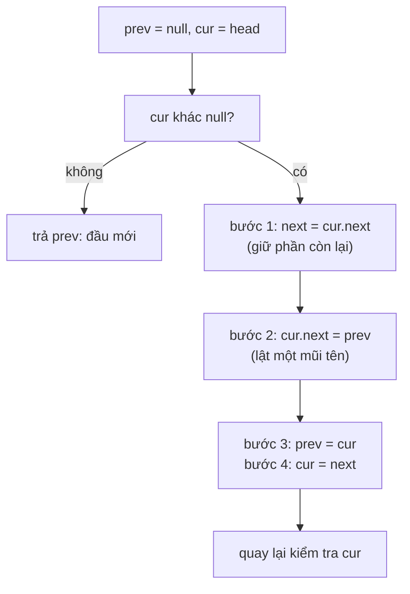

> [!tldr] Đọc nhanh
> - Đề: cho nút đầu của một [[concepts/linked-list|danh sách liên kết]] đơn, trả về nút đầu của danh sách đã đảo chiều. Danh sách có 0 tới 5 000 nút.
> - [[concepts/pointer-reversal|Lật tại chỗ bằng ba con trỏ]]: `prev` (khúc đã lật), `cur` (nút đang lật), `next` (phần còn lại). Mỗi bước giữ `next`, lật `cur.next = prev`, rồi tiến hai con trỏ. O(n) thời gian, O(1) bộ nhớ.
> - Bản đệ quy ngắn hơn nhưng tốn một khung gọi hàm mỗi nút. Đo được: Node 24 dừng ở khoảng 15 650 nút, Java 21 ở 29 470, Python 3.12 ở 998, tức Python **không** qua được giới hạn 5 000 của đề nếu không nâng giới hạn đệ quy. Go chạy được 10⁶ tầng.
> - Bản sai được chạy thật: lật trước khi giữ `next` (2/6 ca, chỉ còn một nút), đệ quy quên `head.next = null` (2/6 ca, hai nút đầu trỏ vào nhau thành vòng), Python gán bộ ba sai thứ tự (`AttributeError`), Go và Java quên kiểm tra danh sách rỗng.
> - Chép giá trị ra mảng rồi ghi ngược cũng đúng, nhưng tốn thêm khoảng 10 MiB ở 10⁶ nút và chậm hơn bản lặp khoảng 6 lần.

> [!info] Bối cảnh
> Bài LeetCode 206 (Easy), bài neo của [[posts/2026-11-24-neetcode-linked-list|ga 1: Con trỏ trên danh sách liên kết]] trong **tuyến NeetCode: Cấu trúc liên kết**. Đây là bài đầu tiên của tuyến, nên trang này bắt đầu từ chỗ danh sách liên kết khác mảng ở đâu. Không cần biết gì ngoài vòng lặp và biến; lời giải có đủ TypeScript, Python, Go, Java và JavaScript.

> [!abstract]- Từ điển nhanh cho bài này (bấm để mở)
> - **Danh sách liên kết (linked list)**: chuỗi nút, mỗi nút giữ một giá trị và một con trỏ `next` tới nút kế; nút cuối trỏ `null`. Xem [[concepts/linked-list|Linked List]].
> - **Con trỏ, tham chiếu**: một biến không chứa nút mà chỉ "chỉ vào" nút. Gán `a = b` làm hai biến chỉ cùng một nút, không chép nút.
> - **`null`, `None`, `nil`**: giá trị "không chỉ vào đâu". Đọc `.next` của nó là lỗi: `TypeError` (JS), `AttributeError` (Python), `NullPointerException` (Java), panic (Go).
> - **Khung gọi hàm, ngăn xếp gọi hàm (call stack)**: mỗi lời gọi hàm chưa trả về giữ một khung trên ngăn xếp; đệ quy sâu n tầng giữ n khung cùng lúc. Ngăn xếp đầy thì chương trình dừng với `RangeError`, `RecursionError` hay `StackOverflowError`.
> - **Bộ thu gom rác (GC)**: phần của runtime tự giải phóng các đối tượng không còn biến nào chỉ tới. Lật danh sách không tạo nút mới, nên không có gì để thu gom.

## Hình dung trước: một hàng người chỉ tay

Một hàng người đứng nối nhau, mỗi người chỉ tay vào người đứng sau mình. Chỉ người đầu hàng được ghi tên trên bảng. Muốn hàng đi theo chiều ngược lại, không ai được đổi chỗ: mỗi người chỉ cần quay tay chỉ vào người **trước** mình.

| Đời thường | Khái niệm |
|---|---|
| Một người trong hàng | một nút |
| Tay chỉ vào người sau | con trỏ `next` |
| Tên người đầu hàng ghi trên bảng | `head`, thứ duy nhất ta cầm |
| Người đang quay tay | `cur` |
| Người vừa quay tay xong, đứng đầu nhóm đã quay | `prev` |
| Ghi nhớ người sau trước khi quay tay đi | `next = cur.next` |
| Quay tay chỉ người trước | `cur.next = prev` |
| Quên ghi nhớ người sau: quay tay xong thì không biết ai là người kế | mất phần còn lại của danh sách |
| Hết hàng, người cuối cũ thành người đầu mới | trả `prev` |



## Vấn đề

Với mảng, đảo chiều là đổi chỗ phần tử đầu với cuối rồi tiến vào giữa: cần nhảy tới ô cuối ngay lập tức. Danh sách liên kết không có phép nhảy đó. Ta chỉ cầm `head`, và muốn tới nút cuối phải đi qua cả n nút. Mỗi nút cũng chỉ biết nút **sau** nó, không biết nút trước.

Nhưng ta không cần đổi chỗ giá trị. Đảo chiều danh sách nghĩa là mọi mũi tên `next` quay ngược lại, và nút cuối cũ thành `head` mới. Đi một lượt từ đầu, mỗi nút lật đúng một mũi tên: đó là toàn bộ lời giải. Chỗ khó duy nhất là thứ tự các phép gán.

## Cơ chế

<figure class="figure-map" style="--ar: 3 / 4">
<div class="frame"><iframe data-archify="../diagrams/neetcode-reverse-linked-list/worked-example.html" title="Cất next trước khi quay con trỏ" loading="lazy"></iframe></div>
<figcaption><span><b>Hình 1.</b> Cất next trước khi quay con trỏ.</span><a href="../diagrams/neetcode-reverse-linked-list/worked-example.html" target="_blank" rel="noopener">Mở toàn màn hình</a></figcaption>
</figure>

<details>
<summary>Đọc từng bước</summary>
<ol>
<li>Bắt đầu ở A, phía sau có B rồi C. <code>prev = null; A → B → C</code></li>
<li>Cất B rồi quay cạnh của A. <code>next = B; A → null</code></li>
<li>Tiến sang B và nối về A. <code>next = C; B → A → null</code></li>
<li>Nối C vào đầu mới rồi trả C. <code>C → B → A → null</code></li>
</ol>
</details>

### Ba con trỏ, bốn phép gán

Giữ ba biến: `prev` là đầu của khúc đã lật (ban đầu rỗng), `cur` là nút đang xử lý (ban đầu `head`), `next` là chỗ giữ phần còn lại. Mỗi vòng lặp:

| Bước | Phép gán | Vì sao |
|---|---|---|
| 1 | `next = cur.next` | sắp ghi đè `cur.next`; không giữ trước thì mất phần còn lại |
| 2 | `cur.next = prev` | lật mũi tên của `cur` về khúc đã lật |
| 3 | `prev = cur` | khúc đã lật giờ bắt đầu ở `cur` |
| 4 | `cur = next` | sang nút kế của phần chưa lật |

**Bất biến** sau mỗi vòng: `prev` là đầu của khúc đã lật (đúng thứ tự ngược), `cur` là đầu của phần chưa lật, và hai khúc không nối với nhau. Khi `cur` thành `null`, phần chưa lật rỗng và `prev` là cả danh sách đã lật. Với `1 → 2 → 3`: sau vòng 1, `1 → null` và còn `2 → 3`; sau vòng 2, `2 → 1 → null` và còn `3`; sau vòng 3, `3 → 2 → 1 → null`. [[posts/2026-11-24-neetcode-linked-list|Post ga]] có sơ đồ tương tác đi đúng ba vòng này.

Danh sách rỗng và một nút không cần nhánh riêng: rỗng thì vòng lặp không chạy và trả `prev = null`; một nút thì lật mũi tên của nó về `null` (vốn đã là `null`) và trả chính nó.

### Bản đệ quy và độ sâu ngăn xếp

Bản đệ quy giải bài toán nhỏ hơn trước: lật phần sau `head`, rồi gắn `head` vào cuối phần đã lật. Nút cuối của phần đã lật chính là `head.next` cũ, nên gắn bằng `head.next.next = head`, rồi cắt `head.next = null` vì `head` giờ là đuôi.

Mỗi nút giữ một khung gọi hàm cho tới khi phần sau nó lật xong, nên danh sách n nút cần n khung cùng lúc. Đo bằng tìm kiếm nhị phân trên n:

| Runtime | Độ sâu tối đa | Qua giới hạn đề 5 000? |
|---|---|---|
| Node 24 (TypeScript, JavaScript) | khoảng 15 650 nút | có |
| Java 21 | 29 470 nút (cả ba lần đo) | có |
| Python 3.12 | 998 nút (giới hạn 1 000 trừ vài khung của chương trình) | **không** |
| Go | 10⁶ nút vẫn chạy: stack của goroutine tự nới | có |

Con số của Node cao hơn con số 9 765 đo ở [[problems/evaluate-reverse-polish-notation|Evaluate Reverse Polish Notation]] vì mỗi khung ở đây nhỏ hơn (một tham số, một biến), còn hàm bên kia giữ thêm biến và gọi hai lần. Bản Python muốn qua 5 000 nút phải gọi `sys.setrecursionlimit` hoặc dùng bản lặp. Bản lặp không có giới hạn này: 10⁶ nút mất khoảng 3 ms trong TypeScript.

### Chép ra mảng: đúng nhưng tốn chỗ

Cách dễ nghĩ nhất là đọc mọi giá trị vào một mảng, rồi đi lại từ đầu và ghi giá trị theo thứ tự ngược. Kết quả đúng, nhưng tốn thêm O(n) bộ nhớ, và nó đổi **giá trị** chứ không đổi **nút**: ai đang cầm con trỏ tới nút đầu cũ giờ thấy nút đó mang giá trị cuối. Đo với `node --expose-gc` ở n = 10⁶: một nút `{val, next}` chiếm khoảng 40 byte, mảng chép giá trị thêm khoảng 10,4 byte mỗi phần tử, tức 10 MiB. Về thời gian, chép ra mảng mất 18,7 ms so với 3,1 ms của bản lặp.

### Bản sai

- **Lật trước khi giữ `next`.** Bỏ bước 1 và viết `cur = cur.next` ở cuối. Nhưng `cur.next` vừa bị gán bằng `prev`, nên `cur` quay về nút trước, ở vòng đầu là `null`. Vòng lặp dừng sau một nút và trả danh sách chỉ còn nút đầu: 2/6 ca đúng (chỉ ca rỗng và một nút).
- **Đệ quy quên `head.next = null`.** Nút đầu cũ vẫn trỏ tới nút thứ hai, mà nút thứ hai giờ trỏ ngược về nó: hai nút trỏ vào nhau thành vòng. Đọc kết quả sẽ không bao giờ hết, nên hàm kiểm tra dừng sau n + 1 nút và báo `VÒNG`: 2/6 ca đúng.
- **Python gán bộ ba sai thứ tự.** `cur.next, prev, cur = prev, cur, cur.next` đúng, vì vế phải được tính hết trước, rồi gán từ trái sang phải, nên `cur.next` ở vế trái còn là nút cũ. Viết `prev, cur, cur.next = cur, cur.next, prev` thì `cur` bị gán trước, và `cur.next` ở vế trái thuộc về nút **mới**; ở nút cuối, `cur` đã là `None` nên gán `None.next` ném `AttributeError`: 1/6 ca đúng.
- **Go, Java: kiểm tra `head.next` trước `head`.** Với danh sách rỗng, đọc `.next` của con trỏ rỗng: Go panic `nil pointer dereference`, Java ném `NullPointerException`. Thứ tự `head == null || head.next == null` mới an toàn, vì `||` dừng ngay khi vế trái đúng.

### Bên dưới năm ngôn ngữ

| | Nút | "Không có nút" | Đệ quy sâu | Bẫy riêng |
|---|---|---|---|---|
| TypeScript | `class ListNode { val; next: ListNode \| null }` | `null`; `strictNullChecks` bắt phải kiểm tra trước khi đọc `.next` | khoảng 15 650 tầng | dấu `!` (`slow!.next`) tắt kiểm tra của trình biên dịch, sai thì lỗi lúc chạy |
| Python | class với `__slots__` cho nhẹ | `None` | 998 tầng mặc định | gán bộ ba: vế phải tính trước, vế trái gán từ trái sang phải |
| Go | `struct` với `Next *ListNode` | `nil` | không giới hạn thực tế | đọc trường qua con trỏ `nil` là panic; `var prev *ListNode` mặc định là `nil` |
| Java | lớp lồng `static class ListNode` | `null` | 29 470 tầng | `NullPointerException`; thứ tự trong `\|\|` quan trọng |
| JavaScript | `class ListNode` | `null` | khoảng 15 650 tầng | destructuring `[a, b, c] = [x, y, z]` đúng nhưng tạo mảng tạm: chậm hơn 6–11 lần ở 10⁶ nút |

## Ví dụ chạy được

[TypeScript](../code/neetcode-reverse-linked-list/reverse-list.ts) · [Python](../code/neetcode-reverse-linked-list/reverse_list.py) · [Go](../code/neetcode-reverse-linked-list/reverse_list.go) · [Java](../code/neetcode-reverse-linked-list/reverse-list.java) · [JavaScript](../code/neetcode-reverse-linked-list/reverse-list.js)

Mỗi file chạy 6 ca: hai ví dụ của đề, danh sách rỗng, một nút, giá trị trùng, và 5 000 nút (giới hạn đề). Bản TypeScript còn đối chiếu 2 000 danh sách ngẫu nhiên (sinh bằng mulberry32), đo độ sâu đệ quy, đo thời gian và bộ nhớ.

```ts
// Lặp: ba con trỏ prev, cur, next. Giữ next trước khi lật cur.next.
function reverseIterative(head: ListNode | null): ListNode | null {
  let prev: ListNode | null = null;
  let cur = head;
  while (cur) {
    const next = cur.next; // giữ phần còn lại trước khi cắt
    cur.next = prev;       // lật một con trỏ
    prev = cur;            // tiến hai con trỏ
    cur = next;
  }
  return prev;
}

// Đệ quy: lật phần sau head, rồi gắn head vào cuối phần đã lật.
function reverseRecursive(head: ListNode | null): ListNode | null {
  if (!head || !head.next) return head;
  const newHead = reverseRecursive(head.next);
  head.next.next = head; // nút sau head giờ trỏ ngược về head
  head.next = null;      // head thành đuôi
  return newHead;
}
```

```python
# Lặp: giữ nxt trước khi lật cur.next.
def reverse_iterative(head):
    prev, cur = None, head
    while cur:
        nxt = cur.next
        cur.next = prev
        prev, cur = cur, nxt
    return prev

# Đệ quy: mỗi nút một khung gọi hàm; Python mặc định dừng ở 1000 khung.
def reverse_recursive(head):
    if head is None or head.next is None:
        return head
    new_head = reverse_recursive(head.next)
    head.next.next = head
    head.next = None
    return new_head
```

```go
// Lặp: giữ next trước khi lật cur.Next.
func reverseIterative(head *ListNode) *ListNode {
	var prev *ListNode
	cur := head
	for cur != nil {
		next := cur.Next
		cur.Next = prev
		prev, cur = cur, next
	}
	return prev
}

// Đệ quy: stack của goroutine tự nới, nên 10⁶ tầng vẫn chạy.
func reverseRecursive(head *ListNode) *ListNode {
	if head == nil || head.Next == nil {
		return head
	}
	newHead := reverseRecursive(head.Next)
	head.Next.Next = head
	head.Next = nil
	return newHead
}
```

```java
// Lặp: giữ next trước khi lật cur.next.
static ListNode reverseIterative(ListNode head) {
    ListNode prev = null, cur = head;
    while (cur != null) {
        ListNode next = cur.next;
        cur.next = prev;
        prev = cur;
        cur = next;
    }
    return prev;
}

// Đệ quy: mỗi nút một khung trên stack của luồng.
static ListNode reverseRecursive(ListNode head) {
    if (head == null || head.next == null) return head;
    ListNode newHead = reverseRecursive(head.next);
    head.next.next = head;
    head.next = null;
    return newHead;
}
```

```js
// Lặp: giữ next trước khi lật cur.next.
function reverseIterative(head) {
  let prev = null, cur = head;
  while (cur) {
    const next = cur.next;
    cur.next = prev;
    prev = cur;
    cur = next;
  }
  return prev;
}

// Đệ quy: mỗi nút một khung trên ngăn xếp gọi hàm của V8.
function reverseRecursive(head) {
  if (!head || !head.next) return head;
  const newHead = reverseRecursive(head.next);
  head.next.next = head;
  head.next = null;
  return newHead;
}
```


Kết quả `node --expose-gc reverse-list.ts` (cờ `--expose-gc` chỉ cần cho dòng bộ nhớ cuối):

```text
reverseIterative  6/6 ca đúng
reverseRecursive  6/6 ca đúng
reverseViaArray   6/6 ca đúng
wrongLoseNext     2/6 ca đúng; sai ở ví dụ 1 → [1], ví dụ 2 → [1], trùng giá trị → [3], 5000 nút (giới hạn đề) → [0]
wrongNoNullHead   2/6 ca đúng; sai ở ví dụ 1 → VÒNG, ví dụ 2 → VÒNG, trùng giá trị → VÒNG, 5000 nút (giới hạn đề) → VÒNG
đối chiếu 2000 danh sách ngẫu nhiên: 0 lần lệch
đệ quy sâu tối đa: 15647 nút
n          lặp          đệ quy        chép ra mảng
1000       0.00 ms      0.01 ms       0.01 ms
5000       0.01 ms      0.06 ms       0.03 ms
100000     0.30 ms      RangeError    1.62 ms
1000000    3.14 ms      RangeError    18.72 ms
bộ nhớ, n = 10⁶: mỗi nút danh sách ~40.0 byte; mảng chép giá trị thêm ~10.4 byte mỗi phần tử (10.0 MiB); bản lặp thêm 3 biến
```

Python (đệ quy tràn ở 5 000 nút, gán bộ ba đúng và sai thứ tự):

```text
reverse_iterative  6/6 ca đúng
reverse_recursive  5/6 ca đúng; sai ở 5000 nút (giới hạn đề) → RecursionError
reverse_tuple      6/6 ca đúng
wrong_tuple_order  1/6 ca đúng; sai ở ví dụ 1 → AttributeError, ví dụ 2 → AttributeError, một nút → AttributeError, trùng giá trị → AttributeError, 5000 nút (giới hạn đề) → AttributeError
đệ quy sâu tối đa: 998 nút (giới hạn 1000, Python 3.12.3)
n = 100000: lặp 5.79 ms, gán bộ ba 5.20 ms
n = 1000000: lặp 57.46 ms, gán bộ ba 51.89 ms
```

Go (đệ quy 10⁶ tầng vẫn chạy; bỏ kiểm tra `nil`):

```text
reverseIterative  6/6 ca đúng
reverseRecursive  6/6 ca đúng
wrongNoNilCheck   5/6 ca đúng; sai ở [rỗng → panic: runtime error: invalid memory address or nil pointer dereference]
n = 100000: lặp 0.12 ms, đệ quy 5.65 ms
n = 1000000: lặp 1.62 ms, đệ quy 46.34 ms
```

Java (độ sâu tối đa ba lần đo; kiểm tra sai thứ tự):

```text
reverseIterative  6/6 ca đúng
reverseRecursive  6/6 ca đúng
wrongCheckOrder   5/6 ca đúng; sai ở [rỗng → NullPointerException]
đệ quy sâu tối đa, lần 1: 29470 nút
đệ quy sâu tối đa, lần 2: 29470 nút
đệ quy sâu tối đa, lần 3: 29470 nút
```

JavaScript (destructuring so với bốn phép gán):

```text
reverseIterative     6/6 ca đúng
reverseDestructuring 6/6 ca đúng
reverseRecursive     6/6 ca đúng
n = 10⁶: lặp 3.42 ms, destructuring 21.18 ms
```

Go cho thấy đệ quy không miễn phí kể cả khi không tràn: 10⁶ nút mất 46 ms so với 1,6 ms của bản lặp, vì mỗi tầng phải cấp khung và stack của goroutine phải nới (chép sang vùng lớn hơn) nhiều lần.

## Hiểu lầm và bẫy hay gặp

- **"Đảo chiều thì phải đổi chỗ giá trị."** Chỉ cần đổi mũi tên. Đổi giá trị cũng ra đúng thứ tự in, nhưng tốn O(n) bộ nhớ và làm sai mọi con trỏ khác đang chỉ vào các nút.
- **Trả `cur` thay vì `prev`.** Khi vòng lặp dừng, `cur` là `null`. Đầu mới là `prev`.
- **"Đệ quy gọn hơn nên tốt hơn."** Gọn hơn, nhưng O(n) bộ nhớ ngăn xếp. Python mặc định không qua nổi giới hạn của chính đề bài.
- **Quên cắt đuôi trong bản đệ quy.** Không có `head.next = null` thì nút đầu cũ và nút thứ hai trỏ vào nhau. Mọi vòng `while (p)` đọc kết quả sẽ chạy mãi.
- **Thứ tự trong gán nhiều biến.** Python và JavaScript tính vế phải trước, nhưng gán vế trái lần lượt. Một biểu thức vế trái như `cur.next` đọc `cur` **tại lúc gán**, không phải lúc bắt đầu câu lệnh.
- **"Lật xong thì GC phải dọn gì đó."** Không có nút nào bị bỏ: mọi nút vẫn nằm trong danh sách mới. Chỉ cách chép ra mảng tạo rác (chính cái mảng).

## Câu hỏi tự kiểm tra

> [!question]- Danh sách `1 → 2 → 3 → 4`. Sau vòng lặp thứ hai, `prev`, `cur` và hai khúc trông thế nào?
> `prev` chỉ nút 2, khúc đã lật là `2 → 1 → null`. `cur` chỉ nút 3, phần chưa lật là `3 → 4 → null`. Hai khúc không nối với nhau: nút 2 trỏ về 1, không còn trỏ tới 3.

> [!question]- Đổi thứ tự bước 3 và 4 (`cur = next` trước, `prev = cur` sau) thì sao?
> `prev` nhận giá trị **mới** của `cur`, tức nút kế chưa lật, nên ở vòng sau nút đó lật mũi tên về chính nó. Thứ tự đúng là tiến `prev` trước, vì `prev` cần nút vừa lật.

> [!question]- Lật chỉ đoạn từ vị trí left tới right (LC 92). Ba con trỏ dùng thế nào?
> Dùng [[concepts/dummy-node|nút giả]] trước `head`, đi tới nút đứng ngay trước vị trí left. Lật `right − left + 1` nút bằng đúng vòng lặp ba con trỏ, rồi nối lại hai đầu: nút đứng trước trỏ vào `prev`, và nút left cũ (giờ là đuôi khúc đã lật) trỏ vào `cur`.

> [!question]- Vì sao Java đo được cùng 29 470 nút ở cả ba lần, trong khi ở trang Evaluate Reverse Polish Notation lần đầu thấp hơn hẳn?
> Vì JIT. Trước khi đo, file đã chạy 6 ca, trong đó có ca 5 000 nút, nên `reverseRecursive` đã được gọi hàng nghìn lần và được biên dịch; khung của code đã biên dịch nhỏ hơn khung của trình thông dịch. Kiểm chứng: `java -Xint reverse-list.java` (tắt JIT, chỉ thông dịch) cho 9 067 nút ở cả ba lần. Bên trang kia, lần đo đầu chạy trên code còn thông dịch.

## Tham khảo

- [LeetCode 206. Reverse Linked List](https://leetcode.com/problems/reverse-linked-list/) (0 tới 5 000 nút, câu hỏi mở rộng: làm cả bản lặp và bản đệ quy)
- [Python `sys.setrecursionlimit`](https://docs.python.org/3/library/sys.html#sys.setrecursionlimit) và [câu lệnh gán](https://docs.python.org/3/reference/simple_stmts.html#assignment-statements) (vế phải tính trước, các đích được gán từ trái sang phải)
- [Go spec: Address operators](https://go.dev/ref/spec#Address_operators) (đọc qua con trỏ `nil` gây run-time panic)
- [JVM Specification SE 21, §2.5.2 Java Virtual Machine Stacks](https://docs.oracle.com/javase/specs/jvms/se21/html/jvms-2.html#jvms-2.5.2) (`StackOverflowError` khi ngăn xếp của luồng đầy)
- [TypeScript: `strictNullChecks`](https://www.typescriptlang.org/tsconfig/#strictNullChecks) và [non-null assertion `!`](https://www.typescriptlang.org/docs/handbook/2/everyday-types.html#non-null-assertion-operator-postfix-)
- Cormen, Leiserson, Rivest, Stein, *Introduction to Algorithms*, mục 10.2 "Linked lists"
- Donald E. Knuth, *The Art of Computer Programming*, tập 1, mục 2.2 "Linear Lists"
