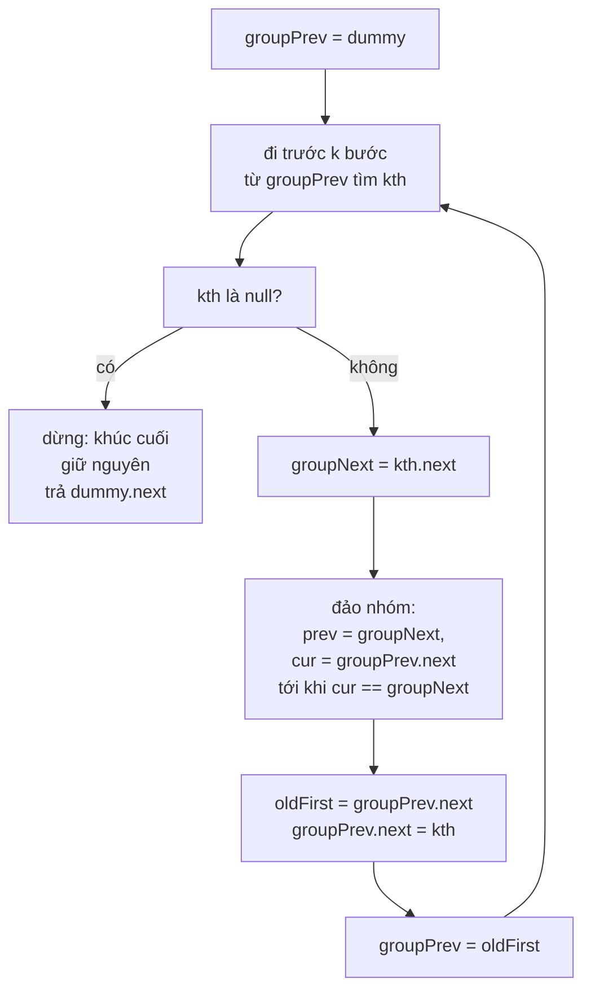

> [!tldr] Đọc nhanh
> - Đề: đảo thứ tự từng nhóm k nút liên tiếp; nhóm cuối thiếu k nút thì **giữ nguyên**. Chỉ được đổi con trỏ, không được đổi giá trị, và follow-up đòi O(1) bộ nhớ thêm.
> - Cách lặp: một nút giả đứng trước đầu, `groupPrev` đứng ngay trước nhóm sắp đảo. Mỗi vòng: đi trước k bước tìm `kth` (không tới được thì dừng), đảo nhóm với `prev` khởi đầu là `kth.next`, rồi `groupPrev.next = kth` và dời `groupPrev` sang nút đầu nhóm cũ.
> - Mẹo nối: khởi đầu `prev = groupNext` thay vì `null`, nên nút đầu nhóm cũ (giờ là đuôi) tự trỏ sang nhóm sau. Khởi đầu bằng `null` thì danh sách bị cắt cụt sau nhóm đầu: `[1,2,3,4,5]`, k = 2 ra `[2,1]`.
> - Bản đệ quy gọn hơn nhưng sâu n/k tầng: Python ném `RecursionError` ngay ở giới hạn đề (5 000 nút, k = 1), Node chịu được 8 192 tầng, Java tràn ở 10⁶ nút với k = 10. Go không tràn vì stack goroutine tự nới.
> - Đo ở 10⁶ nút: lặp 4,2 ms (TypeScript), 2,7 ms (Go), 2,9 ms (Java); chép nút vào mảng rồi đảo tốn 19 ms và O(n) bộ nhớ.

> [!info] Bối cảnh
> Bài LeetCode 25 (Hard) của [[posts/2026-11-24-neetcode-advanced-linked-list|ga 2: Danh sách liên kết nâng cao]] trong **tuyến NeetCode: Cấu trúc liên kết**. Bài này là [[problems/reverse-linked-list|Reverse Linked List]] chạy lặp lại trên từng khúc, cộng thêm phần khó nhất: nối khúc vừa đảo với khúc trước và khúc sau. Lời giải có đủ TypeScript, Python, Go, Java và JavaScript. Bạn cần biết đảo một danh sách bằng ba biến `prev`, `cur`, `next`. Bài cùng ga [[problems/merge-k-sorted-lists|Merge k Sorted Lists]] cũng dùng nút giả để nối kết quả.

> [!abstract]- Từ điển nhanh cho bài này (bấm để mở)
> - **Danh sách liên kết**: chuỗi nút, mỗi nút có giá trị và mũi tên `next`. Xem [[concepts/linked-list|Linked List]].
> - **Đảo con trỏ**: đi dọc danh sách, quay mũi tên `next` của từng nút về nút trước nó. Xem [[concepts/pointer-reversal|Pointer Reversal]].
> - **Nút giả (dummy)**: một nút không mang dữ liệu đứng trước đầu, để nhóm đầu tiên cũng có "nút trước nhóm" như mọi nhóm khác. Xem [[concepts/dummy-node|Dummy Node]].
> - **groupPrev**: nút đứng ngay trước nhóm sắp đảo; ban đầu là nút giả.
> - **kth, groupNext**: nút cuối của nhóm, và nút ngay sau nhóm.
> - **Ngăn xếp gọi hàm (call stack)**: mỗi lời gọi hàm chưa trả về chiếm một khung trên ngăn xếp; quá nhiều tầng thì tràn.

## Hình dung trước: lật từng xấp k lá bài trên một hàng bài

Một hàng bài úp nối đuôi nhau trên bàn. Luật: cứ k lá liền nhau thì đảo thứ tự xấp đó; xấp cuối không đủ k lá thì để yên.

- Bạn đặt một ngón tay **trước** xấp sắp lật (groupPrev). Lúc đầu chưa có lá nào phía trước, nên bạn đặt một lá trắng ở đầu hàng làm mốc (nút giả).
- Trước khi lật, bạn đếm thử k lá. Đếm không đủ thì dừng, xấp cuối giữ nguyên.
- Lật xấp xong, lá đầu cũ thành lá cuối của xấp. Nó phải chạm vào xấp kế tiếp, nếu không hàng bài bị đứt.
- Ngón tay dời sang lá cuối của xấp vừa lật, vì đó là "trước xấp sau". Quên dời thì lần sau bạn lật lại đúng xấp vừa lật.

| Đời thường | Khái niệm |
|---|---|
| Lá trắng làm mốc ở đầu hàng | nút giả `dummy` |
| Ngón tay đặt trước xấp sắp lật | `groupPrev` |
| Đếm thử k lá | đi trước k bước tìm `kth` |
| Xấp cuối không đủ k lá | `kth === null`: dừng, giữ nguyên |
| Lá đầu cũ chạm vào xấp kế tiếp | khởi đầu `prev = groupNext` |
| Dời ngón tay sang cuối xấp vừa lật | `groupPrev = oldFirst` |



## Vấn đề

Đảo cả danh sách thì dễ (bài 206). Cái khó ở đây là ba chỗ nối mỗi nhóm:

1. Nút trước nhóm (`groupPrev`) phải trỏ vào nút **cuối** cũ của nhóm (`kth`), giờ là đầu.
2. Nút **đầu** cũ của nhóm, giờ là đuôi, phải trỏ sang nhóm sau (`groupNext`).
3. Sang nhóm sau, "nút trước nhóm" mới chính là nút đầu cũ ấy.

Thêm một điều kiện: trước khi đảo phải biết chắc nhóm có đủ k nút, vì nhóm thiếu phải giữ nguyên. Đảo trước rồi mới phát hiện thiếu thì phải đảo ngược lại.

## Cơ chế

<figure class="figure-map" style="--ar: 3 / 4">
<div class="frame"><iframe data-archify="../diagrams/neetcode-reverse-nodes-in-k-group/worked-example.html" title="Đảo nhóm đủ k rồi nối lại" loading="lazy"></iframe></div>
<figcaption><span><b>Hình 1.</b> Đảo nhóm đủ k rồi nối lại.</span><a href="../diagrams/neetcode-reverse-nodes-in-k-group/worked-example.html" target="_blank" rel="noopener">Mở toàn màn hình</a></figcaption>
</figure>

<details>
<summary>Đọc từng bước</summary>
<ol>
<li>Đếm đủ hai nút trong nhóm đầu. <code>1 → 2 → 3 → 4 → 5; k = 2</code></li>
<li>Đảo nhóm đầu và giữ đầu nhóm sau. <code>2 → 1; next = 3</code></li>
<li>Đảo nhóm 3 và 4. <code>4 → 3</code></li>
<li>Nhóm cuối chỉ có 5 nên giữ nguyên. <code>2 → 1 → 4 → 3 → 5</code></li>
</ol>
</details>

### Cách 1: lặp, O(1) bộ nhớ thêm

```ts
// Cách 1: lặp, O(1) bộ nhớ thêm. groupPrev là nút đứng ngay trước nhóm sắp đảo.
function reverseKGroup(head: ListNode | null, k: number): ListNode | null {
  const dummy = new ListNode(0);
  dummy.next = head;
  let groupPrev = dummy;
  for (;;) {
    // đi trước k bước tìm nút cuối nhóm; không đủ k nút thì dừng, khúc cuối giữ nguyên
    let kth: ListNode | null = groupPrev;
    for (let i = 0; i < k && kth !== null; i++) kth = kth.next;
    if (kth === null) break;
    const groupNext = kth.next;
    // đảo nhóm: prev bắt đầu từ groupNext, nên nút đầu nhóm cũ trỏ thẳng sang nhóm sau
    let prev: ListNode | null = groupNext, cur = groupPrev.next;
    while (cur !== groupNext) { const nxt: ListNode | null = cur!.next; cur!.next = prev; prev = cur; cur = nxt; }
    // nối: nút đầu nhóm cũ giờ là nút cuối, và là groupPrev của nhóm sau
    const oldFirst = groupPrev.next!;
    groupPrev.next = kth;
    groupPrev = oldFirst;
  }
  return dummy.next;
}
```


Theo dõi `[1,2,3,4,5]`, k = 2:

| Vòng | groupPrev | kth | groupNext | Sau khi đảo và nối |
|---|---|---|---|---|
| 1 | dummy | 2 | 3 | dummy → 2 → 1 → 3 → 4 → 5 |
| 2 | 1 | 4 | 5 | dummy → 2 → 1 → 4 → 3 → 5 |
| 3 | 3 | null (chỉ còn 5) | | dừng: trả 2 → 1 → 4 → 3 → 5 |

Mỗi nút được đi qua hai lần (một lần lúc đếm, một lần lúc đảo), nên O(n) thời gian, O(1) bộ nhớ thêm. Đây là lời giải đáp ứng follow-up của đề.

Vì sao `prev = groupNext`: vòng đảo quay mũi tên của nút đầu tiên trong nhóm về `prev`. Nếu `prev` bắt đầu bằng `groupNext`, nút đầu cũ (giờ là đuôi nhóm) trỏ thẳng sang nhóm sau, nên chỗ nối số 2 ở trên tự xong mà không cần dòng code riêng.

### Cách 2: đệ quy

```ts
// Cách 2: đệ quy. Đảo k nút đầu, rồi nối đuôi nhóm vào kết quả đệ quy của phần còn lại. Sâu n/k tầng.
function reverseKGroupRecursive(head: ListNode | null, k: number): ListNode | null {
  let probe = head;
  for (let i = 0; i < k; i++) { if (probe === null) return head; probe = probe.next; }
  let prev: ListNode | null = reverseKGroupRecursive(probe, k), cur = head;
  for (let i = 0; i < k; i++) { const nxt: ListNode | null = cur!.next; cur!.next = prev; prev = cur; cur = nxt; }
  return prev;
}
```


Đếm k nút; đủ thì đệ quy cho phần còn lại trước, rồi đảo k nút đầu với `prev` khởi đầu là kết quả đệ quy. Ngắn và đẹp, nhưng mỗi nhóm thêm một tầng gọi hàm: n/k tầng. Với k = 1 và n = 5 000 (giới hạn đề) là 5 000 tầng.

| | Đệ quy sâu n/k tầng thì sao |
|---|---|
| Python | giới hạn mặc định 1 000 tầng: `RecursionError` ngay ở 5 000 nút, k = 1, trong giới hạn của đề |
| TypeScript / JavaScript (Node) | đo được tối đa 8 192 tầng với k = 1 và 10 431 tầng với k = 2; 10⁶ nút với k = 2 hay 3 ném `RangeError` |
| Java | 10⁶ nút với k = 2 và k = 10 ném `StackOverflowError`; k = 1 000 (1 000 tầng) chạy được |
| Go | stack của goroutine tự nới (mặc định tối đa 1 GB trên máy 64 bit), nên 5·10⁵ tầng vẫn chạy, chỉ chậm hơn lặp |

### Cách 3: chép nút ra mảng

```ts
// Cách 3: chép các nút vào mảng, đảo từng khúc trong mảng, rồi nối lại. O(n) bộ nhớ thêm.
function reverseKGroupArray(head: ListNode | null, k: number): ListNode | null {
  const nodes: ListNode[] = [];
  for (let cur = head; cur !== null; cur = cur.next) nodes.push(cur);
  for (let i = 0; i + k <= nodes.length; i += k) {
    for (let a = i, b = i + k - 1; a < b; a++, b--) { const t = nodes[a]; nodes[a] = nodes[b]; nodes[b] = t; }
  }
  for (let i = 0; i + 1 < nodes.length; i++) nodes[i].next = nodes[i + 1];
  if (nodes.length > 0) nodes[nodes.length - 1].next = null;
  return nodes.length > 0 ? nodes[0] : null;
}
```


Dễ viết nhất: đảo khúc trong mảng như đảo khúc mảng thường, rồi nối lại `next` theo thứ tự mảng. Đúng, nhưng O(n) bộ nhớ thêm, vi phạm follow-up, và chậm hơn lặp khoảng 4 lần ở 10⁶ nút.

### Ba bản sai, chạy thật

**Đảo cả khúc cuối.** Không kiểm tra đủ k nút trước khi đảo, cứ đi tới đâu đảo tới đó:

```ts
// SAI: đảo cả khúc cuối thiếu k nút.
function wrongReverseTail(head: ListNode | null, k: number): ListNode | null {
  const dummy = new ListNode(0);
  dummy.next = head;
  let groupPrev = dummy;
  while (groupPrev.next !== null) {
    let kth: ListNode = groupPrev;
    for (let i = 0; i < k && kth.next !== null; i++) kth = kth.next; // thiếu nút thì dừng ở nút cuối, vẫn đảo
    const groupNext = kth.next;
    let prev: ListNode | null = groupNext, cur = groupPrev.next;
    while (cur !== groupNext) { const nxt: ListNode | null = cur!.next; cur!.next = prev; prev = cur; cur = nxt; }
    const oldFirst = groupPrev.next!;
    groupPrev.next = kth;
    groupPrev = oldFirst;
  }
  return dummy.next;
}
```


`[1,2,3,4,5]`, k = 3 ra `[3,2,1,5,4]` thay vì `[3,2,1,4,5]`. Bản này đúng 7/8 ca, vì chỉ sai khi n không chia hết cho k và khúc dư có từ 2 nút trở lên (khúc dư 1 nút thì đảo cũng như không). Ví dụ 1 của đề (k = 2, khúc dư là `5`) vẫn qua, đúng kiểu lỗi chỉ hiện ở ví dụ 2.

**Mất đường sang nhóm sau.** Đảo nhóm với `prev = null` như bài 206:

```ts
// SAI: đảo nhóm với prev = null, nên đuôi nhóm trỏ null và mất đường sang nhóm sau.
function wrongLoseNext(head: ListNode | null, k: number): ListNode | null {
  const dummy = new ListNode(0);
  dummy.next = head;
  let groupPrev = dummy;
  for (;;) {
    let kth: ListNode | null = groupPrev;
    for (let i = 0; i < k && kth !== null; i++) kth = kth.next;
    if (kth === null) break;
    const groupNext = kth.next;
    let prev: ListNode | null = null, cur = groupPrev.next;
    while (cur !== groupNext) { const nxt: ListNode | null = cur!.next; cur!.next = prev; prev = cur; cur = nxt; }
    const oldFirst = groupPrev.next!;
    groupPrev.next = kth;
    groupPrev = oldFirst;
  }
  return dummy.next;
}
```


Đuôi nhóm đầu trỏ `null`, nên danh sách trả về chỉ còn nhóm đầu: `[2,1]`, `[3,2,1]`. Vòng lặp vẫn tiếp tục đảo các nhóm sau (`groupPrev` vẫn giữ nút đúng), nhưng không còn ai trỏ tới chúng. Đúng 2/8 ca, chỉ ở hai ca chỉ có một nhóm (k = n và một nút).

**Quên dời groupPrev.** Thiếu dòng `groupPrev = oldFirst`:

```ts
// SAI: quên dời groupPrev sang cuối nhóm vừa đảo. Vòng sau đảo lại đúng nhóm đầu, mãi mãi.
// File chặn ở 1000 vòng và báo "không dừng" thay vì treo.
function wrongNoGroupPrevMove(head: ListNode | null, k: number): ListNode | null {
  const dummy = new ListNode(0);
  dummy.next = head;
  const groupPrev = dummy;
  for (let round = 0; ; round++) {
    if (round === 1000) throw new Error("không dừng");
    let kth: ListNode | null = groupPrev;
    for (let i = 0; i < k && kth !== null; i++) kth = kth.next;
    if (kth === null) break;
    const groupNext = kth.next;
    let prev: ListNode | null = groupNext, cur = groupPrev.next;
    while (cur !== groupNext) { const nxt: ListNode | null = cur!.next; cur!.next = prev; prev = cur; cur = nxt; }
    groupPrev.next = kth;
    // thiếu: groupPrev = nút đầu nhóm cũ
    if (groupNext === null) break;
  }
  return dummy.next;
}
```


Vòng sau lại đếm k bước từ nút giả, lại đảo đúng nhóm đầu, trả nó về thứ tự cũ, cứ thế mãi. Hàm không dừng; file chặn ở 1 000 vòng và báo "không dừng". Chỉ qua được khi cả danh sách là một nhóm và không có nút sau nhóm.

### Bên dưới năm ngôn ngữ

| | Đảo con trỏ | Bẫy riêng |
|---|---|---|
| TypeScript / JavaScript | biến tạm `nxt` | đệ quy ném `RangeError` khoảng vài nghìn tới hơn một vạn tầng |
| Python | gán bộ `cur.next, prev, cur = prev, cur, cur.next` (thứ tự quan trọng, xem [[problems/reorder-list\|Reorder List]]) | đệ quy quá 1 000 tầng: `RecursionError` ở chính giới hạn đề |
| Go | gán bộ `cur.Next, prev, cur = prev, cur, cur.Next` | không tràn, nhưng đệ quy chậm hơn lặp 3 tới 9 lần |
| Java | biến tạm `nxt` | đệ quy sâu: `StackOverflowError` là `Error`, không phải `Exception` |

### Đo

n = 10⁶ nút, trung vị 5 lần, mỗi lần dựng lại danh sách và không tính giờ phần dựng:

| k | TS lặp | TS đệ quy | TS mảng các nút | Go lặp | Go đệ quy | Java lặp | Java đệ quy |
|---|---|---|---|---|---|---|---|
| 2 | 4,2 ms | `RangeError` | 19,2 ms | 2,7 ms | 27,4 ms | 2,9 ms | `StackOverflowError` |
| 10 | | | | | | 1,9 ms | `StackOverflowError` |
| 100 | 4,2 ms | 6,6 ms | 19,4 ms | | | | |
| 1 000 | 4,9 ms | 5,8 ms | 20,0 ms | 3,0 ms | 8,4 ms | 3,2 ms | 3,9 ms |

Python lặp ở 10⁶ nút, k = 2: 66,6 ms. Ô trống là cỡ không đo trong file của ngôn ngữ đó. Thời gian lặp gần như không đổi theo k: dù k bao nhiêu, mỗi nút vẫn bị đi qua hai lần.

### Kiểm vét

Mọi n từ 1 tới 12 và mọi k từ 1 tới n (78 bộ): lặp, đệ quy và mảng các nút đều đúng 78/78 trong TypeScript; Python và JavaScript kiểm lại bản lặp, cũng 78/78. Bộ này phủ mọi kiểu khúc dư (0 tới k − 1 nút) và mọi số nhóm từ 1 tới 12.

## Ví dụ chạy được

[TypeScript](../code/neetcode-reverse-nodes-in-k-group/reverse-k-group.ts) · [Python](../code/neetcode-reverse-nodes-in-k-group/reverse_k_group.py) · [Go](../code/neetcode-reverse-nodes-in-k-group/reverse_k_group.go) · [Java](../code/neetcode-reverse-nodes-in-k-group/reverse-k-group.java) · [JavaScript](../code/neetcode-reverse-nodes-in-k-group/reverse-k-group.js) · [PHP](../code/neetcode-reverse-nodes-in-k-group/reverse-k-group.php) · [Rust](../code/neetcode-reverse-nodes-in-k-group/reverse_k_group.rs)

Mỗi file trong năm bản đầu chạy 8 ca chung: hai ví dụ của đề, k = 1, k = n, một nút, hai nhóm đủ, 7 nút với k = 3, và giá trị trùng (để chắc lời giải đổi nút chứ không so giá trị). File Python thêm ca 5 000 nút với k = 1 để chạy bản đệ quy ở giới hạn đề.

Cách lặp:

```ts
// Cách 1: lặp, O(1) bộ nhớ thêm. groupPrev là nút đứng ngay trước nhóm sắp đảo.
function reverseKGroup(head: ListNode | null, k: number): ListNode | null {
  const dummy = new ListNode(0);
  dummy.next = head;
  let groupPrev = dummy;
  for (;;) {
    // đi trước k bước tìm nút cuối nhóm; không đủ k nút thì dừng, khúc cuối giữ nguyên
    let kth: ListNode | null = groupPrev;
    for (let i = 0; i < k && kth !== null; i++) kth = kth.next;
    if (kth === null) break;
    const groupNext = kth.next;
    // đảo nhóm: prev bắt đầu từ groupNext, nên nút đầu nhóm cũ trỏ thẳng sang nhóm sau
    let prev: ListNode | null = groupNext, cur = groupPrev.next;
    while (cur !== groupNext) { const nxt: ListNode | null = cur!.next; cur!.next = prev; prev = cur; cur = nxt; }
    // nối: nút đầu nhóm cũ giờ là nút cuối, và là groupPrev của nhóm sau
    const oldFirst = groupPrev.next!;
    groupPrev.next = kth;
    groupPrev = oldFirst;
  }
  return dummy.next;
}
```

```python
# Lặp: group_prev đứng trước nhóm; tìm nút thứ k, đảo nhóm với prev khởi đầu là nút sau nhóm.
def reverse_k_group(head, k):
    dummy = ListNode(0, head)
    group_prev = dummy
    while True:
        kth = group_prev
        for _ in range(k):
            kth = kth.next
            if not kth:
                return dummy.next
        group_next = kth.next
        prev, cur = group_next, group_prev.next
        while cur is not group_next:
            cur.next, prev, cur = prev, cur, cur.next
        old_first = group_prev.next
        group_prev.next = kth
        group_prev = old_first
```

```go
// Lặp: groupPrev đứng trước nhóm, kth là nút cuối nhóm.
func reverseKGroup(head *ListNode, k int) *ListNode {
	dummy := &ListNode{Next: head}
	groupPrev := dummy
	for {
		kth := groupPrev
		for i := 0; i < k && kth != nil; i++ {
			kth = kth.Next
		}
		if kth == nil {
			return dummy.Next
		}
		groupNext := kth.Next
		prev, cur := groupNext, groupPrev.Next
		for cur != groupNext {
			cur.Next, prev, cur = prev, cur, cur.Next
		}
		oldFirst := groupPrev.Next
		groupPrev.Next = kth
		groupPrev = oldFirst
	}
}
```

```java
// Lặp: groupPrev đứng trước nhóm, kth là nút cuối nhóm.
static ListNode reverseKGroup(ListNode head, int k) {
    ListNode dummy = new ListNode(0, head), groupPrev = dummy;
    while (true) {
        ListNode kth = groupPrev;
        for (int i = 0; i < k && kth != null; i++) kth = kth.next;
        if (kth == null) return dummy.next;
        ListNode groupNext = kth.next, prev = groupNext, cur = groupPrev.next;
        while (cur != groupNext) { ListNode nxt = cur.next; cur.next = prev; prev = cur; cur = nxt; }
        ListNode oldFirst = groupPrev.next;
        groupPrev.next = kth;
        groupPrev = oldFirst;
    }
}
```

```js
// Lặp: groupPrev đứng trước nhóm, kth là nút cuối nhóm.
function reverseKGroup(head, k) {
  const dummy = new ListNode(0, head);
  let groupPrev = dummy;
  for (;;) {
    let kth = groupPrev;
    for (let i = 0; i < k && kth !== null; i++) kth = kth.next;
    if (kth === null) return dummy.next;
    const groupNext = kth.next;
    let prev = groupNext, cur = groupPrev.next;
    while (cur !== groupNext) { const nxt = cur.next; cur.next = prev; prev = cur; cur = nxt; }
    const oldFirst = groupPrev.next;
    groupPrev.next = kth;
    groupPrev = oldFirst;
  }
}
```

```php
<?php
declare(strict_types=1);

final class ListNode {
    public function __construct(public int $val, public ?ListNode $next = null) {}
}

function reverseKGroup(?ListNode $head, int $k): ?ListNode {
    $dummy = new ListNode(0, $head);
    $before = $dummy;
    while (true) {
        $end = $before;
        for ($i = 0; $i < $k && $end !== null; $i++) $end = $end->next;
        if ($end === null) return $dummy->next;
        $after = $end->next;
        $first = $current = $before->next;
        $prev = $after;
        while ($current !== $after) {
            $next = $current->next;
            $current->next = $prev;
            $prev = $current;
            $current = $next;
        }
        $before->next = $end;
        $before = $first;
    }
}

function listFrom(array $values): ?ListNode {
    $head = null;
    foreach (array_reverse($values) as $val) $head = new ListNode($val, $head);
    return $head;
}

function valuesOf(?ListNode $head): array {
    $values = [];
    for (; $head !== null; $head = $head->next) $values[] = $head->val;
    return $values;
}
```

```rust
type Link = Option<Box<ListNode>>;

struct ListNode {
    val: i32,
    next: Link,
}

fn reverse_k_group(mut head: Link, k: usize) -> Link {
    if k <= 1 {
        return head;
    }
    let mut result = None;
    let mut tail = &mut result;
    loop {
        let mut probe = head.as_deref();
        for _ in 0..k {
            let Some(node) = probe else {
                *tail = head;
                return result;
            };
            probe = node.next.as_deref();
        }
        let mut group = None;
        for _ in 0..k {
            let mut node = head.take().unwrap();
            head = node.next.take();
            node.next = group;
            group = Some(node);
        }
        *tail = group;
        for _ in 0..k {
            tail = &mut tail.as_mut().unwrap().next;
        }
    }
}

fn list_from(values: &[i32]) -> Link {
    values
        .iter()
        .rev()
        .fold(None, |next, &val| Some(Box::new(ListNode { val, next })))
}

fn values_of(head: &Link) -> Vec<i32> {
    let mut out = Vec::new();
    let mut current = head.as_deref();
    while let Some(node) = current {
        out.push(node.val);
        current = node.next.as_deref();
    }
    out
}
```


Cách đệ quy:

```ts
// Cách 2: đệ quy. Đảo k nút đầu, rồi nối đuôi nhóm vào kết quả đệ quy của phần còn lại. Sâu n/k tầng.
function reverseKGroupRecursive(head: ListNode | null, k: number): ListNode | null {
  let probe = head;
  for (let i = 0; i < k; i++) { if (probe === null) return head; probe = probe.next; }
  let prev: ListNode | null = reverseKGroupRecursive(probe, k), cur = head;
  for (let i = 0; i < k; i++) { const nxt: ListNode | null = cur!.next; cur!.next = prev; prev = cur; cur = nxt; }
  return prev;
}
```

```python
# Đệ quy: sâu n/k tầng. Với k = 1 và n = 5000 (giới hạn đề) là 5000 tầng, quá giới hạn mặc định 1000.
def reverse_k_group_recursive(head, k):
    probe = head
    for _ in range(k):
        if not probe:
            return head
        probe = probe.next
    prev, cur = reverse_k_group_recursive(probe, k), head
    for _ in range(k):
        cur.next, prev, cur = prev, cur, cur.next
    return prev
```

```go
// Đệ quy: sâu n/k tầng. Stack của goroutine tự nới nên không tràn ở 10⁶ tầng.
func reverseKGroupRecursive(head *ListNode, k int) *ListNode {
	probe := head
	for i := 0; i < k; i++ {
		if probe == nil {
			return head
		}
		probe = probe.Next
	}
	prev, cur := reverseKGroupRecursive(probe, k), head
	for i := 0; i < k; i++ {
		cur.Next, prev, cur = prev, cur, cur.Next
	}
	return prev
}
```

```java
// Đệ quy: sâu n/k tầng.
static ListNode reverseKGroupRecursive(ListNode head, int k) {
    ListNode probe = head;
    for (int i = 0; i < k; i++) { if (probe == null) return head; probe = probe.next; }
    ListNode prev = reverseKGroupRecursive(probe, k), cur = head;
    for (int i = 0; i < k; i++) { ListNode nxt = cur.next; cur.next = prev; prev = cur; cur = nxt; }
    return prev;
}
```

```js
// Đệ quy: sâu n/k tầng.
function reverseKGroupRecursive(head, k) {
  let probe = head;
  for (let i = 0; i < k; i++) { if (probe === null) return head; probe = probe.next; }
  let prev = reverseKGroupRecursive(probe, k), cur = head;
  for (let i = 0; i < k; i++) { const nxt = cur.next; cur.next = prev; prev = cur; cur = nxt; }
  return prev;
}
```


Kết quả `node reverse-k-group.ts`:

```text
reverseKGroup          8/8 ca đúng
reverseKGroupRecursive 8/8 ca đúng
reverseKGroupArray     8/8 ca đúng
wrongReverseTail       7/8 ca đúng; sai ở ví dụ 2 của đề → [3,2,1,5,4]
wrongLoseNext          2/8 ca đúng; sai ở ví dụ 1 của đề → [2,1], ví dụ 2 của đề → [3,2,1], k = 1 → [1], hai nhóm đủ → [3,2,1], 7 nút, k = 3 → [3,2,1], giá trị trùng → [5,5]
wrongNoGroupPrevMove   2/8 ca đúng; sai ở ví dụ 1 của đề → không dừng, ví dụ 2 của đề → không dừng, k = 1 → không dừng, hai nhóm đủ → không dừng, 7 nút, k = 3 → không dừng, giá trị trùng → không dừng

mọi n ≤ 12, mọi k ≤ n: lặp 78/78, đệ quy 78/78, mảng 78/78
đệ quy, k = 1: chạy được tới n = 8192 (sâu 8192 tầng)
đệ quy, k = 2: chạy được tới n = 20863 (sâu 10431 tầng)

n = 1000000 nút, trung vị 5 lần
k          lặp           đệ quy        mảng các nút
2             4.22 ms    RangeError      19.15 ms
3             4.58 ms    RangeError      19.72 ms
100           4.21 ms       6.63 ms      19.40 ms
1000          4.94 ms       5.80 ms      19.98 ms
```

`python3 reverse_k_group.py`:

```text
reverse_k_group            9/9 ca đúng
reverse_k_group_recursive  8/9 ca đúng; sai ở 5000 nút, k = 1 (giới hạn đề) → ném RecursionError
wrong_lose_next            2/9 ca đúng; sai ở ví dụ 1 của đề → [2, 1], ví dụ 2 của đề → [3, 2, 1], k = 1 → [1], hai nhóm đủ → [3, 2, 1], 7 nút, k = 3 → [3, 2, 1], giá trị trùng → [5, 5], 5000 nút, k = 1 (giới hạn đề) → [0]

mọi n ≤ 12, mọi k ≤ n: lặp 78/78
giới hạn đệ quy mặc định: 1000

n = 1000000 nút, k = 2, trung vị 5 lần
lặp: 66.56 ms
```

`go run reverse_k_group.go`:

```text
reverseKGroup           8/8 ca đúng
reverseKGroupRecursive  8/8 ca đúng
wrongReverseTail        7/8 ca đúng; sai ở ví dụ 2 của đề → [3 2 1 5 4]

n = 1000000 nút, trung vị 5 lần (ms)
k           lặp     đệ quy
2             2.72     27.37
1000          3.02      8.43
```

`java reverse-k-group.java`:

```text
reverseKGroup           8/8 ca đúng
reverseKGroupRecursive  8/8 ca đúng
wrongLoseNext           2/8 ca đúng; sai ở ví dụ 1 của đề → [2, 1], ví dụ 2 của đề → [3, 2, 1], k = 1 → [1], hai nhóm đủ → [3, 2, 1], 7 nút, k = 3 → [3, 2, 1], giá trị trùng → [5, 5]

n = 1000000 nút, trung vị 5 lần
k           lặp            đệ quy
2                 2.92 ms StackOverflowError
10                1.85 ms StackOverflowError
1000              3.22 ms            3.92 ms
```

`node reverse-k-group.js`:

```text
reverseKGroup           8/8 ca đúng
reverseKGroupRecursive  8/8 ca đúng

mọi n ≤ 12, mọi k ≤ n: lặp 78/78
```

Hai bản bổ sung đếm đủ k nút rồi mới đảo. Bản Rust dùng `take()` để chuyển quyền sở hữu từng nút và giữ nguyên đoạn cuối thiếu k nút. PHP `5/5 ca đúng` · Rust `5/5 ca đúng`.

## Hiểu lầm và bẫy hay gặp

- **"Đảo từng nhóm thì gọi bài 206 k lần là xong."** Bài 206 khởi đầu `prev = null`, nên đuôi mỗi nhóm trỏ `null` và danh sách bị cắt cụt. Khởi đầu `prev = groupNext`.
- **Đảo trước rồi mới kiểm đủ k.** Khúc cuối thiếu k bị đảo nhầm. Luôn đếm trước k bước.
- **Quên dời `groupPrev`.** Hàm lặp mãi trên nhóm đầu.
- **"Đệ quy cũng O(1) bộ nhớ vì không tạo mảng."** Mỗi tầng gọi chiếm một khung ngăn xếp: O(n/k) bộ nhớ, và tràn thật ở Python ngay trong giới hạn đề.
- **Đổi giá trị thay vì đổi nút.** Đề cấm; chép giá trị ra mảng rồi ghi lại cũng là vi phạm, dù cho ra cùng dãy số.

## Câu hỏi tự kiểm tra

> [!question]- Với `[1,2,3,4,5,6,7]`, k = 3, `groupPrev` lần lượt là những nút nào, và kết quả là gì?
> `dummy`, rồi `1` (đầu cũ nhóm 1, giờ là đuôi), rồi `4`. Ở vòng thứ ba, đi trước 3 bước từ `4` chỉ tới `7` rồi gặp `null`, nên dừng. Kết quả `[3,2,1,6,5,4,7]`.

> [!question]- Vì sao khởi đầu `prev = groupNext` lo xong việc nối đuôi nhóm sang nhóm sau?
> Bước đảo đầu tiên đặt `cur.next = prev` cho nút đầu nhóm. Với `prev = groupNext`, nút đầu cũ (sẽ là đuôi) trỏ ngay sang nút đầu của nhóm sau. Các nút còn lại trong nhóm trỏ về nút trước chúng trong nhóm, như đảo bình thường.

> [!question]- Bản "đảo cả khúc cuối" qua ví dụ 1 của đề nhưng sai ví dụ 2. Khúc dư phải dài bao nhiêu thì lỗi mới hiện?
> Từ 2 nút trở lên. Khúc dư 0 nút thì không có gì để đảo, 1 nút thì đảo cũng không đổi gì. Ví dụ 1 (n = 5, k = 2) dư 1 nút; ví dụ 2 (n = 5, k = 3) dư 2 nút.

> [!question]- Bản đệ quy sâu bao nhiêu tầng, và vì sao Python tràn mà Go không?
> n/k tầng (cộng 1 cho lời gọi chạm khúc thiếu). Python chặn ở 1 000 tầng theo mặc định để bảo vệ ngăn xếp C. Go cấp cho mỗi goroutine một ngăn xếp nhỏ rồi chép sang vùng lớn hơn khi cần, tới giới hạn mặc định 1 GB trên máy 64 bit.

> [!question]- Bài này và Reverse Linked List khác nhau ở những chỗ nối nào?
> Bài 206 chỉ có một chỗ nối: đầu mới là nút cuối cũ, đuôi mới trỏ `null`. Bài 25 có ba chỗ mỗi nhóm: nút trước nhóm trỏ vào đầu mới, đuôi mới trỏ sang nhóm sau, và nút trước nhóm của vòng sau là đuôi mới.

## Tham khảo

- [LeetCode 25: Reverse Nodes in k-Group](https://leetcode.com/problems/reverse-nodes-in-k-group/) (đề gốc: 1 ≤ k ≤ n ≤ 5 000; follow-up: giải với O(1) bộ nhớ thêm)
- [Python `sys.setrecursionlimit`](https://docs.python.org/3/library/sys.html#sys.setrecursionlimit) (giới hạn đệ quy mặc định và lý do có giới hạn)
- [Java `StackOverflowError`](https://docs.oracle.com/en/java/javase/21/docs/api/java.base/java/lang/StackOverflowError.html)
- [Go FAQ: goroutine](https://go.dev/doc/faq#goroutines) (ngăn xếp goroutine bắt đầu nhỏ và nới khi cần) và [`runtime/debug.SetMaxStack`](https://pkg.go.dev/runtime/debug#SetMaxStack) (giới hạn mặc định 1 GB trên hệ 64 bit)
- Donald Knuth, *The Art of Computer Programming*, tập 1, §2.2.3 (danh sách liên kết và các phép nối con trỏ)
