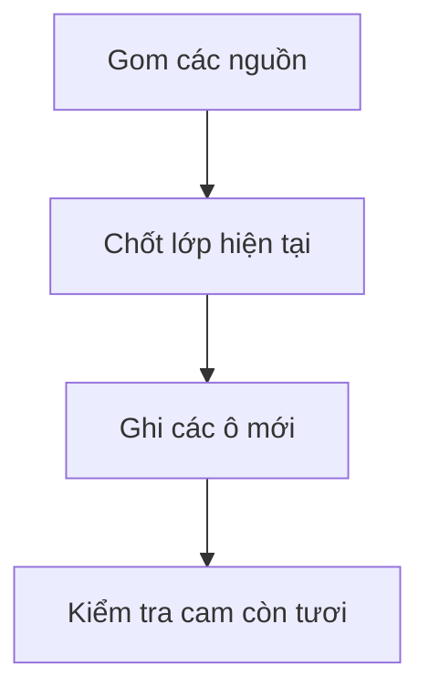

> [!tldr] Đọc nhanh
> - [[concepts/multi-source-bfs|BFS nhiều nguồn]] đưa mọi quả cam hỏng ban đầu vào cùng lớp 0. Một quả tươi đổi trạng thái ở phút bằng khoảng cách ngắn nhất tới một nguồn qua các ô có cam.
> - Chốt kích thước lớp trước khi xử lý. Quả vừa đổi trạng thái được đưa vào lớp sau và chỉ lan tiếp từ phút kế.
> - [[concepts/mark-on-enqueue|Đánh dấu lúc đưa vào hàng đợi]] để hai nguồn cùng chạm một quả chỉ làm giảm biến đếm cam tươi một lần.
> - Hàng đợi cạn mà vẫn còn cam tươi thì trả `-1`. Nếu không có cam tươi lúc đầu thì kết quả là `0`.

> [!info] Bối cảnh
> Đây là bài LeetCode 994, thuộc [[posts/2026-11-26-neetcode-grid-traversal|ga 1: Duyệt lưới]] trên **tuyến NeetCode: Đồ thị**. Mình xem mỗi quả cam như một vị trí trong kho, mỗi bước lan ngang hoặc dọc tốn đúng một phút. Mình chỉ cần biết cách đọc tọa độ hàng và cột.

> [!abstract]- Từ điển nhanh cho bài này (bấm để mở)
> - [[concepts/grid-graph|Đồ thị lưới]] xem ô có cam là đỉnh và hai ô có cam kề cạnh là hai đỉnh nối nhau.
> - Hàng đợi FIFO lấy ô được thêm sớm nhất trước.
> - Lớp BFS là nhóm các ô có cùng khoảng cách ngắn nhất tới tập nguồn.
> - Dấu thời gian của một ô là phút đầu tiên ô đó đổi trạng thái.

## Hình dung trước: tin nhắn chuyển qua từng quầy

Trong một kho, nhiều quầy nhận cùng một tin lúc mở cửa. Mỗi phút, quầy có tin chuyển tin sang các quầy sát vách. Mình muốn biết khi nào quầy cuối nhận được, và còn quầy nào bị ngăn bởi các chỗ trống.

| Đời thường | Khái niệm |
|---|---|
| Các quầy nhận tin trước giờ mở cửa | Nguồn ở lớp 0 |
| Một lượt chuyển tin giữa hai quầy kề | Một cạnh, tốn một phút |
| Ghi ngay quầy vừa nhận tin | Đánh dấu lúc đưa vào hàng đợi |
| Nhóm quầy vừa nhận trong cùng một phút | Một lớp BFS |
| Quầy bị khoảng trống ngăn cách với mọi nguồn | Đỉnh không tới được |



## Vấn đề: đếm phút ở điểm lan xa nhất

Lưới chữ nhật có từ 1 tới 10 hàng và từ 1 tới 10 cột. Ô `0` là chỗ trống, ô `1` là cam tươi, ô `2` là cam đã hỏng. Sau mỗi phút đầy đủ, một quả tươi đổi trạng thái nếu lúc đầu phút nó ở sát cạnh ít nhất một quả đã hỏng. Chỉ xét ô kề ngang hoặc dọc có cam. Trả thời điểm mọi quả tươi đã đổi trạng thái, hoặc `-1` nếu còn quả không bao giờ đổi. Xem [đề gốc LeetCode 994](https://leetcode.com/problems/rotting-oranges/).

Ví dụ dưới có hai nguồn `(0,0)` và `(0,4)`. Tọa độ đếm từ 0.

```text
2 1 1 0 2
0 1 1 1 1
```

| Phút | Ô mới hỏng |
|---|---|
| 0 | `(0,0)`, `(0,4)` là hai nguồn |
| 1 | `(0,1)`, `(1,4)` |
| 2 | `(0,2)`, `(1,1)`, `(1,3)` |
| 3 | `(1,2)` |

Cả ba ô ở phút 2 đều kề `(1,2)`. Lần phát hiện đầu tiên đánh dấu ô này cho phút 3. Hai lượt kiểm tra còn lại thấy nó đã được lên lịch và bỏ qua.

## Cơ chế

<figure class="figure-map" style="--ar: 3 / 4">
<div class="frame"><iframe data-archify="../diagrams/neetcode-rotting-oranges/worked-example.html" title="Hai nguồn cam thối lan cùng phút" loading="lazy"></iframe></div>
<figcaption><span><b>Hình 1.</b> Hai nguồn cam thối lan cùng phút.</span><a href="../diagrams/neetcode-rotting-oranges/worked-example.html" target="_blank" rel="noopener">Mở toàn màn hình</a></figcaption>
</figure>

<details>
<summary>Đọc từng bước</summary>
<ol>
<li>Ghi cả hai nguồn ở phút 0. <code>(0,0), (0,4)</code></li>
<li>Hai nguồn chạm hai ô ở phút 1. <code>(0,1), (1,4)</code></li>
<li>Lớp phút 2 có ba ô mới. <code>(0,2), (1,1), (1,3)</code></li>
<li>Ba hướng gặp cùng một ô. <code>(1,2), d = 3</code></li>
<li>Ô cuối chỉ vào hàng một lần. <code>minutes = 3</code></li>
</ol>
</details>

### Mô phỏng từng phút

Mình quét toàn bộ lưới để tìm các ô tươi có hàng xóm đã hỏng. Trong lúc quét, chỉ ghi tọa độ cần đổi vào danh sách tạm. Quét xong mới đổi đồng loạt sang `2`, rồi tăng phút. Nếu danh sách rỗng mà vẫn có cam tươi thì kết quả là `-1`.

Thứ tự hai pha quyết định tính đúng. Với hàng `[2,1,1]`, đổi ô thứ hai ngay giữa lượt quét sẽ khiến ô thứ ba đọc thấy trạng thái mới của nó. Mô phỏng đúng kết thúc phút 1 ở `[2,2,1]` và cần phút 2 cho ô cuối.

Gọi `R` là số hàng, `C` là số cột, và `P` là số lượt quét trong vòng lặp, kể cả lượt cuối không tìm được ô mới nếu có. Thời gian là `O(R·C·(1+P))` và danh sách tạm tốn tối đa `O(R·C)` bộ nhớ. Mỗi lượt thành công phải đổi ít nhất một ô, nên cận thời gian xấu nhất là `O((R·C)²)`.

### BFS nhiều nguồn mở rộng từng lớp

1. Quét lưới một lần. Đưa tất cả ô `2` vào hàng đợi phút 0 và đếm số ô `1` còn lại.
2. Chốt kích thước lớp hiện tại. Chỉ lấy đúng số ô đã chốt, rồi kiểm tra bốn hướng hợp lệ của mỗi ô.
3. Khi gặp ô `1`, đặt ô đó thành `2`, giảm số cam tươi, rồi đưa nó vào đuôi hàng đợi. Sau khi xong lớp, tăng phút nếu phía sau còn lớp mới.
4. Khi hàng đợi cạn, trả số phút nếu biến đếm cam tươi bằng 0, hoặc trả `-1`.

Bất biến ở đầu mỗi vòng ngoài là mọi ô chưa xử lý trong hàng đợi thuộc cùng một phút. Giả sử lớp đang xử lý là phút `t`. Một ô tươi được phát hiện ở đây có đường dài `t+1` từ một nguồn. Nếu có đường ngắn hơn, hàng đợi đã xử lý ô đứng trước nó trên đường đó ở một lớp trước và đã đánh dấu ô này. Vì thế lần phát hiện đầu tiên là thời điểm sớm nhất. Giữa nhiều nguồn, ta lấy khoảng cách nhỏ nhất cho từng ô. Kết quả toàn lưới là thời điểm lớn nhất trong các ô tươi ban đầu, hoặc `-1` nếu một ô chưa bao giờ được phát hiện. Nếu tập ô tươi rỗng từ đầu, kết quả là 0.

Một cách lưu thời gian tương đương là đưa `(hàng, cột, phút)` vào hàng đợi. Mọi nguồn mang phút 0, ô con mang phút của ô vừa lấy ra cộng 1. Nếu cần trả bản đồ thời điểm lan cho từng ô, có thể lưu dấu thời gian trong một ma trận riêng. File ví dụ dùng ranh giới lớp để trả số phút cuối cùng.

BFS chạy trong `O(R·C)` thời gian và dùng tối đa `O(R·C)` bộ nhớ. Sau lượt đọc đầu tiên, mỗi ô có cam vào hàng đợi tối đa một lần và mỗi lượt lấy ra kiểm tra bốn hướng. Cả hai cách trong file đều sửa lưới nhận vào. Bộ kiểm tra sao chép từng hàng để hai cách bắt đầu từ cùng trạng thái.

### Đo số lần xử lý trên một hành lang

Dùng một hàng có 10 ô, gồm một quả hỏng ở đầu trái và chín quả tươi. Cả hai cách trả 9 phút.

| Cách | Số đo | Phần ngoài số đo |
|---|---:|---|
| Mô phỏng | 90 ô được xét trong 9 lượt quét | Lượt đếm 10 ô ban đầu |
| BFS | 10 lần lấy ô khỏi hàng đợi | Lượt đọc 10 ô ban đầu và các kiểm tra hàng xóm |

Thước đo đếm việc xét ô trong lượt quét và việc lấy ô từ hàng đợi. Mỗi sự kiện có thể kéo theo số thao tác khác nhau. Các số này cho thấy những lượt duyệt lại mà BFS tránh được.

## Ví dụ chạy được

- [TypeScript](../code/neetcode-rotting-oranges/rot-by-minute.ts) — chạy `node rot-by-minute.ts`
- [Python](../code/neetcode-rotting-oranges/rot_by_minute.py) — chạy `python3 rot_by_minute.py`
- [Go](../code/neetcode-rotting-oranges/rot_by_minute.go) — chạy `go run rot_by_minute.go`
- [Java](../code/neetcode-rotting-oranges/rot-by-minute.java) — chạy `java rot-by-minute.java`
- [JavaScript](../code/neetcode-rotting-oranges/rot-by-minute.js) — chạy `node rot-by-minute.js`
- [PHP](../code/neetcode-rotting-oranges/rot-by-minute.php) — chạy `php rot-by-minute.php`
- [Rust](../code/neetcode-rotting-oranges/rot_by_minute.rs) — chạy `rustc --edition 2021 -O rot_by_minute.rs && ./rot_by_minute`

```typescript
type Grid = number[][]
type Cell = [number, number]

const directions: Cell[] = [[-1, 0], [1, 0], [0, -1], [0, 1]]

function simulate(grid: Grid) {
  let fresh = grid.reduce((count, row) => count + row.filter(value => value === 1).length, 0)
  let minutes = 0
  let scans = 0

  while (fresh > 0) {
    const next: Cell[] = []
    for (let r = 0; r < grid.length; r++) {
      for (let c = 0; c < grid[0].length; c++) {
        scans++
        if (grid[r][c] === 1 && directions.some(([dr, dc]) => grid[r + dr]?.[c + dc] === 2)) {
          next.push([r, c])
        }
      }
    }
    if (next.length === 0) return { minutes: -1, scans }
    for (const [r, c] of next) grid[r][c] = 2
    fresh -= next.length
    minutes++
  }
  return { minutes, scans }
}

function spread(grid: Grid) {
  const queue: Cell[] = []
  let fresh = 0
  for (let r = 0; r < grid.length; r++) {
    for (let c = 0; c < grid[0].length; c++) {
      if (grid[r][c] === 2) queue.push([r, c])
      if (grid[r][c] === 1) fresh++
    }
  }

  let head = 0
  let minutes = 0
  while (head < queue.length) {
    const end = queue.length
    while (head < end) {
      const [r, c] = queue[head++]
      for (const [dr, dc] of directions) {
        const nr = r + dr
        const nc = c + dc
        if (grid[nr]?.[nc] !== 1) continue
        grid[nr][nc] = 2
        fresh--
        queue.push([nr, nc])
      }
    }
    if (queue.length > end) minutes++
  }
  return { minutes: fresh === 0 ? minutes : -1, pops: head }
}

const cases: [Grid, number][] = [
  [[[2, 1, 1, 0, 2], [0, 1, 1, 1, 1]], 3],
  [[[2, 1, 0, 1], [0, 1, 0, 1]], -1],
  [[[0, 2, 0]], 0],
  [[[1]], -1],
  [[[0]], 0],
  [[[2, 1, 2]], 1],
  [[[2, 1, 1, 1, 1, 1, 1, 1, 1, 1]], 9],
]
const clone = (grid: Grid) => grid.map(row => row.slice())

for (const [grid, expected] of cases) {
  if (simulate(clone(grid)).minutes !== expected || spread(clone(grid)).minutes !== expected) {
    throw new Error(`unexpected result for ${JSON.stringify(grid)}`)
  }
}

const [corridor] = cases[cases.length - 1]
const { scans } = simulate(clone(corridor))
const { pops } = spread(clone(corridor))
if (scans !== 90 || pops !== 10) throw new Error("unexpected operation counts")
console.log(`${cases.length}/${cases.length} ca đúng`)
console.log(`Quét: ${scans}; lấy khỏi hàng đợi: ${pops}`)
```
```python
from collections import deque

DIRECTIONS = ((-1, 0), (1, 0), (0, -1), (0, 1))


def simulate(grid):
    rows, cols = len(grid), len(grid[0])
    fresh = sum(row.count(1) for row in grid)
    minutes = scans = 0

    while fresh:
        upcoming = []
        for r in range(rows):
            for c in range(cols):
                scans += 1
                if grid[r][c] == 1 and any(
                    0 <= r + dr < rows
                    and 0 <= c + dc < cols
                    and grid[r + dr][c + dc] == 2
                    for dr, dc in DIRECTIONS
                ):
                    upcoming.append((r, c))
        if not upcoming:
            return -1, scans
        for r, c in upcoming:
            grid[r][c] = 2
        fresh -= len(upcoming)
        minutes += 1
    return minutes, scans


def spread(grid):
    rows, cols = len(grid), len(grid[0])
    queue = deque()
    fresh = 0
    for r in range(rows):
        for c in range(cols):
            if grid[r][c] == 2:
                queue.append((r, c))
            elif grid[r][c] == 1:
                fresh += 1

    minutes = pops = 0
    while queue:
        layer_size = len(queue)
        for _ in range(layer_size):
            r, c = queue.popleft()
            pops += 1
            for dr, dc in DIRECTIONS:
                nr, nc = r + dr, c + dc
                if 0 <= nr < rows and 0 <= nc < cols and grid[nr][nc] == 1:
                    grid[nr][nc] = 2
                    fresh -= 1
                    queue.append((nr, nc))
        if queue:
            minutes += 1
    return (minutes if fresh == 0 else -1), pops


def main():
    cases = [
        ([[2, 1, 1, 0, 2], [0, 1, 1, 1, 1]], 3),
        ([[2, 1, 0, 1], [0, 1, 0, 1]], -1),
        ([[0, 2, 0]], 0),
        ([[1]], -1),
        ([[0]], 0),
        ([[2, 1, 2]], 1),
        ([[2, 1, 1, 1, 1, 1, 1, 1, 1, 1]], 9),
    ]
    for grid, expected in cases:
        assert simulate([row[:] for row in grid])[0] == expected, grid
        assert spread([row[:] for row in grid])[0] == expected, grid

    corridor = cases[-1][0]
    _, scans = simulate([row[:] for row in corridor])
    _, pops = spread([row[:] for row in corridor])
    assert (scans, pops) == (90, 10)
    print(f"{len(cases)}/{len(cases)} ca đúng")
    print(f"Quét: {scans}; lấy khỏi hàng đợi: {pops}")


if __name__ == "__main__":
    main()
```
```go
package main

import "fmt"

type cell struct{ row, col int }

var directions = [...]cell{{-1, 0}, {1, 0}, {0, -1}, {0, 1}}

func inside(r, c, rows, cols int) bool {
	return r >= 0 && r < rows && c >= 0 && c < cols
}

func simulate(grid [][]int) (int, int) {
	rows, cols := len(grid), len(grid[0])
	fresh, minutes, scans := 0, 0, 0
	for _, row := range grid {
		for _, value := range row {
			if value == 1 {
				fresh++
			}
		}
	}

	for fresh > 0 {
		next := []cell{}
		for r, row := range grid {
			for c, value := range row {
				scans++
				if value != 1 {
					continue
				}
				for _, d := range directions {
					nr, nc := r+d.row, c+d.col
					if inside(nr, nc, rows, cols) && grid[nr][nc] == 2 {
						next = append(next, cell{r, c})
						break
					}
				}
			}
		}
		if len(next) == 0 {
			return -1, scans
		}
		for _, p := range next {
			grid[p.row][p.col] = 2
		}
		fresh -= len(next)
		minutes++
	}
	return minutes, scans
}

func spread(grid [][]int) (int, int) {
	rows, cols := len(grid), len(grid[0])
	queue := []cell{}
	fresh := 0
	for r, row := range grid {
		for c, value := range row {
			if value == 2 {
				queue = append(queue, cell{r, c})
			}
			if value == 1 {
				fresh++
			}
		}
	}

	head, minutes := 0, 0
	for head < len(queue) {
		end := len(queue)
		for head < end {
			p := queue[head]
			head++
			for _, d := range directions {
				nr, nc := p.row+d.row, p.col+d.col
				if !inside(nr, nc, rows, cols) || grid[nr][nc] != 1 {
					continue
				}
				grid[nr][nc] = 2
				fresh--
				queue = append(queue, cell{nr, nc})
			}
		}
		if len(queue) > end {
			minutes++
		}
	}
	if fresh > 0 {
		return -1, head
	}
	return minutes, head
}

func clone(grid [][]int) [][]int {
	copyRows := make([][]int, len(grid))
	for r, row := range grid {
		copyRows[r] = append([]int(nil), row...)
	}
	return copyRows
}

func main() {
	cases := []struct {
		grid [][]int
		want int
	}{
		{[][]int{{2, 1, 1, 0, 2}, {0, 1, 1, 1, 1}}, 3},
		{[][]int{{2, 1, 0, 1}, {0, 1, 0, 1}}, -1},
		{[][]int{{0, 2, 0}}, 0},
		{[][]int{{1}}, -1},
		{[][]int{{0}}, 0},
		{[][]int{{2, 1, 2}}, 1},
		{[][]int{{2, 1, 1, 1, 1, 1, 1, 1, 1, 1}}, 9},
	}
	for _, test := range cases {
		slow, _ := simulate(clone(test.grid))
		fast, _ := spread(clone(test.grid))
		if slow != test.want || fast != test.want {
			panic(fmt.Sprintf("unexpected result for %v", test.grid))
		}
	}

	corridor := cases[len(cases)-1].grid
	_, scans := simulate(clone(corridor))
	_, pops := spread(clone(corridor))
	if scans != 90 || pops != 10 {
		panic("unexpected operation counts")
	}
	fmt.Printf("%d/%d ca đúng\n", len(cases), len(cases))
	fmt.Printf("Quét: %d; lấy khỏi hàng đợi: %d\n", scans, pops)
}
```
```java
import java.util.ArrayDeque;
import java.util.ArrayList;
import java.util.Arrays;
import java.util.List;

class RotByMinute {
    record Cell(int row, int col) {}
    record Result(int minutes, int inspections) {}
    record Test(int[][] grid, int expected) {}

    static final int[][] DIRECTIONS = {{-1, 0}, {1, 0}, {0, -1}, {0, 1}};

    static boolean inside(int row, int col, int[][] grid) {
        return row >= 0 && row < grid.length && col >= 0 && col < grid[0].length;
    }

    static Result simulate(int[][] grid) {
        int fresh = 0, minutes = 0, scans = 0;
        for (int[] row : grid) {
            for (int value : row) {
                if (value == 1) fresh++;
            }
        }

        while (fresh > 0) {
            List<Cell> next = new ArrayList<>();
            for (int row = 0; row < grid.length; row++) {
                for (int col = 0; col < grid[0].length; col++) {
                    scans++;
                    if (grid[row][col] != 1) continue;
                    for (int[] d : DIRECTIONS) {
                        int nr = row + d[0], nc = col + d[1];
                        if (inside(nr, nc, grid) && grid[nr][nc] == 2) {
                            next.add(new Cell(row, col));
                            break;
                        }
                    }
                }
            }
            if (next.isEmpty()) return new Result(-1, scans);
            for (Cell p : next) grid[p.row()][p.col()] = 2;
            fresh -= next.size();
            minutes++;
        }
        return new Result(minutes, scans);
    }

    static Result spread(int[][] grid) {
        var queue = new ArrayDeque<Cell>();
        int fresh = 0;
        for (int row = 0; row < grid.length; row++) {
            for (int col = 0; col < grid[0].length; col++) {
                if (grid[row][col] == 2) queue.addLast(new Cell(row, col));
                if (grid[row][col] == 1) fresh++;
            }
        }

        int minutes = 0, pops = 0;
        while (!queue.isEmpty()) {
            int layerSize = queue.size();
            for (int i = 0; i < layerSize; i++) {
                Cell p = queue.removeFirst();
                pops++;
                for (int[] d : DIRECTIONS) {
                    int nr = p.row() + d[0], nc = p.col() + d[1];
                    if (!inside(nr, nc, grid) || grid[nr][nc] != 1) continue;
                    grid[nr][nc] = 2;
                    fresh--;
                    queue.addLast(new Cell(nr, nc));
                }
            }
            if (!queue.isEmpty()) minutes++;
        }
        return new Result(fresh == 0 ? minutes : -1, pops);
    }

    static int[][] copy(int[][] grid) {
        return Arrays.stream(grid).map(int[]::clone).toArray(int[][]::new);
    }

    public static void main(String[] args) {
        Test[] cases = {
            new Test(new int[][]{{2, 1, 1, 0, 2}, {0, 1, 1, 1, 1}}, 3),
            new Test(new int[][]{{2, 1, 0, 1}, {0, 1, 0, 1}}, -1),
            new Test(new int[][]{{0, 2, 0}}, 0),
            new Test(new int[][]{{1}}, -1),
            new Test(new int[][]{{0}}, 0),
            new Test(new int[][]{{2, 1, 2}}, 1),
            new Test(new int[][]{{2, 1, 1, 1, 1, 1, 1, 1, 1, 1}}, 9),
        };
        for (Test test : cases) {
            if (simulate(copy(test.grid())).minutes() != test.expected()
                || spread(copy(test.grid())).minutes() != test.expected()) {
                throw new AssertionError(Arrays.deepToString(test.grid()));
            }
        }

        int[][] corridor = cases[cases.length - 1].grid();
        int scans = simulate(copy(corridor)).inspections();
        int pops = spread(copy(corridor)).inspections();
        if (scans != 90 || pops != 10) throw new AssertionError("unexpected operation counts");
        System.out.printf("%d/%d ca đúng%n", cases.length, cases.length);
        System.out.printf("Quét: %d; lấy khỏi hàng đợi: %d%n", scans, pops);
    }
}
```
```javascript
const directions = [[-1, 0], [1, 0], [0, -1], [0, 1]]

function simulate(grid) {
  let fresh = grid.reduce((count, row) => count + row.filter(value => value === 1).length, 0)
  let minutes = 0
  let scans = 0

  while (fresh > 0) {
    const next = []
    for (let r = 0; r < grid.length; r++) {
      for (let c = 0; c < grid[0].length; c++) {
        scans++
        if (grid[r][c] === 1 && directions.some(([dr, dc]) => grid[r + dr]?.[c + dc] === 2)) {
          next.push([r, c])
        }
      }
    }
    if (next.length === 0) return { minutes: -1, scans }
    for (const [r, c] of next) grid[r][c] = 2
    fresh -= next.length
    minutes++
  }
  return { minutes, scans }
}

function spread(grid) {
  const queue = []
  let fresh = 0
  for (let r = 0; r < grid.length; r++) {
    for (let c = 0; c < grid[0].length; c++) {
      if (grid[r][c] === 2) queue.push([r, c])
      if (grid[r][c] === 1) fresh++
    }
  }

  let head = 0
  let minutes = 0
  while (head < queue.length) {
    const end = queue.length
    while (head < end) {
      const [r, c] = queue[head++]
      for (const [dr, dc] of directions) {
        const nr = r + dr
        const nc = c + dc
        if (grid[nr]?.[nc] !== 1) continue
        grid[nr][nc] = 2
        fresh--
        queue.push([nr, nc])
      }
    }
    if (queue.length > end) minutes++
  }
  return { minutes: fresh === 0 ? minutes : -1, pops: head }
}

const cases = [
  [[[2, 1, 1, 0, 2], [0, 1, 1, 1, 1]], 3],
  [[[2, 1, 0, 1], [0, 1, 0, 1]], -1],
  [[[0, 2, 0]], 0],
  [[[1]], -1],
  [[[0]], 0],
  [[[2, 1, 2]], 1],
  [[[2, 1, 1, 1, 1, 1, 1, 1, 1, 1]], 9],
]
const clone = (grid) => grid.map(row => row.slice())

for (const [grid, expected] of cases) {
  if (simulate(clone(grid)).minutes !== expected || spread(clone(grid)).minutes !== expected) {
    throw new Error(`unexpected result for ${JSON.stringify(grid)}`)
  }
}

const [corridor] = cases[cases.length - 1]
const { scans } = simulate(clone(corridor))
const { pops } = spread(clone(corridor))
if (scans !== 90 || pops !== 10) throw new Error("unexpected operation counts")
console.log(`${cases.length}/${cases.length} ca đúng`)
console.log(`Quét: ${scans}; lấy khỏi hàng đợi: ${pops}`)
```

```php
<?php
declare(strict_types=1);

const DIRECTIONS = [[-1, 0], [1, 0], [0, -1], [0, 1]];

function simulate(array $grid): array
{
    $fresh = 0;
    foreach ($grid as $row) {
        $fresh += count(array_keys($row, 1, true));
    }
    $minutes = 0;
    $scans = 0;

    while ($fresh > 0) {
        $next = [];
        foreach ($grid as $r => $row) {
            foreach ($row as $c => $value) {
                $scans++;
                if ($value !== 1) {
                    continue;
                }
                foreach (DIRECTIONS as [$dr, $dc]) {
                    if (($grid[$r + $dr][$c + $dc] ?? null) === 2) {
                        $next[] = [$r, $c];
                        break;
                    }
                }
            }
        }
        if (!$next) {
            return ['minutes' => -1, 'scans' => $scans];
        }
        foreach ($next as [$r, $c]) {
            $grid[$r][$c] = 2;
        }
        $fresh -= count($next);
        $minutes++;
    }
    return ['minutes' => $minutes, 'scans' => $scans];
}

function spread(array $grid): array
{
    $queue = [];
    $fresh = 0;
    foreach ($grid as $r => $row) {
        foreach ($row as $c => $value) {
            if ($value === 2) $queue[] = [$r, $c];
            if ($value === 1) $fresh++;
        }
    }

    $head = 0;
    $minutes = 0;
    while ($head < count($queue)) {
        $end = count($queue);
        while ($head < $end) {
            [$r, $c] = $queue[$head++];
            foreach (DIRECTIONS as [$dr, $dc]) {
                $nr = $r + $dr;
                $nc = $c + $dc;
                if (($grid[$nr][$nc] ?? null) !== 1) {
                    continue;
                }
                $grid[$nr][$nc] = 2;
                $fresh--;
                $queue[] = [$nr, $nc];
            }
        }
        if (count($queue) > $end) $minutes++;
    }
    return ['minutes' => $fresh === 0 ? $minutes : -1, 'pops' => $head];
}

$cases = [
    [[[2, 1, 1, 0, 2], [0, 1, 1, 1, 1]], 3],
    [[[2, 1, 0, 1], [0, 1, 0, 1]], -1],
    [[[0, 2, 0]], 0],
    [[[1]], -1],
    [[[0]], 0],
    [[[2, 1, 2]], 1],
    [[[2, 1, 1, 1, 1, 1, 1, 1, 1, 1]], 9],
];

foreach ($cases as [$grid, $expected]) {
    if (simulate($grid)['minutes'] !== $expected || spread($grid)['minutes'] !== $expected) {
        throw new RuntimeException('unexpected result for ' . json_encode($grid));
    }
}

[$corridor] = $cases[count($cases) - 1];
$scans = simulate($corridor)['scans'];
$pops = spread($corridor)['pops'];
if ($scans !== 90 || $pops !== 10) {
    throw new RuntimeException('unexpected operation counts');
}
$n = count($cases);
echo "{$n}/{$n} ca đúng\n";
echo "Quét: {$scans}; lấy khỏi hàng đợi: {$pops}\n";
```

```rust
use std::collections::VecDeque;

type Grid = Vec<Vec<u8>>;

const DIRECTIONS: [(i32, i32); 4] = [(-1, 0), (1, 0), (0, -1), (0, 1)];

fn at(grid: &Grid, r: i32, c: i32) -> Option<u8> {
    if r < 0 || c < 0 {
        return None;
    }
    grid.get(r as usize)?.get(c as usize).copied()
}

fn simulate(mut grid: Grid) -> (i32, usize) {
    let mut fresh = grid.iter().flatten().filter(|&&v| v == 1).count();
    let mut minutes = 0;
    let mut scans = 0;

    while fresh > 0 {
        let mut next = Vec::new();
        for r in 0..grid.len() {
            for c in 0..grid[0].len() {
                scans += 1;
                if grid[r][c] == 1
                    && DIRECTIONS.iter().any(|&(dr, dc)| at(&grid, r as i32 + dr, c as i32 + dc) == Some(2))
                {
                    next.push((r, c));
                }
            }
        }
        if next.is_empty() {
            return (-1, scans);
        }
        for &(r, c) in &next {
            grid[r][c] = 2;
        }
        fresh -= next.len();
        minutes += 1;
    }
    (minutes, scans)
}

fn spread(mut grid: Grid) -> (i32, usize) {
    let mut queue = VecDeque::new();
    let mut fresh = 0;
    for r in 0..grid.len() {
        for c in 0..grid[0].len() {
            if grid[r][c] == 2 { queue.push_back((r as i32, c as i32)); }
            if grid[r][c] == 1 { fresh += 1; }
        }
    }

    let mut pops = 0;
    let mut minutes = 0;
    while !queue.is_empty() {
        let mut rotted_this_minute = false;
        for _ in 0..queue.len() {
            let (r, c) = queue.pop_front().unwrap();
            pops += 1;
            for (dr, dc) in DIRECTIONS {
                let (nr, nc) = (r + dr, c + dc);
                if at(&grid, nr, nc) != Some(1) {
                    continue;
                }
                grid[nr as usize][nc as usize] = 2;
                fresh -= 1;
                rotted_this_minute = true;
                queue.push_back((nr, nc));
            }
        }
        if rotted_this_minute { minutes += 1; }
    }
    (if fresh == 0 { minutes } else { -1 }, pops)
}

fn main() {
    let cases: Vec<(Grid, i32)> = vec![
        (vec![vec![2, 1, 1, 0, 2], vec![0, 1, 1, 1, 1]], 3),
        (vec![vec![2, 1, 0, 1], vec![0, 1, 0, 1]], -1),
        (vec![vec![0, 2, 0]], 0),
        (vec![vec![1]], -1),
        (vec![vec![0]], 0),
        (vec![vec![2, 1, 2]], 1),
        (vec![vec![2, 1, 1, 1, 1, 1, 1, 1, 1, 1]], 9),
    ];

    for (grid, expected) in &cases {
        if simulate(grid.clone()).0 != *expected || spread(grid.clone()).0 != *expected {
            panic!("unexpected result for {:?}", grid);
        }
    }

    let corridor = &cases[cases.len() - 1].0;
    let (_, scans) = simulate(corridor.clone());
    let (_, pops) = spread(corridor.clone());
    if scans != 90 || pops != 10 {
        panic!("unexpected operation counts");
    }
    println!("{}/{} ca đúng", cases.len(), cases.len());
    println!("Quét: {}; lấy khỏi hàng đợi: {}", scans, pops);
}
```

Cả bảy file chạy ra cùng kết quả:

```text
7/7 ca đúng
Quét: 90; lấy khỏi hàng đợi: 10
```

## Hiểu lầm và bẫy hay gặp

- **Tăng phút cho cả lớp nguồn hoặc lớp cuối rỗng.** Nguồn đã hỏng lúc phút 0. Chỉ tăng phút khi xử lý lớp này đã tạo lớp tiếp theo. Với `[0,2,0]`, hàng đợi vẫn có một ô và đáp án là 0.
- **Đánh dấu khi lấy ra.** Với `[2,1,2]`, hai nguồn cùng thấy ô giữa trong lớp 0. Đánh dấu ngay ở lần phát hiện đầu để ô giữa chỉ được thêm và trừ khỏi biến đếm một lần.
- **DFS gặp đích trước thì đó là đường ngắn.** DFS có thể đi vòng qua nhiều ô trước khi tới đích. Thứ tự theo lớp của BFS cố định thời điểm tới sớm nhất trong mô hình một phút mỗi cạnh.
- **Kiểm tra mỗi điểm hỏng ban đầu bằng một BFS riêng.** Việc này lặp lại công việc khi nhiều nguồn cùng tới một vùng. Gộp chúng vào lớp 0 để lượt phát hiện đầu tiên tự chọn thời điểm sớm nhất.
- **Dùng hàng đợi bằng cách xóa đầu mảng liên tục.** TypeScript và JavaScript dùng chỉ số `head` để đọc mảng tiến dần. Go cũng dùng chỉ số trên slice. Python dùng `deque.popleft()`, Java dùng `ArrayDeque.removeFirst()`.
- **Sao chép mỗi mảng ngoài.** Hai cách đều ghi vào ô. Sao chép mỗi hàng nếu cần giữ đầu vào. Python cho phép chỉ số âm, nên kiểm tra đủ cận dưới và cận trên trước khi đọc ô.
- **PHP: đọc ô ngoài lưới bằng `??`.** `$grid[-1][0] ?? null` không báo lỗi: mảng PHP là bảng băm, khóa `-1` chỉ đơn giản là không có, và `??` trả `null`. Tiện, nhưng nó cũng nuốt luôn lỗi gõ sai tên biến. Mảng PHP truyền theo giá trị nên `simulate($grid)` tự làm việc trên bản sao, không cần chép từng hàng như TypeScript.
- **Rust: `VecDeque` hay `Vec` kèm chỉ số.** Bản Rust dùng `VecDeque::pop_front` và đếm lớp bằng `for _ in 0..queue.len()`: `queue.len()` được đọc **một lần** khi bắt đầu vòng `for`, nên ô thêm vào trong lớp này không lọt vào lớp hiện tại. Đọc ô hàng xóm bằng `grid.get(r)?.get(c)` sau khi đã chặn chỉ số âm, vì ép `-1` sang `usize` sẽ thành một số khổng lồ.

## Câu hỏi tự kiểm tra

> [!question]- Vì sao `[2,1,2]` mất một phút dù có hai nguồn?
> Cả hai nguồn đều ở lớp 0. Ô giữa được phát hiện vào lớp 1 và được đánh dấu ngay ở lần phát hiện đầu.

> [!question]- Hàng `[2,1,0,1]` trả gì?
> Ô thứ hai đổi sau một phút. Chỗ trống cắt mọi đường tới ô cuối, nên hàng đợi cạn trong khi còn cam tươi. Trả `-1`.

> [!question]- Tại sao cập nhật lưới sớm vẫn đúng trong BFS, còn mô phỏng toàn lưới cần chờ hết lượt?
> Trong BFS, quả vừa đánh dấu nằm ở đuôi sau ranh giới lớp, nên chỉ lan khi xử lý phút kế. Trong lượt quét toàn lưới, một lần đọc sau có thể nhìn thấy ô vừa đổi và cho nó lan ngay trong cùng phút.

> [!question]- Nếu cần lưu từng phút đổi trạng thái thì thêm gì?
> Lưu phút cùng tọa độ hoặc trong ma trận khoảng cách. Nguồn có phút 0. Ô tươi vừa phát hiện lần đầu nhận phút của ô cha cộng 1.

## Tham khảo

- Đề bài và miền đầu vào. [LeetCode 994 — Rotting Oranges](https://leetcode.com/problems/rotting-oranges/)
- Cài BFS nhiều nguồn với khoảng cách ban đầu bằng 0. [Princeton Algorithms — BreadthFirstPaths](https://github.com/kevin-wayne/algs4/blob/master/src/main/java/edu/princeton/cs/algs4/BreadthFirstPaths.java)
- Lập luận BFS khám phá đồ thị không trọng số theo khoảng cách. [Cornell CS 2110 — Shortest Paths](https://www.cs.cornell.edu/courses/cs2110/2025fa/lectures/lec23/)
- Thao tác ở đầu và cuối hàng đợi. [Python deque](https://docs.python.org/3/library/collections.html#collections.deque) · [Java ArrayDeque](https://docs.oracle.com/en/java/javase/25/docs/api/java.base/java/util/ArrayDeque.html)
