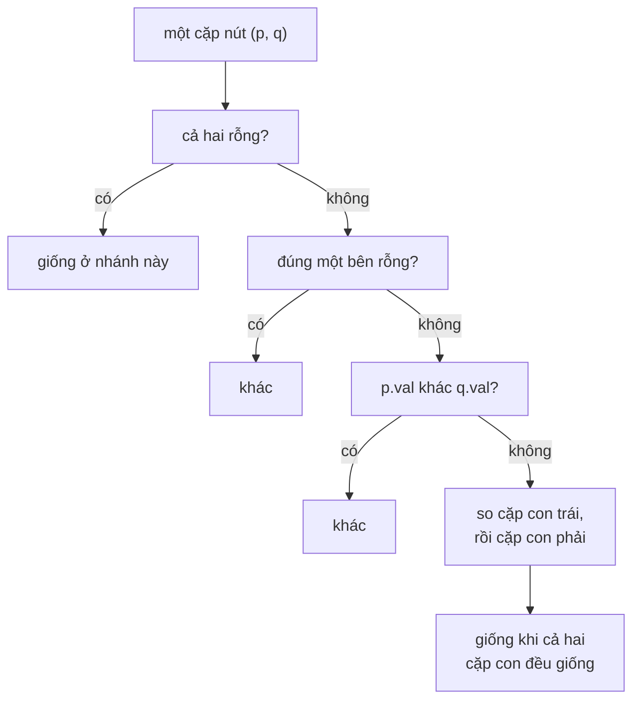
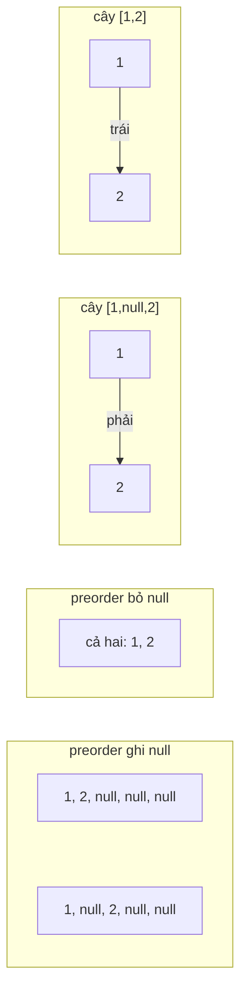

> [!tldr] Đọc nhanh
> - Đề: cho hai cây nhị phân, trả `true` khi chúng giống hệt nhau: cùng hình dạng và cùng giá trị ở mọi vị trí.
> - Lời giải chuẩn là **đệ quy song song**: đi hai cây cùng lúc, mỗi bước so một cặp nút ở cùng vị trí. Ba câu hỏi theo thứ tự: cả hai rỗng? một bên rỗng? giá trị khác? Rồi so cặp con trái và cặp con phải. O(n) thời gian, O(h) ngăn xếp (h là chiều cao).
> - Viết vòng lặp thì bỏ **cặp nút** vào ngăn xếp hoặc hàng đợi, không bỏ từng nút riêng lẻ. Bản vòng lặp chạy được cây lệch 10⁶ nút ở mọi ngôn ngữ; bản đệ quy thì không.
> - Đo thật trên cây lệch: đệ quy dừng ở độ sâu 996 trong Python, 13 907 trong Node, 29 459 trong Java (luồng main); Go vẫn chạy ở 10⁷ vì ngăn xếp goroutine tự lớn tới 1 GB.
> - Bẫy chạy thật: so dãy preorder nhưng bỏ chỗ trống (`[1,2]` và `[1,null,2]` cùng ra `1,2`); quên trường hợp đúng một bên rỗng (TypeError, AttributeError, panic, NullPointerException); Java so hai `Integer` bằng `==` sai từ giá trị 128.

> [!info] Bối cảnh
> Bài LeetCode 100 (Easy) của [[posts/2026-11-25-neetcode-tree-recursion|ga 3: Đệ quy trên cây]] trên **tuyến NeetCode: Cấu trúc liên kết**. Đây là bài đệ quy trên **hai** cây cùng lúc: cùng khuôn "xử lý nút, rồi giao phần còn lại cho hai lời gọi con" như [[problems/maximum-depth-of-binary-tree|Maximum Depth of Binary Tree]], nhưng mỗi lời gọi cầm một cặp nút. Hàm so hai cây ở đây được dùng lại nguyên vẹn trong bài cùng ga [[problems/subtree-of-another-tree|Subtree of Another Tree]]. Lời giải có đủ TypeScript, Python, Go, Java và JavaScript. Bạn chỉ cần biết cây nhị phân là gì.

> [!abstract]- Từ điển nhanh cho bài này (bấm để mở)
> - **Cây nhị phân**: mỗi nút có một giá trị và tối đa hai con, trái và phải. Con trái và con phải là hai vị trí khác nhau: một nút chỉ có con trái khác một nút chỉ có con phải. Xem [[concepts/binary-tree|Binary Tree]].
> - **Chỗ trống (null)**: vị trí không có nút. Hai cây giống nhau phải trống ở cùng các vị trí.
> - **Mảng theo tầng kiểu LeetCode**: cách LeetCode viết một cây, đọc từng tầng từ trái sang phải, `null` là chỗ trống. `[1,2]` là gốc 1 có con trái 2; `[1,null,2]` là gốc 1 có con phải 2.
> - **Ngăn xếp gọi hàm**: mỗi lời gọi hàm chưa xong chiếm một ô trên ngăn xếp của luồng. Đệ quy sâu h tầng cần h ô; hết chỗ thì chương trình ném lỗi. Xem [[concepts/recursion-depth-limit|Recursion Depth Limit]].
> - **Preorder**: thứ tự đi cây "nút, rồi cây con trái, rồi cây con phải".
> - **Tuần tự hóa**: viết cây thành một dãy phẳng (mảng hoặc chuỗi) để so hay lưu. Dãy chỉ đại diện đúng cho cây khi đọc ngược được ra đúng cây đó. Xem [[concepts/key-serialization|Key Serialization]].
> - **n, h**: n là số nút, h là chiều cao (số tầng) của cây.

## Hình dung trước: dò hai bản sơ đồ thư mục

Bạn có thư mục gốc và một bản sao lưu, mỗi thư mục có tối đa hai thư mục con xếp cố định: ngăn trái và ngăn phải. Muốn biết bản sao có y hệt không, bạn mở cả hai ở cùng một chỗ, so tên, rồi cùng mở ngăn trái của cả hai, dò hết, quay lại, cùng mở ngăn phải. Chỗ nào một bên có thư mục mà bên kia trống là khác ngay.

| Đời thường | Khái niệm |
|---|---|
| Hai bản sơ đồ thư mục | hai cây `p`, `q` |
| Mở cả hai ở cùng một chỗ | một lời gọi cầm một cặp nút `(p, q)` |
| Ngăn trái, ngăn phải | con trái, con phải |
| Một bên có thư mục, bên kia trống | đúng một nút là `null`: khác nhau |
| Cả hai cùng trống | cả hai `null`: giống nhau ở nhánh này |
| Tờ giấy ghi "còn phải dò cặp ngăn nào" | ngăn xếp cặp nút của bản vòng lặp |
| Chỉ chép tên thư mục, không ghi ngăn nào trống | tuần tự hóa bỏ `null`: hai cây khác nhau ra cùng một danh sách |

Mỗi cặp nút đi qua đúng một thang câu hỏi:



## Vấn đề

Đề cho gốc của hai cây nhị phân `p` và `q`, mỗi cây có từ 0 tới 100 nút, giá trị mỗi nút trong [−10⁴, 10⁴]. Trả về `true` khi hai cây giống hệt nhau: cùng hình dạng (nút nằm ở cùng các vị trí) và cùng giá trị ở mọi vị trí. Đề gốc: [LeetCode 100](https://leetcode.com/problems/same-tree/).

Mình từng nghĩ chỉ cần đi cả hai cây theo cùng một thứ tự, gom giá trị ra hai mảng rồi so. Hóa ra hai cây khác hình dạng vẫn có thể cho cùng dãy giá trị: `[1,2]` (2 là con trái) và `[1,null,2]` (2 là con phải) đều ra preorder `1, 2`. Muốn so bằng dãy thì dãy phải ghi cả chỗ trống.

## Cơ chế

<figure class="figure-map" style="--ar: 3 / 4">
<div class="frame"><iframe data-archify="../diagrams/neetcode-same-tree/worked-example.html" title="So từng cặp nút ở cùng vị trí" loading="lazy"></iframe></div>
<figcaption><span><b>Hình 1.</b> So từng cặp nút ở cùng vị trí.</span><a href="../diagrams/neetcode-same-tree/worked-example.html" target="_blank" rel="noopener">Mở toàn màn hình</a></figcaption>
</figure>

<details>
<summary>Đọc từng bước</summary>
<ol>
<li>Hai gốc có cùng giá trị 6. <code>6 = 6</code></li>
<li>So hai con trái và thấy đều là 4. <code>4 = 4</code></li>
<li>Một cây có con phải 8, cây kia trống. <code>8 vs null</code></li>
<li>Hình dạng khác nên kết quả sai. <code>false</code></li>
</ol>
</details>

### Cách 1: đệ quy song song

Hai cây giống nhau khi và chỉ khi: hai gốc cùng giá trị, hai cây con trái giống nhau, và hai cây con phải giống nhau. Định nghĩa này gọi lại chính nó trên hai cặp nhỏ hơn, nên viết thành đệ quy là xong. Điểm dừng là khi ít nhất một bên rỗng: cả hai rỗng thì giống, một bên rỗng thì khác. Dòng `return p === q` gộp cả hai: khi một trong hai là `null`, chúng bằng nhau chỉ khi cả hai cùng `null`.

```ts
// Cách 1: đệ quy song song trên hai cây. O(n) thời gian, O(h) ngăn xếp gọi hàm (h là chiều cao).
function isSameRecursive(p: TreeNode | null, q: TreeNode | null): boolean {
  if (p === null || q === null) return p === q; // chỉ đúng khi cả hai cùng null
  return p.val === q.val && isSameRecursive(p.left, q.left) && isSameRecursive(p.right, q.right);
}
```

Mỗi nút được thăm nhiều nhất một lần, và `&&` dừng ngay ở cặp khác đầu tiên, nên O(n) thời gian với n là số nút của cây nhỏ hơn. Bộ nhớ là độ sâu đệ quy: O(log n) với cây cân bằng, O(n) với cây lệch hẳn một phía.

### Cách 2: ngăn xếp các cặp nút

Đổi đệ quy thành vòng lặp: thứ cần nhớ không phải "nút tiếp theo" mà "**cặp** nút tiếp theo cần so". Mỗi phần tử ngăn xếp là một cặp `(a, b)` ở cùng vị trí. Lấy một cặp ra, đi qua đúng thang câu hỏi ở trên, rồi đẩy cặp con phải và cặp con trái vào.

```ts
// Cách 2: vòng lặp với ngăn xếp các cặp nút (DFS). O(n) thời gian, O(h) phần tử trên ngăn xếp.
function isSameStack(p: TreeNode | null, q: TreeNode | null): boolean {
  const stack: [TreeNode | null, TreeNode | null][] = [[p, q]];
  while (stack.length > 0) {
    const [a, b] = stack.pop()!;
    if (a === null && b === null) continue;
    if (a === null || b === null || a.val !== b.val) return false;
    stack.push([a.right, b.right], [a.left, b.left]);
  }
  return true;
}
```

Ngăn xếp này nằm trên heap của chương trình, không phải ngăn xếp gọi hàm, nên không có giới hạn độ sâu nào ngoài bộ nhớ máy.

### Cách 3: hàng đợi các cặp nút

Thay ngăn xếp bằng hàng đợi thì so theo từng tầng (BFS). Vẫn O(n) thời gian; bộ nhớ là tầng rộng nhất, O(n) với cây đầy. Đúng như nhau, chỉ khác thứ tự phát hiện chỗ khác: BFS thấy chỗ khác ở tầng nông trước.

### Cách 4: tuần tự hóa có ghi chỗ trống

Viết mỗi cây thành dãy preorder, ghi cả `null` ở mỗi chỗ trống, rồi so hai dãy. Với cách ghi này, mỗi dãy chỉ ứng với đúng một cây, nên hai dãy bằng nhau khi và chỉ khi hai cây bằng nhau. O(n) thời gian nhưng tốn O(n) bộ nhớ thêm, và phải đi hết cả hai cây trước khi so, kể cả khi chỗ khác nằm ngay ở gốc. Ở bài này nó không có lợi gì; nó đáng biết vì bài [[problems/subtree-of-another-tree|Subtree of Another Tree]] dùng đúng ý này để tìm cây con bằng tìm chuỗi.

| Cách | Thời gian | Bộ nhớ thêm | Ghi chú |
|---|---|---|---|
| Đệ quy song song | O(n) | O(h) ngăn xếp gọi hàm | ngắn nhất; giới hạn độ sâu theo ngôn ngữ |
| Ngăn xếp cặp nút | O(n) | O(h) | không giới hạn độ sâu |
| Hàng đợi cặp nút | O(n) | O(w), w là tầng rộng nhất | thấy chỗ khác ở tầng nông trước |
| Tuần tự hóa có null | O(n) | O(n) | đi hết hai cây rồi mới so |

### Ba cái bẫy

**So preorder nhưng bỏ chỗ trống.** Bản `wrongPreorderNoNull` gom giá trị theo preorder, bỏ qua `null`, rồi so hai mảng. Nó sai ở 2/12 ca: `[1,2]` với `[1,null,2]`, và hai cây lệch 50 nút toàn số 1 (một cây lệch trái, một cây lệch phải), cả hai đều trả `true`. Thêm inorder cũng không cứu được hết; chỉ ghi chỗ trống mới làm dãy đọc ngược được ra đúng một cây.



**Quên trường hợp đúng một bên rỗng.** Viết `if (p === null && q === null) return true;` rồi so `p.val` với `q.val` ngay: khi chỉ một bên rỗng, chương trình đọc thuộc tính của `null`. Năm ngôn ngữ cùng hỏng ở 3/12 ca, mỗi ngôn ngữ một tên lỗi: TypeScript và JavaScript ném `TypeError`, Python `AttributeError`, Go panic, Java `NullPointerException`. Cả ba ca đều có một cây ngắn hơn cây kia, đúng kiểu lỗi lọt qua nếu chỉ thử hai cây cùng hình dạng.

**Java: so hai `Integer` bằng `==`.** LeetCode khai báo `int val`, nên `==` an toàn. Nhưng nếu nút giữ `Integer` (ví dụ một lớp `TreeNode<T>` tự viết), `==` so hai **đối tượng** chứ không so giá trị. `Integer.valueOf` (Java tự gọi khi đóng hộp) chỉ dùng lại đối tượng có sẵn cho các giá trị từ −128 tới 127, nên lỗi chỉ lộ ra với số lớn. File Java in ra `127 == 127: true, 128 == 128: false`; bản `wrongBoxedEquals` sai đúng ở hai ca có giá trị ngoài khoảng đó (1000, 2000 và −10000). Dùng `.equals` hoặc so `int`.

### Đệ quy sâu được bao nhiêu tầng

Đề giới hạn 100 nút nên cách nào cũng chạy. Nhưng cùng một hàm đệ quy, đặt vào cây lệch dài, dừng ở những độ sâu rất khác nhau. Mình cho mỗi file tìm nhị phân độ sâu lớn nhất mà bản đệ quy còn chạy trên hai cây lệch trái giống nhau:

| Ngôn ngữ | Bản đệ quy chạy tới | Giới hạn đến từ đâu | Cách chạy sâu hơn |
|---|---|---|---|
| Python 3.12 | 996 tầng | `sys.getrecursionlimit()` = 1000, trừ vài tầng của chính chương trình | `sys.setrecursionlimit(2_000_100)` chạy được 10⁶ tầng |
| TypeScript, JavaScript (Node 24) | 13 905, 13 907 tầng | ngăn xếp V8 mặc định 984 KB (`--stack-size`) | viết vòng lặp |
| `JSON.stringify` (Node 24) | 4 456 tầng | cũng đệ quy, mỗi tầng tốn nhiều chỗ hơn | viết vòng lặp |
| Java 21 | 29 459 tầng (luồng main) | `ThreadStackSize` mặc định 1024 KB | `new Thread(null, r, "…", 512L << 20)` chạy được 10⁶ tầng |
| Go 1.25 | vẫn chạy ở 10⁷ tầng (1,9 giây) | ngăn xếp goroutine tự lớn tới 1 GB (`debug.SetMaxStack`) | không cần |

Điều mình không ngờ là Python: giới hạn 1000 thấp nhất, nhưng nâng lên thì chạy được 10⁶ tầng mà không sập. Từ Python 3.11, lời gọi từ hàm Python sang hàm Python không còn chiếm ngăn xếp C, nên giới hạn này chỉ còn là một con số đếm. File chạy thử trong một tiến trình con riêng phòng khi sập, và cả hai độ sâu 10⁵, 10⁶ đều trả `True` với mã thoát 0. Bản vòng lặp không cần biết những con số này: ngăn xếp cặp nút chạy cây lệch 10⁶ nút ở cả năm ngôn ngữ.

### Đo tốc độ

Hai cây giống hệt nhau 10⁶ nút (cây tìm kiếm nhị phân dựng từ khóa ngẫu nhiên mulberry32, cao 49 tầng), trung vị 5 lần. Đây là trường hợp tốn nhất vì phải đi hết cả hai cây:

| Ngôn ngữ | Đệ quy | Ngăn xếp cặp | Hàng đợi cặp | Tuần tự hóa |
|---|---|---|---|---|
| TypeScript | 67 ms | 69 ms | 336 ms | 229 ms |
| Go | 76 ms | 89 ms | 224 ms | 265 ms |
| Java | 99 ms | 50 ms | 90 ms | 92 ms |
| Python (10⁵ nút) | 28 ms | 34 ms | 54 ms | 49 ms |

- Đệ quy và ngăn xếp cặp ngang nhau: cùng thứ tự đi, chỉ khác chỗ cất "việc còn lại".
- Hàng đợi chậm hơn rõ ở TypeScript và Go: với cây đầy, hàng đợi phình tới hàng trăm nghìn cặp, còn ngăn xếp chỉ giữ khoảng chiều cao × 2 cặp.
- Tuần tự hóa phải dựng hai mảng 2·10⁶ phần tử trước khi so.
- Số đo dao động tới khoảng 2 lần giữa các lần chạy (cùng file TypeScript, một lần chạy trước đó đo đệ quy 26 ms, hàng đợi 158 ms); thứ hạng thì giữ nguyên.

## Ví dụ chạy được

[TypeScript](../code/neetcode-same-tree/same-tree.ts) · [Python](../code/neetcode-same-tree/same_tree.py) · [Go](../code/neetcode-same-tree/same_tree.go) · [Java](../code/neetcode-same-tree/same-tree.java) · [JavaScript](../code/neetcode-same-tree/same-tree.js) · [PHP](../code/neetcode-same-tree/same-tree.php) · [Rust](../code/neetcode-same-tree/same_tree.rs)

Mỗi file trong năm bản đầu chạy 12 ca chung: hai cây giống hệt, con trái và con phải, đổi chỗ giá trị, hai cây rỗng, một bên rỗng, một nút, giá trị lớn hơn 127, số âm, cây đầy 7 nút, khác ở lá cuối, lệch trái với lệch phải, và lệch trái 100 nút. File TypeScript đối chiếu thêm 3 000 cặp cây ngẫu nhiên với đáp án lấy từ JSON lồng nhau.

Đệ quy song song:

```ts
// Cách 1: đệ quy song song trên hai cây. O(n) thời gian, O(h) ngăn xếp gọi hàm (h là chiều cao).
function isSameRecursive(p: TreeNode | null, q: TreeNode | null): boolean {
  if (p === null || q === null) return p === q; // chỉ đúng khi cả hai cùng null
  return p.val === q.val && isSameRecursive(p.left, q.left) && isSameRecursive(p.right, q.right);
}
```

```python
# Cách 1: đệ quy song song. O(n) thời gian, O(h) ngăn xếp gọi hàm.
def is_same_recursive(p, q):
    if p is None or q is None:
        return p is q  # chỉ đúng khi cả hai cùng None
    return p.val == q.val and is_same_recursive(p.left, q.left) and is_same_recursive(p.right, q.right)
```

```go
// Cách 1: đệ quy song song. O(n) thời gian, O(h) ngăn xếp gọi hàm.
func isSameRecursive(p, q *TreeNode) bool {
	if p == nil || q == nil {
		return p == q // chỉ đúng khi cả hai cùng nil
	}
	return p.Val == q.Val && isSameRecursive(p.Left, q.Left) && isSameRecursive(p.Right, q.Right)
}
```

```java
// Cách 1: đệ quy song song. O(n) thời gian, O(h) ngăn xếp gọi hàm.
static boolean isSameRecursive(TreeNode p, TreeNode q) {
    if (p == null || q == null) return p == q; // chỉ đúng khi cả hai cùng null
    return p.val == q.val && isSameRecursive(p.left, q.left) && isSameRecursive(p.right, q.right);
}
```

```js
// Cách 1: đệ quy song song. O(n) thời gian, O(h) ngăn xếp gọi hàm.
function isSameRecursive(p, q) {
  if (p === null || q === null) return p === q; // chỉ đúng khi cả hai cùng null
  return p.val === q.val && isSameRecursive(p.left, q.left) && isSameRecursive(p.right, q.right);
}
```

```php
<?php
declare(strict_types=1);

final class TreeNode {
    public function __construct(
        public int $val,
        public ?TreeNode $left = null,
        public ?TreeNode $right = null,
    ) {}
}

function isSameTree(?TreeNode $a, ?TreeNode $b): bool {
    if ($a === null || $b === null) return $a === $b;
    return $a->val === $b->val
        && isSameTree($a->left, $b->left)
        && isSameTree($a->right, $b->right);
}
```

```rust
use std::{cell::RefCell, rc::Rc};

type Node = Option<Rc<RefCell<TreeNode>>>;

struct TreeNode {
    val: i32,
    left: Node,
    right: Node,
}

fn node(val: i32, left: Node, right: Node) -> Node {
    Some(Rc::new(RefCell::new(TreeNode { val, left, right })))
}

fn is_same_tree(a: &Node, b: &Node) -> bool {
    match (a, b) {
        (None, None) => true,
        (Some(a), Some(b)) => {
            let a = a.borrow();
            let b = b.borrow();
            a.val == b.val && is_same_tree(&a.left, &b.left) && is_same_tree(&a.right, &b.right)
        }
        _ => false,
    }
}
```


Ngăn xếp các cặp nút:

```ts
// Cách 2: vòng lặp với ngăn xếp các cặp nút (DFS). O(n) thời gian, O(h) phần tử trên ngăn xếp.
function isSameStack(p: TreeNode | null, q: TreeNode | null): boolean {
  const stack: [TreeNode | null, TreeNode | null][] = [[p, q]];
  while (stack.length > 0) {
    const [a, b] = stack.pop()!;
    if (a === null && b === null) continue;
    if (a === null || b === null || a.val !== b.val) return false;
    stack.push([a.right, b.right], [a.left, b.left]);
  }
  return true;
}
```

```python
# Cách 2: ngăn xếp các cặp nút (DFS). Không phụ thuộc giới hạn đệ quy.
def is_same_stack(p, q):
    stack = [(p, q)]
    while stack:
        a, b = stack.pop()
        if a is None and b is None:
            continue
        if a is None or b is None or a.val != b.val:
            return False
        stack.append((a.right, b.right))
        stack.append((a.left, b.left))
    return True
```

```go
type pair struct{ a, b *TreeNode }

// Cách 2: ngăn xếp các cặp nút (DFS).
func isSameStack(p, q *TreeNode) bool {
	stack := []pair{{p, q}}
	for len(stack) > 0 {
		c := stack[len(stack)-1]
		stack = stack[:len(stack)-1]
		if c.a == nil && c.b == nil {
			continue
		}
		if c.a == nil || c.b == nil || c.a.Val != c.b.Val {
			return false
		}
		stack = append(stack, pair{c.a.Right, c.b.Right}, pair{c.a.Left, c.b.Left})
	}
	return true
}
```

```java
// Cách 2: ngăn xếp các cặp nút (DFS). ArrayDeque không nhận null, nên mỗi phần tử là một mảng hai ô.
static boolean isSameStack(TreeNode p, TreeNode q) {
    ArrayDeque<TreeNode[]> stack = new ArrayDeque<>();
    stack.push(new TreeNode[] {p, q});
    while (!stack.isEmpty()) {
        TreeNode[] c = stack.pop();
        TreeNode a = c[0], b = c[1];
        if (a == null && b == null) continue;
        if (a == null || b == null || a.val != b.val) return false;
        stack.push(new TreeNode[] {a.right, b.right});
        stack.push(new TreeNode[] {a.left, b.left});
    }
    return true;
}
```

```js
// Cách 2: ngăn xếp các cặp nút (DFS).
function isSameStack(p, q) {
  const stack = [[p, q]];
  while (stack.length > 0) {
    const [a, b] = stack.pop();
    if (a === null && b === null) continue;
    if (a === null || b === null || a.val !== b.val) return false;
    stack.push([a.right, b.right], [a.left, b.left]);
  }
  return true;
}
```


Kết quả `node same-tree.ts`:

```text
isSameRecursive      12/12 ca đúng
isSameStack          12/12 ca đúng
isSameQueue          12/12 ca đúng
isSameSerialize      12/12 ca đúng
wrongPreorderNoNull  10/12 ca đúng; sai ở con trái và con phải → true, lệch trái và lệch phải → true
wrongMissingOneNull  9/12 ca đúng; sai ở con trái và con phải → ném TypeError, một bên rỗng → ném TypeError, lệch trái và lệch phải → ném TypeError

ngẫu nhiên (146 cặp giống nhau): isSameRecursive 3000/3000, isSameStack 3000/3000, isSameQueue 3000/3000, isSameSerialize 3000/3000

cây lệch 10⁶ nút, đệ quy: RangeError: Maximum call stack size exceeded
độ sâu lớn nhất bản đệ quy chạy được: 13905
isSameStack      cây lệch 10⁶ nút: true
isSameQueue      cây lệch 10⁶ nút: true
isSameSerialize  cây lệch 10⁶ nút: true

hai cây giống hệt 10⁶ nút, cao 49, trung vị 5 lần (ms)
isSameRecursive     67.40
isSameStack         68.96
isSameQueue        336.06
isSameSerialize    229.44
```

`python3 same_tree.py`:

```text
is_same_recursive        12/12 ca đúng
is_same_stack            12/12 ca đúng
is_same_queue            12/12 ca đúng
is_same_serialize        12/12 ca đúng
wrong_missing_one_none   9/12 ca đúng; sai ở con trái và con phải → ném AttributeError, một bên rỗng → ném AttributeError, lệch trái và lệch phải → ném AttributeError

giới hạn đệ quy mặc định: 1000
độ sâu lớn nhất bản đệ quy chạy được: 996
is_same_stack      cây lệch 10⁶ nút: True
is_same_queue      cây lệch 10⁶ nút: True
is_same_serialize  cây lệch 10⁶ nút: True
setrecursionlimit(2_000_100), cây lệch 100000 nút: mã thoát 0, True
setrecursionlimit(2_000_100), cây lệch 1000000 nút: mã thoát 0, True

hai cây giống hệt 10⁵ nút, trung vị 5 lần (ms)
is_same_recursive     28.46
is_same_stack         34.38
is_same_queue         54.04
is_same_serialize     49.20
```

`go run same_tree.go`:

```text
isSameRecursive    12/12 ca đúng
isSameStack        12/12 ca đúng
isSameQueue        12/12 ca đúng
isSameSerialize    12/12 ca đúng
wrongValBeforeNil  9/12 ca đúng; sai ở con trái và con phải → panic, một bên rỗng → panic, lệch trái và lệch phải → panic

cây lệch 1000000 nút, đệ quy: true, 119.4 ms
cây lệch 10000000 nút, đệ quy: true, 1916.2 ms
giới hạn ngăn xếp mặc định: 1000000000 byte

hai cây giống hệt 10⁶ nút, trung vị 5 lần (ms)
isSameRecursive     75.76
isSameStack         88.53
isSameQueue        223.98
isSameSerialize    265.20
```

`java same-tree.java`:

```text
isSameRecursive      12/12 ca đúng
isSameStack          12/12 ca đúng
isSameQueue          12/12 ca đúng
isSameSerialize      12/12 ca đúng
wrongBoxedEquals     10/12 ca đúng; sai ở giá trị lớn hơn 127 → false, số âm → false
wrongMissingOneNull  9/12 ca đúng; sai ở con trái và con phải → ném NullPointerException, một bên rỗng → ném NullPointerException, lệch trái và lệch phải → ném NullPointerException

Integer 127 == 127: true, 128 == 128: false, 128 equals 128: true

độ sâu lớn nhất bản đệ quy chạy được (luồng main): 29459
isSameStack cây lệch 10⁶ nút: true
luồng có ngăn xếp 512 MB, đệ quy cây lệch 10⁶ nút: true

hai cây giống hệt 10⁶ nút, trung vị 5 lần (ms)
isSameRecursive     98.76
isSameStack         49.63
isSameQueue         89.77
isSameSerialize     92.32
```

`node same-tree.js`:

```text
isSameRecursive      12/12 ca đúng
isSameStack          12/12 ca đúng
isSameQueue          12/12 ca đúng
isSameSerialize      12/12 ca đúng
isSameJson           12/12 ca đúng
wrongMissingOneNull  9/12 ca đúng; sai ở con trái và con phải → ném TypeError, một bên rỗng → ném TypeError, lệch trái và lệch phải → ném TypeError

isSameRecursive  độ sâu lớn nhất chạy được: 13907
isSameJson       độ sâu lớn nhất chạy được: 4456
isSameStack      cây lệch 10⁶ nút: true
```

Hai bản bổ sung duyệt song song. Chúng so giá trị và cấu trúc từng cặp nút, kể cả khi chỉ một bên có nút. PHP `5/5 ca đúng` · Rust `5/5 ca đúng`.

## Hiểu lầm và bẫy hay gặp

- **"Cùng dãy preorder là cùng cây."** Chỉ đúng khi dãy ghi cả chỗ trống. Bỏ `null` thì `[1,2]` và `[1,null,2]` cùng ra `1, 2`.
- **"Kiểm cả hai rỗng là đủ."** Còn trường hợp đúng một bên rỗng. Dòng `if (p === null || q === null) return p === q` lo cả hai trong một dòng.
- **"Hàng đợi hay ngăn xếp gì cũng được, miễn bỏ từng nút vào."** Phải bỏ **cặp** nút ở cùng vị trí. Hai hàng đợi riêng cho hai cây sẽ lệch nhau ngay khi một cây thiếu nút, vì `null` không được xếp vào.
- **"Đệ quy trên cây thì không lo tràn ngăn xếp."** Cây cân bằng thì đúng (10⁶ nút chỉ cao khoảng 50 tầng). Cây lệch thì độ sâu bằng số nút: Python dừng ở 996, Node ở khoảng 13 900, Java ở khoảng 29 000.
- **Java: so `Integer` bằng `==`.** Đúng từ −128 tới 127, sai từ 128. Dùng `int` hoặc `.equals`.

## Câu hỏi tự kiểm tra

> [!question]- Vì sao `return p === q` (khi ít nhất một bên là `null`) đúng cho cả hai trường hợp?
> Nếu cả hai là `null` thì `null === null` là `true`. Nếu chỉ một bên là `null`, bên kia là một nút, thì một nút không bao giờ bằng `null`, nên trả `false`. Dòng này thay cho hai câu `if` riêng.

> [!question]- Hai cây có cùng preorder **và** cùng inorder (không ghi null) thì có chắc giống nhau không?
> Chỉ chắc khi mọi giá trị khác nhau: khi đó preorder và inorder dựng lại được đúng một cây. Khi có giá trị trùng thì không: hai cây lệch 50 nút toàn số 1, một lệch trái một lệch phải, có cùng preorder và cùng inorder (đều là năm mươi số 1) mà vẫn khác nhau. Ghi chỗ trống thì không cần điều kiện gì.

> [!question]- Bản vòng lặp đẩy cặp con phải trước, cặp con trái sau. Đổi thứ tự thì có sai không?
> Không sai: mọi cặp vẫn được so đúng một lần. Thứ tự chỉ quyết định cặp nào được so trước, tức chỗ khác nào được phát hiện trước. Đẩy phải trước để cặp trái được lấy ra trước, giống thứ tự của bản đệ quy.

> [!question]- Cây 10⁶ nút có cần lo tràn ngăn xếp khi dùng bản đệ quy không?
> Tùy chiều cao, không tùy số nút. Cây tìm kiếm nhị phân dựng từ 10⁶ khóa ngẫu nhiên trong file đo chỉ cao 49 tầng, đệ quy chạy bình thường ở mọi ngôn ngữ. Cây lệch 10⁶ nút thì cao 10⁶ tầng: chỉ Go chạy được mà không cần chỉnh gì.

> [!question]- Trong Java, nếu `TreeNode` khai báo `int val` thì `p.val == q.val` có dính bẫy 127 không?
> Không. Bẫy chỉ xảy ra khi so hai **đối tượng** `Integer`. Với `int`, `==` so giá trị. Bẫy xuất hiện khi giá trị được đóng hộp, ví dụ nút generic `TreeNode<T>` hoặc lấy giá trị từ `List<Integer>`.

## Tham khảo

- [LeetCode 100: Same Tree](https://leetcode.com/problems/same-tree/) (đề gốc: mỗi cây 0 tới 100 nút, giá trị trong [−10⁴, 10⁴])
- [Python `sys.setrecursionlimit`](https://docs.python.org/3/library/sys.html#sys.setrecursionlimit) (giới hạn mặc định và cảnh báo khi đặt quá cao)
- [What's New in Python 3.11: Inlined Python function calls](https://docs.python.org/3/whatsnew/3.11.html#inlined-python-function-calls) (lời gọi hàm Python không còn chiếm ngăn xếp C)
- [Java `Integer.valueOf(int)`](https://docs.oracle.com/en/java/javase/21/docs/api/java.base/java/lang/Integer.html#valueOf(int)) (luôn dùng lại đối tượng cho các giá trị từ −128 tới 127)
- [Go `runtime/debug.SetMaxStack`](https://pkg.go.dev/runtime/debug#SetMaxStack) (giới hạn ngăn xếp mỗi goroutine, mặc định 1 GB trên hệ 64 bit)
- `node --v8-options` (mục `--stack-size`, mặc định 984 KB) và `java -XX:+PrintFlagsFinal -version` (`ThreadStackSize = 1024`), chạy trên máy của mình
