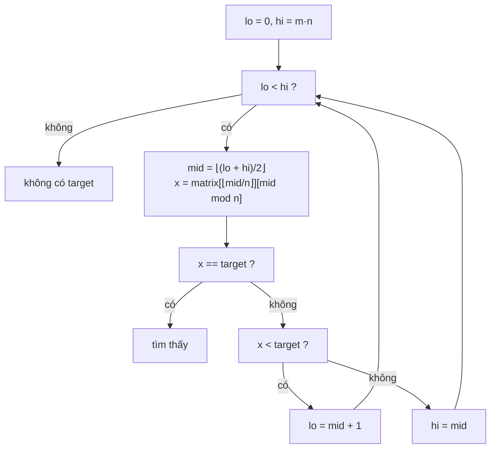

> [!tldr] Đọc nhanh
> - Đề: ma trận m × n, mỗi hàng tăng dần, phần tử đầu mỗi hàng lớn hơn phần tử cuối hàng trước. Hỏi `target` có trong ma trận không, trong O(log(m·n)).
> - Hai điều kiện đó nghĩa là đọc ma trận theo hàng sẽ ra **một mảng tăng dần** dài m·n. Chỉ số phẳng k ứng với ô `(⌊k/n⌋, k mod n)`, với n là số **cột**. Một lần [[concepts/binary-search|chia đôi]] trên k là xong.
> - Cách khác: chia đôi tìm hàng (hàng cuối cùng có phần tử đầu ≤ target), rồi chia đôi trong hàng. Cũng O(log m + log n) = O(log(m·n)), và đo nhanh hơn một chút vì không phải chia và lấy dư ở mỗi bước.
> - Đi **bậc thang** từ góc trên phải là O(m + n): đúng, nhưng chậm hơn tới 500 lần ở ma trận dẹt. Nó dành cho [LeetCode 240](https://leetcode.com/problems/search-a-2d-matrix-ii/), nơi hàng sau **không** bắt đầu lớn hơn hàng trước.
> - Hai bản sai được chạy: lấy nhầm hàng sau thay vì hàng trước (4/10 ca), và chia chỉ số phẳng cho số hàng thay vì số cột (đúng khi ma trận vuông, sai khi m ≠ n).

> [!info] Bối cảnh
> Bài LeetCode 74, thuộc [[posts/2026-11-23-neetcode-binary-search|ga 1: Tìm kiếm nhị phân trên mảng]] trên **tuyến NeetCode: Tìm kiếm và heap**. Bài này lấy chia đôi trên mảng và áp nó lên một ma trận, chỉ bằng một phép đổi chỉ số. Lời giải có đủ TypeScript, Python, Go, Java và JavaScript. Bạn chỉ cần biết vòng lặp, mảng hai chiều và phép chia lấy nguyên.

> [!abstract]- Từ điển nhanh cho bài này (bấm để mở)
> - **Chia đôi (binary search)**: trên dãy đã sắp xếp, so với phần tử giữa rồi bỏ một nửa. Mỗi bước loại một nửa, nên n phần tử cần khoảng log₂ n bước. Xem [[concepts/binary-search|Binary Search]].
> - **Khoảng nửa mở `[lo, hi)`**: gồm `lo`, không gồm `hi`. Vòng lặp chạy khi `lo < hi`, rỗng khi `lo == hi`. Xem [[concepts/half-open-interval|Half-open Interval]].
> - **Thứ tự theo hàng (row-major)**: đọc hết hàng 0, rồi hàng 1, … Ô `(r, c)` có chỉ số phẳng `r·n + c`.
> - **`⌊k/n⌋` và `k mod n`**: thương và số dư khi chia k cho n. Python có `divmod(k, n)` trả cả hai.
> - **Bất biến vòng lặp**: điều luôn đúng trước mỗi vòng, dùng để chứng minh vòng lặp đúng. Xem [[concepts/loop-invariant|Loop Invariant]].

## Hình dung trước: tủ hồ sơ đánh số

Một tủ hồ sơ có m ngăn kéo, mỗi ngăn n tập hồ sơ, đánh số tăng dần: ngăn 0 chứa số 1 tới 7, ngăn 1 bắt đầu từ số 10, và cứ thế. Bạn cần tìm hồ sơ số 16.

| Đời thường | Khái niệm |
|---|---|
| Mở từng ngăn, lật từng tập | quét hết, O(m·n) |
| Nhìn nhãn đầu mỗi ngăn để chọn ngăn, rồi lật giữa ngăn đó | hai lần chia đôi: tìm hàng, rồi tìm cột |
| Coi cả tủ như một chồng hồ sơ liền mạch, đánh số 0 tới m·n − 1 | chỉ số phẳng k |
| Hồ sơ thứ k nằm ở ngăn ⌊k/n⌋, vị trí k mod n trong ngăn | `(⌊k/n⌋, k mod n)` |
| Chọn nhầm ngăn **sau** ngăn đúng | lấy `lo` thay vì `lo − 1` |
| Đứng ở góc, lớn quá thì lùi sang trái, nhỏ quá thì xuống ngăn dưới | đi bậc thang, O(m + n) |



## Vấn đề

**Đề (tóm tắt bằng lời của mình):** cho ma trận số nguyên `matrix` m × n (1 ≤ m, n ≤ 100, giá trị trong ±10⁴). Mỗi hàng tăng dần, và phần tử đầu của mỗi hàng lớn hơn phần tử cuối của hàng trước. Trả `true` nếu `target` có trong ma trận. Lời giải phải chạy trong O(log(m·n)). Đề gốc: [LeetCode 74](https://leetcode.com/problems/search-a-2d-matrix/).

| `matrix` | `target` | Output |
|---|---|---|
| `[[1,3,5,7],[10,11,16,20],[23,30,34,60]]` | 3 | `true` |
| `[[1,3,5,7],[10,11,16,20],[23,30,34,60]]` | 13 | `false` |

Mình từng nghĩ ma trận cần một kiểu chia đôi "hai chiều" riêng. Hóa ra với hai điều kiện của đề, ma trận chỉ là một mảng tăng dần được cắt thành từng khúc dài n, và mọi thứ của chia đôi trên mảng dùng lại được nguyên vẹn.

## Cơ chế

<figure class="figure-map" style="--ar: 3 / 4">
<div class="frame"><iframe data-archify="../diagrams/neetcode-search-a-2d-matrix/worked-example.html" title="Đổi chỉ số ảo thành hàng và cột" loading="lazy"></iframe></div>
<figcaption><span><b>Hình 1.</b> Đổi chỉ số ảo thành hàng và cột.</span><a href="../diagrams/neetcode-search-a-2d-matrix/worked-example.html" target="_blank" rel="noopener">Mở toàn màn hình</a></figcaption>
</figure>

<details>
<summary>Đọc từng bước</summary>
<ol>
<li>Xem ma trận như dãy có thứ tự. <code>&#91;[1, 4, 8], [11, 15, 20]]</code></li>
<li>Chỉ số 2 ứng với hàng 0 cột 2. <code>2 / 3 → (0, 2), value = 8</code></li>
<li>Giá trị 8 nhỏ hơn đích 15. <code>lo = 3, hi = 5</code></li>
<li>Chỉ số 4 đưa tới 15. <code>(1, 1) → true</code></li>
</ol>
</details>

### Cách 1, quét hết: O(m·n)

Duyệt mọi ô. Không dùng tới thứ tự nào cả. Với m·n ≤ 10⁴ thì vẫn qua, nhưng đề đòi O(log(m·n)).

### Cách 2, hai lần chia đôi

**Bước 1, tìm hàng.** Hàng chứa target (nếu có) là **hàng cuối cùng** có phần tử đầu ≤ target. Chia đôi trên cột đầu với khoảng nửa mở `[lo, hi)`: nếu `matrix[mid][0] ≤ target` thì hàng đúng nằm ở `mid` hoặc sau nữa (`lo = mid + 1`), còn không thì nằm trước `mid` (`hi = mid`). Khi dừng, `lo` là **số** hàng có phần tử đầu ≤ target, nên hàng cần tìm là `lo − 1`. Nếu `lo − 1 < 0`, target nhỏ hơn mọi phần tử.

**Bước 2, tìm trong hàng.** Chia đôi thường trên hàng `lo − 1`.

Chỗ dễ sai là bước 1. Lấy `lo` thay vì `lo − 1` là lấy hàng **đầu tiên có phần tử đầu > target**, tức hàng ngay sau hàng đúng. Bản sai này chỉ qua 4/10 ca: nó chỉ "đúng" khi target vốn không có trong ma trận.

### Cách 3, một lần chia đôi trên chỉ số phẳng

Đọc theo hàng, ô `(r, c)` có chỉ số `k = r·n + c`. Ngược lại, `r = ⌊k/n⌋` và `c = k mod n`. Ở đây n là số **cột**, vì mỗi hàng có n phần tử. Chia đôi trên `k ∈ [0, m·n)` như trên một mảng thường, và đổi `mid` thành ô mỗi lần cần đọc.

Chia cho số hàng m thay vì số cột n là lỗi dễ mắc, vì cả hai đều là "kích thước". Với ma trận vuông, m = n nên bản sai vẫn đúng. Với ma trận 3 × 4 của ví dụ, `mid = 11` thành hàng `⌊11/3⌋ = 3`, vượt ra ngoài ma trận. Bản sai qua 8/10 ca, chỉ hỏng ở phần tử cuối của ví dụ và ở ma trận một cột.

### Cách 4, đi bậc thang: O(m + n)

Đứng ở góc trên phải. Ô hiện tại lớn hơn target thì cả cột bên dưới cũng lớn hơn (cột tăng dần): bỏ cột, sang trái. Nhỏ hơn thì cả hàng bên trái cũng nhỏ hơn: bỏ hàng, xuống dưới. Mỗi bước bỏ một hàng hoặc một cột, nên tối đa m + n bước.

Cách này chỉ cần mỗi hàng và mỗi cột tăng dần. Nó **không** dùng điều kiện "hàng sau bắt đầu lớn hơn hàng trước", nên giải được cả [LeetCode 240](https://leetcode.com/problems/search-a-2d-matrix-ii/), nơi điều kiện đó không còn và chỉ số phẳng không còn tăng dần. Ở bài 74, nó bỏ phí thông tin đề cho.

### Đo

TypeScript, giá trị `2·k` ở ô có chỉ số phẳng k (nên nửa số truy vấn không có trong ma trận), 10 000 truy vấn ngẫu nhiên, trung vị 5 lần chạy, ms:

| m × n | quét hết | hai lần chia đôi | chia đôi phẳng | bậc thang |
|---|---|---|---|---|
| 100 × 100 | 56,1 | 0,99 | 1,53 | 1,62 |
| 1 000 × 1 000 | (không chạy) | 1,75 | 2,72 | 14,41 |
| 10 × 100 000 | (không chạy) | 1,51 | 2,72 | 800,49 |
| 100 000 × 10 | (không chạy) | 3,14 | 4,64 | 1 241,00 |

- Ở cỡ của đề (100 × 100), ba cách sau gần như bằng nhau; quét hết chậm hơn khoảng 50 lần.
- Bậc thang đi tới m + n bước mỗi truy vấn. Với ma trận dẹt 10 × 100 000, đó là tới 100 010 bước so với khoảng 20 bước của chia đôi: chậm hơn khoảng 530 lần.
- Hai lần chia đôi nhanh hơn chia đôi phẳng khoảng 1,5 lần dù cùng số bước. Mỗi bước của bản phẳng phải tính `Math.floor(mid / n)` và `mid % n`, còn bản hai lần chỉ đọc mảng.

### Bên dưới bảy ngôn ngữ

| | Điểm giữa và phép chia | Bẫy riêng |
|---|---|---|
| TypeScript / JavaScript | `/` ra số thực: phải `Math.floor(mid / n)`; `(lo + hi) >>> 1` | `>> 1` sai từ 2³¹: `3000000000 >> 1` ra `-647483648` |
| Python | `divmod(k, n)` trả cả thương và dư; int không tràn | `divmod(-7, 4)` là `(-2, 1)`: làm tròn xuống, khác Go và Java |
| Go | `mid / n`, `mid % n` với `int` là chia lấy nguyên; `slices.BinarySearch` trả `(vị trí, có thấy)` | `-7 / 4` là `-1` (làm tròn về 0); `sort.Search` cần điều kiện đơn điệu false → true |
| Java | `(lo + hi) >>> 1`; `Arrays.binarySearch` | `(lo + hi) / 2` tràn khi tổng vượt 2³¹ − 1: ra `-397483648`; `binarySearch` trả `-(vị trí chèn) - 1` khi không thấy |
| PHP | `intdiv($k, $n)`, `$k % $n`; `($lo + $hi) >> 1` | `$k / $n` ra **float** khi chia không hết, và float làm chỉ số mảng bị cắt phần lẻ kèm cảnh báo deprecated (8.1+). `$matrix[-1]` không ném lỗi: ra `null` kèm warning, nên ca "target nhỏ hơn hết" phải chặn trước |
| Rust | `mid / n`, `mid % n` trên `usize` là chia nguyên; `partition_point` + `binary_search` thay hai vòng tự viết | `rows - 1` với `rows = 0` làm chương trình panic (debug) hoặc cuộn thành số khổng lồ (`-O`). Bậc thang cần cột giảm xuống −1, nên giữ cột ở `i64` hoặc kiểm tra trước khi trừ |

Tràn ở điểm giữa không xảy ra ở bài này (m·n ≤ 10⁴), nhưng là lỗi nổi tiếng: chia đôi trong thư viện chuẩn của Java từng có đúng lỗi `(low + high) / 2` này cho tới năm 2006 (xem Tham khảo).

## Ví dụ chạy được

[TypeScript](../code/neetcode-search-a-2d-matrix/search-2d-matrix.ts) · [Python](../code/neetcode-search-a-2d-matrix/search_2d_matrix.py) · [Go](../code/neetcode-search-a-2d-matrix/search_2d_matrix.go) · [Java](../code/neetcode-search-a-2d-matrix/search-2d-matrix.java) · [JavaScript](../code/neetcode-search-a-2d-matrix/search-2d-matrix.js) · [PHP](../code/neetcode-search-a-2d-matrix/search-2d-matrix.php) · [Rust](../code/neetcode-search-a-2d-matrix/search_2d_matrix.rs)

Mỗi file có quét hết, hai lần chia đôi, chia đôi phẳng và bậc thang, chạy 10 ca (gồm phần tử đầu hàng cuối, phần tử cuối cùng, target nhỏ hơn hoặc lớn hơn mọi phần tử, ma trận một ô, một cột và vuông). Dưới đây là hai lần chia đôi và chia đôi phẳng.

```ts
// Cách 2, hai lần chia đôi: tìm hàng cuối cùng có phần tử đầu ≤ target, rồi chia đôi trong hàng đó.
function twoBinarySearch(matrix: number[][], target: number): boolean {
  let lo = 0, hi = matrix.length; // nửa mở [lo, hi): đếm số hàng có phần tử đầu ≤ target
  while (lo < hi) {
    const mid = (lo + hi) >>> 1;
    if (matrix[mid][0] <= target) lo = mid + 1;
    else hi = mid;
  }
  const r = lo - 1; // hàng cuối cùng có phần tử đầu ≤ target
  if (r < 0) return false; // target nhỏ hơn mọi phần tử
  const row = matrix[r];
  let a = 0, b = row.length;
  while (a < b) {
    const mid = (a + b) >>> 1;
    if (row[mid] < target) a = mid + 1;
    else b = mid;
  }
  return a < row.length && row[a] === target;
}

// Cách 3, một lần chia đôi trên chỉ số phẳng k ∈ [0, m·n): hàng = ⌊k/n⌋, cột = k mod n (n là số CỘT).
function flatBinarySearch(matrix: number[][], target: number): boolean {
  const m = matrix.length, n = matrix[0].length;
  let lo = 0, hi = m * n;
  while (lo < hi) {
    const mid = (lo + hi) >>> 1;
    const x = matrix[Math.floor(mid / n)][mid % n];
    if (x === target) return true;
    if (x < target) lo = mid + 1;
    else hi = mid;
  }
  return false;
}
```

```python
def two_binary_search(matrix: list[list[int]], target: int) -> bool:
    # key= (Python 3.10+) so theo phần tử đầu mỗi hàng mà không phải dựng list cột đầu tốn O(m)
    r = bisect_right(matrix, target, key=lambda row: row[0]) - 1  # hàng cuối cùng có phần tử đầu ≤ target
    if r < 0:
        return False
    row = matrix[r]
    c = bisect_left(row, target)
    return c < len(row) and row[c] == target

def flat_binary_search(matrix: list[list[int]], target: int) -> bool:
    m, n = len(matrix), len(matrix[0])
    lo, hi = 0, m * n
    while lo < hi:
        mid = (lo + hi) // 2  # int Python không tràn
        r, c = divmod(mid, n)  # hàng = mid // n, cột = mid % n
        x = matrix[r][c]
        if x == target:
            return True
        if x < target:
            lo = mid + 1
        else:
            hi = mid
    return False
```

```go
func twoBinarySearch(matrix [][]int, target int) bool {
	// sort.Search trả chỉ số nhỏ nhất làm điều kiện đúng: hàng đầu tiên có phần tử đầu > target
	r := sort.Search(len(matrix), func(i int) bool { return matrix[i][0] > target }) - 1
	if r < 0 {
		return false
	}
	_, found := slices.BinarySearch(matrix[r], target) // Go 1.21+: trả (vị trí chèn, có tìm thấy không)
	return found
}

func flatBinarySearch(matrix [][]int, target int) bool {
	m, n := len(matrix), len(matrix[0])
	lo, hi := 0, m*n
	for lo < hi {
		mid := int(uint(lo+hi) >> 1) // cách của sort.Search: không tràn dù lo+hi vượt MaxInt
		x := matrix[mid/n][mid%n] // int chia int là chia lấy nguyên
		if x == target {
			return true
		}
		if x < target {
			lo = mid + 1
		} else {
			hi = mid
		}
	}
	return false
}
```

```java
static boolean twoBinarySearch(int[][] matrix, int target) {
    int lo = 0, hi = matrix.length;
    while (lo < hi) {
        int mid = (lo + hi) >>> 1;
        if (matrix[mid][0] <= target) lo = mid + 1; else hi = mid;
    }
    int r = lo - 1;
    if (r < 0) return false;
    // Arrays.binarySearch trả chỉ số nếu thấy, còn không thì trả -(vị trí chèn) - 1: luôn âm
    return Arrays.binarySearch(matrix[r], target) >= 0;
}

static boolean flatBinarySearch(int[][] matrix, int target) {
    int m = matrix.length, n = matrix[0].length;
    int lo = 0, hi = m * n; // m·n ≤ 10⁴ theo đề; với ma trận rất lớn phải dùng long
    while (lo < hi) {
        int mid = (lo + hi) >>> 1; // >>> dịch không dấu: đúng cả khi lo + hi tràn int
        int x = matrix[mid / n][mid % n];
        if (x == target) return true;
        if (x < target) lo = mid + 1; else hi = mid;
    }
    return false;
}
```

```js
function twoBinarySearch(matrix, target) {
  let lo = 0, hi = matrix.length;
  while (lo < hi) {
    const mid = (lo + hi) >>> 1;
    if (matrix[mid][0] <= target) lo = mid + 1;
    else hi = mid;
  }
  const r = lo - 1;
  if (r < 0) return false;
  const row = matrix[r];
  let a = 0, b = row.length;
  while (a < b) {
    const mid = (a + b) >>> 1;
    if (row[mid] < target) a = mid + 1;
    else b = mid;
  }
  return a < row.length && row[a] === target;
}

function flatBinarySearch(matrix, target) {
  const m = matrix.length, n = matrix[0].length;
  let lo = 0, hi = m * n;
  while (lo < hi) {
    const mid = (lo + hi) >>> 1; // >>> 1 đúng tới 2³²; >> 1 sai từ 2³¹ (thành số âm)
    const x = matrix[Math.floor(mid / n)][mid % n]; // "/" của JS ra số thực: phải Math.floor
    if (x === target) return true;
    if (x < target) lo = mid + 1;
    else hi = mid;
  }
  return false;
}
```

```php
// Cách 2, hai lần chia đôi: tìm hàng cuối cùng có phần tử đầu ≤ target, rồi chia đôi trong hàng đó.
function twoBinarySearch(array $matrix, int $target): bool
{
    $lo = 0;
    $hi = count($matrix); // nửa mở [lo, hi): đếm số hàng có phần tử đầu ≤ target
    while ($lo < $hi) {
        $mid = ($lo + $hi) >> 1;
        if ($matrix[$mid][0] <= $target) $lo = $mid + 1;
        else $hi = $mid;
    }
    $r = $lo - 1; // hàng cuối cùng có phần tử đầu ≤ target
    if ($r < 0) return false; // $matrix[-1] không lỗi trong PHP: ra null kèm cảnh báo
    $row = $matrix[$r];
    $a = 0;
    $b = count($row);
    while ($a < $b) {
        $mid = ($a + $b) >> 1;
        if ($row[$mid] < $target) $a = $mid + 1;
        else $b = $mid;
    }
    return $a < count($row) && $row[$a] === $target;
}

// Cách 3, một lần chia đôi trên chỉ số phẳng k ∈ [0, m·n): hàng = ⌊k/n⌋, cột = k mod n (n là số CỘT).
function flatBinarySearch(array $matrix, int $target): bool
{
    $m = count($matrix);
    $n = count($matrix[0]);
    $lo = 0;
    $hi = $m * $n;
    while ($lo < $hi) {
        $mid = ($lo + $hi) >> 1;
        $x = $matrix[intdiv($mid, $n)][$mid % $n]; // intdiv, không phải /: / ra float
        if ($x === $target) return true;
        if ($x < $target) $lo = $mid + 1;
        else $hi = $mid;
    }
    return false;
}
```

```rust
// Cách 2, hai lần chia đôi: partition_point đếm số hàng có phần tử đầu ≤ target,
// hàng cần tìm là hàng ngay trước đó; rồi binary_search trong hàng.
fn two_binary_search(matrix: &[Vec<i32>], target: i32) -> bool {
    let rows = matrix.partition_point(|row| row[0] <= target);
    if rows == 0 {
        return false; // target nhỏ hơn mọi phần tử; rows - 1 với usize sẽ panic
    }
    matrix[rows - 1].binary_search(&target).is_ok()
}

// Cách 3, một lần chia đôi trên chỉ số phẳng k ∈ [0, m·n): hàng = k / n, cột = k % n (n là số CỘT).
fn flat_binary_search(matrix: &[Vec<i32>], target: i32) -> bool {
    let (m, n) = (matrix.len(), matrix[0].len());
    let (mut lo, mut hi) = (0usize, m * n);
    while lo < hi {
        let mid = lo + (hi - lo) / 2;
        let x = matrix[mid / n][mid % n]; // usize chia usize là chia nguyên
        if x == target {
            return true;
        }
        if x < target {
            lo = mid + 1;
        } else {
            hi = mid;
        }
    }
    false
}
```


File TypeScript chạy thêm hai bản sai, rồi đo:

```text
$ node search-2d-matrix.ts
linearScan        10/10 ca đúng
twoBinarySearch   10/10 ca đúng
flatBinarySearch  10/10 ca đúng
staircase         10/10 ca đúng
wrongRowPick      4/10 ca đúng; sai ở: ví dụ → 3, ví dụ → 60 (cuối), ví dụ → 23 (đầu hàng cuối), [[1]] → 1, một cột [[1],[3]] → 3, vuông [[1,2],[3,4]] → 4
wrongFlatIndex    8/10 ca đúng; sai ở: ví dụ → 60 (cuối), một cột [[1],[3]] → 3

m × n          truy vấn  quét hết   hai lần chia đôi  chia đôi phẳng  bậc thang   (ms, trung vị 5 lần)
100 × 100         10000      56.1              0.99            1.53        1.62
1000 × 1000       10000         —              1.75            2.72       14.41
10 × 100000       10000         —              1.51            2.72      800.49
100000 × 10       10000         —              3.14            4.64     1241.00
```

`wrongRowPick` sai ở **mọi** ca có target, và đúng ở mọi ca không có: nó luôn tìm ở hàng ngay sau hàng đúng. `wrongFlatIndex` đúng ở ma trận vuông `[[1,2],[3,4]]` vì ở đó số hàng bằng số cột. Java in thêm phép tính điểm giữa bị tràn:

```text
$ java search-2d-matrix.java
linearScan        10/10 ca đúng
twoBinarySearch   10/10 ca đúng
flatBinarySearch  10/10 ca đúng
staircase         10/10 ca đúng

lo = 1500000000, hi = 2000000000: (lo + hi) / 2 = -397483648, (lo + hi) >>> 1 = 1750000000, lo + (hi - lo) / 2 = 1750000000
Arrays.binarySearch([1, 3, 5, 7], 4) = -3
```

`-3` nghĩa là "không có, vị trí chèn là 2" (`-(2) - 1`). Python, Go và JavaScript in `10/10 ca đúng` cho cả bốn cách, kèm dòng về phép chia của ngôn ngữ đó: Python `divmod(-7, 4) = (-2, 1)`, Go `-7 / 4 = -1, -7 % 4 = -3`, JavaScript `3000000000 >> 1 = -647483648, 3000000000 >>> 1 = 1500000000, 7 / 2 = 3.5`.

PHP (`php search-2d-matrix.php`) và Rust (`rustc --edition 2021 -O search_2d_matrix.rs`) in `10/10 ca đúng` cho bốn cách đúng, `4/10` cho bản lấy nhầm hàng và `8/10` cho bản chia nhầm số hàng, cùng các ca sai như bản TypeScript.

## Hiểu lầm và bẫy hay gặp

- **"Ma trận cần chia đôi hai chiều."** Với điều kiện của bài 74, ma trận là một mảng tăng dần cắt khúc; chia đôi một chiều trên chỉ số phẳng là đủ.
- **Lấy nhầm hàng.** Hàng chứa target là hàng **cuối cùng** có phần tử đầu ≤ target, tức `lo − 1` sau vòng tìm "số hàng có phần tử đầu ≤ target". Lấy `lo` là tìm ở hàng sau.
- **Quên ca target nhỏ hơn mọi phần tử.** Khi đó `lo − 1 = −1`; đọc `matrix[-1]` là lỗi (Java, Go) hoặc đọc nhầm hàng cuối (Python, vì chỉ số âm đếm từ cuối).
- **Chia chỉ số phẳng cho số hàng.** Test chỉ với ma trận vuông không bắt được lỗi này.
- **Dùng bậc thang cho bài 74.** Đúng nhưng O(m + n); chậm hơn tới vài trăm lần ở ma trận dẹt. Để dành cho LeetCode 240.
- **`(lo + hi) / 2` trong Java hay `>> 1` trong JS.** Không hỏng ở bài này, nhưng hỏng khi chỉ số vượt 2³⁰ (Java) hoặc 2³¹ (JS). Dùng `>>> 1` hoặc `lo + (hi − lo) / 2`.
- **Python: dựng `[row[0] for row in matrix]` để đưa vào `bisect`.** Bước đó tốn O(m), làm hỏng O(log m) của bước tìm hàng. Từ Python 3.10, `bisect_right(matrix, target, key=lambda row: row[0])` so theo phần tử đầu mà không dựng list.
- **PHP: `$matrix[$mid / $n]`.** Phép `/` ra float; PHP cắt phần lẻ làm chỉ số nhưng báo deprecated từ 8.1, và `$matrix[-1]` chỉ ra `null` kèm warning chứ không dừng chương trình. Dùng `intdiv` và chặn ca `r < 0`.
- **Rust: `matrix[rows - 1]` khi `rows = 0`.** `usize` không âm được: bản debug panic, bản `-O` cuộn vòng thành chỉ số khổng lồ rồi panic vì vượt biên. Kiểm tra `rows == 0` trước, như `two_binary_search`.

## Câu hỏi tự kiểm tra

> [!question]- Ma trận 3 × 4. Chỉ số phẳng 7 ứng với ô nào, và ô (2, 1) có chỉ số phẳng bao nhiêu?
> 7 = 1·4 + 3, nên ô (1, 3). Ô (2, 1) có chỉ số 2·4 + 1 = 9.

> [!question]- Ở bước tìm hàng, vì sao vòng lặp `[lo, hi)` dừng lại với `lo` bằng số hàng có phần tử đầu ≤ target?
> Bất biến: mọi hàng trước `lo` có phần tử đầu ≤ target, mọi hàng từ `hi` trở đi có phần tử đầu > target. Cột đầu tăng dần nên điều kiện "≤ target" đúng ở một khúc đầu rồi sai mãi. Khi `lo == hi`, `lo` chính là ranh giới, tức số hàng thỏa điều kiện.

> [!question]- Vì sao đi bậc thang phải bắt đầu ở góc trên phải (hoặc dưới trái), không ở góc trên trái?
> Ở góc trên trái, cả hai hướng đi (sang phải, xuống dưới) đều làm giá trị tăng, nên khi ô nhỏ hơn target không biết nên đi hướng nào. Ở góc trên phải, sang trái làm giảm, xuống dưới làm tăng: mỗi phép so chọn đúng một hướng và bỏ hẳn một hàng hoặc một cột.

> [!question]- Đề đổi thành LeetCode 240: hàng tăng dần, cột tăng dần, nhưng hàng sau không chắc bắt đầu lớn hơn hàng trước. Chia đôi phẳng còn đúng không?
> Không: đọc theo hàng không còn ra mảng tăng dần, nên so với phần tử giữa không cho biết nửa nào chứa target. Đi bậc thang vẫn đúng, vì nó chỉ dùng thứ tự trong từng hàng và từng cột.

## Tham khảo

- [LeetCode 74: Search a 2D Matrix](https://leetcode.com/problems/search-a-2d-matrix/) (đề gốc) và [LeetCode 240: Search a 2D Matrix II](https://leetcode.com/problems/search-a-2d-matrix-ii/) (bản không có điều kiện giữa các hàng)
- Joshua Bloch, [Extra, Extra - Read All About It: Nearly All Binary Searches and Mergesorts are Broken](https://research.google/blog/extra-extra-read-all-about-it-nearly-all-binary-searches-and-mergesorts-are-broken/), Google Research Blog, 2006 (lỗi tràn `(low + high) / 2`)
- [Python: module `bisect`](https://docs.python.org/3/library/bisect.html) và [built-in `divmod`](https://docs.python.org/3/library/functions.html#divmod)
- [Go: `sort.Search`](https://pkg.go.dev/sort#Search) và [`slices.BinarySearch`](https://pkg.go.dev/slices#BinarySearch); [Go spec: Integer operators](https://go.dev/ref/spec#Integer_operators) (chia làm tròn về 0)
- [Java 21 `Arrays.binarySearch(int[], int)`](https://docs.oracle.com/en/java/javase/21/docs/api/java.base/java/util/Arrays.html#binarySearch(int%5B%5D,int)) (giá trị trả về khi không tìm thấy)
- [MDN: Unsigned right shift (`>>>`)](https://developer.mozilla.org/en-US/docs/Web/JavaScript/Reference/Operators/Unsigned_right_shift)
