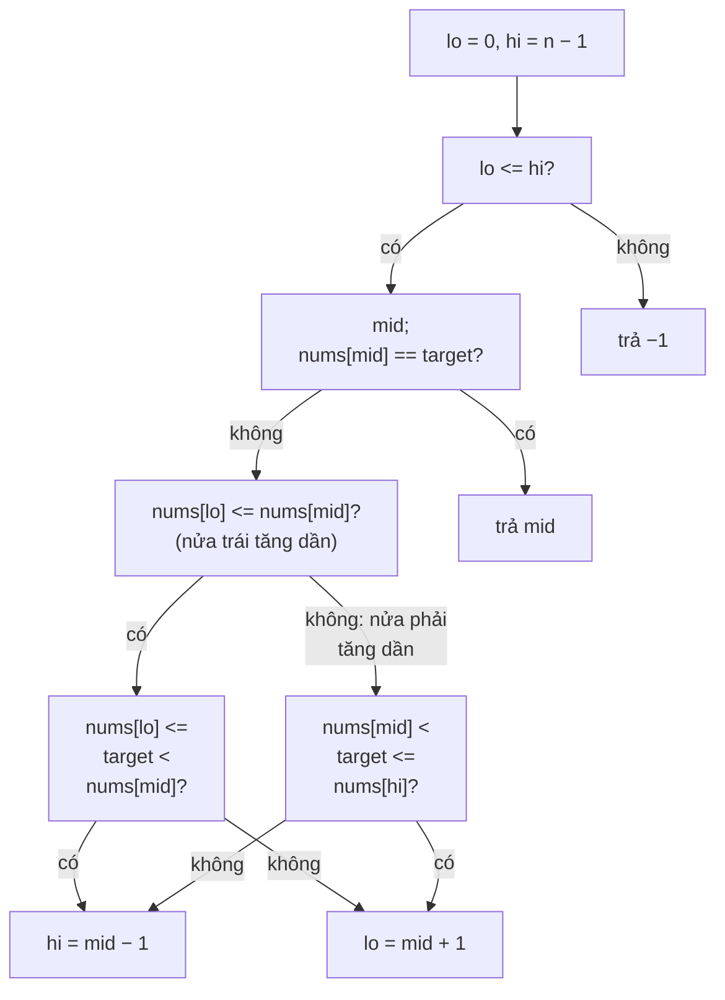

> [!tldr] Đọc nhanh
> - Đề: mảng tăng dần, các số khác nhau, đã bị **xoay**. Tìm chỉ số của `target`, không có thì −1, trong O(log n).
> - Nhận xét chìa khóa: cắt mảng xoay ở bất kỳ mid nào, **ít nhất một nửa** `[lo, mid]` hoặc `[mid, hi]` tăng dần trọn vẹn. Với nửa đó, hỏi "target có nằm trong khoảng hai đầu không?" là biết bỏ nửa nào.
> - Cách hai lượt: dùng lời giải [[problems/find-minimum-in-rotated-sorted-array|Find Minimum]] tìm chỗ gãy, rồi [[concepts/binary-search|chia đôi]] thường trên đoạn chứa target. Dễ đúng hơn, chậm hơn khoảng 2 lần.
> - Bẫy: kiểm "nửa trái tăng dần" bằng `nums[lo] < nums[mid]` thay cho `<=`. Khi còn hai ô thì `lo == mid`, và `[3, 1]` tìm `1` ra −1.
> - Đo: 10⁷ phần tử, `indexOf` 8 135 µs, một lượt 0,040 µs, hai lượt 0,080 µs. Có số trùng (LeetCode 81): 10 016 bước ở n = 10⁵.

> [!info] Bối cảnh
> Bài LeetCode 33, bài cuối của [[posts/2026-11-23-neetcode-binary-search|ga 1: Tìm kiếm nhị phân trên mảng]] trên **tuyến NeetCode: Tìm kiếm và heap**. Nó nối hai bài trước: [[problems/binary-search|Binary Search]] (tìm một số trên mảng tăng dần) và [[problems/find-minimum-in-rotated-sorted-array|Find Minimum in Rotated Sorted Array]] (tìm chỗ gãy). Lời giải có đủ TypeScript, Python, Go, Java và JavaScript. Bạn chỉ cần biết vòng lặp và mảng.

> [!abstract]- Từ điển nhanh cho bài này (bấm để mở)
> - **Tìm kiếm nhị phân (binary search)**: mỗi bước nhìn ô giữa và bỏ một nửa không thể chứa đáp án. Xem [[concepts/binary-search|Binary Search]].
> - **Mảng xoay (rotated sorted array)**: mảng tăng dần bị cắt ở một chỗ, đoạn đầu chuyển ra sau. Xem [[concepts/rotated-sorted-array|Rotated Sorted Array]].
> - **Chỗ gãy (pivot)**: chỉ số của phần tử nhỏ nhất, nơi đoạn sau bắt đầu.
> - **Bất biến vòng lặp (loop invariant)**: điều luôn đúng ở đầu mỗi vòng. Ở đây: "nếu target có trong mảng thì nó nằm trong `[lo, hi]`". Xem [[concepts/loop-invariant|Loop Invariant]].
> - **Khoảng nửa mở (half-open interval)**: `[a, b)` gồm a nhưng không gồm b; `bisect` của Python và `sort.Search` của Go làm việc theo kiểu này. Xem [[concepts/half-open-interval|Half-open Interval]].

## Hình dung trước: tìm một trang trong cuốn sổ bị đóng gáy lệch

Một cuốn sổ đánh số trang tăng dần, nhưng thợ đóng gáy cắt nhầm: phần cuối sổ bị đóng lên trước. Mở từ đầu, bạn thấy trang 40, 50, 60, 70, rồi 0, 10, 20. Bạn cần tìm trang 10 mà không lật từng trang.

| Đời thường | Khái niệm |
|---|---|
| Cuốn sổ đóng gáy lệch | mảng đã bị xoay |
| Mở ở giữa xấp còn nghi ngờ | `mid` |
| Nhìn trang đầu và trang giữa: nếu số tăng đều thì xấp bên trái "lành" | `nums[lo] <= nums[mid]`: nửa trái tăng dần |
| Không thì xấp bên phải "lành" | nửa phải `[mid, hi]` tăng dần |
| Trang cần tìm nằm giữa số đầu và số cuối của xấp lành: chỉ lật xấp đó | thu hẹp vào nửa đã sắp xếp |
| Không nằm trong đó: chắc chắn ở xấp còn lại, kể cả khi xấp đó lệch | thu hẹp vào nửa kia |



## Vấn đề

**Đề (tóm tắt bằng lời của mình):** cho mảng `nums` gồm n số nguyên **khác nhau** (1 ≤ n ≤ 5 000), vốn tăng dần rồi có thể đã bị xoay ở một chỉ số k nào đó, và một số `target`. Trả chỉ số của `target` trong `nums`, không có thì −1. Thuật toán phải O(log n). Đề gốc: [LeetCode 33](https://leetcode.com/problems/search-in-rotated-sorted-array/).

| Input | Output |
|---|---|
| `nums = [4, 5, 6, 7, 0, 1, 2], target = 0` | `4` |
| `nums = [4, 5, 6, 7, 0, 1, 2], target = 3` | `-1` |
| `nums = [1], target = 0` | `-1` |
| `nums = [3, 1], target = 1` | `1` |

Mình từng nghĩ phải biết chỗ gãy trước rồi mới tìm được. Hóa ra không cần: ở mỗi bước, chỉ cần biết **một nửa nào đó** đã sắp xếp. Nửa đã sắp xếp cho mình câu hỏi "target có trong khoảng này không" trả lời chắc chắn được; nửa còn lại thì không cần hỏi, chỉ cần loại trừ.

## Cơ chế

<figure class="figure-map" style="--ar: 3 / 4">
<div class="frame"><iframe data-archify="../diagrams/neetcode-search-in-rotated-sorted-array/worked-example.html" title="Chọn nửa đã sắp có chứa đích" loading="lazy"></iframe></div>
<figcaption><span><b>Hình 1.</b> Chọn nửa đã sắp có chứa đích.</span><a href="../diagrams/neetcode-search-in-rotated-sorted-array/worked-example.html" target="_blank" rel="noopener">Mở toàn màn hình</a></figcaption>
</figure>

<details>
<summary>Đọc từng bước</summary>
<ol>
<li>Xét phần tử ở giữa. <code>[9, 12, 17, 2, 5, 7], target = 5</code></li>
<li>Nửa trái từ 9 tới 17 đã sắp. <code>mid = 2, value = 17</code></li>
<li>Đích 5 nằm ngoài nửa trái. <code>lo = 3, hi = 5</code></li>
<li>Giữa mới là đúng đích. <code>mid = 4</code></li>
</ol>
</details>

### Cách 1, quét: O(n)

`indexOf`, `slices.Index`, hay một vòng `for`. Đúng, nhưng không dùng gì của việc mảng gần như đã sắp xếp.

### Cách 2, một lượt

Vì sao luôn có một nửa tăng dần? Mảng xoay chỉ có **một** chỗ tụt xuống. Chỗ tụt đó nằm trong `[lo, mid]` hoặc trong `[mid, hi]`, không thể ở cả hai, nên nửa không chứa nó tăng dần trọn vẹn. Phép thử `nums[lo] <= nums[mid]` cho biết nửa trái có lành không:

| Nửa lành | target nằm trong nửa lành | Bước |
|---|---|---|
| trái (`nums[lo] <= nums[mid]`) | `nums[lo] <= target < nums[mid]` | `hi = mid − 1` |
| trái | không | `lo = mid + 1` |
| phải (còn lại) | `nums[mid] < target <= nums[hi]` | `lo = mid + 1` |
| phải | không | `hi = mid − 1` |

Hai đầu của khoảng không đối xứng: `nums[mid]` đã được so bằng `==` ở đầu vòng, nên nó là đầu **mở** ở cả hai khoảng; `nums[lo]` và `nums[hi]` là đầu **đóng** vì target có thể nằm đúng ở đó.

### Dấu = trong `nums[lo] <= nums[mid]`

Khi chỉ còn hai ô, `mid` làm tròn xuống nên `mid == lo`, và `nums[lo] == nums[mid]` (cùng một ô). Nửa trái `[lo, mid]` chỉ có một ô, nên là "tăng dần" theo nghĩa hiển nhiên. Viết `<` thì phép thử trả "không", code tưởng nửa phải mới lành và kiểm `nums[mid] < target <= nums[hi]` trên một khoảng mà chỗ tụt nằm ngay trong đó. Với `[3, 1]`, target 1: `3 < 1` sai, nên `hi = mid − 1 = −1`, vòng dừng, trả −1 dù 1 nằm ở chỉ số 1. Lỗi chỉ hiện ra khi đoạn còn lại đúng hai ô, **đang bị xoay**, và target nằm ở ô sau, nên vài test viết tay trên mảng dài dễ bỏ sót nó. File TypeScript chạy bản sai: 8/9 ca đúng, sai đúng ca `[3, 1]`.

### Cách 3, hai lượt: tìm chỗ gãy rồi chia đôi thường

Lượt một là lời giải [[problems/find-minimum-in-rotated-sorted-array|Find Minimum]], trả chỉ số `pivot` của phần tử nhỏ nhất. Hai đoạn `[0, pivot − 1]` và `[pivot, n − 1]` đều tăng dần. Nếu `nums[pivot] <= target <= nums[n − 1]` thì tìm ở đoạn sau, không thì đoạn đầu. Lượt hai là chia đôi thường, nên dùng được thư viện chuẩn: `bisect_left` của Python, `sort.SearchInts` của Go, `Arrays.binarySearch(a, from, to, key)` của Java. Mỗi lượt O(log n), tổng vẫn O(log n). Ít nhánh hơn, dễ chứng minh đúng hơn, đổi lại số bước gấp đôi.

### Kiểm toàn bộ ca nhỏ

Test viết tay dễ bỏ sót ca như `[3, 1]`. File TypeScript thử **mọi** mảng xoay của `0..n−1` với n từ 1 tới 12, mọi target từ −1 tới n, rồi so cả hai cách với `indexOf`: 806 bộ, 0 bộ lệch. Cùng vòng đó bắt bản `<` lệch ở 18 bộ: chỉ 2 %, đủ hiếm để lọt qua vài test viết tay, nhưng không lọt qua phép thử toàn bộ.

### Có số trùng: LeetCode 81

Nếu cho phép số trùng, `nums[lo] == nums[mid] == nums[hi]` không cho biết nửa nào lành: `[1, 1, 1, 0, 1]` và `[1, 0, 1, 1, 1]` nhìn ba ô đó giống hệt nhau. Chỉ có thể bỏ hai đầu (`lo++`, `hi--`), và ca tệ nhất thành O(n). Đề 81 cũng chỉ hỏi có hay không, vì với số trùng, "chỉ số của target" không còn duy nhất.

### Đo

TypeScript, target = −1 (không có, nên mọi cách phải đi hết), trung vị 7 lần:

| n | `indexOf` (µs) | một lượt (µs) | hai lượt (µs) |
|---|---|---|---|
| 1 000 | 0,88 | 0,020 | 0,033 |
| 100 000 | 75,25 | 0,028 | 0,051 |
| 1 000 000 | 754,54 | 0,036 | 0,061 |
| 10 000 000 | 8 135,40 | 0,040 | 0,080 |

Hai lượt chậm hơn một lượt khoảng 1,7 đến 2 lần, đúng như số bước gấp đôi. Cả hai vẫn nhanh hơn `indexOf` cả trăm nghìn lần ở 10⁷ phần tử.

Số trùng (bản LeetCode 81, target 2 không có):

| n | toàn số 1 trừ một số 0 | không trùng |
|---|---|---|
| 1 000 | 109 bước | 10 bước |
| 10 000 | 1 012 bước | 14 bước |
| 100 000 | 10 016 bước | 17 bước |

### Bên dưới bảy ngôn ngữ

| | Chia đôi có sẵn | Bẫy riêng |
|---|---|---|
| TypeScript / JavaScript | không có trong thư viện chuẩn | `lo + ((hi - lo) >> 1)` ép về int32: đúng với mọi chỉ số mảng thật, nhưng sai nếu áp vào khoảng giá trị lớn hơn 2³¹ |
| Python | `bisect_left(a, x, lo, hi)` | `hi` là đầu **mở**; viết `nums[lo] <= target < nums[mid]` được vì Python cho nối so sánh |
| Go | `sort.Search(n, f)`, `sort.SearchInts`, `slices.BinarySearch` | `sort.Search` trả `n` khi không ô nào thỏa `f`: phải kiểm `i < n` trước khi đọc `nums[i]`. Cắt `nums[a:b]` không sao chép, nhưng chỉ số trả về tính từ a |
| Java | `Arrays.binarySearch(a, from, to, key)` | không thấy thì trả `−(điểm chèn) − 1`, không phải −1: `binarySearch([1, 3, 5], 4)` ra `-3`. Kiểm `>= 0`. Đầu `to` là đầu mở |
| PHP | không có; `array_search` là quét tuyến tính | `array_search` không thấy thì trả `false`, không phải `-1`; viết `if (!array_search(...))` thì nhầm luôn ca tìm thấy ở chỉ số 0. Truyền `true` làm tham số thứ ba để so bằng `===` |
| Rust | `slice::binary_search` trên một slice con | cắt `&nums[pivot..]` rồi tìm thì chỉ số trả về tính từ đầu slice con: phải cộng lại `pivot`. Khoảng đóng có `hi = mid - 1` xuống −1, nên bản một lượt giữ chỉ số ở `i64` |

## Ví dụ chạy được

[TypeScript](../code/neetcode-search-in-rotated-sorted-array/search-rotated.ts) · [Python](../code/neetcode-search-in-rotated-sorted-array/search_rotated.py) · [Go](../code/neetcode-search-in-rotated-sorted-array/search_rotated.go) · [Java](../code/neetcode-search-in-rotated-sorted-array/search-rotated.java) · [JavaScript](../code/neetcode-search-in-rotated-sorted-array/search-rotated.js) · [PHP](../code/neetcode-search-in-rotated-sorted-array/search-rotated.php) · [Rust](../code/neetcode-search-in-rotated-sorted-array/search_rotated.rs)

Mỗi file có quét, một lượt và hai lượt, chạy 9 ca. File TypeScript có thêm bản sai, bản có số trùng, phép kiểm toàn bộ ca nhỏ và phép đo. Dưới đây là cách một lượt và cách hai lượt.

```ts
// Cách một lượt: ở mỗi bước, ít nhất một nửa [lo, mid] hoặc [mid, hi] đã sắp xếp. Hỏi target có nằm trong nửa đó không.
function onePass(nums: number[], target: number): number {
  let lo = 0, hi = nums.length - 1;
  while (lo <= hi) {
    const mid = lo + ((hi - lo) >> 1);
    if (nums[mid] === target) return mid;
    if (nums[lo] <= nums[mid]) {
      // nửa trái [lo, mid] tăng dần (dấu = cần cho ca lo == mid)
      if (nums[lo] <= target && target < nums[mid]) hi = mid - 1;
      else lo = mid + 1;
    } else {
      // nửa phải [mid, hi] tăng dần
      if (nums[mid] < target && target <= nums[hi]) lo = mid + 1;
      else hi = mid - 1;
    }
  }
  return -1;
}

// Cách hai lượt: tìm điểm gãy (chỉ số của min, như bài 153), rồi chia đôi thường trên nửa chứa target.
function pivotThenSearch(nums: number[], target: number): number {
  let lo = 0, hi = nums.length - 1;
  while (lo < hi) {
    const mid = lo + ((hi - lo) >> 1);
    if (nums[mid] > nums[hi]) lo = mid + 1;
    else hi = mid;
  }
  const pivot = lo; // nums[pivot..] và nums[..pivot-1] đều tăng dần
  const [a, b] = target >= nums[pivot] && target <= nums[nums.length - 1] ? [pivot, nums.length - 1] : [0, pivot - 1];
  return binarySearch(nums, target, a, b);
}

function binarySearch(nums: number[], target: number, lo: number, hi: number): number {
  while (lo <= hi) {
    const mid = lo + ((hi - lo) >> 1);
    if (nums[mid] === target) return mid;
    if (nums[mid] < target) lo = mid + 1;
    else hi = mid - 1;
  }
  return -1;
}
```

```python
def one_pass(nums: list[int], target: int) -> int:
    lo, hi = 0, len(nums) - 1
    while lo <= hi:
        mid = (lo + hi) // 2
        if nums[mid] == target:
            return mid
        if nums[lo] <= nums[mid]:  # nửa trái tăng dần
            if nums[lo] <= target < nums[mid]:  # Python cho viết so sánh liền nhau: a <= x < b
                hi = mid - 1
            else:
                lo = mid + 1
        else:  # nửa phải tăng dần
            if nums[mid] < target <= nums[hi]:
                lo = mid + 1
            else:
                hi = mid - 1
    return -1

def pivot_then_search(nums: list[int], target: int) -> int:
    lo, hi = 0, len(nums) - 1
    while lo < hi:
        mid = (lo + hi) // 2
        if nums[mid] > nums[hi]:
            lo = mid + 1
        else:
            hi = mid
    pivot = lo
    a, b = (pivot, len(nums)) if nums[pivot] <= target <= nums[-1] else (0, pivot)
    i = bisect_left(nums, target, a, b)  # bisect nhận lo, hi: tìm trên một đoạn mà không phải cắt mảng
    return i if i < b and nums[i] == target else -1
```

```go
func onePass(nums []int, target int) int {
	lo, hi := 0, len(nums)-1
	for lo <= hi {
		mid := lo + (hi-lo)/2
		if nums[mid] == target {
			return mid
		}
		if nums[lo] <= nums[mid] {
			if nums[lo] <= target && target < nums[mid] {
				hi = mid - 1
			} else {
				lo = mid + 1
			}
		} else {
			if nums[mid] < target && target <= nums[hi] {
				lo = mid + 1
			} else {
				hi = mid - 1
			}
		}
	}
	return -1
}

func pivotThenSearch(nums []int, target int) int {
	n := len(nums)
	pivot := sort.Search(n, func(i int) bool { return nums[i] < nums[0] }) // chỉ số đầu tiên nhỏ hơn nums[0]; = n nếu không xoay
	a, b := 0, pivot
	if pivot < n && target < nums[0] {
		a, b = pivot, n
	}
	i := a + sort.SearchInts(nums[a:b], target) // nums[a:b] là slice con, không sao chép
	if i < b && nums[i] == target {
		return i
	}
	return -1
}
```

```java
static int onePass(int[] nums, int target) {
    int lo = 0, hi = nums.length - 1;
    while (lo <= hi) {
        int mid = (lo + hi) >>> 1;
        if (nums[mid] == target) return mid;
        if (nums[lo] <= nums[mid]) {
            if (nums[lo] <= target && target < nums[mid]) hi = mid - 1;
            else lo = mid + 1;
        } else {
            if (nums[mid] < target && target <= nums[hi]) lo = mid + 1;
            else hi = mid - 1;
        }
    }
    return -1;
}

static int pivotThenSearch(int[] nums, int target) {
    int lo = 0, hi = nums.length - 1;
    while (lo < hi) {
        int mid = (lo + hi) >>> 1;
        if (nums[mid] > nums[hi]) lo = mid + 1;
        else hi = mid;
    }
    int pivot = lo, n = nums.length;
    int a = 0, b = pivot;
    if (target >= nums[pivot] && target <= nums[n - 1]) { a = pivot; b = n; }
    // Arrays.binarySearch trả -(điểm chèn) - 1 khi không thấy: phải kiểm >= 0, không so với -1
    int i = Arrays.binarySearch(nums, a, b, target);
    return i >= 0 ? i : -1;
}
```

```js
function onePass(nums, target) {
  let lo = 0, hi = nums.length - 1;
  while (lo <= hi) {
    const mid = Math.floor((lo + hi) / 2);
    if (nums[mid] === target) return mid;
    if (nums[lo] <= nums[mid]) {
      if (nums[lo] <= target && target < nums[mid]) hi = mid - 1;
      else lo = mid + 1;
    } else {
      if (nums[mid] < target && target <= nums[hi]) lo = mid + 1;
      else hi = mid - 1;
    }
  }
  return -1;
}

function pivotThenSearch(nums, target) {
  let lo = 0, hi = nums.length - 1;
  while (lo < hi) {
    const mid = Math.floor((lo + hi) / 2);
    if (nums[mid] > nums[hi]) lo = mid + 1;
    else hi = mid;
  }
  const pivot = lo;
  let [a, b] = target >= nums[pivot] && target <= nums[nums.length - 1] ? [pivot, nums.length - 1] : [0, pivot - 1];
  while (a <= b) {
    const mid = Math.floor((a + b) / 2);
    if (nums[mid] === target) return mid;
    if (nums[mid] < target) a = mid + 1;
    else b = mid - 1;
  }
  return -1;
}
```

```php
// Cách một lượt: ở mỗi bước, ít nhất một nửa [lo, mid] hoặc [mid, hi] đã sắp xếp. Hỏi target có nằm trong nửa đó không.
function onePass(array $nums, int $target): int
{
    $lo = 0;
    $hi = count($nums) - 1;
    while ($lo <= $hi) {
        $mid = ($lo + $hi) >> 1;
        if ($nums[$mid] === $target) return $mid;
        if ($nums[$lo] <= $nums[$mid]) { // nửa trái tăng dần (dấu = cần cho ca lo == mid)
            if ($nums[$lo] <= $target && $target < $nums[$mid]) $hi = $mid - 1;
            else $lo = $mid + 1;
        } else { // nửa phải tăng dần
            if ($nums[$mid] < $target && $target <= $nums[$hi]) $lo = $mid + 1;
            else $hi = $mid - 1;
        }
    }
    return -1;
}

// Cách hai lượt: tìm điểm gãy (chỉ số của min, như bài 153), rồi chia đôi thường trên nửa chứa target.
function pivotThenSearch(array $nums, int $target): int
{
    $n = count($nums);
    $lo = 0;
    $hi = $n - 1;
    while ($lo < $hi) {
        $mid = ($lo + $hi) >> 1;
        if ($nums[$mid] > $nums[$hi]) $lo = $mid + 1;
        else $hi = $mid;
    }
    $pivot = $lo; // nums[pivot..] và nums[..pivot-1] đều tăng dần
    [$a, $b] = $target >= $nums[$pivot] && $target <= $nums[$n - 1] ? [$pivot, $n - 1] : [0, $pivot - 1];
    return binarySearch($nums, $target, $a, $b);
}

function binarySearch(array $nums, int $target, int $lo, int $hi): int
{
    while ($lo <= $hi) {
        $mid = ($lo + $hi) >> 1;
        if ($nums[$mid] === $target) return $mid;
        if ($nums[$mid] < $target) $lo = $mid + 1;
        else $hi = $mid - 1;
    }
    return -1;
}
```

```rust
// Cách một lượt: ở mỗi bước, ít nhất một nửa [lo, mid] hoặc [mid, hi] đã sắp xếp.
// Khoảng đóng cần hi = mid - 1 có thể xuống -1, nên chỉ số giữ ở i64.
fn one_pass(nums: &[i32], target: i32) -> i32 {
    let (mut lo, mut hi) = (0i64, nums.len() as i64 - 1);
    while lo <= hi {
        let mid = lo + (hi - lo) / 2;
        let (l, m, h) = (nums[lo as usize], nums[mid as usize], nums[hi as usize]);
        if m == target {
            return mid as i32;
        }
        if l <= m {
            // nửa trái [lo, mid] tăng dần (dấu = cần cho ca lo == mid)
            if l <= target && target < m { hi = mid - 1 } else { lo = mid + 1 }
        } else {
            // nửa phải [mid, hi] tăng dần
            if m < target && target <= h { lo = mid + 1 } else { hi = mid - 1 }
        }
    }
    -1
}

// Cách hai lượt: tìm điểm gãy (chỉ số của min, như bài 153), rồi binary_search trên nửa chứa target.
fn pivot_then_search(nums: &[i32], target: i32) -> i32 {
    let (mut lo, mut hi) = (0, nums.len() - 1);
    while lo < hi {
        let mid = lo + (hi - lo) / 2;
        if nums[mid] > nums[hi] { lo = mid + 1 } else { hi = mid }
    }
    let pivot = lo; // nums[pivot..] và nums[..pivot] đều tăng dần
    // Cắt slice thay vì truyền hai đầu: nửa trái là nums[..pivot], rỗng khi pivot = 0.
    let (offset, half) = if target >= nums[pivot] && target <= nums[nums.len() - 1] {
        (pivot, &nums[pivot..])
    } else {
        (0, &nums[..pivot])
    };
    match half.binary_search(&target) {
        Ok(i) => (offset + i) as i32, // chỉ số trong slice con phải cộng lại offset
        Err(_) => -1,
    }
}
```

Kết quả của file TypeScript:

```text
linearScan       9/9 ca đúng
onePass          9/9 ca đúng
pivotThenSearch  9/9 ca đúng
wrongStrict      8/9 ca đúng; sai ở [3,1] t=1 → -1

đối chiếu với indexOf: 806 bộ (mảng, target), 0 bộ lệch; bản sai wrongStrict lệch 18 bộ

n          indexOf (µs)   một lượt (µs)   hai lượt (µs)   target = -1 (không có)
1000               0.88           0.020           0.033
100000            75.25           0.028           0.051
1000000          754.54           0.036           0.061
10000000        8135.40           0.040           0.080

LeetCode 81, số bước khi target không có
n = 1000    toàn số 1 trừ một số 0:    109 bước;  không trùng: 10 bước
n = 10000   toàn số 1 trừ một số 0:   1012 bước;  không trùng: 14 bước
n = 100000  toàn số 1 trừ một số 0:  10016 bước;  không trùng: 17 bước
```

File Java in thêm giá trị trả về của `Arrays.binarySearch` khi không thấy:

```text
linearScan       9/9 ca đúng
onePass          9/9 ca đúng
pivotThenSearch  9/9 ca đúng

Arrays.binarySearch([1, 3, 5], 4) = -3
```

Python, Go và JavaScript in `9/9 ca đúng` cho cả ba cách.

PHP (`php search-rotated.php`) và Rust (`rustc --edition 2021 -O search_rotated.rs`) chạy cả bản sai, phép kiểm toàn bộ ca nhỏ và bản có số trùng: `9/9` cho ba cách đúng, `8/9` cho `wrongStrict` (sai ở `[3,1] t=1`), 806 bộ lệch 0 (bản sai lệch 18), và 109 / 1 012 / 10 016 bước ở LeetCode 81, khớp TypeScript.

## Hiểu lầm và bẫy hay gặp

- **"Phải tìm chỗ gãy trước."** Không bắt buộc: cách một lượt chỉ cần biết nửa nào lành ở mỗi bước. Tìm chỗ gãy trước (cách hai lượt) là lựa chọn dễ đúng hơn, không phải bắt buộc.
- **`nums[lo] < nums[mid]` thay cho `<=`.** Sai khi còn hai ô và `lo == mid`. Ca nhỏ nhất bắt lỗi: `[3, 1]`, target 1.
- **Đầu khoảng sai.** `nums[lo] <= target < nums[mid]`: mid đã được so riêng nên là đầu mở; lo là đầu đóng. Đổi `<=` thành `<` ở đầu lo bỏ sót target nằm đúng ở `nums[lo]`.
- **Hỏi nửa không lành.** "target > nums[mid]" không nói gì nếu nửa phải chứa chỗ gãy. Luôn hỏi trên nửa đã sắp xếp, và suy ra nửa kia bằng loại trừ.
- **Java: so kết quả `Arrays.binarySearch` với −1.** Nó trả `−(điểm chèn) − 1`, nên −1 chỉ có nghĩa "điểm chèn là 0". Kiểm `>= 0`.
- **Áp nguyên lời giải cho mảng có số trùng.** Phải thêm nhánh `lo++, hi--` khi ba ô bằng nhau, và chấp nhận O(n) ca tệ nhất.
- **PHP: `array_search` làm bản đối chiếu.** Nó trả `false` khi không thấy và `0` khi thấy ở đầu mảng; so lỏng `== -1` hay `!` thì nhầm cả hai. File mẫu đổi `false` thành `-1` bằng `=== false`.
- **Rust: quên cộng `offset` sau khi tìm trên slice con.** `nums[pivot..].binary_search(&t)` trả chỉ số trong slice con; trả thẳng giá trị đó là sai mọi ca target nằm ở nửa phải. Ca `pivot = 0` cho nửa trái `&nums[..0]` rỗng, không panic.

## Câu hỏi tự kiểm tra

> [!question]- Chạy cách một lượt trên `[6, 7, 1, 2, 3, 4, 5]`, target 6. Ghi lo, hi, mid mỗi bước.
> lo = 0, hi = 6, mid = 3: `nums[3] = 2`. `6 <= 2`? không, nên nửa phải lành; `2 < 6 <= 5`? không, `hi = 2`. lo = 0, hi = 2, mid = 1: `nums[1] = 7`. `6 <= 7`, nửa trái lành; `6 <= 6 < 7`, `hi = 0`. lo = hi = 0, mid = 0: `nums[0] = 6`, trả 0.

> [!question]- Vì sao trong một mảng xoay, ít nhất một trong hai nửa `[lo, mid]`, `[mid, hi]` luôn tăng dần?
> Đoạn `[lo, hi]` của một mảng xoay có nhiều nhất một chỗ tụt xuống. Chỗ tụt đó chỉ nằm trong một nửa, nên nửa kia không có chỗ tụt nào, tức là tăng dần.

> [!question]- Ở cách hai lượt, nếu mảng không xoay thì pivot bằng bao nhiêu và code còn đúng không?
> Pivot = 0 (phần tử nhỏ nhất ở đầu). Đoạn sau là cả mảng `[0, n − 1]`, đoạn đầu rỗng. Phép thử `nums[0] <= target <= nums[n − 1]` chọn đúng cả mảng; target nằm ngoài khoảng đó thì đoạn đầu rỗng trả −1.

> [!question]- Với số trùng, vì sao `[1, 1, 1, 0, 1]` buộc phải bỏ từng ô?
> lo = 0, mid = 2, hi = 4 đều là 1. Số 0 có thể nằm bên trái mid (như `[1, 0, 1, 1, 1]`) hoặc bên phải (như ở đây); ba ô nhìn thấy không phân biệt được. Bỏ `lo` và `hi` là an toàn vì giá trị của chúng vẫn còn ở mid.

## Tham khảo

- [LeetCode 33: Search in Rotated Sorted Array](https://leetcode.com/problems/search-in-rotated-sorted-array/) (đề gốc)
- [LeetCode 81: Search in Rotated Sorted Array II](https://leetcode.com/problems/search-in-rotated-sorted-array-ii/) (bản có số trùng)
- [Python `bisect`](https://docs.python.org/3/library/bisect.html) (`bisect_left` với tham số `lo`, `hi`)
- [Java 21 `Arrays.binarySearch(int[], int, int, int)`](https://docs.oracle.com/en/java/javase/21/docs/api/java.base/java/util/Arrays.html#binarySearch(int%5B%5D,int,int,int)) (giá trị trả về khi không thấy)
- [Go `sort.Search`](https://pkg.go.dev/sort#Search) (trả n khi không ô nào thỏa)
