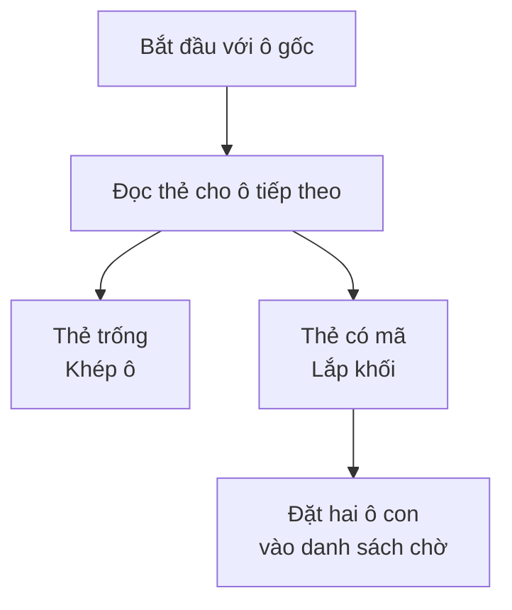
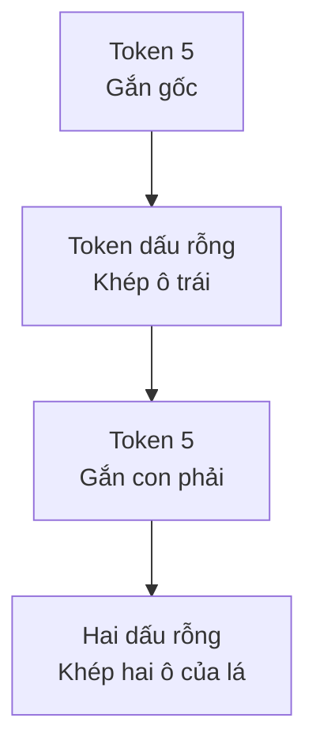

> [!tldr] Đọc nhanh
> - Một bộ [[concepts/tree-serialization|mã hóa cây]] phải giữ cả giá trị lẫn vị trí con trái, con phải. Chỉ ghi các số theo thứ tự duyệt có thể cho cùng kết quả trên hai cây khác nhau.
> - Ghi `#` ở mỗi chỗ rỗng, kể cả gốc rỗng. Mỗi token điền đúng một chỗ chờ. Số nguyên sinh thêm hai chỗ con, còn `#` khép chỗ hiện tại.
> - Tiền thứ tự dùng stack, duyệt theo tầng dùng hàng đợi. Cả hai làm việc tuyến tính theo độ dài chuỗi. Hình dạng cây quyết định danh sách chờ nào lớn hơn.
> - Hai cách lặp đều qua chuỗi lệch 10 000 nút. Bộ đọc từ chối token sai, chuỗi thiếu và chuỗi thừa.

> [!info] Bối cảnh
> Bài LeetCode 297 (Hard) thuộc [[posts/2026-11-26-neetcode-tree-reconstruction|ga 6: Dựng và mã hóa cây]] trên **tuyến NeetCode: Cấu trúc liên kết**. Ở [[problems/construct-binary-tree-from-preorder-and-inorder-traversal|LC-0105]], hai thứ tự duyệt và giả thiết giá trị phân biệt giúp mình tìm ranh giới cây con. Bài này cho tự thiết kế dữ liệu truyền đi, nên mình có thể ghi trực tiếp thông tin về hình dạng, kể cả khi các nút trùng giá trị. Bạn chỉ cần biết cây nhị phân và thao tác thêm, lấy phần tử khỏi một danh sách.

> [!abstract]- Từ điển nhanh cho bài này (bấm để mở)
> - **Codec** là cặp hàm ghi dữ liệu và đọc lại theo cùng quy ước.
> - **Token** là một mục trong chuỗi đã tách theo dấu phẩy. Ở đây mỗi mục là một số nguyên hoặc dấu `#`.
> - **Dấu rỗng** ([[concepts/null-marker|null marker]]) ghi rõ một vị trí con không có nút.
> - **Chỗ chờ** là vị trí cần có token tiếp theo, ban đầu là gốc, sau đó là vị trí con trái hoặc con phải của một nút đã đọc.
> - **Tiền thứ tự** ([[concepts/pre-order-traversal|pre-order traversal]]) đi theo thứ tự nút, cây con trái, cây con phải. **Duyệt theo tầng** ([[concepts/breadth-first-search|BFS]]) đọc hết tầng hiện tại từ trái sang phải rồi sang tầng sau.

## Hình dung trước: gửi bảng chỉ dẫn lắp kệ hai ô

Mình đóng gói một bộ kệ mà mỗi khối có hai ô, trái và phải. Người nhận có danh sách các ô còn chờ lắp. Khi đọc thẻ ghi mã một khối, họ lắp khối vào ô tiếp theo rồi ghi hai ô mới của nó vào danh sách. Khi đọc thẻ trống, họ để ô đó rỗng và gạch ô khỏi danh sách. Hai bên có thể làm hết một nhánh hoặc lắp lần lượt từng tầng, miễn là làm theo cùng thứ tự.

| Đời thường | Khái niệm |
|---|---|
| Thẻ mã khối | token số nguyên |
| Thẻ trống | dấu rỗng `#` |
| Ô còn chờ lắp | chỗ chờ |
| Lắp hết ô trái và các ô bên dưới | tiền thứ tự với stack |
| Lắp hết các ô cùng tầng | duyệt theo tầng với hàng đợi |
| Còn thẻ sau khi hết ô | chuỗi thừa token |



## Vấn đề: danh sách giá trị làm mất hình dạng

Cho cây nhị phân từ 0 đến 10 000 nút, mỗi giá trị nguyên nằm trong [−1000, 1000]. Viết hàm đổi cây thành chuỗi và hàm đọc chuỗi đó để tạo lại cây với cùng giá trị và đúng vị trí con trái, phải. Hai hàm được tự chọn định dạng. [Đề LeetCode 297](https://leetcode.com/problems/serialize-and-deserialize-binary-tree/)

Mình từng nghĩ ghi tiền thứ tự là đủ. Thử cây gốc 5 có **con trái** 5 và cây gốc 5 có **con phải** 5. Duyệt bỏ qua chỗ rỗng đều ghi `5,5`. Nếu mỗi chỗ rỗng có dấu riêng, hai chuỗi tiền thứ tự tương ứng là `5,5,#,#,#` và `5,#,5,#,#`. Bộ đọc phân biệt hai cây ngay ở token thứ hai.

## Cơ chế

### Một quy tắc điền ô cho hai thứ tự

Bắt đầu với một chỗ chờ dành cho gốc. Lấy một chỗ theo thứ tự đã chọn, đọc đúng một token, rồi xử lý theo bảng sau.

| Token | Điền gì | Thay đổi số chỗ chờ |
|---|---|---|
| Số nguyên | Tạo nút rồi thêm ô trái và ô phải | +1 |
| `#` | Giữ chỗ rỗng | −1 |

Bộ đọc luôn có cùng vị trí chờ kế tiếp với bộ ghi. Điều này đúng ở gốc. Sau mỗi token, hai bên đều lấy một chỗ ra và cùng thêm hai chỗ con nếu token là số, nên bước sau tiếp tục khớp. Với cây có `n` nút, bộ ghi tạo đúng `2n + 1` token, gồm một chỗ gốc và hai chỗ con cho mỗi nút thật. Vậy có `n + 1` dấu `#`. Điều kiện độ dài chỉ là kiểm tra nhanh. Bộ đọc vẫn cần từ chối token đến khi danh sách đã rỗng và phát hiện chỗ chờ còn lại khi chuỗi kết thúc.

### Cách 1 — Tiền thứ tự bằng stack

Stack lấy phần tử vừa thêm. Đẩy ô **phải trước**, ô **trái sau** để lấy ô trái ra trước. Các ô thuộc cây con trái được đẩy sau ô phải nên cả nhánh trái được xử lý trước khi quay về nhánh phải. Trong phiên bản đệ quy, thứ tự này đến từ hai lời gọi con trái rồi con phải. Bản lặp cất chỗ chờ trong vùng nhớ do chương trình quản lý và tránh đệ quy sâu trên cây lệch.

Trên cây có gốc 5, chỉ có con phải 5, bộ đọc tiền thứ tự đi qua các bước sau.



### Cách 2 — Duyệt theo tầng bằng hàng đợi

Hàng đợi lấy phần tử đã chờ lâu nhất. Thêm ô **trái trước**, ô **phải sau**. Khi xử lý một ô, mọi ô cùng tầng còn lại đứng phía trước hai ô con vừa thêm. Vì vậy, mỗi tầng được xử lý hết trước tầng kế.

Ví dụ, gốc 8 có hai con là −4 và 8. Nút −4 chỉ có con phải 0, còn nút 8 bên phải có hai con −1000 và 1000. Hai cách ghi đều giữ toàn bộ chỗ trống, nhưng thứ tự token khác nhau.

| Cách ghi | Chuỗi thu được |
|---|---|
| Tiền thứ tự | `8,-4,#,0,#,#,8,-1000,#,#,1000,#,#` |
| Theo tầng | `8,-4,8,#,0,-1000,1000,#,#,#,#,#,#` |

### Chi phí và số chỗ chờ đo được

Gọi `L` là độ dài chuỗi, `h` là số tầng, `w` là số nút thật ở tầng rộng nhất. Cả ghi và đọc đều mất O(L) thời gian, tức O(n + 1) với giá trị giới hạn trong đề. Stack tiền thứ tự có O(h + 1) chỗ chờ vì mỗi tầng chỉ có thể để lại một nhánh anh em chưa đi và chỗ kế tiếp. Hàng đợi có O(w + 1) chỗ vì chỉ giữ vị trí ở tầng đang đọc và tầng kế. Các ví dụ dùng `split` để đọc và giữ toàn bộ chuỗi khi ghi, nên tổng bộ nhớ cũng tính O(L) cho phần chuỗi và token. Cây mới dựng có thêm O(n) nút.

Mình đo độ dài lớn nhất của danh sách chờ trong bộ ghi Python bằng cách ghi nhận `len(pending)` lúc tạo hàng đợi và sau mỗi lần thêm hai con. Đây là số vị trí đang chờ, không tính byte, bộ đệm token hay cây đầu vào.

| Hình cây | Số token | Stack tiền thứ tự | Hàng đợi theo tầng |
|---|---:|---:|---:|
| Cây hoàn hảo 12 tầng, 4 095 nút | 8 191 | 13 | 4 096 |
| Chuỗi lệch trái 10 000 nút | 20 001 | 10 001 | 3 |
| Chuỗi lệch phải 10 000 nút | 20 001 | 2 | 2 |

Ở chuỗi lệch trái, mỗi bước đi sâu để lại một ô phải chờ. Ở chuỗi lệch phải, ô trái rỗng được lấy ra ngay trước khi đi tiếp. Hai cây cao bằng nhau nhưng số ô chờ của stack rất khác.

## Ví dụ chạy được

Mỗi file chạy cả hai thứ tự trên 12 ca. Năm ca nhỏ đối chiếu chuỗi chính xác và cấu trúc dựng lại, hai ca kiểm từng nút của chuỗi lệch trái/phải 10 000 nút, và năm ca sai kiểm tra bộ đọc có từ chối dữ liệu hay không. Chạy từ thư mục `content/code/neetcode-serialize-and-deserialize-binary-tree/`.

[Tải TypeScript](../code/neetcode-serialize-and-deserialize-binary-tree/binary-tree-codec.ts) · [Python](../code/neetcode-serialize-and-deserialize-binary-tree/binary-tree-codec.py) · [Go](../code/neetcode-serialize-and-deserialize-binary-tree/binary-tree-codec.go) · [Java](../code/neetcode-serialize-and-deserialize-binary-tree/binary-tree-codec.java) · [JavaScript](../code/neetcode-serialize-and-deserialize-binary-tree/binary-tree-codec.js)

```ts
import assert from "node:assert/strict"

class TreeNode {
  value: number
  left: TreeNode | null
  right: TreeNode | null

  constructor(value: number, left: TreeNode | null = null, right: TreeNode | null = null) {
    this.value = value
    this.left = left
    this.right = right
  }
}

class Pending<T> {
  private head = 0
  private items: T[]
  private byLevel: boolean

  constructor(items: T[], byLevel: boolean) {
    this.items = items
    this.byLevel = byLevel
  }

  get size() {
    return this.items.length - this.head
  }

  take(): T {
    if (!this.byLevel) return this.items.pop()!
    const item = this.items[this.head++]!
    if (2 * this.head >= this.items.length) {
      this.items = this.items.slice(this.head)
      this.head = 0
    }
    return item
  }

  addChildren(left: T, right: T) {
    if (this.byLevel) this.items.push(left, right)
    else this.items.push(right, left)
  }
}

function serialize(root: TreeNode | null, byLevel = false): string {
  const pending = new Pending([root], byLevel)
  const tokens: string[] = []
  while (pending.size > 0) {
    const node = pending.take()
    tokens.push(node === null ? "#" : String(node.value))
    if (node !== null) pending.addChildren(node.left, node.right)
  }
  return tokens.join(",")
}

type Slot = { parent: TreeNode; side: "left" | "right" }

function deserialize(wire: string, byLevel = false): TreeNode | null {
  const holder = new TreeNode(0)
  const pending = new Pending<Slot>([{ parent: holder, side: "left" }], byLevel)
  for (const token of wire.split(",")) {
    if (pending.size === 0) throw new Error("extra token")
    const { parent, side } = pending.take()
    if (token === "#") continue
    const value = Number(token)
    if (!Number.isInteger(value) || Math.abs(value) > 1000 || String(value) !== token) {
      throw new Error("invalid token")
    }
    const node = new TreeNode(value)
    parent[side] = node
    pending.addChildren({ parent: node, side: "left" }, { parent: node, side: "right" })
  }
  if (pending.size !== 0) throw new Error("missing token")
  return holder.left
}

const leaf = new TreeNode(5)
const examples = [
  [null, "#", "#"],
  [new TreeNode(0), "0,#,#", "0,#,#"],
  [new TreeNode(5, leaf), "5,5,#,#,#", "5,5,#,#,#"],
  [new TreeNode(5, null, leaf), "5,#,5,#,#", "5,#,5,#,#"],
  [
    new TreeNode(8, new TreeNode(-4, null, new TreeNode(0)), new TreeNode(8, new TreeNode(-1000), new TreeNode(1000))),
    "8,-4,#,0,#,#,8,-1000,#,#,1000,#,#",
    "8,-4,8,#,0,-1000,1000,#,#,#,#,#,#",
  ],
] as const
const invalid = ["", "1,#", "#,", "1x,#,#", "1001,#,#"]

for (const byLevel of [false, true]) {
  for (const [tree, preorder, level] of examples) {
    const wire = byLevel ? level : preorder
    assert.equal(serialize(tree, byLevel), wire)
    assert.deepEqual(deserialize(wire, byLevel), tree)
  }
  for (const side of ["left", "right"] as const) {
    const other = side === "left" ? "right" : "left"
    let chain: TreeNode | null = null
    for (let i = 9999; i >= 0; i--) {
      const node = new TreeNode(i % 11 - 5)
      node[side] = chain
      chain = node
    }
    const wire = serialize(chain, byLevel)
    assert.equal(wire.split(",").length, 20_001)
    let restored = deserialize(wire, byLevel)
    for (let i = 0; i < 10_000; i++) {
      assert(restored !== null)
      assert.equal(restored.value, i % 11 - 5)
      assert.equal(restored[other], null)
      restored = restored[side]
    }
    assert.equal(restored, null)
  }
  for (const wire of invalid) assert.throws(() => deserialize(wire, byLevel))
}
console.log(`${examples.length + 2 + invalid.length}/12 ca đúng`)
```
```python
from collections import deque
from dataclasses import dataclass


@dataclass
class TreeNode:
    value: int
    left: "TreeNode | None" = None
    right: "TreeNode | None" = None


def add_children(pending, left, right, by_level):
    pending.extend((left, right) if by_level else (right, left))


def serialize(root, by_level=False):
    pending = deque([root])
    take = pending.popleft if by_level else pending.pop
    tokens = []
    while pending:
        node = take()
        if node is None:
            tokens.append("#")
        else:
            tokens.append(str(node.value))
            add_children(pending, node.left, node.right, by_level)
    return ",".join(tokens)


def deserialize(wire, by_level=False):
    holder = TreeNode(0)
    pending = deque([(holder, "left")])
    take = pending.popleft if by_level else pending.pop
    for token in wire.split(","):
        if not pending:
            raise ValueError("extra token")
        parent, side = take()
        if token == "#":
            continue
        value = int(token)
        if abs(value) > 1000 or str(value) != token:
            raise ValueError("invalid token")
        node = TreeNode(value)
        setattr(parent, side, node)
        add_children(pending, (node, "left"), (node, "right"), by_level)
    if pending:
        raise ValueError("missing token")
    return holder.left


leaf = TreeNode(5)
examples = [
    (None, "#", "#"),
    (TreeNode(0), "0,#,#", "0,#,#"),
    (TreeNode(5, leaf), "5,5,#,#,#", "5,5,#,#,#"),
    (TreeNode(5, None, leaf), "5,#,5,#,#", "5,#,5,#,#"),
    (
        TreeNode(8, TreeNode(-4, None, TreeNode(0)), TreeNode(8, TreeNode(-1000), TreeNode(1000))),
        "8,-4,#,0,#,#,8,-1000,#,#,1000,#,#",
        "8,-4,8,#,0,-1000,1000,#,#,#,#,#,#",
    ),
]
invalid = ["", "1,#", "#,", "1x,#,#", "1001,#,#"]

for by_level in (False, True):
    for tree, preorder, level in examples:
        wire = level if by_level else preorder
        assert serialize(tree, by_level) == wire
        assert deserialize(wire, by_level) == tree
    for side, other in (("left", "right"), ("right", "left")):
        chain = None
        for i in reversed(range(10_000)):
            node = TreeNode(i % 11 - 5)
            setattr(node, side, chain)
            chain = node
        wire = serialize(chain, by_level)
        assert len(wire.split(",")) == 20_001
        restored = deserialize(wire, by_level)
        for i in range(10_000):
            assert restored.value == i % 11 - 5
            assert getattr(restored, other) is None
            restored = getattr(restored, side)
        assert restored is None
    for wire in invalid:
        try:
            deserialize(wire, by_level)
        except ValueError:
            continue
        raise AssertionError("accepted invalid wire")
print(f"{len(examples) + 2 + len(invalid)}/12 ca đúng")
```
```go
package main

import (
	"container/list"
	"fmt"
	"strconv"
	"strings"
)

type node struct {
	value       int
	left, right *node
}

type pending[T any] struct {
	items   list.List
	byLevel bool
}

func (p *pending[T]) take() T {
	next := p.items.Back()
	if p.byLevel {
		next = p.items.Front()
	}
	return p.items.Remove(next).(T)
}

func (p *pending[T]) addChildren(left, right T) {
	if p.byLevel {
		p.items.PushBack(left)
		p.items.PushBack(right)
	} else {
		p.items.PushBack(right)
		p.items.PushBack(left)
	}
}

func serialize(root *node, byLevel bool) string {
	work := pending[*node]{byLevel: byLevel}
	work.items.PushBack(root)
	tokens := []string{}
	for work.items.Len() > 0 {
		current := work.take()
		if current == nil {
			tokens = append(tokens, "#")
		} else {
			tokens = append(tokens, strconv.Itoa(current.value))
			work.addChildren(current.left, current.right)
		}
	}
	return strings.Join(tokens, ",")
}

func deserialize(wire string, byLevel bool) (*node, error) {
	var root *node
	work := pending[**node]{byLevel: byLevel}
	work.items.PushBack(&root)
	for _, token := range strings.Split(wire, ",") {
		if work.items.Len() == 0 {
			return nil, fmt.Errorf("extra token")
		}
		slot := work.take()
		if token == "#" {
			continue
		}
		value, err := strconv.Atoi(token)
		if err != nil || value < -1000 || value > 1000 || strconv.Itoa(value) != token {
			return nil, fmt.Errorf("invalid token")
		}
		current := &node{value: value}
		*slot = current
		work.addChildren(&current.left, &current.right)
	}
	if work.items.Len() != 0 {
		return nil, fmt.Errorf("missing token")
	}
	return root, nil
}

func equalSmall(a, b *node) bool {
	if a == nil || b == nil {
		return a == b
	}
	return a.value == b.value && equalSmall(a.left, b.left) && equalSmall(a.right, b.right)
}

func check(ok bool) {
	if !ok {
		panic("test failed")
	}
}

func main() {
	leaf := &node{value: 5}
	examples := []struct {
		tree            *node
		preorder, level string
	}{
		{nil, "#", "#"},
		{&node{value: 0}, "0,#,#", "0,#,#"},
		{&node{value: 5, left: leaf}, "5,5,#,#,#", "5,5,#,#,#"},
		{&node{value: 5, right: leaf}, "5,#,5,#,#", "5,#,5,#,#"},
		{
			&node{8, &node{value: -4, right: &node{value: 0}}, &node{8, &node{value: -1000}, &node{value: 1000}}},
			"8,-4,#,0,#,#,8,-1000,#,#,1000,#,#",
			"8,-4,8,#,0,-1000,1000,#,#,#,#,#,#",
		},
	}
	invalid := []string{"", "1,#", "#,", "1x,#,#", "1001,#,#"}

	for _, byLevel := range []bool{false, true} {
		for _, ex := range examples {
			wire := ex.preorder
			if byLevel {
				wire = ex.level
			}
			check(serialize(ex.tree, byLevel) == wire)
			restored, err := deserialize(wire, byLevel)
			check(err == nil && equalSmall(restored, ex.tree))
		}
		for _, left := range []bool{false, true} {
			var chain *node
			for i := 9999; i >= 0; i-- {
				if left {
					chain = &node{value: i%11 - 5, left: chain}
				} else {
					chain = &node{value: i%11 - 5, right: chain}
				}
			}
			wire := serialize(chain, byLevel)
			check(strings.Count(wire, ",") == 20_000)
			restored, err := deserialize(wire, byLevel)
			check(err == nil)
			for i := 0; i < 10_000; i++ {
				check(restored != nil && restored.value == i%11-5)
				if left {
					check(restored.right == nil)
					restored = restored.left
				} else {
					check(restored.left == nil)
					restored = restored.right
				}
			}
			check(restored == nil)
		}
		for _, wire := range invalid {
			_, err := deserialize(wire, byLevel)
			check(err != nil)
		}
	}
	fmt.Printf("%d/12 ca đúng\n", len(examples)+2+len(invalid))
}
```
```java
import java.util.LinkedList;

class BinaryTreeCodec {
    static class Node {
        final int value;
        Node left;
        Node right;

        Node(int value) {
            this(value, null, null);
        }

        Node(int value, Node left, Node right) {
            this.value = value;
            this.left = left;
            this.right = right;
        }
    }

    static class Pending<T> {
        final LinkedList<T> items = new LinkedList<>();
        final boolean byLevel;

        Pending(T root, boolean byLevel) {
            items.add(root);
            this.byLevel = byLevel;
        }

        T take() {
            return byLevel ? items.removeFirst() : items.removeLast();
        }

        void addChildren(T left, T right) {
            items.add(byLevel ? left : right);
            items.add(byLevel ? right : left);
        }
    }

    static String serialize(Node root, boolean byLevel) {
        var pending = new Pending<>(root, byLevel);
        var tokens = new StringBuilder();
        while (!pending.items.isEmpty()) {
            var node = pending.take();
            if (!tokens.isEmpty()) tokens.append(',');
            if (node == null) {
                tokens.append('#');
            } else {
                tokens.append(node.value);
                pending.addChildren(node.left, node.right);
            }
        }
        return tokens.toString();
    }

    record Slot(Node parent, boolean left) {}

    static Node deserialize(String wire, boolean byLevel) {
        var holder = new Node(0);
        var pending = new Pending<>(new Slot(holder, true), byLevel);
        for (String token : wire.split(",", -1)) {
            if (pending.items.isEmpty()) throw new IllegalArgumentException("extra token");
            var slot = pending.take();
            if (token.equals("#")) continue;
            int value = Integer.parseInt(token);
            if (value < -1000 || value > 1000 || !Integer.toString(value).equals(token)) {
                throw new IllegalArgumentException("invalid token");
            }
            var node = new Node(value);
            if (slot.left()) slot.parent().left = node;
            else slot.parent().right = node;
            pending.addChildren(new Slot(node, true), new Slot(node, false));
        }
        if (!pending.items.isEmpty()) throw new IllegalArgumentException("missing token");
        return holder.left;
    }

    record Example(Node tree, String preorder, String level) {}

    static boolean equalSmall(Node a, Node b) {
        if (a == null || b == null) return a == b;
        return a.value == b.value && equalSmall(a.left, b.left) && equalSmall(a.right, b.right);
    }

    static void check(boolean ok) {
        if (!ok) throw new AssertionError("test failed");
    }

    public static void main(String[] args) {
        var leaf = new Node(5);
        var examples = new Example[] {
            new Example(null, "#", "#"),
            new Example(new Node(0), "0,#,#", "0,#,#"),
            new Example(new Node(5, leaf, null), "5,5,#,#,#", "5,5,#,#,#"),
            new Example(new Node(5, null, leaf), "5,#,5,#,#", "5,#,5,#,#"),
            new Example(
                new Node(8, new Node(-4, null, new Node(0)), new Node(8, new Node(-1000), new Node(1000))),
                "8,-4,#,0,#,#,8,-1000,#,#,1000,#,#",
                "8,-4,8,#,0,-1000,1000,#,#,#,#,#,#"
            )
        };
        var invalid = new String[] {"", "1,#", "#,", "1x,#,#", "1001,#,#"};

        for (boolean byLevel : new boolean[] {false, true}) {
            for (var ex : examples) {
                String wire = byLevel ? ex.level() : ex.preorder();
                check(serialize(ex.tree(), byLevel).equals(wire));
                check(equalSmall(deserialize(wire, byLevel), ex.tree()));
            }
            for (boolean left : new boolean[] {false, true}) {
                Node chain = null;
                for (int i = 9999; i >= 0; i--) {
                    int value = i % 11 - 5;
                    chain = left ? new Node(value, chain, null) : new Node(value, null, chain);
                }
                String wire = serialize(chain, byLevel);
                check(wire.split(",", -1).length == 20_001);
                Node restored = deserialize(wire, byLevel);
                for (int i = 0; i < 10_000; i++) {
                    check(restored != null && restored.value == i % 11 - 5);
                    check((left ? restored.right : restored.left) == null);
                    restored = left ? restored.left : restored.right;
                }
                check(restored == null);
            }
            for (String wire : invalid) {
                try {
                    deserialize(wire, byLevel);
                } catch (IllegalArgumentException ex) {
                    continue;
                }
                throw new AssertionError("accepted invalid wire");
            }
        }
        System.out.printf("%d/12 ca đúng%n", examples.length + 2 + invalid.length);
    }
}
```
```js
import assert from "node:assert/strict"

class TreeNode {
  constructor(value, left = null, right = null) {
    this.value = value
    this.left = left
    this.right = right
  }
}

class Pending {
  head = 0

  constructor(items, byLevel) {
    this.items = items
    this.byLevel = byLevel
  }

  get size() {
    return this.items.length - this.head
  }

  take() {
    if (!this.byLevel) return this.items.pop()
    const item = this.items[this.head++]
    if (2 * this.head >= this.items.length) {
      this.items = this.items.slice(this.head)
      this.head = 0
    }
    return item
  }

  addChildren(left, right) {
    if (this.byLevel) this.items.push(left, right)
    else this.items.push(right, left)
  }
}

function serialize(root, byLevel = false) {
  const pending = new Pending([root], byLevel)
  const tokens = []
  while (pending.size > 0) {
    const node = pending.take()
    tokens.push(node === null ? "#" : String(node.value))
    if (node !== null) pending.addChildren(node.left, node.right)
  }
  return tokens.join(",")
}

function deserialize(wire, byLevel = false) {
  const holder = new TreeNode(0)
  const pending = new Pending([{ parent: holder, side: "left" }], byLevel)
  for (const token of wire.split(",")) {
    if (pending.size === 0) throw new Error("extra token")
    const { parent, side } = pending.take()
    if (token === "#") continue
    const value = Number(token)
    if (!Number.isInteger(value) || Math.abs(value) > 1000 || String(value) !== token) {
      throw new Error("invalid token")
    }
    const node = new TreeNode(value)
    parent[side] = node
    pending.addChildren({ parent: node, side: "left" }, { parent: node, side: "right" })
  }
  if (pending.size !== 0) throw new Error("missing token")
  return holder.left
}

const leaf = new TreeNode(5)
const examples = [
  [null, "#", "#"],
  [new TreeNode(0), "0,#,#", "0,#,#"],
  [new TreeNode(5, leaf), "5,5,#,#,#", "5,5,#,#,#"],
  [new TreeNode(5, null, leaf), "5,#,5,#,#", "5,#,5,#,#"],
  [
    new TreeNode(8, new TreeNode(-4, null, new TreeNode(0)), new TreeNode(8, new TreeNode(-1000), new TreeNode(1000))),
    "8,-4,#,0,#,#,8,-1000,#,#,1000,#,#",
    "8,-4,8,#,0,-1000,1000,#,#,#,#,#,#",
  ],
]
const invalid = ["", "1,#", "#,", "1x,#,#", "1001,#,#"]

for (const byLevel of [false, true]) {
  for (const [tree, preorder, level] of examples) {
    const wire = byLevel ? level : preorder
    assert.equal(serialize(tree, byLevel), wire)
    assert.deepEqual(deserialize(wire, byLevel), tree)
  }
  for (const side of ["left", "right"]) {
    const other = side === "left" ? "right" : "left"
    let chain = null
    for (let i = 9999; i >= 0; i--) {
      const node = new TreeNode(i % 11 - 5)
      node[side] = chain
      chain = node
    }
    const wire = serialize(chain, byLevel)
    assert.equal(wire.split(",").length, 20_001)
    let restored = deserialize(wire, byLevel)
    for (let i = 0; i < 10_000; i++) {
      assert(restored !== null)
      assert.equal(restored.value, i % 11 - 5)
      assert.equal(restored[other], null)
      restored = restored[side]
    }
    assert.equal(restored, null)
  }
  for (const wire of invalid) assert.throws(() => deserialize(wire, byLevel))
}
console.log(`${examples.length + 2 + invalid.length}/12 ca đúng`)
```

```text
$ node binary-tree-codec.ts
12/12 ca đúng
$ python3 binary-tree-codec.py
12/12 ca đúng
$ go run binary-tree-codec.go
12/12 ca đúng
$ java binary-tree-codec.java
12/12 ca đúng
$ node binary-tree-codec.js
12/12 ca đúng
```

## Hiểu lầm và bẫy hay gặp

- **Dùng lẫn thứ tự ghi và đọc.** `1,2,#,#,3,#,#` hợp lệ với cả hai bộ đọc. Tiền thứ tự đặt 3 ở con phải của 1. Duyệt theo tầng đặt 3 ở con phải của 2. Nếu lưu cả hai kiểu trong cùng hệ thống, lưu thêm phiên bản hoặc tên định dạng để chọn đúng bộ đọc.
- **Dùng giá trị hợp lệ làm dấu rỗng.** `0` và số âm đều có thể xuất hiện. Giữ `#` ngoài tập giá trị hợp lệ và dùng dấu phẩy để tách số nhiều chữ số.
- **Lấy phần tử đầu bằng cách dồn cả mảng.** Python dùng `deque.popleft()`. Với TypeScript và JavaScript, con trỏ đầu tăng dần. Khi đã tiêu thụ ít nhất nửa mảng, code chép phần còn lại. Số vị trí vừa tiêu thụ đủ để bù chi phí bản chép, nên mỗi lần lấy có chi phí O(1) trung bình theo chuỗi thao tác.
- **Đưa giá trị rỗng vào sai cấu trúc Java.** `ArrayDeque` cấm `null`. File dùng `LinkedList` để đưa cả vị trí rỗng vào danh sách chờ. Khi tách chuỗi, `split(",", -1)` giữ token rỗng ở cuối, giúp phát hiện dấu phẩy thừa.
- **Giả sử đệ quy chạy được ở mọi độ sâu.** Cây có thể là một chuỗi 10 000 nút. Python có [[concepts/recursion-depth-limit|giới hạn đệ quy]]. Bản lặp kiểm tra cả hai hướng lệch và vẫn dùng danh sách chờ tương ứng với hình dạng cây.

## Câu hỏi tự kiểm tra

> [!question]- Vì sao `5,5,#,#,#` và `5,#,5,#,#` đủ phân biệt hai cây có cùng thứ tự giá trị?
> Bộ đọc tiền thứ tự xử lý ô trái ngay sau gốc. Ở chuỗi thứ nhất, ô đó nhận số 5. Ở chuỗi thứ hai, ô đó nhận dấu rỗng.

> [!question]- Chuỗi `6,#` kết thúc trong trạng thái nào?
> Token 6 mở hai ô con. Dấu rỗng đóng ô trái, còn ô phải vẫn chờ một token. Bộ đọc báo thiếu.

> [!question]- Nếu chỉ so chuỗi ghi lại để thử bộ đọc, mình còn có thể bỏ sót lỗi gì?
> Nếu cả hai hàm cùng hoán đổi trái và phải, một phép thử ghi rồi đọc có thể triệt tiêu sai sót. Hãy đối chiếu chuỗi mong đợi với một cây bất đối xứng và kiểm tra trực tiếp cấu trúc giải mã.

> [!question]- Khi nào hàng đợi nhỏ hơn stack dù hai bộ ghi có cùng số token?
> Trên chuỗi lệch trái, hàng đợi chỉ giữ một tầng và tối đa vài vị trí tạm thời. Stack giữ lại ô phải đang chờ của các tổ tiên đã đi qua.

## Tham khảo

- [LeetCode 297 — Serialize and Deserialize Binary Tree](https://leetcode.com/problems/serialize-and-deserialize-binary-tree/) — hợp đồng đầu vào và đầu ra.
- [OpenDSA — Sequential Tree Representations](https://opendsa-server.cs.vt.edu/ODSA/Books/cnu/cpsc270/spring-2025/TR_930Siochi11Conner/html/SequentialRep.html) — cách biểu diễn cây bằng tiền thứ tự với dấu rỗng.
- [Python — Giới hạn đệ quy](https://docs.python.org/3/library/sys.html#sys.getrecursionlimit) và [deque](https://docs.python.org/3/library/collections.html#collections.deque) — giới hạn của stack lời gọi và thao tác ở hai đầu hàng đợi.
- [Java — LinkedList](https://docs.oracle.com/en/java/javase/21/docs/api/java.base/java/util/LinkedList.html) và [ArrayDeque](https://docs.oracle.com/en/java/javase/21/docs/api/java.base/java/util/ArrayDeque.html) — quy tắc nhận phần tử `null`.
