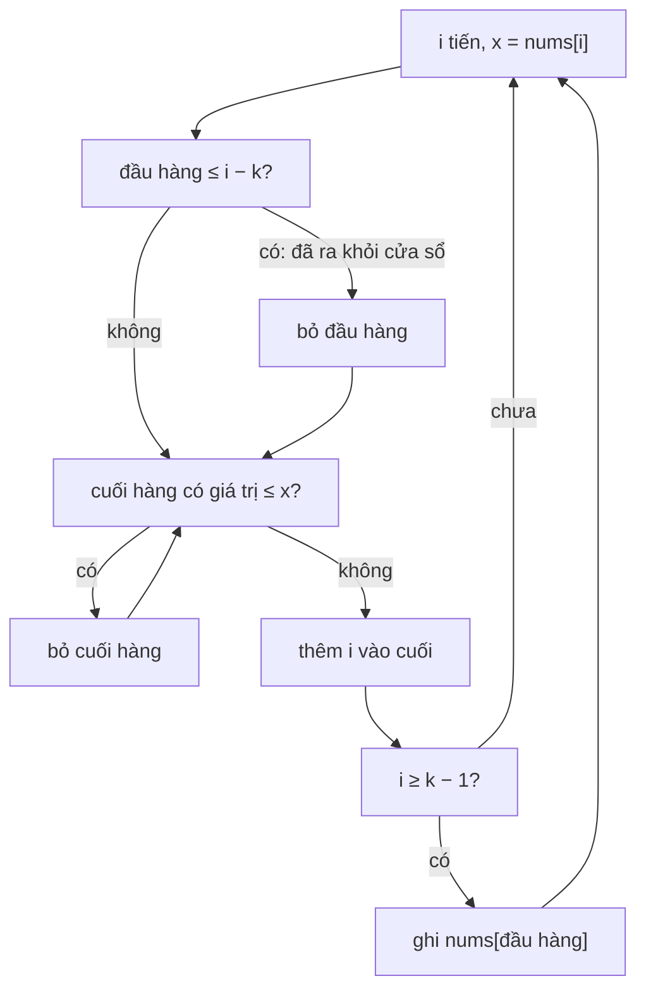

> [!tldr] Đọc nhanh
> - Đề: mảng `nums` và số k; trả max của **mọi** cửa sổ dài k (`[1, 3, −1, −3, 5, 3, 6, 7]`, k = 3 → `[3, 3, 5, 5, 6, 7]`).
> - Giữ một "max chạy" là sai: khi max trượt ra khỏi cửa sổ, không có cách nào biết max **kế tiếp** (5/7 ca).
> - [[concepts/monotonic-deque|Hàng đợi đơn điệu]] giữ các **chỉ số còn có thể thành max**, giá trị giảm dần. Phần tử mới đuổi mọi phần tử không lớn hơn nó ở cuối hàng; đầu hàng là max.
> - Vòng `while` lồng trong `for` nhưng mỗi chỉ số vào hàng một lần và ra tối đa một lần: tổng O(n) ([[concepts/aggregate-analysis|phân tích gộp]]).
> - JS không có deque: bỏ đầu hàng bằng `shift()` dời cả mảng. Với k = 10⁵ trên dãy giảm dần, bản `shift()` mất 1 223 ms, bản dùng chỉ số `head` mất 1,4 ms.

> [!info] Bối cảnh
> Bài LeetCode 239, thuộc [[posts/2026-11-23-neetcode-sliding-window|ga 5: Cửa sổ trượt]] trên **tuyến NeetCode: Mảng và chuỗi**. Các bài khác của ga nhớ một con số hoặc một bảng đếm; bài này cần một cấu trúc mới, hàng đợi đơn điệu, sẽ quay lại ở ga ngăn xếp đơn điệu. Lời giải có đủ TypeScript, Python, Go, Java và JavaScript. Nên đọc trước [[problems/trapping-rain-water|Trapping Rain Water]] (max tiền tố, hậu tố).

> [!abstract]- Từ điển nhanh cho bài này (bấm để mở)
> - **Cửa sổ cố định**: luôn dài đúng k, mỗi bước trượt sang phải một ô. Xem [[concepts/fixed-size-window|Fixed-size Window]].
> - **Deque (hàng đợi hai đầu)**: thêm và bớt được ở **cả hai đầu** trong O(1).
> - **Đơn điệu**: luôn tăng hoặc luôn giảm. Ở đây giá trị tại các chỉ số trong hàng giảm dần từ đầu tới cuối.
> - **Max tiền tố, hậu tố**: max của đoạn từ đầu (hoặc tới cuối) một khối. Xem [[concepts/prefix-maximum|Prefix Maximum]].
> - **Phân tích gộp**: đếm tổng số thao tác trên cả thuật toán. Xem [[concepts/aggregate-analysis|Aggregate Analysis]].

## Hình dung trước: hàng người chờ làm "người cao nhất"

Một hàng người bước qua một khung cửa rộng k người. Ở mỗi thời điểm, bạn cần biết ai cao nhất **trong khung**. Bạn giữ một danh sách ứng viên. Khi một người mới cao hơn bước vào, mọi ứng viên thấp hơn đứng **trước** anh ta không bao giờ còn là người cao nhất: họ sẽ rời khung sớm hơn anh ta mà lại thấp hơn. Họ bị gạch khỏi danh sách.

| Đời thường | Khái niệm |
|---|---|
| Khung cửa rộng k người | cửa sổ cố định dài k |
| Danh sách ứng viên, người cao đứng đầu | hàng đợi chỉ số, giá trị giảm dần |
| Người mới cao hơn: gạch mọi ứng viên thấp hơn ở cuối danh sách | `pop` ở cuối khi `nums[cuối] ≤ nums[i]` |
| Ứng viên đầu danh sách đã ra khỏi khung: gạch | bỏ đầu hàng khi chỉ số ≤ i − k |
| Người đứng đầu danh sách | max của cửa sổ |
| Mỗi người vào danh sách một lần, bị gạch tối đa một lần | tổng O(n) |



## Vấn đề

**Đề (tóm tắt bằng lời của mình):** cho mảng số nguyên `nums` (1 ≤ n ≤ 10⁵, giá trị ±10⁴) và k (1 ≤ k ≤ n). Một cửa sổ dài k trượt từ trái sang phải từng ô một; trả về mảng gồm max của từng vị trí cửa sổ, tức n − k + 1 số. Đề gốc: [LeetCode 239](https://leetcode.com/problems/sliding-window-maximum/).

| nums | k | Output |
|---|---|---|
| `[1, 3, −1, −3, 5, 3, 6, 7]` | 3 | `[3, 3, 5, 5, 6, 7]` |
| `[9, 8, 7, 6, 5]` | 2 | `[9, 8, 7, 6]` |
| `[1]` | 1 | `[1]` |

Mình từng nghĩ chỉ cần giữ một biến max như [[problems/best-time-to-buy-and-sell-stock|Best Time to Buy and Sell Stock]] giữ giá thấp nhất. Sai ở chỗ: bài đó chỉ thêm phần tử, không bao giờ bớt. Ở đây phần tử rời cửa sổ, và khi phần tử rời là max, một biến duy nhất không biết max kế tiếp là ai.

## Cơ chế

### Cách 1, vét cạn: O(n·k)

Mỗi cửa sổ tìm max lại từ đầu. Với k nhỏ thì đủ nhanh; với k cỡ n/2 thì O(n²).

### Bản sai, một max chạy

`m = max(m, nums[i])` rồi ghi m. Với `[9, 8, 7, 6, 5]`, k = 2, nó ra `[9, 9, 9, 9]` vì số 9 đã ra khỏi cửa sổ từ lâu mà vẫn được giữ. Max không "đảo được" như tổng: bớt một phần tử khỏi tổng thì trừ đi, bớt max khỏi max thì không biết còn lại gì.

### Cách 2, chia khối với max tiền tố và hậu tố: O(n)

Chia mảng thành các khối dài k. Tính `pre[i]` = max từ đầu khối của i tới i, và `suf[i]` = max từ i tới cuối khối của i. Mọi cửa sổ `[i, i + k − 1]` hoặc trùng đúng một khối, hoặc cắt qua đúng một ranh giới khối: phần trái là đuôi một khối (`suf[i]`), phần phải là đầu khối sau (`pre[i + k − 1]`). Đáp án là `max(suf[i], pre[i + k − 1])`.

Đây là ý tiền tố, hậu tố của [[posts/2026-11-23-neetcode-prefix-suffix-encoding|ga 3]] áp cho phép max. Không cần cấu trúc nào, nhưng tốn hai mảng phụ.

### Cách 3, hàng đợi đơn điệu: O(n), một mảng chỉ số

Hàng đợi giữ **chỉ số**, không giữ giá trị, vì phải biết khi nào một phần tử ra khỏi cửa sổ. Mỗi bước i:
1. nếu chỉ số ở đầu hàng ≤ i − k, nó đã ra khỏi cửa sổ: bỏ đầu hàng;
2. chừng nào giá trị ở cuối hàng ≤ `nums[i]`, bỏ cuối hàng: phần tử đó rời cửa sổ trước i mà không lớn hơn i, nên không bao giờ còn là max;
3. thêm i vào cuối;
4. từ i = k − 1 trở đi, ghi `nums[đầu hàng]`.

Bất biến: giá trị tại các chỉ số trong hàng **giảm dần**, và mọi chỉ số đều nằm trong cửa sổ. Vì thế đầu hàng là max.

| i | x | bỏ cuối | hàng (chỉ số: giá trị) | ghi |
|---|---|---|---|---|
| 0 | 1 | | 0:1 | |
| 1 | 3 | 0:1 | 1:3 | |
| 2 | −1 | | 1:3, 2:−1 | 3 |
| 3 | −3 | | 1:3, 2:−1, 3:−3 | 3 |
| 4 | 5 | 3, 2 (và đầu 1 đã ra) | 4:5 | 5 |
| 5 | 3 | | 4:5, 5:3 | 5 |
| 6 | 6 | 5, 4 | 6:6 | 6 |
| 7 | 7 | 6 | 7:7 | 7 |

### Vì sao tổng O(n) dù có vòng `while`

Mỗi chỉ số được **thêm** vào hàng đúng một lần và **bỏ** ra tối đa một lần, ở đầu hoặc ở cuối. Mỗi lần lặp của vòng `while` bỏ một chỉ số, nên trên cả thuật toán, vòng `while` chạy tổng cộng không quá n lần. Thêm n lần thêm và tối đa n lần bỏ đầu hàng, tổng ≤ 3n thao tác: O(n). Một bước riêng lẻ có thể tốn tới k thao tác (phần tử mới lớn hơn cả hàng), nhưng các bước đó "trả trước" cho những bước rẻ.

Lập luận này giả định mỗi thao tác ở hai đầu là O(1). Nếu bỏ đầu hàng tốn O(độ dài hàng), như `shift()` của mảng JS hay `pop(0)` của list Python, tổng thành O(n·k).

### Đo

TypeScript, trung vị 3 lần. Dãy **giảm dần** là ca tệ nhất cho hàng đợi: không phần tử nào bị đuổi ở cuối, hàng dài đúng k, và mỗi bước phải bỏ đầu hàng.

| n | k | dữ liệu | vét cạn | chia khối | hàng đợi, `head` | hàng đợi, `shift()` |
|---|---|---|---|---|---|---|
| 10⁵ | 1 000 | giảm dần | 47,9 ms | 3,5 ms | 1,7 ms | 5,5 ms |
| 10⁵ | 1 000 | ngẫu nhiên | 61,8 ms | 8,4 ms | 1,8 ms | 2,0 ms |
| 2·10⁵ | 10⁵ | giảm dần | (không chạy) | 6,6 ms | 1,4 ms | 1 223,1 ms |
| 2·10⁵ | 10⁵ | ngẫu nhiên | (không chạy) | 4,4 ms | 1,6 ms | 2,4 ms |

Với dữ liệu ngẫu nhiên, hàng đợi luôn ngắn (phần tử lớn đuổi gần hết), nên `shift()` không lộ ra. Với dãy giảm dần và k lớn, nó chậm gấp gần 900 lần. Một phép thử riêng cho thấy V8 làm `shift()` gần như miễn phí khi mảng nhỏ, nhưng với mảng lớn cỡ 10⁵ phần tử thì nó dời toàn bộ: 10⁵ lần `shift()` trên mảng 10⁵ phần tử mất 560 ms. Python có cùng hiện tượng với `list.pop(0)`:

| n = 2·10⁵, k = 10⁵, giảm dần | ms |
|---|---|
| chia khối | 54,2 |
| `collections.deque` | 19,6 |
| `list.pop(0)` | 1 141,9 |

### Bên dưới năm ngôn ngữ

| | Deque | Bẫy riêng |
|---|---|---|
| TypeScript / JavaScript | không có sẵn: mảng chỉ số + biến `head` | `shift()` là O(n) trên mảng lớn; `Math.max(...arr)` ném `RangeError` khi mảng quá dài |
| Python | `collections.deque`, `popleft()` O(1) | `list.pop(0)` là O(n) |
| Go | slice + chỉ số `head` | `q = q[1:]` cũng O(1), nhưng mảng nền cũ vẫn bị giữ trong bộ nhớ tới khi slice được cấp lại |
| Java | `ArrayDeque<Integer>` | `Stack` đồng bộ hóa nên chậm, `LinkedList` tạo một node cho mỗi phần tử; chỉ số bị đóng hộp thành `Integer` |

## Ví dụ chạy được

[TypeScript](../code/neetcode-sliding-window-maximum/sliding-window-max.ts) · [Python](../code/neetcode-sliding-window-maximum/sliding_window_max.py) · [Go](../code/neetcode-sliding-window-maximum/sliding_window_max.go) · [Java](../code/neetcode-sliding-window-maximum/sliding-window-max.java) · [JavaScript](../code/neetcode-sliding-window-maximum/sliding-window-max.js)

Mỗi file có vét cạn, chia khối và hàng đợi đơn điệu, chạy 7 ca gồm dãy giảm dần, giá trị bằng nhau và k = n. Dưới đây là chia khối và hàng đợi đơn điệu.

```ts
// Cách 2, chia khối k: max tiền tố trong khối và max hậu tố trong khối. Cửa sổ [i, i+k-1] cắt đúng một ranh giới khối.
function blocks(nums: number[], k: number): number[] {
  const n = nums.length;
  const pre = new Array(n), suf = new Array(n);
  for (let i = 0; i < n; i++) pre[i] = i % k === 0 ? nums[i] : Math.max(pre[i - 1], nums[i]);
  for (let i = n - 1; i >= 0; i--) suf[i] = i === n - 1 || (i + 1) % k === 0 ? nums[i] : Math.max(suf[i + 1], nums[i]);
  const out: number[] = [];
  for (let i = 0; i + k <= n; i++) out.push(Math.max(suf[i], pre[i + k - 1]));
  return out;
}

// Cách 3, hàng đợi đơn điệu: mảng chỉ số + biến head thay cho shift(). Giá trị theo chỉ số giảm dần từ head.
function monotonicDeque(nums: number[], k: number): number[] {
  const q = new Int32Array(nums.length); // chỉ số; q[head..tail-1] là hàng đợi
  let head = 0, tail = 0;
  const out: number[] = [];
  for (let i = 0; i < nums.length; i++) {
    if (head < tail && q[head] <= i - k) head++; // đầu hàng đã trượt ra khỏi cửa sổ
    while (head < tail && nums[q[tail - 1]] <= nums[i]) tail--; // bỏ mọi phần tử không lớn hơn phần tử mới
    q[tail++] = i;
    if (i >= k - 1) out.push(nums[q[head]]);
  }
  return out;
}
```

```python
def blocks(nums: list[int], k: int) -> list[int]:
    n = len(nums)
    pre, suf = nums[:], nums[:]
    for i in range(1, n):
        if i % k:
            pre[i] = max(pre[i - 1], nums[i])
    for i in range(n - 2, -1, -1):
        if (i + 1) % k:
            suf[i] = max(suf[i + 1], nums[i])
    return [max(suf[i], pre[i + k - 1]) for i in range(n - k + 1)]

def monotonic_deque(nums: list[int], k: int) -> list[int]:
    q: deque[int] = deque()  # chỉ số; popleft() là O(1)
    out = []
    for i, x in enumerate(nums):
        if q and q[0] <= i - k:
            q.popleft()
        while q and nums[q[-1]] <= x:
            q.pop()
        q.append(i)
        if i >= k - 1:
            out.append(nums[q[0]])
    return out
```

```go
func blocks(nums []int, k int) []int {
	n := len(nums)
	pre, suf := slices.Clone(nums), slices.Clone(nums)
	for i := 1; i < n; i++ {
		if i%k != 0 {
			pre[i] = max(pre[i-1], nums[i])
		}
	}
	for i := n - 2; i >= 0; i-- {
		if (i+1)%k != 0 {
			suf[i] = max(suf[i+1], nums[i])
		}
	}
	out := make([]int, 0, n-k+1)
	for i := 0; i+k <= n; i++ {
		out = append(out, max(suf[i], pre[i+k-1]))
	}
	return out
}

func monotonicDeque(nums []int, k int) []int {
	// slice + chỉ số head: q[head:] là hàng đợi. Viết q = q[1:] cũng O(1), nhưng mảng nền cũ vẫn bị giữ trong bộ nhớ.
	q := make([]int, 0, len(nums))
	head := 0
	out := make([]int, 0, len(nums)-k+1)
	for i, x := range nums {
		if head < len(q) && q[head] <= i-k {
			head++
		}
		for len(q) > head && nums[q[len(q)-1]] <= x {
			q = q[:len(q)-1]
		}
		q = append(q, i)
		if i >= k-1 {
			out = append(out, nums[q[head]])
		}
	}
	return out
}
```

```java
static int[] blocks(int[] nums, int k) {
    int n = nums.length;
    int[] pre = nums.clone(), suf = nums.clone(), out = new int[n - k + 1];
    for (int i = 1; i < n; i++) if (i % k != 0) pre[i] = Math.max(pre[i - 1], nums[i]);
    for (int i = n - 2; i >= 0; i--) if ((i + 1) % k != 0) suf[i] = Math.max(suf[i + 1], nums[i]);
    for (int i = 0; i + k <= n; i++) out[i] = Math.max(suf[i], pre[i + k - 1]);
    return out;
}

static int[] monotonicDeque(int[] nums, int k) {
    // ArrayDeque: thêm, bớt hai đầu O(1). Đừng dùng Stack hay LinkedList: Stack đồng bộ hóa, LinkedList tạo một node mỗi phần tử.
    Deque<Integer> q = new ArrayDeque<>();
    int[] out = new int[nums.length - k + 1];
    for (int i = 0; i < nums.length; i++) {
        if (!q.isEmpty() && q.peekFirst() <= i - k) q.pollFirst();
        while (!q.isEmpty() && nums[q.peekLast()] <= nums[i]) q.pollLast();
        q.offerLast(i);
        if (i >= k - 1) out[i - k + 1] = nums[q.peekFirst()];
    }
    return out;
}
```

```js
function blocks(nums, k) {
  const n = nums.length;
  const pre = nums.slice(), suf = nums.slice();
  for (let i = 1; i < n; i++) if (i % k) pre[i] = Math.max(pre[i - 1], nums[i]);
  for (let i = n - 2; i >= 0; i--) if ((i + 1) % k) suf[i] = Math.max(suf[i + 1], nums[i]);
  const out = [];
  for (let i = 0; i + k <= n; i++) out.push(Math.max(suf[i], pre[i + k - 1]));
  return out;
}

function monotonicDeque(nums, k) {
  const q = new Int32Array(nums.length); // JS không có deque sẵn: mảng + head thay cho shift()
  let head = 0, tail = 0;
  const out = [];
  for (let i = 0; i < nums.length; i++) {
    if (head < tail && q[head] <= i - k) head++;
    while (head < tail && nums[q[tail - 1]] <= nums[i]) tail--;
    q[tail++] = i;
    if (i >= k - 1) out.push(nums[q[head]]);
  }
  return out;
}
```


File TypeScript chạy thêm bản max chạy và bản `shift()`, rồi đo:

```text
$ node sliding-window-max.ts
bruteForce      7/7 ca đúng
runningMaxOnly  5/7 ca đúng; sai ở [9,8,7,6,5] k=2 → [9,9,9,9] [5,1,2,3] k=2 → [5,5,5]
blocks          7/7 ca đúng
monotonicDeque  7/7 ca đúng
monotonicShift  7/7 ca đúng

n        k        dữ liệu     vét cạn   khối   hàng đợi (head)   hàng đợi (shift)   (ms, trung vị 3 lần)
100000   1000     giảm dần        47.9    3.5               1.7                5.5
100000   1000     ngẫu nhiên      61.8    8.4               1.8                2.0
200000   100000   giảm dần           —    6.6               1.4             1223.1
200000   100000   ngẫu nhiên         —    4.4               1.6                2.4
```

File Python so `deque` với `list.pop(0)`:

```text
$ python3 sliding_window_max.py
brute_force      7/7 ca đúng
blocks           7/7 ca đúng
monotonic_deque  7/7 ca đúng
monotonic_list   7/7 ca đúng

n = 200000, k = 100000, dãy giảm dần (ms, một lần chạy)
blocks               54.2
monotonic_deque      19.6
monotonic_list     1141.9
```

Go, Java và JavaScript in `7/7 ca đúng` cho cả ba cách.

## Hiểu lầm và bẫy hay gặp

- **Giữ một max chạy.** Đúng khi chỉ thêm phần tử; sai ngay khi max trượt ra.
- **Lưu giá trị thay vì chỉ số trong hàng đợi.** Không còn biết phần tử đầu hàng đã ra khỏi cửa sổ chưa. Lưu chỉ số và đọc giá trị qua `nums[i]`.
- **Đuổi bằng `<` thay vì `≤`.** Vẫn đúng, nhưng hàng giữ cả các giá trị bằng nhau và dài hơn cần thiết. Quan trọng là bước bỏ đầu hàng dùng chỉ số, không so giá trị.
- **`shift()` hay `pop(0)` để bỏ đầu hàng.** Kết quả đúng, test nhỏ chạy nhanh, nhưng ca tệ nhất thành O(n·k).
- **"Vòng `while` lồng trong `for` là O(n·k)."** Phải đếm tổng số lần bỏ: mỗi chỉ số bị bỏ tối đa một lần.
- **Dùng heap.** Max-heap với "xóa lười" (bỏ đỉnh khi chỉ số đã ra ngoài) cũng đúng, O(n log n). Hàng đợi đơn điệu nhanh hơn và gọn hơn.

## Câu hỏi tự kiểm tra

> [!question]- Vì sao một phần tử ở cuối hàng có giá trị ≤ phần tử mới thì bỏ được ngay?
> Nó đứng trước phần tử mới nên rời cửa sổ **sớm hơn**, mà lại không lớn hơn. Ở mọi cửa sổ còn chứa nó, phần tử mới cũng có mặt và lớn bằng hoặc hơn, nên nó không bao giờ là max duy nhất.

> [!question]- Chứng minh tổng số lần lặp của vòng `while` (bỏ cuối hàng) không quá n.
> Mỗi lần lặp bỏ một chỉ số khỏi hàng. Mỗi chỉ số chỉ được thêm một lần, nên chỉ bị bỏ tối đa một lần. Có n chỉ số, nên tổng số lần bỏ ≤ n.

> [!question]- Với dãy tăng dần, hàng đợi dài bao nhiêu ở mỗi bước? Với dãy giảm dần?
> Tăng dần: mỗi phần tử mới đuổi hết, hàng luôn dài 1. Giảm dần: không ai bị đuổi, hàng dài tới k, và mỗi bước bỏ một phần tử ở đầu. Đó là ca làm `shift()` lộ chi phí O(k).

> [!question]- Ở cách chia khối, vì sao cửa sổ `[i, i + k − 1]` không thể cắt qua hai ranh giới khối?
> Hai ranh giới liên tiếp cách nhau đúng k. Một đoạn dài k chứa nhiều nhất một ranh giới ở bên trong.

## Tham khảo

- [LeetCode 239: Sliding Window Maximum](https://leetcode.com/problems/sliding-window-maximum/) (đề gốc)
- [Python: `collections.deque`](https://docs.python.org/3/library/collections.html#collections.deque) (thêm, bớt hai đầu O(1); `list.pop(0)` phải dời dữ liệu)
- [Java 21: `ArrayDeque`](https://docs.oracle.com/en/java/javase/21/docs/api/java.base/java/util/ArrayDeque.html) (nhanh hơn `Stack` khi dùng làm ngăn xếp và nhanh hơn `LinkedList` khi dùng làm hàng đợi)
- [ECMAScript 2025: `Array.prototype.shift`](https://tc39.es/ecma262/2025/#sec-array.prototype.shift) (định nghĩa dời từng phần tử xuống một chỉ số)
- [Go spec: Slice expressions](https://go.dev/ref/spec#Slice_expressions) (slice con dùng chung mảng nền)
- Cormen, Leiserson, Rivest, Stein, *Introduction to Algorithms*, chương "Amortized Analysis" (phương pháp gộp)
