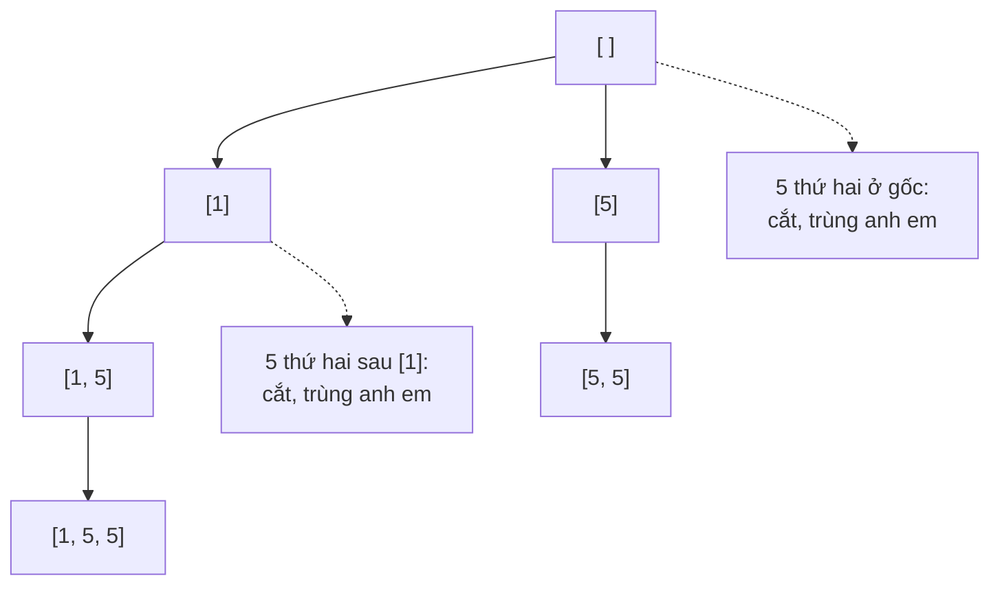

> [!tldr] Đọc nhanh
> - Mảng có giá trị lặp, nên cây lấy hoặc bỏ của [[problems/subsets|Subsets]] sinh ra tập trùng: `[5, 5, 1]` cho hai bản `[5, 1]`.
> - Sắp xếp trước để các giá trị bằng nhau đứng liền nhau. Ở mỗi tầng của cây [[concepts/start-index|chỉ số bắt đầu]], chỉ thử phần tử đầu của mỗi nhóm bằng nhau: bỏ `nums[i]` khi `i > start` và `nums[i] == nums[i - 1]`.
> - Điều kiện là `i > start`, không phải `i > 0`. [[concepts/duplicate-skipping|Bỏ trùng]] chỉ áp dụng giữa các nhánh anh em, còn đi sâu vẫn được lấy thêm bản sao, nên `[5, 5]` vẫn có mặt.
> - Sinh đủ 2ⁿ tập rồi lọc bằng Set cũng đúng, nhưng tốn công cho cả những nhánh trùng. Với năm số 4 và năm số 9, Set sinh 1.024 tập để giữ 36.

> [!info] Bối cảnh
> Đây là bài LeetCode 90 tại [[posts/2026-11-28-neetcode-subsets-combinations|ga MISC-01: Quay lui: tập con và tổ hợp]] trên **tuyến NeetCode: Kỹ thuật tổng hợp**. Mình hình dung một túi bi có vài viên cùng màu, và muốn liệt kê mọi nắm bi khác nhau có thể bốc ra. Nên đọc [[problems/subsets|Subsets]] trước; bài này chỉ thêm một dòng vào lời giải đó.

> [!abstract]- Từ điển nhanh cho bài này (bấm để mở)
> - Multiset (đa tập) là một tập cho phép phần tử lặp. `[5, 5, 1]` có hai số 5.
> - Hai tập con được coi là giống nhau khi chứa cùng các giá trị với cùng số lần, bất kể lấy từ vị trí nào.
> - Tầng của cây là các lựa chọn có chung một nút cha, tức các vòng lặp của cùng một lời gọi `walk(start)`.
> - [[concepts/backtracking|Quay lui]] thêm một phần tử vào `path`, đi sâu, rồi gỡ nó ra để thử phần tử khác.

## Hình dung trước: bốc bi từ túi có bi cùng màu

Túi có hai bi đỏ và một bi xanh. Hai bi đỏ trông y hệt nhau. Nắm "một đỏ, một xanh" dù bốc viên đỏ nào cũng là một nắm. Nắm "hai đỏ" thì có thật và phải được đếm. Tổng cộng có 3 × 2 = 6 nắm: số bi đỏ là 0, 1 hoặc 2, số bi xanh là 0 hoặc 1.

| Đời thường | Khái niệm |
|---|---|
| Túi bi có viên cùng màu | Mảng `nums` có giá trị lặp |
| Xếp bi theo màu trước khi bốc | Sắp xếp `nums` |
| Một nắm bi | Một tập con |
| Hai cách bốc cho cùng một nắm | Hai nhánh sinh ra cùng tập con |
| Ở mỗi lượt, mỗi màu chỉ thử một lần | Bỏ `nums[i]` khi `i > start` và bằng phần tử trước |
| Bốc tiếp viên đỏ thứ hai sau viên đỏ đầu | Đi sâu vẫn được lấy bản sao kế tiếp |
| Đếm theo màu: 0..2 đỏ, 0..1 xanh | Cách đếm theo nhóm, dùng để đối chiếu |

Với `[5, 5, 1]` đã sắp thành `[1, 5, 5]`, cây theo chỉ số bắt đầu chỉ còn sáu nút. Nhánh thứ hai bắt đầu bằng `5` ở gốc bị cắt, vì nó là anh em của nhánh `5` đầu tiên:



## Vấn đề: tập con khác nhau của một mảng có lặp

Cho mảng `nums` dài 1–10, mỗi giá trị nằm trong khoảng −10 đến 10, các giá trị có thể lặp. Trả về mọi tập con khác nhau của `nums`, theo thứ tự nào cũng được. Hai tập con chứa cùng các giá trị với cùng số lần chỉ được xuất hiện một lần. Ví dụ `[0, -1, 0]` có sáu tập con khác nhau: `[]`, `[-1]`, `[-1, 0]`, `[-1, 0, 0]`, `[0]` và `[0, 0]`. [Đề gốc LeetCode 90](https://leetcode.com/problems/subsets-ii/)

Cách đầu tiên mình nghĩ tới là chạy lời giải Subsets rồi bỏ trùng bằng một Set. Cách đó đúng, nhưng nó vẫn đi hết 2ⁿ nhánh rồi mới vứt phần lớn đi. Câu hỏi thật của bài là: có thể không bao giờ sinh ra bản trùng không?

## Cơ chế

### Vì sao sinh trùng

Cây chỉ số bắt đầu thử lần lượt từng `nums[i]` làm phần tử tiếp theo. Nếu `nums[i]` và `nums[j]` bằng nhau và cùng là lựa chọn của một nút, hai cây con sau chúng sinh cùng các tập. Ở `[1, 5, 5]`, gốc thử `5` ở chỉ số 1 và `5` ở chỉ số 2. Cây con của `5` thứ hai chỉ là một phần của cây con `5` đầu tiên, nên mọi tập nó sinh ra đều đã có.

### Sắp xếp rồi bỏ trùng cùng tầng

Sắp xếp làm các giá trị bằng nhau đứng liền nhau. Trong vòng lặp của `walk(start)`, mình bỏ `nums[i]` khi `i > start` và `nums[i] == nums[i - 1]`. Điều kiện `i > start` nghĩa là `nums[i - 1]` cũng là một lựa chọn của chính vòng lặp này, tức là anh em đã được thử. Khi `i == start`, `nums[i - 1]` đã nằm sẵn trong `path` ở tầng trên; lấy thêm `nums[i]` là lấy bản sao thứ hai, một tập mới như `[5, 5]`.

Mỗi tập con khác nhau có đúng một cách viết theo thứ tự đã sắp mà dùng các bản sao sớm nhất của mỗi giá trị. Điều kiện trên giữ đúng cách viết đó và cắt mọi cách khác, nên mỗi nút của cây cắt tỉa là một tập con khác nhau và ngược lại. Số nút bằng đúng số tập con khác nhau: tích của (số lần xuất hiện + 1) trên mọi giá trị.

### Bỏ trùng sai chỗ

Viết `i > 0` thay cho `i > start` sẽ cắt cả lựa chọn đầu tiên của một tầng khi nó bằng phần tử đứng trước, dù phần tử đó đang nằm trong `path`. Với `[5, 5, 1]`, nhánh `[5]` không bao giờ được đi sâu thành `[5, 5]`, và kết quả chỉ còn 4 tập thay vì 6.

### Lọc sau bằng Set

Sắp xếp `nums`, sinh mọi 2ⁿ tập theo mask, rồi cất khóa của từng tập vào một Set. Sắp xếp là bắt buộc: không sắp thì `[5, 1]` và `[1, 5]` cho hai khóa khác nhau. Cách này tốn O(n·2ⁿ) bất kể có bao nhiêu tập khác nhau.

| Cách | Thời gian | Số tập được sinh | Ghi chú |
|---|---|---|---|
| Sắp xếp, bỏ trùng cùng tầng | O(n log n + n·k) | k, số tập khác nhau | Không bao giờ sinh bản trùng |
| Sinh đủ rồi lọc bằng Set | O(n·2ⁿ) | 2ⁿ | Cần khóa của tập đã sắp |
| Đếm theo nhóm | O(n·k) | k | Mỗi giá trị lấy 0..c bản; dùng để đối chiếu |

Trong trường hợp xấu nhất mọi giá trị khác nhau, k = 2ⁿ, và cả ba cách bằng nhau. Khoảng cách chỉ lộ ra khi có nhiều giá trị lặp.

## Ví dụ chạy được

[TypeScript](../code/neetcode-subsets-ii/multiset.ts) · [Python](../code/neetcode-subsets-ii/multiset.py) · [Go](../code/neetcode-subsets-ii/multiset.go) · [Java](../code/neetcode-subsets-ii/multiset.java) · [JavaScript](../code/neetcode-subsets-ii/multiset.js) · [PHP](../code/neetcode-subsets-ii/multiset.php) · [Rust](../code/neetcode-subsets-ii/multiset.rs)

```ts
// Cách chính: sắp xếp, rồi ở mỗi tầng chỉ dùng phần tử đầu của mỗi nhóm giá trị bằng nhau
function subsetsWithDup(nums: number[], counter = { calls: 0 }): number[][] {
    const sorted = [...nums].sort((a, b) => a - b)
    const result: number[][] = []
    const path: number[] = []
    const walk = (start: number) => {
        counter.calls++
        result.push([...path])
        for (let i = start; i < sorted.length; i++) {
            // i > start: cùng tầng, giá trị này đã được thử ở anh em đứng trước
            if (i > start && sorted[i] === sorted[i - 1]) continue
            path.push(sorted[i])
            walk(i + 1)
            path.pop()
        }
    }
    walk(0)
    return result
}
```

```python
# Cách chính: sắp xếp, rồi ở mỗi tầng chỉ dùng phần tử đầu của mỗi nhóm giá trị bằng nhau
def subsets_with_dup(nums, counter=None):
    nums = sorted(nums)
    result, path = [], []

    def walk(start):
        if counter is not None:
            counter["calls"] += 1
        result.append(path[:])
        for i in range(start, len(nums)):
            # i > start: cùng tầng, giá trị này đã được thử ở anh em đứng trước
            if i > start and nums[i] == nums[i - 1]:
                continue
            path.append(nums[i])
            walk(i + 1)
            path.pop()

    walk(0)
    return result
```

```go
// Cách chính: sắp xếp, rồi ở mỗi tầng chỉ dùng phần tử đầu của mỗi nhóm giá trị bằng nhau
func subsetsWithDup(nums []int, calls *int) [][]int {
	sorted := slices.Clone(nums)
	slices.Sort(sorted)
	result := [][]int{}
	path := []int{}
	var walk func(start int)
	walk = func(start int) {
		*calls++
		result = append(result, slices.Clone(path))
		for i := start; i < len(sorted); i++ {
			// i > start: cùng tầng, giá trị này đã được thử ở anh em đứng trước
			if i > start && sorted[i] == sorted[i-1] {
				continue
			}
			path = append(path, sorted[i])
			walk(i + 1)
			path = path[:len(path)-1]
		}
	}
	walk(0)
	return result
}
```

```java
// Cách chính: sắp xếp, rồi ở mỗi tầng chỉ dùng phần tử đầu của mỗi nhóm giá trị bằng nhau
static List<List<Integer>> subsetsWithDup(int[] nums) {
    int[] sorted = nums.clone();
    Arrays.sort(sorted);
    List<List<Integer>> result = new ArrayList<>();
    walk(sorted, 0, new ArrayList<>(), result);
    return result;
}

static void walk(int[] sorted, int start, List<Integer> path, List<List<Integer>> result) {
    calls++;
    result.add(new ArrayList<>(path));
    for (int i = start; i < sorted.length; i++) {
        // i > start: cùng tầng, giá trị này đã được thử ở anh em đứng trước
        if (i > start && sorted[i] == sorted[i - 1]) continue;
        path.add(sorted[i]);
        walk(sorted, i + 1, path, result);
        path.remove(path.size() - 1);
    }
}
```

```js
// Cách chính: sắp xếp, rồi ở mỗi tầng chỉ dùng phần tử đầu của mỗi nhóm giá trị bằng nhau
function subsetsWithDup(nums, counter = { calls: 0 }) {
    const sorted = [...nums].sort((a, b) => a - b)
    const result= []
    const path= []
    const walk = (start) => {
        counter.calls++
        result.push([...path])
        for (let i = start; i < sorted.length; i++) {
            // i > start: cùng tầng, giá trị này đã được thử ở anh em đứng trước
            if (i > start && sorted[i] === sorted[i - 1]) continue
            path.push(sorted[i])
            walk(i + 1)
            path.pop()
        }
    }
    walk(0)
    return result
}
```

```php
// Cách chính: sắp xếp, rồi ở mỗi tầng chỉ dùng phần tử đầu của mỗi nhóm giá trị bằng nhau
function subsetsWithDup(array $nums): array {
    global $calls;
    sort($nums);
    $result = [];
    $path = [];
    $walk = function (int $start) use (&$walk, &$result, &$path, &$calls, $nums) {
        $calls++;
        $result[] = $path;
        for ($i = $start; $i < count($nums); $i++) {
            // i > start: cùng tầng, giá trị này đã được thử ở anh em đứng trước
            if ($i > $start && $nums[$i] === $nums[$i - 1]) continue;
            $path[] = $nums[$i];
            $walk($i + 1);
            array_pop($path);
        }
    };
    $walk(0);
    return $result;
}
```

```rust
// Cách chính: sắp xếp, rồi ở mỗi tầng chỉ dùng phần tử đầu của mỗi nhóm giá trị bằng nhau
fn subsets_with_dup(nums: &[i32], calls: &mut usize) -> Vec<Vec<i32>> {
    fn walk(sorted: &[i32], start: usize, path: &mut Vec<i32>, result: &mut Vec<Vec<i32>>, calls: &mut usize) {
        *calls += 1;
        result.push(path.clone());
        for i in start..sorted.len() {
            // i > start: cùng tầng, giá trị này đã được thử ở anh em đứng trước
            if i > start && sorted[i] == sorted[i - 1] {
                continue;
            }
            path.push(sorted[i]);
            walk(sorted, i + 1, path, result, calls);
            path.pop();
        }
    }
    let mut sorted = nums.to_vec();
    sorted.sort();
    let mut result = Vec::new();
    walk(&sorted, 0, &mut Vec::new(), &mut result, calls);
    result
}
```

Các tab trích cách sắp xếp rồi bỏ trùng cùng tầng; dòng tăng `calls` chỉ để đếm cho phép đo. File tải về còn có bản bỏ trùng sai chỗ, bản lọc bằng Set và cách đếm theo nhóm. Tám ca kiểm tra gồm hai số bằng nhau, bốn số bằng nhau, số 0 lặp quanh số âm, mười số giống hệt (11 tập) và mười số khác nhau (1.024 tập). Cả bản bỏ trùng cùng tầng và bản lọc bằng Set phải khớp cách đếm theo nhóm, không tập nào lặp.

Dòng thứ hai đối chiếu trên mọi mảng dài 0–5 với giá trị trong {1, 2, 3}: 364 mảng. Hai dòng cuối là phép đo: bản bỏ trùng sai chỗ trên `[5, 5, 1]`, và số tập mỗi cách phải sinh với năm số 4 và năm số 9.

```text
8/8 ca đúng
364/364 ca đúng (đối chiếu đếm theo nhóm)
Bỏ trùng mọi lúc với [5,5,1]: 4 tập, đúng là 6
[4×5, 9×5]: Set sinh 1024 tập để giữ 36, cắt cùng tầng sinh 36
```

36 = (5 + 1) × (5 + 1): mỗi tập chọn 0..5 số 4 và 0..5 số 9. Cây cắt tỉa đi đúng 36 nút, không thừa nút nào.

## Hiểu lầm và bẫy hay gặp

- Quên sắp xếp. Điều kiện `nums[i] == nums[i - 1]` chỉ bắt được trùng khi các giá trị bằng nhau đứng liền nhau. Với `[5, 1, 5]` chưa sắp, hai số 5 không kề nhau và tập `[5]` bị sinh hai lần.
- Viết `i > 0` thay cho `i > start`. Kết quả thiếu mọi tập chứa hai bản của cùng một giá trị, như ví dụ `[5, 5, 1]` ở trên.
- Lọc bằng Set mà không sắp từng tập. `[5, 1]` và `[1, 5]` cho hai khóa khác nhau.
- JavaScript, TypeScript: `new Set()` so mảng theo tham chiếu, nên phải dùng khóa chuỗi như `subset.join(',')`. Java thì khác: `List.equals` so theo nội dung, nên `HashSet<List<Integer>>` bỏ trùng được trực tiếp. Python cần `tuple` vì `list` không hash được. Rust dùng được `HashSet<Vec<i32>>`.
- Java, Go: các giá trị bằng nhau là `int`, nên so `==` an toàn. Nếu đổi sang `Integer` trong Java, `==` so tham chiếu và chỉ tình cờ đúng với các số trong khoảng −128 đến 127 nhờ bộ nhớ đệm của `Integer.valueOf`; dùng `equals`.
- PHP: closure phải bắt `$path` theo tham chiếu, `use (&$path)`. Viết `use ($path)` thì mỗi lời gọi nhận bản chép lúc tạo closure, luôn là mảng rỗng: với `[1, 2, 3]`, kết quả là 8 mảng rỗng.

## Câu hỏi tự kiểm tra

> [!question]- Vì sao `[4, 4, 4, 4]` chỉ có 5 tập con khác nhau?
> Mọi phần tử bằng nhau, nên một tập con chỉ được nhận diện bởi số bản 4 nó chứa: 0, 1, 2, 3 hoặc 4.

> [!question]- Ở `walk(start)`, khi `i == start` và `nums[i] == nums[i - 1]`, vì sao không bỏ?
> `nums[i - 1]` không phải anh em mà là phần tử đã nằm trong `path` từ tầng trên. Lấy `nums[i]` là thêm bản sao thứ hai, một tập mới.

> [!question]- Bản lọc bằng Set có cần sắp xếp `nums` không?
> Có, hoặc phải sắp từng tập trước khi lấy khóa. Nếu không, cùng một tập con viết theo hai thứ tự cho hai khóa khác nhau.

> [!question]- Với mảng gồm 10 giá trị khác nhau, bản bỏ trùng cùng tầng có nhanh hơn Subsets không?
> Không. Không có cặp nào bằng nhau nên không nhánh nào bị cắt, và cây vẫn có 1.024 nút. Chỉ thêm chi phí sắp xếp O(n log n).

## Tham khảo

- [LeetCode 90](https://leetcode.com/problems/subsets-ii/)
- [Jeff Erickson, Algorithms, chương 2: quay lui](https://jeffe.cs.illinois.edu/teaching/algorithms/book/02-backtracking.pdf)
- [Python collections.Counter](https://docs.python.org/3/library/collections.html#collections.Counter) · [Java List.equals](https://docs.oracle.com/en/java/javase/21/docs/api/java.base/java/util/List.html#equals(java.lang.Object)) · [PHP array_count_values](https://www.php.net/manual/en/function.array-count-values.php)
