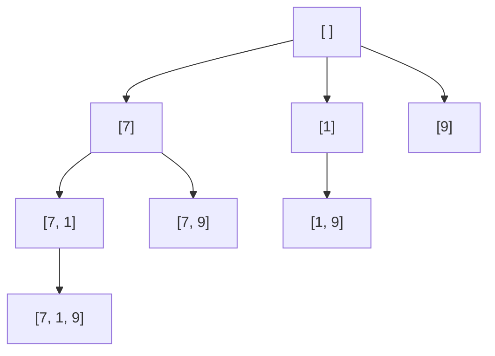

> [!tldr] Đọc nhanh
> - n phần tử khác nhau cho đúng 2ⁿ tập con, vì mỗi phần tử có hai số phận: được lấy hoặc bị bỏ.
> - Vẽ hai số phận đó thành một [[concepts/choice-tree|cây lựa chọn]], mỗi đường từ gốc tới lá là một tập con. Duyệt cây bằng [[concepts/backtracking|quay lui]]: thêm, đi sâu, rồi gỡ ra.
> - Cách viết gọn hơn dùng [[concepts/start-index|chỉ số bắt đầu]]: mỗi nút của cây đã là một tập con, và chỉ thêm phần tử đứng sau phần tử cuối cùng vừa thêm.
> - Mọi cách đều tốn O(n·2ⁿ), vì đầu ra đã dài chừng đó. Bẫy thật nằm ở chỗ khác: cất `path` vào kết quả mà quên sao chép.

> [!info] Bối cảnh
> Đây là bài LeetCode 78 tại [[posts/2026-11-28-neetcode-subsets-combinations|ga MISC-01: Quay lui: tập con và tổ hợp]] trên **tuyến NeetCode: Kỹ thuật tổng hợp**. Mình hình dung một quầy pizza cho chọn topping tùy thích và muốn in ra mọi kiểu bánh có thể gọi. Bạn chỉ cần biết mảng, vòng lặp và hàm đệ quy.

> [!abstract]- Từ điển nhanh cho bài này (bấm để mở)
> - Tập con là một cách chọn ra vài phần tử, không quan tâm thứ tự. `[7, 1]` và `[1, 7]` là cùng một tập con. Tập rỗng cũng là một tập con.
> - `path` là danh sách các phần tử đã chọn trên đường đang đi. Mọi lời gọi đệ quy dùng chung một `path`.
> - Mask là một số nguyên mà bit thứ i cho biết có lấy phần tử thứ i hay không. `1 << n` bằng 2ⁿ.
> - Tham chiếu (reference) là chỗ nhiều biến cùng trỏ vào một mảng. Sửa qua biến này thì biến kia cũng thấy.

## Hình dung trước: gọi pizza với mọi kiểu topping

Quầy có ba topping: nấm, ô liu, ớt. Với từng topping, mình chỉ trả lời "có" hoặc "không". Ba câu hỏi, mỗi câu hai đáp án, nên có 2 × 2 × 2 = 8 kiểu bánh, kể cả bánh trơn không topping. Không ai coi "nấm rồi ô liu" khác "ô liu rồi nấm": trên bánh chúng là một.

| Đời thường | Khái niệm |
|---|---|
| Danh sách topping của quầy | Mảng `nums`, các giá trị khác nhau |
| Một kiểu bánh | Một tập con |
| Bánh trơn | Tập rỗng `[]` |
| Hỏi lần lượt từng topping có hay không | Cây lấy hoặc bỏ, sâu n tầng |
| Tờ phiếu đang ghi dở | `path` |
| Chụp lại tờ phiếu trước khi viết tiếp | Sao chép `path` trước khi cất |
| Chỉ hỏi các topping đứng sau topping vừa chọn | Chỉ số bắt đầu `start` |

Với `nums = [7, 1, 9]`, cây theo chỉ số bắt đầu trông thế này. Mỗi ô là một tập con được ghi ngay khi tới nó, nên cây có đúng 8 ô.



## Vấn đề: in mọi tập con của một mảng

Cho mảng `nums` dài 1–10, các giá trị đôi một khác nhau, mỗi giá trị nằm trong khoảng −10 đến 10. Trả về mọi tập con của `nums`, theo thứ tự nào cũng được, nhưng không tập con nào được xuất hiện hai lần. Ví dụ `[4, -2]` có bốn tập con: `[]`, `[4]`, `[-2]` và `[4, -2]`. [Đề gốc LeetCode 78](https://leetcode.com/problems/subsets/)

Mình từng nghĩ đây là bài "sinh tổ hợp" cần công thức gì đó. Hóa ra nó là bài đi hết một cây có 2ⁿ lá, và phần khó là đi sao cho không sinh trùng và không làm hỏng kết quả đã cất.

## Cơ chế

### Cây lấy hoặc bỏ

Đứng ở phần tử thứ i, mình rẽ hai nhánh: thêm `nums[i]` vào `path` rồi đi tiếp, hoặc không thêm rồi đi tiếp. Khi i bằng n, mọi phần tử đã có số phận, `path` là một tập con hoàn chỉnh và được cất vào kết quả. Cây có n tầng và 2ⁿ lá, nên có đúng 2ⁿ tập con, không trùng nhau vì hai lá khác nhau ở ít nhất một câu trả lời "có/không".

Sau khi nhánh "lấy" quay về, phải `pop` phần tử vừa thêm, để nhánh "bỏ" thấy `path` như trước. Đó là bước gỡ lựa chọn của quay lui.

### Chỉ số bắt đầu: mỗi nút là một tập con

Cách thứ hai cất `path` ngay khi vào một nút, rồi thử thêm lần lượt từng phần tử từ `start` trở đi. Sau khi thêm `nums[i]`, lời gọi con chỉ được xét từ `i + 1`. Nhờ vậy các phần tử trong `path` luôn theo đúng thứ tự chỉ số, nên `[7, 1]` có mặt còn `[1, 7]` thì không bao giờ được sinh ra. Đây là hình cây ở trên, và là cách mà bài anh em Combination Sum hay Subsets II dùng lại.

### Mask và nhân đôi

Hai cách không đệ quy cho cùng kết quả:

- **Mask:** đếm `mask` từ 0 tới 2ⁿ − 1. Bit thứ i bằng 1 nghĩa là lấy `nums[i]`. Mỗi số nguyên là một tập con, và 2ⁿ số khác nhau cho 2ⁿ tập con khác nhau. Cách này hợp với n nhỏ, vì `1 << n` phải vừa kiểu số nguyên.
- **Nhân đôi:** bắt đầu với `[[]]`. Với mỗi phần tử x, chép mọi tập đang có, thêm x vào bản chép rồi nối vào cuối. Sau phần tử đầu có 2 tập, sau phần tử thứ hai có 4, sau n phần tử có 2ⁿ.

| Cách | Thời gian | Bộ nhớ phụ ngoài đầu ra | Ghi chú |
|---|---|---|---|
| Lấy hoặc bỏ | O(n·2ⁿ) | O(n) ngăn xếp | Chỉ cất ở lá |
| Chỉ số bắt đầu | O(n·2ⁿ) | O(n) ngăn xếp | Cất ở mọi nút |
| Mask | O(n·2ⁿ) | O(1) | Cần n nhỏ hơn số bit của kiểu số nguyên |
| Nhân đôi | O(n·2ⁿ) | O(1) | Phải sao chép tập cũ trước khi thêm x |

Phần n trong O(n·2ⁿ) đến từ việc sao chép: mỗi tập con dài tới n phần tử. Không cách nào nhanh hơn được, vì đầu ra tự nó đã có tổng độ dài n·2ⁿ⁻¹.

### Cất mà quên sao chép

Mọi lời gọi dùng chung một `path`. Nếu cất chính `path` thay vì một bản sao, thì ở TypeScript, JavaScript, Python và Java kết quả giữ 8 lần cùng một mảng. Mảng đó còn bị `push` và `pop` tiếp, và khi đệ quy xong nó rỗng. Go, PHP và Rust phản ứng khác, như bảng ở phần ví dụ chạy được cho thấy.


Go đáng nói riêng. Một slice gồm con trỏ tới mảng nền, độ dài và sức chứa. Cất `path` là cất một bản sao của ba con số đó, không phải của dữ liệu. Các slice đã cất giữ nguyên độ dài lúc cất, nhưng cùng nhìn vào một mảng nền mà lần ghi cuối để lại `3, 3, 3`. Kết quả thành `[] [3] [3 3] [3 3 3] [3 3] [3] [3 3] [3]`, trong đó chỉ `[]` và `[3]` tình cờ đúng.

## Ví dụ chạy được

[TypeScript](../code/neetcode-subsets/powerset.ts) · [Python](../code/neetcode-subsets/powerset.py) · [Go](../code/neetcode-subsets/powerset.go) · [Java](../code/neetcode-subsets/powerset.java) · [JavaScript](../code/neetcode-subsets/powerset.js) · [PHP](../code/neetcode-subsets/powerset.php) · [Rust](../code/neetcode-subsets/powerset.rs)

```ts
// Cách 2: chỉ số bắt đầu, mỗi nút của cây là một tập con
function subsetsStart(nums: number[]): number[][] {
    const result: number[][] = []
    const path: number[] = []
    const walk = (start: number) => {
        result.push([...path])
        for (let i = start; i < nums.length; i++) {
            path.push(nums[i])
            walk(i + 1) // chỉ xét các phần tử sau i, nên [a, b] không có bản sao [b, a]
            path.pop()
        }
    }
    walk(0)
    return result
}
```

```python
# Cách 2: chỉ số bắt đầu, mỗi nút của cây là một tập con
def subsets_start(nums):
    result, path = [], []

    def walk(start):
        result.append(path[:])
        for i in range(start, len(nums)):
            path.append(nums[i])
            walk(i + 1)  # chỉ xét các phần tử sau i, nên [a, b] không có bản sao [b, a]
            path.pop()

    walk(0)
    return result
```

```go
// Cách 2: chỉ số bắt đầu, mỗi nút của cây là một tập con
func subsetsStart(nums []int) [][]int {
	result := [][]int{}
	path := []int{}
	var walk func(start int)
	walk = func(start int) {
		result = append(result, slices.Clone(path))
		for i := start; i < len(nums); i++ {
			path = append(path, nums[i])
			walk(i + 1) // chỉ xét các phần tử sau i, nên [a, b] không có bản sao [b, a]
			path = path[:len(path)-1]
		}
	}
	walk(0)
	return result
}
```

```java
// Cách 2: chỉ số bắt đầu, mỗi nút của cây là một tập con
static List<List<Integer>> subsetsStart(int[] nums) {
    List<List<Integer>> result = new ArrayList<>();
    fromStart(nums, 0, new ArrayList<>(), result);
    return result;
}

static void fromStart(int[] nums, int start, List<Integer> path, List<List<Integer>> result) {
    result.add(new ArrayList<>(path));
    for (int i = start; i < nums.length; i++) {
        path.add(nums[i]);
        fromStart(nums, i + 1, path, result); // chỉ xét các phần tử sau i, nên [a, b] không có bản sao [b, a]
        path.remove(path.size() - 1);
    }
}
```

```js
// Cách 2: chỉ số bắt đầu, mỗi nút của cây là một tập con
function subsetsStart(nums) {
    const result= []
    const path= []
    const walk = (start) => {
        result.push([...path])
        for (let i = start; i < nums.length; i++) {
            path.push(nums[i])
            walk(i + 1) // chỉ xét các phần tử sau i, nên [a, b] không có bản sao [b, a]
            path.pop()
        }
    }
    walk(0)
    return result
}
```

```php
// Cách 2: chỉ số bắt đầu, mỗi nút của cây là một tập con
function subsetsStart(array $nums): array {
    $result = [];
    $path = [];
    $walk = function (int $start) use (&$walk, &$result, &$path, $nums) {
        $result[] = $path;
        for ($i = $start; $i < count($nums); $i++) {
            $path[] = $nums[$i];
            $walk($i + 1); // chỉ xét các phần tử sau i, nên [a, b] không có bản sao [b, a]
            array_pop($path);
        }
    };
    $walk(0);
    return $result;
}
```

```rust
// Cách 2: chỉ số bắt đầu, mỗi nút của cây là một tập con
fn subsets_start(nums: &[i32]) -> Vec<Vec<i32>> {
    fn walk(nums: &[i32], start: usize, path: &mut Vec<i32>, result: &mut Vec<Vec<i32>>) {
        result.push(path.clone());
        for i in start..nums.len() {
            path.push(nums[i]);
            walk(nums, i + 1, path, result); // chỉ xét các phần tử sau i, nên [a, b] không có bản sao [b, a]
            path.pop();
        }
    }
    let mut result = Vec::new();
    walk(nums, 0, &mut Vec::new(), &mut result);
    result
}
```

Các tab trích cách chỉ số bắt đầu. File tải về có đủ bốn cách. Bảy ca kiểm tra gồm mảng một phần tử, số âm, và mảng mười phần tử với 1.024 tập con. Mỗi cách phải cho đúng 2ⁿ tập, không tập nào lặp, khớp đáp án viết tay nếu có và khớp cách mask.

Dòng thứ hai đối chiếu chéo bốn cách trên mọi mảng gồm các giá trị khác nhau lấy từ {−2, −1, 0, 1, 2}, dài 0–4, theo mọi thứ tự: 206 mảng. Dòng cuối chạy bản quên sao chép trên `[1, 2, 3]` và đếm xem bao nhiêu trong 8 tập con đúng có mặt trong kết quả.

```text
7/7 ca đúng
206/206 ca đúng (đối chiếu chéo bốn cách)
Quên sao chép path với [1,2,3]: 1/8 tập con đúng
```

Dòng cuối khác nhau giữa các ngôn ngữ, và đó chính là điều cần thấy:

| Ngôn ngữ | Dòng cuối | Vì sao |
|---|---|---|
| TypeScript, JavaScript, Python, Java | 1/8 | Tám tham chiếu tới một mảng, cuối cùng rỗng |
| Go | 2/8 | Tám slice chung mảng nền `3, 3, 3`, chỉ `[]` và `[3]` tình cờ đúng |
| PHP | 8/8 | Mảng PHP được chép khi gán, nên bản "quên sao chép" vẫn đúng |
| Rust | không in | Bản lỗi không biên dịch được, xem phần bẫy |

## Hiểu lầm và bẫy hay gặp

- Nghĩ rằng cần sắp xếp hay khử trùng. Các giá trị đã khác nhau, nên cây lấy hoặc bỏ không bao giờ sinh hai tập giống nhau. Khử trùng chỉ cần khi mảng có giá trị lặp, như ở [[problems/subsets-ii|Subsets II]].
- Ở cách chỉ số bắt đầu, gọi đệ quy với `start + 1` thay vì `i + 1`. Khi đó phần tử đứng trước `nums[i]` lại được thêm sau nó, sinh ra cả `[7, 1]` lẫn `[1, 7]`.
- Quên `pop` sau khi đi sâu. Nhánh kế tiếp sẽ thấy một `path` dài hơn thực tế.
- TypeScript, JavaScript: dùng `[...path]` hoặc `path.slice()`. Python: `path[:]` hoặc `list(path)`. Java: `new ArrayList<>(path)`.
- Go: dùng `slices.Clone(path)` hoặc `append([]int(nil), path...)`. Cách nhân đôi còn một bẫy nữa: `append(result[k], x)` có thể ghi thẳng vào mảng nền của `result[k]` khi slice đó còn sức chứa, làm hỏng một tập đã cất. File chép `result[k]` trước khi thêm.
- PHP: mảng được chép khi gán (copy-on-write), nên `$result[] = $path` an toàn. Đổi `$path` thành tham chiếu `&$path` để bắt nó vào closure là đúng, nhưng đừng cất `&$path` vào kết quả.
- Rust: `result.push(*path)` báo E0507 vì không thể chuyển quyền sở hữu ra khỏi một tham chiếu. Cất `&path` rồi `path.push(...)` báo E0502 vì vừa mượn đọc vừa mượn ghi. Trình biên dịch buộc phải `path.clone()`.

## Câu hỏi tự kiểm tra

> [!question]- Mảng 10 phần tử có bao nhiêu tập con, và vì sao thời gian là O(n·2ⁿ) chứ không phải O(2ⁿ)?
> 2¹⁰ = 1.024 tập con. Mỗi tập phải được chép ra kết quả, và một tập dài tới n phần tử, nên tổng công chép là O(n·2ⁿ).

> [!question]- Ở cách chỉ số bắt đầu, vì sao cất `path` ngay khi vào nút chứ không đợi tới lá?
> Mỗi nút tương ứng một tập con khác nhau: đường từ gốc tới nút đó chọn các phần tử theo thứ tự chỉ số tăng. Tập rỗng là gốc, tập đầy đủ là nút sâu nhất. Cất ở lá sẽ bỏ sót các tập ngắn.

> [!question]- Đổi lời gọi `walk(i + 1)` thành `walk(start + 1)` thì sai thế nào?
> Lời gọi con có thể quay lại thêm các phần tử đứng trước `nums[i]`, nên cùng một tập con xuất hiện theo nhiều thứ tự, ví dụ cả `[7, 1]` và `[1, 7]`.

> [!question]- Vì sao bản quên sao chép của Go không cho toàn mảng rỗng như JavaScript?
> Mỗi slice đã cất giữ độ dài lúc cất, nhưng cùng trỏ vào một mảng nền. Mảng nền cuối cùng chứa `3, 3, 3`, nên một slice độ dài 2 đọc ra `[3 3]`.

## Tham khảo

- [LeetCode 78](https://leetcode.com/problems/subsets/)
- [Jeff Erickson, Algorithms, chương 2: quay lui](https://jeffe.cs.illinois.edu/teaching/algorithms/book/02-backtracking.pdf)
- [Go blog, Go Slices: usage and internals](https://go.dev/blog/slices-intro) · [Go slices.Clone](https://pkg.go.dev/slices#Clone)
- [PHP manual, Arrays](https://www.php.net/manual/en/language.types.array.php) · [Rust E0502](https://doc.rust-lang.org/error_codes/E0502.html)
