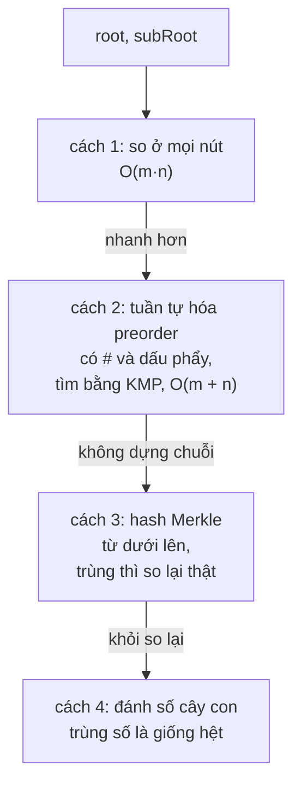

> [!tldr] Đọc nhanh
> - Đề: cho cây `root` (tối đa 2000 nút) và cây `subRoot` (tối đa 1000 nút). Trả `true` khi có một nút của `root` mà cây con bắt đầu từ nút đó (nút ấy cùng mọi con cháu) giống hệt `subRoot`.
> - Lời giải chuẩn: ở mỗi nút của `root`, gọi hàm so hai cây của [[problems/same-tree|Same Tree]]. O(m·n) trong trường hợp xấu nhất (m, n là số nút hai cây), nhưng với giới hạn của đề vẫn chỉ vài chục mili giây.
> - Ba cách O(m + n): **tuần tự hóa** hai cây (có ghi chỗ trống và dấu phân cách đứng trước mỗi giá trị) rồi tìm chuỗi bằng KMP; **hash Merkle** (hash của nút tính từ hash hai con), trùng hash thì so lại thật; **đánh số cây con**, mỗi cây con khác nhau một số riêng, không bao giờ va chạm.
> - Đo trên đầu vào xấu (hai cây lệch toàn số 1, khác ở đáy): ở cỡ 20 000 và 10 000 nút, so ở mọi nút mất 5,3 giây, `includes` của V8 170 ms và `contains` của Java 115 ms (cả hai tăng theo bình phương), KMP chỉ 1,9 ms. Toán tử `in` của Python và `strings.Contains` của Go thì vẫn tuyến tính.
> - Bẫy chạy thật: bỏ chỗ trống khi tuần tự hóa; dấu phân cách chỉ đứng sau (`"12,#,#,"` chứa `"2,#,#,"`); hash yếu không kiểm lại (`Objects.hash` của Java cho `[1,1]` và `[1,null,961]` cùng 984064); bản đệ quy trong Python ném `RecursionError` với cây lệch 2000 nút, vẫn nằm trong giới hạn của đề.

> [!info] Bối cảnh
> Bài LeetCode 572 (Easy) của [[posts/2026-11-25-neetcode-tree-recursion|ga 3: Đệ quy trên cây]] trên **tuyến NeetCode: Cấu trúc liên kết**. Bài này dựng trên [[problems/same-tree|Same Tree]]: cùng hàm so hai cây, nhưng gọi ở mọi nút của cây lớn. Phần tối ưu nối sang hai đề tài khác: tìm chuỗi con (biến cây thành chuỗi như bài [[problems/encode-and-decode-strings|Encode and Decode Strings]] biến danh sách thành chuỗi) và hash cây con (cùng ý tính từ dưới lên như [[problems/diameter-of-binary-tree|Diameter of Binary Tree]]). Lời giải có đủ TypeScript, Python, Go, Java và JavaScript. Bạn cần biết cây nhị phân và đã đọc bài Same Tree.

> [!abstract]- Từ điển nhanh cho bài này (bấm để mở)
> - **Cây con (subtree)**: một nút cùng **mọi** con cháu của nó. Chỉ khớp một phần trên cùng là chưa đủ: nếu nút tương ứng trong `root` có thêm con thì không tính. Xem [[concepts/binary-tree|Binary Tree]].
> - **m, n**: m là số nút của `root`, n là số nút của `subRoot`.
> - **Tuần tự hóa**: viết cây thành một chuỗi hoặc mảng phẳng. Ở đây theo preorder, có ghi chỗ trống. Xem [[concepts/key-serialization|Key Serialization]].
> - **Dấu phân cách**: ký tự ngăn hai giá trị liền nhau, như dấu phẩy. Đặt sai chỗ thì một giá trị có thể "dính" vào giá trị khác. Xem [[concepts/delimiter-collision|Delimiter Collision]].
> - **KMP (Knuth–Morris–Pratt)**: thuật toán tìm một dãy mẫu trong một dãy dài, không bao giờ lùi lại trong dãy dài, nên O(độ dài hai dãy) trong mọi trường hợp.
> - **Hash Merkle**: hash của một nút được tính từ giá trị của nó và hash của hai con, nên cả cây con thu về một số. Xem [[concepts/tree-hashing|Tree Hashing]].
> - **Va chạm hash**: hai cây khác nhau cho cùng một hash. Xem [[concepts/hash-collision|Hash Collision]].
> - **Duyệt hậu thứ tự (post-order)**: xử lý hai con trước rồi mới tới nút cha. Hash và đánh số cây con đều cần thứ tự này. Xem [[concepts/post-order-traversal|Post-order Traversal]].

## Hình dung trước: tìm một nhánh cây cảnh trong cả vườn

Bạn cầm ảnh một cành bonsai (`subRoot`) và đi tìm trong một khu vườn (`root`) xem có cành nào giống hệt không: cùng cách rẽ nhánh, cùng từng chiếc lá, và cành đó không được mọc thêm gì so với ảnh.

| Đời thường | Khái niệm |
|---|---|
| Ảnh cành mẫu | `subRoot` |
| Đứng ở từng chỗ rẽ trong vườn, so với ảnh | so ở mọi nút: O(m·n) |
| Cành giống ảnh nhưng mọc thêm một nhánh | cây con có thêm nút: không tính |
| Tả mỗi cành bằng một dòng chữ rồi tìm dòng chữ | tuần tự hóa rồi tìm chuỗi |
| Dòng chữ ghi cả "chỗ này không có nhánh" | ghi chỗ trống (`#`) |
| Mã số dán lên mỗi cành, tính từ mã của hai nhánh con | hash Merkle |
| Hai cành khác nhau nhưng trùng mã | va chạm: phải đối chiếu lại bằng mắt |
| Sổ đăng ký: mỗi kiểu cành khác nhau một số thứ tự | đánh số cây con: không bao giờ trùng |



## Vấn đề

Đề cho gốc của hai cây nhị phân `root` (1 tới 2000 nút) và `subRoot` (1 tới 1000 nút), giá trị trong [−10⁴, 10⁴]. Trả `true` khi `root` có một nút mà cây con bắt đầu từ nút đó giống hệt `subRoot`, cả hình dạng lẫn giá trị. `root` cũng tính là cây con của chính nó. Đề gốc: [LeetCode 572](https://leetcode.com/problems/subtree-of-another-tree/).

Chỗ dễ hiểu sai là chữ "cây con". Mình từng nghĩ chỉ cần tìm thấy các nút của `subRoot` nằm liền nhau trong `root`. Hóa ra cây con phải lấy nút đó **cùng tất cả con cháu**: `root = [7,8,9,4,5]` chứa `[8,4,5]`, nhưng nếu nút 5 trong `root` có thêm một con (`[7,8,9,4,5,null,null,null,null,6]`) thì không chứa nữa.

## Cơ chế

### Cách 1: so ở mọi nút

Cây con giống `subRoot` thì hoặc bắt đầu ngay ở gốc, hoặc nằm trong nhánh trái, hoặc nằm trong nhánh phải. Ba khả năng đó viết thẳng thành đệ quy, dùng lại hàm so của bài 100:

```ts
// Cách 1 (dạng đệ quy quen thuộc): cây con bắt đầu ở gốc, hoặc nằm trong nhánh trái, hoặc nhánh phải.
function isSameRec(p: TreeNode | null, q: TreeNode | null): boolean {
  if (p === null || q === null) return p === q;
  return p.val === q.val && isSameRec(p.left, q.left) && isSameRec(p.right, q.right);
}
function isSubtreeRecursive(root: TreeNode | null, sub: TreeNode | null): boolean {
  if (root === null) return sub === null;
  return isSameRec(root, sub) || isSubtreeRecursive(root.left, sub) || isSubtreeRecursive(root.right, sub);
}
```

Thường thì mỗi lần so dừng rất sớm (giá trị gốc khác ngay). Trường hợp xấu là khi nhiều nút của `root` khớp gần hết `subRoot` rồi mới khác ở cuối: mỗi nút tốn tới n bước, tổng O(m·n). Đầu vào xấu nhất mình dùng để đo: `root` là cây lệch trái m nút toàn số 1, `subRoot` là cây lệch trái n nút toàn số 1 trừ nút đáy là 2. Ở mỗi nút của `root`, lần so đi xuống tới n tầng rồi mới gặp số 2.

Bản đệ quy còn một vấn đề riêng ở Python: cây lệch 2000 nút (vẫn trong giới hạn của đề) cần độ sâu đệ quy khoảng 2000, vượt giới hạn mặc định 1000. Bản Python ném `RecursionError` ở cả hai ca cây lệch 2000 nút. Mình không kiểm được LeetCode có nâng giới hạn này trong môi trường chấm hay không, nên các file đều có thêm bản vòng lặp (`isSubtreeNaive`): duyệt mọi nút của `root` bằng ngăn xếp, so bằng bản `isSame` vòng lặp.

### Cách 2: tuần tự hóa rồi tìm chuỗi

Viết mỗi cây thành chuỗi preorder, mỗi nút một phần tử `,giá trị`, mỗi chỗ trống một phần tử `,#`. Khi đó cây con bắt đầu ở một nút của `root` là một **đoạn liền** trong chuỗi của `root` (preorder viết hết một cây con rồi mới sang phần khác), và đoạn đó bằng chuỗi của `subRoot` khi và chỉ khi hai cây giống nhau. Bài toán cây thành bài toán tìm chuỗi con.

```ts
// Tuần tự hóa preorder thành chuỗi: mỗi nút ",giá trị", mỗi chỗ trống ",#". Dấu phẩy đứng TRƯỚC mỗi phần tử.
function serializeString(root: TreeNode | null): string {
  const parts: string[] = [];
  const stack: (TreeNode | null)[] = [root];
  while (stack.length > 0) {
    const n = stack.pop()!;
    if (n === null) { parts.push(",#"); continue; }
    parts.push("," + n.val);
    stack.push(n.right, n.left);
  }
  return parts.join("");
}

// Cách 2a: tuần tự hóa rồi tìm chuỗi bằng includes có sẵn.
function isSubtreeString(root: TreeNode | null, sub: TreeNode | null): boolean {
  return serializeString(root).includes(serializeString(sub));
}
```

Hai chi tiết quyết định đúng sai:
- **Ghi chỗ trống.** Bỏ `#` thì `[8,4,5]` khớp vào giữa dãy `7,8,4,5,6,9` dù nút 5 có thêm con 6. Bản `wrongNoNullMarkers` sai 3/14 ca, cả ba đều trả `true` thay vì `false`.
- **Dấu phân cách đứng trước mỗi giá trị.** Chỉ đặt dấu phẩy phía sau thì chuỗi của `[12]` là `"12,#,#,"` và chứa chuỗi của `[2]` là `"2,#,#,"`; tương tự `[-3]` chứa `[3]`. Đặt dấu phẩy phía trước thì `",2"` không thể bắt đầu giữa `",12"`. Bản `wrongNoLeadingDelimiter` sai đúng hai ca đó.

Còn tìm chuỗi bằng gì? Hàm có sẵn của mỗi ngôn ngữ không hứa O(m + n). Đầu vào xấu nhất ở trên là đúng kiểu làm khổ cách tìm ngây thơ: mẫu là `,1,1,…,1,2,#,…`, và ở mỗi vị trí trong chuỗi dài nó khớp gần hết dãy số 1 rồi mới hỏng ở số 2. Đo ra (bảng ở phần Đo), `includes` của V8 và `String.contains` của Java tăng khoảng 45 tới 110 lần khi cỡ tăng 10 lần, tức theo bình phương. `in` của Python và `strings.Contains` của Go thì từ cỡ 20 000 trở lên chỉ tăng khoảng 6 tới 13 lần mỗi khi cỡ tăng 10 lần, tức tuyến tính.

Muốn chắc O(m + n) ở mọi ngôn ngữ thì tự tìm bằng **KMP**. Tuần tự hóa thành mảng số (chỗ trống là một số nằm ngoài khoảng giá trị) thay vì chuỗi, thì không còn chuyện dấu phân cách: mỗi giá trị là một ô riêng.

```ts
// KMP: tìm mẫu pat trong text, O(|text| + |pat|) trong mọi trường hợp.
function kmpContains(text: number[], pat: number[]): boolean {
  const fail = new Int32Array(pat.length); // fail[i]: độ dài tiền tố dài nhất cũng là hậu tố của pat[0..i]
  for (let i = 1, k = 0; i < pat.length; i++) {
    while (k > 0 && pat[i] !== pat[k]) k = fail[k - 1];
    if (pat[i] === pat[k]) k++;
    fail[i] = k;
  }
  for (let i = 0, k = 0; i < text.length; i++) {
    while (k > 0 && text[i] !== pat[k]) k = fail[k - 1];
    if (text[i] === pat[k]) k++;
    if (k === pat.length) return true;
  }
  return false;
}
```

Ý của KMP: khi mẫu hỏng ở vị trí k, phần vừa khớp chính là `pat[0..k-1]`, nên không cần lùi lại trong `text`. Bảng `fail` cho biết phần cuối của đoạn vừa khớp còn trùng với phần đầu mẫu bao nhiêu ký tự, và cứ tiếp tục từ đó. Mỗi phần tử của `text` được đọc đúng một lần.

### Cách 3: hash Merkle, trùng thì so lại

Tính một hash cho mỗi cây con, từ dưới lên: hash của nút trộn giá trị của nút với hash của con trái và con phải. Hai cây giống nhau chắc chắn cùng hash. Rồi chỉ cần tìm nút của `root` có hash bằng hash của `subRoot`.

```ts
// Hàm trộn cuối của MurmurHash3 (fmix32): là một hoán vị trên 2³² giá trị, hai đầu vào khác nhau luôn ra khác nhau.
function fmix32(h: number): number {
  h ^= h >>> 16;
  h = Math.imul(h, 0x85ebca6b);
  h ^= h >>> 13;
  h = Math.imul(h, 0xc2b2ae35);
  return (h ^ (h >>> 16)) >>> 0;
}
const NULL_HASH = 0x165667b1;
// Hash Merkle 32 bit: từ giá trị của nút và hash hai con. Trái và phải nhân hệ số khác nhau nên đổi chỗ thì hash khác.
function nodeHash(val: number, hl: number, hr: number): number {
  return fmix32(Math.imul(hl, 0x9e3779b1) ^ Math.imul(hr ^ 0x85ebca6b, 0xc2b2ae35) ^ ((val + 0x27d4eb2f) | 0));
}

// Cách 3: hash Merkle. Hash trùng thì so lại thật bằng isSame, vì hai cây khác nhau vẫn có thể trùng hash.
function isSubtreeHash(root: TreeNode | null, sub: TreeNode | null): boolean {
  if (sub === null) return true;
  const target = subtreeHashes(sub, nodeHash, NULL_HASH).get(sub)!;
  for (const [node, h] of subtreeHashes(root, nodeHash, NULL_HASH)) if (h === target && isSame(node, sub)) return true;
  return false;
}
```

Chiều ngược lại không đúng: cùng hash chưa chắc cùng cây. Hash 32 bit chỉ có khoảng 4,3 tỷ giá trị, nên với D cây con khác nhau, số cặp trùng hash kỳ vọng khoảng D²/2³³. File TypeScript đếm thật trên một cây ngẫu nhiên 10⁶ nút có 637 975 cây con khác nhau: lý thuyết khoảng 47 cặp, đo được 49 giá trị hash bị hai cây con khác nhau dùng chung. Vì vậy hash trùng thì phải gọi `isSame` để xác nhận. Kiểm lại vẫn giữ O(m + n) kỳ vọng: số lần trùng giả rất ít, còn lần trùng thật thì trả `true` ngay.

Hàm trộn cũng quan trọng. Cùng công thức nhưng trộn bằng hàm trộn của mulberry32 (nhân với `1 | a`, phụ thuộc chính đầu vào, nên không phải hoán vị) cho 156 giá trị bị dùng chung, gấp ba lý thuyết. Còn hash yếu như "tổng các giá trị" thì va chạm ngay ở ca nhỏ: bản `wrongWeakHash` không kiểm lại sai 3/14 ca, kể cả `[1,2]` với `[1,null,2]` (cùng tổng 3). `Objects.hash` của Java cũng yếu: nó là đa thức cơ số 31, tuyến tính theo từng tham số, nên mình giải được một cặp va chạm bằng tay: `[1,1]` và `[1,null,961]` đều ra 984064.

### Cách 4: đánh số cây con

Bỏ hash, dùng một bảng: mỗi bộ `(giá trị, số của con trái, số của con phải)` chưa từng gặp được cấp một số mới. Hai cây con nhận cùng số khi và chỉ khi giống hệt nhau (chứng minh bằng quy nạp từ lá lên), nên không có va chạm và không cần so lại. Chỉ cần đánh số các cây con của `subRoot` (n mục); một nút của `root` không có trong bảng thì nhận số −1, và cha của nó cũng không thể có. O(m + n) kỳ vọng, phụ thuộc bảng băm của ngôn ngữ.

Trong Python bộ `(val, id_left, id_right)` dùng thẳng làm khóa `dict`; Go dùng `struct`, Java dùng `record`; TypeScript và JavaScript ghép thành chuỗi `"giá trị,số trái,số phải"` vì `Map` so khóa đối tượng theo danh tính.

| Cách | Thời gian | Bộ nhớ thêm | Ghi chú |
|---|---|---|---|
| So ở mọi nút | O(m·n) xấu nhất | O(h) | ngắn nhất; đủ nhanh với giới hạn của đề |
| Chuỗi + hàm tìm có sẵn | O(m + n) tới O(m·n), tùy ngôn ngữ | O(m + n) | phải ghi `#` và đặt dấu phân cách phía trước |
| Mảng + KMP | O(m + n) | O(m + n) | chắc chắn tuyến tính |
| Hash Merkle | O(m + n) kỳ vọng | O(m + n) | trùng hash phải so lại |
| Đánh số cây con | O(m + n) kỳ vọng | O(m + n) | không va chạm, không cần so lại |

### Đo

Đầu vào xấu cho cách so ở mọi nút: `root` lệch m nút toàn số 1, `subRoot` lệch n nút toàn số 1 trừ đáy là 2 (đáp án `false`). Trung vị 5 lần (3 lần ở cỡ lớn nhất). Ô trống là cách đó bị bỏ qua ở cỡ này vì quá chậm.

| Ngôn ngữ | m / n | So ở mọi nút | Tìm chuỗi có sẵn | KMP | Hash | Đánh số |
|---|---|---|---|---|---|---|
| TypeScript | 2 000 / 1 000 | 27 ms | 1,6 ms | 0,10 ms | 0,52 ms | 0,43 ms |
| TypeScript | 20 000 / 10 000 | 5 338 ms | 170 ms | 1,9 ms | 5,4 ms | 6,7 ms |
| TypeScript | 2·10⁶ / 10⁶ | | | 304 ms | 1 192 ms | 2 382 ms |
| Java | 20 000 / 10 000 | 2 701 ms | 115 ms | 1,6 ms | 5,5 ms | 5,6 ms |
| Java | 2·10⁶ / 10⁶ | | | 145 ms | 933 ms | 1 163 ms |
| Go | 20 000 / 10 000 | | 3,2 ms | 5,4 ms | 8,7 ms | 15 ms |
| Go | 2·10⁶ / 10⁶ | | 245 ms | 474 ms | 946 ms | 1 399 ms |
| Python | 20 000 / 10 000 | | 6,4 ms | 8,5 ms | 33 ms | 12 ms |
| Python | 2·10⁶ / 10⁶ | | 737 ms | 896 ms | 3 757 ms | 1 632 ms |

- So ở mọi nút: TypeScript 27 ms ở cỡ của đề, 5,3 giây ở cỡ gấp 10 (gấp khoảng 200 lần), đúng dáng O(m·n). Go mất khoảng 17 giây ở cỡ 20 000 trong một lần chạy thử, nên file Go chỉ chạy cách này ở cỡ nhỏ.
- `includes` (V8) và `contains` (Java) tăng theo bình phương trên đầu vào này; `in` (Python) và `Contains` (Go) thì tuyến tính và nhanh ngang hoặc hơn KMP tự viết, vì chạy bằng mã máy.
- KMP rẻ nhất ở TypeScript và Java vì chỉ đọc mảng số. Hash và đánh số chậm hơn vì mỗi nút phải ghi vào một bảng băm (`Map` theo nút), và đánh số còn ghép chuỗi làm khóa.
- Máy chạy cùng lúc việc khác, số đo dao động tới khoảng 2 lần giữa các lần chạy (một lần chạy TypeScript trước đó: so ở mọi nút 3 429 ms, `includes` 83 ms, KMP 0,86 ms); thứ hạng giữ nguyên.

## Ví dụ chạy được

[TypeScript](../code/neetcode-subtree-of-another-tree/subtree.ts) · [Python](../code/neetcode-subtree-of-another-tree/subtree.py) · [Go](../code/neetcode-subtree-of-another-tree/subtree.go) · [Java](../code/neetcode-subtree-of-another-tree/subtree.java) · [JavaScript](../code/neetcode-subtree-of-another-tree/subtree.js)

Mỗi file chạy 14 ca chung: khớp nhánh trái, nút 5 có thêm con, `12` và `2`, `-3` và `3`, trùng cả cây, sub là lá, lá và nút có con, giá trị lặp, trái và phải, cùng tổng giá trị, số âm, cặp trùng `Objects.hash`, hai cây lệch 2000 và 1000 nút, và cùng cặp đó nhưng khác ở đáy. File TypeScript đối chiếu thêm 3 000 cặp ngẫu nhiên (một nửa `subRoot` chép từ một cây con của `root`) với đáp án lấy từ tập JSON của mọi cây con.

So ở mọi nút, dạng đệ quy:

```ts
// Cách 1 (dạng đệ quy quen thuộc): cây con bắt đầu ở gốc, hoặc nằm trong nhánh trái, hoặc nhánh phải.
function isSameRec(p: TreeNode | null, q: TreeNode | null): boolean {
  if (p === null || q === null) return p === q;
  return p.val === q.val && isSameRec(p.left, q.left) && isSameRec(p.right, q.right);
}
function isSubtreeRecursive(root: TreeNode | null, sub: TreeNode | null): boolean {
  if (root === null) return sub === null;
  return isSameRec(root, sub) || isSubtreeRecursive(root.left, sub) || isSubtreeRecursive(root.right, sub);
}
```

```python
# Cách 1 (dạng đệ quy quen thuộc). Cây lệch 2000 nút đã vượt giới hạn đệ quy mặc định 1000 của Python.
def is_same_rec(p, q):
    if p is None or q is None:
        return p is q
    return p.val == q.val and is_same_rec(p.left, q.left) and is_same_rec(p.right, q.right)


def is_subtree_recursive(root, sub):
    if root is None:
        return sub is None
    return is_same_rec(root, sub) or is_subtree_recursive(root.left, sub) or is_subtree_recursive(root.right, sub)
```

```go
// Cách 1 (dạng đệ quy quen thuộc).
func isSameRec(p, q *TreeNode) bool {
	if p == nil || q == nil {
		return p == q
	}
	return p.Val == q.Val && isSameRec(p.Left, q.Left) && isSameRec(p.Right, q.Right)
}

func isSubtreeRecursive(root, sub *TreeNode) bool {
	if root == nil {
		return sub == nil
	}
	return isSameRec(root, sub) || isSubtreeRecursive(root.Left, sub) || isSubtreeRecursive(root.Right, sub)
}
```

```java
// Cách 1 (dạng đệ quy quen thuộc).
static boolean isSameRec(TreeNode p, TreeNode q) {
    if (p == null || q == null) return p == q;
    return p.val == q.val && isSameRec(p.left, q.left) && isSameRec(p.right, q.right);
}
static boolean isSubtreeRecursive(TreeNode root, TreeNode sub) {
    if (root == null) return sub == null;
    return isSameRec(root, sub) || isSubtreeRecursive(root.left, sub) || isSubtreeRecursive(root.right, sub);
}
```

```js
// Cách 1 (dạng đệ quy quen thuộc).
function isSameRec(p, q) {
  if (p === null || q === null) return p === q;
  return p.val === q.val && isSameRec(p.left, q.left) && isSameRec(p.right, q.right);
}
function isSubtreeRecursive(root, sub) {
  if (root === null) return sub === null;
  return isSameRec(root, sub) || isSubtreeRecursive(root.left, sub) || isSubtreeRecursive(root.right, sub);
}
```


Đánh số cây con (`preorderNodes` trả mọi nút theo preorder bằng một ngăn xếp; đi ngược danh sách đó thì con luôn xong trước cha):

```ts
// Cách 4: đánh số cây con. Mỗi bộ (giá trị, số của con trái, số của con phải) khác nhau được một số riêng,
// nên hai cây cùng số khi và chỉ khi giống hệt nhau: không có va chạm. Chỉ cần đánh số các cây con của sub.
function isSubtreeIds(root: TreeNode | null, sub: TreeNode | null): boolean {
  if (sub === null) return true;
  const ids = new Map<string, number>();
  const idOf = new Map<TreeNode, number>();
  const subNodes = preorderNodes(sub);
  for (let i = subNodes.length - 1; i >= 0; i--) {
    const n = subNodes[i];
    const key = `${n.val},${n.left ? idOf.get(n.left) : 0},${n.right ? idOf.get(n.right) : 0}`;
    if (!ids.has(key)) ids.set(key, ids.size + 1);
    idOf.set(n, ids.get(key)!);
  }
  const target = idOf.get(sub)!;
  const rootNodes = preorderNodes(root);
  for (let i = rootNodes.length - 1; i >= 0; i--) {
    const n = rootNodes[i];
    const l = n.left ? idOf.get(n.left)! : 0, r = n.right ? idOf.get(n.right)! : 0;
    // con không có trong sub (số -1) thì cha cũng không thể có
    const id = l < 0 || r < 0 ? -1 : (ids.get(`${n.val},${l},${r}`) ?? -1);
    if (id === target) return true;
    idOf.set(n, id);
  }
  return false;
}
```

```python
# Cách 4: đánh số cây con. Khóa là bộ (giá trị, số con trái, số con phải): hai cây cùng số khi và chỉ khi giống hệt.
def is_subtree_ids(root, sub):
    if sub is None:
        return True
    ids, id_of = {}, {None: 0}
    for n in reversed(preorder_nodes(sub)):
        id_of[n] = ids.setdefault((n.val, id_of[n.left], id_of[n.right]), len(ids) + 1)
    target = id_of[sub]
    for n in reversed(preorder_nodes(root)):
        id_of[n] = ids.get((n.val, id_of[n.left], id_of[n.right]), -1)  # -1: không có trong sub
        if id_of[n] == target:
            return True
    return False
```

```go
type triple struct{ val, l, r int }

// Cách 4: đánh số cây con. Khóa là struct (giá trị, số con trái, số con phải), dùng thẳng làm khóa map.
func isSubtreeIds(root, sub *TreeNode) bool {
	if sub == nil {
		return true
	}
	ids := map[triple]int{}
	idOf := map[*TreeNode]int{nil: 0}
	subNodes := preorderNodes(sub)
	for i := len(subNodes) - 1; i >= 0; i-- {
		n := subNodes[i]
		k := triple{n.Val, idOf[n.Left], idOf[n.Right]}
		if _, ok := ids[k]; !ok {
			ids[k] = len(ids) + 1
		}
		idOf[n] = ids[k]
	}
	target := idOf[sub]
	rootNodes := preorderNodes(root)
	for i := len(rootNodes) - 1; i >= 0; i-- {
		n := rootNodes[i]
		id, ok := ids[triple{n.Val, idOf[n.Left], idOf[n.Right]}]
		if !ok {
			id = -1 // không có trong sub
		}
		if id == target {
			return true
		}
		idOf[n] = id
	}
	return false
}
```

```java
record Triple(int val, int l, int r) {}

// Cách 4: đánh số cây con. record Triple tự có equals và hashCode nên dùng thẳng làm khóa HashMap.
static boolean isSubtreeIds(TreeNode root, TreeNode sub) {
    if (sub == null) return true;
    HashMap<Triple, Integer> ids = new HashMap<>();
    IdentityHashMap<TreeNode, Integer> idOf = new IdentityHashMap<>();
    List<TreeNode> subNodes = preorderNodes(sub);
    for (int i = subNodes.size() - 1; i >= 0; i--) {
        TreeNode n = subNodes.get(i);
        Triple k = new Triple(n.val, n.left == null ? 0 : idOf.get(n.left), n.right == null ? 0 : idOf.get(n.right));
        idOf.put(n, ids.computeIfAbsent(k, x -> ids.size() + 1));
    }
    int target = idOf.get(sub);
    List<TreeNode> rootNodes = preorderNodes(root);
    for (int i = rootNodes.size() - 1; i >= 0; i--) {
        TreeNode n = rootNodes.get(i);
        int l = n.left == null ? 0 : idOf.get(n.left), r = n.right == null ? 0 : idOf.get(n.right);
        int id = l < 0 || r < 0 ? -1 : ids.getOrDefault(new Triple(n.val, l, r), -1);
        if (id == target) return true;
        idOf.put(n, id);
    }
    return false;
}
```

```js
// Cách 4: đánh số cây con, khóa chuỗi "giá trị,số trái,số phải".
function isSubtreeIds(root, sub) {
  if (sub === null) return true;
  const ids = new Map();
  const idOf = new Map();
  const subNodes = preorderNodes(sub);
  for (let i = subNodes.length - 1; i >= 0; i--) {
    const n = subNodes[i];
    const key = `${n.val},${n.left ? idOf.get(n.left) : 0},${n.right ? idOf.get(n.right) : 0}`;
    if (!ids.has(key)) ids.set(key, ids.size + 1);
    idOf.set(n, ids.get(key));
  }
  const target = idOf.get(sub);
  const rootNodes = preorderNodes(root);
  for (let i = rootNodes.length - 1; i >= 0; i--) {
    const n = rootNodes[i];
    const l = n.left ? idOf.get(n.left) : 0, r = n.right ? idOf.get(n.right) : 0;
    const id = l < 0 || r < 0 ? -1 : (ids.get(`${n.val},${l},${r}`) ?? -1);
    if (id === target) return true;
    idOf.set(n, id);
  }
  return false;
}
```


Kết quả `node subtree.ts`:

```text
isSubtreeRecursive       14/14 ca đúng
isSubtreeNaive           14/14 ca đúng
isSubtreeString          14/14 ca đúng
isSubtreeKmp             14/14 ca đúng
isSubtreeHash            14/14 ca đúng
isSubtreeIds             14/14 ca đúng
wrongNoNullMarkers       11/14 ca đúng; sai ở nút 5 có thêm con → true, lá và nút có con → true, trái và phải → true
wrongNoLeadingDelimiter  12/14 ca đúng; sai ở 12 và 2 → true, -3 và 3 → true
wrongWeakHash            11/14 ca đúng; sai ở trái và phải → true, cùng tổng giá trị → true, lệch, đáy khác → true

ngẫu nhiên (1756 cặp có): isSubtreeRecursive 3000/3000, isSubtreeNaive 3000/3000, isSubtreeString 3000/3000, isSubtreeKmp 3000/3000, isSubtreeHash 3000/3000, isSubtreeIds 3000/3000

1000000 nút, 637975 cây con khác nhau; lý thuyết với hash ngẫu nhiên 32 bit ≈ 47.4 cặp va chạm
  fmix32                 49 giá trị hash bị ≥ 2 cây con khác nhau dùng chung
  mix32 của mulberry32   156 giá trị hash bị ≥ 2 cây con khác nhau dùng chung

root lệch m nút, sub lệch n nút khác ở đáy, trung vị 5 lần (ms)
m         n         mọi nút includes      KMP     hash  đánh số
2000      1000        27.38     1.58     0.10     0.52     0.43
20000     10000     5337.91   169.86     1.93     5.44     6.71
200000    100000                        35.26    84.90   135.06
2000000   1000000                      303.52  1192.08  2381.91
```

`python3 subtree.py`:

```text
is_subtree_recursive        12/14 ca đúng; sai ở lệch 2000 và 1000 → ném RecursionError, lệch, đáy khác → ném RecursionError
is_subtree_naive            14/14 ca đúng
is_subtree_string           14/14 ca đúng
is_subtree_kmp              14/14 ca đúng
is_subtree_hash             14/14 ca đúng
is_subtree_ids              14/14 ca đúng
wrong_no_leading_delimiter  12/14 ca đúng; sai ở 12 và 2 → True, -3 và 3 → True

root lệch m nút, sub lệch n nút khác ở đáy, trung vị 5 lần (ms)
m         n         mọi nút       in      KMP     hash  đánh số
2000      1000       204.19     0.62     0.83     3.27     0.99
20000     10000                 6.43     8.48    33.45    11.59
200000    100000               75.29    88.86   357.45   129.80
2000000   1000000             736.98   895.86  3756.98  1631.58
```

`go run subtree.go`:

```text
isSubtreeRecursive  14/14 ca đúng
isSubtreeNaive      14/14 ca đúng
isSubtreeString     14/14 ca đúng
isSubtreeKmp        14/14 ca đúng
isSubtreeHash       14/14 ca đúng
isSubtreeIds        14/14 ca đúng
wrongNoNullMarkers  11/14 ca đúng; sai ở nút 5 có thêm con → true, lá và nút có con → true, trái và phải → true

root lệch m nút, sub lệch n nút khác ở đáy, trung vị 5 lần (ms)
m         n         mọi nút Contains      KMP     hash  đánh số
2000      1000        37.45     0.11     0.14     0.63     1.03
20000     10000                 3.22     5.40     8.65    14.82
200000    100000               42.65    71.59    68.66   137.51
2000000   1000000             245.20   473.89   946.29  1399.12
```

`java subtree.java`:

```text
isSubtreeRecursive  14/14 ca đúng
isSubtreeNaive      14/14 ca đúng
isSubtreeString     14/14 ca đúng
isSubtreeKmp        14/14 ca đúng
isSubtreeHash       14/14 ca đúng
isSubtreeIds        14/14 ca đúng
wrongObjectsHash    13/14 ca đúng; sai ở trùng Objects.hash → true

Objects.hash: [1,1] → 984064, [1,null,961] → 984064

root lệch m nút, sub lệch n nút khác ở đáy, trung vị 5 lần (ms)
m         n         mọi nút contains      KMP     hash  đánh số
2000      1000        45.87     2.43     1.21     1.84     1.62
20000     10000     2700.93   114.82     1.61     5.45     5.55
200000    100000                         8.50    59.06    54.58
2000000   1000000                      144.81   932.93  1163.43
```

`node subtree.js`:

```text
isSubtreeRecursive       14/14 ca đúng
isSubtreeNaive           14/14 ca đúng
isSubtreeString          14/14 ca đúng
isSubtreeKmp             14/14 ca đúng
isSubtreeHash            14/14 ca đúng
isSubtreeIds             14/14 ca đúng
isSubtreeJson            14/14 ca đúng
wrongNoLeadingDelimiter  12/14 ca đúng; sai ở 12 và 2 → true, -3 và 3 → true
cây lệch 4000 nút: isSubtreeJson → true, isSubtreeKmp → true
cây lệch 10000 nút: isSubtreeJson → ném RangeError, isSubtreeKmp → true
```

File JavaScript có thêm lối tắt `JSON.stringify(root).includes(JSON.stringify(sub))`. Nó đúng, vì JSON có ngoặc và ghi `null` cho mọi chỗ trống, nhưng `JSON.stringify` đi cây bằng đệ quy (dừng ở khoảng 4 456 tầng, đo ở [[problems/same-tree|Same Tree]]) và `includes` vẫn có thể chậm theo bình phương.

## Hiểu lầm và bẫy hay gặp

- **"Thấy các nút của `subRoot` liền nhau trong `root` là đủ."** Cây con phải gồm cả mọi con cháu: nút tương ứng trong `root` có thêm con thì không tính.
- **Tuần tự hóa bỏ chỗ trống.** Dãy giá trị không ghi `#` không phân biệt được hình dạng; sai cả ở ca "nút 5 có thêm con".
- **Dấu phân cách chỉ đứng sau.** `"12,#,#,"` chứa `"2,#,#,"`, `"-3,#,#,"` chứa `"3,#,#,"`. Đặt dấu phân cách trước mỗi giá trị, hoặc tuần tự hóa thành mảng số.
- **"`includes` hay `contains` là O(m + n)."** Không có hứa hẹn nào như vậy: trên đầu vào xấu, V8 và Java tăng theo bình phương. Cần chắc tuyến tính thì dùng KMP.
- **Hash trùng là cây trùng.** Hash 32 bit trên 10⁶ nút đã có khoảng 49 va chạm thật; hash yếu (tổng giá trị, `Objects.hash`) va chạm ngay ở ca nhỏ. Luôn so lại, hoặc đánh số cây con.
- **Python và cây lệch.** Bản đệ quy ném `RecursionError` với cây lệch 2000 nút, vẫn trong giới hạn của đề.

## Câu hỏi tự kiểm tra

> [!question]- Vì sao preorder có ghi chỗ trống biến "cây con" thành "chuỗi con"?
> Preorder viết một nút rồi viết hết cây con trái, hết cây con phải của nó, sau đó mới sang phần khác. Nên phần viết ra cho cây con bắt đầu ở một nút là một đoạn liền. Có ghi chỗ trống thì đoạn đó xác định đúng một cây, nên đoạn bằng chuỗi của `subRoot` khi và chỉ khi cây con giống `subRoot`.

> [!question]- Đặt dấu phẩy **sau** mỗi phần tử thì sai ở đâu, còn đặt **trước** thì vì sao đúng?
> Đặt sau: chuỗi mẫu `"2,#,#,"` có thể bắt đầu giữa một số như `"12,#,#,"`, vì không có gì đánh dấu chỗ bắt đầu một giá trị. Đặt trước: mẫu bắt đầu bằng dấu phẩy, và dấu phẩy chỉ xuất hiện ở đầu mỗi phần tử, nên mọi chỗ khớp đều bắt đầu đúng ở đầu một phần tử. Phần tử cuối của mẫu luôn là `,#`, nên cũng không khớp dư ở cuối.

> [!question]- Hash Merkle trùng thì phải so lại. Như vậy có làm mất O(m + n) không?
> Trường hợp thường thì không: lần so lại vì trùng thật thì trả `true` luôn, còn trùng giả rất hiếm (khoảng D²/2³³ cặp với hash 32 bit tốt). Nhưng nếu kẻ xấu chọn được đầu vào va chạm, hoặc hash yếu, thì có thể phải so lại ở rất nhiều nút, quay về O(m·n). Đánh số cây con tránh được chuyện này.

> [!question]- Vì sao đánh số cây con chỉ cần đánh số các cây con của `subRoot`, không cần của `root`?
> Ta chỉ hỏi một nút của `root` có giống **một** cây con nào của `subRoot` hay không. Nút của `root` có bộ `(giá trị, số trái, số phải)` không có trong bảng thì không giống cây con nào của `subRoot`, đánh dấu −1 là đủ, và mọi tổ tiên của nó cũng không thể giống. Bảng chỉ có n mục.

> [!question]- Với giới hạn của đề (2000 và 1000 nút), nên nộp cách nào?
> So ở mọi nút là đủ: đầu vào xấu nhất của đề chỉ khoảng 1,5·10⁶ bước, đo được 27 ms ở TypeScript và 46 ms ở Java. Trong Python nên dùng bản vòng lặp, hoặc nâng giới hạn đệ quy, vì cây lệch 2000 nút vượt giới hạn 1000. Các cách O(m + n) đáng học vì chúng là cách tìm cây con trùng trong cây lớn thật (ví dụ tìm đoạn mã trùng trong cây cú pháp).

## Tham khảo

- [LeetCode 572: Subtree of Another Tree](https://leetcode.com/problems/subtree-of-another-tree/) (đề gốc: `root` 1 tới 2000 nút, `subRoot` 1 tới 1000 nút, giá trị trong [−10⁴, 10⁴])
- [Knuth–Morris–Pratt algorithm](https://en.wikipedia.org/wiki/Knuth%E2%80%93Morris%E2%80%93Pratt_algorithm) (bảng thất bại và vì sao không phải lùi lại trong chuỗi dài)
- [Merkle tree](https://en.wikipedia.org/wiki/Merkle_tree) (hash của nút tính từ hash của các con)
- [MurmurHash3, hàm `fmix32`](https://github.com/aappleby/smhasher/blob/master/src/MurmurHash3.cpp) (hàm trộn cuối dùng cho hash Merkle ở đây)
- [Java `Objects.hash`](https://docs.oracle.com/en/java/javase/21/docs/api/java.base/java/util/Objects.html#hash(java.lang.Object...)) (tính như `Arrays.hashCode`: đa thức cơ số 31)
- Knuth, Morris, Pratt, "Fast Pattern Matching in Strings", *SIAM Journal on Computing* 6(2), 1977
