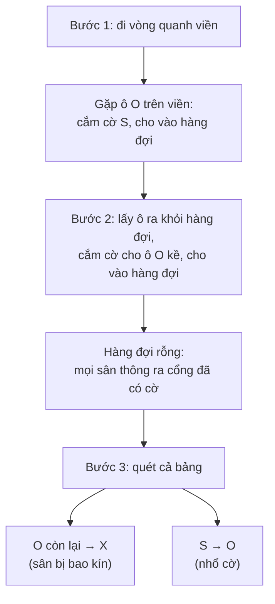
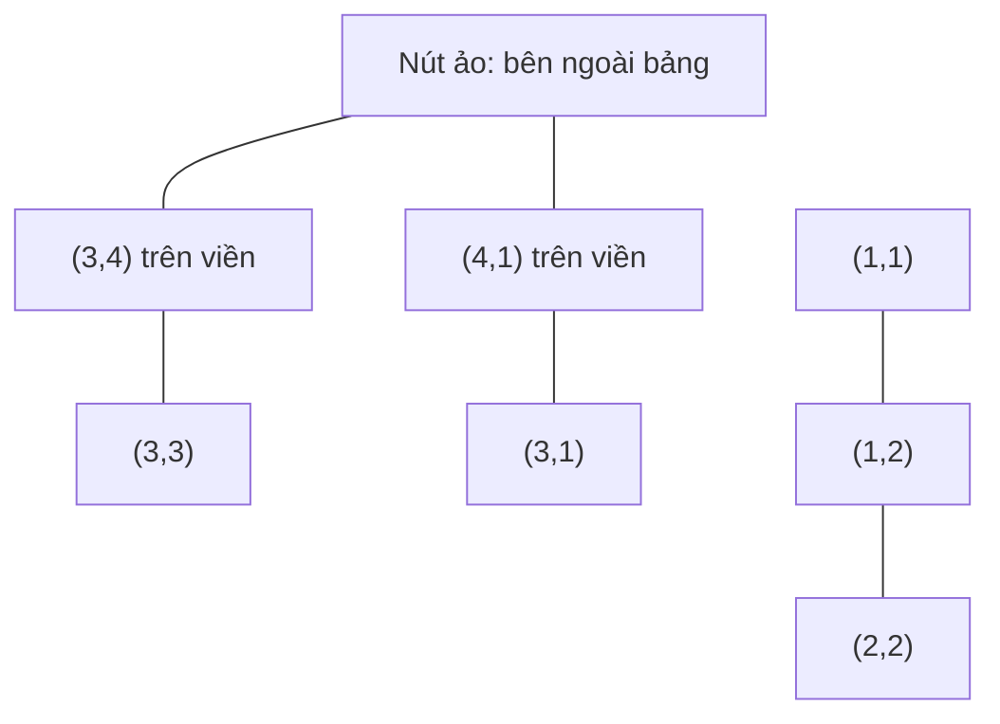

> [!tldr] Đọc nhanh
> - Một **vùng** là một nhóm ô `O` nối với nhau qua cạnh ngang hoặc dọc. Vùng **bị vây** khi không ô nào của nó nằm trên viền bảng. Đề bắt đổi mọi vùng bị vây thành `X`, ngay trên bảng đầu vào.
> - Hỏi "vùng này có bị vây không?" cho từng vùng thì phải duyệt hết vùng rồi mới biết. Hỏi ngược lại dễ hơn: **ô nào nối được ra viền?** Đó là ý của [[concepts/reverse-reachability|đi ngược từ đích]].
> - Cách nên dùng có ba bước: đánh dấu `S` cho mọi ô `O` trên viền, lan `S` vào trong bằng BFS, rồi quét một lượt: `O` còn sót thành `X`, `S` trả lại thành `O`. Thời gian `O(mn)`.
> - Bẫy lớn nhất là **đổi ô ngay trong lúc tìm**: tới khi phát hiện vùng chạm viền thì đã đổi mất vài ô. Bản sai đó chỉ đúng 2/10 ca.
> - DFS đệ quy trên bảng `200 × 200` toàn `O` sâu tới hàng chục nghìn tầng gọi, nên tràn stack ở TypeScript, JavaScript, Python và Java. Go thì không.

> [!info] Bối cảnh
> Bài LeetCode 130 (Medium), thuộc [[posts/2026-11-26-neetcode-graph-bfs|ga 2: Duyệt đồ thị và BFS]] trên **tuyến NeetCode: Đồ thị**. Bài này dùng lại đúng lượt duyệt lan của [[problems/number-of-islands|Number of Islands]], chỉ đổi câu hỏi: thay vì đếm đảo, mình cần biết đảo nào chạm mép. Bạn chỉ cần biết vòng lặp, mảng hai chiều và hàng đợi. Mọi thuật ngữ khác được giải thích ngay dưới.

> [!abstract]- Từ điển nhanh cho bài này (bấm để mở)
> - **Bảng (board)**: lưới `m` hàng, `n` cột, mỗi ô là ký tự `'X'` hoặc `'O'`. Tọa độ `(hàng, cột)` đếm từ 0.
> - **Viền (biên)**: các ô ở hàng đầu, hàng cuối, cột đầu hoặc cột cuối.
> - **Kề**: hai ô chung một cạnh (trên, dưới, trái, phải). Chung góc không tính là kề.
> - **Vùng**: một [[concepts/connected-component|thành phần liên thông]] của các ô `O`, tức nhóm ô `O` đi qua lại được bằng các bước kề.
> - [[concepts/grid-graph|Đồ thị lưới]]: coi mỗi ô là một đỉnh và mỗi cặp ô kề là một cạnh.
> - [[concepts/flood-fill|Duyệt lan (flood fill)]]: từ một ô, lan dần sang mọi ô kề cùng loại cho tới hết vùng.
> - [[concepts/breadth-first-search|BFS]]: duyệt theo lớp, dùng hàng đợi (vào trước ra trước). **DFS**: đi sâu một nhánh trước, dùng ngăn xếp hoặc đệ quy.
> - [[concepts/multi-source-bfs|BFS nhiều nguồn]]: bỏ nhiều ô xuất phát vào hàng đợi cùng lúc thay vì chạy BFS riêng cho từng ô.
> - **Sửa tại chỗ (in-place)**: hàm không trả về gì, mà phải sửa chính mảng người gọi đưa vào.
> - **Union-Find**: cấu trúc gom phần tử thành nhóm và hỏi nhanh "hai phần tử có cùng nhóm không". Ga 4 của tuyến này dạy kỹ.

## Hình dung trước: một tòa thành có tường và sân

Hình dung bảng là bản vẽ một tòa thành nhìn từ trên xuống. Ô `X` là **tường**. Ô `O` là **sân trống**. Mép bản vẽ là **cổng thành**: một khoảng sân chạm mép thì người bên ngoài đi vào được.

Nhà vua ra lệnh: khoảng sân nào bị tường bao kín, không có lối ra cổng, thì **lấp đầy** (đổi thành `X`).

Lính có hai cách làm. Cách vụng: đứng trong từng khoảng sân, đi thử xem có lối ra không. Cách khôn: đứng **ngoài cổng**, đi vào mọi sân mình tới được và **cắm cờ** ở đó. Sân nào không có cờ thì chắc chắn bị bao kín. Cuối cùng lấp các sân không cờ, rồi nhổ cờ.

| Đời thường | Khái niệm |
|---|---|
| Tường | Ô `X` |
| Sân trống | Ô `O` |
| Một khoảng sân liền nhau | Một vùng: thành phần liên thông của các ô `O` |
| Sân sát mép bản vẽ | Ô `O` nằm trên viền |
| Lính từ ngoài cổng đi vào, cắm cờ | [[concepts/reverse-reachability\|Đi ngược từ đích]]: [[concepts/multi-source-bfs\|BFS nhiều nguồn]] từ viền, đánh dấu `S` |
| Sân không có cờ | Vùng bị vây, đổi thành `X` |
| Nhổ cờ | Trả `S` về `O` |
| Lấp sân ngay khi đang đi thử | Bẫy "đổi trong lúc tìm" |



## Vấn đề: vùng nào bị vây?

Đầu vào là một bảng `m × n` gồm ký tự `'X'` và `'O'`, với `1 ≤ m, n ≤ 200`. Một vùng ô `O` bị vây khi không có ô nào của nó nằm trên viền. Đổi mọi ô của các vùng bị vây thành `'X'`. Hàm không trả về gì: phải sửa thẳng trên bảng được đưa vào. [Đề LC-0130](https://leetcode.com/problems/surrounded-regions/)

Mình từng nghĩ cách làm là "ô `O` nào không nằm trên viền thì đổi thành `X`". Sai, vì một ô ở giữa bảng vẫn có thể nối ra viền qua một chuỗi ô `O` khác. Xét bảng `5 × 5` dưới đây:

```text
     cột 0 1 2 3 4
hàng 0     X X X X X
hàng 1     X O O X X
hàng 2     X X O X X
hàng 3     X O X O O
hàng 4     X O X X X
```

Có ba vùng ô `O`:

| Vùng | Các ô | Có ô trên viền? | Kết quả |
|---|---|---|---|
| A | `(1,1)`, `(1,2)`, `(2,2)` | Không | Bị vây, đổi thành `X` |
| B | `(3,1)`, `(4,1)` | Có: `(4,1)` ở hàng cuối | Giữ nguyên |
| C | `(3,3)`, `(3,4)` | Có: `(3,4)` ở cột cuối | Giữ nguyên |

Ô `(3,1)` và `(3,3)` đều nằm bên trong, nhưng vẫn được giữ vì cùng vùng với một ô trên viền. Bảng sau khi xử lý:

```text
X X X X X
X X X X X
X X X X X
X O X O O
X O X X X
```

## Cơ chế

<figure class="figure-map" style="--ar: 3 / 4">
<div class="frame"><iframe data-archify="../diagrams/neetcode-surrounded-regions/worked-example.html" title="Tìm vùng bị vây bằng cách đi ngược từ viền" loading="lazy"></iframe></div>
<figcaption><span><b>Hình 1.</b> Trên bảng 5 × 5 ở trên, chỉ hai ô viền là điểm xuất phát; cờ lan tới đúng bốn ô, ba ô còn lại bị lấp.</span><a href="../diagrams/neetcode-surrounded-regions/worked-example.html" target="_blank" rel="noopener">Mở toàn màn hình</a></figcaption>
</figure>

<details>
<summary>Đọc từng bước</summary>
<ol>
<li>Đi vòng quanh viền, gặp O ở biên. <code>(3,4), (4,1) → S</code></li>
<li>Đưa hai ô biên vào hàng đợi. <code>hàng đợi: (3,4), (4,1)</code></li>
<li>Lấy (3,4), lan sang ô O kề. <code>(3,3) → S</code></li>
<li>Lấy (4,1), lan sang ô O kề. <code>(3,1) → S</code></li>
<li>Lấy (3,3), (3,1): hết ô O kề. <code>hàng đợi rỗng</code></li>
<li>Quét cuối: O còn lại bị vây. <code>(1,1), (1,2), (2,2) → X</code></li>
<li>Trả S về O, xong. <code>4 ô S → O</code></li>
</ol>
</details>

### Vì sao đi ngược lại dễ hơn

Câu hỏi "vùng này có bị vây không" có một điểm khó: muốn trả lời **không**, chỉ cần thấy một ô trên viền. Muốn trả lời **có**, phải đi hết vùng mới chắc. Nếu vừa đi vừa đổi ô, mình sẽ đổi sai những vùng hóa ra chạm viền.

Đảo câu hỏi thành "ô nào nối được ra viền" thì mọi thứ gọn lại. Các ô `O` trên viền chắc chắn được giữ. Từ chúng, ô `O` kề nào cũng được giữ, và cứ thế lan vào. Mỗi ô được đánh dấu **đúng một lần**, không ô nào phải chờ cả vùng duyệt xong. Đây là [[concepts/reverse-reachability|đi ngược từ đích]]: thay vì hỏi từ mỗi ô "tôi có tới được đích không", mình xuất phát từ đích và hỏi "đích tới được những ô nào".

Ba cách đầu dưới đây đều đúng. Chúng khác nhau ở chỗ phải làm lại bao nhiêu việc.

### Cách 0 — vét cạn: hỏi riêng từng ô

Với mỗi ô `O`, chạy một BFS mới từ ô đó. Nếu BFS chạm viền thì giữ ô, không thì ghi ô vào danh sách cần đổi. Chỉ đổi khi đã xét xong mọi ô, để các BFS sau vẫn đọc bảng gốc.

Cách này đúng nhưng chậm. Một vùng bị vây có `k` ô sẽ bị duyệt lại `k` lần, mỗi lần `k` ô, tức `k²` lượt thăm. Bảng `90 × 90` có viền `X` và phần trong toàn `O` có một vùng `88 × 88 = 7.744` ô, nên tốn `7.744² ≈ 6·10⁷` lượt thăm. Thời gian xấu nhất là `O((mn)²)`.

### Cách 1 — tô từng vùng, duyệt xong mới đổi

Sửa chỗ lãng phí của cách 0: duyệt **mỗi vùng một lần**. Quét bảng theo hàng. Gặp ô `O` chưa thăm thì BFS gom cả vùng vào một danh sách, đồng thời ghi nhớ một cờ "vùng có chạm viền không". Duyệt xong vùng mới quyết định: không chạm viền thì đổi cả danh sách thành `X`.

Mỗi ô vào hàng đợi đúng một lần, nên thời gian là `O(mn)`. Cái giá là một mảng `seen` cỡ `m × n` và danh sách ô của vùng đang xét.

### Cách 2 — đi ngược từ viền bằng BFS (nên dùng)

Đây là cách trong hình 1, và là cách mình chọn khi nộp bài:

1. **Gieo nguồn.** Đi hết bốn cạnh của bảng. Mỗi ô `O` trên viền được đổi thành `'S'` (an toàn) và cho vào hàng đợi. Hàng đợi lúc này có nhiều ô xuất phát cùng lúc: đó là [[concepts/multi-source-bfs|BFS nhiều nguồn]].
2. **Lan.** Lấy từng ô khỏi hàng đợi. Ô kề nào còn là `'O'` thì đổi thành `'S'` ngay lúc cho vào hàng đợi. Đổi ngay lúc thêm giúp một ô không bị thêm hai lần.
3. **Chốt.** Quét cả bảng một lượt: `'O'` còn sót là ô không nối được ra viền, đổi thành `'X'`. `'S'` trả lại thành `'O'`.

Chạy trên bảng ví dụ:

| Bước | Ô lấy ra | Ô kề được cắm cờ `S` | Hàng đợi sau bước này |
|---|---|---|---|
| Gieo | | `(3,4)`, `(4,1)` | `(3,4)`, `(4,1)` |
| 1 | `(3,4)` | `(3,3)` | `(4,1)`, `(3,3)` |
| 2 | `(4,1)` | `(3,1)` | `(3,3)`, `(3,1)` |
| 3 | `(3,3)` | không có | `(3,1)` |
| 4 | `(3,1)` | không có | rỗng |

Quét chốt thấy ba ô `O` của vùng A, đổi chúng thành `X`, rồi trả bốn ô `S` về `O`. Kết quả khớp bảng ở phần Vấn đề.

Cách này không cần mảng `seen` riêng: chữ `'S'` trên bảng chính là dấu đã thăm. Thời gian `O(mn)`. Bộ nhớ phụ là hàng đợi, tệ nhất `O(mn)` khi cả bảng là `O`.

### Cách 3 và 4 — cùng ý tưởng, lan bằng DFS

Thay hàng đợi bằng ngăn xếp (DFS lặp) hoặc bằng đệ quy (DFS đệ quy) thì vẫn đúng, vì bước lan chỉ cần thăm hết các ô nối được, không quan tâm thứ tự.

Đệ quy ngắn nhất nhưng có bẫy. Trên bảng `200 × 200` toàn `O`, DFS từ ô `(0,0)` với thứ tự trên, dưới, trái, phải đi xuống hết cột 0, sang cột 1 đi lên, sang cột 2 đi xuống... như rắn bò. Đường đi đó dài 40.000 ô và mỗi ô là một tầng gọi đang mở. Đó là [[concepts/recursion-depth-limit|giới hạn độ sâu đệ quy]]:

| Ngôn ngữ | DFS đệ quy trên `200 × 200` toàn `O` |
|---|---|
| TypeScript, JavaScript | `RangeError` (hết stack) |
| Python | `RecursionError` (mặc định khoảng 1.000 tầng) |
| Java | `StackOverflowError` |
| Go | Chạy đúng: stack của goroutine tự lớn dần, tới 1 GB |

DFS lặp với ngăn xếp tự quản lý không gặp chuyện này ở ngôn ngữ nào.

### Cách 5 — Union-Find với một nút "viền" ảo

Một cách nhìn khác: thêm một **nút ảo** đại diện cho "bên ngoài bảng". Mỗi ô `O` trên viền được nối vào nút ảo. Mỗi ô `O` được nối với ô `O` kề bên phải và bên dưới. Sau đó, ô `O` nào **không** cùng nhóm với nút ảo thì bị vây.



Ba ô `(1,1)`, `(1,2)`, `(2,2)` tạo một nhóm riêng không có đường tới nút ảo, nên bị đổi. Union-Find chạy gần `O(mn)` và không cần hàng đợi, nhưng phải cài thêm hai hàm `find` và `union`. Ga 4 của [[series/neetcode-grph|tuyến Đồ thị]] dạy cấu trúc này kỹ; ở bài này BFS từ viền ngắn và dễ đọc hơn.

### Tóm tắt các cách

| Cách | Thời gian | Bộ nhớ phụ | Ghi chú |
|---|---|---|---|
| 0. Vét cạn từng ô | `O((mn)²)` | `O(mn)` | Đúng nhưng quá chậm ở `200 × 200` |
| 1. Tô từng vùng | `O(mn)` | `O(mn)` | Cần mảng `seen` và danh sách vùng |
| 2. BFS từ viền | `O(mn)` | `O(mn)` hàng đợi | Nên dùng: ngắn, không đệ quy |
| 3. DFS đệ quy từ viền | `O(mn)` | `O(mn)` stack gọi | Tràn stack ở 4/5 ngôn ngữ |
| 4. DFS lặp từ viền | `O(mn)` | `O(mn)` ngăn xếp | Tương đương cách 2 |
| 5. Union-Find, nút ảo | gần `O(mn)` | `O(mn)` | Cài dài hơn, hữu ích khi bảng thay đổi dần |

### Đo: vét cạn so với tô từng vùng

Mình chạy cách 0 và cách 1 trên bảng có viền `X`, phần trong toàn `O`. Cả phần trong là một vùng bị vây, nên cả hai cách đều phải duyệt hết nó. Số lượt thăm của vét cạn là số đếm chính xác, không phụ thuộc máy. Thời gian thì đổi theo máy và theo lần chạy, chỉ nên đọc tỉ lệ.

| Bảng | Lượt thăm của vét cạn | Vét cạn (TS) | Tô từng vùng (TS) |
|---|---:|---:|---:|
| `30 × 30` | 614.656 | 16,4 ms | 0,03 ms |
| `60 × 60` | 11.316.496 | 289,1 ms | 0,11 ms |
| `90 × 90` | 59.969.536 | 1.548,7 ms | 0,24 ms |

Cạnh bảng tăng gấp ba (30 → 90) thì vét cạn chậm đi khoảng 94 lần, đúng nhịp `O((mn)²)`: số ô gấp 9, bình phương lên gấp 81. Tô từng vùng chỉ chậm đi khoảng 8 lần, theo đúng số ô. Ở giới hạn `200 × 200`, vét cạn cần khoảng `1,5·10⁹` lượt thăm. Vì vậy các file chỉ chạy nó trên 8 ca nhỏ.

## Ví dụ chạy được

Mỗi file chạy cả sáu cách đúng và ba bản sai trên 10 ca chung: bảng ví dụ, một ô `O`, một ô `X`, `3 × 3` toàn `O`, vòng `X` bao một ô, một hàng `OXO`, hai ô chỉ chạm góc, một đường vòng vèo ra viền, `200 × 200` toàn `O`, và `200 × 200` viền `X` với phần trong toàn `O`. Sau đó file đối chiếu năm cách đúng với vét cạn trên 2.000 bảng ngẫu nhiên tới `8 × 8`, rồi đo như bảng trên. Đoạn dưới là cách 2 trong từng file.

[TypeScript](../code/neetcode-surrounded-regions/surrounded.ts) · [Python](../code/neetcode-surrounded-regions/surrounded.py) · [Go](../code/neetcode-surrounded-regions/surrounded.go) · [Java](../code/neetcode-surrounded-regions/surrounded.java) · [JavaScript](../code/neetcode-surrounded-regions/surrounded.js) · [PHP](../code/neetcode-surrounded-regions/surrounded.php) · [Rust](../code/neetcode-surrounded-regions/surrounded.rs)

```ts
const DIRS = [[-1, 0], [1, 0], [0, -1], [0, 1]]

// Cách 2 (nên dùng): đi ngược từ biên. Mọi ô O trên biên vào hàng đợi cùng lúc
// và được đánh dấu an toàn 'S'. BFS lan 'S' vào trong. Cuối cùng quét một lượt:
// O còn lại bị vây nên thành X, S trả lại thành O.
function borderBfs(board: Board): void {
  const m = board.length, n = board[0].length
  const queue: number[] = []
  const seed = (r: number, c: number) => {
    if (board[r][c] === 'O') { board[r][c] = 'S'; queue.push(r * n + c) }
  }
  for (let r = 0; r < m; r++) { seed(r, 0); seed(r, n - 1) }
  for (let c = 0; c < n; c++) { seed(0, c); seed(m - 1, c) }
  for (let head = 0; head < queue.length; head++) {
    const cr = Math.floor(queue[head] / n), cc = queue[head] % n
    for (const [dr, dc] of DIRS) {
      const nr = cr + dr, nc = cc + dc
      if (nr < 0 || nr >= m || nc < 0 || nc >= n || board[nr][nc] !== 'O') continue
      board[nr][nc] = 'S'
      queue.push(nr * n + nc)
    }
  }
  finish(board)
}

function finish(board: Board): void {
  for (const row of board) {
    for (let c = 0; c < row.length; c++) row[c] = row[c] === 'O' ? 'X' : row[c] === 'S' ? 'O' : row[c]
  }
}
```
```python
DIRS = ((-1, 0), (1, 0), (0, -1), (0, 1))

def finish(board):
    for row in board:
        for c, ch in enumerate(row):
            row[c] = 'X' if ch == 'O' else 'O' if ch == 'S' else ch


def border_cells(m, n):
    for r in range(m):
        yield r, 0
        yield r, n - 1
    for c in range(n):
        yield 0, c
        yield m - 1, c


# Cách 2 (nên dùng): đi ngược từ biên. Mọi ô O trên biên vào hàng đợi cùng lúc
# và được đánh dấu an toàn 'S'. BFS lan 'S' vào trong. Cuối cùng quét một lượt:
# O còn lại bị vây nên thành X, S trả lại thành O.
def border_bfs(board):
    m, n = len(board), len(board[0])
    queue = deque()
    for r, c in border_cells(m, n):
        if board[r][c] == 'O':
            board[r][c] = 'S'
            queue.append((r, c))
    while queue:
        cr, cc = queue.popleft()
        for dr, dc in DIRS:
            nr, nc = cr + dr, cc + dc
            if 0 <= nr < m and 0 <= nc < n and board[nr][nc] == 'O':
                board[nr][nc] = 'S'
                queue.append((nr, nc))
    finish(board)
```
```go
var dirs = [4][2]int{{-1, 0}, {1, 0}, {0, -1}, {0, 1}}

func finish(board Board) {
	for _, row := range board {
		for c, ch := range row {
			if ch == 'O' {
				row[c] = 'X'
			} else if ch == 'S' {
				row[c] = 'O'
			}
		}
	}
}

func borderCells(m, n int, visit func(r, c int)) {
	for r := 0; r < m; r++ {
		visit(r, 0)
		visit(r, n-1)
	}
	for c := 0; c < n; c++ {
		visit(0, c)
		visit(m-1, c)
	}
}

// Cách 2 (nên dùng): đi ngược từ biên bằng BFS nhiều nguồn, đánh dấu an toàn 'S'.
func borderBfs(board Board) {
	m, n := len(board), len(board[0])
	var queue []int
	borderCells(m, n, func(r, c int) {
		if board[r][c] == 'O' {
			board[r][c] = 'S'
			queue = append(queue, r*n+c)
		}
	})
	for head := 0; head < len(queue); head++ {
		cr, cc := queue[head]/n, queue[head]%n
		for _, d := range dirs {
			nr, nc := cr+d[0], cc+d[1]
			if nr < 0 || nr >= m || nc < 0 || nc >= n || board[nr][nc] != 'O' {
				continue
			}
			board[nr][nc] = 'S'
			queue = append(queue, nr*n+nc)
		}
	}
	finish(board)
}
```
```java
    static final int[][] DIRS = {{-1, 0}, {1, 0}, {0, -1}, {0, 1}};

    static void finish(char[][] board) {
        for (char[] row : board)
            for (int c = 0; c < row.length; c++)
                row[c] = row[c] == 'O' ? 'X' : row[c] == 'S' ? 'O' : row[c];
    }

    static void borderCells(int m, int n, Consumer<int[]> visit) {
        for (int r = 0; r < m; r++) { visit.accept(new int[]{r, 0}); visit.accept(new int[]{r, n - 1}); }
        for (int c = 0; c < n; c++) { visit.accept(new int[]{0, c}); visit.accept(new int[]{m - 1, c}); }
    }

    // Cách 2 (nên dùng): đi ngược từ biên bằng BFS nhiều nguồn, đánh dấu an toàn 'S'.
    static void borderBfs(char[][] board) {
        int m = board.length, n = board[0].length;
        ArrayDeque<Integer> queue = new ArrayDeque<>();
        borderCells(m, n, p -> {
            if (board[p[0]][p[1]] == 'O') { board[p[0]][p[1]] = 'S'; queue.addLast(p[0] * n + p[1]); }
        });
        while (!queue.isEmpty()) {
            int id = queue.removeFirst(), cr = id / n, cc = id % n;
            for (int[] d : DIRS) {
                int nr = cr + d[0], nc = cc + d[1];
                if (nr < 0 || nr >= m || nc < 0 || nc >= n || board[nr][nc] != 'O') continue;
                board[nr][nc] = 'S';
                queue.addLast(nr * n + nc);
            }
        }
        finish(board);
    }
```
```js
const DIRS = [[-1, 0], [1, 0], [0, -1], [0, 1]];

// Cách 2 (nên dùng): đi ngược từ biên. Mọi ô O trên biên vào hàng đợi cùng lúc
// và được đánh dấu an toàn 'S'. BFS lan 'S' vào trong. Cuối cùng quét một lượt:
// O còn lại bị vây nên thành X, S trả lại thành O.
function borderBfs(board) {
    const m = board.length, n = board[0].length;
    const queue = [];
    const seed = (r, c) => {
        if (board[r][c] === 'O') {
            board[r][c] = 'S';
            queue.push(r * n + c);
        }
    };
    for (let r = 0; r < m; r++) {
        seed(r, 0);
        seed(r, n - 1);
    }
    for (let c = 0; c < n; c++) {
        seed(0, c);
        seed(m - 1, c);
    }
    for (let head = 0; head < queue.length; head++) {
        const cr = Math.floor(queue[head] / n), cc = queue[head] % n;
        for (const [dr, dc] of DIRS) {
            const nr = cr + dr, nc = cc + dc;
            if (nr < 0 || nr >= m || nc < 0 || nc >= n || board[nr][nc] !== 'O')
                continue;
            board[nr][nc] = 'S';
            queue.push(nr * n + nc);
        }
    }
    finish(board);
}
function finish(board) {
    for (const row of board) {
        for (let c = 0; c < row.length; c++)
            row[c] = row[c] === 'O' ? 'X' : row[c] === 'S' ? 'O' : row[c];
    }
}
```

```php
<?php
const DIRS = [[-1, 0], [1, 0], [0, -1], [0, 1]];

// Cách 2 (nên dùng): đi ngược từ biên. Ô O trên biên vào hàng đợi, đánh dấu an toàn 'S',
// BFS lan 'S' vào trong. Cuối cùng: O còn lại thành X, S trả lại thành O.
function borderBfs(array &$board): void
{
    $m = count($board);
    $n = count($board[0]);
    $queue = [];
    $seed = function (int $r, int $c) use (&$board, &$queue, $n): void {
        if ($board[$r][$c] === 'O') { $board[$r][$c] = 'S'; $queue[] = $r * $n + $c; }
    };
    for ($r = 0; $r < $m; $r++) { $seed($r, 0); $seed($r, $n - 1); }
    for ($c = 0; $c < $n; $c++) { $seed(0, $c); $seed($m - 1, $c); }
    for ($head = 0; $head < count($queue); $head++) {
        $cr = intdiv($queue[$head], $n);
        $cc = $queue[$head] % $n;
        foreach (DIRS as [$dr, $dc]) {
            $nr = $cr + $dr;
            $nc = $cc + $dc;
            if ($nr < 0 || $nr >= $m || $nc < 0 || $nc >= $n || $board[$nr][$nc] !== 'O') continue;
            $board[$nr][$nc] = 'S';
            $queue[] = $nr * $n + $nc;
        }
    }
    finish($board);
}

function finish(array &$board): void
{
    foreach ($board as &$row) {
        foreach ($row as &$cell) $cell = $cell === 'O' ? 'X' : ($cell === 'S' ? 'O' : $cell);
        unset($cell);
    }
    unset($row);
}
```

```rust
const DIRS: [(i32, i32); 4] = [(-1, 0), (1, 0), (0, -1), (0, 1)];

// Hàng xóm trong bảng m×n của ô (r, c), đã lọc ô ra ngoài biên.
fn neighbors(m: usize, n: usize, r: usize, c: usize) -> impl Iterator<Item = (usize, usize)> {
    DIRS.iter().filter_map(move |&(dr, dc)| {
        let (nr, nc) = (r as i32 + dr, c as i32 + dc);
        if nr < 0 || nr >= m as i32 || nc < 0 || nc >= n as i32 {
            None
        } else {
            Some((nr as usize, nc as usize))
        }
    })
}

// Các ô O trên biên: điểm xuất phát của những cách đi ngược.
fn border_cells(m: usize, n: usize) -> Vec<(usize, usize)> {
    let mut cells = Vec::new();
    for r in 0..m { cells.push((r, 0)); cells.push((r, n - 1)); }
    for c in 0..n { cells.push((0, c)); cells.push((m - 1, c)); }
    cells
}

// Cách 2 (nên dùng): đi ngược từ biên. Ô O trên biên vào hàng đợi, đánh dấu an toàn 'S',
// BFS lan 'S' vào trong. Cuối cùng: O còn lại thành X, S trả lại thành O.
fn border_bfs(board: &mut Board) {
    let (m, n) = (board.len(), board[0].len());
    let mut queue = Vec::new();
    for (r, c) in border_cells(m, n) {
        if board[r][c] == b'O' { board[r][c] = b'S'; queue.push(r * n + c); }
    }
    let mut head = 0;
    while head < queue.len() {
        let (cr, cc) = (queue[head] / n, queue[head] % n);
        head += 1;
        for (nr, nc) in neighbors(m, n, cr, cc) {
            if board[nr][nc] != b'O' { continue; }
            board[nr][nc] = b'S';
            queue.push(nr * n + nc);
        }
    }
    finish(board);
}

fn finish(board: &mut Board) {
    for cell in board.iter_mut().flatten() {
        *cell = match *cell { b'O' => b'X', b'S' => b'O', other => other };
    }
}
```

Kết quả `node surrounded.ts`:

```text
bruteForcePerCell      8/8 ca đúng (chỉ các ca nhỏ)
regionFill             10/10 ca đúng
borderBfs              10/10 ca đúng
borderDfsRecursive     9/10 ca đúng; sai ở 200×200 toàn O → ném RangeError
borderDfsIterative     10/10 ca đúng
unionFind              10/10 ca đúng
wrongNotOnBorder       6/10 ca đúng; sai ở ví dụ 5×5 ở trên, 3×3 toàn O, đường vòng vèo ra biên, 200×200 toàn O
wrongFlipDuringSearch  2/10 ca đúng; sai ở ví dụ 5×5 ở trên, một ô O, 3×3 toàn O, một hàng OXO, chạm chéo không tính là nối, đường vòng vèo ra biên, 200×200 toàn O, 200×200 viền X, trong toàn O → ném RangeError
wrongNewBoard          6/10 ca đúng; sai ở ví dụ 5×5 ở trên, vòng X bao một ô O, chạm chéo không tính là nối, 200×200 viền X, trong toàn O
đối chiếu ngẫu nhiên: 2000/2000 bảng, năm cách đúng khớp vét cạn
30×30: vét cạn 614656 lượt thăm, 16.4 ms; tô từng vùng 0.03 ms
60×60: vét cạn 11316496 lượt thăm, 289.1 ms; tô từng vùng 0.11 ms
90×90: vét cạn 59969536 lượt thăm, 1548.7 ms; tô từng vùng 0.24 ms
```

Sáu file còn lại cho cùng kết quả đúng/sai, trừ bốn chỗ:
- **Go:** `borderDfsRecursive` đúng cả 10/10, vì stack của goroutine tự lớn. Bản sai `wrongFlipDuringSearch` cũng không tràn stack, nên đúng thêm ca `200 × 200` viền `X` (3/10 thay vì 2/10). Ở ca đó mọi ô bên trong đều bị vây, nên đổi ngay cũng tình cờ ra đúng.
- **Python:** in thêm một dòng cho bẫy riêng của Python: `bảng là list[str]: ném TypeError ('str' object does not support item assignment)`. Python đo trên bảng nhỏ hơn (20, 30, 40) vì chậm hơn: `40 × 40` tốn 2.085.136 lượt thăm, khoảng 1.068 ms cho vét cạn và 0,54 ms cho tô từng vùng.
- **PHP** (`php surrounded.php`): `borderDfsRecursive` đúng 10/10, vì lời gọi hàm PHP nằm trên heap chứ không trên stack của luồng (máy bật Xdebug thì Xdebug chặn ở 512 tầng; tắt bằng `php -d xdebug.mode=off`). `wrongFlipDuringSearch` vì thế cũng được 3/10 như Go. Bản sai thứ ba được viết lại cho đúng kiểu PHP: hàm nhận `array $board` thay vì `array &$board`, tức **quên dấu `&`**, nên nó sửa một bản sao và vẫn sai 6/10. PHP chỉ đo `30 × 30` và `60 × 60`: vét cạn `60 × 60` đã mất khoảng 3.500 ms, `90 × 90` mất khoảng 20 giây.
- **Rust** (`rustc --edition 2021 -O surrounded.rs`): `border_dfs_recursive` đúng 10/10 trên stack 8 MB của luồng chính, `wrong_flip_during_search` được 3/10 như Go. Bản sai thứ ba che tên bằng `let mut board = board.clone()`, nên cũng sửa bản sao. Rust nhanh nhất ở phép đo: vét cạn `90 × 90` mất khoảng 520 ms, tô từng vùng 0,07 ms.

## Hiểu lầm và bẫy hay gặp

- **"Ô `O` nào không nằm trên viền thì đổi."** Bỏ qua chuyện ô bên trong vẫn nối ra viền qua ô khác. Bản `wrongNotOnBorder` sai 4/10 ca, kể cả bảng ví dụ (ô `(3,1)` và `(3,3)` bị đổi nhầm).
- **Đổi ô ngay trong lúc tìm.** Bản `wrongFlipDuringSearch` đổi ô thành `X` để đánh dấu đã thăm, rồi mới phát hiện vùng chạm viền: những ô đã đổi không quay lại được. Tệ hơn, `a && b && c && d` dừng ngay khi một vế trả `false`, nên phần còn lại của vùng không được thăm. Bản này đúng 2/10 ca (3/10 ở Go). Cách sửa: dùng một dấu tạm khác (`S`), hoặc gom cả vùng rồi mới quyết định.
- **Tạo bảng mới rồi gán lại tham số.** `board = board.map(...)` (hoặc `board = [row[:] ...]`, `board = copy(board)`) chỉ đổi biến cục bộ; người gọi vẫn giữ bảng cũ. Bản `wrongNewBoard` làm đúng trên bản sao nhưng sai 4/10 ca, đúng những ca có ô cần đổi. Đề yêu cầu **sửa tại chỗ**.
- **Coi hai ô chạm góc là nối nhau.** Chỉ bốn hướng trên, dưới, trái, phải. Ca "chạm chéo" có ô `(1,1)` và `(2,2)` chạm góc ô `(0,0)` trên viền, nhưng vẫn bị vây.
- **Quên bước nhổ cờ.** Nếu không trả `S` về `O`, bảng kết quả có chữ `S` lạ.
- **DFS đệ quy trên bảng lớn.** Tràn stack ở TypeScript, JavaScript, Python và Java như bảng ở trên. Dùng BFS hoặc DFS lặp.
- **Python: hàng là chuỗi.** Nếu bảng là `list[str]`, lệnh `board[r][c] = 'X'` ném `TypeError`, vì chuỗi không sửa được. LeetCode đưa vào `list[list[str]]`; khi tự viết ca thử, nhớ `list(row)`.
- **TypeScript/JavaScript: hàng là chuỗi.** Lệnh gán `board[r][c] = 'X'` lên một chuỗi **không báo lỗi gì** trong file không ở strict mode (mình chạy thử: chuỗi `'XOX'` vẫn là `'XOX'`). Ở strict mode thì ném `TypeError: Cannot assign to read only property`. Bảng phải là mảng các mảng ký tự.
- **Java: so `char` với `String`.** Viết `board[r][c] == "O"` (nháy kép) là lỗi biên dịch `bad operand types for binary operator '=='`. Dùng `'O'` (nháy đơn).
- **Go và Java: chép bảng nông.** `copy(dst, board)` trong Go hay `board.clone()` trong Java chỉ chép mảng ngoài; các hàng vẫn dùng chung. Khi cần bản sao để thử, chép từng hàng như hàm `clone`/`copy` trong file.
- **PHP: `foreach ($board as $row)` rồi sửa `$row`.** `$row` là bản sao của hàng, sửa nó không đổi bảng. Hàm `finish` trong bản PHP lặp bằng tham chiếu (`foreach ($board as &$row)`) và `unset($row)` ngay sau vòng lặp; quên `unset` thì vòng `foreach` kế tiếp sẽ ghi đè lên hàng cuối.
- **Rust: hàm đệ quy mượn `&mut board` hai lần.** Không thể viết `dfs` thành closure vừa đọc vừa sửa `board` rồi tự gọi lại chính nó; borrow checker từ chối. Bản Rust tách `mark_safe` thành hàm thường nhận `board: &mut Board` và chỉ số kiểu `i32`, để `r - 1` ở hàng 0 thành `-1` rồi bị chặn ở dòng kiểm biên, không panic.

## Câu hỏi tự kiểm tra

> [!question]- Bảng chỉ có một hàng, ví dụ `O X O O X O`. Có ô nào bị đổi không?
> Không. Với một hàng (hoặc một cột), mọi ô đều nằm trên viền, nên không vùng nào bị vây.

> [!question]- Vì sao đánh dấu `S` ngay lúc cho ô vào hàng đợi, mà không đợi tới lúc lấy ra?
> Một ô có thể kề hai ô đã có cờ. Nếu đợi lúc lấy ra mới đánh dấu, cả hai hàng xóm đều thấy nó còn là `O` và cho nó vào hàng đợi hai lần. Đánh dấu ngay lúc thêm chặn lần thứ hai.

> [!question]- Ô `(2,2)` nằm giữa bảng nhưng có đường gồm toàn ô `O` dẫn ra cột cuối. Cách 2 có giữ nó không?
> Có. BFS bắt đầu từ ô `O` ở cột cuối, lan ngược theo đường đó và cắm cờ `S` cho `(2,2)`. Bước chốt trả nó về `O`.

> [!question]- Nếu được phép dùng thêm bộ nhớ thoải mái, vì sao vẫn không nên dùng vét cạn?
> Vấn đề không phải bộ nhớ mà là thời gian: mỗi ô của một vùng lớn duyệt lại cả vùng, nên tốn `O((mn)²)`. Ở `200 × 200` là khoảng `1,5·10⁹` lượt thăm.

## Tham khảo

- [LeetCode · Surrounded Regions](https://leetcode.com/problems/surrounded-regions/) — đề và giới hạn `1 ≤ m, n ≤ 200` (đã đối chiếu ngày 26/11/2026).
- [Princeton · Breadth-first paths](https://github.com/kevin-wayne/algs4/blob/master/src/main/java/edu/princeton/cs/algs4/BreadthFirstPaths.java) — BFS nhiều nguồn và đánh dấu trước khi cho vào hàng đợi.
- [Princeton · Weighted quick-union](https://github.com/kevin-wayne/algs4/blob/master/src/main/java/edu/princeton/cs/algs4/WeightedQuickUnionUF.java) — Union-Find gộp theo kích thước.
- [Python · Giới hạn đệ quy](https://docs.python.org/3/library/sys.html#sys.getrecursionlimit), [Go · SetMaxStack](https://pkg.go.dev/runtime/debug#SetMaxStack) (stack goroutine tối đa 1 GB trên máy 64 bit), [Java · ArrayDeque](https://docs.oracle.com/en/java/javase/21/docs/api/java.base/java/util/ArrayDeque.html).
