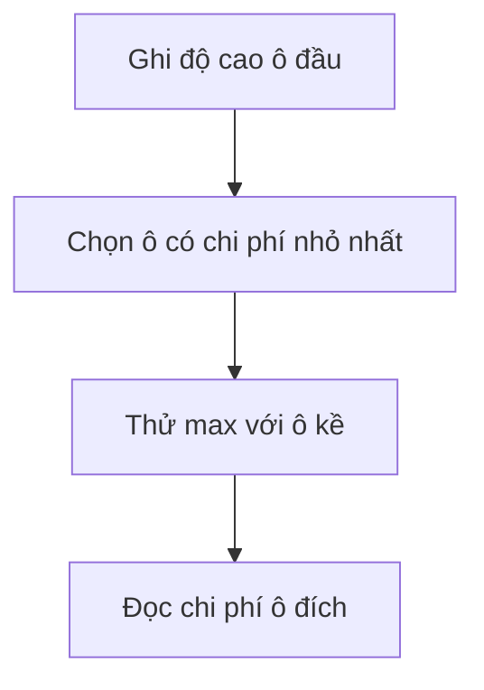

> [!tldr] Đọc nhanh
> - Chi phí một đường là độ cao lớn nhất trên đường, tính cả ô đầu và ô cuối.
> - [[concepts/minimax-path|Đường đi minimax]] chọn đường có chi phí lớn nhất đó thấp nhất.
> - Dijkstra vẫn chốt được giá thấp nhất vì mở rộng đường bằng `max` chỉ giữ nguyên hoặc tăng chi phí.

> [!info] Bối cảnh
> Bài LeetCode 778, thuộc [[posts/2026-11-27-neetcode-shortest-path|ga 5: Đường đi ngắn nhất]] trên tuyến NeetCode Đồ thị. Bạn chỉ cần biết vòng lặp và mảng để bắt đầu.

> [!abstract]- Từ điển nhanh cho bài này (bấm để mở)
> - Ngưỡng `t` mở mọi ô có độ cao không quá `t`.
> - Cạnh nối hai ô chung cạnh, di chuyển theo bốn hướng.
> - [[concepts/breadth-first-search|BFS]] trả lời có đường qua các ô mở ở một ngưỡng cho trước hay không.

## Hình dung trước: lối qua các bậc đá

Mình muốn chèo xuồng qua một bãi đá. Tuyến thứ nhất đi qua bậc đá cao 8, tuyến dài hơn chỉ gặp bậc cao 4. Tuyến dài hơn mở sớm hơn vì nước chỉ cần lên tới mức 4.

| Đời thường | Khái niệm |
| --- | --- |
| Độ cao bậc đá | Giá trị ô |
| Bậc cao nhất trên tuyến | Chi phí minimax |
| Mức nước đầu tiên cho một tuyến hợp lệ | Giá tốt nhất tới đích |



## Vấn đề: mực nước nào mở lối tới góc đối diện

Trên lưới vuông n × n với `1 ≤ n ≤ 50`, mỗi ô có một độ cao khác nhau từ 0 đến n²−1. Ở mực nước `t`, mình chỉ qua các ô có độ cao không quá `t` và đi theo bốn hướng. Tìm `t` nhỏ nhất giúp đi từ góc trên trái tới góc dưới phải.

## Cơ chế

### Ngưỡng và đường đi

Với lưới `[[0,8,7],[1,6,5],[2,3,4]]`, tuyến dọc cột trái rồi ngang qua hàng dưới có chi phí 4. Mực thấp hơn không thể mở ô đích cao 4, nên 4 là tối ưu.

Một cách trực tiếp là thử từng mực từ thấp lên rồi dùng BFS. Tối đa n² lần kiểm tra, mỗi lần O(n²), nên thời gian O(n⁴) và bộ nhớ O(n²). Một khi đi được ở mức t thì mọi mức cao hơn đều đi được. Tìm nhị phân trên ngưỡng giảm số lần BFS xuống O(log n), thành O(n² log(n + 1)) thời gian.

### Đổi phép cộng thành max

Mình đánh số ô bằng `row * n + col`, tạo cạnh đi vào ô kề với trọng số là độ cao của ô kề. Một đường bắt đầu với `grid[0][0]`. Mỗi lần mở rộng từ giá `d` tới ô cao `h`, giá mới là `max(d, h)`.

Phép `max` vừa không hạ giá của đường, vừa bảo toàn thứ tự giữa hai giá cũ khi cùng mở rộng qua một ô. Nếu có một đường tốt hơn đến ô sắp chốt, ô chưa chốt đầu tiên của đường tốt hơn phải có giá nhỏ hơn mức đang lấy, và heap sẽ lấy ô đó trước.

Mã xây danh sách kề tường minh để dùng chung vòng lặp [[concepts/dijkstra|Dijkstra]]. Có n² đỉnh và không quá 4n² cạnh, nên thời gian O(n² log(n + 1)), bộ nhớ O(n²). Mô hình kề ngầm cũng sinh đúng bốn nước đi, tiết kiệm phần lưu cạnh. File TypeScript kiểm kết quả bằng BFS tìm nhị phân trên 200 hoán vị nhỏ.

## Ví dụ chạy được

[TypeScript](../code/neetcode-swim-in-rising-water/water-level.ts) · [Python](../code/neetcode-swim-in-rising-water/water_level.py) · [Go](../code/neetcode-swim-in-rising-water/water_level.go) · [Java](../code/neetcode-swim-in-rising-water/water-level.java) · [JavaScript](../code/neetcode-swim-in-rising-water/water-level.js) · [PHP](../code/neetcode-swim-in-rising-water/water-level.php) · [Rust](../code/neetcode-swim-in-rising-water/water_level.rs)

Tab hiển thị hàm chính. File tải về còn chạy các cách so sánh trên những ca nhỏ. File TypeScript chạy thêm phép đối chiếu ngẫu nhiên.

```ts
function swimTime(grid: number[][]): number {
  const n = grid.length
  const graph = Array.from({ length: n * n }, (): Neighbor[] => [])
  const directions = [[-1, 0], [1, 0], [0, -1], [0, 1]]
  for (let row = 0; row < n; row++) {
    for (let col = 0; col < n; col++) {
      for (const [dr, dc] of directions) {
        const r = row + dr
        const c = col + dc
        if (0 <= r && r < n && 0 <= c && c < n) graph[row * n + col].push([r * n + c, grid[r][c]])
      }
    }
  }
  return leastCosts(graph, 0, grid[0][0], Math.max)[n * n - 1]
}
```

```python
def swim_time(grid):
    n = len(grid)
    graph = [[] for _ in range(n * n)]
    for row in range(n):
        for col in range(n):
            for dr, dc in ((-1, 0), (1, 0), (0, -1), (0, 1)):
                r, c = row + dr, col + dc
                if 0 <= r < n and 0 <= c < n:
                    graph[row * n + col].append((r * n + c, grid[r][c]))
    return least_costs(graph, 0, grid[0][0], max)[-1]
```

```go
func swimTime(grid [][]int) int {
	n := len(grid)
	graph := make([][]neighbor, n*n)
	directions := [][2]int{{-1, 0}, {1, 0}, {0, -1}, {0, 1}}
	for row := range grid {
		for col := range grid[row] {
			for _, delta := range directions {
				r, c := row+delta[0], col+delta[1]
				if r >= 0 && r < n && c >= 0 && c < n {
					from := row*n + col
					graph[from] = append(graph[from], neighbor{r*n + c, grid[r][c]})
				}
			}
		}
	}
	return leastCosts(graph, 0, grid[0][0], func(a, b int) int { return max(a, b) })[n*n-1]
}
```

```java
static int swimTime(int[][] grid) {
    int n = grid.length;
    var graph = emptyGraph(n * n);
    int[][] directions = {{-1, 0}, {1, 0}, {0, -1}, {0, 1}};
    for (int row = 0; row < n; row++) {
        for (int col = 0; col < n; col++) {
            for (int[] delta : directions) {
                int r = row + delta[0], c = col + delta[1];
                if (0 <= r && r < n && 0 <= c && c < n) {
                    graph.get(row * n + col).add(new int[]{r * n + c, grid[r][c]});
                }
            }
        }
    }
    return leastCosts(graph, 0, grid[0][0], Math::max)[n * n - 1];
}
```

```js
function swimTime(grid) {
  const n = grid.length
  const graph = Array.from({ length: n * n }, () => [])
  const directions = [[-1, 0], [1, 0], [0, -1], [0, 1]]
  for (let row = 0; row < n; row++) {
    for (let col = 0; col < n; col++) {
      for (const [dr, dc] of directions) {
        const r = row + dr
        const c = col + dc
        if (0 <= r && r < n && 0 <= c && c < n) graph[row * n + col].push([r * n + c, grid[r][c]])
      }
    }
  }
  return leastCosts(graph, 0, grid[0][0], Math.max)[n * n - 1]
}
```

```php
function swimTime(array $grid): int {
    $n = count($grid);
    $graph = array_fill(0, $n * $n, []);
    $directions = [[-1, 0], [1, 0], [0, -1], [0, 1]];
    for ($row = 0; $row < $n; $row++) {
        for ($col = 0; $col < $n; $col++) {
            foreach ($directions as [$dr, $dc]) {
                $r = $row + $dr;
                $c = $col + $dc;
                if (0 <= $r && $r < $n && 0 <= $c && $c < $n) {
                    $graph[$row * $n + $col][] = [$r * $n + $c, $grid[$r][$c]];
                }
            }
        }
    }
    return leastCosts($graph, 0, $grid[0][0], 'max')[$n * $n - 1];
}
```

```rust
fn swim_time(grid: &[&[i32]]) -> i32 {
    let n = grid.len();
    let mut graph = vec![Vec::new(); n * n];
    let directions = [(-1, 0), (1, 0), (0, -1), (0, 1)];
    for row in 0..n {
        for col in 0..n {
            for (dr, dc) in directions {
                let r = row.wrapping_add_signed(dr);
                let c = col.wrapping_add_signed(dc);
                if r < n && c < n {
                    graph[row * n + col].push((r * n + c, grid[r][c]));
                }
            }
        }
    }
    least_costs(&graph, 0, grid[0][0], i32::max)[n * n - 1]
}
```

```text
5/5 ca đúng
200/200 ca đối chiếu
```

## Hiểu lầm và bẫy hay gặp

- **Cộng độ cao dọc đường.** Nước chỉ cần vượt bậc cao nhất.
- **Khởi tạo giá nguồn bằng 0.** Ô đầu có thể cao nhất, chẳng hạn `[[3,0],[2,1]]` có đáp án 3.
- **Đòi tối ưu số bước đi.** Điều kiện mở đường không tính số bước.
- **Trừ 1 khỏi chỉ số unsigned khi ở viền.** Rust dùng `wrapping_add_signed` rồi kiểm biên trên trước truy cập.

## Câu hỏi tự kiểm tra

> [!question]- Hai đường đi đồng giá 4 nhưng một đường dài gấp đôi. Đáp án có đổi không?
> Không. Hai đường cùng mở ở mực 4.

> [!question]- Lưới chỉ một ô có cần đi BFS không?
> Ô đầu cũng là ô cuối. Trả độ cao của ô đó.

## Tham khảo

- [LeetCode 778 · Swim in Rising Water](https://leetcode.com/problems/swim-in-rising-water/)
- [Dijkstra (1959)](https://doi.org/10.1007/BF01386390)
