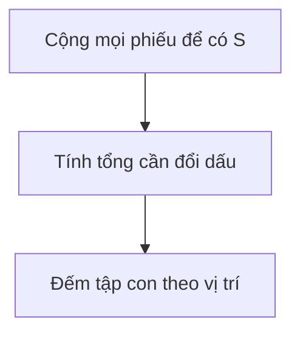

> [!tldr] Đọc nhanh
> - Chọn vị trí đặt dấu trừ. Nếu tổng cả mảng là S và tổng các vị trí được chọn là N thì biểu thức có giá trị S − 2N.
> - Chỉ cần đếm tập con có tổng N = (S − target)/2. Nếu giá trị đích vượt khoảng [−S, S] hoặc S − target lẻ, kết quả bằng 0.
> - Quét tổng giảm dần vì mỗi vị trí được chọn tối đa một lần. Mỗi số 0 làm số cách ở từng tổng tăng gấp đôi.

> [!info] Bối cảnh
> Đây là bài LeetCode 494 tại [[posts/2026-11-27-neetcode-knapsack|ga DP-03: Ba lô và đổi tiền]] trên **tuyến NeetCode: Quy hoạch động**. Mình hình dung bảng điều chỉnh kho, mỗi phiếu ghi tăng hay giảm một lượng hàng. Bạn chỉ cần biết cách tính tổng và đọc vòng lặp.

> [!abstract]- Từ điển nhanh cho bài này (bấm để mở)
> - [[concepts/signed-subset-sum|Quy đổi tổng có dấu]] chuyển lựa chọn dấu ở từng vị trí thành chọn một tập con vị trí.
> - [[concepts/zero-one-knapsack|0/1 Knapsack]] cho mỗi vị trí hai lựa chọn, lấy hoặc bỏ.
> - [[concepts/knapsack-update-order|Thứ tự cập nhật]] quyết định ô nguồn thuộc hàng cũ hay hàng đang ghi.

## Hình dung trước: phiếu cộng hoặc trừ

Một kho có các phiếu mang lượng hàng 1, 2, 5. Nếu đánh dấu cộng hết, sổ tăng 8. Đổi riêng phiếu 2 sang dấu trừ kéo sổ xuống 4 đơn vị, từ 8 thành 4. Khi đã chọn phiếu nào đổi dấu, dấu của mọi phiếu còn lại được xác định.

| Đời thường | Khái niệm |
|---|---|
| Tổng coi mọi phiếu đều cộng | S |
| Danh sách phiếu đổi dấu | Tập con vị trí |
| Phiếu x đổi từ cộng sang trừ | Tổng giảm 2x |
| Phiếu số 0 ghi tăng hay giảm đều được | Hai lựa chọn có cùng tổng |



## Vấn đề: đếm dấu theo từng vị trí

Mảng có từ 1 đến 20 số nguyên không âm, mỗi số không quá 1.000 và tổng toàn mảng không quá 1.000. Giá trị đích thuộc [−1.000, 1.000]. Mỗi vị trí bắt buộc có một dấu. Hai dãy dấu khác nhau được tính riêng, kể cả khi chúng chỉ khác ở vị trí mang số 0. Ví dụ `[1,2,5]` tới 4 có một cách `+1−2+5`. [Đề gốc LeetCode 494](https://leetcode.com/problems/target-sum/)

## Cơ chế

### Vét hai dấu và gộp các nhánh trùng tổng

Vét cạn quyết định dấu tại từng vị trí và kiểm tra tổng ở lá. Cây có 2ⁿ lá, nên cần O(2ⁿ) thời gian và O(n) ngăn xếp. Để dùng lại công việc, giữ `ways[s]` bằng số cách tới tổng có dấu s sau một tiền tố. Với x tiếp theo, mỗi cách ở s đóng góp vào `s+x` và `s−x` trên **một hàng mới**. Hai cạnh cùng đến một ô khi x = 0, nên cộng cả hai. Map chỉ lưu tổng thực sự tới được. Gọi S là tổng mảng và Sᵢ là tổng tiền tố i. Có tối đa 2Sᵢ + 1 khóa ở lớp i. Cận xấu nhất là O(n(S+1)) thời gian kỳ vọng với bảng băm và O(S+1) bộ nhớ.

### Quy đổi và bỏ hàng cũ

Gọi P, N là tổng các vị trí mang dấu cộng và trừ. Ta có P + N = S và P − N = target, suy ra N = (S − target)/2. Mỗi tập vị trí có tổng N xác định duy nhất cả dãy dấu. Điều kiện chẵn lẻ và khoảng chỉ là điều kiện cần. Bảng vẫn có thể trả 0.

Đặt `ways[0] = 1` cho tập rỗng. Trước khi xử lý x, ô s đếm tập con từ tiền tố đã xử lý. Sau lượt x, số mới ở s bằng số cũ ở s cộng số cũ ở s − x. Với x > 0, quét giảm bảo đảm ô nhỏ hơn vẫn thuộc hàng cũ. Với x = 0, vế phải đọc đúng số cũ ở ô s và nhân đôi nó bằng một phép cộng. Hai số 0 trước `[2,3]` làm số cách tới 1 tăng từ 1 lên 4.

Gọi W là tổng tập con cần tìm. Bảng cuộn cần O(n(W+1)) thời gian và O(W+1) bộ nhớ. Thời gian phụ thuộc giá trị số của W, nên đây là cận giả đa thức. Không có phép nhân đếm nào vượt 2²⁰ dưới giới hạn đề.

## Ví dụ chạy được

[TypeScript](../code/neetcode-target-sum/signs.ts) · [Python](../code/neetcode-target-sum/signs.py) · [Go](../code/neetcode-target-sum/signs.go) · [Java](../code/neetcode-target-sum/signs.java) · [JavaScript](../code/neetcode-target-sum/signs.js) · [PHP](../code/neetcode-target-sum/signs.php) · [Rust](../code/neetcode-target-sum/signs.rs)

```ts
function countBySubset(nums: number[], target: number) {
    const sum = nums.reduce((a, b) => a+b, 0)
    const twice = sum-target
    if (Math.abs(target) > sum || twice % 2 !== 0) return 0
    const goal = twice/2
    const ways = Array(goal+1).fill(0)
    ways[0] = 1
    for (const x of nums) {
        for (let s = goal; s >= x; s--) {
            ways[s] += ways[s-x]
        }
    }
    return ways[goal]
}
```

```python
def count_by_subset(nums, target):
    total = sum(nums)
    twice = total - target
    if abs(target) > total or twice % 2:
        return 0
    goal = twice // 2
    ways = [1] + [0] * goal
    for x in nums:
        for s in range(goal, x-1, -1):
            ways[s] += ways[s-x]
    return ways[goal]
```

```go
func countBySubset(nums []int, target int) int {
	sum := 0
	for _, x := range nums {
		sum += x
	}
	twice := sum - target
	if target > sum || target < -sum || twice%2 != 0 {
		return 0
	}
	goal := twice / 2
	ways := make([]int, goal+1)
	ways[0] = 1
	for _, x := range nums {
		for s := goal; s >= x; s-- {
			ways[s] += ways[s-x]
		}
	}
	return ways[goal]
}
```

```java
static int countBySubset(int[] nums, int target) {
    int sum = Arrays.stream(nums).sum();
    int twice = sum-target;
    if (Math.abs(target)>sum || twice%2!=0) return 0;
    int goal = twice/2;
    int[] ways = new int[goal+1];
    ways[0] = 1;
    for (int x : nums) {
        for (int s=goal;s>=x;s--) ways[s] += ways[s-x];
    }
    return ways[goal];
}
```

```js
function countBySubset(nums, target) {
    const sum = nums.reduce((a, b) => a+b, 0)
    const twice = sum-target
    if (Math.abs(target) > sum || twice % 2 !== 0) return 0
    const goal = twice/2
    const ways = Array(goal+1).fill(0)
    ways[0] = 1
    for (const x of nums) {
        for (let s = goal; s >= x; s--) {
            ways[s] += ways[s-x]
        }
    }
    return ways[goal]
}
```

```php
function countBySubset(array $nums, int $target): int {
    $sum = array_sum($nums);
    $twice = $sum - $target;
    if (abs($target) > $sum || $twice % 2 !== 0) return 0;
    $goal = intdiv($twice, 2);
    $ways = array_fill(0, $goal+1, 0);
    $ways[0] = 1;
    foreach ($nums as $x) {
        for ($s=$goal; $s >= $x; $s--) $ways[$s] += $ways[$s-$x];
    }
    return $ways[$goal];
}
```

```rust
fn count_by_subset(nums: &[i32], target: i32) -> i32 {
    let sum: i32 = nums.iter().sum();
    let twice = sum - target;
    if target.abs() > sum || twice % 2 != 0 {
        return 0;
    }
    let goal = (twice / 2) as usize;
    let mut ways = vec![0; goal + 1];
    ways[0] = 1;
    for &x in nums {
        let x = x as usize;
        for s in (x..=goal).rev() {
            ways[s] += ways[s - x];
        }
    }
    ways[goal]
}
```

Các tab hiển thị phần đếm tập con. File tải về còn có map theo tổng có dấu và vét cạn. Ba cách đối chiếu trên ca tối đa 16 phần tử. Hai cách DP còn kiểm tra 20 số 0. Bản Node.js đếm số lá của cây quyết định và số lượt cập nhật ô với 16 số 1, đích 0. Phép đo đếm hai loại thao tác, không suy ra tỉ lệ thời gian chạy.

```text
11/11 ca đúng
16 số 1: 65536 lá, 128 lượt cập nhật ô
```

## Hiểu lầm và bẫy hay gặp

- Tập hợp các giá trị sẽ làm mất vị trí trùng. Với bốn số 3 và tổng 0 có sáu cách chọn hai vị trí mang dấu trừ.
- Bỏ qua x = 0 làm mất một nửa cách cho mỗi số 0. Rust dùng range đảo chiều có cả cận 0, nên không cần trừ trực tiếp một biến `usize` đã bằng 0.
- Ép sang chỉ số hoặc chia nguyên trước khi so khoảng và chẵn lẻ có thể làm tròn một đích bất hợp lệ. Python dùng `//` và PHP dùng `intdiv` sau hai điều kiện này.

## Câu hỏi tự kiểm tra

> [!question]- Tại sao đổi một dấu làm tổng giảm 2x?
> Phiếu từng đóng góp +x và giờ đóng góp −x. Chênh lệch là −2x.

> [!question]- Vì sao cần một hàng mới trong cách map?
> Hai đích phải xuất phát từ cùng một lớp. Ghi trở lại map đang duyệt có thể đưa x vào một nhánh thêm lần nữa.

> [!question]- Tổng đích 0 với hai số 0 có mấy cách?
> Có bốn cách. Mỗi vị trí có hai dấu độc lập.

## Tham khảo

- [LeetCode 494](https://leetcode.com/problems/target-sum/)
- [MIT 6.006, Subset Sum và thời gian giả đa thức](https://ocw.mit.edu/courses/6-006-introduction-to-algorithms-spring-2020/resources/lecture-18-dynamic-programming-part-4-rods-subset-sum-pseudopolynomial/)
