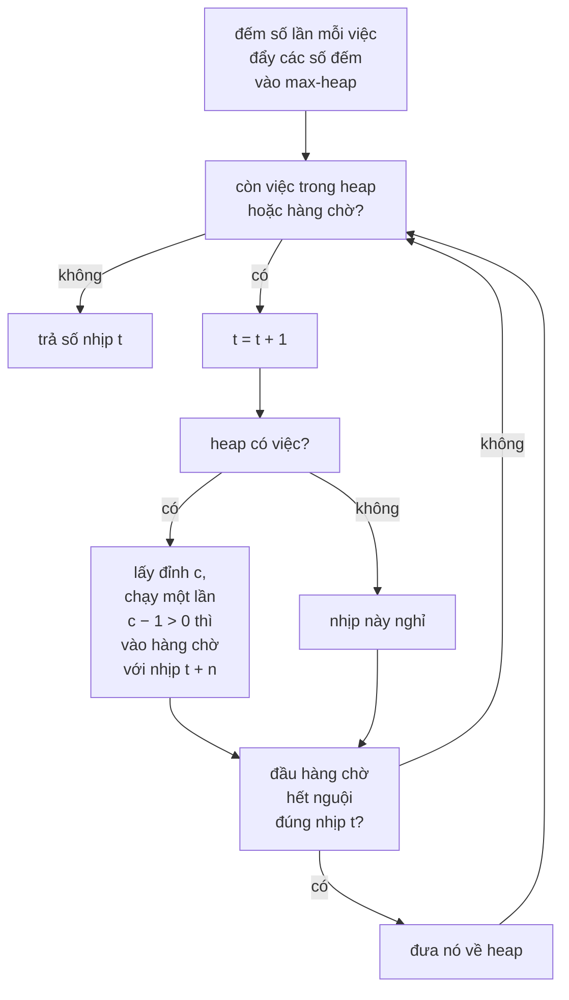

> [!tldr] Đọc nhanh
> - Đề: các việc là chữ `A`..`Z`, mỗi nhịp CPU chạy một việc hoặc nghỉ; hai lần chạy cùng một việc phải cách nhau ít nhất n nhịp. Hỏi số nhịp ít nhất để chạy hết.
> - Mô phỏng: mỗi nhịp chạy việc **còn nhiều lần nhất** trong số việc sẵn sàng ([[concepts/heap|max-heap]]), việc vừa chạy vào **hàng chờ nguội** cho tới nhịp `t + n`. O(số nhịp · log 26).
> - [[concepts/idle-slot-counting|Công thức khung]]: gọi f là số lần của việc nhiều nhất, k là số việc cùng đạt f. Đáp án là `max(số việc, (f − 1)(n + 1) + k)`. Trang chứng minh cả hai chiều và đối chiếu với tìm kiếm vét cạn: khớp 1 500/1 500 bộ nhỏ.
> - Dựng lịch thật theo khung chỉ đúng khi rải các việc còn lại theo số lần **giảm dần**; rải tăng dần thì 42/1 500 lịch vi phạm thời gian nguội, ví dụ `AAABBC`, n = 2.
> - Ba bản sai chạy thật: quên `max` với số việc (6/10), khung cuối luôn 1 ô (8/10), chạy việc sẵn sàng đầu tiên theo bảng chữ cái thay vì việc còn nhiều nhất (8/10).

> [!info] Bối cảnh
> Bài LeetCode 621 của [[posts/2026-11-24-neetcode-two-heaps|ga 4: Hai heap và lập lịch]] trong **tuyến NeetCode: Tìm kiếm và heap**. Bài trước ở ga 3, [[problems/last-stone-weight|Last Stone Weight]], đã dùng max-heap để lấy lặp lại phần tử lớn nhất; ở đây heap thêm một bạn đồng hành là hàng chờ, và lời giải nhanh nhất lại không cần heap. Lời giải có đủ TypeScript, Python, Go, Java và JavaScript. Bạn chỉ cần biết mảng, vòng lặp và đếm tần suất.

> [!abstract]- Từ điển nhanh cho bài này (bấm để mở)
> - **Nhịp (interval)**: một đơn vị thời gian của CPU; mỗi nhịp chạy đúng một việc hoặc nghỉ.
> - **Nghỉ (idle)**: nhịp không chạy việc nào vì mọi việc còn lại đều đang nguội.
> - **Thời gian nguội n**: giữa hai lần chạy cùng một việc phải có ít nhất n nhịp khác, tức hai lần chạy cách nhau ít nhất n + 1 nhịp.
> - **Max-heap**: cây nhị phân trong mảng, phần tử lớn nhất luôn ở đỉnh, lấy đỉnh và thêm O(log n). Xem [[concepts/heap|Heap]].
> - **Hàng chờ (queue)**: vào sau ra sau; ở đây giữ các việc đang nguội theo thứ tự hết nguội.
> - **Đếm tần suất**: mảng 26 ô đếm số lần mỗi chữ, như [[concepts/frequency-counting|Frequency Counting]] và [[concepts/counting-array|Counting Array]].

## Hình dung trước: lịch tập gym mà mỗi nhóm cơ phải nghỉ n hiệp

Bạn có danh sách bài tập cho buổi tối: ngực 3 hiệp, lưng 3 hiệp, chân 1 hiệp. Luật của huấn luyện viên: tập xong một nhóm cơ thì nhóm đó phải nghỉ n hiệp mới được tập lại. Mỗi hiệp bạn tập một nhóm cơ đang khỏe, hoặc ngồi uống nước nếu nhóm nào cũng đang nghỉ. Muốn về sớm, bạn luôn chọn nhóm **còn nhiều hiệp nhất**: nhóm đó là nút cổ chai, để dồn nó về cuối thì cuối buổi sẽ toàn hiệp ngồi chờ.

| Đời thường | Khái niệm |
|---|---|
| Nhóm cơ (ngực, lưng, chân) | loại việc `A`..`Z` |
| Số hiệp mỗi nhóm phải tập | số lần mỗi việc xuất hiện |
| Một hiệp | một nhịp |
| Ngồi uống nước | nhịp nghỉ (idle) |
| Nhóm cơ phải nghỉ n hiệp | thời gian nguội n |
| Bảng "nhóm khỏe, còn nhiều hiệp nhất ở trên cùng" | max-heap số lần còn lại |
| Danh sách nhóm đang nghỉ, ai hết nghỉ trước đứng đầu | hàng chờ nguội |
| Chia buổi tập thành các vòng n + 1 hiệp, mỗi vòng mở đầu bằng nhóm nhiều nhất | khung trong công thức |



## Vấn đề

Nếu không có thời gian nguội (n = 0), đáp án đơn giản là số việc. Thời gian nguội sinh ra nhịp nghỉ, và câu hỏi thật là: **ít nhất bao nhiêu nhịp nghỉ** là không tránh được? Thứ tự chạy quyết định điều đó. Với `ABBB`, n = 1, chạy `A` trước thì ra `A B _ B _ B`, 6 nhịp; chạy `B` trước thì ra `B A B _ B`, 5 nhịp. Thử mọi thứ tự là bùng nổ tổ hợp, nên ta cần một quy tắc chọn và một lý do để tin quy tắc đó tối ưu.

## Cơ chế

<figure class="figure-map" style="--ar: 3 / 4">
<div class="frame"><iframe data-archify="../diagrams/neetcode-task-scheduler/worked-example.html" title="Chừa chỗ giữa các việc giống nhau" loading="lazy"></iframe></div>
<figcaption><span><b>Hình 1.</b> Chừa chỗ giữa các việc giống nhau.</span><a href="../diagrams/neetcode-task-scheduler/worked-example.html" target="_blank" rel="noopener">Mở toàn màn hình</a></figcaption>
</figure>

<details>
<summary>Đọc từng bước</summary>
<ol>
<li>Việc A xuất hiện nhiều nhất. <code>A × 3, B × 2, cooldown = 2</code></li>
<li>Xếp hai nhóm trước lần A cuối. <code>A _ _ / A _ _ / A</code></li>
<li>Chèn B vào hai khoảng khác nhau. <code>A B _ / A B _ / A</code></li>
<li>Tổng lịch là bảy nhịp. <code>7 = (3 - 1) × 3 + 1</code></li>
</ol>
</details>

### Cách 1: mô phỏng bằng max-heap và hàng chờ nguội

Quy tắc tham lam: **mỗi nhịp, chạy việc sẵn sàng còn nhiều lần nhất**. Ta không cần biết tên việc, chỉ cần số lần còn lại, nên heap chỉ giữ tối đa 26 con số. Việc vừa chạy chưa thể chạy lại, nên nó không quay về heap ngay mà vào hàng chờ kèm nhịp `t + n`; hết nhịp đó, nó được đưa về heap và chạy lại được từ nhịp `t + n + 1`.

```ts
// Mô phỏng từng nhịp: heap giữ số lần còn lại của các việc sẵn sàng,
// hàng chờ giữ [số lần còn lại, nhịp được chạy lại] của các việc đang nguội.
function simulateHeap(tasks: string[], n: number): number {
  const heap = new MaxHeap();
  for (const c of countTasks(tasks)) if (c > 0) heap.push(c);
  const queue: [number, number][] = [];
  let head = 0, time = 0;
  while (heap.size > 0 || head < queue.length) {
    time++;
    if (heap.size > 0) {
      const c = heap.pop() - 1; // chạy việc còn nhiều nhất
      if (c > 0) queue.push([c, time + n]);
    } // heap rỗng: nhịp này nghỉ (idle)
    if (head < queue.length && queue[head][1] === time) heap.push(queue[head++][0]);
  }
  return time;
}
```


Chạy tay ví dụ của đề `AAABBB`, n = 2:

| Nhịp | Heap trước | Chạy | Hàng chờ sau nhịp | Về heap cuối nhịp |
|---|---|---|---|---|
| 1 | 3, 3 | 3 → 2 | (2, nhịp 3) | |
| 2 | 3 | 3 → 2 | (2, 3), (2, 4) | |
| 3 | rỗng | nghỉ | (2, 4) | 2 |
| 4 | 2 | 2 → 1 | (1, 6) | 2 |
| 5 | 2 | 2 → 1 | (1, 6), (1, 7) | |
| 6 | rỗng | nghỉ | (1, 7) | 1 |
| 7 | 1 | 1 → 0 | | 1 |
| 8 | 1 | 1 → 0 | | |

8 nhịp, lịch là `A B _ A B _ A B`. Hàng chờ luôn theo thứ tự hết nguội vì mỗi nhịp chỉ thêm một việc, với nhịp hết nguội tăng dần, nên chỉ cần nhìn phần tử đầu.

Chi phí: mỗi nhịp có việc tốn O(log 26) cho heap, mỗi nhịp nghỉ O(1). Số vòng lặp bằng **đáp án**, không phải số việc. Đáp án có thể lớn hơn số việc rất nhiều: 10⁵ việc chỉ có hai chữ, n = 100, cần 5 082 523 nhịp. Khi heap rỗng, cả dải nghỉ tới lúc việc đầu hàng chờ hết nguội có thể cộng một lần:

```ts
// Như trên, nhưng khi heap rỗng thì nhảy thẳng tới nhịp việc đầu hàng chờ hết nguội,
// thay vì đếm từng nhịp nghỉ. Số vòng lặp chỉ còn bằng số việc.
function simulateJump(tasks: string[], n: number): number {
  const heap = new MaxHeap();
  for (const c of countTasks(tasks)) if (c > 0) heap.push(c);
  const queue: [number, number][] = [];
  let head = 0, time = 0;
  while (heap.size > 0 || head < queue.length) {
    if (heap.size === 0) { // các nhịp tới queue[head][1] đều nghỉ: cộng cả dải một lần
      time = queue[head][1];
      heap.push(queue[head++][0]);
    }
    time++;
    const c = heap.pop() - 1;
    if (c > 0) queue.push([c, time + n]);
    if (head < queue.length && queue[head][1] === time) heap.push(queue[head++][0]);
  }
  return time;
}
```


Bản nhảy này chỉ lặp đúng một lần cho mỗi việc, O(số việc · log 26).

**Vì sao chọn việc còn nhiều nhất?** Việc nhiều lần nhất là nút cổ chai: các lần chạy của nó phải trải ra ít nhất `(f − 1)(n + 1) + 1` nhịp dù làm gì. Chạy nó muộn chỉ đẩy dải đó ra xa hơn. Bản sai `wrongAnyAvailable` chọn việc sẵn sàng đầu tiên theo bảng chữ cái: với `ABBB`, n = 1, nó chạy `A` trước và ra 6 thay vì 5. Phần chứng minh bên dưới làm lập luận này chặt chẽ, bằng cách chỉ ra một lịch đạt đúng cận dưới.

### Cách 2: công thức khung, và vì sao nó đúng

Gọi f là số lần của việc nhiều nhất, k là số việc cùng có f lần. Với `AAABBB`, f = 3, k = 2.

```text
đáp án = max(số việc, (f − 1) · (n + 1) + k)
```

```ts
// Công thức khung: f = số lần của việc nhiều nhất, k = số việc cùng đạt f.
// (f − 1) khung dài n + 1, cộng khung cuối k ô; nếu việc nhiều hơn chỗ trống thì không nghỉ nhịp nào.
function formula(tasks: string[], n: number): number {
  const cnt = countTasks(tasks);
  const f = Math.max(...cnt);
  const k = cnt.filter((c) => c === f).length;
  return Math.max(tasks.length, (f - 1) * (n + 1) + k);
}
```


**Cận dưới thứ nhất: không thể ít hơn số việc.** Mỗi nhịp chạy nhiều nhất một việc.

**Cận dưới thứ hai: không thể ít hơn (f − 1)(n + 1) + k.** Lấy một việc X có f lần. Hai lần chạy liền nhau của X cách nhau ít nhất n + 1 nhịp, nên từ lần đầu tới lần cuối của X có ít nhất (f − 1)(n + 1) nhịp, và lần cuối của X nằm ở nhịp thứ (f − 1)(n + 1) + 1 trở đi. Điều đó đúng với **cả k** việc đạt f. Lần cuối của k việc này nằm ở k nhịp khác nhau, đều từ nhịp (f − 1)(n + 1) + 1 trở đi, nên nhịp muộn nhất trong chúng ít nhất là (f − 1)(n + 1) + k.

**Cận trên: luôn có một lịch đạt đúng giá trị lớn hơn trong hai cận.** Dựng lịch theo **khung**:

1. Tạo f khung. Mỗi khung mở đầu bằng k việc đạt f, theo cùng một thứ tự. f − 1 khung đầu có độ dài danh nghĩa n + 1; khung cuối chỉ có k việc đó.
2. Rải các việc còn lại (mỗi việc có ít hơn f lần) vào f − 1 khung đầu, **theo cột**: lần thứ nhất vào khung 1, lần thứ hai vào khung 2, …, hết khung f − 1 thì quay lại khung 1 ở cột kế tiếp. Các việc được xếp theo số lần **giảm dần**.
3. Khung nào ngắn hơn n + 1 thì lấp phần thiếu bằng nhịp nghỉ. Khung nào dài hơn thì cứ để dài.

Lịch này hợp lệ:
- **Việc đạt f** đứng cùng vị trí trong mọi khung, và mỗi khung dài ít nhất n + 1, nên hai lần chạy liền nhau của nó cách nhau ít nhất n + 1 nhịp.
- **Việc có c < f lần** chiếm c ô liên tiếp theo thứ tự cột. Có f − 1 khung mà c ≤ f − 1, nên không khung nào chứa nó hai lần. Nếu nó nằm gọn trong một cột, hai lần liền nhau ở hai khung kề nhau cùng cột, cách nhau đúng một độ dài khung, ít nhất n + 1.
- **Trường hợp nó tràn sang cột kế tiếp:** lần cuối ở cột j bắt đầu từ khung r, lần đầu ở cột j + 1 dừng ở khung s. Hai lần gần nhau nhất là ở khung s (cột j + 1) và khung r (cột j), cách nhau khoảng (r − s)(n + 1) − 1 nhịp. Vì việc xếp **giảm dần** nên các việc có f − 1 lần đứng trước và mỗi việc lấp trọn một cột từ khung 1; mọi việc tràn cột đều có c ≤ f − 2, kéo theo r ≥ s + 2. Khoảng cách vì thế ít nhất 2(n + 1) − 1 ≥ n + 1.

Độ dài lịch:
- Nếu không khung nào bị kéo dài, lịch dài đúng (f − 1)(n + 1) + k, bằng cận dưới thứ hai.
- Nếu có khung bị kéo dài, nghĩa là các việc đã lấp kín mọi ô danh nghĩa. Khi đó mọi khung đều kín, không còn nhịp nghỉ nào, và lịch dài đúng bằng số việc.
- Cả hai trường hợp đều bằng giá trị lớn hơn trong hai cận dưới, nên công thức là đáp án tối ưu. ∎

`frameSchedule` trong file TypeScript dựng đúng lịch này, và `isValid` kiểm tra nó:

```ts
// Dựng lịch thật theo đúng chứng minh: mỗi khung mở đầu bằng các việc đạt f,
// các việc còn lại (xếp theo số lần GIẢM dần) rải theo cột qua f − 1 khung đầu.
function frameSchedule(tasks: string[], n: number, ascending = false): string[] {
  const cnt = countTasks(tasks);
  const f = Math.max(...cnt);
  const letters = [...Array(26).keys()].filter((i) => cnt[i] > 0).map((i) => String.fromCharCode(65 + i));
  const top = letters.filter((c) => cnt[c.charCodeAt(0) - 65] === f);
  const rest = letters.filter((c) => cnt[c.charCodeAt(0) - 65] < f)
    .sort((a, b) => (cnt[b.charCodeAt(0) - 65] - cnt[a.charCodeAt(0) - 65]) * (ascending ? -1 : 1));
  const frames: string[][] = Array.from({ length: f }, () => [...top]);
  let p = 0;
  for (const c of rest) {
    for (let r = 0; r < cnt[c.charCodeAt(0) - 65]; r++) frames[p++ % (f - 1)].push(c); // đi xuống theo cột
  }
  const out: string[] = [];
  frames.forEach((fr, i) => {
    out.push(...fr);
    if (i < f - 1) for (let s = fr.length; s < n + 1; s++) out.push("idle"); // lấp khung còn thiếu bằng nhịp nghỉ
  });
  return out;
}
```


```text
lịch dựng theo khung cho AAAAAABCDEFG, n=2 (16 nhịp):
  A B G A C idle A D idle A E idle A F idle A
```

Ở ví dụ này f = 6, có 5 khung đầu dài 3 và khung cuối chỉ có `A`. Sáu việc khác chỉ đủ lấp 6 trong 10 ô trống, nên còn 4 nhịp nghỉ: 16 = 5 · 3 + 1.

### Thứ tự rải việc không phải chi tiết thừa

Bước "giảm dần" trong chứng minh dễ bị coi là cho đẹp. File TypeScript chạy cùng cách dựng với thứ tự **tăng dần** trên 1 500 bộ nhỏ ngẫu nhiên:

```text
lịch dựng theo khung, việc xếp giảm dần: hợp lệ và ngắn nhất ở 1500/1500
lịch dựng theo khung, việc xếp TĂNG dần: hợp lệ và ngắn nhất ở 1458/1500
AAABBC, n=2, xếp tăng dần: A C B A B idle A → hợp lệ? false
AAABBC, n=2, xếp giảm dần: A B C A B idle A → hợp lệ? true
```

Với `AAABBC`, n = 2: xếp tăng dần thì `C` (1 lần) vào khung 1, rồi `B` (2 lần) lấp nốt khung 2 và tràn về khung 1. Hai chữ `B` ở nhịp 3 và nhịp 5, cách nhau 2 < n + 1 = 3. Đó đúng là trường hợp r = s + 1 mà chứng minh loại trừ bằng thứ tự giảm dần. Độ dài vẫn là 7, chỉ có lịch là sai, nên phép đếm bằng công thức không bị ảnh hưởng. Chỗ dễ sai là khi bạn cần **in ra** lịch.

### Đối chiếu với vét cạn

Chứng minh trên giấy dễ sót trường hợp, nên file TypeScript có thêm `bruteForce`: tìm theo chiều rộng (BFS) trên trạng thái "mỗi việc còn bao nhiêu lần, còn phải nguội bao nhiêu nhịp". Mỗi bước, hoặc nghỉ, hoặc chạy một việc đã hết nguội. Số bước tới trạng thái "hết việc" là đáp án tối ưu thật. Trên 1 500 bộ ngẫu nhiên tới 9 việc, 4 chữ, n ≤ 3, cả ba cách (heap từng nhịp, heap nhảy, công thức) khớp với vét cạn ở 1 500/1 500 bộ. Thêm 300 bộ lớn tới 2 000 việc, n ≤ 100: ba cách khớp nhau và lịch dựng theo khung hợp lệ ở 300/300.

### Ba bản sai

**Quên `max` với số việc.** Công thức khung đếm thiếu khi việc nhiều hơn chỗ trống, vì khi đó các khung bị kéo dài:

```ts
// SAI: quên lấy max với số việc: khi việc nhiều hơn chỗ trống, công thức khung đếm thiếu.
function wrongNoMax(tasks: string[], n: number): number {
  const cnt = countTasks(tasks);
  const f = Math.max(...cnt);
  const k = cnt.filter((c) => c === f).length;
  return (f - 1) * (n + 1) + k;
}
```


Nó sai 4/10 ca, trong đó có ví dụ 2 của đề `ACABDB`, n = 1: khung cho ra 4, nhưng có 6 việc. Ca `AABBCCDD`, n = 1 cũng vậy: 4 việc đạt f = 2 lấp kín khung, đáp án là 8 việc, không nghỉ nhịp nào.

**Khung cuối luôn 1 ô.** Quên rằng k việc có thể cùng đạt f:

```ts
// SAI: khung cuối luôn 1 ô, quên rằng nhiều việc có thể cùng đạt f.
function wrongCountMax(tasks: string[], n: number): number {
  const cnt = countTasks(tasks);
  const f = Math.max(...cnt);
  return Math.max(tasks.length, (f - 1) * (n + 1) + 1);
}
```


`AAABBB`, n = 2 ra 7 thay vì 8. Ví dụ 1 và ví dụ 3 của đề đều bắt được lỗi này.

**Chạy việc sẵn sàng đầu tiên, không ưu tiên việc còn nhiều nhất.** Vẫn tôn trọng thời gian nguội, nhưng chọn sai việc:

```ts
// SAI: mỗi nhịp chạy việc sẵn sàng đầu tiên theo bảng chữ cái, không ưu tiên việc còn nhiều nhất.
function wrongAnyAvailable(tasks: string[], n: number): number {
  const cnt = countTasks(tasks);
  const ready = new Array(26).fill(1);
  let left = tasks.length, time = 0;
  while (left > 0) {
    time++;
    const i = cnt.findIndex((c, j) => c > 0 && ready[j] <= time);
    if (i >= 0) { cnt[i]--; ready[i] = time + n + 1; left--; }
  }
  return time;
}
```


`ABBB`, n = 1 ra 6 thay vì 5; `AAABBBCCCDDE`, n = 2 ra 13 thay vì 12. Ví dụ của đề đều qua, vì ở đó các việc có số lần bằng nhau.

### Bên dưới năm ngôn ngữ

| | Max-heap | Hàng chờ nguội | Bẫy riêng |
|---|---|---|---|
| TypeScript / JavaScript | tự viết (khoảng 30 dòng); với 26 số đếm, sắp xếp lại mỗi vòng cũng đủ | mảng + chỉ số đầu `head` (tránh `shift()` dời mảng) | `sort()` không hàm so sánh so số đếm theo chuỗi: `[10, 3, 2]` thành `"3" > "2" > "10"` |
| Python | `heapq` là min-heap, lưu `-c` | `collections.deque`, `popleft()` O(1) | quên đổi dấu thì chạy việc còn **ít** nhất trước: 6/10 ca |
| Go | `container/heap`, `Less` trả `h[i] > h[j]` | slice, cắt `queue[1:]` | LeetCode cho `tasks []byte`, `t - 'A'` là chỉ số; gọi `heap.Pop(&h)`, không gọi `h.Pop()`; hàm `max` có sẵn từ Go 1.21 |
| Java | `new PriorityQueue<>(Collections.reverseOrder())` | `ArrayDeque<int[]>` | quên comparator thì `PriorityQueue` là min-heap: 6/10 ca |

Bẫy của JavaScript chạy thật trong [file JS](../code/neetcode-task-scheduler/task-scheduler.js): bản "sắp mỗi vòng" dùng `cnt.sort().reverse()` sai ở `AAAAAAAAAABBBCC`, n = 1, ra 21 thay vì 19. Số đếm 10 bị xếp sau 3 và 2, nên việc nhiều nhất bị bỏ lại tới cuối.

### Đo

TypeScript, chữ ngẫu nhiên (bộ sinh mulberry32), trung vị 5 lần chạy:

| Số việc | Số chữ | n | Đáp án | Heap từng nhịp | Heap nhảy | Công thức |
|---|---|---|---|---|---|---|
| 10⁴ | 26 | 2 | 10 000 | 0,31 ms | 0,29 ms | 0,02 ms |
| 10⁴ | 26 | 100 | 44 340 | 0,20 ms | 0,13 ms | 0,02 ms |
| 10⁵ | 26 | 100 | 399 355 | 4,02 ms | 3,10 ms | 0,20 ms |
| 10⁵ | 2 | 100 | 5 082 523 | 14,5 ms | 2,05 ms | 0,20 ms |
| 10⁵ | 26 | 10 000 (ngoài giới hạn đề) | 39 713 972 | 90,1 ms | 2,15 ms | 0,20 ms |
| 10⁶ | 26 | 100 | 3 918 397 | 72,3 ms | 64,5 ms | 1,99 ms |

- Công thức chỉ là một lần đếm, nhanh hơn heap 15 tới 450 lần.
- Heap từng nhịp chậm theo **đáp án**: với hai chữ hay n lớn, phần lớn nhịp là nghỉ, và bản nhảy bỏ qua chúng. Ở n = 10 000, heap từng nhịp mất 90,1 ms, bản nhảy 2,15 ms.
- Đề giới hạn 10⁴ việc và n ≤ 100, nên mọi cách đều dưới 1 ms trên LeetCode.

JavaScript, so heap tự viết với cách sắp 26 số đếm mỗi vòng n + 1 nhịp:

| Số việc | n | Heap | Sắp mỗi vòng | Công thức |
|---|---|---|---|---|
| 10⁴ | 2 | 0,65 ms | 2,40 ms | 0,02 ms |
| 10⁵ | 2 | 11,06 ms | 22,50 ms | 0,20 ms |
| 10⁵ | 100 | 2,66 ms | 1,46 ms | 0,21 ms |
| 10⁶ | 100 | 61,89 ms | 14,63 ms | 1,95 ms |

Sắp mỗi vòng thắng khi n lớn: mỗi vòng chạy cả 26 việc chỉ với một lần sắp. Nó thua khi n nhỏ: mỗi vòng chỉ chạy 3 việc mà vẫn sắp đủ 26 số. Với 26 loại việc, cả hai đều ổn. Khi số loại việc m lớn, sắp lại mỗi vòng tốn O(m log m) dù chỉ chạy n + 1 việc, còn heap chỉ tốn O(log m) mỗi nhịp.

Các ngôn ngữ khác (10⁶ việc, n = 100): Python heap + deque 326,3 ms, công thức 30,56 ms; Go heap 43,80 ms, công thức 0,57 ms; Java heap 25,41 ms, công thức 0,55 ms. Công thức của Python mất 30,56 ms gần như hoàn toàn cho `Counter` đếm 10⁶ chuỗi, nhưng vẫn nhanh hơn heap 10 lần.

## Ví dụ chạy được

[TypeScript](../code/neetcode-task-scheduler/task-scheduler.ts) · [Python](../code/neetcode-task-scheduler/task_scheduler.py) · [Go](../code/neetcode-task-scheduler/task_scheduler.go) · [Java](../code/neetcode-task-scheduler/task-scheduler.java) · [JavaScript](../code/neetcode-task-scheduler/task-scheduler.js) · [PHP](../code/neetcode-task-scheduler/task-scheduler.php) · [Rust](../code/neetcode-task-scheduler/task_scheduler.rs)

Mỗi file trong năm bản đầu chạy 10 ca chung: ba ví dụ của đề, n = 0, một việc với n = 100, `AAAAAABCDEFG` (nhiều nhịp nghỉ), `ABBB` (bắt lỗi chọn sai việc), `AABBCCDD` và `AAABBBCCCDDE` (số việc thắng công thức khung), `AAAB` với n = 3. File JavaScript có thêm ca `AAAAAAAAAABBBCC` để bắt lỗi `sort()`.

Mô phỏng bằng heap và hàng chờ nguội:

```ts
// Mô phỏng từng nhịp: heap giữ số lần còn lại của các việc sẵn sàng,
// hàng chờ giữ [số lần còn lại, nhịp được chạy lại] của các việc đang nguội.
function simulateHeap(tasks: string[], n: number): number {
  const heap = new MaxHeap();
  for (const c of countTasks(tasks)) if (c > 0) heap.push(c);
  const queue: [number, number][] = [];
  let head = 0, time = 0;
  while (heap.size > 0 || head < queue.length) {
    time++;
    if (heap.size > 0) {
      const c = heap.pop() - 1; // chạy việc còn nhiều nhất
      if (c > 0) queue.push([c, time + n]);
    } // heap rỗng: nhịp này nghỉ (idle)
    if (head < queue.length && queue[head][1] === time) heap.push(queue[head++][0]);
  }
  return time;
}
```

```python
# heapq chỉ có min-heap: lưu -c để việc còn nhiều nhất nằm ở đỉnh.
# deque giữ (số lần còn lại, nhịp được chạy lại) của các việc đang nguội.
def least_interval_heap(tasks, n):
    heap = [-c for c in Counter(tasks).values()]
    heapq.heapify(heap)
    cooling = deque()
    t = 0
    while heap or cooling:
        t += 1
        if heap:
            c = heapq.heappop(heap) + 1  # bớt một lần (số âm nên cộng 1)
            if c < 0:
                cooling.append((c, t + n))
        if cooling and cooling[0][1] == t:
            heapq.heappush(heap, cooling.popleft()[0])
    return t
```

```go
// LeetCode cho tasks kiểu []byte; t - 'A' là chỉ số 0..25.
func leastIntervalHeap(tasks []byte, n int) int {
	var cnt [26]int
	for _, t := range tasks {
		cnt[t-'A']++
	}
	h := maxHeap{}
	for _, c := range cnt {
		if c > 0 {
			h = append(h, c)
		}
	}
	heap.Init(&h)
	var queue []cooling
	t := 0
	for h.Len() > 0 || len(queue) > 0 {
		t++
		if h.Len() > 0 {
			c := heap.Pop(&h).(int) - 1
			if c > 0 {
				queue = append(queue, cooling{c, t + n})
			}
		}
		if len(queue) > 0 && queue[0].ready == t {
			heap.Push(&h, queue[0].c)
			queue = queue[1:]
		}
	}
	return t
}
```

```java
// PriorityQueue là min-heap; Collections.reverseOrder() đưa số lần còn lại lớn nhất lên đỉnh.
// Hàng đợi nguội giữ int[]{số lần còn lại, nhịp chạy lại được}.
static int leastIntervalHeap(char[] tasks, int n) {
    int[] cnt = new int[26];
    for (char t : tasks) cnt[t - 'A']++;
    PriorityQueue<Integer> pq = new PriorityQueue<>(Collections.reverseOrder());
    for (int c : cnt) if (c > 0) pq.add(c);
    ArrayDeque<int[]> cooling = new ArrayDeque<>();
    int time = 0;
    while (!pq.isEmpty() || !cooling.isEmpty()) {
        time++;
        if (!pq.isEmpty()) {
            int c = pq.poll() - 1;
            if (c > 0) cooling.add(new int[]{c, time + n});
        }
        if (!cooling.isEmpty() && cooling.peek()[1] == time) pq.add(cooling.poll()[0]);
    }
    return time;
}
```

```js
function heapSim(tasks, n) {
  const heap = new MaxHeap();
  for (const c of countTasks(tasks)) if (c > 0) heap.push(c);
  const queue = [];
  let head = 0, time = 0;
  while (heap.size > 0 || head < queue.length) {
    time++;
    if (heap.size > 0) {
      const c = heap.pop() - 1;
      if (c > 0) queue.push([c, time + n]);
    }
    if (head < queue.length && queue[head][1] === time) heap.push(queue[head++][0]);
  }
  return time;
}
```


Công thức khung:

```ts
// Công thức khung: f = số lần của việc nhiều nhất, k = số việc cùng đạt f.
// (f − 1) khung dài n + 1, cộng khung cuối k ô; nếu việc nhiều hơn chỗ trống thì không nghỉ nhịp nào.
function formula(tasks: string[], n: number): number {
  const cnt = countTasks(tasks);
  const f = Math.max(...cnt);
  const k = cnt.filter((c) => c === f).length;
  return Math.max(tasks.length, (f - 1) * (n + 1) + k);
}
```

```python
# Công thức khung: (f - 1) khung dài n + 1, cộng k việc cùng đạt f; không ít hơn số việc.
def least_interval_formula(tasks, n):
    cnt = Counter(tasks)
    f = max(cnt.values())
    k = sum(1 for c in cnt.values() if c == f)
    return max(len(tasks), (f - 1) * (n + 1) + k)
```

```go
// Công thức khung: max(số việc, (f - 1)(n + 1) + k).
func leastIntervalFormula(tasks []byte, n int) int {
	var cnt [26]int
	f := 0
	for _, t := range tasks {
		cnt[t-'A']++
		f = max(f, cnt[t-'A'])
	}
	k := 0
	for _, c := range cnt {
		if c == f {
			k++
		}
	}
	return max(len(tasks), (f-1)*(n+1)+k)
}
```

```java
// Công thức khung: max(số việc, (f - 1)(n + 1) + k).
static int leastIntervalFormula(char[] tasks, int n) {
    int[] cnt = new int[26];
    int f = 0;
    for (char t : tasks) f = Math.max(f, ++cnt[t - 'A']);
    int k = 0;
    for (int c : cnt) if (c == f) k++;
    return Math.max(tasks.length, (f - 1) * (n + 1) + k);
}
```

```js
function formula(tasks, n) {
  const cnt = countTasks(tasks);
  const f = Math.max(...cnt);
  const k = cnt.filter((c) => c === f).length;
  return Math.max(tasks.length, (f - 1) * (n + 1) + k);
}
```

```php
<?php
declare(strict_types=1);

function leastInterval(array $tasks, int $cooldown): int
{
    if ($tasks === []) {
        return 0;
    }
    $counts = array_count_values($tasks);
    $most = max($counts);
    $leaders = 0;
    foreach ($counts as $count) {
        if ($count === $most) {
            $leaders++;
        }
    }
    return max(count($tasks), ($most - 1) * ($cooldown + 1) + $leaders);
}
```

```rust
fn least_interval(tasks: &[u8], cooldown: usize) -> usize {
    if tasks.is_empty() {
        return 0;
    }
    let mut counts = [0; 26];
    for &task in tasks {
        counts[usize::from(task - b'A')] += 1;
    }
    let most = *counts.iter().max().unwrap();
    let leaders = counts.iter().filter(|&&count| count == most).count();
    tasks.len().max((most - 1) * (cooldown + 1) + leaders)
}
```


Kết quả `node task-scheduler.ts`:

```text
simulateHeap      10/10 ca đúng
simulateJump      10/10 ca đúng
formula           10/10 ca đúng
frameSchedule     10/10 ca đúng
bruteForce        10/10 ca đúng
wrongNoMax        6/10 ca đúng; sai ở ACABDB n=1 → 4, AAABBB n=0 → 4, AABBCCDD n=1 → 6, AAABBBCCCDDE n=2 → 9
wrongCountMax     8/10 ca đúng; sai ở AAABBB n=2 → 7, AAABBB n=3 → 9
wrongAnyAvailable 8/10 ca đúng; sai ở ABBB n=1 → 6, AAABBBCCCDDE n=2 → 13

lịch dựng theo khung cho AAAAAABCDEFG, n=2 (16 nhịp):
  A B G A C idle A D idle A E idle A F idle A

vét cạn so với 3 cách: khớp 1500/1500 bộ nhỏ
lịch dựng theo khung, việc xếp giảm dần: hợp lệ và ngắn nhất ở 1500/1500
lịch dựng theo khung, việc xếp TĂNG dần: hợp lệ và ngắn nhất ở 1458/1500
AAABBC, n=2, xếp tăng dần: A C B A B idle A → hợp lệ? false
AAABBC, n=2, xếp giảm dần: A B C A B idle A → hợp lệ? true
bộ lớn (tới 2000 việc, n ≤ 100): khớp và hợp lệ ở 300/300

số việc   chữ  n       đáp án   heap từng nhịp  heap nhảy   công thức
10000     26   2           10000         0.31 ms     0.29 ms     0.02 ms
10000     26   100         44340         0.20 ms     0.13 ms     0.02 ms
100000    26   100        399355         4.02 ms     3.10 ms     0.20 ms
100000    2    100       5082523         14.5 ms     2.05 ms     0.20 ms
100000    26   10000    39713972         90.1 ms     2.15 ms     0.20 ms
1000000   26   100       3918397         72.3 ms     64.5 ms     1.99 ms
```

`python3 task_scheduler.py`:

```text
least_interval_heap     10/10 ca đúng
least_interval_formula  10/10 ca đúng
forgot_negate           6/10 ca đúng; sai ở AAAAAABCDEFG n=2 → 22, ABBB n=1 → 6, AAABBBCCCDDE n=2 → 14, AAAB n=3 → 10

ngẫu nhiên: heap và công thức khớp ở 300/300 bộ

số việc   n      heap + deque   công thức
10000     2             2.3 ms     0.28 ms
100000    100          33.9 ms     3.05 ms
1000000   100         326.3 ms    30.56 ms
```

`go run task_scheduler.go`:

```text
leastIntervalHeap     10/10 ca đúng
leastIntervalFormula  10/10 ca đúng
leastIntervalRounds   10/10 ca đúng

ngẫu nhiên: ba cách khớp ở 300/300 bộ

số việc   n      heap        theo vòng   công thức
10000     2         0.45 ms     1.07 ms     0.01 ms
100000    100       3.99 ms     0.61 ms     0.06 ms
1000000   100      43.80 ms     6.44 ms     0.57 ms
```

`java task-scheduler.java`:

```text
leastIntervalHeap     10/10 ca đúng
leastIntervalFormula  10/10 ca đúng
minHeapDefault        6/10 ca đúng; sai ở AAAAAABCDEFG n=2 → 22, ABBB n=1 → 6, AAABBBCCCDDE n=2 → 14, AAAB n=3 → 10

ngẫu nhiên: heap và công thức khớp ở 300/300 bộ

số việc   n      heap        công thức
10000     2         0.22 ms     0.01 ms
100000    100       1.58 ms     0.06 ms
1000000   100      25.41 ms     0.55 ms
```

`node task-scheduler.js`:

```text
heapSim          11/11 ca đúng
roundsSort       11/11 ca đúng
formula          11/11 ca đúng
wrongDefaultSort 10/11 ca đúng; sai ở AAAAAAAAAABBBCC n=1 → 21

ngẫu nhiên: ba cách khớp ở 300/300 bộ

số việc   n      heap       sắp mỗi vòng  công thức
10000     2         0.65 ms       2.40 ms    0.02 ms
100000    2        11.06 ms      22.50 ms    0.20 ms
100000    100       2.66 ms       1.46 ms    0.21 ms
1000000   100      61.89 ms      14.63 ms    1.95 ms
```

Hai bản thêm dùng công thức khung. Rust dùng mảng 26 ô cho các byte ASCII `A` đến `Z`. PHP in `10/10 ca đúng` và Rust in `10/10 ca đúng`.

## Hiểu lầm và bẫy hay gặp

- **"Phải mô phỏng mới biết đáp án."** Câu hỏi chỉ cần **số** nhịp; một lần đếm và công thức là đủ. Mô phỏng chỉ cần khi phải in ra lịch, và khi đó cách dựng theo khung cũng in được.
- **"Công thức khung luôn đúng."** Chỉ khi còn chỗ trống. Việc nhiều hơn chỗ trống thì không có nhịp nghỉ nào, đáp án là số việc: luôn lấy `max`.
- **"Khung cuối có 1 ô."** Có k ô, với k là số việc cùng đạt f.
- **"Tham lam nào cũng được, miễn tôn trọng thời gian nguội."** Phải chọn việc còn nhiều nhất; chọn theo bảng chữ cái sai ở `ABBB`, n = 1.
- **"Thời gian nguội n nghĩa là hai lần chạy cách nhau n nhịp."** Cách nhau **ít nhất n + 1** nhịp, tức có ít nhất n nhịp khác ở giữa. Nhầm chỗ này thì việc trong hàng chờ quay lại heap sớm một nhịp.
- **Dựng lịch theo khung với thứ tự tùy ý.** Phải rải các việc theo số lần giảm dần; tăng dần thì có lịch vi phạm thời gian nguội dù độ dài vẫn đúng.
- **Mô phỏng từng nhịp với n rất lớn.** Số vòng lặp bằng đáp án chứ không bằng số việc; cộng cả dải nghỉ một lần khi heap rỗng.

## Câu hỏi tự kiểm tra

> [!question]- Với `AAAABBBB`, n = 3, đáp án là bao nhiêu? Lịch trông thế nào?
> f = 4, k = 2: (4 − 1) · 4 + 2 = 14, lớn hơn 8 việc, nên đáp án 14. Lịch: `A B _ _ A B _ _ A B _ _ A B`.

> [!question]- Khi nào đáp án bằng đúng số việc?
> Khi (f − 1)(n + 1) + k ≤ số việc, tức các việc khác đủ lấp mọi ô trống trong các khung. Khi đó không có nhịp nghỉ nào. Trường hợp riêng: n = 0.

> [!question]- Vì sao heap trong mô phỏng chỉ giữ số đếm mà không giữ tên việc?
> Câu hỏi chỉ hỏi số nhịp. Hai việc có cùng số lần còn lại và cùng trạng thái nguội là đổi chỗ được cho nhau, nên tên không ảnh hưởng tới đáp án. Muốn in lịch thì lưu thêm tên trong mỗi phần tử heap.

> [!question]- Mô phỏng từng nhịp tốn bao nhiêu vòng lặp ở trường hợp xấu nhất trong giới hạn đề?
> Số vòng bằng đáp án. Trường hợp xấu nhất là 10⁴ lần cùng một việc với n = 100: (10⁴ − 1) · 101 + 1 = 1 009 900 vòng, phần lớn là nhịp nghỉ O(1). Bản nhảy chỉ lặp 10⁴ lần.

> [!question]- Trong chứng minh, vì sao việc có c < f lần không bao giờ nằm hai lần trong cùng một khung?
> Nó chiếm c ô liên tiếp theo thứ tự cột, mỗi cột đi qua f − 1 khung. Muốn nằm hai lần trong một khung, nó phải đi hết một vòng f − 1 khung rồi thêm một ô, tức c ≥ f. Mâu thuẫn với c < f.

## Tham khảo

- [LeetCode 621: Task Scheduler](https://leetcode.com/problems/task-scheduler/) (đề gốc: 1 ≤ số việc ≤ 10⁴, 0 ≤ n ≤ 100, việc là chữ in hoa)
- [Python `heapq`](https://docs.python.org/3/library/heapq.html) (min-heap trên list) và [`collections.deque`](https://docs.python.org/3/library/collections.html#collections.deque) (thêm, bớt hai đầu O(1))
- [Go `container/heap`](https://pkg.go.dev/container/heap) (heap.Interface, gọi `heap.Push` và `heap.Pop`)
- [Java `PriorityQueue`](https://docs.oracle.com/en/java/javase/21/docs/api/java.base/java/util/PriorityQueue.html) (min-heap theo thứ tự tự nhiên hoặc comparator) và [`Collections.reverseOrder`](https://docs.oracle.com/en/java/javase/21/docs/api/java.base/java/util/Collections.html#reverseOrder())
- [ECMAScript: `Array.prototype.sort`](https://tc39.es/ecma262/#sec-array.prototype.sort) (không có comparator thì so sánh chuỗi)
- Cormen, Leiserson, Rivest, Stein, *Introduction to Algorithms*, ấn bản 3, chương 6 (hàng đợi ưu tiên) và chương 16 (thuật toán tham lam: chứng minh bằng cận dưới và một lời giải đạt cận)
