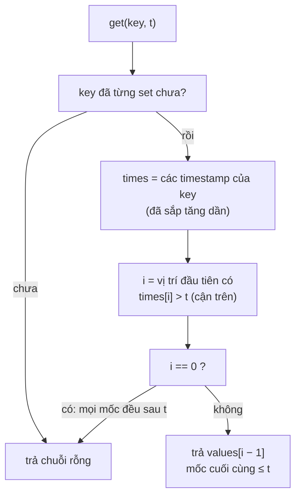

> [!tldr] Đọc nhanh
> - Đề: thiết kế `TimeMap` với `set(key, value, timestamp)` và `get(key, timestamp)`. `get` trả `value` của lần `set` có timestamp **lớn nhất mà vẫn ≤** timestamp được hỏi; không có thì trả chuỗi rỗng `""`.
> - Đề hứa timestamp của các lần `set` **tăng dần**. Nên mỗi key chỉ cần một mảng timestamp nối thêm ở cuối: mảng tự sắp, `set` là O(1).
> - `get` là một lần [[concepts/binary-search|chia đôi]] tìm **cận trên**: vị trí đầu tiên có timestamp > t, lùi một ô. Đó là "mốc cuối cùng ≤ t". O(log k) với k là số lần set của key đó.
> - Ba bản sai được chạy: dùng [[concepts/lower-bound|cận dưới]] thay cận trên trả **giá trị từ tương lai** (2/8 ca); Python `bisect_right(pairs, (t,))` bỏ qua mốc trùng t (4/8 ca); JS dùng object `{}` làm kho thì key `"constructor"` ném `TypeError`.
> - Nếu timestamp **không** tăng dần, chèn đúng chỗ vào mảng tốn O(k) mỗi lần: 10⁵ lần set theo thứ tự ngẫu nhiên mất 290 ms so với 0,9 ms khi chỉ nối thêm. Lúc đó cây cân bằng (`TreeMap` của Java) mới đáng dùng.

> [!info] Bối cảnh
> Bài LeetCode 981, thuộc [[posts/2026-11-23-neetcode-binary-search-answer|ga 2: Tìm kiếm nhị phân trên đáp án]] trên **tuyến NeetCode: Tìm kiếm và heap**. Đây là bài *thiết kế*: không có một hàm duy nhất mà là một lớp với hai thao tác, và LeetCode gọi chúng xen kẽ. Phần chia đôi giống hệt [[problems/binary-search|Binary Search]] ở [[posts/2026-11-23-neetcode-binary-search|ga 1]]; cái mới là chọn đúng cận và tổ chức dữ liệu để mảng luôn sắp. Lời giải có đủ TypeScript, Python, Go, Java và JavaScript. Bạn chỉ cần biết mảng, vòng lặp và bảng băm.

> [!abstract]- Từ điển nhanh cho bài này (bấm để mở)
> - **Bảng băm (hash map)**: cấu trúc tra `key → value` trung bình O(1). Ở đây nó tra `key → lịch sử của key`. Xem [[concepts/hash-map|Hash Map]].
> - **Timestamp**: một con số đánh dấu thời điểm. Đề dùng số nguyên từ 1 tới 10⁷, không cần biết nó là giây hay mili giây.
> - **Cận dưới, cận trên (lower bound, upper bound)**: trong mảng đã sắp, cận dưới là vị trí đầu tiên ≥ t, cận trên là vị trí đầu tiên > t. Xem [[concepts/lower-bound|Lower Bound]].
> - **Khoảng nửa mở `[lo, hi)`**: gồm `lo`, không gồm `hi`; vòng lặp chạy khi `lo < hi`. Xem [[concepts/half-open-interval|Half-open Interval]].
> - **Bài thiết kế (design problem)**: đề cho tên lớp và các phương thức; bạn chọn cách lưu dữ liệu để mọi thao tác đủ nhanh.

## Hình dung trước: bảng điều chỉnh giá xăng

Giá xăng không đổi mỗi ngày. Mỗi lần điều chỉnh, cửa hàng ghi một dòng: *ngày 1: 20 nghìn, ngày 4: 22 nghìn, ngày 11: 21 nghìn*. Ai đó hỏi "ngày 7 mình đổ xăng giá bao nhiêu?". Câu trả lời là giá của lần điều chỉnh **gần nhất không sau ngày 7**, tức ngày 4.

| Đời thường | Khái niệm |
|---|---|
| Mỗi loại xăng có một bảng riêng | bảng băm `key → lịch sử` |
| Các dòng ghi theo thứ tự ngày, dòng mới luôn ở cuối | timestamp tăng dần, `set` chỉ nối thêm |
| "Ngày 7 giá bao nhiêu?" | `get(key, 7)` |
| Lần điều chỉnh gần nhất không sau ngày 7 | mốc cuối cùng ≤ t, tức cận trên − 1 |
| Lật giữa bảng, xem ngày đó trước hay sau ngày 7, bỏ nửa kia | [[concepts/binary-search|chia đôi]] |
| Hỏi ngày 0, trước lần điều chỉnh đầu tiên | chưa có giá: trả `""` |
| Nhìn nhầm sang lần điều chỉnh **sau** ngày 7 | cận dưới: giá trị từ tương lai |



## Vấn đề

**Đề (tóm tắt bằng lời của mình):** cài lớp `TimeMap`:

- `set(key, value, timestamp)`: ghi `value` cho `key` tại thời điểm `timestamp`.
- `get(key, timestamp)`: trả `value` của lần `set(key, …, t_prev)` có `t_prev ≤ timestamp` lớn nhất. Không có lần nào như vậy thì trả `""`.

Ràng buộc: key và value là chữ thường và chữ số, dài 1 tới 100; timestamp từ 1 tới 10⁷; **mọi timestamp của `set` tăng ngặt**; tổng cộng tối đa 2·10⁵ lần gọi `set` và `get`. Đề gốc: [LeetCode 981](https://leetcode.com/problems/time-based-key-value-store/).

| Lệnh | Kết quả |
|---|---|
| `set("foo", "bar", 1)` | |
| `get("foo", 1)` | `"bar"` |
| `get("foo", 3)` | `"bar"`: chưa có lần set nào sau 1, giá trị vẫn là `"bar"` |
| `set("foo", "bar2", 4)` | |
| `get("foo", 4)` | `"bar2"` |
| `get("foo", 5)` | `"bar2"` |

Mình từng nghĩ `get` cần tìm timestamp **bằng** t, giống [[problems/binary-search|Binary Search]]. Hóa ra hầu hết lần hỏi rơi vào **giữa** hai mốc, và câu hỏi đúng là "mốc cuối cùng không vượt t". Đó là một câu hỏi về **ranh giới**, không phải về sự có mặt: tất cả các mốc ≤ t đứng thành một khúc đầu, các mốc > t thành khúc sau, và mình cần ô cuối của khúc đầu.

## Cơ chế

<figure class="figure-map" style="--ar: 3 / 4">
<div class="frame"><iframe data-archify="../diagrams/neetcode-time-based-key-value-store/worked-example.html" title="Tìm phiên bản cuối không vượt t" loading="lazy"></iframe></div>
<figcaption><span><b>Hình 1.</b> Tìm phiên bản cuối không vượt t.</span><a href="../diagrams/neetcode-time-based-key-value-store/worked-example.html" target="_blank" rel="noopener">Mở toàn màn hình</a></figcaption>
</figure>

<details>
<summary>Đọc từng bước</summary>
<ol>
<li>Các lần ghi đã tăng theo thời gian. <code>1 → red, 4 → blue, 8 → green</code></li>
<li>Hỏi ở thời điểm 6. <code>t = 6</code></li>
<li>Mốc 4 hợp lệ, thử sang phải. <code>4 ≤ 6</code></li>
<li>Mốc 8 chưa xuất hiện ở thời điểm hỏi. <code>8 &gt; 6</code></li>
<li>Lấy giá trị tại mốc 4. <code>blue</code></li>
</ol>
</details>

### Dữ liệu: một bảng băm, mỗi key một lịch sử đã sắp

Mỗi key giữ hai mảng song song: `times` và `values`, cùng chỉ số. Vì đề hứa timestamp tăng ngặt **trên mọi lần set** (nên cũng tăng ngặt trong từng key), `set` chỉ cần nối vào cuối hai mảng và mảng `times` tự sắp. Không cần sắp lại, không cần chèn giữa.

### Cách 1, quét lùi: O(k) mỗi lần get

Duyệt `times` từ cuối về đầu, dừng ở mốc đầu tiên ≤ t. Đúng, nhưng nếu một key có 10⁵ phiên bản và câu hỏi rơi ngẫu nhiên, trung bình phải lùi nửa mảng.

### Cách 2, chia đôi tìm cận trên: O(log k) mỗi lần get

Trên [[concepts/half-open-interval|khoảng nửa mở]] `[lo, hi) = [0, k)`: nếu `times[mid] ≤ t` thì ranh giới nằm sau `mid` (`lo = mid + 1`), ngược lại nằm ở `mid` hoặc trước (`hi = mid`). [[concepts/loop-invariant|Bất biến]]: mọi ô trước `lo` có timestamp ≤ t, mọi ô từ `hi` trở đi có timestamp > t. Khi `lo == hi`, `lo` chính là **số** mốc ≤ t, và mốc cuối cùng ≤ t là `lo − 1`. Nếu `lo == 0`, mọi mốc đều sau t: trả `""`.

Đây là `bisect_right(times, t) − 1` của Python, `sort.Search(k, func(i) bool { return times[i] > t }) − 1` của Go, và `floorEntry(t)` của `TreeMap` trong Java.

### Bản sai 1: cận dưới thay cận trên

Cận dưới là vị trí đầu tiên **≥ t**. Khi t trùng đúng một mốc, nó trỏ vào mốc đó và trả đúng. Nhưng khi t nằm giữa hai mốc, nó trỏ vào mốc **sau** t: `get("a", 15)` với hai mốc 10 và 20 trả giá trị ghi lúc 20, một giá trị chưa tồn tại ở thời điểm 15. Bản sai này qua 2/8 ca; nó chỉ đúng ở hai ca mà mọi câu hỏi trùng một mốc hoặc key không tồn tại.

Đó là lý do bài này cần cận **trên**: câu hỏi là "mốc cuối cùng ≤ t", tức ô ngay trước ranh giới giữa khúc "≤ t" và khúc "> t".

### Bản sai 2: Python so tuple

Nếu mỗi key giữ một list cặp `(timestamp, value)`, lời gọi tự nhiên là `bisect_right(pairs, (t,))`. Nhưng Python so tuple từng phần tử, và tuple ngắn hơn đứng trước khi phần đầu bằng nhau: `(5,) < (5, "v")`. Nên `bisect_right` dừng **trước** mốc có timestamp bằng t, và `get` trả giá trị của mốc trước đó. Bản sai qua 4/8 ca, hỏng đúng ở các ca hỏi trùng một mốc. Từ Python 3.10, `bisect_right(pairs, t, key=lambda p: p[0])` so theo timestamp và đúng.

### Bản sai 3: JS dùng object thường làm kho

`const store = {}` rồi `store[key]` trông giống `Map`. Nhưng object thường kế thừa từ `Object.prototype`, nên `store["constructor"]` đã là hàm `Object` trước khi bạn set gì. Key của đề là chữ thường và chữ số, nên `"constructor"` là key hợp lệ: `get` đọc `h.times.length` trên một hàm và ném `TypeError`. `Map` không có vấn đề này.

### Khi timestamp không tăng dần

Đề hứa tăng dần, nên nối thêm là đủ. Nếu bỏ lời hứa đó (ví dụ dữ liệu tới trễ từ nhiều máy), `set` phải chèn đúng chỗ: chia đôi tìm vị trí là O(log k), nhưng dời các phần tử phía sau là O(k). Với 10⁵ lần set, thứ tự ngẫu nhiên, chèn bằng `splice` mất 290 ms; nối thêm khi tăng dần mất 0,9 ms. Khi đó cây cân bằng như `TreeMap` (cây đỏ đen, O(log k) cho cả `put` và `floorEntry`) mới là lựa chọn đúng.

### Ngoài LeetCode: kho nhiều phiên bản

Ý tưởng "giữ mọi phiên bản theo thời gian, đọc phiên bản mới nhất không sau một thời điểm" có ở nhiều hệ thống thật. Bigtable của Google lưu nhiều phiên bản của mỗi ô, đánh chỉ mục theo timestamp và xếp phiên bản mới nhất lên trước ([bài báo OSDI 2006](https://research.google.com/archive/bigtable-osdi06.pdf), mục 2). Postgres dùng [[concepts/mvcc|MVCC]]: mỗi `UPDATE` tạo một phiên bản dòng mới, và mỗi transaction đọc phiên bản nó được phép thấy. Postgres quyết định "được phép thấy" bằng mã transaction (`xmin`, `xmax`) chứ không chia đôi trên một mảng timestamp, nên đây là cùng ý tưởng, không phải cùng cách cài.

### Đo

TypeScript, một key có k mốc (timestamp 2, 4, 6, …), 10⁵ lần `get`, trung vị 5 lần chạy, ms. Hai kiểu câu hỏi: t ngẫu nhiên trên cả lịch sử, và t "gần đây" (trong 10 mốc cuối).

| k | quét lùi, t ngẫu nhiên | chia đôi, t ngẫu nhiên | quét lùi, t gần đây | chia đôi, t gần đây |
|---|---|---|---|---|
| 100 | 4,58 | 4,52 | 2,70 | 3,47 |
| 1 000 | 22,08 | 5,49 | 2,76 | 3,71 |
| 10 000 | 196,44 | 7,46 | 2,86 | 3,96 |
| 100 000 | (không chạy) | 10,94 | 3,34 | 4,26 |

- Với t ngẫu nhiên, quét lùi tăng theo k (từ k = 1 000 lên 10 000 thì gấp khoảng 9 lần), còn chia đôi chỉ tăng từ 4,5 lên 10,9 ms khi k tăng 1 000 lần.
- Với t gần đây, quét lùi **nhanh hơn** chia đôi, vì nó dừng sau vài bước. Nếu ứng dụng gần như chỉ hỏi phiên bản mới nhất, quét lùi là lựa chọn hợp lý; nhưng trường hợp xấu nhất của nó vẫn là O(k).
- Đổi thứ tự set (ở trên): 10⁵ lần chèn đúng chỗ mất 290,51 ms, nối thêm mất 0,88 ms.

Java, một key, 10⁶ lần set rồi 10⁶ lần get ngẫu nhiên, trung vị 5 lần: `TreeMap` mất khoảng 98 ms để set và 400 ms để get; hai mảng `int[]`/`String[]` tự nới mất 26 ms và 129 ms. Mảng nhanh hơn khoảng 3 lần ở cả hai: `TreeMap` bọc mỗi timestamp thành `Integer` và đi qua các nút cây rải trong bộ nhớ, còn mảng `int[]` nằm liền nhau. Python, 10⁵ get trên 10⁵ mốc: `bisect_right` trên list timestamp mất 38 ms, `bisect_right(..., key=)` trên list cặp mất 88 ms, vì hàm `key` là một lời gọi Python ở mỗi bước so.

### Bên dưới năm ngôn ngữ

| | Chia đôi có sẵn | Bẫy riêng |
|---|---|---|
| TypeScript / JavaScript | không có: tự viết, `(lo + hi) >>> 1` | object `{}` làm kho: key `"constructor"` ném `TypeError`; dùng `Map` |
| Python | `bisect_right(times, t)`; `key=` từ 3.10 | `bisect_right(pairs, (t,))` bỏ qua mốc trùng t (4/8 ca); **đọc** `defaultdict[key]` cũng tạo key rỗng |
| Go | `sort.Search(n, pred)`: chỉ số nhỏ nhất làm `pred` đúng; `pred` phải false rồi true | `m[key].times = …` với `map[string]history` là lỗi biên dịch "cannot assign to struct field … in map": dùng `map[string]*history`; key thiếu trả `nil` |
| Java | `TreeMap.floorEntry(t)`, `Collections.binarySearch` | `floorEntry` trả `null` khi mọi mốc sau t; `Collections.binarySearch([10, 20], 15)` trả `-2`, tức `-(vị trí chèn) − 1`; `TreeMap` chậm hơn mảng `int[]` khoảng 3 lần |

## Ví dụ chạy được

[TypeScript](../code/neetcode-time-based-key-value-store/time-map.ts) · [Python](../code/neetcode-time-based-key-value-store/time_map.py) · [Go](../code/neetcode-time-based-key-value-store/time_map.go) · [Java](../code/neetcode-time-based-key-value-store/time-map.java) · [JavaScript](../code/neetcode-time-based-key-value-store/time-map.js)

Mỗi file chạy 8 ca (9 ca ở JavaScript): ví dụ của đề, key chưa từng set, t trước mốc đầu, t giữa hai mốc, t sau mốc cuối, hai key xen kẽ, t trùng mốc giữa, timestamp 10⁷. File JavaScript thêm ca key `"constructor"`. Dưới đây là lời giải chính của mỗi ngôn ngữ.

```ts
// Cách 2, chia đôi: tìm vị trí đầu tiên có timestamp > t (cận trên), lùi một ô. O(log k) mỗi lần get.
class BinaryTimeMap implements TimeMapLike {
  protected store = new Map<string, { times: number[]; values: string[] }>();
  set(key: string, value: string, timestamp: number): void {
    let h = this.store.get(key);
    if (!h) this.store.set(key, (h = { times: [], values: [] }));
    h.times.push(timestamp);
    h.values.push(value);
  }
  get(key: string, timestamp: number): string {
    const h = this.store.get(key);
    if (!h) return "";
    let lo = 0, hi = h.times.length; // nửa mở [lo, hi): đếm số mốc ≤ timestamp
    while (lo < hi) {
      const mid = (lo + hi) >>> 1;
      if (h.times[mid] <= timestamp) lo = mid + 1;
      else hi = mid;
    }
    return lo === 0 ? "" : h.values[lo - 1]; // lo − 1 là mốc cuối cùng ≤ timestamp
  }
}
```

```python
class TimeMap:
    """Hai list song song cho mỗi key: times đã sắp (đề hứa tăng dần), values cùng chỉ số."""

    def __init__(self):
        self.times = defaultdict(list)
        self.values = defaultdict(list)

    def set(self, key: str, value: str, timestamp: int) -> None:
        self.times[key].append(timestamp)
        self.values[key].append(value)

    def get(self, key: str, timestamp: int) -> str:
        if key not in self.times:  # đừng đọc self.times[key]: defaultdict sẽ tạo key rỗng
            return ""
        i = bisect_right(self.times[key], timestamp)  # số mốc ≤ timestamp
        return self.values[key][i - 1] if i else ""
```

```go
type history struct {
	times  []int
	values []string
}

// Map trỏ tới *history: m.store[key].times = … với map[string]history là lỗi biên dịch
// ("cannot assign to struct field … in map"), vì giá trị trong map không lấy địa chỉ được.
type TimeMap struct {
	store map[string]*history
}

func Constructor() TimeMap { return TimeMap{store: map[string]*history{}} }

func (m *TimeMap) Set(key, value string, timestamp int) {
	h := m.store[key]
	if h == nil {
		h = &history{}
		m.store[key] = h
	}
	h.times = append(h.times, timestamp) // đề hứa timestamp tăng dần: append giữ mảng đã sắp
	h.values = append(h.values, value)
}

func (m *TimeMap) Get(key string, timestamp int) string {
	h := m.store[key]
	if h == nil {
		return ""
	}
	// sort.Search trả chỉ số nhỏ nhất làm điều kiện đúng: mốc đầu tiên > timestamp
	i := sort.Search(len(h.times), func(i int) bool { return h.times[i] > timestamp })
	if i == 0 {
		return ""
	}
	return h.values[i-1]
}
```

```java
// Cách 1, TreeMap: floorEntry(t) trả mốc lớn nhất ≤ t, hoặc null. O(log k) mỗi lần set và get.
static class TreeTimeMap implements TimeMapLike {
    private final Map<String, TreeMap<Integer, String>> store = new HashMap<>();
    public void set(String key, String value, int timestamp) {
        store.computeIfAbsent(key, k -> new TreeMap<>()).put(timestamp, value);
    }
    public String get(String key, int timestamp) {
        TreeMap<Integer, String> h = store.get(key);
        if (h == null) return "";
        Map.Entry<Integer, String> e = h.floorEntry(timestamp);
        return e == null ? "" : e.getValue();
    }
}
```

```js
// Dùng Map, không dùng object thường: key của đề là chữ thường và số, nên "constructor" là key hợp lệ.
class TimeMap {
  constructor() { this.store = new Map(); }
  set(key, value, timestamp) {
    let h = this.store.get(key);
    if (!h) this.store.set(key, (h = { times: [], values: [] }));
    h.times.push(timestamp); // đề hứa timestamp tăng dần: push giữ mảng đã sắp
    h.values.push(value);
  }
  get(key, timestamp) {
    const h = this.store.get(key);
    if (!h) return "";
    let lo = 0, hi = h.times.length; // nửa mở [lo, hi): đếm số mốc ≤ timestamp
    while (lo < hi) {
      const mid = (lo + hi) >>> 1;
      if (h.times[mid] <= timestamp) lo = mid + 1;
      else hi = mid;
    }
    return lo === 0 ? "" : h.values[lo - 1];
  }
}
```


Bản sai dùng cận dưới (TypeScript) và bản sai so tuple (Python):

```ts
// SAI: dùng cận dưới (mốc đầu tiên ≥ t). Đúng khi t trùng một mốc, nhưng khi t nằm giữa hai mốc thì trả giá trị của mốc SAU, tức giá trị "từ tương lai".
class LowerBoundTimeMap extends BinaryTimeMap {
  override get(key: string, timestamp: number): string {
    const h = this.store.get(key);
    if (!h) return "";
    let lo = 0, hi = h.times.length;
    while (lo < hi) {
      const mid = (lo + hi) >>> 1;
      if (h.times[mid] < timestamp) lo = mid + 1;
      else hi = mid;
    }
    return lo === h.times.length ? "" : h.values[lo];
  }
}
```

```python
class TupleTimeMap(KeyTimeMap):
    """SAI: so cả tuple với (timestamp,). Tuple ngắn hơn đứng trước, nên (5,) < (5, "v") và mốc trùng t bị bỏ qua."""

    def get(self, key: str, timestamp: int) -> str:
        pairs = self.store.get(key, [])
        i = bisect_right(pairs, (timestamp,))
        return pairs[i - 1][1] if i else ""
```


File TypeScript chạy bốn cách, rồi đo:

```text
$ node time-map.ts
LinearTimeMap      8/8 ca đúng
BinaryTimeMap      8/8 ca đúng
LowerBoundTimeMap  2/8 ca đúng; sai ở: ví dụ của đề → ["bar", "", "bar2", ""]; t nhỏ hơn mốc đầu → ["v", "v"]; t nằm giữa hai mốc → ["v2"]; t lớn hơn mốc cuối → [""]; hai key xen kẽ → ["", "a2", "b1"]; timestamp 10⁷ → ["hi", "hi"]
NullTimeMap        5/8 ca đúng; sai ở: key chưa từng set → [null]; t nhỏ hơn mốc đầu → [null, "v"]; hai key xen kẽ → ["b1", "a1", null]

k mốc       quét lùi, t ngẫu nhiên  chia đôi, t ngẫu nhiên  quét lùi, t gần đây  chia đôi, t gần đây   (ms cho 10⁵ get, trung vị 5 lần)
100                           4.58                    4.52                 2.70                 3.47
1000                         22.08                    5.49                 2.76                 3.71
10000                       196.44                    7.46                 2.86                 3.96
100000                           —                   10.94                 3.34                 4.26

n lần set    push, tăng dần   chèn đúng chỗ, thứ tự ngẫu nhiên   (ms, trung vị 5 lần)
10000                  0.03                              2.56
100000                 0.88                            290.51
```

`LowerBoundTimeMap` ở ca "t nhỏ hơn mốc đầu" trả `"v"` cho `get("a", 4)`, dù `"v"` chỉ được ghi lúc 5. Ở ca "t lớn hơn mốc cuối", cận dưới rơi ra ngoài mảng nên trả `""` thay vì giá trị mới nhất. `NullTimeMap` trả `null` thay cho `""`: LeetCode so kết quả với chuỗi rỗng nên đó cũng là đáp án sai.

```text
$ python3 time_map.py
TimeMap        8/8 ca đúng
KeyTimeMap     8/8 ca đúng
TupleTimeMap   4/8 ca đúng; sai ở: ví dụ của đề → ['', 'bar', 'bar', 'bar2']; t nhỏ hơn mốc đầu → ['', '']; trùng mốc ở giữa → ['1']; timestamp 10⁷ → ['lo', 'lo']

defaultdict sau một lần đọc d['chưa có']: {'chưa có': []}
TimeMap        10⁵ get trên 10⁵ mốc: 38.0 ms (trung vị 5 lần)
KeyTimeMap     10⁵ get trên 10⁵ mốc: 88.1 ms (trung vị 5 lần)
```

```text
$ java time-map.java
TreeTimeMap   8/8 ca đúng
ArrayTimeMap  8/8 ca đúng

floorEntry(15) = 10=v1, floorEntry(5) = null, ceilingEntry(15) = 20=v2
Collections.binarySearch([10, 20], 15) = -2
TreeTimeMap   10⁶ set:   98.1 ms, 10⁶ get:  400.3 ms (trung vị 5 lần)
ArrayTimeMap  10⁶ set:   25.8 ms, 10⁶ get:  129.1 ms (trung vị 5 lần)
```

```text
$ node time-map.js
TimeMap        9/9 ca đúng
ObjectTimeMap  8/9 ca đúng; sai ở: key "constructor" → [get ném TypeError, set ném TypeError, get ném TypeError]

({})["constructor"] = function Object() { [native code] }
new Map().get("constructor") = undefined
```

Go in `TimeMap  8/8 ca đúng` và `map[string]*history{}["x"] == nil: true`. Lỗi biên dịch của bản `map[string]history` được thử riêng với Go 1.25: `cannot assign to struct field m["k"].times in map`.

## Hiểu lầm và bẫy hay gặp

- **"Tìm timestamp bằng t."** Phần lớn câu hỏi rơi giữa hai mốc. Câu hỏi đúng là mốc cuối cùng ≤ t.
- **Dùng cận dưới.** Trả giá trị của mốc sau t: một giá trị chưa tồn tại tại thời điểm được hỏi. Nhớ: "cuối cùng ≤ t" = cận trên − 1.
- **Quên ca mọi mốc đều sau t.** Khi cận trên là 0, `values[-1]` là lỗi (Go, Java), là phần tử cuối (Python) hoặc `undefined` (JS). Phải trả `""`.
- **Trả `null`/`None` thay cho `""`.** Đề yêu cầu chuỗi rỗng.
- **Sắp lại mảng sau mỗi lần set.** Không cần: đề hứa timestamp tăng dần, nên nối thêm đã giữ mảng sắp. Sắp lại mỗi lần biến `set` thành ít nhất O(k).
- **Python: đọc `defaultdict` để kiểm tra key.** `self.times[key]` tạo key rỗng ngay cả khi chỉ đọc; dùng `key in self.times` hoặc `dict.get`.
- **JS: object thường làm kho.** Key `"constructor"`, `"toString"`, `"__proto__"` đã có sẵn hoặc có nghĩa đặc biệt. Dùng `Map`.
- **Go: map của struct.** Không gán được vào field của giá trị trong map; giữ con trỏ.

## Câu hỏi tự kiểm tra

> [!question]- Một key có các mốc 10, 20, 30. Cận dưới và cận trên của t = 20 và t = 25 là gì, và `get` trả mốc nào?
> t = 20: cận dưới 1, cận trên 2, `get` trả mốc chỉ số 2 − 1 = 1 (timestamp 20). t = 25: cận dưới và cận trên đều là 2, `get` trả mốc chỉ số 1 (timestamp 20). Cận dưới chỉ trùng đáp án khi t trùng một mốc; với t = 25 nó trỏ tới mốc 30, giá trị từ tương lai.

> [!question]- Vì sao `bisect_right(pairs, (t,))` bỏ qua mốc có timestamp đúng bằng t?
> Python so tuple theo từng phần tử; khi phần đầu bằng nhau, tuple ngắn hơn nhỏ hơn: `(t,) < (t, value)`. Nên mọi cặp có timestamp t đều được coi là lớn hơn `(t,)`, và `bisect_right` trả vị trí đứng trước chúng. Sửa bằng `key=lambda p: p[0]`, hoặc dùng list timestamp riêng.

> [!question]- Đề bỏ lời hứa timestamp tăng dần. Bạn đổi gì, và `set`, `get` tốn bao nhiêu?
> Với mảng: chia đôi tìm chỗ chèn O(log k) nhưng dời phần tử O(k), nên `set` là O(k) (10⁵ lần mất 290 ms so với 0,9 ms). Với cây cân bằng như `TreeMap`: `put` và `floorEntry` đều O(log k). `get` vẫn là "mốc lớn nhất ≤ t" trong cả hai cách.

> [!question]- Ứng dụng của bạn gần như chỉ hỏi phiên bản mới nhất. Quét lùi hay chia đôi?
> Phép đo cho thấy quét lùi nhanh hơn khi t nằm trong vài mốc cuối (3,3 ms so với 4,3 ms cho 10⁵ get ở k = 10⁵), vì nó dừng sau vài bước. Nhưng nó vẫn là O(k) khi có câu hỏi về quá khứ xa. Một lựa chọn an toàn là kiểm tra mốc cuối trước (O(1)), rồi mới chia đôi.

> [!question]- Vì sao `const store = {}` làm hỏng lời giải JS với key `"constructor"`, còn `new Map()` thì không?
> Object thường kế thừa thuộc tính từ `Object.prototype`, nên `store["constructor"]` đã là hàm `Object` dù chưa set gì; mã coi nó là lịch sử và đọc `.times.length` trên một hàm. `Map` chỉ chứa những gì bạn `set`, nên `map.get("constructor")` là `undefined`.

## Tham khảo

- [LeetCode 981: Time Based Key-Value Store](https://leetcode.com/problems/time-based-key-value-store/) (đề gốc)
- [Python: module `bisect`](https://docs.python.org/3/library/bisect.html) (`bisect_right`, tham số `key` từ 3.10) và [So sánh dãy](https://docs.python.org/3/tutorial/datastructures.html#comparing-sequences-and-other-types) (tuple ngắn hơn đứng trước)
- [Go: `sort.Search`](https://pkg.go.dev/sort#Search) và [Go spec: Assignment statements](https://go.dev/ref/spec#Assignment_statements) (vế trái phải lấy địa chỉ được, hoặc là phần tử của map)
- [Java 21 `TreeMap.floorEntry`](https://docs.oracle.com/en/java/javase/21/docs/api/java.base/java/util/TreeMap.html#floorEntry(K)) và [`Collections.binarySearch`](https://docs.oracle.com/en/java/javase/21/docs/api/java.base/java/util/Collections.html#binarySearch(java.util.List,T))
- [MDN: `Map` so với `Object`](https://developer.mozilla.org/en-US/docs/Web/JavaScript/Reference/Global_Objects/Map#objects_vs._maps) (object có key mặc định từ prototype)
- Fay Chang và cộng sự, [Bigtable: A Distributed Storage System for Structured Data](https://research.google.com/archive/bigtable-osdi06.pdf), OSDI 2006 (nhiều phiên bản mỗi ô, đánh chỉ mục theo timestamp)
- [PostgreSQL: Concurrency Control, Introduction](https://www.postgresql.org/docs/current/mvcc-intro.html) (MVCC)
