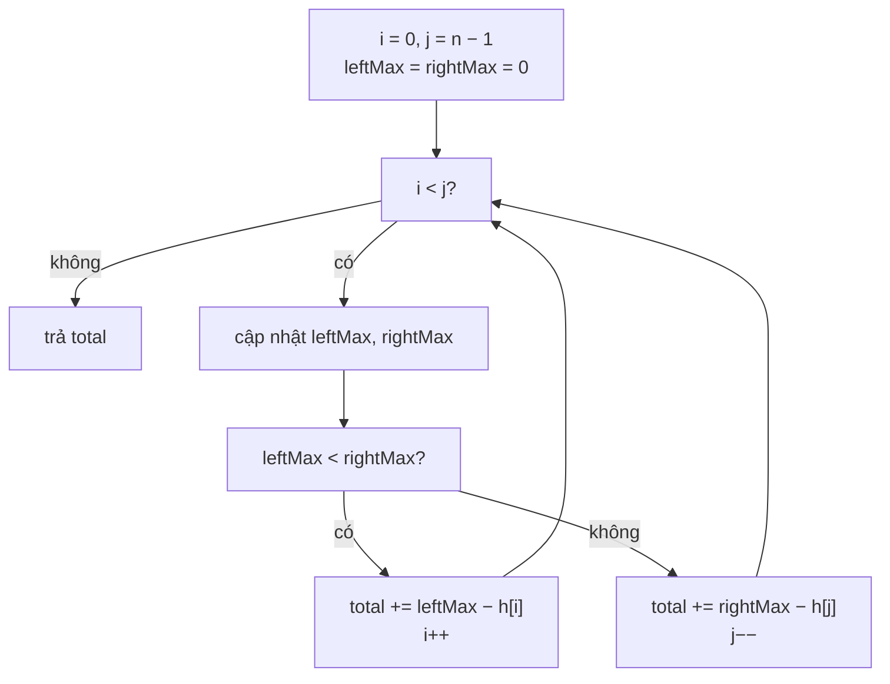

> [!tldr] Đọc nhanh
> - Đề: các cột cao `h[i]`, rộng 1. Mưa xong, nước đọng bao nhiêu ô?
> - Nước trên cột i = `min(L[i], R[i]) − h[i]`, với `L[i]` là cột cao nhất từ 0 tới i và `R[i]` là cột cao nhất từ i tới cuối (tính cả cột i, nên kết quả không bao giờ âm).
> - [[concepts/prefix-maximum|Max tiền tố]] và max hậu tố tính `L`, `R` trong hai lượt: O(n) thời gian, O(n) bộ nhớ. Cùng ý với tích tiền tố, hậu tố ở [[problems/product-of-array-except-self|ga 3]].
> - [[concepts/two-pointers|Hai con trỏ]] bỏ được hai mảng: bên nào có max nhỏ hơn thì mực nước ở bên đó đã chắc chắn. O(1) bộ nhớ.
> - Đo ở n = 10⁶: hai mảng 18,4 ms, ngăn xếp đơn điệu 12,9 ms, hai con trỏ 3,8 ms.

> [!info] Bối cảnh
> Bài LeetCode 42, bài khó nhất của [[posts/2026-11-23-neetcode-two-pointers|ga 4: Hai con trỏ]] trên **tuyến NeetCode: Mảng và chuỗi**. Trang này dùng [[problems/container-with-most-water|Container With Most Water]] (cùng ga) và ý tiền tố, hậu tố của [[problems/product-of-array-except-self|Product of Array Except Self]]. Lời giải có đủ TypeScript, Python, Go, Java và JavaScript.

> [!abstract]- Từ điển nhanh cho bài này (bấm để mở)
> - **Max tiền tố**: `L[i] = max(h[0..i])`, giá trị lớn nhất từ đầu tới i. **Max hậu tố**: `R[i] = max(h[i..n−1])`.
> - **Mực nước**: chiều cao mặt nước trên cột i, bằng `min(L[i], R[i])`. Nước tràn qua bờ thấp hơn.
> - **Ngăn xếp (stack)**: vào sau ra trước. **Ngăn xếp đơn điệu**: ngăn xếp luôn giữ phần tử theo một chiều tăng hoặc giảm. Ga 7 của tuyến này dành riêng cho nó.
> - **Bất biến (invariant)**: điều luôn đúng ở mỗi vòng lặp, dùng để chứng minh thuật toán đúng.

## Hình dung trước: ruộng bậc thang sau cơn mưa

Một dãy ruộng có bờ cao thấp khác nhau. Mưa đổ xuống, nước ở mỗi thửa dâng lên tới khi tràn qua bờ **thấp hơn** trong hai bờ cao nhất hai bên. Muốn biết thửa i ngập bao sâu, chỉ cần biết bờ cao nhất phía trái và bờ cao nhất phía phải.

| Đời thường | Khái niệm |
|---|---|
| Bờ cao nhất phía trái thửa i | `L[i]`, max tiền tố |
| Bờ cao nhất phía phải thửa i | `R[i]`, max hậu tố |
| Nước tràn qua bờ thấp hơn trong hai bờ đó | mực nước `min(L[i], R[i])` |
| Độ sâu nước = mực nước trừ độ cao đáy thửa | `min(L[i], R[i]) − h[i]` |
| Một người đi từ trái ghi bờ cao nhất đã gặp, một người đi từ phải cũng vậy | hai lượt tiền tố, hậu tố |
| Ai đang thấy bờ thấp hơn thì phía đó đã biết chắc mực nước | hai con trỏ |



## Vấn đề

**Đề (tóm tắt bằng lời của mình):** cho mảng `height` (1 ≤ n ≤ 2·10⁴, mỗi giá trị 0..10⁵) là chiều cao các cột rộng 1. Tính tổng lượng nước đọng lại sau mưa. Đề gốc: [LeetCode 42](https://leetcode.com/problems/trapping-rain-water/).

| Input | Output |
|---|---|
| `[0, 1, 0, 2, 1, 0, 1, 3, 2, 1, 2, 1]` | 6 |
| `[4, 2, 0, 3, 2, 5]` | 9 |
| `[1, 2, 3, 4]` | 0 (nước chảy hết sang trái) |

Mình từng nghĩ phải tìm từng "vũng" (từ bờ trái tới bờ phải) rồi tính thể tích từng vũng. Hóa ra không cần: tính theo **từng cột** thì mỗi cột chỉ phụ thuộc hai con số.

## Cơ chế

<figure class="figure-map" style="--ar: 3 / 4">
<div class="frame"><iframe data-archify="../diagrams/neetcode-trapping-rain-water/worked-example.html" title="Chốt lượng nước từ phía thấp hơn" loading="lazy"></iframe></div>
<figcaption><span><b>Hình 1.</b> Chốt lượng nước từ phía thấp hơn.</span><a href="../diagrams/neetcode-trapping-rain-water/worked-example.html" target="_blank" rel="noopener">Mở toàn màn hình</a></figcaption>
</figure>

<details>
<summary>Đọc từng bước</summary>
<ol>
<li>Bắt đầu với biên trái 3 và phải 4. <code>[3, 0, 2, 4]</code></li>
<li>Ô 0 giữ 3 đơn vị. <code>3 - 0 = 3</code></li>
<li>Ô 2 giữ thêm 1 đơn vị. <code>3 - 2 = 1</code></li>
<li>Cộng nước ở từng ô đã chốt. <code>3 + 1 = 4</code></li>
</ol>
</details>

### Công thức theo từng cột

Nước trên cột i bị chặn bởi bờ cao nhất bên trái và bờ cao nhất bên phải; mặt nước cao bằng bờ thấp hơn trong hai bờ đó. Tính cả chính cột i vào hai max thì `min(L[i], R[i]) ≥ h[i]`, nên nước không bao giờ âm và không cần `max(0, …)`.

| i | 0 | 1 | 2 | 3 | 4 | 5 |
|---|---|---|---|---|---|---|
| `h` | 4 | 2 | 0 | 3 | 2 | 5 |
| `L` (max từ trái) | 4 | 4 | 4 | 4 | 4 | 5 |
| `R` (max từ phải) | 5 | 5 | 5 | 5 | 5 | 5 |
| nước `min(L, R) − h` | 0 | 2 | 4 | 1 | 2 | 0 |

Tổng 9.

### Bốn cách

| Cách | Thời gian | Bộ nhớ phụ |
|---|---|---|
| vét cạn: với mỗi i, quét hai phía tìm max | O(n²) | O(1) |
| hai mảng max tiền tố, max hậu tố | O(n) | O(n) |
| hai con trỏ | O(n) | O(1) |
| ngăn xếp đơn điệu: đổ nước theo từng lớp ngang | O(n) | O(n) |

### Vì sao hai con trỏ đúng

Giữ `leftMax = max(h[0..i])` và `rightMax = max(h[j..n−1])`. Giả sử `leftMax < rightMax`:
- `R[i]` (max thật của mọi cột từ i tới cuối) ≥ `rightMax`, vì đoạn `[i, n)` chứa đoạn `[j, n)`.
- Nên `R[i] ≥ rightMax > leftMax = L[i]`, và `min(L[i], R[i]) = L[i] = leftMax`.

Mực nước ở i đã biết chắc mà không cần biết `R[i]` chính xác. Cộng `leftMax − h[i]`, dời i. Trường hợp ngược lại đối xứng cho j. Cùng kiểu lập luận với [[problems/container-with-most-water|Container With Most Water]]: bên thấp hơn quyết định, bên cao hơn chỉ cần "đủ cao".

### Đo

TypeScript, chiều cao ngẫu nhiên 0..10⁵, trung vị:

| n | vét cạn | max tiền tố | hai con trỏ | ngăn xếp |
|---|---|---|---|---|
| 5 000 | 10,8 ms | 0,49 ms | 0,06 ms | 0,11 ms |
| 10 000 | 42,5 ms | 0,23 ms | 0,12 ms | 0,21 ms |
| 20 000 | 170,6 ms | 0,60 ms | 0,03 ms | 0,17 ms |
| 10⁶ | (không chạy) | 18,41 ms | 3,76 ms | 12,87 ms |

Ba cách O(n) chênh nhau tới 5 lần: hai mảng phải cấp phát và ghi 2n số, ngăn xếp đẩy và rút từng chỉ số, còn hai con trỏ chỉ đọc mảng gốc.

### Bên dưới năm ngôn ngữ

| | Max tiền tố gọn nhất | Bẫy riêng |
|---|---|---|
| TypeScript / JavaScript | vòng lặp | `Math.max(...h.slice(0, i))` trong vòng lặp là O(n²) và có thể tràn ngăn xếp với mảng lớn |
| Python | `list(accumulate(h, max))` | `max(h[:i + 1])` trong vòng lặp vừa O(n²) vừa sao chép mảng mỗi lần |
| Go | vòng lặp với `max` có sẵn | mảng rỗng: `h[0]` panic, phải kiểm `len(h) == 0` trước |
| Java | vòng lặp | dùng `ArrayDeque` cho ngăn xếp, không dùng lớp `Stack` cũ |

## Ví dụ chạy được

[TypeScript](../code/neetcode-trapping-rain-water/trapping-rain-water.ts) · [Python](../code/neetcode-trapping-rain-water/trapping_rain_water.py) · [Go](../code/neetcode-trapping-rain-water/trapping_rain_water.go) · [Java](../code/neetcode-trapping-rain-water/trapping-rain-water.java) · [JavaScript](../code/neetcode-trapping-rain-water/trapping-rain-water.js)

Mỗi file có cả bốn cách và chạy 8 ca, gồm mảng rỗng, một cột, dãy tăng và dãy giảm. Dưới đây là max tiền tố và hai con trỏ.

```ts
// Hai mảng max tiền tố và max hậu tố: O(n) thời gian, O(n) bộ nhớ.
function prefixMax(h: number[]): number {
  const n = h.length;
  if (n === 0) return 0;
  const left = new Array(n), right = new Array(n);
  left[0] = h[0];
  for (let i = 1; i < n; i++) left[i] = Math.max(left[i - 1], h[i]);
  right[n - 1] = h[n - 1];
  for (let i = n - 2; i >= 0; i--) right[i] = Math.max(right[i + 1], h[i]);
  let total = 0;
  for (let i = 0; i < n; i++) total += Math.min(left[i], right[i]) - h[i];
  return total;
}

// Hai con trỏ: O(1) bộ nhớ. Bên nào có max nhỏ hơn thì nước ở bên đó đã biết chắc.
function twoPointers(h: number[]): number {
  let i = 0, j = h.length - 1, leftMax = 0, rightMax = 0, total = 0;
  while (i < j) {
    leftMax = Math.max(leftMax, h[i]);
    rightMax = Math.max(rightMax, h[j]);
    if (leftMax < rightMax) {
      total += leftMax - h[i]; // bên phải có cột ≥ rightMax > leftMax, nên leftMax là mực nước ở i
      i++;
    } else {
      total += rightMax - h[j];
      j--;
    }
  }
  return total;
}
```

```python
def prefix_max(h: list[int]) -> int:
    left = list(accumulate(h, max))  # accumulate với max: max tiền tố trong một dòng
    right = list(accumulate(reversed(h), max))[::-1]
    return sum(min(l, r) - x for l, r, x in zip(left, right, h))

def two_pointers(h: list[int]) -> int:
    i, j, left_max, right_max, total = 0, len(h) - 1, 0, 0, 0
    while i < j:
        left_max, right_max = max(left_max, h[i]), max(right_max, h[j])
        if left_max < right_max:
            total += left_max - h[i]
            i += 1
        else:
            total += right_max - h[j]
            j -= 1
    return total
```

```go
func prefixMax(h []int) int {
	n := len(h)
	if n == 0 {
		return 0 // h[0] với slice rỗng sẽ panic: index out of range
	}
	left, right := make([]int, n), make([]int, n)
	left[0], right[n-1] = h[0], h[n-1]
	for i := 1; i < n; i++ {
		left[i] = max(left[i-1], h[i])
	}
	for i := n - 2; i >= 0; i-- {
		right[i] = max(right[i+1], h[i])
	}
	total := 0
	for i := range h {
		total += min(left[i], right[i]) - h[i]
	}
	return total
}

func twoPointers(h []int) int {
	i, j, leftMax, rightMax, total := 0, len(h)-1, 0, 0, 0
	for i < j {
		leftMax, rightMax = max(leftMax, h[i]), max(rightMax, h[j])
		if leftMax < rightMax {
			total += leftMax - h[i]
			i++
		} else {
			total += rightMax - h[j]
			j--
		}
	}
	return total
}
```

```java
static int prefixMax(int[] h) {
    int n = h.length;
    if (n == 0) return 0;
    int[] left = new int[n], right = new int[n];
    left[0] = h[0]; right[n - 1] = h[n - 1];
    for (int i = 1; i < n; i++) left[i] = Math.max(left[i - 1], h[i]);
    for (int i = n - 2; i >= 0; i--) right[i] = Math.max(right[i + 1], h[i]);
    int total = 0;
    for (int i = 0; i < n; i++) total += Math.min(left[i], right[i]) - h[i];
    return total;
}

static int twoPointers(int[] h) {
    int i = 0, j = h.length - 1, leftMax = 0, rightMax = 0, total = 0;
    while (i < j) {
        leftMax = Math.max(leftMax, h[i]);
        rightMax = Math.max(rightMax, h[j]);
        if (leftMax < rightMax) total += leftMax - h[i++];
        else total += rightMax - h[j--];
    }
    return total;
}
```

```js
function prefixMax(h) {
  const n = h.length;
  if (n === 0) return 0;
  const left = new Array(n), right = new Array(n);
  left[0] = h[0];
  for (let i = 1; i < n; i++) left[i] = Math.max(left[i - 1], h[i]);
  right[n - 1] = h[n - 1];
  for (let i = n - 2; i >= 0; i--) right[i] = Math.max(right[i + 1], h[i]);
  let total = 0;
  for (let i = 0; i < n; i++) total += Math.min(left[i], right[i]) - h[i];
  return total;
}

function twoPointers(h) {
  let i = 0, j = h.length - 1, leftMax = 0, rightMax = 0, total = 0;
  while (i < j) {
    leftMax = Math.max(leftMax, h[i]);
    rightMax = Math.max(rightMax, h[j]);
    if (leftMax < rightMax) total += leftMax - h[i++];
    else total += rightMax - h[j--];
  }
  return total;
}
```


File TypeScript chạy thêm một bản sai rồi đo:

```text
$ node trapping-rain-water.ts
bruteForce       8/8 ca đúng
prefixMax        8/8 ca đúng
twoPointers      8/8 ca đúng
monotonicStack   8/8 ca đúng
exclusiveNoClamp 5/8 ca đúng; sai ở [0,1,0,2,1,0,1,3,2,1,2,1] → 2 (đúng 6) [1,2,3,4] → -2 (đúng 0) [5,4,1,2] → -1 (đúng 1)

n          vét cạn  max tiền tố  hai con trỏ  ngăn xếp   (ms, trung vị; chiều cao 0..10⁵)
5000          10.8         0.49         0.06      0.11
10000         42.5         0.23         0.12      0.21
20000        170.6         0.60         0.03      0.17
1000000          —        18.41         3.76     12.87
```

Bản sai tính max hai bên **không** gồm cột i và quên chặn ở 0: một cột cao hơn mọi cột hai bên cho ra nước âm, và các số âm trừ vào tổng. Python, Go, Java và JavaScript in `8/8 ca đúng` cho cả bốn cách.

## Hiểu lầm và bẫy hay gặp

- **Max hai bên không tính cột i và quên `max(0, …)`.** Ra nước âm (đo ở trên). Tính cả cột i vào max là cách gọn nhất để khỏi phải chặn.
- **Hai con trỏ so `h[i] < h[j]` thay vì `leftMax < rightMax`.** Với bài này, so `h[i]`, `h[j]` cũng đúng nếu cập nhật max đúng chỗ, nhưng lập luận phải viết lại; so hai max thì lập luận ở trên áp thẳng vào.
- **Tính max bằng hàm có sẵn trong vòng lặp.** `max(h[:i + 1])` hay `Math.max(...h.slice(0, i))` biến O(n) thành O(n²).
- **Tìm từng vũng nước.** Làm được nhưng dễ sai ở các vũng lồng nhau; tính theo cột thì không có khái niệm vũng.
- **Nhầm với Container With Most Water.** Bài đó chọn hai cột và bỏ qua phần giữa; bài này cộng nước trên mọi cột.

## Câu hỏi tự kiểm tra

> [!question]- Tính nước cho `[3, 0, 0, 2, 0, 4]`.
> `L = [3,3,3,3,3,4]`, `R = [4,4,4,4,4,4]`, mực nước `[3,3,3,3,3,4]`, nước `[0,3,3,1,3,0]`, tổng 10.

> [!question]- Ở hai con trỏ, khi `leftMax < rightMax`, vì sao không cần biết `R[i]` chính xác?
> Vì `R[i] ≥ rightMax > leftMax`. Mực nước là `min(L[i], R[i]) = leftMax`, bất kể `R[i]` lớn bao nhiêu.

> [!question]- Vì sao mảng tăng dần `[1, 2, 3, 4]` không giữ nước?
> Với mọi i, `L[i] = h[i]` (cột i là cao nhất tính tới đó), nên `min(L[i], R[i]) − h[i] = 0`.

> [!question]- Bản 2D của bài này (LeetCode 407, nước trên một lưới) có dùng hai con trỏ được không?
> Không: một ô có bốn hướng thoát nước, không còn "trái" và "phải". Cách chuẩn là đi từ biên vào trong bằng heap, luôn xử lý ô biên thấp nhất trước, cùng tinh thần "bên thấp hơn quyết định".

## Tham khảo

- [LeetCode 42: Trapping Rain Water](https://leetcode.com/problems/trapping-rain-water/) (đề gốc)
- [Python: `itertools.accumulate`](https://docs.python.org/3/library/itertools.html#itertools.accumulate) (với `func=max` cho max tiền tố)
- [Java 21 `ArrayDeque`](https://docs.oracle.com/en/java/javase/21/docs/api/java.base/java/util/ArrayDeque.html) (khuyến nghị thay cho `Stack`)
- [LeetCode 407: Trapping Rain Water II](https://leetcode.com/problems/trapping-rain-water-ii/) (bản lưới 2D)
