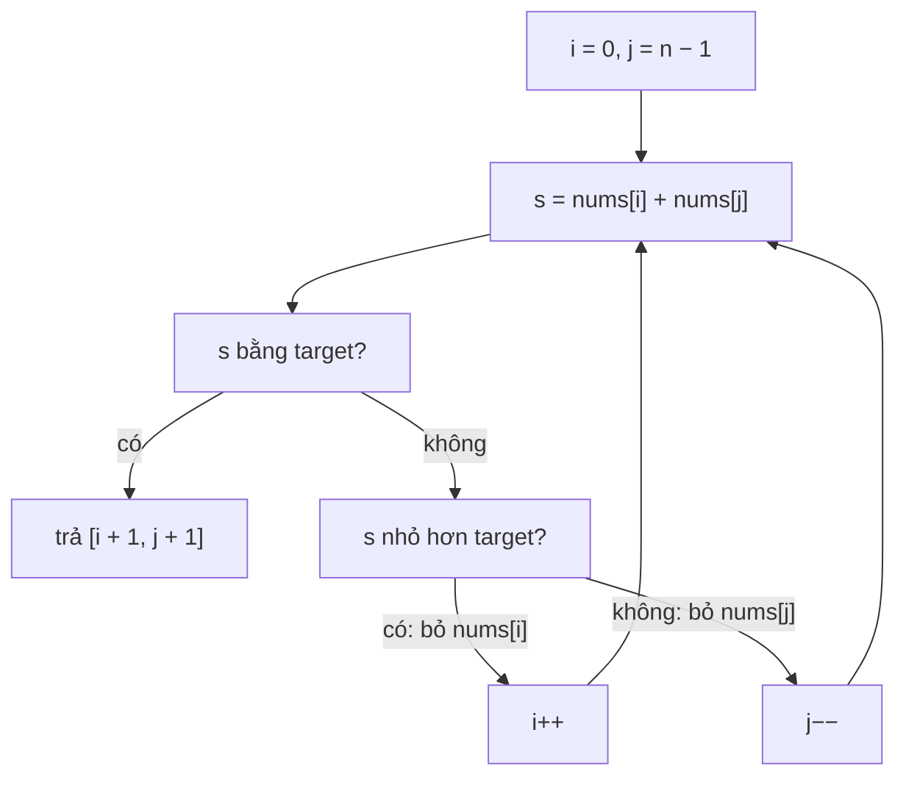

> [!tldr] Đọc nhanh
> - Đề: mảng **tăng dần**, tìm hai số có tổng bằng `target`, trả chỉ số **đếm từ 1**. Có đúng một đáp án; chỉ được dùng O(1) bộ nhớ phụ.
> - [[concepts/two-pointers|Hai con trỏ]]: `i` ở đầu, `j` ở cuối. Tổng nhỏ quá thì tăng `i`, lớn quá thì giảm `j`. Mỗi bước bỏ hẳn một số: O(n), O(1) bộ nhớ.
> - Vì sao bỏ được: nếu `nums[i] + nums[j]` còn thiếu thì `nums[i]` cộng với số **lớn nhất còn lại** cũng thiếu, nên `nums[i]` không thuộc cặp nào. Đây là [[concepts/search-space-pruning|cắt không gian tìm kiếm]].
> - Hash map của [[problems/two-sum|Two Sum]] vẫn đúng nhưng tốn O(n) bộ nhớ và chậm hơn: đo ở n = 10⁶ là 99,8 ms so với 1,2 ms.
> - Bẫy: tìm nhị phân trên **cả** mảng có thể ghép một số với chính nó (`[3, 3]` → `[1, 1]`).

> [!info] Bối cảnh
> Bài LeetCode 167, bài neo của [[posts/2026-11-23-neetcode-two-pointers|ga 4: Hai con trỏ]] trên **tuyến NeetCode: Mảng và chuỗi**. Bài anh em [[problems/two-sum|Two Sum]] (ga 1) có mảng chưa sắp xếp nên dùng hash map; ở đây thứ tự đã có sẵn và mình tận dụng nó. Lời giải có đủ TypeScript, Python, Go, Java và JavaScript.

> [!abstract]- Từ điển nhanh cho bài này (bấm để mở)
> - **Mảng tăng dần (non-decreasing)**: mỗi phần tử không nhỏ hơn phần tử trước; số trùng được phép.
> - **Chỉ số đếm từ 1 (1-indexed)**: phần tử đầu là số 1, không phải 0. Trả `[i + 1, j + 1]`.
> - **Tìm nhị phân (binary search)**: tìm trong mảng đã sắp xếp bằng cách mỗi lần loại một nửa: O(log n).
> - **Phần bù (complement)**: `target − x`, số cần tìm để ghép với x. Xem [[concepts/complement-lookup|Complement Lookup]].

## Hình dung trước: hai người khiêng hàng lên cân

Một kho có các thùng hàng xếp theo cân nặng từ nhẹ đến nặng. Cần chọn đúng hai thùng nặng tổng cộng đúng bằng mức cân cho phép. Một người đứng ở đầu nhẹ, một người ở đầu nặng, mỗi người cầm thùng trước mặt mình đặt lên cân.

| Đời thường | Khái niệm |
|---|---|
| Thùng xếp từ nhẹ đến nặng | mảng tăng dần |
| Người đầu nhẹ, người đầu nặng | con trỏ `i`, con trỏ `j` |
| Cân chỉ thiếu: thùng nhẹ quá, kể cả ghép với thùng nặng nhất còn lại | tăng `i`, bỏ `nums[i]` |
| Cân chỉ thừa: thùng nặng quá, kể cả ghép với thùng nhẹ nhất còn lại | giảm `j`, bỏ `nums[j]` |
| Cân chỉ vừa | trả `[i + 1, j + 1]` |
| Mỗi lần cân là một thùng bị loại vĩnh viễn | tối đa n − 1 bước |



## Vấn đề

**Đề (tóm tắt bằng lời của mình):** cho mảng `numbers` tăng dần (2 ≤ n ≤ 3·10⁴, giá trị trong −1000..1000) và `target`. Tìm hai vị trí khác nhau `i < j` sao cho `numbers[i] + numbers[j] = target`, trả `[i + 1, j + 1]`. Có đúng một đáp án. Chỉ được dùng bộ nhớ phụ hằng số. Đề gốc: [LeetCode 167](https://leetcode.com/problems/two-sum-ii-input-array-is-sorted/).

| Input | target | Output |
|---|---|---|
| `[2, 7, 11, 15]` | 9 | `[1, 2]` |
| `[2, 3, 4]` | 6 | `[1, 3]` |
| `[-1, 0]` | −1 | `[1, 2]` |

Mình từng nghĩ "đã có Two Sum với hash map rồi, dùng lại là xong". Đúng là chạy được, nhưng đề cấm O(n) bộ nhớ, và hash map bỏ phí đúng thông tin quý nhất: mảng đã sắp xếp.

## Cơ chế

<figure class="figure-map" style="--ar: 3 / 4">
<div class="frame"><iframe data-archify="../diagrams/neetcode-two-sum-ii-input-array-is-sorted/worked-example.html" title="Dịch đúng đầu mút theo tổng" loading="lazy"></iframe></div>
<figcaption><span><b>Hình 1.</b> Dịch đúng đầu mút theo tổng.</span><a href="../diagrams/neetcode-two-sum-ii-input-array-is-sorted/worked-example.html" target="_blank" rel="noopener">Mở toàn màn hình</a></figcaption>
</figure>

<details>
<summary>Đọc từng bước</summary>
<ol>
<li>So tổng hai đầu với 11. <code>[1, 4, 7, 9], 1 + 9 = 10</code></li>
<li>Tổng thiếu nên tăng đầu trái. <code>4 + 9 = 13</code></li>
<li>Tổng dư nên giảm đầu phải. <code>4 + 7 = 11</code></li>
<li>Trả vị trí đánh số từ 1. <code>[2, 3]</code></li>
</ol>
</details>

### Bốn cách, xếp theo bộ nhớ và thời gian

| Cách | Thời gian | Bộ nhớ phụ | Dùng thứ tự? |
|---|---|---|---|
| vét cạn mọi cặp | O(n²) | O(1) | không |
| với mỗi `i`, tìm nhị phân phần bù ở **bên phải** `i` | O(n log n) | O(1) | có, một phần |
| hash map một lượt (ga 1) | O(n) | O(n) | không |
| hai con trỏ | O(n) | O(1) | có, trọn vẹn |

### Vì sao hai con trỏ không sót cặp nào

Giữ một bất biến: **nếu đáp án tồn tại thì nó nằm trong đoạn `[i, j]`.** Lúc đầu đoạn là cả mảng, nên đúng. Mỗi bước:

- Nếu `nums[i] + nums[j] < target`: với mọi `k` trong `(i, j]`, `nums[k] ≤ nums[j]`, nên `nums[i] + nums[k] < target`. `nums[i]` không ghép được với ai trong đoạn, bỏ nó vẫn giữ bất biến.
- Nếu tổng lớn hơn target: lập luận đối xứng, `nums[j]` không ghép được với ai, bỏ nó.

Mỗi bước thu đoạn đi một phần tử, nên sau tối đa n − 1 bước hoặc tìm thấy, hoặc đoạn rỗng. Đây là [[concepts/search-space-pruning|cắt không gian tìm kiếm]]: không xét từng cặp, mà mỗi bước loại cả một **hàng** cặp trong bảng n × n.

### Đo

TypeScript, mảng `0, 1, …, n − 1` và target là tổng hai số lớn nhất, nên cặp đáp án nằm cuối mảng (ca tệ nhất cho cả bốn cách). Trung vị:

| n | vét cạn | tìm nhị phân | hash map | hai con trỏ |
|---|---|---|---|---|
| 5 000 | 6,0 ms | 0,11 ms | 0,37 ms | 0,08 ms |
| 10 000 | 23,1 ms | 0,18 ms | 0,65 ms | 0,01 ms |
| 20 000 | 92,7 ms | 0,21 ms | 1,53 ms | 0,03 ms |
| 10⁶ | (không chạy) | 15,92 ms | 99,75 ms | 1,20 ms |

Hash map chậm nhất trong ba cách nhanh dù cùng O(n) như hai con trỏ: mỗi bước phải băm và ghi vào bảng, bảng còn phải nới ra nhiều lần. Hai con trỏ chỉ đọc mảng theo thứ tự, thứ bộ nhớ đệm của CPU làm rất tốt.

### Bên dưới bảy ngôn ngữ

| | Tìm nhị phân có sẵn | Bẫy riêng |
|---|---|---|
| TypeScript / JavaScript | không có; tự viết | `(lo + hi) >>> 1` để chia đôi lấy nguyên |
| Python | `bisect_left(a, x, lo)` | phải truyền `lo = i + 1`, không thì tìm cả bên trái i |
| Go | `sort.SearchInts(rest, x)` trên slice con | chỉ số trả về tính từ đầu slice con, phải cộng lại `i + 1` |
| Java | `Arrays.binarySearch(a, from, to, x)` | không thấy thì trả số **âm**, không phải −1; mảng có số trùng thì không chắc trả vị trí nào |
| PHP | không có; tự viết | `($lo + $hi) / 2` ra **float** khi tổng lẻ; dùng `intdiv` |
| Rust | `slice.binary_search(&x)` trên `nums[i + 1..]` | trả `Result`: `Ok(k)` với `k` tính từ đầu slice con; có số trùng thì không chắc trả vị trí nào |

## Ví dụ chạy được

[TypeScript](../code/neetcode-two-sum-ii-input-array-is-sorted/two-sum-ii.ts) · [Python](../code/neetcode-two-sum-ii-input-array-is-sorted/two_sum_ii.py) · [Go](../code/neetcode-two-sum-ii-input-array-is-sorted/two_sum_ii.go) · [Java](../code/neetcode-two-sum-ii-input-array-is-sorted/two-sum-ii.java) · [JavaScript](../code/neetcode-two-sum-ii-input-array-is-sorted/two-sum-ii.js) · [PHP](../code/neetcode-two-sum-ii-input-array-is-sorted/two-sum-ii.php) · [Rust](../code/neetcode-two-sum-ii-input-array-is-sorted/two_sum_ii.rs)

Mỗi file có cả bốn cách và chạy 6 ca, gồm số âm và số trùng. Dưới đây là tìm nhị phân và hai con trỏ.

```ts
// Với mỗi nums[i], tìm nhị phân phần bù trong đoạn BÊN PHẢI i. O(n log n), O(1) bộ nhớ.
function binarySearch(nums: number[], target: number): number[] {
  for (let i = 0; i < nums.length; i++) {
    let lo = i + 1, hi = nums.length - 1;
    const want = target - nums[i];
    while (lo <= hi) {
      const mid = (lo + hi) >>> 1;
      if (nums[mid] === want) return [i + 1, mid + 1];
      if (nums[mid] < want) lo = mid + 1; else hi = mid - 1;
    }
  }
  return [];
}

// Hai con trỏ: tổng nhỏ quá thì tăng trái, lớn quá thì giảm phải. O(n), O(1) bộ nhớ.
function twoPointers(nums: number[], target: number): number[] {
  let i = 0, j = nums.length - 1;
  while (i < j) {
    const sum = nums[i] + nums[j];
    if (sum === target) return [i + 1, j + 1];
    if (sum < target) i++; // nums[i] cộng với số LỚN NHẤT còn lại vẫn thiếu: nums[i] không thuộc cặp nào
    else j--; // nums[j] cộng với số NHỎ NHẤT còn lại vẫn thừa: nums[j] không thuộc cặp nào
  }
  return [];
}
```

```python
def binary_search(nums: list[int], target: int) -> list[int]:
    for i, x in enumerate(nums):
        j = bisect_left(nums, target - x, i + 1)  # lo = i + 1: chỉ tìm bên phải i
        if j < len(nums) and nums[j] == target - x:
            return [i + 1, j + 1]
    return []

def two_pointers(nums: list[int], target: int) -> list[int]:
    i, j = 0, len(nums) - 1
    while i < j:
        s = nums[i] + nums[j]
        if s == target:
            return [i + 1, j + 1]
        if s < target:
            i += 1
        else:
            j -= 1
    return []
```

```go
func binarySearch(nums []int, target int) []int {
	for i, x := range nums {
		rest := nums[i+1:] // slice con dùng chung mảng gốc, không sao chép
		k := sort.SearchInts(rest, target-x)
		if k < len(rest) && rest[k] == target-x {
			return []int{i + 1, i + 2 + k}
		}
	}
	return nil
}

func twoPointers(nums []int, target int) []int {
	for i, j := 0, len(nums)-1; i < j; {
		switch s := nums[i] + nums[j]; {
		case s == target:
			return []int{i + 1, j + 1}
		case s < target:
			i++
		default:
			j--
		}
	}
	return nil
}
```

```java
static int[] binarySearch(int[] nums, int target) {
    for (int i = 0; i < nums.length; i++) {
        // khoảng [i + 1, n): không ghép nums[i] với chính nó. Trả số âm nếu không thấy.
        int j = Arrays.binarySearch(nums, i + 1, nums.length, target - nums[i]);
        if (j >= 0) return new int[] {i + 1, j + 1};
    }
    return new int[0];
}

static int[] twoPointers(int[] nums, int target) {
    int i = 0, j = nums.length - 1;
    while (i < j) {
        int sum = nums[i] + nums[j];
        if (sum == target) return new int[] {i + 1, j + 1};
        if (sum < target) i++; else j--;
    }
    return new int[0];
}
```

```js
function binarySearch(nums, target) {
  for (let i = 0; i < nums.length; i++) {
    let lo = i + 1, hi = nums.length - 1;
    const want = target - nums[i];
    while (lo <= hi) {
      const mid = (lo + hi) >>> 1; // >>> 1: chia đôi lấy nguyên, không thành số thực
      if (nums[mid] === want) return [i + 1, mid + 1];
      if (nums[mid] < want) lo = mid + 1; else hi = mid - 1;
    }
  }
  return [];
}

function twoPointers(nums, target) {
  let i = 0, j = nums.length - 1;
  while (i < j) {
    const sum = nums[i] + nums[j];
    if (sum === target) return [i + 1, j + 1];
    if (sum < target) i++; else j--;
  }
  return [];
}
```

```php
// Với mỗi nums[i], tìm nhị phân phần bù trong đoạn BÊN PHẢI i. O(n log n), O(1) bộ nhớ.
function binarySearch(array $nums, int $target): array {
    $n = count($nums);
    for ($i = 0; $i < $n; $i++) {
        $lo = $i + 1; $hi = $n - 1;
        $want = $target - $nums[$i];
        while ($lo <= $hi) {
            $mid = intdiv($lo + $hi, 2); // ($lo + $hi) / 2 cho ra float khi tổng lẻ
            if ($nums[$mid] === $want) return [$i + 1, $mid + 1];
            if ($nums[$mid] < $want) $lo = $mid + 1; else $hi = $mid - 1;
        }
    }
    return [];
}
// Hai con trỏ: tổng nhỏ quá thì tăng trái, lớn quá thì giảm phải. O(n), O(1) bộ nhớ.
function twoPointers(array $nums, int $target): array {
    $i = 0; $j = count($nums) - 1;
    while ($i < $j) {
        $sum = $nums[$i] + $nums[$j];
        if ($sum === $target) return [$i + 1, $j + 1];
        if ($sum < $target) $i++; // nums[i] cộng với số LỚN NHẤT còn lại vẫn thiếu
        else $j--;                // nums[j] cộng với số NHỎ NHẤT còn lại vẫn thừa
    }
    return [];
}
```

```rust
// Với mỗi nums[i], tìm nhị phân phần bù trong đoạn BÊN PHẢI i. O(n log n), O(1) bộ nhớ.
// binary_search có sẵn trên slice con nums[i + 1..]; chỉ số trả về tính từ đầu slice con.
fn binary_search(nums: &[i32], target: i32) -> Vec<i32> {
    for i in 0..nums.len() {
        if let Ok(k) = nums[i + 1..].binary_search(&(target - nums[i])) {
            return vec![i as i32 + 1, (i + 1 + k) as i32 + 1];
        }
    }
    vec![]
}
// Hai con trỏ: tổng nhỏ quá thì tăng trái, lớn quá thì giảm phải. O(n), O(1) bộ nhớ.
fn two_pointers(nums: &[i32], target: i32) -> Vec<i32> {
    let (mut i, mut j) = (0, nums.len() - 1);
    while i < j {
        let sum = nums[i] + nums[j];
        if sum == target {
            return vec![i as i32 + 1, j as i32 + 1];
        }
        if sum < target {
            i += 1; // nums[i] cộng với số LỚN NHẤT còn lại vẫn thiếu
        } else {
            j -= 1; // nums[j] cộng với số NHỎ NHẤT còn lại vẫn thừa
        }
    }
    vec![]
}
```


```text
$ node two-sum-ii.ts
bruteForce             6/6 ca đúng
binarySearch           6/6 ca đúng
hashMap                6/6 ca đúng
twoPointers            6/6 ca đúng
binarySearchWholeArray 4/6 ca đúng; sai ở [3,3], 6 → [1,1] [1,2,3,4,4,9,56,90], 8 → [4,4]

n          vét cạn  tìm nhị phân  hash map  hai con trỏ   (ms, trung vị)
5000           6.0          0.11      0.37         0.08
10000         23.1          0.18      0.65         0.01
20000         92.7          0.21      1.53         0.03
1000000          —         15.92     99.75         1.20
```

Bản tìm nhị phân trên cả mảng tìm thấy phần bù 3 của số 3 **ở chính vị trí của nó**, và trả `[1, 1]`. Chỉ ca có hai số bằng nhau và bằng `target / 2` mới lộ lỗi này. Python, Go, Java và JavaScript in `6/6 ca đúng` cho cả bốn cách. PHP và Rust cũng in `6/6 ca đúng` cho bốn cách, và bản tìm trên cả mảng in `4/6 ca đúng` với đúng hai ca sai như TypeScript.

## Hiểu lầm và bẫy hay gặp

- **Trả chỉ số đếm từ 0.** Đề đếm từ 1.
- **Tìm phần bù trên cả mảng.** Phải tìm trong `(i, n)`; không thì ghép một số với chính nó.
- **Dời cả hai con trỏ khi tổng sai.** Chỉ dời bên có bằng chứng: thiếu thì `i`, thừa thì `j`. Dời cả hai có thể bỏ lỡ cặp `(i, j − 1)`.
- **"O(n) thì như nhau."** Hash map và hai con trỏ cùng O(n) nhưng chênh 80 lần ở 10⁶ phần tử.
- **Lo tràn số khi cộng.** Với giới hạn ±1000 thì không. Ở bài khác có giá trị tới 2³¹, `nums[i] + nums[j]` tràn `int` trong Java và Go 32 bit; khi đó so `nums[i] < target − nums[j]` hoặc dùng `long`.
- **PHP: chia đôi bằng `/`.** `($lo + $hi) / 2` trả `float` khi tổng lẻ (`7 / 2 = 3.5`), và `$nums[3.5]` bị ép về chỉ số 3 kèm cảnh báo "Deprecated: implicit conversion" từ PHP 8.1. Dùng `intdiv($lo + $hi, 2)`.
- **Rust: quên rằng `binary_search` trả chỉ số trong slice con.** `nums[i + 1..].binary_search(&want)` trả `Ok(k)` tính từ `i + 1`, nên chỉ số thật là `i + 1 + k`. Thêm nữa, `nums.len() - 1` trên `usize` tràn khi mảng rỗng; đề hứa có ít nhất hai phần tử.

## Câu hỏi tự kiểm tra

> [!question]- Mảng `[1, 2, 5, 9]`, target 11. Viết các bước của hai con trỏ.
> 1 + 9 = 10 < 11: tăng i. 2 + 9 = 11: trả `[2, 4]`.

> [!question]- Bất biến của hai con trỏ là gì, và vì sao bỏ `nums[i]` khi tổng nhỏ hơn target không phá nó?
> "Nếu có đáp án thì nó nằm trong `[i, j]`." Khi `nums[i] + nums[j] < target`, mọi `nums[k]` trong đoạn đều ≤ `nums[j]`, nên `nums[i]` cộng với bất kỳ ai cũng thiếu. Nó không thuộc đáp án.

> [!question]- Nếu mảng chưa sắp xếp, nên sắp xếp rồi dùng hai con trỏ hay dùng hash map?
> Bài [[problems/two-sum|Two Sum]] cần chỉ số gốc, nên sắp xếp phải mang theo chỉ số và tốn O(n log n). Hash map O(n) thời gian là đủ. Sắp xếp + hai con trỏ chỉ thắng khi bộ nhớ là ràng buộc chính.

> [!question]- Đề đổi: đếm **số cặp** có tổng bằng target, mảng có số trùng. Hai con trỏ cần sửa gì?
> Khi tổng bằng target, nếu `nums[i] = nums[j]` thì mọi cặp trong đoạn đều đúng: cộng `C(j − i + 1, 2)` rồi dừng. Nếu khác nhau, đếm số lần lặp `a` của `nums[i]` và `b` của `nums[j]`, cộng `a · b`, rồi nhảy qua cả hai nhóm.

## Tham khảo

- [LeetCode 167: Two Sum II - Input Array Is Sorted](https://leetcode.com/problems/two-sum-ii-input-array-is-sorted/) (đề gốc)
- [Python: `bisect`](https://docs.python.org/3/library/bisect.html) (`bisect_left(a, x, lo, hi)`)
- [Java 21 `Arrays.binarySearch(int[], int, int, int)`](https://docs.oracle.com/en/java/javase/21/docs/api/java.base/java/util/Arrays.html#binarySearch(int%5B%5D,int,int,int)) (trả `-(điểm chèn) − 1` khi không thấy; không chắc vị trí khi có số trùng)
- [Go: `sort.SearchInts`](https://pkg.go.dev/sort#SearchInts)
