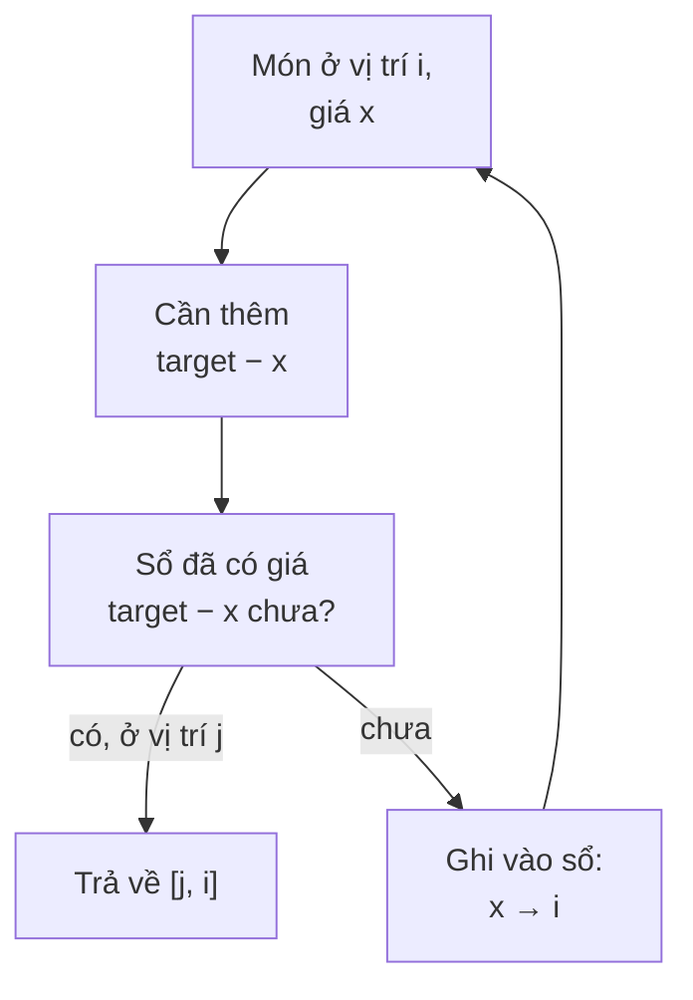

> [!tldr] Đọc nhanh
> - Đề: tìm **chỉ số** của hai phần tử có tổng bằng `target`. Luôn có đúng một đáp án, và không được dùng một phần tử hai lần.
> - [[concepts/complement-lookup|Tra phần bù]]: với mỗi `x`, số cần tìm là `target - x`. Câu hỏi "có cặp nào?" biến thành "đã gặp `target - x` chưa?", một câu hash map trả lời được trong O(1).
> - [[concepts/one-pass-hash-map|Hash map một lượt]]: **hỏi trước, ghi sau**. Ghi trước thì `[3, 2, 4]`, target 6 trả về `[0, 0]`: ghép số 3 với chính nó.
> - [[concepts/two-pointers|Hai con trỏ]] trên mảng đã sắp xếp cũng chạy được, O(n log n), nhưng phải sắp xếp **chỉ số** để không mất vị trí gốc. Trong JS, `sort()` mặc định làm hai con trỏ bỏ sót đáp án.
> - Hash map là O(1) **trung bình** và [[concepts/amortized-o1|khấu hao]]. Khi mọi khóa [[concepts/hash-collision|va chạm]] vào cùng một ô, Java vẫn trụ được nhờ biến ô đó thành cây, nhưng chỉ khi khóa so sánh được thứ tự.

> [!info] Bối cảnh
> Bài LeetCode 1, thuộc [[posts/2026-11-22-neetcode-hash-lookup|ga 1: Tra cứu bằng hash]] trên **tuyến NeetCode: Mảng và chuỗi**. Bài Contains Duplicate nhớ "đã thấy chưa", bài Valid Anagram nhớ "bao nhiêu lần"; bài này nhớ "**ở vị trí nào**" và hỏi về một số *chưa* thấy. Lời giải có đủ TypeScript, JavaScript, Python, Go và Java.

> [!abstract]- Từ điển nhanh cho bài này (bấm để mở)
> - **Big-O, Set, hash**: xem [[problems/contains-duplicate|Contains Duplicate]]. **Map**: xem [[problems/valid-anagram|Valid Anagram]].
> - **Chỉ số (index)**: vị trí của phần tử trong mảng, bắt đầu từ 0. Đề bài đòi chỉ số, không đòi giá trị.
> - **Ô (bucket)**: hash table là một mảng các ô; hash của khóa quyết định khóa nằm ở ô nào.
> - **Load factor (hệ số tải)**: số khóa chia cho số ô. Vượt ngưỡng thì bảng nới rộng (thường gấp đôi) và chuyển mọi khóa sang bảng mới.
> - **JIT**: trình biên dịch chạy lúc chương trình đang chạy (JVM, V8). Vài lần chạy đầu thường chậm hơn, nên phép đo phải "khởi động" trước.

## Hình dung trước: đi chợ với đúng 9 nghìn

Bạn có đúng 9 nghìn và muốn mua **đúng hai món** tiêu hết số tiền đó. Bạn đi dọc dãy hàng, mỗi món một giá.

| Đời thường | Khái niệm |
|---|---|
| Với mỗi món, quay lại xem từng món phía sau xem có cộng đủ 9 không | Vét cạn, O(n²) |
| Đứng trước món giá 2, nghĩ "mình cần một món giá **7**" | [[concepts/complement-lookup\|Tra phần bù]] |
| Ghi vào sổ "giá → vị trí kệ" mọi món đã đi qua; tới món mới thì tra sổ tìm giá còn thiếu | [[concepts/one-pass-hash-map\|Hash map một lượt]] |
| Xếp hàng hóa theo giá, một người đứng đầu rẻ nhất, một người đứng cuối đắt nhất, cùng đi vào giữa | [[concepts/two-pointers\|Hai con trỏ]] |
| Cuốn sổ có mục lục theo giá; nhiều giá rơi vào cùng một trang mục lục thì phải dò lâu hơn | [[concepts/hash-collision\|Va chạm hash]] |
| Sổ đầy thì chép sang cuốn dày gấp đôi; tốn công, nhưng hiếm khi phải làm | [[concepts/amortized-o1\|O(1) khấu hao]] |



## Vấn đề

**Đề (tóm tắt):** cho mảng số nguyên `nums` và số `target`, trả về chỉ số của hai phần tử có tổng bằng `target`. Đề bảo đảm có **đúng một** đáp án, và một phần tử không được dùng hai lần. Thứ tự trả về không quan trọng. Đề gốc: [LeetCode 1](https://leetcode.com/problems/two-sum/).

| `nums` | `target` | Output |
|---|---|---|
| `[2, 7, 11, 15]` | 9 | `[0, 1]` |
| `[3, 2, 4]` | 6 | `[1, 2]` (không phải `[0, 0]`) |
| `[3, 3]` | 6 | `[0, 1]` |

Giới hạn: từ 2 tới **10 000** phần tử, giá trị và target trong khoảng ±10⁹. Câu hỏi mở rộng của đề: có cách nào nhanh hơn O(n²) không?

Hai ca cuối là nơi lời giải sai lộ ra: `[3, 2, 4]` bẫy những ai ghép một số với chính nó, `[3, 3]` bẫy những ai dùng Set (mất thông tin có hai số 3).

## Cơ chế

<figure class="figure-map" style="--ar: 3 / 4">
<div class="frame"><iframe data-archify="../diagrams/neetcode-two-sum/one-pass.html" title="Hash map một lượt trên [3, 2, 4] với target 6" loading="lazy"></iframe></div>
<figcaption><span><b>Hình 1.</b> [3, 2, 4], target 6. Số 3 hỏi sổ tìm 3 trước khi tự ghi mình vào, nên không tự ghép với chính nó. Tới số 4, sổ đã có 2 ở vị trí 1: đáp án [1, 2].</span><a href="../diagrams/neetcode-two-sum/one-pass.html" target="_blank" rel="noopener">Mở toàn màn hình</a></figcaption>
</figure>

### Tra phần bù

Vét cạn hỏi "cặp (i, j) này có cộng ra target không?" cho mọi cặp, O(n²). Mẹo [[concepts/complement-lookup|tra phần bù]] lật câu hỏi lại: khi đứng ở `x`, chỉ có **đúng một** giá trị ghép được với nó, là `target - x`. Câu hỏi "có cặp nào chứa x?" thành "đã thấy giá trị `target - x` chưa?", và đó chính là câu hỏi của bài Contains Duplicate. Chỉ khác là lần này cần nhớ thêm vị trí, nên dùng Map `giá trị → chỉ số` thay cho Set.

Mẹo này đi xa hơn Two Sum rất nhiều: "đếm số đoạn con có tổng bằng k" dùng phần bù trên tổng tiền tố, và "4Sum II" chia đôi rồi tra phần bù.

### Hash map một lượt: hỏi trước, ghi sau

Có hai cách dựng sổ:

- **Hai lượt**: lượt 1 ghi mọi số vào map, lượt 2 tra phần bù và kiểm tra `j !== i`.
- **[[concepts/one-pass-hash-map|Một lượt]]**: vừa duyệt vừa tra, rồi mới ghi. Sổ chỉ chứa các số **đứng trước** i, nên không bao giờ tìm thấy chính i. Với `[3, 3]`, số 3 thứ hai tìm thấy số 3 thứ nhất ở vị trí 0, đúng.

Nếu đảo thứ tự (ghi trước rồi mới hỏi), số 3 trong `[3, 2, 4]` tìm thấy chính nó, trả về `[0, 0]`. Mình gặp lỗi này ở lần viết đầu tiên.

Còn trùng khóa thì sao? Với `[3, 3]` và một target khác 6, số 3 thứ hai ghi đè vị trí của số 3 thứ nhất. Điều đó không sao, vì hai số 3 như nhau với mọi phần tử đứng sau.

### Hai con trỏ: khi mảng đã sắp xếp

Nếu mảng đã tăng dần, đặt một [[concepts/two-pointers|con trỏ]] ở đầu (nhỏ nhất) và một ở cuối (lớn nhất). Tổng nhỏ hơn target thì dời con trỏ trái sang phải để tăng tổng; lớn hơn thì dời con trỏ phải sang trái. Mỗi bước loại đúng một phần tử khỏi mọi đáp án có thể, nên tổng cộng O(n) bước và O(1) bộ nhớ.

Bài này không cho mảng đã sắp xếp. Sắp xếp tốn O(n log n), và làm mất vị trí gốc, nên phải sắp xếp một mảng **chỉ số** theo giá trị. Bài "Two Sum II" (bài thứ hai của nhóm Two Pointers trong NeetCode 150) cho sẵn mảng đã sắp xếp, và ở đó hai con trỏ là lời giải tối ưu.

### Bên trong hash table: vì sao O(1) chỉ là trung bình

Hash map là một mảng các ô. `hash(khóa)` chọn ô; hai khóa khác nhau rơi vào cùng ô là một [[concepts/hash-collision|va chạm]]. Va chạm là chuyện bình thường: với bảng có m ô, chỉ khoảng 1,2·√m khóa là đã có 50% khả năng có hai khóa trùng ô (bài toán ngày sinh). Mọi hash table đều có cách xử lý:

| | Cách xử lý va chạm | Nới bảng |
|---|---|---|
| Java `HashMap` | mỗi ô là danh sách liên kết; ô có từ **8** khóa (và bảng ≥ 64 ô) thì đổi thành **cây đỏ-đen** | load factor 0,75, gấp đôi |
| Python `dict` | địa chỉ mở: ô bận thì dò ô khác theo một dãy giả ngẫu nhiên phụ thuộc mọi bit của hash | nới khi đầy khoảng 2/3 |
| Go `map` | từ Go 1.24 là Swiss Table: nhóm 8 ô, so 8 byte "dấu vân tay" của hash cùng lúc | nới theo từng bảng con |
| V8 `Map` | bảng hash giữ thứ tự chèn, mỗi ô là một chuỗi nối | gấp đôi |

Hai cơ chế làm "O(1)" đúng trong thực tế:

- **Hash tốt rải khóa đều**, nên mỗi ô trung bình có một khóa. Kẻ tấn công biết hàm hash có thể cố ý gửi hàng nghìn khóa cùng hash, biến mỗi lần tra thành O(n): đây là tấn công hash flooding (oCERT 2011). Python đáp lại bằng cách ngẫu nhiên hóa hash của chuỗi mỗi lần chạy (`PYTHONHASHSEED`); Java đáp lại bằng cây trong từng ô.
- **Nới bảng [[concepts/amortized-o1|khấu hao]]**: thỉnh thoảng một lần `set` phải chép cả bảng, O(n). Nhưng nếu mỗi lần nới gấp đôi, tổng công chép sau n lần ghi chỉ cỡ 2n, tức trung bình O(1) mỗi lần. Từng lần riêng lẻ có thể chậm; tổng thì không.

## Ví dụ chạy được

[TypeScript](../code/neetcode-two-sum/two-sum.ts) · [JavaScript](../code/neetcode-two-sum/two-sum.js) · [Python](../code/neetcode-two-sum/two_sum.py) · [Go](../code/neetcode-two-sum/two_sum.go) · [Java](../code/neetcode-two-sum/two-sum.java) · [PHP](../code/neetcode-two-sum/two-sum.php) · [Rust](../code/neetcode-two-sum/two_sum.rs)

```ts
// TypeScript: hash map một lượt
function onePass(nums: number[], target: number): [number, number] | null {
  const seen = new Map<number, number>(); // giá trị → chỉ số
  for (let i = 0; i < nums.length; i++) {
    const j = seen.get(target - nums[i]);
    if (j !== undefined) return [j, i]; // hỏi TRƯỚC khi ghi: không bao giờ ghép x với chính nó
    seen.set(nums[i], i);
  }
  return null;
}

// Hai con trỏ: sắp xếp CHỈ SỐ theo giá trị để còn trả về vị trí gốc
function twoPointers(nums: number[], target: number): [number, number] | null {
  const idx = nums.map((_, i) => i).sort((a, b) => nums[a] - nums[b]);
  let l = 0, r = idx.length - 1;
  while (l < r) {
    const sum = nums[idx[l]] + nums[idx[r]];
    if (sum === target) return [Math.min(idx[l], idx[r]), Math.max(idx[l], idx[r])];
    if (sum < target) l++; else r--;
  }
  return null;
}
```

```python
def two_sum(nums: list[int], target: int) -> list[int]:
    seen: dict[int, int] = {}  # giá trị → chỉ số
    for i, x in enumerate(nums):
        if (need := target - x) in seen:  # hỏi trước khi ghi
            return [seen[need], i]
        seen[x] = i
    return []
```

```go
func twoSum(nums []int, target int) []int {
	seen := make(map[int]int, len(nums)) // giá trị → chỉ số
	for i, x := range nums {
		if j, ok := seen[target-x]; ok { // "comma ok": phân biệt "không có" với "có, giá trị 0"
			return []int{j, i}
		}
		seen[x] = i
	}
	return nil
}
```

```java
static int[] twoSum(int[] nums, int target) {
    Map<Integer, Integer> seen = new HashMap<>(); // giá trị → chỉ số
    for (int i = 0; i < nums.length; i++) {
        Integer j = seen.get(target - nums[i]);
        if (j != null) return new int[] {j, i};
        seen.put(nums[i], i);
    }
    return new int[0];
}
```

```js
function twoSum(nums, target) {
  const seen = new Map(); // dùng Map, đừng dùng {}: khóa của object luôn bị đổi thành chuỗi
  for (let i = 0; i < nums.length; i++) {
    const need = target - nums[i];
    if (seen.has(need)) return [seen.get(need), i];
    seen.set(nums[i], i);
  }
  return [];
}
```

```php
function twoSum(array $nums, int $target): array {
    $seen = []; // giá trị → chỉ số; mảng PHP là bảng băm
    foreach ($nums as $i => $x) {
        $need = $target - $x;
        if (isset($seen[$need])) return [$seen[$need], $i]; // hỏi trước khi ghi
        $seen[$x] = $i;
    }
    return [];
}
```

```rust
fn two_sum(nums: Vec<i32>, target: i32) -> Vec<i32> {
    let mut seen: HashMap<i32, i32> = HashMap::with_capacity(nums.len()); // giá trị → chỉ số
    for (i, &x) in nums.iter().enumerate() {
        if let Some(&j) = seen.get(&(target - x)) {
            return vec![j, i as i32]; // get trả Option: không có "giá trị 0 giả" như Go
        }
        seen.insert(x, i as i32);
    }
    vec![]
}
```

```text
$ node two-sum.ts
bruteForce         5/5 ca đúng
twoPointers        5/5 ca đúng
onePass            5/5 ca đúng
onePassWrongOrder  3/5 ca đúng; sai ở [3,2,4], target 6 → [0,0]

[10, 9, 1, 100], target 11:
  sort() mặc định → [1,10,100,9]: không tìm thấy
  sort((a,b)=>a-b) → [1,9,10,100]: 1 + 10

n            ns mỗi lần set   ns mỗi lần get
1000                  114.7             74.4
10000                 146.5            113.8
100000                106.4             51.1
1000000               170.3            100.8
4000000               256.2            127.7
bruteForce   n = 20 000:   219.84 ms
twoPointers  n = 20 000:     1.23 ms
onePass      n = 20 000:     1.81 ms
```

- **Thứ tự hỏi/ghi**: bản ghi trước sai 2/5 ca (`[3, 2, 4]` và `[3, 3]`).
- **`sort()` mặc định**: `[1, 10, 100, 9]` không tăng dần theo số, nên hai con trỏ đi sai hướng và bỏ sót `1 + 10`.
- **Khấu hao**: n tăng 4 000 lần, chi phí mỗi lần `set` chỉ dao động quanh 100–250 ns. Phần tăng ở các cỡ lớn chủ yếu vì bảng không còn nằm gọn trong cache CPU, không phải vì Big-O.
- Với n = 20 000, hai con trỏ và hash map đều khoảng 1–2 ms. Vét cạn mất 220 ms.

Bản Java thêm một phép thử va chạm. Chuỗi `"Aa"` và `"BB"` có cùng `hashCode` (2112), nên ghép 16 khối như vậy cho ra 65 536 chuỗi có **cùng một** hashCode:

```text
$ java two-sum.java
[0, 1] [1, 2] [0, 1]
"Aa".hashCode() = 2112, "BB".hashCode() = 2112
hashCode khác nhau: chuỗi xấu 1, chuỗi thường 65536
put + get 65 536 khóa: thường 4.4 ms, cùng hashCode (String, Comparable) 23.6 ms
put + get 5000 khóa cùng hashCode, không Comparable: 109.0 ms
put + get 10000 khóa cùng hashCode, không Comparable: 447.5 ms
put + get 20000 khóa cùng hashCode, không Comparable: 2700.6 ms
```

- 65 536 chuỗi dồn vào một ô chỉ chậm khoảng **5 lần**: ô đó đã thành cây, và vì `String` là `Comparable`, cây được sắp theo thứ tự chuỗi, nên mỗi lần tra là O(log n).
- Với khóa **không** so sánh được thứ tự (một `record` có `hashCode` cố định), cây không biết đi trái hay phải nên phải dò cả hai nhánh. n tăng gấp đôi, thời gian tăng 4–6 lần: đúng dáng O(n²) cho cả n lần tra.

Python và Go:

```text
$ python3 two_sum.py
[2, 7, 11, 15] 9 → [0, 1] [0, 1]
[3, 2, 4] 6 → [1, 2] [1, 2]
[3, 3] 6 → [0, 1] [0, 1]
PYTHONHASHSEED=1: hash('two-sum'), hash(2026) = 5272480527784930694 2026
PYTHONHASHSEED=2: hash('two-sum'), hash(2026) = -3137576308460970527 2026

$ go run two_sum.go
[0 1] [1 2] [0 1]
seen[5] = 0 | seen[99] = 0 ← cả hai đều 0
dùng comma ok: 99 có trong map? false
```

Hash của chuỗi trong Python đổi theo seed, còn hash của số nguyên thì không. Trong Go, đọc một khóa không có trả về giá trị 0, trùng với chỉ số 0 hợp lệ, nên phải dùng dạng `j, ok := seen[k]`.

PHP và Rust in cùng bốn dòng đếm ca như TypeScript (`onePassWrongOrder  3/5 ca đúng`), kèm một bẫy riêng mỗi ngôn ngữ:

```text
$ php two-sum.php
...
khóa '1', 1 và 1.7 dồn vào: [1] → số thực 1.7

$ rustc --edition 2021 -O two_sum.rs && ./two_sum
...
2e9 + 1e9 với i32: checked_add = None, wrapping_add = -1294967296
```

Trong PHP, chuỗi số `'1'` và số thực `1.7` đều bị ép thành khóa nguyên `1`, nên ba lần ghi đè lên cùng một ô. Rust bản build tối ưu (`-O`) tràn số thì quấn vòng âm thầm; bản debug thì panic.

## Hiểu lầm và bẫy hay gặp

- **Ghi trước rồi mới hỏi.** Ghép một số với chính nó. Luôn hỏi trước, ghi sau.
- **Dùng Set thay Map.** Mất vị trí, và với `[3, 3]` mất luôn thông tin có hai số 3.
- **Go: `if j := seen[k]; j != 0`.** Chỉ số 0 là hợp lệ. Dùng `j, ok := seen[k]`.
- **JS: dùng object `{}` làm map.** Khóa luôn bị đổi thành chuỗi, nên `1` và `"1"` là một khóa; và các tên như `__proto__` có ý nghĩa đặc biệt. `Map` giữ nguyên kiểu khóa.
- **Hai con trỏ trên mảng sắp xếp bằng `sort()` mặc định của JS.** Bỏ sót đáp án, như ví dụ `[10, 9, 1, 100]`.
- **Sắp xếp giá trị rồi trả về chỉ số sau khi sắp xếp.** Đề đòi vị trí gốc. Sắp xếp mảng chỉ số, hoặc mảng cặp (giá trị, chỉ số).
- **Tràn số khi tính `target - x`.** Với giới hạn ±10⁹ thì `int` 32 bit vẫn đủ (hiệu tối đa 2·10⁹ < 2³¹ ≈ 2,1·10⁹), nhưng sát nút. Với giới hạn lớn hơn, Java và Go cần `long`/`int64`.
- **"Hash map luôn O(1)."** O(1) là trung bình khi hash rải đều, và khấu hao qua các lần nới bảng. Khóa do người dùng gửi lên có thể bị chọn để va chạm.
- **PHP: khóa mảng bị ép kiểu.** Chuỗi số như `"1"` thành khóa nguyên `1`, số thực bị cắt phần lẻ. Với Two Sum dùng số nguyên thì không sao, nhưng đừng dùng mảng PHP làm map cho số thực hay chuỗi số có số 0 đứng đầu. Và `isset` trả `false` khi giá trị là `null`, nên đừng lưu `null` vào sổ.
- **Rust: tràn số khác nhau giữa debug và release.** `target - x` với `i32` panic ở bản debug nhưng quấn vòng âm thầm ở bản `-O`. Với giới hạn ±10⁹ thì vừa đủ, nhưng muốn chắc thì đổi sang `i64` hoặc dùng `checked_sub`.

## Câu hỏi tự kiểm tra

> [!question]- Đứng ở phần tử x, vì sao chỉ cần tìm đúng một giá trị?
> Vì tổng phải bằng target, nên phần tử còn lại bắt buộc có giá trị `target - x`. Câu hỏi "có cặp nào chứa x" chỉ còn là "có giá trị đó không", một lần tra map.

> [!question]- Với `[3, 3]` và target 6, bản một lượt trả về gì, và vì sao số 3 thứ hai không bị nhầm thành chính nó?
> Trả về `[0, 1]`. Khi xét số 3 thứ hai (vị trí 1), sổ chỉ chứa các số đứng trước nó, tức số 3 ở vị trí 0. Vị trí 1 chưa được ghi lúc tra.

> [!question]- Vì sao hai con trỏ trên mảng đã sắp xếp không bỏ sót đáp án?
> Khi tổng nhỏ hơn target, phần tử bên trái không thể ghép với bất kỳ phần tử nào còn lại (tất cả đều không lớn hơn phần tử bên phải), nên loại nó là an toàn. Lập luận tương tự cho phần tử bên phải khi tổng lớn hơn target.

> [!question]- Nới bảng phải chép cả bảng, tốn O(n). Vì sao vẫn nói `set` là O(1)?
> Vì bảng nới gấp đôi mỗi lần, số lần chép rất thưa: sau n lần ghi, tổng số khóa đã chép cỡ n + n/2 + n/4 + … < 2n. Chia đều cho n lần ghi là O(1) mỗi lần, gọi là O(1) khấu hao.

> [!question]- 20 000 khóa cùng hashCode làm HashMap mất 2,7 giây, nhưng 65 536 chuỗi cùng hashCode chỉ mất 24 ms. Khác nhau ở đâu?
> Cả hai đều dồn vào một ô và ô đó thành cây. Chuỗi là `Comparable` nên cây sắp được theo thứ tự, tra O(log n). Khóa không so sánh được thì cây phải dò cả hai nhánh, tra O(n).

## Tham khảo

- [LeetCode 1: Two Sum](https://leetcode.com/problems/two-sum/) (đề gốc)
- [OpenJDK: HashMap.java](https://github.com/openjdk/jdk/blob/master/src/java.base/share/classes/java/util/HashMap.java) (`TREEIFY_THRESHOLD = 8`, `MIN_TREEIFY_CAPACITY = 64`, load factor 0,75)
- [Python: `object.__hash__`](https://docs.python.org/3/reference/datamodel.html#object.__hash__) (ngẫu nhiên hóa hash chuỗi, `PYTHONHASHSEED`)
- [Go 1.24 release notes](https://go.dev/doc/go1.24) (map dùng Swiss Tables)
- [oCERT-2011-003](https://ocert.org/advisories/ocert-2011-003.html) (tấn công hash flooding lên nhiều ngôn ngữ)
