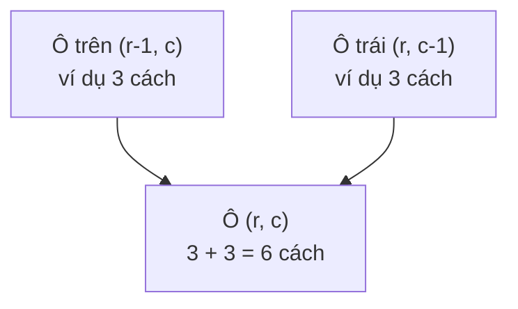
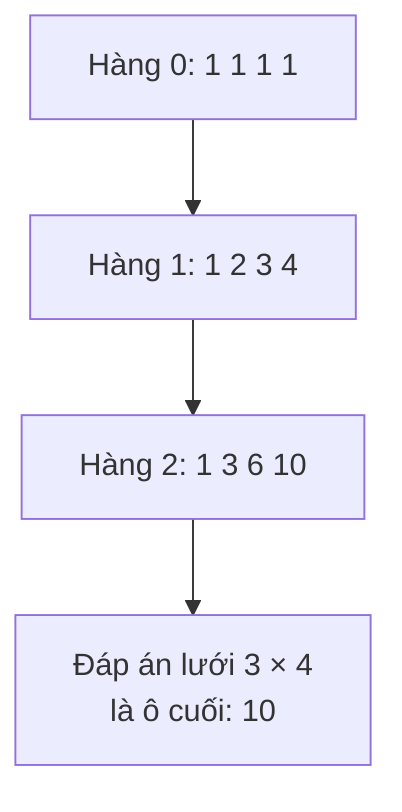

> [!tldr] Đọc nhanh
> - Mọi đường tới ô (r, c) đều đi qua ô ngay trên hoặc ô ngay trái nó, và hai nhóm đường này không trùng nhau. Vậy `ways[r][c] = ways[r-1][c] + ways[r][c-1]`.
> - Hàng đầu và cột đầu đều bằng 1: chỉ có một cách là đi thẳng.
> - Mỗi ô chỉ cần hàng trên và ô bên trái, nên một mảng dài n là đủ ([[concepts/rolling-state|Rolling State]]): quét trái sang phải và cộng dồn.
> - Đường đi nào cũng gồm đúng m − 1 bước xuống và n − 1 bước sang phải, nên đáp án là tổ hợp C(m + n − 2, m − 1). Nhân rồi chia ngay từng bước để không tràn số.

> [!info] Bối cảnh
> Đây là bài LeetCode 62 tại [[posts/2026-11-27-neetcode-grid-two-strings|ga DP-05: Lưới và hai chuỗi]] trên **tuyến NeetCode: Quy hoạch động**. Mình hình dung một khu phố kẻ ô bàn cờ và một người giao hàng chỉ được đi về phía đông hoặc phía nam. Bạn chỉ cần biết mảng hai chiều và vòng lặp lồng nhau.

> [!abstract]- Từ điển nhanh cho bài này (bấm để mở)
> - Lưới m × n có m hàng, n cột. Ô (r, c) nằm ở hàng r, cột c, đếm từ 0.
> - [[concepts/grid-path-dp|Grid Path DP]] là cách đặt một giá trị cho mỗi ô và tính nó từ các ô đi tới được ô đó.
> - [[concepts/dp-state|Trạng thái DP]] nói rõ một ô của bảng lưu điều gì.
> - [[concepts/recurrence-relation|Công thức truy hồi]] cho biết lấy những ô nào để tính ô hiện tại.
> - [[concepts/memoization|Ghi nhớ kết quả]] (memoization) lưu đáp án của một trạng thái ở lần hỏi đầu tiên.
> - Tổ hợp C(N, k) là số cách chọn k vị trí trong N vị trí, không quan tâm thứ tự chọn.

## Hình dung trước: người giao hàng trong khu phố ô bàn cờ

Kho hàng ở góc tây bắc, khách ở góc đông nam. Mỗi lượt người giao hàng chỉ đi một block về phía đông hoặc một block về phía nam. Đứng ở một ngã tư bất kỳ, mình hỏi: lượt cuối cùng tới đây là từ đâu? Chỉ có hai khả năng: từ ngã tư phía bắc, hoặc từ ngã tư phía tây. Nên số lộ trình tới đây bằng tổng số lộ trình tới hai ngã tư đó.

| Đời thường | Khái niệm |
|---|---|
| Ngã tư ở hàng r, cột c | Ô (r, c) của lưới |
| Số lộ trình khác nhau tới ngã tư đó | `ways[r][c]` |
| Đến từ phía bắc hoặc phía tây | Ô trên `(r-1, c)` và ô trái `(r, c-1)` |
| Phố biên phía bắc hoặc phía tây | Hàng đầu và cột đầu, mỗi ô chỉ có 1 cách |
| Ghi số lên tấm bảng một hàng rồi viết đè khi xuống hàng | Một mảng dài n dùng lại cho mọi hàng |
| Lịch trình gồm các lượt "đông" và "nam" | Chuỗi gồm m − 1 chữ X (xuống) và n − 1 chữ P (phải) |



## Vấn đề: đếm lộ trình chỉ đi sang phải và xuống dưới

Có một lưới m hàng, n cột, với 1 ≤ m, n ≤ 100. Một robot đứng ở ô trên cùng bên trái và cần tới ô dưới cùng bên phải. Mỗi bước nó chỉ được sang phải một ô hoặc xuống dưới một ô. Trả về số đường đi khác nhau. Đề bảo đảm đáp án không vượt quá 2·10⁹. Ví dụ lưới 3 × 3 có 6 đường, lưới 1 × n chỉ có 1 đường. [Đề gốc LeetCode 62](https://leetcode.com/problems/unique-paths/)

Mình từng nghĩ phải liệt kê từng đường rồi đếm. Hóa ra chỉ cần đếm, không cần biết các đường trông ra sao. Đếm thì cộng được, còn liệt kê thì không.

## Cơ chế

### Vét cạn và ghi nhớ theo ô

Hàm `walk(r, c)` trả số đường từ (r, c) tới đích. Ở đích trả 1. Ở chỗ khác, cộng số đường khi sang phải và khi đi xuống, bỏ hướng nào ra ngoài lưới. Mỗi lá của cây gọi là một đường đi hoàn chỉnh. Mỗi ô được gọi lại một lần cho mỗi đường từ xuất phát tới nó, nên tổng cộng có đúng C(m + n, m) − 1 lượt gọi, tăng theo hàm mũ. Lưới 10 × 10 có 48.620 đường và tốn 184.755 lượt gọi.

Rất nhiều nhánh quay lại cùng một ô. Từ ô (1, 0) đi phải hay từ ô (0, 1) đi xuống đều tới (1, 1), và từ đó số đường tới đích không phụ thuộc mình tới (1, 1) bằng cách nào. Lưu `walk(r, c)` theo ô thì mỗi ô chỉ tính một lần. Bản ghi nhớ còn dừng sớm ở hàng cuối và cột cuối, vì từ đó chỉ còn một cách là đi thẳng. Thời gian và bộ nhớ là O(m·n). Với lưới 10 × 10 chỉ còn 163 lượt gọi.

### Điền bảng từ góc trên trái

Đảo chiều câu hỏi: `ways[r][c]` là số đường từ góc xuất phát tới (r, c). Bước cuối tới (r, c) đến từ ô trên hoặc ô trái. Hai nhóm đường này không chung đường nào, vì bước cuối của chúng khác nhau, và gộp lại thì đủ mọi đường. Nên `ways[r][c] = ways[r-1][c] + ways[r][c-1]`.

Ô trên hàng 0 chỉ tới được bằng cách đi thẳng sang phải, ô ở cột 0 chỉ tới được bằng cách đi thẳng xuống, nên cả hai đều bằng 1. Duyệt hàng từ trên xuống, trong mỗi hàng duyệt cột từ trái sang, thì cả ô trên lẫn ô trái đều đã có giá trị trước khi cần. Thời gian O(m·n), bộ nhớ O(m·n).



### Một hàng là đủ

Ô (r, c) chỉ đọc hàng ngay trên và ô bên trái cùng hàng. Mình giữ một mảng `row` dài n. Trước khi cập nhật, `row[c]` vẫn là giá trị của hàng trên. `row[c-1]` thì vừa được cập nhật thành giá trị của hàng hiện tại. Nên `row[c] += row[c-1]` đúng là "trên + trái". Thời gian vẫn O(m·n), bộ nhớ còn O(n). Lưới có tính đối xứng, nên có thể chọn n là chiều nhỏ hơn.

### Công thức tổ hợp

Đường nào cũng có đúng m − 1 bước xuống và n − 1 bước sang phải, tổng m + n − 2 bước. Một đường được xác định hoàn toàn khi biết bước nào là bước xuống. Vậy đáp án là C(m + n − 2, m − 1).

Tính `100!` rồi chia sẽ tràn mọi kiểu số nguyên 64 bit. Thay vào đó, với k = min(m, n) − 1, mình nhân dần: `result = result * (N − k + i) / i` với i = 1…k. Sau bước i, `result` đúng bằng C(N − k + i, i), một số nguyên, nên phép chia luôn chia hết. Giá trị trung gian lớn nhất là đáp án nhân với một số không quá 198, tức dưới 4·10¹¹: vừa trong số 64 bit và vẫn chính xác trong `number` của JavaScript (dưới 2⁵³). Thời gian O(min(m, n)), bộ nhớ O(1).

| Cách | Thời gian | Bộ nhớ phụ |
|---|---|---|
| Vét cạn | O(C(m + n, m)), hàm mũ | O(m + n) ngăn xếp |
| Ghi nhớ theo ô | O(m·n) | O(m·n) |
| Bảng đầy đủ | O(m·n) | O(m·n) |
| Một hàng | O(m·n) | O(min(m, n)) |
| Tổ hợp | O(min(m, n)) | O(1) |

## Ví dụ chạy được

[TypeScript](../code/neetcode-unique-paths/paths.ts) · [Python](../code/neetcode-unique-paths/paths.py) · [Go](../code/neetcode-unique-paths/paths.go) · [Java](../code/neetcode-unique-paths/paths.java) · [JavaScript](../code/neetcode-unique-paths/paths.js) · [PHP](../code/neetcode-unique-paths/paths.php) · [Rust](../code/neetcode-unique-paths/paths.rs)

```ts
function pathsRow(m: number, n: number): number {
    const row = Array(n).fill(1)
    for (let r = 1; r < m; r++) {
        for (let c = 1; c < n; c++) row[c] += row[c - 1]
    }
    return row[n - 1]
}
```

```python
def paths_row(m, n):
    row = [1] * n
    for _ in range(1, m):
        for c in range(1, n):
            row[c] += row[c - 1]
    return row[n - 1]
```

```go
func pathsRow(m, n int) int {
	row := make([]int, n)
	for c := range row {
		row[c] = 1
	}
	for r := 1; r < m; r++ {
		for c := 1; c < n; c++ {
			row[c] += row[c-1]
		}
	}
	return row[n-1]
}
```

```java
static int pathsRow(int m, int n) {
    int[] row = new int[n];
    java.util.Arrays.fill(row, 1);
    for (int r = 1; r < m; r++) {
        for (int c = 1; c < n; c++) row[c] += row[c - 1];
    }
    return row[n - 1];
}
```

```js
function pathsRow(m, n) {
    const row = Array(n).fill(1)
    for (let r = 1; r < m; r++) {
        for (let c = 1; c < n; c++) row[c] += row[c - 1]
    }
    return row[n - 1]
}
```

```php
function pathsRow(int $m, int $n): int {
    $row = array_fill(0, $n, 1);
    for ($r = 1; $r < $m; $r++) {
        for ($c = 1; $c < $n; $c++) $row[$c] += $row[$c - 1];
    }
    return $row[$n - 1];
}
```

```rust
fn paths_row(m: usize, n: usize) -> u64 {
    let mut row = vec![1u64; n];
    for _ in 1..m {
        for c in 1..n {
            row[c] += row[c - 1];
        }
    }
    row[n - 1]
}
```

Các tab trích bản một hàng. File tải về còn có vét cạn, bản ghi nhớ, bảng đầy đủ và công thức tổ hợp. Dòng đầu là 7 ca có đáp án biết trước, gồm lưới 1 × 1, lưới một hàng và lưới 23 × 12. Dòng thứ hai đối chiếu năm cách với vét cạn trên mọi lưới từ 1 × 1 tới 8 × 8. Dòng thứ ba dựng tam giác Pascal có chặn trên cho mọi m, n từ 1 tới 100, rồi so ba cách không đệ quy trên mọi lưới có đáp án không vượt 2·10⁹. Dòng cuối đếm số lần đi vào hàm, không phải thời gian chạy.

```text
7/7 ca đúng
64/64 ca đúng (đối chiếu vét cạn, lưới tới 8×8)
1773/1773 ca đúng (mọi lưới 1..100 có đáp án ≤ 2·10⁹)
Lưới 10×10: vét cạn 184755 lượt gọi, memo 163 lượt gọi
```

## Hiểu lầm và bẫy hay gặp

- Đặt hàng đầu và cột đầu bằng 0. Khi đó cả bảng toàn số 0. Ô biên có đúng một đường, không phải không có đường nào.
- Nghĩ rằng bản một hàng phải quét từ phải sang trái như [[concepts/knapsack-update-order|ba lô 0/1]]. Ở đây mình cần ô trái **của hàng mới**, nên phải quét từ trái sang phải. Quét ngược sẽ cộng ô trái của hàng cũ.
- Tính tổ hợp bằng giai thừa. `100!` có 158 chữ số. Chia trước rồi nhân cũng sai, vì `result / i` chưa chắc chia hết. Nhân trước rồi chia ngay ở từng bước thì mọi phép chia đều chia hết.
- Java: `int` chứa được đáp án (2·10⁹ < 2³¹ − 1), nhưng tích `result * (N − k + i)` trong công thức thì không, nên biến trung gian phải là `long`. Go dùng `int` 64 bit trên máy 64 bit, Rust dùng `u64`.
- Python: dùng `/` cho ra `float`. Phải dùng `//`. Thư viện chuẩn có sẵn `math.comb(m + n - 2, m - 1)`.
- PHP: `/` trả `float` kể cả khi chia hết. `intdiv` giữ kiểu `int`, nên phép so `===` với số nguyên mới đúng.
- JavaScript và TypeScript: `/` luôn là phép chia số thực, nhưng vì giá trị trung gian dưới 2⁵³ và luôn chia hết nên kết quả vẫn chính xác. Bảng đầy đủ cho lưới 100 × 100 thì vượt 2⁵³ ở các ô giữa và mất chính xác. Đề chỉ hỏi những lưới có đáp án ≤ 2·10⁹, nên mọi ô trên đường tới đích đều nhỏ hơn đáp án.

## Câu hỏi tự kiểm tra

> [!question]- Vì sao được cộng ô trên với ô trái mà không đếm trùng?
> Hai nhóm đường khác nhau ở bước cuối: một nhóm bước xuống, một nhóm bước sang phải. Không đường nào thuộc cả hai nhóm, và mọi đường tới ô đó thuộc một trong hai.

> [!question]- Bản một hàng quét c từ trái sang phải. Nếu quét từ phải sang trái thì sai ở đâu?
> `row[c-1]` khi đó vẫn là giá trị của hàng trên, nên ô (r, c) cộng nhầm ô chéo trên trái thay vì ô trái.

> [!question]- Lưới 3 × 7 có bao nhiêu đường, tính bằng tổ hợp?
> Có 2 bước xuống và 6 bước sang phải, tổng 8 bước. C(8, 2) = 28.

> [!question]- Nếu một số ô có vật cản thì bảng đổi thế nào?
> Ô vật cản có 0 đường. Hàng đầu và cột đầu không còn toàn 1: sau vật cản đầu tiên, các ô phía sau trên biên đều thành 0. Công thức tổ hợp không còn dùng được.

## Tham khảo

- [LeetCode 62](https://leetcode.com/problems/unique-paths/)
- [Lattice path (Wikipedia)](https://en.wikipedia.org/wiki/Lattice_path)
- [Python math.comb](https://docs.python.org/3/library/math.html#math.comb) · [PHP intdiv](https://www.php.net/manual/en/function.intdiv.php) · [Java SE 21, kiểu số nguyên và tràn số](https://docs.oracle.com/javase/specs/jls/se21/html/jls-4.html#jls-4.2.2)
