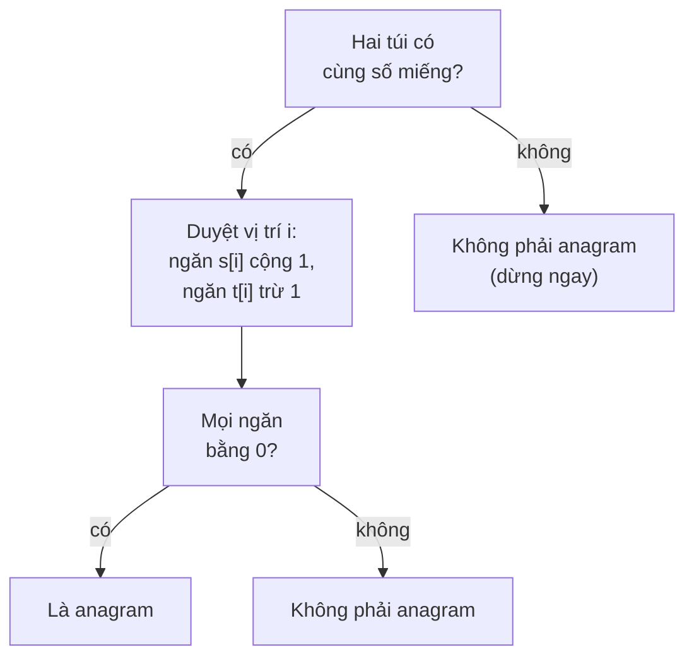

> [!tldr] Đọc nhanh
> - Đề: `s` và `t` là anagram khi xếp lại các chữ của `s` thì được `t`. Nói cách khác: cùng chữ, cùng số lần.
> - Sắp xếp hai chuỗi rồi so sánh: O(n log n). Đúng, ngắn, nhưng chậm nhất: 201 ms với hai chuỗi một triệu chữ.
> - [[concepts/frequency-counting|Đếm tần suất]] bằng một [[concepts/counting-array|mảng 26 ô]]: cộng theo `s`, trừ theo `t`, cuối cùng mọi ô phải bằng 0. O(n) thời gian, O(1) bộ nhớ, 3,4 ms.
> - Khi bảng chữ cái không cố định (Unicode), đếm bằng [[concepts/hash-map|hash map]] theo **code point**, sau khi [[concepts/unicode-normalization|chuẩn hóa Unicode]].
> - Bẫy: `split('')` trong JS và `char[]` trong Java tách theo đơn vị UTF-16, nên coi "😀🌃" và "🜃🈀" là anagram. Python và Go không mắc lỗi này.

> [!info] Bối cảnh
> Bài LeetCode 242, thuộc [[posts/2026-11-22-neetcode-counting-keys|ga 2: Khóa chuẩn và đếm tần suất]] trên **tuyến NeetCode: Mảng và chuỗi**. Bài Contains Duplicate hỏi "đã thấy chưa?"; bài này hỏi "thấy **bao nhiêu lần**?". Lời giải có đủ TypeScript, JavaScript, Python, Go và Java. Bạn chỉ cần biết vòng lặp và mảng.

> [!abstract]- Từ điển nhanh cho bài này (bấm để mở)
> - **Big-O, hash, Set**: xem [[problems/contains-duplicate|Contains Duplicate]].
> - **Mã ký tự**: mỗi ký tự được lưu bằng một con số. Chữ `'a'` là 97, `'b'` là 98… nên `mã - 97` cho ra vị trí 0..25 trong bảng chữ cái.
> - **Code point**: con số Unicode gán cho một ký tự, ví dụ `é` là U+00E9, `😀` là U+1F600.
> - **UTF-16, code unit**: cách JS và Java lưu chuỗi, mỗi đơn vị 16 bit. Ký tự có code point lớn hơn U+FFFF (như emoji) cần **hai** code unit, gọi là một cặp surrogate.
> - **Map**: bảng "khóa → giá trị", như Set nhưng mỗi khóa mang thêm một giá trị (ở đây là số lần đếm).

## Hình dung trước: hai túi chữ cái

Bạn có hai túi đựng các miếng chữ của trò xếp chữ. Câu hỏi: hai túi có chứa **đúng cùng các miếng** không?

| Đời thường | Khái niệm |
|---|---|
| Đổ cả hai túi ra, xếp từng túi theo thứ tự A→Z, rồi so hai hàng | Sắp xếp rồi so sánh, O(n log n) |
| Một khay 26 ngăn: miếng từ túi 1 thì bỏ vào ngăn đúng chữ (+1), miếng từ túi 2 thì lấy ra (−1) | [[concepts/counting-array\|Mảng đếm 26 ô]] |
| Cuối cùng mọi ngăn trống trơn thì hai túi giống nhau | [[concepts/frequency-counting\|Đếm tần suất]] |
| Miếng chữ lạ (chữ Thái, emoji): không có ngăn sẵn, phải dán nhãn thêm ngăn mới | [[concepts/hash-map\|Hash map]] |
| Miếng "é" in liền và miếng "e" kèm miếng dấu sắc rời: trông như nhau, đếm thành khác nhau | [[concepts/unicode-normalization\|Chuẩn hóa Unicode]] |



## Vấn đề

**Đề (tóm tắt):** cho hai chuỗi `s` và `t`, trả `true` nếu `t` là anagram của `s`, tức là dùng đúng các chữ của `s`, mỗi chữ đúng số lần. Đề gốc: [LeetCode 242](https://leetcode.com/problems/valid-anagram/).

| `s` | `t` | Output |
|---|---|---|
| `anagram` | `nagaram` | `true` |
| `rat` | `car` | `false` |
| `aacc` | `ccac` | `false` (cùng tập chữ, khác số lần) |

Giới hạn: mỗi chuỗi dài tới **50 000** ký tự, chỉ gồm chữ thường `a`–`z`. Đề có thêm câu hỏi mở rộng: nếu chuỗi chứa ký tự Unicode thì sửa lời giải thế nào?

Ca `aacc` / `ccac` là lý do "cùng tập chữ" chưa đủ. Một Set (bài Contains Duplicate) chỉ nhớ "có", không nhớ "bao nhiêu".

## Cơ chế

<figure class="figure-map" style="--ar: 3 / 4">
<div class="frame"><iframe data-archify="../diagrams/neetcode-valid-anagram/count-26.html" title="Đếm chữ của rat và car trong một mảng 26 ô" loading="lazy"></iframe></div>
<figcaption><span><b>Hình 1.</b> "rat" và "car": mỗi vị trí cộng một ngăn theo s và trừ một ngăn theo t. Cuối cùng ngăn t còn +1, ngăn c còn −1, nên không phải anagram.</span><a href="../diagrams/neetcode-valid-anagram/count-26.html" target="_blank" rel="noopener">Mở toàn màn hình</a></figcaption>
</figure>

### Cách 1, sắp xếp rồi so: O(n log n)

Hai anagram sau khi sắp xếp chữ cái thì thành **cùng một chuỗi**. Đây là cách ngắn nhất để viết (Python: `sorted(s) == sorted(t)`), và ý tưởng "đưa về một dạng chuẩn" sẽ quay lại ở bài Group Anagrams. Chi phí là hai lần sắp xếp.

### Cách 2, đếm bằng mảng 26 ô: O(n) thời gian, O(1) bộ nhớ

[[concepts/frequency-counting|Đếm tần suất]] biến câu hỏi "cùng chữ, cùng số lần" thành "hai bảng đếm bằng nhau". Khi bảng chữ cái nhỏ và biết trước, bảng đếm là một [[concepts/counting-array|mảng]]: chỉ số `c - 'a'` là ngăn của chữ `c`. Hai mẹo nhỏ:

- **So độ dài trước.** Khác độ dài thì chắc chắn không phải anagram, trả lời ngay. Cùng độ dài thì có thể duyệt cả hai chuỗi trong cùng một vòng lặp.
- **Một mảng, cộng và trừ.** Thay vì hai bảng rồi so, cộng theo `s[i]` và trừ theo `t[i]`; cuối cùng mọi ô phải bằng 0.

Mảng luôn có 26 ô, bất kể n lớn cỡ nào, nên bộ nhớ là O(1). Đọc và ghi một ô mảng không cần tính hash, nên đây là cách nhanh nhất trong bài.

### Cách 3, hash map: khi không biết trước bảng chữ cái

Câu hỏi mở rộng phá vỡ giả định "26 ô". Riêng chữ thường tiếng Việt đã có hơn 60 chữ có dấu, emoji thì có hàng nghìn. Khi đó bảng đếm phải là một [[concepts/hash-map|hash map]]: khóa là ký tự, giá trị là số lần. Vẫn O(n) trung bình, nhưng mỗi lần đếm phải tính hash, nên chậm hơn mảng khoảng 10 lần trong phép đo dưới.

### Unicode: "một ký tự" là gì?

Đếm theo ký tự thì phải biết đơn vị ký tự. Có ba bẫy:

1. **JS và Java lưu chuỗi bằng UTF-16.** `s.length`, `s[i]`, `split('')`, `charAt` đều làm việc với *code unit*, không phải ký tự. Emoji 😀 (U+1F600) là hai code unit `d83d de00`. Tách theo code unit rồi sắp xếp là trộn lẫn nửa của các emoji khác nhau. Với "😀🌃" và "🜃🈀", hai chuỗi khác hẳn nhau nhưng có **cùng bốn code unit**, nên cách sắp xếp kết luận là anagram.
2. **Cùng một chữ có thể có hai cách mã hóa.** `é` có thể là một code point (U+00E9) hoặc là `e` cộng dấu sắc kết hợp (U+0301). Hai cách hiển thị giống hệt nhau. [[concepts/unicode-normalization|Chuẩn hóa]] về dạng NFC đưa cả hai về một dạng (UAX #15).
3. **Mảng 26 ô với chữ ngoài a–z.** `'é'.charCodeAt(0) - 97` là 136, ngoài 26 ô. JS lặng lẽ nới mảng lên 137 phần tử và ghi `NaN` vào ô 136, Java ném `ArrayIndexOutOfBoundsException`, Go panic.

| | Chuỗi là dãy… | Duyệt theo ký tự Unicode |
|---|---|---|
| TypeScript / JavaScript | code unit UTF-16 | `for (const ch of s)` đi theo code point; `s.normalize('NFC')` |
| Python | code point | `for ch in s` đã đúng; `unicodedata.normalize('NFC', s)` |
| Go | **byte** UTF-8 (`len("é")` là 2) | `for _, r := range s` trả về từng `rune`; chuẩn hóa cần gói `golang.org/x/text/unicode/norm` |
| Java | code unit UTF-16 (`char`) | `s.codePoints()`; `Normalizer.normalize(s, NFC)` |

Ngay cả code point cũng chưa phải "ký tự người đọc thấy": cờ quốc gia hay emoji gia đình ghép từ nhiều code point. Muốn đếm theo đơn vị người đọc thấy (grapheme cluster), cần `Intl.Segmenter` trong JS hoặc thư viện tương đương. Đề không đòi tới mức đó, nhưng nên biết là nó tồn tại.

## Ví dụ chạy được

[TypeScript](../code/neetcode-valid-anagram/valid-anagram.ts) · [JavaScript](../code/neetcode-valid-anagram/valid-anagram.js) · [Python](../code/neetcode-valid-anagram/valid_anagram.py) · [Go](../code/neetcode-valid-anagram/valid_anagram.go) · [Java](../code/neetcode-valid-anagram/valid-anagram.java)

```ts
// TypeScript: mảng 26 ô cho đề gốc (chỉ a–z)
function byCount26(s: string, t: string): boolean {
  if (s.length !== t.length) return false;
  const count = new Array<number>(26).fill(0);
  for (let i = 0; i < s.length; i++) {
    count[s.charCodeAt(i) - 97]++; // 97 là mã của 'a'
    count[t.charCodeAt(i) - 97]--;
  }
  return count.every((c) => c === 0);
}

// Câu hỏi mở rộng: đếm theo code point, sau khi chuẩn hóa NFC
function byMap(s: string, t: string): boolean {
  s = s.normalize('NFC'); t = t.normalize('NFC');
  const count = new Map<string, number>();
  for (const ch of s) count.set(ch, (count.get(ch) ?? 0) + 1); // for…of đi theo code point
  for (const ch of t) {
    const c = count.get(ch);
    if (!c) return false;
    count.set(ch, c - 1);
  }
  return [...count.values()].every((c) => c === 0);
}
```

```python
def is_anagram(s: str, t: str) -> bool:
    if len(s) != len(t):
        return False
    count = [0] * 26
    for a, b in zip(s, t):
        count[ord(a) - ord("a")] += 1
        count[ord(b) - ord("a")] -= 1
    return all(c == 0 for c in count)

# Unicode: Counter đếm theo code point; vẫn cần chuẩn hóa
def is_anagram_counter(s: str, t: str) -> bool:
    nfc = lambda x: unicodedata.normalize("NFC", x)
    return Counter(nfc(s)) == Counter(nfc(t))
```

```go
func isAnagram(s, t string) bool {
	if len(s) != len(t) {
		return false
	}
	var count [26]int // mảng cố định, đã bằng 0
	for i := 0; i < len(s); i++ {
		count[s[i]-'a']++
		count[t[i]-'a']--
	}
	return count == [26]int{} // mảng Go so sánh được bằng ==
}
```

```java
static boolean isAnagram(String s, String t) {
    if (s.length() != t.length()) return false;
    int[] count = new int[26];
    for (int i = 0; i < s.length(); i++) {
        count[s.charAt(i) - 'a']++;
        count[t.charAt(i) - 'a']--;
    }
    for (int c : count) if (c != 0) return false;
    return true;
}
```

```js
function isAnagram(s, t) {
  if (s.length !== t.length) return false;
  const count = new Int32Array(26); // mảng số nguyên cố định, khởi tạo bằng 0
  for (let i = 0; i < s.length; i++) {
    count[s.charCodeAt(i) - 97]++;
    count[t.charCodeAt(i) - 97]--;
  }
  return count.every((c) => c === 0);
}
```

```text
$ node valid-anagram.ts
test chữ thường: 3 cách × 5 ca, 0 ca sai

"café" vs "éfac": length 4 vs 5
  bySorting: false, byMap (NFC): true

"😀🌃" code unit: d83d de00 d83c df03
"🜃🈀" code unit: d83d df03 d83c de00
  bySorting: true (sai), byMap: false
  byCount26 với chữ có dấu: count['é'.charCodeAt(0) - 97] = count[136] → ghi ra ngoài 26 ô
bySorting  n = 1 000 000:   201.1 ms (true)
byCount26  n = 1 000 000:     3.4 ms (true)
byMap      n = 1 000 000:    40.3 ms (true)
```

Các ngôn ngữ còn lại, cùng hai bẫy:

```text
$ python3 valid_anagram.py
...
len: 4 5 | sorted: False | Counter + NFC: True
emoji: False (Python không vỡ code point)

$ go run valid_anagram.go
true false false
len("é") = 2 byte; số rune = 1
true false

$ java valid-anagram.java
true false
emoji, sắp xếp char[]: true (sai) | theo code point: false
café vs éfac: false | NFC: true
```

Đọc kết quả:

- **Tốc độ**: mảng 26 ô nhanh hơn sắp xếp khoảng 60 lần và hash map khoảng 12 lần. Cả ba đều cho đáp án đúng với chữ thường.
- **"café"** viết theo hai cách có độ dài khác nhau (4 và 5), nên mọi cách không chuẩn hóa đều trả `false`. Sau NFC thì đúng.
- **Emoji**: cách sắp xếp code unit của JS và Java trả `true`, sai. Python sắp xếp theo code point nên đúng; Go duyệt theo `rune` cũng đúng.

## Hiểu lầm và bẫy hay gặp

- **"Cùng tập chữ là anagram."** `aacc` và `ccac` có cùng tập `{a, c}` nhưng khác số lần. Phải đếm, không chỉ đánh dấu.
- **Quên so độ dài trước.** Không chỉ là tối ưu: cách cộng-trừ trong cùng một vòng lặp chỉ đúng khi hai chuỗi dài bằng nhau.
- **Dùng mảng 26 ô khi input không chắc là a–z.** Chữ hoa, dấu cách, chữ có dấu đều ra ngoài mảng. Kiểm tra giả định, hoặc chuyển sang map.
- **Coi `s.length` (JS, Java) là số ký tự.** Nó là số code unit UTF-16. `'😀'.length` là 2.
- **Sắp xếp `split('')` với chuỗi Unicode.** Vỡ cặp surrogate, cho ra anagram sai như ví dụ emoji.
- **Không chuẩn hóa.** Hai chuỗi trông giống hệt nhau có thể khác nhau từng byte. Dữ liệu người dùng gõ từ các bàn phím khác nhau, hoặc copy từ macOS, hay gặp dạng tách (NFD).
- **Go: `len(s)` là số byte.** Cách mảng 26 ô theo byte chỉ đúng vì đề giới hạn a–z (mỗi chữ một byte). Với chữ có dấu, phải duyệt `range s` theo rune.

## Câu hỏi tự kiểm tra

> [!question]- Vì sao một Set (như bài Contains Duplicate) không đủ để kiểm tra anagram?
> Set chỉ nhớ một chữ có xuất hiện hay không, không nhớ bao nhiêu lần. `aacc` và `ccac` có cùng Set `{a, c}` nhưng không phải anagram.

> [!question]- Mảng đếm 26 ô được gọi là O(1) bộ nhớ. Vì sao, dù nó là một mảng?
> Kích thước của nó cố định là 26, không tăng theo độ dài chuỗi n. Big-O đo bộ nhớ tăng thế nào theo n.

> [!question]- Cách cộng theo s, trừ theo t trong cùng một vòng lặp cần điều kiện gì để đúng?
> Hai chuỗi phải dài bằng nhau, vì vòng lặp duyệt chung chỉ số i. Đó là lý do phải so độ dài trước.

> [!question]- `'😀🌃'` và `'🜃🈀'` khác nhau, nhưng sắp xếp `split('')` lại cho ra cùng một chuỗi. Giải thích.
> `split('')` tách theo code unit UTF-16. Mỗi emoji là hai code unit, và bốn code unit của hai chuỗi là cùng một tập (`d83d`, `de00`, `d83c`, `df03`), chỉ ghép cặp khác nhau. Sắp xếp làm mất thông tin ghép cặp.

> [!question]- Người dùng gõ "Huế" trên hai máy khác nhau, so sánh `===` ra `false`. Nguyên nhân có thể là gì và sửa thế nào?
> Một máy lưu `ế` dạng dựng sẵn (một code point), máy kia dạng tách (chữ cái cộng dấu kết hợp). Chuẩn hóa cả hai về NFC trước khi so.

## Tham khảo

- [LeetCode 242: Valid Anagram](https://leetcode.com/problems/valid-anagram/) (đề gốc và câu hỏi mở rộng về Unicode)
- [Unicode Standard Annex #15: Normalization Forms](https://unicode.org/reports/tr15/) (NFC, NFD)
- [ECMAScript 2025](https://tc39.es/ecma262/2025/) (chuỗi là dãy code unit UTF-16; `String.prototype.normalize`; vòng `for…of` trên chuỗi đi theo code point)
- [The Go Programming Language Specification](https://go.dev/ref/spec) (string là dãy byte; `range` trên string trả về rune)
