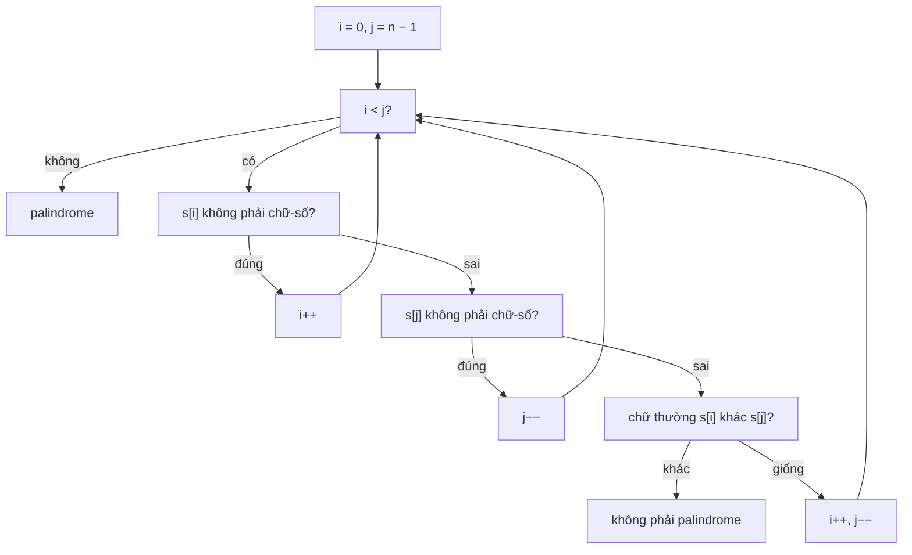

> [!tldr] Đọc nhanh
> - Đề: một chuỗi là palindrome nếu, sau khi đổi hết sang chữ thường và **chỉ giữ chữ cái và chữ số**, nó đọc xuôi hay ngược đều như nhau. `"A man, a plan, a canal: Panama"` → `true`.
> - Cách dễ: lọc ra chuỗi sạch, đảo ngược, so. O(n) thời gian nhưng tốn O(n) bộ nhớ cho chuỗi sạch và bản đảo.
> - [[concepts/two-pointers|Hai con trỏ]]: `i` từ đầu, `j` từ cuối, bỏ qua ký tự không hợp lệ, so từng cặp. O(1) bộ nhớ, và dừng ngay ở cặp lệch đầu tiên.
> - Đo trên 10⁶ ký tự: với chuỗi là palindrome, hai con trỏ nhanh hơn khoảng 4 lần; với chuỗi lệch ở ký tự đầu, hai con trỏ xong gần như tức thì còn cách lọc vẫn mất 9 ms.
> - Bẫy: regex `\w` gồm cả dấu `_`; `str.isalnum()` của Python nhận cả `"²"` và chữ có dấu. Đề chỉ tính `a–z`, `A–Z`, `0–9`.

> [!info] Bối cảnh
> Bài LeetCode 125, bài mở đầu của [[posts/2026-11-23-neetcode-two-pointers|ga 4: Hai con trỏ]] trên **tuyến NeetCode: Mảng và chuỗi**. Đây là dạng hai con trỏ đơn giản nhất: không cần sắp xếp, chỉ cần hai đầu khớp nhau. Lời giải có đủ TypeScript, Python, Go, Java và JavaScript. Bạn chỉ cần biết chuỗi và vòng lặp.

> [!abstract]- Từ điển nhanh cho bài này (bấm để mở)
> - **Palindrome**: chuỗi đọc xuôi hay ngược đều như nhau, như `"level"` hay `"racecar"`.
> - **Ký tự chữ-số (alphanumeric)**: chữ cái hoặc chữ số. Ở bài này: chỉ `a–z`, `A–Z`, `0–9`.
> - **Mã ký tự**: con số máy tính dùng cho mỗi ký tự. `'A'` là 65, `'a'` là 97, nên chữ hoa cộng 32 thành chữ thường.
> - **Regex `\w`**: lớp ký tự "chữ của từ" trong biểu thức chính quy, gồm `[A-Za-z0-9_]`, tức **có** dấu gạch dưới.

## Hình dung trước: hai người đọc từ hai đầu

Hai người cầm một dải băng chữ, mỗi người đứng ở một đầu và cùng đọc vào giữa. Gặp dấu câu hay khoảng trắng thì bước qua. Gặp chữ thì đọc to; hai người phải đọc ra cùng một chữ. Chỉ cần một lần đọc khác nhau là biết dải băng không phải palindrome, khỏi đọc tiếp.

| Đời thường | Khái niệm |
|---|---|
| Chép lại dải băng bỏ hết dấu câu, rồi viết ngược ra một tờ khác để so | lọc, đảo chuỗi, so: O(n) bộ nhớ |
| Hai người đứng ở hai đầu | hai con trỏ `i = 0`, `j = n − 1` |
| Bước qua dấu câu và khoảng trắng | bỏ qua ký tự không phải chữ-số |
| Đọc "A" và "a" coi như một | so sau khi đổi về chữ thường |
| Đọc khác nhau là dừng | trả `false` ngay ở cặp lệch đầu tiên |
| Hai người gặp nhau ở giữa | `i ≥ j`: palindrome |



## Vấn đề

**Đề (tóm tắt bằng lời của mình):** cho chuỗi `s` (1 ≤ độ dài ≤ 2·10⁵, chỉ gồm ký tự ASCII in được). Đổi mọi chữ hoa thành chữ thường và bỏ mọi ký tự không phải chữ cái hay chữ số. Trả `true` nếu chuỗi còn lại đọc xuôi ngược như nhau. Đề gốc: [LeetCode 125](https://leetcode.com/problems/valid-palindrome/).

| Input | Chuỗi sạch | Output |
|---|---|---|
| `"A man, a plan, a canal: Panama"` | `amanaplanacanalpanama` | `true` |
| `"race a car"` | `raceacar` | `false` |
| `" "` | (rỗng) | `true` |
| `"0P"` | `0p` | `false` |

Mình từng nghĩ bài này chỉ là "đảo chuỗi rồi so". Hóa ra phần khó là định nghĩa "chữ hoặc số", và mỗi ngôn ngữ có một hàm "trông giống" nhưng định nghĩa khác đề.

## Cơ chế

### Cách 1, lọc rồi đảo

Tạo chuỗi sạch (chữ thường, chỉ `a–z0–9`), đảo nó, so với chính nó. Ba lượt qua dữ liệu và hai chuỗi phụ dài tới n. Cách này luôn đọc **hết** chuỗi, kể cả khi ký tự đầu và cuối đã khác nhau.

### Cách 2, hai con trỏ

`i` bắt đầu ở 0, `j` ở n − 1. Mỗi vòng làm **đúng một** việc: bỏ qua ký tự rác ở `i`, hoặc ở `j`, hoặc so một cặp chữ-số. Cặp khác nhau thì trả `false`; hai con trỏ gặp nhau thì trả `true`.

Vì sao không sót: chuỗi sạch là palindrome khi và chỉ khi ký tự sạch thứ k từ đầu bằng ký tự sạch thứ k từ cuối, với mọi k. `i` và `j` đi qua đúng những cặp đó theo thứ tự k = 1, 2, …, và dừng khi đã qua nửa chuỗi.

### Đo

TypeScript, chuỗi 10⁶ ký tự gồm chữ, dấu phẩy và khoảng trắng, trung vị 5 lần:

| Chuỗi | lọc + đảo | hai con trỏ |
|---|---|---|
| là palindrome (phải đọc hết) | 9,63 ms | 2,50 ms |
| lệch ngay ký tự đầu | 8,86 ms | dưới 0,001 ms |

Cả hai đều O(n) ở ca tệ nhất. Hai con trỏ nhanh hơn ở ca tệ nhất vì không tạo chuỗi mới, và nhanh hơn hẳn ở ca "sai sớm" vì nó dừng ngay.

### Bên dưới năm ngôn ngữ: "chữ hoặc số" là gì

| | Hàm có sẵn | Khớp với đề? |
|---|---|---|
| TypeScript / JavaScript | regex `\w` | **không**: `\w` gồm cả `_`, nên `"a_"` thành `a_` thay vì `a` |
| TypeScript / JavaScript | `/[a-z0-9]/i` | có |
| Python | `str.isalnum()` | **không hẳn**: nhận cả `"é"`, `"²"`, chữ Hán; đúng với ASCII thì thêm `isascii()` |
| Go | `unicode.IsLetter`, `IsDigit` | nhận Unicode; đề chỉ có ASCII nên so byte trực tiếp là đủ |
| Java | `Character.isLetterOrDigit` | nhận Unicode, như Python |

Đề chỉ có ASCII nên `isalnum()` và `isLetterOrDigit` vẫn qua LeetCode. Nhưng chép hàm này sang nơi nhận chữ tiếng Việt thì "chữ hoặc số" đã đổi nghĩa mà không ai để ý.

## Ví dụ chạy được

[TypeScript](../code/neetcode-valid-palindrome/valid-palindrome.ts) · [Python](../code/neetcode-valid-palindrome/valid_palindrome.py) · [Go](../code/neetcode-valid-palindrome/valid_palindrome.go) · [Java](../code/neetcode-valid-palindrome/valid-palindrome.java) · [JavaScript](../code/neetcode-valid-palindrome/valid-palindrome.js)

Mỗi file có cả hai cách và chạy 8 ca (Python 9 ca). Dưới đây là cách hai con trỏ.

```ts
// Cách 2: hai con trỏ từ hai đầu, bỏ qua ký tự không phải chữ hoặc số. O(1) bộ nhớ phụ.
function twoPointers(s: string): boolean {
  let i = 0, j = s.length - 1;
  while (i < j) {
    const a = s.charCodeAt(i), b = s.charCodeAt(j);
    if (!isAlnum(a)) { i++; continue; }
    if (!isAlnum(b)) { j--; continue; }
    if (lower(a) !== lower(b)) return false; // khác nhau: dừng ngay, không cần đọc phần giữa
    i++; j--;
  }
  return true;
}
```

```python
def two_pointers(s: str) -> bool:
    i, j = 0, len(s) - 1
    while i < j:
        if not (s[i].isascii() and s[i].isalnum()):
            i += 1
        elif not (s[j].isascii() and s[j].isalnum()):
            j -= 1
        elif s[i].lower() != s[j].lower():
            return False
        else:
            i, j = i + 1, j - 1
    return True
```

```go
func twoPointers(s string) bool {
	for i, j := 0, len(s)-1; i < j; {
		switch {
		case !isAlnum(s[i]):
			i++
		case !isAlnum(s[j]):
			j--
		case lower(s[i]) != lower(s[j]):
			return false
		default:
			i, j = i+1, j-1
		}
	}
	return true
}
```

```java
static boolean twoPointers(String s) {
    int i = 0, j = s.length() - 1;
    while (i < j) {
        char a = s.charAt(i), c = s.charAt(j);
        if (!isAlnum(a)) i++;
        else if (!isAlnum(c)) j--;
        else if (Character.toLowerCase(a) != Character.toLowerCase(c)) return false;
        else { i++; j--; }
    }
    return true;
}
```

```js
function twoPointers(s) {
  let i = 0, j = s.length - 1;
  while (i < j) {
    if (!isAlnum(s[i])) i++;
    else if (!isAlnum(s[j])) j--;
    else if (s[i].toLowerCase() !== s[j].toLowerCase()) return false;
    else { i++; j--; }
  }
  return true;
}
```


```text
$ node valid-palindrome.ts
cleanReverse  8/8 ca đúng
twoPointers   8/8 ca đúng
wordRegex     7/8 ca đúng; sai ở "a_"

n = 10⁶ ký tự          lọc + đảo   hai con trỏ   (ms, trung vị 5 lần)
palindrome                  9.63         2.497
sai ở ký tự đầu             8.86         0.000
```

```text
$ python3 valid_palindrome.py
clean_reverse   9/9 ca đúng
two_pointers    9/9 ca đúng
unicode_isalnum 8/9 ca đúng; sai ở ['a²']
```

Bản dùng `\w` giữ lại `_` nên `"a_"` thành `a_`, không phải palindrome. Bản Python chỉ dùng `isalnum()` giữ lại `²` (chỉ số trên) vì Unicode coi nó là chữ số. Go, Java và JavaScript in `8/8 ca đúng` cho cả hai cách.

## Hiểu lầm và bẫy hay gặp

- **Dùng `\w` để lọc.** `\w` là `[A-Za-z0-9_]`, có dấu gạch dưới.
- **Tin `isalnum()` chỉ có ASCII.** Python, Java và Go đều theo Unicode. Đúng với đề vì đề chỉ có ASCII, sai khi dữ liệu thật có chữ có dấu.
- **Dời cả hai con trỏ khi gặp ký tự rác.** Chỉ ký tự rác ở **một** bên được bỏ; dời cả hai là bỏ qua một ký tự thật ở bên kia.
- **Quên `i < j` trong vòng bỏ qua.** Chuỗi toàn dấu câu như `".,"` làm `i` chạy quá `j` hoặc ra ngoài mảng nếu vòng bỏ qua viết riêng mà không kiểm biên.
- **So trước khi đổi chữ thường.** `"Aa"` là palindrome theo đề.

## Câu hỏi tự kiểm tra

> [!question]- Chuỗi `".,"` cho ra gì, và vì sao?
> `true`. Chuỗi sạch rỗng, và chuỗi rỗng đọc xuôi ngược như nhau. Trong code, `i` và `j` bỏ qua ký tự rác cho tới khi `i ≥ j`.

> [!question]- Vì sao hai con trỏ dùng O(1) bộ nhớ còn cách lọc thì O(n)?
> Hai con trỏ chỉ giữ hai chỉ số và đọc thẳng trên chuỗi gốc. Cách lọc tạo chuỗi sạch và bản đảo, mỗi cái dài tới n.

> [!question]- Ở mỗi vòng lặp, hai con trỏ làm bao nhiêu việc, và vì sao chỉ một?
> Đúng một: bỏ qua rác ở `i`, hoặc ở `j`, hoặc so một cặp. Làm từng việc một thì mỗi lần dời đều được kiểm lại `i < j`, nên không bao giờ đọc ra ngoài hay so một ký tự với chính nó sau khi đã vượt nhau.

> [!question]- Nếu đề đổi thành "palindrome sau khi xóa **tối đa một** ký tự", hai con trỏ cần thêm gì?
> Ở cặp lệch đầu tiên, thử hai khả năng: bỏ `s[i]` (kiểm `i+1..j`) hoặc bỏ `s[j]` (kiểm `i..j−1`). Mỗi khả năng là một lần chạy hai con trỏ nữa, vẫn O(n). Đó là LeetCode 680.

## Tham khảo

- [LeetCode 125: Valid Palindrome](https://leetcode.com/problems/valid-palindrome/) (đề gốc)
- [MDN: Character classes](https://developer.mozilla.org/en-US/docs/Web/JavaScript/Guide/Regular_expressions/Character_classes) (`\w` là `[A-Za-z0-9_]`)
- [Python: `str.isalnum`](https://docs.python.org/3/library/stdtypes.html#str.isalnum) (đúng khi mọi ký tự là chữ hoặc số theo Unicode)
- [Java 21 `Character.isLetterOrDigit`](https://docs.oracle.com/en/java/javase/21/docs/api/java.base/java/lang/Character.html#isLetterOrDigit(char))
