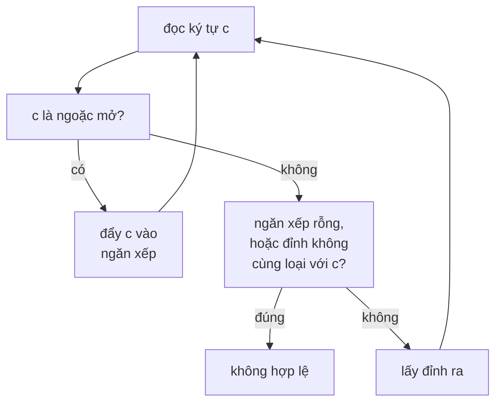

> [!tldr] Đọc nhanh
> - Đề: chuỗi chỉ gồm `()[]{}`. Hợp lệ khi mỗi ngoặc mở được đóng bởi **đúng loại**, theo **đúng thứ tự**, và không ngoặc nào thừa.
> - Đếm không đủ: một bộ đếm chung cho `"(]"` qua; ba bộ đếm riêng cho `"([)]"` qua. Thứ cần nhớ là **thứ tự** các ngoặc mở chưa đóng.
> - Ngoặc đóng luôn khớp với ngoặc mở **gần nhất** chưa đóng: đó là đỉnh của một [[concepts/stack|ngăn xếp]]. Đẩy ngoặc mở, gặp ngoặc đóng thì lấy đỉnh ra so. O(n), một lượt.
> - Xóa lặp lại các cặp `()`, `[]`, `{}` cũng đúng nhưng O(n²): 180 ms ở 16 000 ký tự, so với 0,35 ms của ngăn xếp.
> - Hai chỗ hay quên: lấy từ ngăn xếp **rỗng** (Python ném `IndexError`, Java ném `NoSuchElementException`, Go panic) và quên kiểm ngăn xếp rỗng ở **cuối** (`"(("`).

> [!info] Bối cảnh
> Bài LeetCode 20, bài neo của [[posts/2026-11-23-neetcode-stack|ga 6: Ngăn xếp]] trên **tuyến NeetCode: Mảng và chuỗi**. Lời giải có đủ TypeScript, Python, Go, Java, JavaScript, PHP và Rust. Bạn chỉ cần biết vòng lặp, chuỗi và mảng.

> [!abstract]- Từ điển nhanh cho bài này (bấm để mở)
> - **Ngăn xếp (stack)**: danh sách chỉ thêm và lấy ở **một đầu** (đỉnh). Vào sau thì ra trước (LIFO). Xem [[concepts/stack|Stack]].
> - **push / pop**: đặt một phần tử lên đỉnh / lấy phần tử trên đỉnh ra.
> - **Khớp cặp (bracket matching)**: ghép mỗi ngoặc đóng với ngoặc mở tương ứng. Xem [[concepts/bracket-matching|Bracket Matching]].

## Hình dung trước: chồng hộp lồng nhau

Bạn mở một món quà: hộp to, trong có hộp vừa, trong nữa có hộp nhỏ. Muốn đóng lại cho đúng, bạn phải đóng hộp nhỏ trước, rồi hộp vừa, rồi hộp to. Hộp nào mở **sau cùng** thì phải đóng **trước tiên**.

| Đời thường | Khái niệm |
|---|---|
| Mở một hộp | gặp ngoặc mở: đẩy vào ngăn xếp |
| Hộp đang mở gần nhất, nằm trong cùng | đỉnh ngăn xếp |
| Đóng một nắp: phải là nắp của hộp trong cùng | ngoặc đóng phải khớp đỉnh |
| Cầm nắp tròn mà hộp trong cùng là hộp vuông | `"(]"`: sai loại |
| Đóng hộp to khi hộp nhỏ bên trong còn mở | `"([)]"`: sai thứ tự |
| Cầm nắp mà không còn hộp nào mở | lấy từ ngăn xếp rỗng |
| Xong việc mà còn hộp chưa đóng | ngăn xếp còn phần tử ở cuối |



Hết chuỗi: hợp lệ khi và chỉ khi ngăn xếp rỗng.

## Vấn đề

**Đề (tóm tắt bằng lời của mình):** cho chuỗi `s` (1 ≤ độ dài ≤ 10⁴) chỉ gồm `(`, `)`, `[`, `]`, `{`, `}`. Trả `true` nếu mỗi ngoặc mở được đóng bởi ngoặc cùng loại, theo đúng thứ tự lồng nhau, và mọi ngoặc đóng đều có ngoặc mở tương ứng. Đề gốc: [LeetCode 20](https://leetcode.com/problems/valid-parentheses/).

| Input | Output | Vì sao |
|---|---|---|
| `"()[]{}"` | `true` | ba cặp đứng cạnh nhau |
| `"{[]}"` | `true` | lồng nhau đúng thứ tự |
| `"(]"` | `false` | sai loại |
| `"([)]"` | `false` | đủ số lượng từng loại, nhưng đóng sai thứ tự |
| `"(("` | `false` | còn ngoặc chưa đóng |

Mình từng nghĩ chỉ cần đếm: mở thì cộng, đóng thì trừ, cuối cùng về 0 là được. Hóa ra đếm chỉ biết **bao nhiêu** ngoặc đang mở, không biết **ngoặc nào** mở sau cùng.

## Cơ chế

<figure class="figure-map" style="--ar: 3 / 4">
<div class="frame"><iframe data-archify="../diagrams/neetcode-valid-parentheses/worked-example.html" title="Ghép dấu đóng với đỉnh ngăn xếp" loading="lazy"></iframe></div>
<figcaption><span><b>Hình 1.</b> Ghép dấu đóng với đỉnh ngăn xếp.</span><a href="../diagrams/neetcode-valid-parentheses/worked-example.html" target="_blank" rel="noopener">Mở toàn màn hình</a></figcaption>
</figure>

<details>
<summary>Đọc từng bước</summary>
<ol>
<li>Đẩy hai dấu mở. <code>&quot;{[&quot; → [&#x27;{&#x27;, &#x27;[&#x27;]</code></li>
<li>Đọc dấu ] và lấy [ ra. <code>[&#x27;{&#x27;]</code></li>
<li>Đọc dấu } và lấy { ra. <code>[]</code></li>
<li>Hết chuỗi và ngăn xếp rỗng. <code>&quot;{[]}&quot; → true</code></li>
</ol>
</details>

### Cách 1, một bộ đếm: sai

Cộng 1 khi gặp ngoặc mở, trừ 1 khi gặp ngoặc đóng, âm thì sai, cuối cùng phải về 0. Đúng với đề chỉ có một loại ngoặc. Với ba loại, `"(]"` cho 1 rồi 0: lọt.

### Cách 2, ba bộ đếm: vẫn sai

Mỗi loại một bộ đếm. Bắt được `"(]"` (bộ đếm `[` thành −1), nhưng `"([)]"` vẫn lọt: mỗi bộ đếm đi 0 → 1 → 0, không bộ nào âm. Thông tin bị thiếu là **thứ tự**: lúc gặp `)`, ngoặc mở gần nhất là `[`, không phải `(`.

### Cách 3, xóa cặp lặp lại: đúng nhưng O(n²)

Một chuỗi hợp lệ luôn chứa ít nhất một cặp kề nhau `()`, `[]` hay `{}` (cặp trong cùng). Xóa nó đi, phần còn lại vẫn hợp lệ. Lặp tới khi không xóa được nữa; hợp lệ khi còn lại chuỗi rỗng. Mỗi lượt xóa đọc lại cả chuỗi, và chuỗi lồng sâu `"((((…))))"` mỗi lượt chỉ xóa được một cặp ở giữa: n/2 lượt × O(n) mỗi lượt = O(n²).

### Cách 4, ngăn xếp: O(n)

Ngoặc đóng cần khớp với ngoặc mở **gần nhất** chưa đóng. "Gần nhất trong những thứ chưa xử lý" chính là đỉnh ngăn xếp:
- gặp ngoặc mở: đẩy vào;
- gặp ngoặc đóng: ngăn xếp rỗng thì sai; lấy đỉnh ra, khác loại thì sai;
- hết chuỗi: còn gì trong ngăn xếp thì sai.

Mỗi ký tự vào ngăn xếp và ra tối đa một lần: O(n) thời gian, O(n) bộ nhớ. Một mẹo nhỏ: độ dài lẻ thì chắc chắn sai, trả `false` ngay.

Cách xóa cặp và cách ngăn xếp thật ra làm cùng một việc: ngăn xếp xóa cặp trong cùng **ngay khi nó xuất hiện**, nên không phải đọc lại chuỗi.

### Đo

Chuỗi lồng sâu `"(" × n/2 + ")" × n/2`, ca tệ nhất của cách xóa cặp, TypeScript, trung vị 3 lần:

| n | xóa cặp lặp | ngăn xếp |
|---|---|---|
| 2 000 | 3,0 ms | 0,08 ms |
| 4 000 | 11,4 ms | 0,08 ms |
| 8 000 | 45,5 ms | 0,15 ms |
| 16 000 | 179,9 ms | 0,35 ms |
| 10⁶ | (không chạy) | 20,51 ms |

n gấp đôi, cách xóa cặp chậm gấp khoảng 4 lần: đúng dáng n². Với giới hạn 10⁴ của đề, nó vẫn qua (nằm giữa hai số đo 45,5 ms ở n = 8 000 và 179,9 ms ở n = 16 000), nên LeetCode không ép bạn phải dùng ngăn xếp; phép đo mới cho thấy khác biệt.

### Bên dưới bảy ngôn ngữ

| | Ngăn xếp dùng | Lấy từ ngăn xếp rỗng |
|---|---|---|
| TypeScript / JavaScript | mảng: `push`, `pop` ở cuối (O(1)); đừng dùng `shift`/`unshift` ở đầu (O(n)) | `pop()` trả `undefined`, không báo lỗi |
| Python | `list`: `append`, `pop()` | `IndexError: pop from empty list` |
| Go | slice: `append`, cắt `st[:len(st)-1]` | `st[len(st)-1]` trên slice rỗng: panic |
| Java | `ArrayDeque`: `push`, `pop`, `peek` | `NoSuchElementException` |
| PHP | mảng: `$st[] = …`, `array_pop` | `array_pop` trả `null`, không báo lỗi; `SplStack::pop` thì ném `RuntimeException` |
| Rust | `Vec<char>`: `push`, `pop` | `pop()` trả `Option`: rỗng là `None`, trình biên dịch bắt mình xử lý |

Java còn có lớp `Stack`, nhưng tài liệu chính thức khuyên dùng `Deque` thay thế. Lý do không phải tốc độ: đo trên 10⁶ ký tự, `ArrayDeque` mất 5,2 ms còn `Stack` mất 4,6 ms, vì khóa `synchronized` không bị tranh chấp gần như không tốn gì. Lý do là thiết kế: `Stack` kế thừa `Vector`, nên ai cũng gọi được `get(i)` hay `add(0, x)` vào giữa ngăn xếp.

## Ví dụ chạy được

[TypeScript](../code/neetcode-valid-parentheses/valid-parentheses.ts) · [Python](../code/neetcode-valid-parentheses/valid_parentheses.py) · [Go](../code/neetcode-valid-parentheses/valid_parentheses.go) · [Java](../code/neetcode-valid-parentheses/valid-parentheses.java) · [JavaScript](../code/neetcode-valid-parentheses/valid-parentheses.js) · [PHP](../code/neetcode-valid-parentheses/valid-parentheses.php) · [Rust](../code/neetcode-valid-parentheses/valid_parentheses.rs)

Mỗi file có cách xóa cặp và cách ngăn xếp, chạy 9 ca gồm chuỗi rỗng, `"(("` và `"){"`. Dưới đây là cách ngăn xếp.

```ts
// Ngăn xếp: ngoặc mở thì đẩy vào, ngoặc đóng thì phải khớp với ngoặc mở trên đỉnh.
function stack(s: string): boolean {
  if (s.length % 2 === 1) return false; // độ dài lẻ thì chắc chắn có ngoặc lẻ đôi
  const open: Record<string, string> = { ")": "(", "]": "[", "}": "{" };
  const st: string[] = [];
  for (const ch of s) {
    if (!(ch in open)) st.push(ch);
    else if (st.pop() !== open[ch]) return false; // pop trên mảng rỗng trả undefined, cũng khác "(" nên vẫn đúng
  }
  return st.length === 0; // còn ngoặc mở chưa đóng thì sai
}
```

```python
def stack(s: str) -> bool:
    st: list[str] = []  # list làm ngăn xếp: append và pop ở cuối đều O(1)
    for ch in s:
        if ch not in OPEN:
            st.append(ch)
        elif not st or st.pop() != OPEN[ch]:  # phải kiểm rỗng trước: pop() trên list rỗng ném IndexError
            return False
    return not st
```

```go
func stack(s string) bool {
	open := map[byte]byte{')': '(', ']': '[', '}': '{'}
	st := make([]byte, 0, len(s)) // slice làm ngăn xếp; cấp sẵn sức chứa để append không phải nới
	for i := 0; i < len(s); i++ {
		want, isClose := open[s[i]]
		if !isClose {
			st = append(st, s[i])
			continue
		}
		if len(st) == 0 || st[len(st)-1] != want { // st[len(st)-1] trên slice rỗng là panic: kiểm độ dài trước
			return false
		}
		st = st[:len(st)-1] // "pop": cắt bớt phần tử cuối
	}
	return len(st) == 0
}
```

```java
static boolean stack(String s) {
    Deque<Character> st = new ArrayDeque<>(); // ArrayDeque thay cho Stack: Stack kế thừa Vector, mọi lệnh đều synchronized
    for (char ch : s.toCharArray()) {
        char want = switch (ch) { case ')' -> '('; case ']' -> '['; case '}' -> '{'; default -> 0; };
        if (want == 0) st.push(ch);
        else if (st.isEmpty() || st.pop() != want) return false; // pop() trên deque rỗng ném NoSuchElementException
    }
    return st.isEmpty();
}
```

```js
function stack(s) {
  const open = { ")": "(", "]": "[", "}": "{" };
  const st = []; // mảng làm ngăn xếp: push và pop ở cuối là O(1); shift/unshift ở đầu thì O(n)
  for (const ch of s) {
    if (!(ch in open)) st.push(ch);
    else if (st.pop() !== open[ch]) return false;
  }
  return st.length === 0;
}
```

```php
function stack(string $s): bool {
    if (strlen($s) % 2 === 1) return false;
    $st = [];
    foreach (str_split($s) as $ch) {
        if (!isset(OPEN[$ch])) $st[] = $ch;
        elseif (array_pop($st) !== OPEN[$ch]) return false; // array_pop trên mảng rỗng trả null, khác "(" nên vẫn đúng
    }
    return !$st;
}
```

```rust
fn stack(s: &str) -> bool {
    if s.len() % 2 == 1 { return false; }
    let mut st: Vec<char> = Vec::with_capacity(s.len());
    for ch in s.chars() {
        match open_of(ch) {
            None => st.push(ch),
            // pop() trả Option: ngăn xếp rỗng là None, khác Some('('), nên không cần kiểm riêng
            Some(o) => if st.pop() != Some(o) { return false; },
        }
    }
    st.is_empty()
}
```


File TypeScript chạy thêm ba bản sai, rồi đo:

```text
$ node valid-parentheses.ts
singleCounter      7/9 ca đúng; sai ở "(]" "([)]"
threeCounters      8/9 ca đúng; sai ở "([)]"
replacePairs       9/9 ca đúng
stack              9/9 ca đúng
stackNoFinalCheck  8/9 ca đúng; sai ở "(("

n (độ dài)   xóa cặp lặp   ngăn xếp   (ms, trung vị 3 lần, chuỗi lồng sâu)
2000                 3.0       0.08
4000                11.4       0.08
8000                45.5       0.15
16000              179.9       0.35
1000000                —      20.51
```

File Python chạy thêm bản quên kiểm rỗng trước khi `pop`:

```text
$ python3 valid_parentheses.py
replace_pairs    9/9 ca đúng
stack            9/9 ca đúng
stack_unguarded  8/9 ca đúng; lỗi ở '){': IndexError(pop from empty list)
```

Bản TypeScript cùng lỗi đó lại chạy đúng, vì `pop()` trên mảng rỗng trả `undefined`, và `undefined` khác mọi ngoặc mở. Cùng một dòng code, ngôn ngữ này tha, ngôn ngữ kia ném lỗi. File Java so `ArrayDeque` với `Stack`:

```text
$ java valid-parentheses.java
replacePairs  9/9 ca đúng
stack         9/9 ca đúng
legacyStack   9/9 ca đúng

10^6 ký tự: ArrayDeque 5.2 ms, Stack 4.6 ms
```

Go, JavaScript và Rust in `9/9 ca đúng` cho cả hai cách. File PHP chạy cùng thuật toán trên hai loại ngăn xếp:

```text
$ php valid-parentheses.php
singleCounter      7/9 ca đúng; sai ở "(]" "([)]"
threeCounters      8/9 ca đúng; sai ở "([)]"
replacePairs       9/9 ca đúng
stack              9/9 ca đúng
stackNoFinalCheck  8/9 ca đúng; sai ở "(("
splStackUnguarded  8/9 ca đúng; sai ở "){": RuntimeException(Can't pop from an empty datastructure)
```

Mảng PHP tha như JS (`array_pop` trả `null`), còn `SplStack` ném lỗi như Python. Ở Rust, `pop()` trả `Option`, nên không có cách nào quên trường hợp rỗng mà vẫn biên dịch được.

## Hiểu lầm và bẫy hay gặp

- **"Đếm ngoặc là đủ."** Một bộ đếm không phân biệt loại, ba bộ đếm không phân biệt thứ tự. Chỉ ngăn xếp nhớ được thứ tự.
- **Quên kiểm ngăn xếp rỗng ở cuối.** `"(("` không có ngoặc đóng nào sai, nhưng còn hai ngoặc chưa đóng.
- **Lấy từ ngăn xếp rỗng.** `")"` ở đầu chuỗi. Python, Java, Go ném lỗi hoặc panic; JS lặng lẽ trả `undefined`.
- **Dùng `shift`/`unshift` làm ngăn xếp trong JS.** Thêm ở đầu mảng phải dời mọi phần tử: O(n) mỗi lần, cả thuật toán thành O(n²).
- **"Java `Stack` chậm vì synchronized."** Đo thì không chậm hơn đáng kể. Vấn đề của nó là API lộ cả các thao tác không phải của ngăn xếp.
- **PHP: `array_pop` và `SplStack::pop` xử lý ngăn xếp rỗng ngược nhau.** Mảng trả `null` và chạy tiếp; `SplStack` ném `RuntimeException`. Đổi kiểu ngăn xếp giữa chừng là đổi luôn hành vi ở ca `"){"`.
- **Rust: `s.len()` đếm byte, không đếm ký tự.** Phép kiểm độ dài lẻ chỉ đúng vì đề chỉ có sáu ký tự ngoặc ASCII; với chuỗi có ký tự nhiều byte phải dùng `s.chars().count()`.

## Câu hỏi tự kiểm tra

> [!question]- Ghi nội dung ngăn xếp sau mỗi ký tự khi kiểm `"{[()]}"`.
> `{` → `{[` → `{[(` → gặp `)`: `{[` → gặp `]`: `{` → gặp `}`: rỗng. Hợp lệ.

> [!question]- Vì sao ba bộ đếm cho `"([)]"` qua?
> Mỗi loại ngoặc đều mở một lần, đóng một lần, không bộ đếm nào âm. Bộ đếm không biết lúc gặp `)` thì ngoặc mở gần nhất là `[`.

> [!question]- Nếu chuỗi chỉ có một loại ngoặc `()`, có cần ngăn xếp không?
> Không. Mọi phần tử trong ngăn xếp đều là `(`, nên chỉ cần biết có bao nhiêu: một bộ đếm (âm thì sai, cuối cùng phải về 0), O(1) bộ nhớ.

> [!question]- Vì sao cách xóa cặp lặp lại là O(n²) ở chuỗi `"((((…))))"`?
> Mỗi lượt chỉ có một cặp kề nhau (ở giữa), nên cần n/2 lượt, mỗi lượt đọc cả chuỗi O(n).

## Tham khảo

- [LeetCode 20: Valid Parentheses](https://leetcode.com/problems/valid-parentheses/) (đề gốc)
- [Java 21 `Stack`](https://docs.oracle.com/en/java/javase/21/docs/api/java.base/java/util/Stack.html) (tài liệu khuyên dùng `Deque` thay thế) và [`ArrayDeque`](https://docs.oracle.com/en/java/javase/21/docs/api/java.base/java/util/ArrayDeque.html)
- [Python tutorial: Using lists as stacks](https://docs.python.org/3/tutorial/datastructures.html#using-lists-as-stacks)
- [MDN: `Array.prototype.pop`](https://developer.mozilla.org/en-US/docs/Web/JavaScript/Reference/Global_Objects/Array/pop) (mảng rỗng trả `undefined`)
- [Go spec: Index expressions](https://go.dev/ref/spec#Index_expressions) (chỉ số ngoài phạm vi gây panic lúc chạy)
