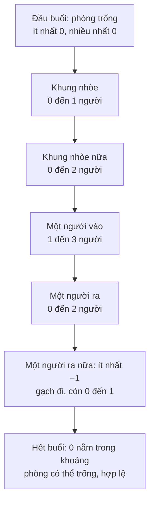
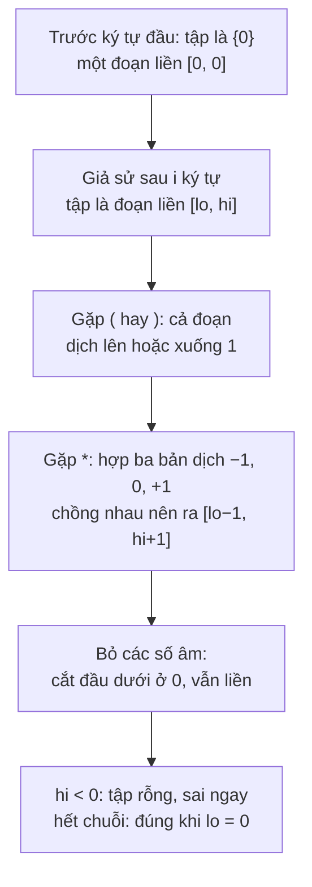

> [!tldr] Đọc nhanh
> - Mỗi dấu `*` có ba cách hiểu: `)`, rỗng hoặc `(`. Vét cạn thử cả 3^k tổ hợp; với 12 dấu `*` đã là 531.441 cách hiểu.
> - DP nhớ theo cặp (vị trí, số ngoặc đang mở) chỉ có O(n²) trạng thái: tệ nhất 5.050 trạng thái ở n = 100.
> - Tập các số ngoặc mở có thể có sau mỗi ký tự luôn là một **đoạn liền**, nên chỉ cần hai đầu mút `[lo, hi]`. Đây là [[concepts/open-count-range|khoảng số ngoặc mở]]: `(` cộng cả hai, `)` trừ cả hai, `*` trừ `lo` và cộng `hi`.
> - `hi < 0` thì sai ngay; `lo < 0` thì kẹp về 0, vì đó chỉ là bỏ các cách hiểu làm số mở âm. Cuối chuỗi, hợp lệ khi `lo = 0`. Một lượt O(n), bộ nhớ O(1).
> - Cách hai ngăn xếp chỉ số cũng O(n): `)` ăn `(` trước, hết mới ăn `*`; cuối cùng mỗi `(` còn lại cần một `*` đứng **sau** nó.

> [!info] Bối cảnh
> Đây là bài LeetCode 678 tại [[posts/2026-11-28-neetcode-greedy-grouping|ga MISC-04: Tham lam theo nhóm]] trên **tuyến NeetCode: Kỹ thuật tổng hợp**. Bản không có dấu `*` là [[problems/valid-parentheses|Valid Parentheses]]: ở đó chỉ có một loại ngoặc thì một bộ đếm là đủ. Ở đây bộ đếm "nhòe" thành một khoảng. Bạn chỉ cần biết vòng lặp và chuỗi; đọc Valid Parentheses trước sẽ dễ theo hơn.

> [!abstract]- Từ điển nhanh cho bài này (bấm để mở)
> - Ký tự đại diện (wildcard): ở đây là `*`, mình được tự chọn nó đóng vai `(`, `)` hay không là gì.
> - Số ngoặc mở (`open`): số `(` đã gặp mà chưa có `)` đóng. Một chuỗi một loại ngoặc hợp lệ khi `open` không bao giờ âm và kết thúc bằng 0 ([[concepts/bracket-matching|khớp cặp ngoặc]]).
> - [[concepts/dp-state|Trạng thái DP]]: bộ số đủ mô tả "đang ở đâu" để phần còn lại không cần biết quá khứ. Ở bài này là (vị trí i, số mở).
> - [[concepts/memoization|Nhớ kết quả]] (memoization): lưu đáp án của mỗi trạng thái đã tính để lần sau trả ngay.
> - [[concepts/stack|Ngăn xếp]]: vào sau ra trước; ở đây mình cất **chỉ số** của ký tự, không cất ký tự.
> - [[concepts/greedy-choice|Lựa chọn tham lam]]: chốt một quyết định cục bộ ngay và chứng minh nó không làm mất đáp án.

## Hình dung trước: người gác cửa phòng họp

Mình gác cửa một phòng họp và ghi sổ theo camera. Mỗi khung hình là một ký tự: `(` là một người bước **vào**, `)` là một người bước **ra**. Có những khung bị nhòe (`*`): có thể là người vào, người ra, hoặc chỉ ai đó đi ngang hành lang. Cuối buổi mình phải trả lời: có cách đọc các khung nhòe nào để sổ hợp lý không, tức là phòng không bao giờ có số người âm và cuối buổi phòng trống.

Mình không lập riêng một cuốn sổ cho từng cách đọc. Mình chỉ ghi hai con số: phòng có **ít nhất** bao nhiêu người và **nhiều nhất** bao nhiêu người. Khung nhòe thì số ít nhất giảm một (coi như có người ra), số nhiều nhất tăng một (coi như có người vào). Số ít nhất tụt xuống −1 thì mình gạch đi, ghi 0: không cách đọc nào được phép có −1 người. Số nhiều nhất mà âm thì kể cả đọc mọi khung nhòe là "vào" vẫn có người ra từ phòng trống: sổ sai.

| Đời thường | Khái niệm |
|---|---|
| Một người bước vào | `(`: `lo++`, `hi++` |
| Một người bước ra | `)`: `lo--`, `hi--` |
| Khung camera nhòe | `*`: `lo--`, `hi++` |
| Số người ít nhất / nhiều nhất trong phòng | `lo` / `hi` |
| Không thể có −1 người, gạch đi ghi 0 | kẹp `lo` về 0 |
| Kể cả đoán toàn "vào" vẫn thiếu người để ra | `hi < 0`: sai ngay |
| Cuối buổi phòng có thể trống | `lo = 0` |

Với chuỗi `**())`:



## Vấn đề: dấu * có cứu được chuỗi ngoặc không

Cho chuỗi `s` chỉ gồm ba ký tự `(`, `)` và `*`, độ dài từ 1 đến 100. Mỗi `*` được thay bằng `(`, `)` hoặc xóa đi, độc lập với nhau. Trả về `true` nếu có ít nhất một cách thay làm `s` thành chuỗi ngoặc đúng: mỗi `(` có một `)` đóng nó nằm phía sau, và không `)` nào thiếu `(` phía trước. Ví dụ của mình: `(()*` đúng (coi `*` là `)`), `*(` sai (không `*` nào đứng sau `(` để đóng nó), `**())` đúng. [Đề gốc LeetCode 678](https://leetcode.com/problems/valid-parenthesis-string/)

Lần đầu mình nghĩ chỉ cần đếm: số `(` trừ số `)` mà nằm trong khoảng bù được bằng số `*` là xong. `*(` phá ngay ý đó: một `(`, một `*`, đếm thì bù vừa khít, nhưng `*` đứng trước nên không đóng được `(`. Bài này, cũng như [[problems/valid-parentheses|Valid Parentheses]], là chuyện **thứ tự**, không chỉ là chuyện số lượng.

## Cơ chế

### Vét cạn: thử cả 3^k cách hiểu

Đi từ trái sang phải, gặp `*` thì rẽ ba nhánh, tới cuối chuỗi thì có một chuỗi ngoặc thường và kiểm nó bằng một bộ đếm như Valid Parentheses. Với k dấu `*` có 3^k chuỗi, mỗi chuỗi kiểm O(n): tổng O(3^k · n) thời gian, O(n) bộ nhớ cho đệ quy và bộ đệm. Đây là [[concepts/backtracking|quay lui]] không cắt nhánh. Ở giới hạn n = 100 toàn dấu `*`, 3^100 vào khoảng 5·10⁴⁷ cách hiểu (số tính, không đo). Mình chỉ giữ nó làm trọng tài cho chuỗi ngắn; trong file chạy, vét cạn không dừng sớm để đếm đủ 3^k.

### DP nhớ theo (vị trí, số mở)

Nhìn lại vét cạn: hai cách hiểu khác nhau của phần đầu `s[0..i)` mà để lại cùng số ngoặc mở thì phần còn lại `s[i..]` nhìn chúng y hệt nhau. Vậy [[concepts/dp-state|trạng thái]] chỉ cần là (i, open):

- `open < 0`: sai, vì có một tiền tố đóng nhiều hơn mở.
- `i = n`: đúng khi `open = 0`.
- `s[i] = (`: f(i + 1, open + 1). `s[i] = )`: f(i + 1, open − 1).
- `s[i] = *`: f(i + 1, open − 1) **hoặc** f(i + 1, open) **hoặc** f(i + 1, open + 1).

`open` không vượt quá i, nên có tối đa khoảng n²/2 trạng thái, mỗi trạng thái O(1): O(n²) thời gian và bộ nhớ. [[concepts/memoization|Nhớ kết quả]] biến cây 3^k nhánh thành một bảng.

### Khoảng [lo, hi]: vì sao hai số là đủ

DP vẫn lưu từng giá trị `open` riêng lẻ. Câu hỏi mình tự đặt: ở mỗi vị trí, **tập** các `open` có thể đạt được trông như thế nào? Hóa ra nó luôn là một đoạn liền, không có lỗ. Chứng minh bằng quy nạp:



Ba ý nhỏ trong hình:

- Dịch một đoạn liền lên hay xuống 1 vẫn là đoạn liền.
- Với `*`, ba bản dịch `[lo−1, hi−1]`, `[lo, hi]`, `[lo+1, hi+1]` chồng lên nhau từng bước một, nên hợp của chúng là đúng `[lo−1, hi+1]`, không hở số nào.
- Số âm là các cách hiểu đã chết (có tiền tố đóng thừa). Bỏ chúng đi tức là cắt đoạn ở 0: `[max(lo, 0), hi]`. Đó chính là dòng `if (lo < 0) lo = 0`. Kẹp `lo` **an toàn** vì nó không bịa ra cách hiểu nào: giá trị 0 đã có sẵn trong tập (đoạn `[lo, hi]` với `lo < 0 ≤ hi` thì chứa 0), mình chỉ gạch các giá trị không hợp lệ.

Nếu `hi < 0` thì cả đoạn nằm dưới 0, tập rỗng, không cách hiểu nào sống: trả `false` ngay. Hết chuỗi, chuỗi hợp lệ khi 0 thuộc tập, mà sau khi kẹp `lo ≥ 0`, nên điều kiện là `lo = 0`. Một lượt, hai biến: O(n) thời gian, O(1) bộ nhớ. Đây là một [[concepts/greedy-choice|lựa chọn tham lam]] theo nghĩa "chỉ giữ thứ cần giữ": không bao giờ quay lại xét cách hiểu cũ.

Truy vết `**())`:

| Ký tự | `lo` trước khi kẹp | `lo` | `hi` | Tập số mở có thể |
|---|---|---|---|---|
| `*` | −1 | 0 | 1 | {0, 1} |
| `*` | −1 | 0 | 2 | {0, 1, 2} |
| `(` | 1 | 1 | 3 | {1, 2, 3} |
| `)` | 0 | 0 | 2 | {0, 1, 2} |
| `)` | −1 | 0 | 1 | {0, 1} |

Cuối chuỗi `lo = 0`: hợp lệ. Một cách hiểu cụ thể là `(())` với `*` đầu là `(` và `*` thứ hai là rỗng.

### Hai ngăn xếp chỉ số

Cách này giữ lại *vị trí*, gần với [[concepts/bracket-matching|khớp cặp ngoặc]] hơn. Một ngăn xếp `opens` cất chỉ số các `(`, một ngăn xếp `stars` cất chỉ số các `*`:

| Bước | Làm gì | Vì sao |
|---|---|---|
| gặp `(` hoặc `*` | đẩy chỉ số vào ngăn xếp tương ứng | để dành, chưa quyết |
| gặp `)` | có `(` thì lấy `(`, không thì lấy một `*`, không còn gì thì sai | `(` chỉ có một việc là chờ đóng; `*` linh hoạt hơn nên để dành |
| hết chuỗi | lần lượt lấy đỉnh hai ngăn xếp; `(` đứng sau `*` thì sai | `*` chỉ đóng được một `(` nằm trước nó |
| cuối cùng | đúng khi `opens` rỗng | `*` thừa coi là rỗng |

Một chỗ mình từng ngờ: khi `)` phải ăn một `*`, lấy `*` mới nhất có làm mất một `*` cần cho sau này không? Không: `opens` đang rỗng nghĩa là mọi `(` từ trước tới giờ đã được đóng, nên các `(` còn thừa lúc cuối đều nằm **sau** `)` này, tức sau mọi `*` đang có trong ngăn xếp. Những `*` đó vô dụng với chúng, lấy cái nào cũng như nhau. Ở bước cuối, ghép `(` muộn nhất với `*` muộn nhất là tốt nhất: `*` muộn nhất có nhiều khả năng đứng sau một `(` nhất. O(n) thời gian, O(n) bộ nhớ.

| Cách | Thời gian | Bộ nhớ phụ | Ghi chú |
|---|---|---|---|
| Vét cạn 3^k cách hiểu | O(3^k · n) | O(n) | Trọng tài cho chuỗi ngắn |
| DP nhớ (i, open) | O(n²) | O(n²) | Tối đa khoảng n²/2 trạng thái |
| Hai ngăn xếp chỉ số | O(n) | O(n) | Giữ vị trí, ghép `(` với `*` sau nó |
| Khoảng `[lo, hi]` | O(n) | O(1) | Cách chính |

### Đo: vét cạn, DP và khoảng [lo, hi]

Để DP không dừng sớm, mình dựng chuỗi tệ nhất ở giới hạn n = 100: 99 dấu `*` rồi một `(`. Đáp án là `false` (dấu `(` cuối không có gì đóng), nên DP phải đi hết mọi cặp (i, open) với 0 ≤ open ≤ i: 1 + 2 + … + 100 = 5.050 trạng thái. Khoảng `[lo, hi]` đi đúng 100 bước. Vét cạn chạy trên chuỗi nhỏ cùng dạng, 12 dấu `*` rồi một `(`: 3^12 = 531.441 cách hiểu. Mỗi ngôn ngữ đo một lần trên máy mình:

| Ngôn ngữ | Vét cạn, n = 13 | DP, n = 100 | `[lo, hi]`, n = 100 |
|---|---|---|---|
| TypeScript (Node) | 15,6 ms | 0,12 ms | 0,001 ms |
| Python | 170,5 ms | 2,06 ms | 0,007 ms |
| Go | 6,2 ms | 0,09 ms | dưới 0,001 ms |
| Java | 20,1 ms | 0,06 ms | dưới 0,001 ms |
| JavaScript (Node) | 13,8 ms | 0,11 ms | 0,001 ms |
| PHP | 115,7 ms | 0,98 ms | 0,003 ms |
| Rust | 4,0 ms | 0,06 ms | dưới 0,001 ms |

Ở giới hạn của đề, kể cả DP cũng chỉ tốn vài phần nghìn giây: n = 100 quá nhỏ để O(n²) thành vấn đề. Khác biệt thật nằm ở số bước (5.050 so với 100) và bộ nhớ (một bảng (n + 1)(n + 2) ô so với hai biến). Vét cạn thì khác hẳn: mỗi dấu `*` thêm vào nhân thời gian lên 3, nên ở 13 ký tự nó đã chậm hơn DP ở 100 ký tự khoảng 70 đến 330 lần, tùy ngôn ngữ.

## Ví dụ chạy được

[TypeScript](../code/neetcode-valid-parenthesis-string/wildcard.ts) · [Python](../code/neetcode-valid-parenthesis-string/wildcard.py) · [Go](../code/neetcode-valid-parenthesis-string/wildcard.go) · [Java](../code/neetcode-valid-parenthesis-string/wildcard.java) · [JavaScript](../code/neetcode-valid-parenthesis-string/wildcard.js) · [PHP](../code/neetcode-valid-parenthesis-string/wildcard.php) · [Rust](../code/neetcode-valid-parenthesis-string/wildcard.rs)

```ts
// Cách chính: giữ khoảng [lo, hi] các số ngoặc mở có thể có
function checkValidString(s: string, counter = { steps: 0 }): boolean {
    let lo = 0 // số ngoặc mở ít nhất có thể
    let hi = 0 // số ngoặc mở nhiều nhất có thể
    for (const c of s) {
        counter.steps++
        if (c === '(') {
            lo++
            hi++
        } else if (c === ')') {
            lo--
            hi--
        } else {
            lo-- // "*" là ")"
            hi++ // "*" là "("
        }
        if (hi < 0) return false // kể cả coi mọi "*" là "(" vẫn đóng thừa
        if (lo < 0) lo = 0 // bỏ các cách hiểu làm số mở âm
    }
    return lo === 0 // 0 nằm trong khoảng: có cách hiểu đóng hết
}
```

```python
# Cách chính: giữ khoảng [lo, hi] các số ngoặc mở có thể có
def check_valid_string(s, counter=None):
    lo = 0  # số ngoặc mở ít nhất có thể
    hi = 0  # số ngoặc mở nhiều nhất có thể
    for c in s:
        if counter is not None:
            counter["steps"] += 1
        if c == "(":
            lo += 1
            hi += 1
        elif c == ")":
            lo -= 1
            hi -= 1
        else:
            lo -= 1  # "*" là ")"
            hi += 1  # "*" là "("
        if hi < 0:
            return False  # kể cả coi mọi "*" là "(" vẫn đóng thừa
        if lo < 0:
            lo = 0  # bỏ các cách hiểu làm số mở âm
    return lo == 0  # 0 nằm trong khoảng: có cách hiểu đóng hết
```

```go
// Cách chính: giữ khoảng [lo, hi] các số ngoặc mở có thể có
func checkValidString(s string, steps *int64) bool {
	lo := 0 // số ngoặc mở ít nhất có thể
	hi := 0 // số ngoặc mở nhiều nhất có thể
	for i := 0; i < len(s); i++ {
		*steps++
		switch s[i] {
		case '(':
			lo++
			hi++
		case ')':
			lo--
			hi--
		default:
			lo-- // "*" là ")"
			hi++ // "*" là "("
		}
		if hi < 0 {
			return false // kể cả coi mọi "*" là "(" vẫn đóng thừa
		}
		if lo < 0 {
			lo = 0 // bỏ các cách hiểu làm số mở âm
		}
	}
	return lo == 0 // 0 nằm trong khoảng: có cách hiểu đóng hết
}
```

```java
// Cách chính: giữ khoảng [lo, hi] các số ngoặc mở có thể có
static boolean checkValidString(String s) {
    int lo = 0; // số ngoặc mở ít nhất có thể
    int hi = 0; // số ngoặc mở nhiều nhất có thể
    for (int i = 0; i < s.length(); i++) {
        char c = s.charAt(i);
        steps++;
        if (c == '(') {
            lo++;
            hi++;
        } else if (c == ')') {
            lo--;
            hi--;
        } else {
            lo--; // "*" là ")"
            hi++; // "*" là "("
        }
        if (hi < 0) return false; // kể cả coi mọi "*" là "(" vẫn đóng thừa
        if (lo < 0) lo = 0; // bỏ các cách hiểu làm số mở âm
    }
    return lo == 0; // 0 nằm trong khoảng: có cách hiểu đóng hết
}
```

```js
// Cách chính: giữ khoảng [lo, hi] các số ngoặc mở có thể có
function checkValidString(s, counter = { steps: 0 }) {
    let lo = 0 // số ngoặc mở ít nhất có thể
    let hi = 0 // số ngoặc mở nhiều nhất có thể
    for (const c of s) {
        counter.steps++
        if (c === '(') {
            lo++
            hi++
        } else if (c === ')') {
            lo--
            hi--
        } else {
            lo-- // "*" là ")"
            hi++ // "*" là "("
        }
        if (hi < 0) return false // kể cả coi mọi "*" là "(" vẫn đóng thừa
        if (lo < 0) lo = 0 // bỏ các cách hiểu làm số mở âm
    }
    return lo === 0 // 0 nằm trong khoảng: có cách hiểu đóng hết
}
```

```php
// Cách chính: giữ khoảng [lo, hi] các số ngoặc mở có thể có
function checkValidString(string $s): bool {
    global $steps;
    $lo = 0; // số ngoặc mở ít nhất có thể
    $hi = 0; // số ngoặc mở nhiều nhất có thể
    $n = strlen($s);
    for ($i = 0; $i < $n; $i++) {
        $c = $s[$i];
        $steps++;
        if ($c === '(') {
            $lo++;
            $hi++;
        } elseif ($c === ')') {
            $lo--;
            $hi--;
        } else {
            $lo--; // "*" là ")"
            $hi++; // "*" là "("
        }
        if ($hi < 0) return false; // kể cả coi mọi "*" là "(" vẫn đóng thừa
        if ($lo < 0) $lo = 0; // bỏ các cách hiểu làm số mở âm
    }
    return $lo === 0; // 0 nằm trong khoảng: có cách hiểu đóng hết
}
```

```rust
// Cách chính: giữ khoảng [lo, hi] các số ngoặc mở có thể có
fn check_valid_string(s: &[u8], steps: &mut u64) -> bool {
    let mut lo: i32 = 0; // số ngoặc mở ít nhất có thể
    let mut hi: i32 = 0; // số ngoặc mở nhiều nhất có thể
    for &c in s {
        *steps += 1;
        match c {
            b'(' => {
                lo += 1;
                hi += 1;
            }
            b')' => {
                lo -= 1;
                hi -= 1;
            }
            _ => {
                lo -= 1; // "*" là ")"
                hi += 1; // "*" là "("
            }
        }
        if hi < 0 {
            return false; // kể cả coi mọi "*" là "(" vẫn đóng thừa
        }
        if lo < 0 {
            lo = 0; // bỏ các cách hiểu làm số mở âm
        }
    }
    lo == 0 // 0 nằm trong khoảng: có cách hiểu đóng hết
}
```

Các tab trích cách chính, khoảng `[lo, hi]`; dòng tăng `steps` chỉ để đếm cho phép đo. File tải về còn có vét cạn, DP nhớ, hai ngăn xếp chỉ số và một bản sai không kẹp `lo`. Mười ca tự dựng gồm `*` đứng một mình, `)` đứng một mình, `*(`, `(*`, `((*`, `(()*`, `*)(*`, `(*)*)(`, `**())` và `((**)`; mỗi ca, cả bốn cách phải ra đúng đáp án mong đợi.

Dòng thứ hai đối chiếu trên **mọi** chuỗi độ dài 1 đến 8 trên ba ký tự: 3 + 9 + … + 3⁸ = 9.840 chuỗi. Một chuỗi tính là đúng khi DP, hai ngăn xếp và `[lo, hi]` đều trả cùng kết quả với vét cạn. Dòng thứ ba chạy bản sai trên cùng 9.840 chuỗi. Hai dòng cuối là phép đo ở trên (đây là số của TypeScript).

```text
10/10 ca đúng
9840/9840 ca đúng (đối chiếu vét cạn)
Không kẹp lo: sai 1663/9840 ca
n = 100, đáp án false/false: DP 5050 trạng thái (0.12 ms), khoảng [lo, hi] 100 bước (0.001 ms)
n = 13, đáp án false: vét cạn 531441 cách hiểu (15.6 ms)
```

Cả bảy ngôn ngữ in đúng ba dòng đầu và cùng số trạng thái, số bước, số cách hiểu ở hai dòng cuối; chỉ thời gian khác nhau, như bảng ở phần Cơ chế. Go, Java và Rust in `0.000 ms` cho `[lo, hi]`, tức dưới 0,001 ms.

## Hiểu lầm và bẫy hay gặp

- Chỉ đếm số lượng: "số `(` − số `)` bù được bằng số `*` là đủ". `*(` có số lượng khớp mà vẫn sai, vì `*` đứng trước `(`.
- Không kẹp `lo`, hết chuỗi kiểm `lo == 0`. Với `(**`, `lo` đi 1, 0, −1 và hàm trả `false`, trong khi `(*` cộng một `*` rỗng là `()`. `lo` âm nghĩa là cách hiểu "ít nhất" đã chết từ lâu; phải kẹp ở mỗi bước, không phải chỉ lúc cuối.
- Không kẹp `lo` rồi "sửa" bằng `lo <= 0`. Có vẻ hợp lý, nhưng `lo` khi đó cho phép số mở âm **ở giữa** chuỗi. `*(` cho `lo` đi −1, 0 và hàm trả `true`. Dòng thứ ba ở trên cho thấy bản này sai 1.663/9.840 chuỗi.
- Chỉ kiểm `hi < 0` ở cuối chuỗi thay vì ở mỗi bước. `)*` cho `hi` đi −1, 0 và `lo` được kẹp về 0 hai lần, nên kiểm cuối trả `true`, trong khi dấu `)` đầu tiên không có gì để đóng.
- Hai ngăn xếp: cho `)` ăn `*` trước `(`. Với `((*)`, `)` ăn `*`, còn hai `(` không có `*` nào sau chúng, hàm trả `false`; đáp án đúng là `true` (coi `*` là `)` thành `(())`). `(` không làm được gì khác ngoài chờ đóng, nên phải dùng nó trước.
- Hai ngăn xếp: quên so chỉ số ở bước cuối, chỉ so độ dài hai ngăn xếp. Đó lại là lỗi "chỉ đếm" ở trên.
- TypeScript, JavaScript: `s[i]` là một chuỗi một ký tự, so với `'('` bằng `===` là đúng. Nhưng memo bằng object với khóa `` `${i},${open}` `` thì mỗi lần tra phải dựng một chuỗi mới; file dùng một `Int8Array` với khóa `i * (n + 2) + open`.
- Python: đặt tên biến là `open` sẽ che hàm có sẵn `open()`; file dùng `open_`. DP đệ quy sâu tối đa n = 100 tầng, dưới giới hạn đệ quy mặc định 1.000 của Python.
- Go: `for _, c := range s` cho `rune`, còn `s[i]` cho `byte`. Chuỗi chỉ có ký tự ASCII nên cả hai đều chạy, nhưng đừng trộn hai kiểu trong một phép so sánh.
- Java: `ArrayDeque<Integer>` cất số đã đóng hộp. `opens.pop() > stars.pop()` tự mở hộp nên đúng, nhưng nếu viết `==` giữa hai `Integer` thì Java so tham chiếu, chỉ "trùng hợp" đúng với số trong đoạn −128..127 nhờ bộ đệm `Integer`.
- PHP: `array_pop` trên mảng rỗng trả `null` chứ không báo lỗi, nên quên kiểm mảng rỗng trước khi `pop` sẽ âm thầm chạy tiếp. File kiểm `if ($opens)` trước.
- Rust: khai báo `lo` kiểu `usize` vì "số ngoặc không âm". `lo -= 1` tại 0 làm bản debug panic (`attempt to subtract with overflow`), còn bản `-O` quấn vòng thành số rất lớn, nên phép kẹp `lo < 0` không bao giờ đúng. Dùng `i32` rồi kẹp.

## Câu hỏi tự kiểm tra

> [!question]- Vì sao tập các số ngoặc mở có thể có luôn là một đoạn liền?
> Ban đầu là {0}. `(` và `)` dịch cả đoạn đi 1. `*` lấy hợp ba bản dịch −1, 0, +1 của đoạn, ba bản này chồng lên nhau nên hợp vẫn liền. Bỏ số âm chỉ cắt đầu dưới ở 0. Không bước nào tạo ra lỗ.

> [!question]- Kẹp `lo` về 0 có thể làm hàm trả `true` sai không?
> Không. Kẹp chỉ xảy ra khi `lo < 0 ≤ hi` (nếu `hi < 0` thì đã trả `false`). Khi đó 0 vốn đã thuộc đoạn; mình chỉ gạch các giá trị âm, không thêm giá trị nào.

> [!question]- Truy vết `[lo, hi]` cho `(*)*)(`. Kết quả là gì?
> `(` → [1, 1]; `*` → [0, 2]; `)` → [−1, 1] kẹp thành [0, 1]; `*` → [0, 2]; `)` → [0, 1]; `(` → [1, 2]. Cuối chuỗi `lo = 1`, nên `false`: dấu `(` cuối không có gì đứng sau để đóng.

> [!question]- Ở cách hai ngăn xếp, vì sao `)` phải ăn `(` trước khi ăn `*`?
> `(` chỉ có một vai là chờ đóng, còn `*` có thể là rỗng hoặc đóng một `(` khác về sau. Dùng `*` trước có thể bỏ lại một `(` không còn `*` nào sau nó, như `((*)`.

> [!question]- DP ở bài này có bao nhiêu trạng thái với chuỗi 99 dấu `*` rồi một `(`? Vì sao?
> 5.050. Ở vị trí i, `open` chạy từ 0 tới i, và đáp án `false` buộc DP thăm hết: 1 + 2 + … + 100.

## Tham khảo

- [LeetCode 678: Valid Parenthesis String](https://leetcode.com/problems/valid-parenthesis-string/)
- [Java SE 21 JLS §5.1.7: Boxing Conversion](https://docs.oracle.com/javase/specs/jls/se21/html/jls-5.html#jls-5.1.7)
- [PHP manual: array_pop](https://www.php.net/manual/en/function.array-pop.php)
