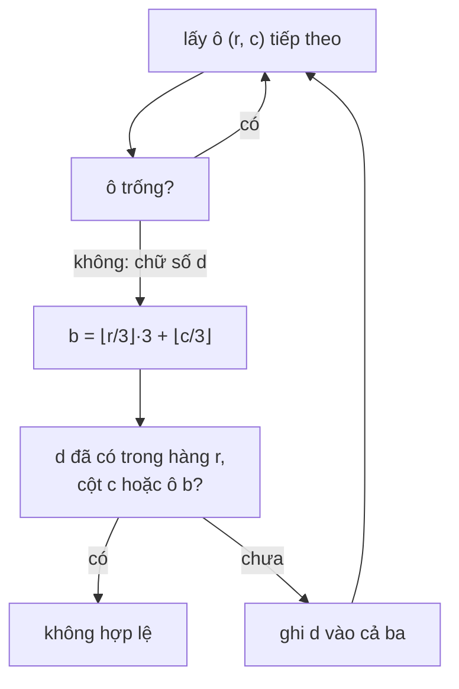

> [!tldr] Đọc nhanh
> - Đề: bảng 9×9 điền dở, `"."` là ô trống. Hỏi các ô **đã điền** có vi phạm luật không: mỗi hàng, mỗi cột, mỗi ô 3×3 không có chữ số lặp. Không cần giải Sudoku.
> - Mỗi chữ số ở ô (r, c) thuộc ba nhóm: hàng r, cột c và ô 3×3 số `⌊r/3⌋·3 + ⌊c/3⌋`. Gặp lại một chữ số trong cùng nhóm là sai. Đây là khuôn "hỏi trước, ghi sau" của [[posts/2026-11-22-neetcode-hash-lookup|ga 1]] với ba [[concepts/canonical-key|khóa]].
> - Bảng luôn 9×9, nên mọi cách đều O(1) theo nghĩa chặt. Khác biệt nằm ở hằng số: [[concepts/bitmask|bitmask]] (mỗi nhóm là một số 9 bit) nhanh hơn 27 Set khoảng **10 lần**.
> - Hai bẫy: viết chỉ số ô 3×3 thành `⌊r/3⌋ + ⌊c/3⌋` (thiếu nhân 3), và tạo 9 Set bằng `[set()] * 9` hay `Array(9).fill(new Set())`, cả hai làm **bảng hợp lệ** bị báo là sai.

> [!info] Bối cảnh
> Bài LeetCode 36, thuộc [[posts/2026-11-22-neetcode-counting-keys|ga 2: Khóa chuẩn và đếm tần suất]] trên **tuyến NeetCode: Mảng và chuỗi**. Post của ga dùng bài này làm ví dụ "một phần tử, nhiều khóa"; trang này so ba cách cài đặt và đo chúng. Lời giải có đủ TypeScript, Python, Go, Java, JavaScript, PHP và Rust. Bạn chỉ cần biết vòng lặp, mảng hai chiều và luật Sudoku.

> [!abstract]- Từ điển nhanh cho bài này (bấm để mở)
> - **Ô 3×3 (box)**: chín khối 3×3 chia bảng 9×9, đánh số 0..8 từ trái sang phải, trên xuống dưới.
> - **Chia lấy nguyên `⌊x/3⌋`**: bỏ phần dư. `⌊7/3⌋ = 2`. TypeScript/JS viết `Math.floor(x / 3)`, Python `x // 3`, Go và Java `x / 3` với số nguyên.
> - **Set**: tập hợp trả lời "đã có x chưa?" trong O(1) trung bình. Xem [[concepts/hash-set|Hash Set]].
> - **Bitmask**: dùng từng bit của một số nguyên làm một ô đúng/sai. Xem [[concepts/bitmask|Bitmask]].
> - **Phép `|`, `&`, `<<`**: OR từng bit, AND từng bit, dịch trái. `1 << 4` là `0b10000`, bật bit số 4.

## Hình dung trước: ba cuốn sổ điểm danh

Một trường có 81 chỗ ngồi xếp 9 hàng × 9 cột, chia thành 9 khu 3×3. Luật: trong một hàng, một cột hay một khu, không có hai bạn mang cùng số áo. Thầy giám thị đi qua từng chỗ có người và ghi số áo vào **ba cuốn sổ**: sổ của hàng, sổ của cột, sổ của khu.

| Đời thường | Khái niệm |
|---|---|
| 81 chỗ ngồi, chỗ trống không cần ghi | bảng 9×9, ô `"."` bỏ qua |
| Số áo của bạn ngồi ở chỗ (r, c) | chữ số `board[r][c]` |
| Ba cuốn sổ: hàng r, cột c, khu của chỗ đó | ba Set `rows[r]`, `cols[c]`, `boxes[b]` |
| Biết chỗ (r, c) thuộc khu nào mà không cần tra bản đồ | công thức `b = ⌊r/3⌋·3 + ⌊c/3⌋` |
| Số áo đã có trong một trong ba sổ: báo vi phạm | gặp lại khóa → `false` |
| Thay sổ bằng một dãy 9 bóng đèn, bật đèn số k khi gặp số áo k | bitmask 9 bit |



## Vấn đề

**Đề (tóm tắt bằng lời của mình):** cho bảng `board` 9×9, mỗi ô là một chữ số `"1"`…`"9"` hoặc `"."`. Trả `true` nếu các ô đã điền không vi phạm luật: không có chữ số lặp trong cùng hàng, cùng cột, hay cùng ô 3×3. Bảng hợp lệ chưa chắc giải được; đề không hỏi chuyện đó. Đề gốc: [LeetCode 36](https://leetcode.com/problems/valid-sudoku/).

Mình từng nghĩ phải viết ba vòng lặp riêng cho hàng, cột và ô 3×3. Thật ra một vòng qua 81 ô là đủ, miễn mỗi ô biết nó thuộc ô 3×3 nào.

### Công thức ô 3×3

`⌊r/3⌋` cho biết ô nằm ở dải ngang thứ mấy (0, 1, 2); `⌊c/3⌋` cho dải dọc. Đánh số chín khối theo hàng thì khối ở dải ngang `R`, dải dọc `C` có số `R·3 + C`, giống cách đổi (hàng, cột) thành chỉ số của mảng một chiều.

| r \ c | 0–2 | 3–5 | 6–8 |
|---|---|---|---|
| **0–2** | 0 | 1 | 2 |
| **3–5** | 3 | 4 | 5 |
| **6–8** | 6 | 7 | 8 |

Thiếu phép nhân 3 (`⌊r/3⌋ + ⌊c/3⌋`) thì khối (0, 1) và khối (1, 0) cùng ra số 1. Hai chữ số giống nhau nằm ở hai khối khác nhau sẽ bị coi là trùng, và bảng **hợp lệ** bị báo sai.

## Cơ chế

<figure class="figure-map" style="--ar: 3 / 4">
<div class="frame"><iframe data-archify="../diagrams/neetcode-valid-sudoku/worked-example.html" title="Một chữ số thuộc ba nhóm Sudoku" loading="lazy"></iframe></div>
<figcaption><span><b>Hình 1.</b> Một chữ số thuộc ba nhóm Sudoku.</span><a href="../diagrams/neetcode-valid-sudoku/worked-example.html" target="_blank" rel="noopener">Mở toàn màn hình</a></figcaption>
</figure>

<details>
<summary>Đọc từng bước</summary>
<ol>
<li>Đọc chữ số 7 ở hàng 1 cột 4. <code>r = 1, c = 4, d = 7</code></li>
<li>Tính ô 3 × 3 số 1. <code>floor(1/3) × 3 + floor(4/3) = 1</code></li>
<li>Ghi 7 vào cả ba nhóm. <code>row[1], col[4], box[1]</code></li>
<li>Gặp 7 tại hàng 2 cột 3. <code>r = 2, c = 3, box = 1</code></li>
<li>Trùng trong cùng khối. <code>box[1] → false</code></li>
</ol>
</details>

### Cách 1, ba lượt

Lượt i lấy hàng i, cột i và khối i, mỗi nhóm kiểm bằng một Set mới. Khối i có góc trên trái ở `(⌊i/3⌋·3, (i mod 3)·3)`. Mỗi ô được đọc ba lần.

### Cách 2, một lượt với 27 Set

Chín Set cho hàng, chín cho cột, chín cho khối. Đi qua 81 ô một lần; với mỗi chữ số, hỏi ba Set trước rồi ghi vào cả ba. Đây là cách tự nhiên nhất, nhưng tạo 27 Set mỗi lần gọi.

### Cách 3, bitmask

Chữ số chỉ có 9 giá trị, nên mỗi nhóm chỉ cần 9 ô đúng/sai, vừa trong một số nguyên. Chữ số d ứng với bit `1 << (d − 1)`. "Đã có d chưa" là `mask & bit`, "ghi d" là `mask |= bit`. Ba nhóm kiểm cùng lúc: `(rows[r] | cols[c] | boxes[b]) & bit`. Toàn bộ trạng thái là 27 số nguyên, không cấp phát gì thêm.

### Đo: ba cách khác nhau ở hằng số

Bảng luôn 81 ô, nên cả ba cách đều làm một lượng việc cố định. Kiểm bảng ví dụ 100 000 lần, trung vị 5 lần chạy, TypeScript:

| Cách | ms |
|---|---|
| ba lượt (mỗi nhóm một Set mới) | 266,9 |
| một lượt, 27 Set | 320,6 |
| bitmask | 32,9 |

Một lượt lại chậm hơn ba lượt: cả hai đều tạo 27 Set, nhưng một lượt giữ cả 27 Set sống cùng lúc và gọi `has`/`add` trên ba Set khác nhau mỗi ô. Bitmask nhanh hơn khoảng 10 lần vì phép trên bit không cần hash và không cấp phát. Big-O ở đây không phân biệt được ba cách; chỉ có đo mới thấy.

### Bên dưới năm ngôn ngữ

| | Đổi chữ số thành chỉ số 0..8 | Bẫy riêng |
|---|---|---|
| TypeScript / JavaScript | `d.charCodeAt(0) - 49` hoặc `Number(d) - 1` | `Array(9).fill(new Set())`: chín ô cùng trỏ về **một** Set |
| Python | `int(d) - 1` | `[set()] * 9`: chín phần tử cùng trỏ về **một** set; `[0] * 9` thì an toàn vì int bất biến |
| Go | `board[r][c] - '1'` (kiểu `byte`) | `&` đứng trước `!=` nên `x&bit != 0` đúng như ý |
| Java | `board[r][c] - '1'` (char trừ char ra `int`) | `&` đứng **sau** `!=`: phải viết `(x & bit) != 0` |

## Ví dụ chạy được

[TypeScript](../code/neetcode-valid-sudoku/valid-sudoku.ts) · [Python](../code/neetcode-valid-sudoku/valid_sudoku.py) · [Go](../code/neetcode-valid-sudoku/valid_sudoku.go) · [Java](../code/neetcode-valid-sudoku/valid-sudoku.java) · [PHP](../code/neetcode-valid-sudoku/valid-sudoku.php) · [Rust](../code/neetcode-valid-sudoku/valid_sudoku.rs) · [JavaScript](../code/neetcode-valid-sudoku/valid-sudoku.js)

Mỗi file có cả ba cách và tự chạy 6 ca kiểm tra. Dưới đây là cách một lượt và cách bitmask.

```ts
// Cách 2, một lượt với 27 Set: rows[r], cols[c], boxes[b].
function onePass(board: string[][]): boolean {
  const rows = Array.from({ length: 9 }, () => new Set<string>());
  const cols = Array.from({ length: 9 }, () => new Set<string>());
  const boxes = Array.from({ length: 9 }, () => new Set<string>());
  for (let r = 0; r < 9; r++) {
    for (let c = 0; c < 9; c++) {
      const d = board[r][c];
      if (d === ".") continue;
      const b = Math.floor(r / 3) * 3 + Math.floor(c / 3);
      if (rows[r].has(d) || cols[c].has(d) || boxes[b].has(d)) return false;
      rows[r].add(d); cols[c].add(d); boxes[b].add(d);
    }
  }
  return true;
}

// Cách 3, bitmask: mỗi hàng/cột/ô 3×3 là một số nguyên 9 bit; bit k bật nghĩa là đã có chữ số k+1.
function bitmask(board: string[][]): boolean {
  const rows = new Array(9).fill(0), cols = new Array(9).fill(0), boxes = new Array(9).fill(0);
  for (let r = 0; r < 9; r++) {
    for (let c = 0; c < 9; c++) {
      const d = board[r][c];
      if (d === ".") continue;
      const bit = 1 << (d.charCodeAt(0) - 49); // "1" là mã 49 → bit 0
      const b = Math.floor(r / 3) * 3 + Math.floor(c / 3);
      if ((rows[r] | cols[c] | boxes[b]) & bit) return false;
      rows[r] |= bit; cols[c] |= bit; boxes[b] |= bit;
    }
  }
  return true;
}
```

```python
def one_pass(board: list[list[str]]) -> bool:
    rows = [set() for _ in range(9)]
    cols = [set() for _ in range(9)]
    boxes = [set() for _ in range(9)]  # đừng viết [set()] * 9: chín phần tử cùng trỏ về MỘT set
    for r in range(9):
        for c in range(9):
            d = board[r][c]
            if d == ".":
                continue
            b = r // 3 * 3 + c // 3
            if d in rows[r] or d in cols[c] or d in boxes[b]:
                return False
            rows[r].add(d)
            cols[c].add(d)
            boxes[b].add(d)
    return True

def bitmask(board: list[list[str]]) -> bool:
    rows, cols, boxes = [0] * 9, [0] * 9, [0] * 9  # int là bất biến, nên [0] * 9 không có bẫy như [set()] * 9
    for r in range(9):
        for c in range(9):
            d = board[r][c]
            if d == ".":
                continue
            bit = 1 << (int(d) - 1)
            b = r // 3 * 3 + c // 3
            if (rows[r] | cols[c] | boxes[b]) & bit:
                return False
            rows[r] |= bit
            cols[c] |= bit
            boxes[b] |= bit
    return True
```

```go
func onePass(board [][]byte) bool {
	var rows, cols, boxes [9][9]bool
	for r := 0; r < 9; r++ {
		for c := 0; c < 9; c++ {
			if board[r][c] == '.' {
				continue
			}
			d, b := board[r][c]-'1', r/3*3+c/3
			if rows[r][d] || cols[c][d] || boxes[b][d] {
				return false
			}
			rows[r][d], cols[c][d], boxes[b][d] = true, true, true
		}
	}
	return true
}

func bitmask(board [][]byte) bool {
	var rows, cols, boxes [9]uint16
	for r := 0; r < 9; r++ {
		for c := 0; c < 9; c++ {
			if board[r][c] == '.' {
				continue
			}
			bit, b := uint16(1)<<(board[r][c]-'1'), r/3*3+c/3
			if (rows[r]|cols[c]|boxes[b])&bit != 0 { // Go: & đứng trước != nên không cần ngoặc thêm
				return false
			}
			rows[r] |= bit
			cols[c] |= bit
			boxes[b] |= bit
		}
	}
	return true
}
```

```java
static boolean onePass(char[][] board) {
    List<Set<Character>> rows = new ArrayList<>(), cols = new ArrayList<>(), boxes = new ArrayList<>();
    for (int i = 0; i < 9; i++) { rows.add(new HashSet<>()); cols.add(new HashSet<>()); boxes.add(new HashSet<>()); }
    for (int r = 0; r < 9; r++)
        for (int c = 0; c < 9; c++) {
            char d = board[r][c];
            if (d == '.') continue;
            int b = r / 3 * 3 + c / 3;
            // add trả false khi đã có: kiểm và ghi trong một lệnh
            if (!rows.get(r).add(d) || !cols.get(c).add(d) || !boxes.get(b).add(d)) return false;
        }
    return true;
}

static boolean bitmask(char[][] board) {
    int[] rows = new int[9], cols = new int[9], boxes = new int[9];
    for (int r = 0; r < 9; r++)
        for (int c = 0; c < 9; c++) {
            if (board[r][c] == '.') continue;
            int bit = 1 << (board[r][c] - '1'), b = r / 3 * 3 + c / 3;
            if (((rows[r] | cols[c] | boxes[b]) & bit) != 0) return false; // Java: phải có ngoặc, & thấp hơn !=
            rows[r] |= bit; cols[c] |= bit; boxes[b] |= bit;
        }
    return true;
}
```

```js
function onePass(board) {
  // Array(9).fill(new Set()) là bẫy: chín ô cùng trỏ về MỘT Set. Dùng Array.from với hàm tạo.
  const rows = Array.from({ length: 9 }, () => new Set());
  const cols = Array.from({ length: 9 }, () => new Set());
  const boxes = Array.from({ length: 9 }, () => new Set());
  for (let r = 0; r < 9; r++) {
    for (let c = 0; c < 9; c++) {
      const d = board[r][c];
      if (d === ".") continue;
      const b = Math.floor(r / 3) * 3 + Math.floor(c / 3);
      if (rows[r].has(d) || cols[c].has(d) || boxes[b].has(d)) return false;
      rows[r].add(d); cols[c].add(d); boxes[b].add(d);
    }
  }
  return true;
}

function bitmask(board) {
  const rows = new Array(9).fill(0), cols = new Array(9).fill(0), boxes = new Array(9).fill(0);
  for (let r = 0; r < 9; r++) {
    for (let c = 0; c < 9; c++) {
      const d = board[r][c];
      if (d === ".") continue;
      const bit = 1 << (Number(d) - 1);
      const b = Math.floor(r / 3) * 3 + Math.floor(c / 3);
      if ((rows[r] | cols[c] | boxes[b]) & bit) return false;
      rows[r] |= bit; cols[c] |= bit; boxes[b] |= bit;
    }
  }
  return true;
}
```

```php
function isValidSudoku(array $board): bool {
    // array_fill với [] an toàn: mảng PHP là giá trị, chín ô là chín bản riêng
    $rows = array_fill(0, 9, []); $cols = array_fill(0, 9, []); $boxes = array_fill(0, 9, []);
    for ($r = 0; $r < 9; $r++) {
        for ($c = 0; $c < 9; $c++) {
            $d = $board[$r][$c];
            if ($d === '.') continue;
            $b = intdiv($r, 3) * 3 + intdiv($c, 3);
            if (isset($rows[$r][$d]) || isset($cols[$c][$d]) || isset($boxes[$b][$d])) return false;
            $rows[$r][$d] = $cols[$c][$d] = $boxes[$b][$d] = true;
        }
    }
    return true;
}
```

```rust
fn is_valid_sudoku(board: Vec<Vec<char>>) -> bool {
    let (mut rows, mut cols, mut boxes) = ([0u16; 9], [0u16; 9], [0u16; 9]);
    for r in 0..9 {
        for c in 0..9 {
            let d = board[r][c];
            if d == '.' {
                continue;
            }
            let bit = 1u16 << (d as u8 - b'1'); // char → u8: '1' là 49
            let b = r / 3 * 3 + c / 3;
            if (rows[r] | cols[c] | boxes[b]) & bit != 0 { // Rust: & đứng trước != nên không cần thêm ngoặc
                return false;
            }
            rows[r] |= bit;
            cols[c] |= bit;
            boxes[b] |= bit;
        }
    }
    true
}
```


File TypeScript chạy thêm bản sai công thức ô 3×3, rồi đo:

```text
$ node valid-sudoku.ts
threePass      6/6 ca đúng
onePass        6/6 ca đúng
bitmask        6/6 ca đúng
wrongBoxIndex  4/6 ca đúng; sai ở: ví dụ hợp lệ, hai số 1 ở hai ô khác nhau

100 000 lần kiểm bảng ví dụ (ms, trung vị 5 lần)
threePass    266.9
onePass      320.6
bitmask       32.9
```

Bản sai công thức báo **bảng ví dụ hợp lệ** là sai: nó không bỏ sót vi phạm mà còn bịa ra vi phạm. File Python chạy thêm bản tạo set bằng `[set()] * 9`:

```text
$ python3 valid_sudoku.py
three_pass            6/6 ca đúng
one_pass              6/6 ca đúng
bitmask               6/6 ca đúng
one_pass_shared_sets  4/6 ca đúng; sai ở: ví dụ hợp lệ, hai số 1 ở hai ô khác nhau
```

Chín "set của hàng" thật ra là một set, nên chữ số 5 ở hàng 0 và chữ số 5 ở hàng 4 bị coi là cùng hàng. Go, Java, JavaScript, PHP và Rust in `6/6 ca đúng` cho cả ba cách, và cũng bắt được bản sai công thức (`4/6`). Trong PHP, `array_fill(0, 9, [])` không dính bẫy này: mảng là giá trị, mỗi ô là một bản sao riêng.

## Hiểu lầm và bẫy hay gặp

- **"Phải giải được mới là hợp lệ."** Đề chỉ hỏi các ô đã điền có vi phạm luật không. Một bảng hợp lệ vẫn có thể vô nghiệm.
- **Công thức ô 3×3 thiếu nhân 3.** `⌊r/3⌋ + ⌊c/3⌋` chỉ ra 5 giá trị 0..4, nên chín khối bị dồn vào năm nhóm.
- **Tạo nhiều Set bằng phép nhân hay `fill`.** `[set()] * 9` và `Array(9).fill(new Set())` lặp lại **cùng một** object chín lần. Dùng list comprehension hoặc `Array.from({ length: 9 }, () => new Set())`.
- **Java: `x & bit != 0` không biên dịch.** `!=` được tính trước, thành `x & true`. Phải có ngoặc.
- **"O(1) thì cách nào cũng như nhau."** Cùng O(1) nhưng bitmask nhanh hơn 10 lần trong phép đo trên. Hằng số chỉ quan trọng khi hàm được gọi rất nhiều lần, như trong một bộ giải Sudoku thử hàng triệu bảng.
- **PHP: `$x & $bit != 0` biên dịch được nhưng sai.** Như Java và C, `!=` được tính trước, thành `$x & true`, rồi `true` bị ép thành `1`. Khác Java, PHP không báo lỗi: file PHP cho `0b101 & 0b010 != 0` ra `1` (tưởng là có). Luôn đặt ngoặc quanh `&`.
- **Rust: `char` không phải số.** `d - '1'` không biên dịch; phải đổi `d as u8 - b'1'`. Ngược lại, độ ưu tiên của Rust đặt `&` trước `!=`, nên `x & bit != 0` đúng nghĩa. Và `vec![HashSet::new(); 9]` clone từng phần tử, nên không dính bẫy chín ô dùng chung như JS và Python.

## Câu hỏi tự kiểm tra

> [!question]- Ô (4, 7) thuộc ô 3×3 số mấy?
> `⌊4/3⌋·3 + ⌊7/3⌋ = 1·3 + 2 = 5`: khối giữa, bên phải.

> [!question]- Vì sao `[0] * 9` an toàn trong Python còn `[set()] * 9` thì không?
> Cả hai đều lặp cùng một object chín lần. `rows[r] |= bit` trên int tạo int **mới** và gán lại vào ô r, nên các ô tách nhau. `rows[r].add(d)` sửa **chính** set đó, và cả chín ô cùng thấy thay đổi.

> [!question]- Với bitmask, làm sao kiểm ba nhóm chỉ bằng một phép so?
> OR ba mặt nạ lại rồi AND với bit của chữ số: `(rows[r] | cols[c] | boxes[b]) & bit`. Khác 0 nghĩa là chữ số đã có trong ít nhất một nhóm.

> [!question]- Nếu bảng là 16×16 (chữ số 1..16, khối 4×4), cần đổi gì?
> Công thức khối thành `⌊r/4⌋·4 + ⌊c/4⌋`, và mặt nạ cần 16 bit (vẫn vừa một số nguyên). Mọi thứ khác giữ nguyên.

## Tham khảo

- [LeetCode 36: Valid Sudoku](https://leetcode.com/problems/valid-sudoku/) (đề gốc)
- [Python FAQ: How do I create a multidimensional list?](https://docs.python.org/3/faq/programming.html#how-do-i-create-a-multidimensional-list) (vì sao `[x] * n` lặp cùng một object)
- [MDN: `Array.prototype.fill`](https://developer.mozilla.org/en-US/docs/Web/JavaScript/Reference/Global_Objects/Array/fill) (fill bằng object thì mọi ô cùng tham chiếu)
- [Java tutorial: Operators](https://docs.oracle.com/javase/tutorial/java/nutsandbolts/operators.html) (bảng thứ tự ưu tiên: `==`/`!=` trước `&`)
- [Go spec: Operator precedence](https://go.dev/ref/spec#Operator_precedence) (`&` cùng mức với `*`, trước `==`/`!=`)
