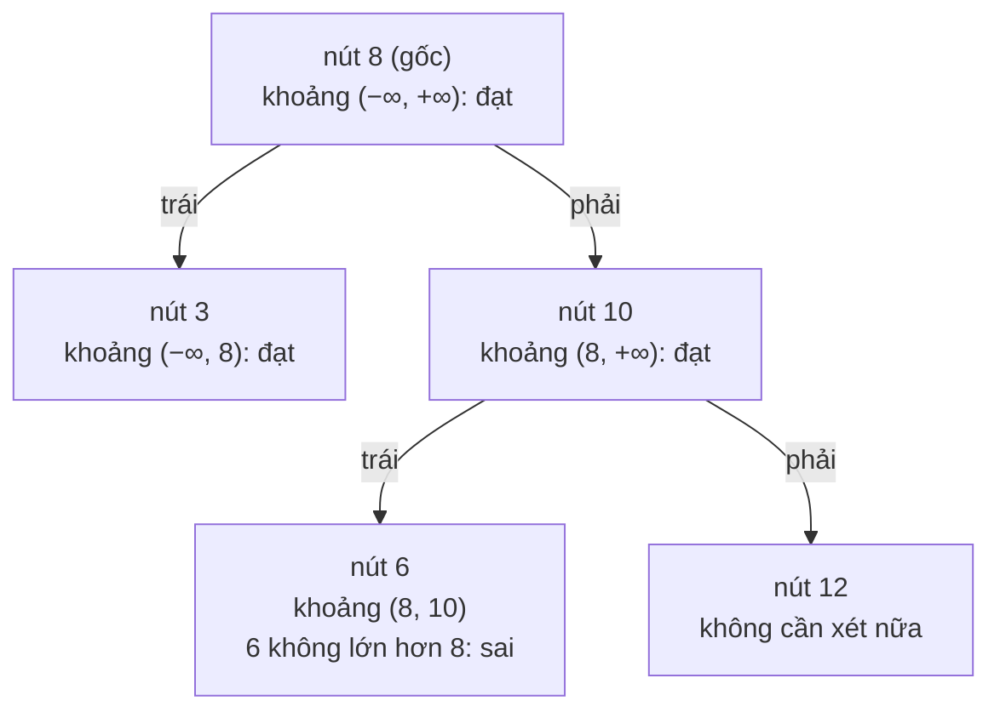
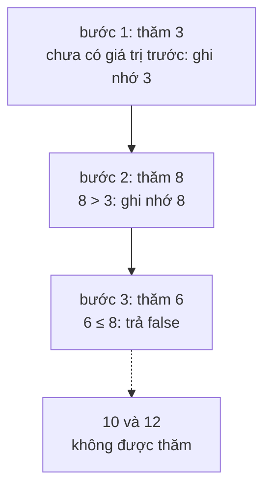

> [!tldr] Đọc nhanh
> - Đề: cho gốc một cây nhị phân, trả `true` nếu nó là **cây nhị phân tìm kiếm**: ở mọi nút, **mọi** giá trị trong cây con trái nhỏ hơn hẳn nút, **mọi** giá trị trong cây con phải lớn hơn hẳn nút. Trùng giá trị là sai.
> - Chỉ so nút với hai con trực tiếp là **sai**: cây `[8, 3, 10, null, null, 6, 12]` qua mọi phép so cha con, nhưng 6 nằm bên phải 8 mà lại nhỏ hơn 8.
> - Cách O(n) thứ nhất: [[concepts/bounds-propagation|truyền khoảng]] mở (lo, hi) từ gốc xuống. Rẽ trái thì cận trên thành giá trị nút, rẽ phải thì cận dưới thành giá trị nút. Cách thứ hai: [[concepts/in-order-traversal|duyệt trung thứ tự]] phải ra một dãy **tăng ngặt**.
> - Giá trị trải hết dải 32 bit, nên dùng `INT_MIN`/`INT_MAX` làm "vô cực" thì hỏng ở đúng các ca biên: Java và Go cận kiểu `int` sai 3/13 ca. Dùng `null`, `long`, hay `-Infinity`.
> - Đề cho tới 10⁴ nút. Chuỗi lệch 10⁴ nút làm bản đệ quy Python ném `RecursionError`, bản đệ quy Java ném `StackOverflowError` khi chưa được JIT biên dịch, và Node chỉ chịu được 7 959 tới 10 428 tầng tùy lần chạy. Bản lặp thì không sao.

> [!info] Bối cảnh
> Bài LeetCode 98 (Medium), thuộc [[posts/2026-11-25-neetcode-binary-search-tree|ga 4: Cây nhị phân tìm kiếm]] trên **tuyến NeetCode: Cấu trúc liên kết**. Ga trước, [[posts/2026-11-25-neetcode-tree-recursion|Đệ quy trên cây]], dạy hàm đệ quy trả kết quả **từ dưới lên**; bài này dùng chiều ngược lại: thông tin (khoảng được phép) đi **từ trên xuống**. Hai bài cùng ga, [[problems/lowest-common-ancestor-of-a-binary-search-tree|Lowest Common Ancestor of a BST]] và [[problems/kth-smallest-element-in-a-bst|Kth Smallest Element in a BST]], đều **giả sử** cây đã là cây tìm kiếm; bài này là bài kiểm tra giả thiết đó. Lời giải có đủ TypeScript, Python, Go, Java và JavaScript. Bạn cần biết đệ quy là gì; cây tìm kiếm được giải thích ngay dưới.

> [!abstract]- Từ điển nhanh cho bài này (bấm để mở)
> - **Cây nhị phân**: mỗi nút có tối đa hai con, trái và phải. Xem [[concepts/binary-tree|Binary Tree]].
> - **Cây nhị phân tìm kiếm (BST)**: cây nhị phân mà ở mọi nút, cả cây con trái nhỏ hơn nút, cả cây con phải lớn hơn nút. Xem [[concepts/binary-search-tree|Binary Search Tree]].
> - **Tổ tiên**: cha, cha của cha, … tới gốc. **Cháu** (trong trang này): con của con.
> - **Khoảng mở (lo, hi)**: mọi số x với lo < x < hi, không tính hai đầu. Xem [[concepts/bounds-propagation|Bounds Propagation]].
> - **Trung thứ tự (in-order)**: thăm cây con trái, rồi nút, rồi cây con phải. Trên cây tìm kiếm, nó cho các giá trị theo thứ tự tăng. Xem [[concepts/in-order-traversal|In-order Traversal]].
> - **Giá trị canh (sentinel value)**: một giá trị đặt sẵn để đóng vai "chưa có" hay "vô cực". Xem [[concepts/sentinel-value|Sentinel Value]].
> - **INT_MIN, INT_MAX**: số nguyên 32 bit nhỏ nhất và lớn nhất, −2 147 483 648 và 2 147 483 647.
> - **Chuỗi lệch phải**: mọi nút chỉ có con phải, cây sâu đúng bằng số nút. Giới hạn độ sâu đệ quy: xem [[concepts/recursion-depth-limit|Recursion Depth Limit]].
> - **Morris**: cách duyệt trung thứ tự không cần ngăn xếp, tạm sửa con trỏ trong cây rồi sửa lại. Giải thích ở phần Cơ chế.

## Hình dung trước: khu phố có biển chỉ đường ở mỗi ngã rẽ

Một khu phố mọc theo kiểu cây: từ cổng vào, mỗi ngã rẽ có tấm biển "số nhà nhỏ hơn 8: rẽ trái; lớn hơn 8: rẽ phải". Đi tiếp lại gặp ngã rẽ khác với biển của nó. Người kiểm tra muốn biết khu phố có được đánh số đúng không, nghĩa là mọi nhà đều nằm đúng phía mà **mọi** tấm biển trên đường tới nó đã hứa.

- **Kiểm tra lười:** ở mỗi ngã rẽ chỉ nhìn hai nhà ngay cạnh. Nhà 6 nằm sau biển "rẽ phải nếu lớn hơn 8" rồi tới biển "rẽ trái nếu nhỏ hơn 10". Người kiểm tra lười chỉ so 6 với biển 10 gần nhất, thấy đúng, và bỏ qua lời hứa của biển 8.
- **Mang theo một tờ giấy:** người kiểm tra cầm tờ giấy ghi "số nhà phải nằm giữa … và …". Qua mỗi biển, họ sửa một trong hai đầu. Tới nhà 6, tờ giấy ghi "giữa 8 và 10": sai ngay.
- **Đi dạo từ trái sang phải:** đi hết khu phố theo thứ tự "mọi nhà bên trái, rồi ngã rẽ, rồi mọi nhà bên phải". Khu phố đúng thì số nhà gặp được tăng dần, không bao giờ lặp lại.

| Đời thường | Khái niệm |
|---|---|
| Biển ở ngã rẽ | nút, giá trị của nút |
| Lời hứa của mọi biển trên đường đi | tính chất cây tìm kiếm áp cho cả cây con |
| Chỉ so với biển gần nhất | hiểu sai: so cha với con |
| Tờ giấy "giữa … và …" | khoảng mở (lo, hi) truyền xuống |
| Tờ giấy chưa ghi đầu nào | cận `null`, hay ±∞ |
| Viết sẵn "giữa −2 147 483 648 và …" | giá trị canh INT_MIN, hỏng khi có nhà mang đúng số đó |
| Đi dạo từ trái sang phải, số tăng dần | duyệt trung thứ tự, dãy tăng ngặt |
| Hai nhà cùng số | trùng giá trị: không hợp lệ |

Cây dưới đây là ca "cháu phải nhỏ hơn ông" trong file chạy thử. Mỗi ô ghi khoảng mà nút nhận được từ cha:



## Vấn đề

Đầu vào là gốc của một cây nhị phân có từ 1 tới 10⁴ nút, mỗi giá trị là một số nguyên 32 bit bất kỳ, tức trong [−2³¹, 2³¹ − 1]. Trả về cây có phải cây nhị phân tìm kiếm theo nghĩa **ngặt** hay không: mọi giá trị trong cây con trái của một nút nhỏ hơn hẳn nút, mọi giá trị trong cây con phải lớn hơn hẳn nút, và cả hai cây con cũng là cây tìm kiếm. Đề gốc: [LeetCode 98](https://leetcode.com/problems/validate-binary-search-tree/).

Mình từng nghĩ "cây tìm kiếm" là "con trái nhỏ hơn cha, con phải lớn hơn cha" và viết đúng ba dòng như thế. Câu chữ của đề nói "mọi nút trong cây con", không phải "con". Khác biệt đó là cả bài.

## Cơ chế

<figure class="figure-map" style="--ar: 3 / 4">
<div class="frame"><iframe data-archify="../diagrams/neetcode-validate-binary-search-tree/worked-example.html" title="Mỗi nút giữ mọi ràng buộc từ tổ tiên" loading="lazy"></iframe></div>
<figcaption><span><b>Hình 1.</b> Mỗi nút giữ mọi ràng buộc từ tổ tiên.</span><a href="../diagrams/neetcode-validate-binary-search-tree/worked-example.html" target="_blank" rel="noopener">Mở toàn màn hình</a></figcaption>
</figure>

<details>
<summary>Đọc từng bước</summary>
<ol>
<li>Gốc 10 đặt cận trên cho nhánh trái. <code>left range = (-∞, 10)</code></li>
<li>Nút 5 thêm cận dưới cho con phải. <code>right range = (5, 10)</code></li>
<li>Con phải của 5 có giá trị 12. <code>12 &gt; 10</code></li>
<li>Nút 12 vi phạm cận từ gốc. <code>false</code></li>
</ol>
</details>

### Cách sai: chỉ so cha với con

```ts
// Sai 1: chỉ so nút với hai con trực tiếp.
function wrongParentChild(root: TreeNode | null): boolean {
  if (root === null) return true;
  if (root.left !== null && root.left.val >= root.val) return false;
  if (root.right !== null && root.right.val <= root.val) return false;
  return wrongParentChild(root.left) && wrongParentChild(root.right);
}
```

Nó nhận cây `[8, 3, 10, null, null, 6, 12]` ở hình trên: 3 < 8 < 10 đúng, 6 < 10 < 12 đúng. Nhưng 6 nằm trong cây con phải của 8. Cách này chỉ bắt được lỗi giữa hai tầng liền nhau, còn lỗi giữa ông và cháu (hay xa hơn) thì lọt. Ở file TypeScript, nó sai 70 trên 5 000 cây ngẫu nhiên nhỏ, và sai cả ca chuỗi 10⁴ nút có nút đáy mang giá trị 0: 0 nhỏ hơn cha trực tiếp của nó, nhưng nó nằm bên phải của mọi nút phía trên.

### Cách 1: vét cạn max và min của từng cây con

Viết đúng theo định nghĩa: ở mỗi nút, giá trị lớn nhất của cây con trái phải nhỏ hơn nút, giá trị nhỏ nhất của cây con phải phải lớn hơn nút.

```ts
// Cách 1: vét cạn. Ở mọi nút: max cây con trái < nút < min cây con phải. O(n·h), chuỗi lệch là O(n²).
function bruteMaxMin(root: TreeNode | null): boolean {
  if (root === null) return true;
  const stack: TreeNode[] = [root];
  while (stack.length > 0) {
    const node = stack.pop()!;
    if (node.left !== null) {
      if (scan(node.left)[1] >= node.val) return false;
      stack.push(node.left);
    }
    if (node.right !== null) {
      if (scan(node.right)[0] <= node.val) return false;
      stack.push(node.right);
    }
  }
  return true;
}
```

`scan` đi hết một cây con để lấy min và max. Mỗi nút bị quét lại một lần cho mỗi tổ tiên của nó, nên tổng là O(n · h) với h là chiều cao: O(n log n) trên cây cân, O(n²) trên chuỗi lệch. Chuỗi phải 10⁴ nút (cây đúng, nên không dừng sớm) tốn 49 995 000 lần ghé, đúng n(n − 1)/2. Mình viết cả vòng ngoài bằng ngăn xếp để phép đo chỉ đo thời gian, không vướng giới hạn đệ quy.

### Cách 2: truyền khoảng từ trên xuống

Đổi chiều nhìn: thay vì hỏi "cây con của tôi có những giá trị nào", mỗi nút hỏi "các tổ tiên cho phép tôi nằm trong khoảng nào". Gốc được phép mọi giá trị. Rẽ trái từ nút v thì mọi thứ phía dưới phải nhỏ hơn v, nên cận trên thành v; rẽ phải thì cận dưới thành v. Cận còn lại giữ nguyên, và đó là chỗ lời hứa của ông được mang xuống tới cháu.

```ts
// Cách 2: truyền khoảng mở (lo, hi) xuống. null nghĩa là chưa có cận, nên không cần giá trị canh nào.
function validBounds(root: TreeNode | null): boolean {
  const go = (node: TreeNode | null, lo: number | null, hi: number | null): boolean => {
    if (node === null) return true;
    if ((lo !== null && node.val <= lo) || (hi !== null && node.val >= hi)) return false;
    return go(node.left, lo, node.val) && go(node.right, node.val, hi);
  };
  return go(root, null, null);
}
```

Mỗi nút được xét một lần: O(n) thời gian, O(h) bộ nhớ cho ngăn xếp gọi hàm. Vì sao chỉ cần **một** khoảng, chứ không cần nhớ hết các biển trên đường? Vì mọi lời hứa đều có dạng "lớn hơn a" hoặc "nhỏ hơn b", và giao của chúng luôn là một khoảng: chỉ cận dưới lớn nhất và cận trên nhỏ nhất là có tác dụng. Mỗi lần rẽ, giá trị nút mới luôn nằm trong khoảng cũ (nếu không đã trả `false`), nên thay một đầu bằng nó chỉ làm khoảng hẹp lại.

**Giá trị canh cho "vô cực".** Phần dễ hỏng nhất là chọn giá trị cho cận "chưa có". Đề cho giá trị trải hết dải 32 bit, nên không có số `int` nào nằm ngoài dải để làm vô cực:

| Ngôn ngữ | Lựa chọn hỏng | Lựa chọn đúng |
|---|---|---|
| Java | `int lo = Integer.MIN_VALUE`: nút mang đúng INT_MIN bị từ chối, sai 3/13 ca | cận `long` với `Long.MIN_VALUE`, hoặc `Integer` có thể `null` |
| Go | `math.MinInt32`, `math.MaxInt32`: sai 3/13 ca như Java | con trỏ `*int` với `nil`; hoặc `math.MinInt` vì `int` của Go 64 bit |
| Python | `-2**31` | `float("-inf")`, so được với mọi `int` |
| TypeScript / JavaScript | `-2147483648` | `-Infinity`, `Infinity`, hoặc `null` |

Một biến thể của cùng bẫy nằm ở cách 3: biến "giá trị trước" khởi tạo bằng INT_MIN.

### Cách 3: duyệt trung thứ tự, dãy phải tăng ngặt

Tính chất thứ hai của cây tìm kiếm: duyệt trái, nút, phải thì được các giá trị theo thứ tự tăng. Điều ngược lại cũng đúng: nếu dãy trung thứ tự tăng ngặt thì cây là cây tìm kiếm (mọi nút của cây con trái đứng trước nút trong dãy, mọi nút của cây con phải đứng sau). Vậy chỉ cần nhớ giá trị vừa thăm và so với giá trị kế tiếp, khỏi lưu cả dãy.

Trên cây ở hình đầu trang, dãy trung thứ tự là 3, 8, 6, 10, 12 và việc kiểm tra dừng ở bước 3:



Bản lặp dùng một [[concepts/stack|ngăn xếp]] tự quản lý: đi trái hết mức và đẩy từng nút vào, lấy nút trên đỉnh ra thăm, rồi sang cây con phải của nó.

```ts
// Cách 3b: trung thứ tự lặp: đi trái hết mức, lấy ra, sang phải.
function validInorderIterative(root: TreeNode | null): boolean {
  const stack: TreeNode[] = [];
  let cur = root;
  let prev: number | null = null;
  while (cur !== null || stack.length > 0) {
    while (cur !== null) { stack.push(cur); cur = cur.left; }
    cur = stack.pop()!;
    if (prev !== null && cur.val <= prev) return false;
    prev = cur.val;
    cur = cur.right;
  }
  return true;
}
```

`prev = null` nghĩa là "chưa thăm nút nào". Nếu khởi tạo `prev = INT_MIN` để khỏi kiểm `null`, cây một nút mang INT_MIN bị từ chối vì INT_MIN ≤ INT_MIN (hàm `wrongPrevIntMin` sai 2/13 ca). Trong JavaScript, `-Infinity` làm được việc đó vì nó nhỏ hơn mọi số.

So với cách 2: cùng O(n), nhưng trung thứ tự dừng ở **cặp liền nhau đầu tiên** bị đảo trong dãy, còn truyền khoảng dừng ở nút đầu tiên ra khỏi khoảng theo thứ tự tiền thứ tự. Trên một cây đúng, cả hai đi hết n nút.

**Morris: bộ nhớ thêm O(1).** Cả hai cách trên tốn O(h) cho ngăn xếp. Morris (1979) bỏ ngăn xếp bằng cách tạm mượn con trỏ phải đang rỗng của nút cuối cùng trong cây con trái (nút đứng ngay trước trong dãy trung thứ tự) để trỏ về nút hiện tại. Lần thứ hai đi qua sợi nối, nó gỡ sợi nối ra.

```ts
// Cách 3c: Morris, bộ nhớ thêm O(1). Tạm nối nút cuối của cây con trái về nút hiện tại.
// Gặp chỗ sai vẫn phải đi tiếp tới hết để gỡ mọi sợi nối tạm.
function validMorris(root: TreeNode | null): boolean {
  let cur = root;
  let prev: number | null = null;
  let ok = true;
  while (cur !== null) {
    if (cur.left === null) {
      if (prev !== null && cur.val <= prev) ok = false;
      prev = cur.val;
      cur = cur.right;
    } else {
      let p = cur.left;
      while (p.right !== null && p.right !== cur) p = p.right;
      if (p.right === null) { p.right = cur; cur = cur.left; }
      else {
        p.right = null;
        if (prev !== null && cur.val <= prev) ok = false;
        prev = cur.val;
        cur = cur.right;
      }
    }
  }
  return ok;
}
```

Cái giá: Morris **sửa cây trong lúc chạy**. Nếu viết `return false` ngay chỗ sai như hai cách kia, những sợi nối chưa gỡ ở lại trong cây. File TypeScript chụp mọi con trỏ trước khi chạy rồi so sau: `wrongMorrisEarlyReturn` để lại sợi nối ở 2 trên 13 ca. Ở cây hình đầu trang, nút 6 bị bỏ lại với con phải trỏ ngược về 10, thành một vòng: hàm nào duyệt cây đó sau này sẽ chạy mãi. Bản đúng phải đi tới hết dù đã biết đáp án, nên mất phần dừng sớm. Morris cũng không an toàn khi luồng khác đang đọc cùng cây.

| Cách | Thời gian | Bộ nhớ thêm | Ghi chú |
|---|---|---|---|
| So cha với con | O(n) | O(h) | **sai** |
| Vét cạn max/min | O(n·h): O(n log n) cây cân, O(n²) chuỗi lệch | O(h) | đúng nhưng chậm |
| Truyền khoảng, đệ quy | O(n) | O(h) | cẩn thận giá trị canh |
| Truyền khoảng, lặp | O(n) | O(h) | không giới hạn độ sâu |
| Trung thứ tự, đệ quy | O(n) | O(h) | cẩn thận giá trị `prev` đầu tiên |
| Trung thứ tự, lặp | O(n) | O(h) | không giới hạn độ sâu |
| Morris | O(n) | O(1) | sửa cây tạm thời, không được dừng sớm |

### Đo

TypeScript, Node 24, trung vị 5 lần. Mọi cây đều đúng, nên không cách nào dừng sớm:

| Cây | n | Vét cạn: ghé | Vét cạn | Truyền khoảng (lặp) | Trung thứ tự (lặp) |
|---|---|---|---|---|---|
| cây cân | 10 000 | 113 631 | 0,89 ms | 0,12 ms | 0,05 ms |
| chuỗi phải | 1 000 | 499 500 | 2,22 ms | 0,05 ms | 0,00 ms |
| chuỗi phải | 2 000 | 1 999 000 | 9,48 ms | 0,01 ms | 0,01 ms |
| chuỗi phải | 4 000 | 7 998 000 | 33,8 ms | 0,03 ms | 0,02 ms |
| chuỗi phải | 10 000 | 49 995 000 | 215 ms | 0,24 ms | 0,04 ms |

- Chuỗi phải: n gấp đôi thì số lần ghé của vét cạn gấp bốn, đúng dáng n². Hai cách O(n) ghé đúng n nút.
- Cây cân 10⁴ nút: vét cạn ghé 113 631 lần, khoảng 11 lần n, đúng dáng n log n.
- Bản truyền khoảng lặp ở TypeScript chậm hơn trung thứ tự lặp vì mỗi nút tạo một mảng ba phần tử `[node, lo, hi]` để đẩy vào ngăn xếp.

Các ngôn ngữ khác, trung vị 5 lần (ms), cột truyền khoảng là bản đệ quy:

| | Cây cân 10⁴: vét cạn | truyền khoảng | trung thứ tự | Morris | Chuỗi phải 10⁴: vét cạn | truyền khoảng | trung thứ tự | Morris |
|---|---|---|---|---|---|---|---|---|
| Go | 0,59 | 0,049 | 0,042 | 0,051 | 121 | 0,096 | 0,027 | 0,017 |
| Java | 1,27 | 0,021 | 0,148 | 0,087 | 164 | 0,073 | 0,041 | 0,023 |

Python 3.12, trung vị 5 lần: vét cạn trên chuỗi phải 4 000 nút mất 1 390 ms, bản lặp truyền khoảng 0,32 ms, trung thứ tự lặp 0,21 ms, Morris 0,12 ms. Chuỗi 10⁴ nút làm vét cạn Python mất khoảng 9 giây mỗi lần, nên file không đo 5 lần ở cỡ đó.

### Bên dưới năm ngôn ngữ

| | "Vô cực" an toàn | Bẫy riêng |
|---|---|---|
| TypeScript / JavaScript | `-Infinity`, `Infinity`, hoặc `null` | Node chịu được 7 959 tới 10 428 tầng của `validBounds` tùy lần chạy, ngay quanh giới hạn đề 10⁴; trong bộ ca chạy thử nó vẫn qua chuỗi 10⁴ nút, nhưng không nên dựa vào |
| Python | `float("-inf")` | chuỗi 10⁴ nút vượt giới hạn 1 000 tầng mặc định; `sys.setrecursionlimit(50000)` làm bản đệ quy chạy được |
| Go | con trỏ `*int` với `nil`, hoặc `math.MinInt` (64 bit) | `math.MinInt32` thì hỏng; đệ quy 10⁴ tầng không sao vì ngăn xếp goroutine tự lớn lên |
| Java | `long` với `Long.MIN_VALUE`, hoặc `Integer` `null` | `Integer.MIN_VALUE` thì hỏng; chuỗi 10⁴ nút làm bản đệ quy ném `StackOverflowError` khi hàm còn chạy bằng trình thông dịch, dù chính hàm đó qua chuỗi 10⁴ nút ở phần đo sau khi đã được JIT biên dịch |

## Ví dụ chạy được

[TypeScript](../code/neetcode-validate-binary-search-tree/validate-bst.ts) · [Python](../code/neetcode-validate-binary-search-tree/validate_bst.py) · [Go](../code/neetcode-validate-binary-search-tree/validate_bst.go) · [Java](../code/neetcode-validate-binary-search-tree/validate-bst.java) · [JavaScript](../code/neetcode-validate-binary-search-tree/validate-bst.js)

Mỗi file dựng cây từ mảng theo tầng kiểu LeetCode (`null` là chỗ trống) và chạy 13 ca chung: một nút, ba nút đúng, cháu phải nhỏ hơn ông (cây ở hình đầu trang), cháu trái lớn hơn ông (`[8, 3, 10, 1, 9]`), trùng bên trái, trùng bên phải, một nút INT_MIN, một nút INT_MAX, INT_MIN rồi INT_MAX làm con phải, hai nút cùng là INT_MAX, cây cân 10⁴ nút, chuỗi phải 10⁴ nút, và chuỗi 10⁴ nút có nút đáy mang giá trị 0. File TypeScript còn đối chiếu sáu cách đúng trên 5 000 cây ngẫu nhiên 1 tới 8 nút với giá trị 0 tới 5 (sinh bằng mulberry32, để hay có trùng và hay sai), và kiểm tra Morris có trả cây về nguyên vẹn không.

Truyền khoảng, đệ quy:

```ts
function validBounds(root: TreeNode | null): boolean {
  const go = (node: TreeNode | null, lo: number | null, hi: number | null): boolean => {
    if (node === null) return true;
    if ((lo !== null && node.val <= lo) || (hi !== null && node.val >= hi)) return false;
    return go(node.left, lo, node.val) && go(node.right, node.val, hi);
  };
  return go(root, null, null);
}
```

```python
def valid_bounds(root):
    """Cách 2: truyền khoảng mở (lo, hi); vô cực của float so được với mọi int."""
    def go(node, lo, hi):
        if node is None:
            return True
        if not (lo < node.val < hi):
            return False
        return go(node.left, lo, node.val) and go(node.right, node.val, hi)

    return go(root, float("-inf"), float("inf"))
```

```go
// Cách 2: truyền khoảng mở; lo, hi là con trỏ, nil nghĩa là chưa có cận. Không cần giá trị canh.
func validBounds(root *TreeNode) bool {
	var walk func(node *TreeNode, lo, hi *int) bool
	walk = func(node *TreeNode, lo, hi *int) bool {
		if node == nil {
			return true
		}
		if (lo != nil && node.Val <= *lo) || (hi != nil && node.Val >= *hi) {
			return false
		}
		return walk(node.Left, lo, &node.Val) && walk(node.Right, &node.Val, hi)
	}
	return walk(root, nil, nil)
}
```

```java
// Cách 2: truyền khoảng mở bằng long. Long.MIN_VALUE nhỏ hơn mọi int, nên làm "âm vô cực" an toàn.
static boolean validBounds(TreeNode root) { return walk(root, Long.MIN_VALUE, Long.MAX_VALUE); }

static boolean walk(TreeNode node, long lo, long hi) {
    if (node == null) return true;
    if (node.val <= lo || node.val >= hi) return false;
    return walk(node.left, lo, node.val) && walk(node.right, node.val, hi);
}
```

```js
// Cách 2: truyền khoảng mở. -Infinity và Infinity là số thật trong JS, so được với mọi giá trị.
function validBounds(root) {
  const go = (node, lo, hi) => {
    if (node === null) return true;
    if (node.val <= lo || node.val >= hi) return false;
    return go(node.left, lo, node.val) && go(node.right, node.val, hi);
  };
  return go(root, -Infinity, Infinity);
}
```

Trung thứ tự lặp, an toàn với chuỗi 10⁴ nút ở mọi ngôn ngữ:

```ts
function validInorderIterative(root: TreeNode | null): boolean {
  const stack: TreeNode[] = [];
  let cur = root;
  let prev: number | null = null;
  while (cur !== null || stack.length > 0) {
    while (cur !== null) { stack.push(cur); cur = cur.left; }
    cur = stack.pop()!;
    if (prev !== null && cur.val <= prev) return false;
    prev = cur.val;
    cur = cur.right;
  }
  return true;
}
```

```python
def valid_inorder_iterative(root):
    """Cách 3b: trung thứ tự lặp."""
    stack, cur, prev = [], root, None
    while cur or stack:
        while cur:
            stack.append(cur)
            cur = cur.left
        cur = stack.pop()
        if prev is not None and cur.val <= prev:
            return False
        prev = cur.val
        cur = cur.right
    return True
```

```go
// Cách 3b: trung thứ tự lặp.
func validInorderIterative(root *TreeNode) bool {
	stack := []*TreeNode{}
	cur := root
	prev, hasPrev := 0, false
	for cur != nil || len(stack) > 0 {
		for cur != nil {
			stack = append(stack, cur)
			cur = cur.Left
		}
		cur = stack[len(stack)-1]
		stack = stack[:len(stack)-1]
		if hasPrev && cur.Val <= prev {
			return false
		}
		prev, hasPrev = cur.Val, true
		cur = cur.Right
	}
	return true
}
```

```java
// Cách 3b: trung thứ tự lặp.
static boolean validInorderIterative(TreeNode root) {
    Deque<TreeNode> stack = new ArrayDeque<>();
    TreeNode cur = root;
    boolean hasPrev = false;
    int p = 0;
    while (cur != null || !stack.isEmpty()) {
        while (cur != null) { stack.push(cur); cur = cur.left; }
        cur = stack.pop();
        if (hasPrev && cur.val <= p) return false;
        p = cur.val;
        hasPrev = true;
        cur = cur.right;
    }
    return true;
}
```

```js
// Cách 3b: trung thứ tự lặp.
function validInorderIterative(root) {
  const stack = [];
  let cur = root, prev = -Infinity;
  while (cur !== null || stack.length > 0) {
    while (cur !== null) { stack.push(cur); cur = cur.left; }
    cur = stack.pop();
    if (cur.val <= prev) return false;
    prev = cur.val;
    cur = cur.right;
  }
  return true;
}
```

Kết quả `node validate-bst.ts`:

```text
bruteMaxMin           13/13 ca đúng
validBounds           13/13 ca đúng
validBoundsIterative  13/13 ca đúng
validInorder          13/13 ca đúng
validInorderIterative 13/13 ca đúng
validMorris           13/13 ca đúng
wrongParentChild      10/13 ca đúng; sai ở cháu phải nhỏ hơn ông → true, cháu trái lớn hơn ông → true, chuỗi 10^4 nút, đáy sai → true
wrongAllowDuplicates  10/13 ca đúng; sai ở trùng bên trái → true, trùng bên phải → true, INT_MAX trùng → true
wrongPrevIntMin       11/13 ca đúng; sai ở một nút INT_MIN → false, INT_MIN rồi INT_MAX → false

Morris: cây còn nguyên sau khi chạy?
validMorris             cây nguyên vẹn ở cả 13 ca
wrongMorrisEarlyReturn  để lại sợi nối ở: cháu phải nhỏ hơn ông, chuỗi 10^4 nút, đáy sai

đối chiếu 5000 cây ngẫu nhiên 1..8 nút: sáu cách khớp nhau 5000/5000 (947 cây đúng); wrongParentChild sai 70 cây

số lần ghé nút và thời gian trung vị 5 lần (ms), mọi cây đều đúng
cây                       n   vét cạn: ghé        ms   khoảng: ghé      ms   trung thứ tự lặp: ghé      ms
cây cân             10000         113631      0.89        10000    0.12                  10000    0.05
chuỗi phải           1000         499500      2.22         1000    0.05                   1000    0.00
chuỗi phải           2000        1999000      9.48         2000    0.01                   2000    0.01
chuỗi phải           4000        7998000     33.81         4000    0.03                   4000    0.02
chuỗi phải          10000       49995000    215.22        10000    0.24                  10000    0.04

chuỗi phải dài nhất bản đệ quy chạy được (đề cho tới 10^4 nút):
validBounds   7959 nút
validInorder  11377 nút
chuỗi phải 10^5 nút: validInorderIterative → true, validMorris → true
```

Dòng "dài nhất" tìm nhị phân độ dài chuỗi mà bản đệ quy còn chạy được, và chạy **sau** phần đo, khi hàm đã được JIT tối ưu. Qua sáu lần chạy file, `validBounds` ra 7 959 năm lần và 10 428 một lần; một thử nghiệm riêng với hàm chưa đụng tới phần đo ra khoảng 10 450 tới 11 100. Con số dao động quanh đúng giới hạn đề, nên bản đệ quy ở Node là đúng nhưng không chắc chắn.

`python3 validate_bst.py`:

```text
brute_max_min           13/13 ca đúng
valid_bounds            11/13 ca đúng; sai ở chuỗi phải 10^4 nút → ném RecursionError, chuỗi 10^4 nút, đáy sai → ném RecursionError
valid_bounds_iterative  13/13 ca đúng
valid_inorder           11/13 ca đúng; sai ở chuỗi phải 10^4 nút → ném RecursionError, chuỗi 10^4 nút, đáy sai → ném RecursionError
valid_inorder_iterative 13/13 ca đúng
valid_morris            13/13 ca đúng
wrong_parent_child      9/13 ca đúng; sai ở cháu phải nhỏ hơn ông → True, cháu trái lớn hơn ông → True, chuỗi phải 10^4 nút → ném RecursionError, chuỗi 10^4 nút, đáy sai → ném RecursionError
wrong_prev_int_min      9/13 ca đúng; sai ở một nút INT_MIN → False, INT_MIN rồi INT_MAX → False, chuỗi phải 10^4 nút → ném RecursionError, chuỗi 10^4 nút, đáy sai → ném RecursionError

thời gian trung vị 5 lần (ms), cây đúng
cây                 n     vét cạn   khoảng (lặp)   trung thứ tự (lặp)   Morris
cây cân        10000        23.3           0.80                 0.60     0.92
chuỗi phải      1000        86.6           0.08                 0.06     0.03
chuỗi phải      2000       344.9           0.17                 0.11     0.07
chuỗi phải      4000      1389.7           0.32                 0.21     0.12
(chuỗi phải 10^4 nút: vét cạn mất khoảng 9 giây mỗi lần nên không đo 5 lần; ca chạy thử ở trên đã gồm nó)

sau sys.setrecursionlimit(50000): valid_bounds trên chuỗi phải 10^4 nút → True
```

`go run validate_bst.go`:

```text
bruteMaxMin           13/13 ca đúng
validBounds           13/13 ca đúng
validBoundsIterative  13/13 ca đúng
validInorder          13/13 ca đúng
validInorderIterative 13/13 ca đúng
validMorris           13/13 ca đúng
wrongParentChild      10/13 ca đúng; sai ở cháu phải nhỏ hơn ông → true, cháu trái lớn hơn ông → true, chuỗi 10^4 nút, đáy sai → true
wrongInt32Sentinel    10/13 ca đúng; sai ở một nút INT_MIN → false, một nút INT_MAX → false, INT_MIN rồi INT_MAX → false

số lần ghé nút và thời gian trung vị 5 lần (ms), cây đúng
cây                n   vét cạn: ghé       ms   khoảng (đệ quy)   trung thứ tự (lặp)   Morris
cây cân      10000         113631     0.59             0.049                0.042    0.051
chuỗi phải    1000         499500     1.51             0.011                0.003    0.002
chuỗi phải    4000        7998000    19.52             0.037                0.011    0.007
chuỗi phải   10000       49995000   121.38             0.096                0.027    0.017
```

`java validate-bst.java`:

```text
bruteMaxMin           13/13 ca đúng
validBounds           11/13 ca đúng; sai ở chuỗi phải 10^4 nút → ném StackOverflowError, chuỗi 10^4 nút, đáy sai → ném StackOverflowError
validBoundsIterative  13/13 ca đúng
validInorder          11/13 ca đúng; sai ở chuỗi phải 10^4 nút → ném StackOverflowError, chuỗi 10^4 nút, đáy sai → ném StackOverflowError
validInorderIterative 13/13 ca đúng
validMorris           13/13 ca đúng
wrongParentChild      10/13 ca đúng; sai ở cháu phải nhỏ hơn ông → true, cháu trái lớn hơn ông → true, chuỗi 10^4 nút, đáy sai → true
wrongIntSentinel      10/13 ca đúng; sai ở một nút INT_MIN → false, một nút INT_MAX → false, INT_MIN rồi INT_MAX → false

số lần ghé nút và thời gian trung vị 5 lần (ms), cây đúng
cây                n   vét cạn: ghé       ms   khoảng (đệ quy)   trung thứ tự (lặp)   Morris
cây cân      10000         113631     1.27             0.021                0.148    0.087
chuỗi phải    1000         499500     1.44             0.006                0.010    0.003
chuỗi phải    4000        7998000    23.35             0.025                0.067    0.010
chuỗi phải   10000       49995000   164.08             0.073                0.041    0.023
```

Ở Java, `validBounds` ném `StackOverflowError` trên chuỗi 10⁴ nút trong bộ ca chạy thử, nhưng chính hàm đó chạy xong chuỗi 10⁴ nút ở bảng đo phía dưới (0,073 ms). Khác nhau ở chỗ lúc chạy bộ ca, hàm còn chạy bằng trình thông dịch với khung ngăn xếp lớn; tới phần đo nó đã được JIT biên dịch, khung nhỏ hơn. Ở một lần chạy khác, ca "đáy sai" của `validBounds` qua được (12/13). Một thử nghiệm riêng, nơi hàm đã nóng, chịu được 23 577 tầng.

`node validate-bst.js`:

```text
bruteMaxMin           13/13 ca đúng
validBounds           13/13 ca đúng
validBoundsIterative  13/13 ca đúng
validInorder          13/13 ca đúng
validInorderIterative 13/13 ca đúng
validMorris           13/13 ca đúng
wrongParentChild      10/13 ca đúng; sai ở cháu phải nhỏ hơn ông → true, cháu trái lớn hơn ông → true, chuỗi 10^4 nút, đáy sai → true
wrongAllowDuplicates  10/13 ca đúng; sai ở trùng bên trái → true, trùng bên phải → true, INT_MAX trùng → true
```

## Hiểu lầm và bẫy hay gặp

- **"Con trái nhỏ hơn cha, con phải lớn hơn cha là đủ."** Tính chất áp cho **cả cây con**. Cây `[8, 3, 10, null, null, 6, 12]` qua mọi phép so cha con mà vẫn sai, vì 6 nằm bên phải 8.
- **Dùng `<=` thay vì `<`.** Đề định nghĩa ngặt: hai nút cùng giá trị là sai, dù ở bên trái hay bên phải. `wrongAllowDuplicates` nhận cả ba ca trùng.
- **INT_MIN và INT_MAX làm "vô cực".** Giá trị đề trải hết dải 32 bit, nên một nút có thể mang đúng INT_MIN. Cận `int` ở Java và Go sai 3/13 ca; `prev = INT_MIN` ở bản trung thứ tự sai 2/13. Dùng `null`, `long`, con trỏ, hoặc vô cực của số thực.
- **"Chỉ cần nhớ cận của cha."** Mỗi nút cần cả cận dưới lẫn cận trên. Rẽ trái chỉ đổi cận trên, cận dưới thừa hưởng từ tổ tiên xa hơn; ca chuỗi 10⁴ nút có nút đáy mang 0 bắt đúng lỗi này.
- **Morris trả về sớm.** Morris sửa cây tạm thời; thoát giữa chừng là để lại sợi nối, có khi thành vòng. Phải đi tới hết rồi mới trả kết quả.
- **Giới hạn đề không an toàn cho đệ quy.** Chuỗi lệch 10⁴ nút vượt giới hạn 1 000 tầng của Python, vượt ngăn xếp Java khi hàm chưa được JIT biên dịch, và nằm ngay mép giới hạn của Node. Bản lặp hoặc Morris thì không có vấn đề này.

## Câu hỏi tự kiểm tra

> [!question]- Vẽ một cây mà mọi cặp cha con đều đúng chiều nhưng không phải cây tìm kiếm.
> `[8, 3, 10, null, null, 6, 12]`: 3 < 8 < 10 và 6 < 10 < 12, nhưng 6 nằm trong cây con phải của 8 mà nhỏ hơn 8. Đối xứng: `[8, 3, 10, 1, 9]`, với 9 trong cây con trái của 8.

> [!question]- Khi đi từ nút v sang con trái, khoảng (lo, hi) đổi thành gì, và vì sao lo giữ nguyên?
> Thành (lo, v). Mọi nút trong cây con trái của v vẫn nằm trong cây con của các tổ tiên phía trên, nên vẫn phải giữ lời hứa "lớn hơn lo" của họ; chỉ có thêm lời hứa mới "nhỏ hơn v".

> [!question]- Vì sao `Integer.MIN_VALUE` làm cận dưới ban đầu thì sai, còn `Long.MIN_VALUE` thì đúng?
> Phép kiểm là `val <= lo` thì sai. Một nút mang đúng −2 147 483 648 thì `val <= Integer.MIN_VALUE` đúng, nên một cây hợp lệ bị từ chối. `Long.MIN_VALUE` nhỏ hơn mọi giá trị `int`, nên không nút nào bằng nó.

> [!question]- Dãy trung thứ tự tăng ngặt có đủ để kết luận cây là cây tìm kiếm không? Vì sao?
> Đủ. Trong dãy trung thứ tự, mọi nút của cây con trái của v đứng trước v và mọi nút của cây con phải đứng sau v. Dãy tăng ngặt thì mọi nút đứng trước nhỏ hơn v và mọi nút đứng sau lớn hơn v, đúng điều kiện ở mọi nút.

> [!question]- Vì sao vét cạn max/min tốn O(n²) trên chuỗi lệch mà chỉ O(n log n) trên cây cân?
> Mỗi nút bị quét lại một lần cho mỗi tổ tiên, tức số lần ghé là tổng độ sâu của mọi nút. Trên chuỗi, độ sâu là 1, 2, …, n, tổng n(n − 1)/2 (49 995 000 với n = 10⁴). Trên cây cân, mọi độ sâu không quá log₂ n.

> [!question]- Bản Morris đã biết đáp án là `false` ở nút thứ ba. Vì sao nó vẫn đi tiếp?
> Vì nó đã tạm nối con trỏ phải của một số nút về tổ tiên. Thoát lúc đó là bỏ lại các sợi nối trong cây của người gọi, có khi thành vòng. Chỉ khi đi hết, mọi sợi nối mới được gỡ.

## Tham khảo

- [LeetCode 98: Validate Binary Search Tree](https://leetcode.com/problems/validate-binary-search-tree/) (đề gốc: 1 tới 10⁴ nút, giá trị trong [−2³¹, 2³¹ − 1])
- [Python `sys.setrecursionlimit`](https://docs.python.org/3/library/sys.html#sys.setrecursionlimit)
- Cormen, Leiserson, Rivest, Stein, *Introduction to Algorithms*, chương 12 (cây nhị phân tìm kiếm; duyệt trung thứ tự in ra khóa theo thứ tự tăng)
- Joseph M. Morris, "Traversing binary trees simply and cheaply", *Information Processing Letters* 9(5), 1979: duyệt trung thứ tự không cần ngăn xếp
