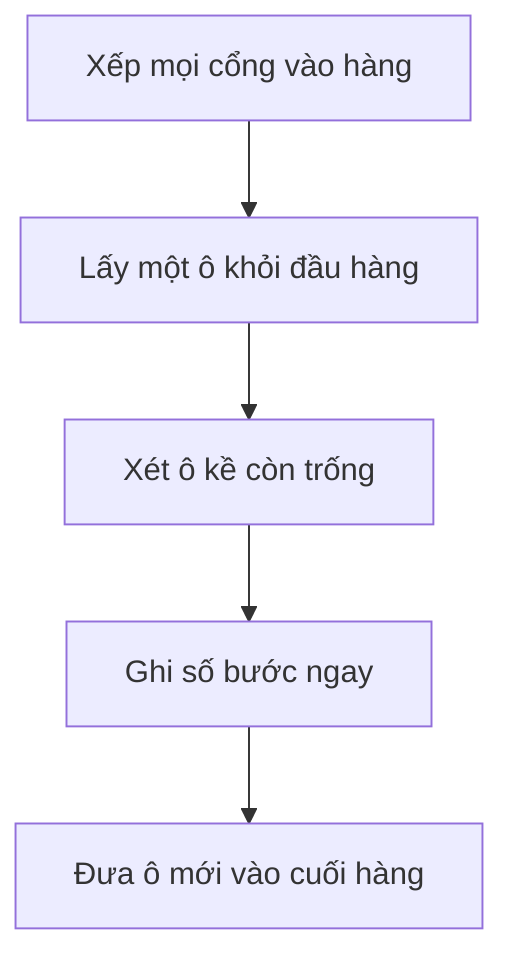
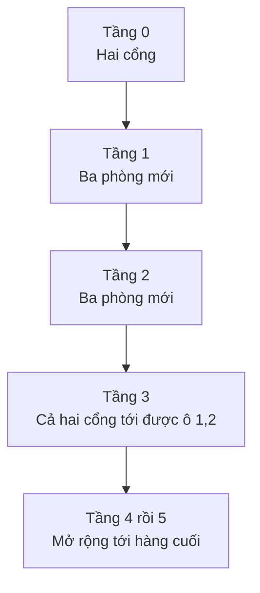

> [!tldr] Đọc nhanh
> - Một lần BFS từ mỗi phòng tìm được cổng gần nhất, nhưng nhiều phòng duyệt lại cùng hành lang.
> - [[concepts/multi-source-bfs|BFS đa nguồn]] đưa tất cả cổng vào cùng hàng đợi với khoảng cách 0. Lần đầu một phòng được khám phá là khoảng cách ngắn nhất tới bất kỳ cổng nào.
> - Ghi khoảng cách ngay khi đưa ô vào hàng đợi. Giá trị đó thay luôn dấu chưa thăm, còn tường, cổng và phòng không tới được cổng giữ nguyên.

> [!info] Bối cảnh
> Bài LeetCode 286 (Medium) thuộc [[posts/2026-11-26-neetcode-grid-traversal|ga 1: Duyệt lưới]] trên **tuyến NeetCode: Đồ thị**. Mình muốn ghi lên từng phòng số bước để ra cổng gần nhất khi hành lang có tường chắn. Bạn chỉ cần biết chỉ số hàng, cột và hàng đợi vào trước ra trước.

> [!abstract]- Từ điển nhanh cho bài này (bấm để mở)
> - [[concepts/grid-graph|Đồ thị lưới]] xem mỗi ô đi được là một nút, mỗi bước ngang hoặc dọc hợp lệ là một cạnh.
> - [[concepts/breadth-first-search|BFS]] mở rộng đường đi theo từng tầng khoảng cách bằng hàng đợi FIFO.
> - **INF** là giá trị canh cho phòng chưa biết khoảng cách. Trong bài này, giá trị lưu trong ô là số nguyên `2147483647`.
> - **Cập nhật tại chỗ** nghĩa là ghi kết quả vào từng ô của bảng được truyền vào.

## Hình dung trước: đặt biển chỉ đường trong tòa nhà

Mỗi cổng mở một đội treo biển. Các đội cùng xuất phát rồi đi một phòng mỗi lượt, qua cửa nối phòng chung tường. Đội tới một phòng lần đầu treo số bước đã đi để đội đến sau biết phòng đó đã được xử lý.

| Đời thường | Khái niệm |
|---|---|
| Cửa giữa hai phòng chung tường | Cạnh ngang hoặc dọc |
| Bức tường kín | Ô bị chặn |
| Các đội cùng xuất phát ở cổng | BFS đa nguồn, mọi nguồn ở tầng 0 |
| Treo biển ngay khi nhận phòng | [[concepts/mark-on-enqueue\|Đánh dấu khi đưa vào hàng đợi]] |
| Phòng cô lập giữ biển trống | Phòng không tới được cổng giữ `INF` |



## Vấn đề: khoảng cách phải đi vòng tường

Mỗi ô của bảng mang một trong ba vai trò. `-1` là tường và không đi xuyên qua được, `0` là cổng, còn `INF = 2³¹ − 1` là phòng cần điền khoảng cách. Mỗi bước đi sang một ô kề ngang hoặc dọc. Điền trực tiếp số bước ngắn nhất từ phòng tới một cổng vào bảng. Nếu phòng không tới được cổng nào thì giữ `INF`. Phiên bản công khai của NeetCode giới hạn hai chiều từ 1 đến 100. [LeetCode 286](https://leetcode.com/problems/walls-and-gates/) · [Phiên bản công khai của NeetCode](https://neetcode.io/problems/islands-and-treasure/question)

Mình dùng `I` để viết gọn `INF` và `#` để chỉ tường. Ví dụ dưới đây đánh số hàng và cột từ 0.

```text
Đầu vào               Kết quả
0 # I I 0             0 # 2 1 0
I I I # I             1 2 3 # 1
I # I # #             2 # 4 # #
I I I # I             3 4 5 # I
```

Phòng `(1,2)` cách mỗi cổng 3 bước. Từ cổng trái đi xuống rồi sang phải hai lần. Từ cổng phải đi sang trái hai lần rồi đi xuống. Phòng `(3,4)` bị cô lập và giữ `I`. Đếm chênh lệch hàng và cột chỉ cho một cận dưới khi có tường chắn.

## Cơ chế

<figure class="figure-map" style="--ar: 3 / 4">
<div class="frame"><iframe data-archify="../diagrams/neetcode-walls-and-gates/worked-example.html" title="Ghi khoảng cách từ cổng tới trước" loading="lazy"></iframe></div>
<figcaption><span><b>Hình 1.</b> Ghi khoảng cách từ cổng tới trước.</span><a href="../diagrams/neetcode-walls-and-gates/worked-example.html" target="_blank" rel="noopener">Mở toàn màn hình</a></figcaption>
</figure>

<details>
<summary>Đọc từng bước</summary>
<ol>
<li>Đưa cả hai cổng vào lớp 0. <code>(0,0), (0,4)</code></li>
<li>Bước một đến ba phòng. <code>(1,0), (1,4), (0,3)</code></li>
<li>Hai cổng cùng tới được (1,2). <code>min(3, 3) = 3</code></li>
<li>Phòng ở (3,4) bị tường cô lập. <code>room[3][4] = INF</code></li>
<li>Chỉ thay phòng có đường tới cổng. <code>(1,2) = 3; (3,4) = INF</code></li>
</ol>
</details>

### Cách 1 — Tìm từ từng phòng

Từ một phòng, chạy BFS qua tất cả ô đi được. Hàng đợi xử lý các ô theo khoảng cách từ phòng đang xét, nên cổng đầu tiên được lấy ra có khoảng cách nhỏ nhất. Nếu hàng đợi cạn thì phòng giữ `INF`. Lặp lại cho mọi phòng và dùng một mảng khoảng cách riêng cho mỗi lượt tìm. Khi đọc bảng ở lượt sau, **phòng đã có số dương vẫn đi qua được**. Chỉ `-1` chặn đường.

Đặt `V = m × n` và `R` là số phòng trống ban đầu. Mỗi ô có nhiều nhất bốn ô kề nên một lượt tốn tối đa `O(V)` thời gian và `O(V)` bộ nhớ phụ. Quét bảng và chạy `R` lượt tốn `O(V + R · V)` thời gian, với trường hợp xấu nhất `O(V²)`. Mảng của lượt trước có thể giải phóng trước khi bắt đầu lượt sau.

### Cách 2 — Cho mọi cổng mở rộng cùng nhau

Đường đi giữa phòng và cổng có thể đảo chiều vì các cạnh của lưới đi được theo cả hai hướng. Mình gom mọi cổng vào một hàng đợi, rồi dùng số đã ghi trong bảng làm khoảng cách. Lấy ô có khoảng cách `d` ra. Với mỗi hàng xóm còn `INF`, ghi `d + 1` ngay rồi đưa hàng xóm vào cuối hàng. Kiểm tra biên trước khi đọc ô.



Ở ví dụ, sau khi xử lý hai cổng, hàng đợi chỉ chứa các phòng cách 1 bước. Lúc các phòng cách 2 bước mở rộng, phòng `(1,2)` được ghi 3 ngay khi gặp từ một hướng. Hướng kia gặp số 3 thay vì `INF` và bỏ qua. Đổi thứ tự hai cổng vẫn cho giá trị 3.

Mình kiểm tra tính đúng theo các tầng. Mọi ô được ghi `d + 1` đều có đường hợp lệ qua ô cha cách `d` bước. Nếu tồn tại đường ngắn hơn đến cùng phòng, ô ngay trước phòng trên đường ngắn ấy sẽ nằm ở tầng nhỏ hơn `d` và đã được xử lý sớm hơn. Nó sẽ ghi vào phòng trước, nên lần ghi đầu tiên cho khoảng cách nhỏ nhất. Những phòng không có đường từ bất kỳ cổng nào không bao giờ vào hàng đợi.

Quét bảng tìm nguồn tốn `O(V)`. Mỗi cổng và mỗi phòng tới được cổng vào hàng đợi một lần. Xét tối đa bốn hàng xóm cho mỗi ô nên cả thuật toán tốn `O(V)` thời gian. Bảng đầu vào giữ kết quả kiêm trạng thái đã thăm, và hàng đợi vẫn có thể cần `O(V)` bộ nhớ.

### Đo số ô phải lấy từ hàng đợi

Trên bảng mở 24 × 24, có đúng một cổng ở `(0,0)`. Hai cách điền cùng một ma trận.

| Cách | Số lượt lấy ô khỏi hàng đợi |
|---|---:|
| BFS riêng cho từng phòng | 238775 |
| Một BFS đa nguồn | 576 |

Trình đo tính cả cổng khi lấy ra. Lượt chung lấy từng ô đúng một lần. Bảng này cho thấy lượng công việc lặp với cổng đặt ở góc. Số lượt không phải thời gian chạy và sẽ thay đổi theo vị trí của cổng và tường.

## Ví dụ chạy được

Tải [TypeScript](../code/neetcode-walls-and-gates/gate-distances.ts), [Python](../code/neetcode-walls-and-gates/gate_distances.py), [Go](../code/neetcode-walls-and-gates/gate_distances.go), [Java](../code/neetcode-walls-and-gates/gate-distances.java), [JavaScript](../code/neetcode-walls-and-gates/gate-distances.js), [PHP](../code/neetcode-walls-and-gates/gate-distances.php) hoặc [Rust](../code/neetcode-walls-and-gates/gate_distances.rs). Cả bảy file chạy hai cách trên cùng bảy ca. Ở cả hai cách, hàm ghi vào bảng nhận vào và giá trị trả về chỉ dùng để đo số lượt lấy ô.

```ts
const INF = 2 ** 31 - 1
const directions = [[-1, 0], [1, 0], [0, -1], [0, 1]]

function fromRoom(rooms: number[][], start: number) {
  const rows = rooms.length
  const cols = rooms[0].length
  const queue = [start]
  const distance = Array(rows * cols).fill(-1)
  distance[start] = 0

  for (let head = 0; head < queue.length; head++) {
    const cell = queue[head]
    const r = Math.floor(cell / cols)
    const c = cell % cols
    if (rooms[r][c] === 0) return [distance[cell], head + 1]
    for (const [dr, dc] of directions) {
      const nr = r + dr
      const nc = c + dc
      const next = nr * cols + nc
      if (nr < 0 || nr >= rows || nc < 0 || nc >= cols) continue
      if (rooms[nr][nc] === -1 || distance[next] !== -1) continue
      distance[next] = distance[cell] + 1
      queue.push(next)
    }
  }
  return [INF, queue.length]
}

function perRoom(rooms: number[][]) {
  let popped = 0
  const cols = rooms[0].length
  for (let r = 0; r < rooms.length; r++) {
    for (let c = 0; c < cols; c++) {
      if (rooms[r][c] !== INF) continue
      const [distance, visits] = fromRoom(rooms, r * cols + c)
      rooms[r][c] = distance
      popped += visits
    }
  }
  return popped
}

function fromAllGates(rooms: number[][]) {
  const rows = rooms.length
  const cols = rooms[0].length
  const queue: number[] = []
  for (let r = 0; r < rows; r++) {
    for (let c = 0; c < cols; c++) {
      if (rooms[r][c] === 0) queue.push(r * cols + c)
    }
  }

  for (let head = 0; head < queue.length; head++) {
    const cell = queue[head]
    const r = Math.floor(cell / cols)
    const c = cell % cols
    for (const [dr, dc] of directions) {
      const nr = r + dr
      const nc = c + dc
      if (nr < 0 || nr >= rows || nc < 0 || nc >= cols) continue
      if (rooms[nr][nc] !== INF) continue
      rooms[nr][nc] = rooms[r][c] + 1
      queue.push(nr * cols + nc)
    }
  }
  return queue.length
}

function check(before: number[][], expected: number[][]) {
  for (const fill of [perRoom, fromAllGates]) {
    const work = before.map(row => row.slice())
    fill(work)
    if (JSON.stringify(work) !== JSON.stringify(expected)) throw new Error(fill.name)
  }
}

const cases = [
  [
    [[0, -1, INF, INF, 0], [INF, INF, INF, -1, INF], [INF, -1, INF, -1, -1], [INF, INF, INF, -1, INF]],
    [[0, -1, 2, 1, 0], [1, 2, 3, -1, 1], [2, -1, 4, -1, -1], [3, 4, 5, -1, INF]],
  ],
  [[[INF, 0, INF, INF, 0, INF]], [[1, 0, 1, 1, 0, 1]]],
  [[[0, -1, INF]], [[0, -1, INF]]],
  [[[INF, INF], [INF, -1]], [[INF, INF], [INF, -1]]],
  [[[0]], [[0]]],
  [[[-1], [INF], [0], [INF]], [[-1], [1], [0], [1]]],
  [[[0, -1, INF], [INF, INF, INF]], [[0, -1, 4], [1, 2, 3]]],
]
for (const [before, expected] of cases) check(before, expected)
console.log(`${cases.length}/${cases.length} ca đúng`)

const roomByRoom = Array.from({ length: 24 }, () => Array(24).fill(INF))
roomByRoom[0][0] = 0
const inOnePass = roomByRoom.map(row => row.slice())
const repeatedPops = perRoom(roomByRoom)
const sharedPops = fromAllGates(inOnePass)
if (JSON.stringify(roomByRoom) !== JSON.stringify(inOnePass)) throw new Error("24 × 24")
console.log(`Số lượt lấy ô khỏi hàng đợi: ${repeatedPops} / ${sharedPops}`)
```
```python
INF = 2**31 - 1
DIRECTIONS = [(-1, 0), (1, 0), (0, -1), (0, 1)]


def from_room(rooms, start):
    rows, cols = len(rooms), len(rooms[0])
    queue = [start]
    distance = [-1] * (rows * cols)
    distance[start] = 0

    for head, cell in enumerate(queue):
        r, c = divmod(cell, cols)
        if rooms[r][c] == 0:
            return distance[cell], head + 1
        for dr, dc in DIRECTIONS:
            nr, nc = r + dr, c + dc
            if not (0 <= nr < rows and 0 <= nc < cols):
                continue
            neighbor = nr * cols + nc
            if rooms[nr][nc] == -1 or distance[neighbor] != -1:
                continue
            distance[neighbor] = distance[cell] + 1
            queue.append(neighbor)
    return INF, len(queue)


def per_room(rooms):
    popped = 0
    cols = len(rooms[0])
    for r, row in enumerate(rooms):
        for c in range(cols):
            if row[c] != INF:
                continue
            row[c], visits = from_room(rooms, r * cols + c)
            popped += visits
    return popped


def from_all_gates(rooms):
    rows, cols = len(rooms), len(rooms[0])
    queue = [r * cols + c for r in range(rows) for c in range(cols) if rooms[r][c] == 0]
    for cell in queue:
        r, c = divmod(cell, cols)
        for dr, dc in DIRECTIONS:
            nr, nc = r + dr, c + dc
            if not (0 <= nr < rows and 0 <= nc < cols):
                continue
            if rooms[nr][nc] != INF:
                continue
            rooms[nr][nc] = rooms[r][c] + 1
            queue.append(nr * cols + nc)
    return len(queue)


def check(before, expected):
    for fill in (per_room, from_all_gates):
        work = [row[:] for row in before]
        fill(work)
        assert work == expected, fill.__name__


cases = [
    (
        [[0, -1, INF, INF, 0], [INF, INF, INF, -1, INF], [INF, -1, INF, -1, -1], [INF, INF, INF, -1, INF]],
        [[0, -1, 2, 1, 0], [1, 2, 3, -1, 1], [2, -1, 4, -1, -1], [3, 4, 5, -1, INF]],
    ),
    ([[INF, 0, INF, INF, 0, INF]], [[1, 0, 1, 1, 0, 1]]),
    ([[0, -1, INF]], [[0, -1, INF]]),
    ([[INF, INF], [INF, -1]], [[INF, INF], [INF, -1]]),
    ([[0]], [[0]]),
    ([[-1], [INF], [0], [INF]], [[-1], [1], [0], [1]]),
    ([[0, -1, INF], [INF, INF, INF]], [[0, -1, 4], [1, 2, 3]]),
]
for before, expected in cases:
    check(before, expected)
print(f"{len(cases)}/{len(cases)} ca đúng")

room_by_room = [[INF] * 24 for _ in range(24)]
room_by_room[0][0] = 0
in_one_pass = [row[:] for row in room_by_room]
repeated_pops = per_room(room_by_room)
shared_pops = from_all_gates(in_one_pass)
assert room_by_room == in_one_pass
print(f"Số lượt lấy ô khỏi hàng đợi: {repeated_pops} / {shared_pops}")
```
```go
package main

import (
	"fmt"
	"slices"
)

const inf = 1<<31 - 1

var directions = [][2]int{{-1, 0}, {1, 0}, {0, -1}, {0, 1}}

func fromRoom(rooms [][]int, start int) (int, int) {
	rows, cols := len(rooms), len(rooms[0])
	queue := []int{start}
	distance := make([]int, rows*cols)
	for i := range distance {
		distance[i] = -1
	}
	distance[start] = 0

	for head := 0; head < len(queue); head++ {
		cell := queue[head]
		r, c := cell/cols, cell%cols
		if rooms[r][c] == 0 {
			return distance[cell], head + 1
		}
		for _, step := range directions {
			nr, nc := r+step[0], c+step[1]
			if nr < 0 || nr >= rows || nc < 0 || nc >= cols {
				continue
			}
			next := nr*cols + nc
			if rooms[nr][nc] == -1 || distance[next] != -1 {
				continue
			}
			distance[next] = distance[cell] + 1
			queue = append(queue, next)
		}
	}
	return inf, len(queue)
}

func perRoom(rooms [][]int) int {
	popped, cols := 0, len(rooms[0])
	for r, row := range rooms {
		for c, cell := range row {
			if cell != inf {
				continue
			}
			distance, visits := fromRoom(rooms, r*cols+c)
			row[c] = distance
			popped += visits
		}
	}
	return popped
}

func fromAllGates(rooms [][]int) int {
	rows, cols := len(rooms), len(rooms[0])
	queue := []int{}
	for r, row := range rooms {
		for c, cell := range row {
			if cell == 0 {
				queue = append(queue, r*cols+c)
			}
		}
	}

	for head := 0; head < len(queue); head++ {
		cell := queue[head]
		r, c := cell/cols, cell%cols
		for _, step := range directions {
			nr, nc := r+step[0], c+step[1]
			if nr < 0 || nr >= rows || nc < 0 || nc >= cols {
				continue
			}
			if rooms[nr][nc] != inf {
				continue
			}
			rooms[nr][nc] = rooms[r][c] + 1
			queue = append(queue, nr*cols+nc)
		}
	}
	return len(queue)
}

func clone(rooms [][]int) [][]int {
	copy := make([][]int, len(rooms))
	for r, row := range rooms {
		copy[r] = slices.Clone(row)
	}
	return copy
}

func checkEqual(a, b [][]int) {
	for r, row := range a {
		if !slices.Equal(row, b[r]) {
			panic("distance mismatch")
		}
	}
}

func main() {
	cases := [][2][][]int{
		{
			{{0, -1, inf, inf, 0}, {inf, inf, inf, -1, inf}, {inf, -1, inf, -1, -1}, {inf, inf, inf, -1, inf}},
			{{0, -1, 2, 1, 0}, {1, 2, 3, -1, 1}, {2, -1, 4, -1, -1}, {3, 4, 5, -1, inf}},
		},
		{{{inf, 0, inf, inf, 0, inf}}, {{1, 0, 1, 1, 0, 1}}},
		{{{0, -1, inf}}, {{0, -1, inf}}},
		{{{inf, inf}, {inf, -1}}, {{inf, inf}, {inf, -1}}},
		{{{0}}, {{0}}},
		{{{-1}, {inf}, {0}, {inf}}, {{-1}, {1}, {0}, {1}}},
		{{{0, -1, inf}, {inf, inf, inf}}, {{0, -1, 4}, {1, 2, 3}}},
	}
	for _, test := range cases {
		for _, fill := range []func([][]int) int{perRoom, fromAllGates} {
			work := clone(test[0])
			fill(work)
			checkEqual(work, test[1])
		}
	}
	fmt.Printf("%d/%d ca đúng\n", len(cases), len(cases))

	roomByRoom := make([][]int, 24)
	for r := range roomByRoom {
		roomByRoom[r] = make([]int, 24)
		for c := range roomByRoom[r] {
			roomByRoom[r][c] = inf
		}
	}
	roomByRoom[0][0] = 0
	inOnePass := clone(roomByRoom)
	repeatedPops := perRoom(roomByRoom)
	sharedPops := fromAllGates(inOnePass)
	checkEqual(roomByRoom, inOnePass)
	fmt.Printf("Số lượt lấy ô khỏi hàng đợi: %d / %d\n", repeatedPops, sharedPops)
}
```
```java
import java.util.Arrays;

class GateDistances {
    static final int INF = Integer.MAX_VALUE;
    static final int[][] DIRECTIONS = {{-1, 0}, {1, 0}, {0, -1}, {0, 1}};

    record Search(int distance, int popped) {}

    static Search fromRoom(int[][] rooms, int start) {
        int rows = rooms.length, cols = rooms[0].length;
        int[] queue = new int[rows * cols];
        int[] distance = new int[rows * cols];
        Arrays.fill(distance, -1);
        queue[0] = start;
        distance[start] = 0;
        int tail = 1;

        for (int head = 0; head < tail; head++) {
            int cell = queue[head], r = cell / cols, c = cell % cols;
            if (rooms[r][c] == 0) return new Search(distance[cell], head + 1);
            for (int[] step : DIRECTIONS) {
                int nr = r + step[0], nc = c + step[1];
                if (nr < 0 || nr >= rows || nc < 0 || nc >= cols) continue;
                int next = nr * cols + nc;
                if (rooms[nr][nc] == -1 || distance[next] != -1) continue;
                distance[next] = distance[cell] + 1;
                queue[tail++] = next;
            }
        }
        return new Search(INF, tail);
    }

    static int perRoom(int[][] rooms) {
        int popped = 0, cols = rooms[0].length;
        for (int r = 0; r < rooms.length; r++) {
            for (int c = 0; c < cols; c++) {
                if (rooms[r][c] != INF) continue;
                Search result = fromRoom(rooms, r * cols + c);
                rooms[r][c] = result.distance();
                popped += result.popped();
            }
        }
        return popped;
    }

    static int fromAllGates(int[][] rooms) {
        int rows = rooms.length, cols = rooms[0].length;
        int[] queue = new int[rows * cols];
        int tail = 0;
        for (int r = 0; r < rows; r++) {
            for (int c = 0; c < cols; c++) {
                if (rooms[r][c] == 0) queue[tail++] = r * cols + c;
            }
        }

        for (int head = 0; head < tail; head++) {
            int cell = queue[head], r = cell / cols, c = cell % cols;
            for (int[] step : DIRECTIONS) {
                int nr = r + step[0], nc = c + step[1];
                if (nr < 0 || nr >= rows || nc < 0 || nc >= cols) continue;
                if (rooms[nr][nc] != INF) continue;
                rooms[nr][nc] = rooms[r][c] + 1;
                queue[tail++] = nr * cols + nc;
            }
        }
        return tail;
    }

    static int[][] copyGrid(int[][] rooms) {
        return Arrays.stream(rooms).map(int[]::clone).toArray(int[][]::new);
    }

    static void check(int[][] before, int[][] expected) {
        int[][] roomByRoom = copyGrid(before);
        int[][] inOnePass = copyGrid(before);
        perRoom(roomByRoom);
        fromAllGates(inOnePass);
        if (!Arrays.deepEquals(expected, roomByRoom) || !Arrays.deepEquals(expected, inOnePass)) {
            throw new AssertionError("distance mismatch");
        }
    }

    public static void main(String[] args) {
        int[][][][] cases = {
            {
                {{0, -1, INF, INF, 0}, {INF, INF, INF, -1, INF}, {INF, -1, INF, -1, -1}, {INF, INF, INF, -1, INF}},
                {{0, -1, 2, 1, 0}, {1, 2, 3, -1, 1}, {2, -1, 4, -1, -1}, {3, 4, 5, -1, INF}},
            },
            {{{INF, 0, INF, INF, 0, INF}}, {{1, 0, 1, 1, 0, 1}}},
            {{{0, -1, INF}}, {{0, -1, INF}}},
            {{{INF, INF}, {INF, -1}}, {{INF, INF}, {INF, -1}}},
            {{{0}}, {{0}}},
            {{{-1}, {INF}, {0}, {INF}}, {{-1}, {1}, {0}, {1}}},
            {{{0, -1, INF}, {INF, INF, INF}}, {{0, -1, 4}, {1, 2, 3}}},
        };
        for (int[][][] test : cases) check(test[0], test[1]);
        System.out.printf("%d/%d ca đúng%n", cases.length, cases.length);

        int[][] roomByRoom = new int[24][24];
        for (int[] row : roomByRoom) Arrays.fill(row, INF);
        roomByRoom[0][0] = 0;
        int[][] inOnePass = copyGrid(roomByRoom);
        int repeatedPops = perRoom(roomByRoom);
        int sharedPops = fromAllGates(inOnePass);
        if (!Arrays.deepEquals(roomByRoom, inOnePass)) throw new AssertionError("24 × 24");
        System.out.printf("Số lượt lấy ô khỏi hàng đợi: %d / %d%n", repeatedPops, sharedPops);
    }
}
```
```js
const INF = 2 ** 31 - 1
const directions = [[-1, 0], [1, 0], [0, -1], [0, 1]]

function fromRoom(rooms, start) {
  const rows = rooms.length
  const cols = rooms[0].length
  const queue = [start]
  const distance = Array(rows * cols).fill(-1)
  distance[start] = 0

  for (let head = 0; head < queue.length; head++) {
    const cell = queue[head]
    const r = Math.floor(cell / cols)
    const c = cell % cols
    if (rooms[r][c] === 0) return [distance[cell], head + 1]
    for (const [dr, dc] of directions) {
      const nr = r + dr
      const nc = c + dc
      const next = nr * cols + nc
      if (nr < 0 || nr >= rows || nc < 0 || nc >= cols) continue
      if (rooms[nr][nc] === -1 || distance[next] !== -1) continue
      distance[next] = distance[cell] + 1
      queue.push(next)
    }
  }
  return [INF, queue.length]
}

function perRoom(rooms) {
  let popped = 0
  const cols = rooms[0].length
  for (let r = 0; r < rooms.length; r++) {
    for (let c = 0; c < cols; c++) {
      if (rooms[r][c] !== INF) continue
      const [distance, visits] = fromRoom(rooms, r * cols + c)
      rooms[r][c] = distance
      popped += visits
    }
  }
  return popped
}

function fromAllGates(rooms) {
  const rows = rooms.length
  const cols = rooms[0].length
  const queue = []
  for (let r = 0; r < rows; r++) {
    for (let c = 0; c < cols; c++) {
      if (rooms[r][c] === 0) queue.push(r * cols + c)
    }
  }

  for (let head = 0; head < queue.length; head++) {
    const cell = queue[head]
    const r = Math.floor(cell / cols)
    const c = cell % cols
    for (const [dr, dc] of directions) {
      const nr = r + dr
      const nc = c + dc
      if (nr < 0 || nr >= rows || nc < 0 || nc >= cols) continue
      if (rooms[nr][nc] !== INF) continue
      rooms[nr][nc] = rooms[r][c] + 1
      queue.push(nr * cols + nc)
    }
  }
  return queue.length
}

function check(before, expected) {
  for (const fill of [perRoom, fromAllGates]) {
    const work = before.map(row => row.slice())
    fill(work)
    if (JSON.stringify(work) !== JSON.stringify(expected)) throw new Error(fill.name)
  }
}

const cases = [
  [
    [[0, -1, INF, INF, 0], [INF, INF, INF, -1, INF], [INF, -1, INF, -1, -1], [INF, INF, INF, -1, INF]],
    [[0, -1, 2, 1, 0], [1, 2, 3, -1, 1], [2, -1, 4, -1, -1], [3, 4, 5, -1, INF]],
  ],
  [[[INF, 0, INF, INF, 0, INF]], [[1, 0, 1, 1, 0, 1]]],
  [[[0, -1, INF]], [[0, -1, INF]]],
  [[[INF, INF], [INF, -1]], [[INF, INF], [INF, -1]]],
  [[[0]], [[0]]],
  [[[-1], [INF], [0], [INF]], [[-1], [1], [0], [1]]],
  [[[0, -1, INF], [INF, INF, INF]], [[0, -1, 4], [1, 2, 3]]],
]
for (const [before, expected] of cases) check(before, expected)
console.log(`${cases.length}/${cases.length} ca đúng`)

const roomByRoom = Array.from({ length: 24 }, () => Array(24).fill(INF))
roomByRoom[0][0] = 0
const inOnePass = roomByRoom.map(row => row.slice())
const repeatedPops = perRoom(roomByRoom)
const sharedPops = fromAllGates(inOnePass)
if (JSON.stringify(roomByRoom) !== JSON.stringify(inOnePass)) throw new Error("24 × 24")
console.log(`Số lượt lấy ô khỏi hàng đợi: ${repeatedPops} / ${sharedPops}`)
```

```php
<?php
declare(strict_types=1);

const EMPTY_ROOM = 2 ** 31 - 1; // phòng trống; không đặt tên INF vì PHP đã có hằng INF (số thực vô cực)
const DIRECTIONS = [[-1, 0], [1, 0], [0, -1], [0, 1]];

function fromRoom(array $rooms, int $start): array
{
    $rows = count($rooms);
    $cols = count($rooms[0]);
    $queue = [$start];
    $distance = array_fill(0, $rows * $cols, -1);
    $distance[$start] = 0;

    for ($head = 0; $head < count($queue); $head++) {
        $cell = $queue[$head];
        $r = intdiv($cell, $cols);
        $c = $cell % $cols;
        if ($rooms[$r][$c] === 0) return [$distance[$cell], $head + 1];
        foreach (DIRECTIONS as [$dr, $dc]) {
            $nr = $r + $dr;
            $nc = $c + $dc;
            $next = $nr * $cols + $nc;
            if ($nr < 0 || $nr >= $rows || $nc < 0 || $nc >= $cols) continue;
            if ($rooms[$nr][$nc] === -1 || $distance[$next] !== -1) continue;
            $distance[$next] = $distance[$cell] + 1;
            $queue[] = $next;
        }
    }
    return [EMPTY_ROOM, count($queue)];
}

function perRoom(array &$rooms): int
{
    $popped = 0;
    $cols = count($rooms[0]);
    for ($r = 0; $r < count($rooms); $r++) {
        for ($c = 0; $c < $cols; $c++) {
            if ($rooms[$r][$c] !== EMPTY_ROOM) continue;
            [$distance, $visits] = fromRoom($rooms, $r * $cols + $c);
            $rooms[$r][$c] = $distance;
            $popped += $visits;
        }
    }
    return $popped;
}

function fromAllGates(array &$rooms): int
{
    $rows = count($rooms);
    $cols = count($rooms[0]);
    $queue = [];
    for ($r = 0; $r < $rows; $r++) {
        for ($c = 0; $c < $cols; $c++) {
            if ($rooms[$r][$c] === 0) $queue[] = $r * $cols + $c;
        }
    }

    for ($head = 0; $head < count($queue); $head++) {
        $cell = $queue[$head];
        $r = intdiv($cell, $cols);
        $c = $cell % $cols;
        foreach (DIRECTIONS as [$dr, $dc]) {
            $nr = $r + $dr;
            $nc = $c + $dc;
            if ($nr < 0 || $nr >= $rows || $nc < 0 || $nc >= $cols) continue;
            if ($rooms[$nr][$nc] !== EMPTY_ROOM) continue;
            $rooms[$nr][$nc] = $rooms[$r][$c] + 1;
            $queue[] = $nr * $cols + $nc;
        }
    }
    return count($queue);
}

function check(array $before, array $expected): void
{
    foreach (['perRoom', 'fromAllGates'] as $fill) {
        $work = $before;
        $fill($work);
        if ($work !== $expected) throw new RuntimeException($fill);
    }
}

$cases = [
    [
        [[0, -1, EMPTY_ROOM, EMPTY_ROOM, 0], [EMPTY_ROOM, EMPTY_ROOM, EMPTY_ROOM, -1, EMPTY_ROOM], [EMPTY_ROOM, -1, EMPTY_ROOM, -1, -1], [EMPTY_ROOM, EMPTY_ROOM, EMPTY_ROOM, -1, EMPTY_ROOM]],
        [[0, -1, 2, 1, 0], [1, 2, 3, -1, 1], [2, -1, 4, -1, -1], [3, 4, 5, -1, EMPTY_ROOM]],
    ],
    [[[EMPTY_ROOM, 0, EMPTY_ROOM, EMPTY_ROOM, 0, EMPTY_ROOM]], [[1, 0, 1, 1, 0, 1]]],
    [[[0, -1, EMPTY_ROOM]], [[0, -1, EMPTY_ROOM]]],
    [[[EMPTY_ROOM, EMPTY_ROOM], [EMPTY_ROOM, -1]], [[EMPTY_ROOM, EMPTY_ROOM], [EMPTY_ROOM, -1]]],
    [[[0]], [[0]]],
    [[[-1], [EMPTY_ROOM], [0], [EMPTY_ROOM]], [[-1], [1], [0], [1]]],
    [[[0, -1, EMPTY_ROOM], [EMPTY_ROOM, EMPTY_ROOM, EMPTY_ROOM]], [[0, -1, 4], [1, 2, 3]]],
];
foreach ($cases as [$before, $expected]) check($before, $expected);
$n = count($cases);
echo "{$n}/{$n} ca đúng\n";

$roomByRoom = array_fill(0, 24, array_fill(0, 24, EMPTY_ROOM));
$roomByRoom[0][0] = 0;
$inOnePass = $roomByRoom;
$repeatedPops = perRoom($roomByRoom);
$sharedPops = fromAllGates($inOnePass);
if ($roomByRoom !== $inOnePass) throw new RuntimeException("24 × 24");
echo "Số lượt lấy ô khỏi hàng đợi: {$repeatedPops} / {$sharedPops}\n";
```

```rust
const INF: i32 = i32::MAX;
const DIRECTIONS: [(i32, i32); 4] = [(-1, 0), (1, 0), (0, -1), (0, 1)];

fn from_room(rooms: &[Vec<i32>], start: usize) -> (i32, usize) {
    let (rows, cols) = (rooms.len(), rooms[0].len());
    let mut queue = vec![start];
    let mut distance = vec![-1; rows * cols];
    distance[start] = 0;

    let mut head = 0;
    while head < queue.len() {
        let cell = queue[head];
        head += 1;
        let (r, c) = (cell / cols, cell % cols);
        if rooms[r][c] == 0 {
            return (distance[cell], head);
        }
        for (dr, dc) in DIRECTIONS {
            let (nr, nc) = (r as i32 + dr, c as i32 + dc);
            if nr < 0 || nr >= rows as i32 || nc < 0 || nc >= cols as i32 {
                continue;
            }
            let (nr, nc) = (nr as usize, nc as usize);
            let next = nr * cols + nc;
            if rooms[nr][nc] == -1 || distance[next] != -1 {
                continue;
            }
            distance[next] = distance[cell] + 1;
            queue.push(next);
        }
    }
    (INF, queue.len())
}

fn per_room(rooms: &mut [Vec<i32>]) -> usize {
    let mut popped = 0;
    let cols = rooms[0].len();
    for r in 0..rooms.len() {
        for c in 0..cols {
            if rooms[r][c] != INF {
                continue;
            }
            let (distance, visits) = from_room(rooms, r * cols + c);
            rooms[r][c] = distance;
            popped += visits;
        }
    }
    popped
}

fn from_all_gates(rooms: &mut [Vec<i32>]) -> usize {
    let (rows, cols) = (rooms.len(), rooms[0].len());
    let mut queue = Vec::new();
    for r in 0..rows {
        for c in 0..cols {
            if rooms[r][c] == 0 {
                queue.push(r * cols + c);
            }
        }
    }

    let mut head = 0;
    while head < queue.len() {
        let cell = queue[head];
        head += 1;
        let (r, c) = (cell / cols, cell % cols);
        for (dr, dc) in DIRECTIONS {
            let (nr, nc) = (r as i32 + dr, c as i32 + dc);
            if nr < 0 || nr >= rows as i32 || nc < 0 || nc >= cols as i32 {
                continue;
            }
            let (nr, nc) = (nr as usize, nc as usize);
            if rooms[nr][nc] != INF {
                continue;
            }
            rooms[nr][nc] = rooms[r][c] + 1;
            queue.push(nr * cols + nc);
        }
    }
    queue.len()
}

fn check(before: &[Vec<i32>], expected: &[Vec<i32>]) {
    let fills: [(&str, fn(&mut [Vec<i32>]) -> usize); 2] = [("per_room", per_room), ("from_all_gates", from_all_gates)];
    for (name, fill) in fills {
        let mut work = before.to_vec();
        fill(&mut work);
        if work != expected {
            panic!("{}", name);
        }
    }
}

fn main() {
    let cases: Vec<(Vec<Vec<i32>>, Vec<Vec<i32>>)> = vec![
        (
            vec![vec![0, -1, INF, INF, 0], vec![INF, INF, INF, -1, INF], vec![INF, -1, INF, -1, -1], vec![INF, INF, INF, -1, INF]],
            vec![vec![0, -1, 2, 1, 0], vec![1, 2, 3, -1, 1], vec![2, -1, 4, -1, -1], vec![3, 4, 5, -1, INF]],
        ),
        (vec![vec![INF, 0, INF, INF, 0, INF]], vec![vec![1, 0, 1, 1, 0, 1]]),
        (vec![vec![0, -1, INF]], vec![vec![0, -1, INF]]),
        (vec![vec![INF, INF], vec![INF, -1]], vec![vec![INF, INF], vec![INF, -1]]),
        (vec![vec![0]], vec![vec![0]]),
        (vec![vec![-1], vec![INF], vec![0], vec![INF]], vec![vec![-1], vec![1], vec![0], vec![1]]),
        (vec![vec![0, -1, INF], vec![INF, INF, INF]], vec![vec![0, -1, 4], vec![1, 2, 3]]),
    ];
    for (before, expected) in &cases {
        check(before, expected);
    }
    println!("{}/{} ca đúng", cases.len(), cases.len());

    let mut room_by_room = vec![vec![INF; 24]; 24];
    room_by_room[0][0] = 0;
    let mut in_one_pass = room_by_room.clone();
    let repeated_pops = per_room(&mut room_by_room);
    let shared_pops = from_all_gates(&mut in_one_pass);
    if room_by_room != in_one_pass {
        panic!("24 × 24");
    }
    println!("Số lượt lấy ô khỏi hàng đợi: {} / {}", repeated_pops, shared_pops);
}
```

```text
7/7 ca đúng
Số lượt lấy ô khỏi hàng đợi: 238775 / 576
```

## Hiểu lầm và bẫy hay gặp

- **Chạy hết BFS của cổng này rồi đến cổng kia và chốt lần ghi đầu.** Cổng chạy trước có thể ghi số lớn hơn khoảng cách đến cổng còn lại. Khởi tạo tất cả nguồn trước vòng duyệt để khoảng cách giữa các lượt lấy ra tăng dần.
- **Đánh dấu khi lấy ô ra.** Hai ô ở cùng tầng có thể cùng đưa một phòng vào hàng đợi. Ghi khoảng cách ngay trước khi đưa vào để lượt sau thấy nó đã được khám phá.
- **Cập nhật tại chỗ đồng nghĩa với bộ nhớ hằng số.** Hàng đợi vẫn lưu chỉ số ô. TypeScript và JavaScript dùng chỉ số đầu thay cho `shift()`, còn Python duyệt danh sách bằng chỉ số của bộ lặp và nối thêm vào cuối.
- **Sao chép bảng để so hai cách bằng cách sao chép hàng ngoài.** Các hàng con vẫn dùng chung bộ nhớ. Bộ thử sao từng hàng để cách thứ hai đọc đúng đầu vào ban đầu. Trong Java, dùng `Integer.MAX_VALUE` làm INF và chỉ cộng 1 từ ô đã có khoảng cách để tránh tràn số nguyên. Trong TypeScript và JavaScript, `2 ** 31 - 1` cho giá trị INF mà không ép về số nguyên 32 bit có dấu.
- **PHP: đặt tên hằng là `INF`.** PHP đã có sẵn hằng `INF` (số thực vô cực), nên `const INF = 2 ** 31 - 1;` chỉ sinh cảnh báo "already defined" và mọi phép so `=== INF` âm thầm dùng số thực vô cực, không phải `2147483647` của đề. Bản PHP đặt tên `EMPTY_ROOM`; tên `EMPTY` cũng không được vì `empty` là từ khóa.
- **Rust: `i32::MAX + 1` tràn số.** Bản debug panic, bản `-O` quay vòng thành số âm. Phép cộng `rooms[r][c] + 1` an toàn vì chỉ chạy từ ô đã có khoảng cách thật, không bao giờ từ ô `INF`, giống lời khuyên cho Java ở trên.

## Câu hỏi tự kiểm tra

> [!question]- Tại sao đi từ cổng ra lại cho khoảng cách từ phòng tới cổng?
> Mỗi bước hợp lệ đều đi ngược lại được. Một đường dài d bước theo chiều này cho một đường dài d bước theo chiều kia, nên hai khoảng cách tối thiểu bằng nhau.

> [!question]- Nếu hai cổng cùng cách một phòng ba bước thì điều gì xảy ra?
> Hướng được xử lý trước ghi số 3 và đưa phòng vào hàng. Hướng còn lại thấy phòng đã có khoảng cách và bỏ qua.

> [!question]- Bảng không có cổng thì vòng BFS đa nguồn làm gì?
> Lượt quét không đưa ô nào vào hàng đợi. Vòng BFS không chạy và mọi phòng vẫn giữ INF.

## Tham khảo

- [LeetCode 286, Walls and Gates](https://leetcode.com/problems/walls-and-gates/) ghi mã và tên bài. Phần đề đầy đủ yêu cầu Premium.
- [NeetCode, Islands and Treasure](https://neetcode.io/problems/islands-and-treasure/question) là bản công khai có cùng mô hình tường, nguồn và khoảng cách.
- [Princeton Algorithms, BreadthFirstPaths](https://raw.githubusercontent.com/kevin-wayne/algs4/master/src/main/java/edu/princeton/cs/algs4/BreadthFirstPaths.java) cài BFS trên đồ thị vô hướng với cả trường hợp một nguồn và nhiều nguồn.
