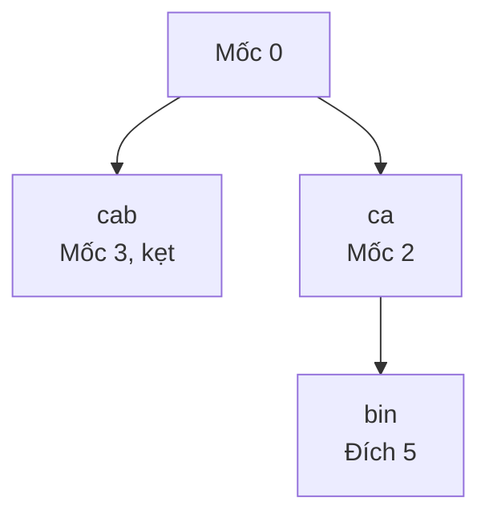

> [!tldr] Đọc nhanh
> - Mỗi vị trí là một ranh giới. Có cạnh i → j khi đoạn từ i đến trước j là một từ hợp lệ.
> - Chỉ giữ [[concepts/prefix-reachability|khả năng tới ranh giới]] để biết có cắt trọn tiền tố hay chưa. Các đường cùng tới một ranh giới có cùng phần còn lại.
> - Đánh dấu ranh giới 0 rồi duyệt tăng, hoặc dùng đệ quy ghi nhớ đáp án ở từng vị trí. Nhớ lưu cả kết quả sai.

> [!info] Bối cảnh
> Đây là bài LeetCode 139 tại [[posts/2026-11-27-neetcode-word-break-lis|ga DP-04: Cắt chuỗi và dãy con tăng]] trên **tuyến NeetCode: Quy hoạch động**. Mình hình dung một dải nhãn dán liền nhau, mỗi nhãn mang một mã có trong danh mục. Bạn chỉ cần biết đọc chuỗi và chạy vòng lặp.

> [!abstract]- Từ điển nhanh cho bài này (bấm để mở)
> - Đoạn `s[i:j]` bắt đầu ở vị trí i và dừng ngay trước j.
> - [[concepts/dp-state|Trạng thái DP]] nói rõ dữ kiện được lưu tại một chỉ số.
> - [[concepts/memoization|Ghi nhớ kết quả]] (memoization) lưu lại đáp án khi một trạng thái được hỏi lần đầu.
> - [[concepts/recurrence-relation|Công thức truy hồi]] cho biết dùng đáp án của trạng thái nào để tính trạng thái hiện tại.

## Hình dung trước: gỡ các nhãn dán trên một dải

Dải `cabin` có thể bắt đầu bằng nhãn `cab` hoặc `ca`. Nếu gỡ `cab`, phần còn lại là `in` và danh mục không có nhãn đó. Nếu gỡ `ca`, nhãn `bin` phủ trọn phần còn lại. Mình đánh dấu cả hai mép cắt hợp lệ và tiếp tục từ mỗi mép còn có thể đi.

| Đời thường | Khái niệm |
|---|---|
| Mép ngay trước ký tự i | Ranh giới i |
| Mã nhãn bắt đầu tại mép i | Từ khớp với hậu tố bắt đầu ở i |
| Gỡ hết các nhãn từ đầu đến mép j | Tiền tố `s[0:j]` có thể cắt trọn |
| Hai cách gỡ tới cùng một mép | Một trạng thái dùng chung |



## Vấn đề: kiểm tra có cách cắt trọn chuỗi

Cho chuỗi `s` dài 1–300 ký tự và 1–1.000 từ phân biệt. Mỗi từ dài 1–20 ký tự, cả chuỗi và danh mục dùng chữ thường tiếng Anh. Trả `true` nếu có thể chia `s` thành các đoạn liền nhau, mỗi đoạn bằng một từ trong danh mục. Mỗi từ có thể dùng nhiều lần. Ví dụ, `mintminttea` với `["mint", "tea"]` cắt được thành `mint | mint | tea`. [Đề gốc LeetCode 139](https://leetcode.com/problems/word-break/)

## Cơ chế

### Vét cạn và ghi nhớ hậu tố

Mình bắt đầu ở vị trí i, thử mọi từ khớp tại đây rồi hỏi phần còn lại từ `i + word.length`. Chạm n nghĩa là đã phủ trọn chuỗi. Mỗi từ có độ dài dương, nên các bước luôn đi tới. Khi duyệt đến `in` trong ví dụ, hàm trả `false` và quay lại thử nhãn khác.

Gọi n là độ dài chuỗi, k là số từ và L là độ dài từ lớn nhất. Vét cạn có thể xét số cách đặt điểm cắt tăng theo hàm mũ. Cận trên là O(2ⁿkL) thời gian và O(n) ngăn xếp. Khi nhiều nhánh tới cùng i, chúng có cùng hậu tố, nên mình lưu kết quả của `solve(i)` theo i. Tối đa n vị trí phải quét từ điển, mỗi vị trí thử k từ, mỗi phép so tốn tối đa O(L). Với truy cập bảng ghi nhớ O(1), tổng thời gian là O(nkL) và bộ nhớ phụ là O(n).

### Điền bảng khả năng cắt trọn tiền tố

Đặt `reachable[i]` là khả năng cắt trọn `s[0:i]`. Bắt đầu bằng `reachable[0] = true` vì tiền tố rỗng đã được phủ. Khi tới một i đã đánh dấu, thử các từ khớp ngay tại i. Từ dài m cho phép đánh dấu `i + m`. Từ không khớp hoặc dài hơn phần còn lại sẽ không tạo cạnh.

Mỗi ô được đánh dấu nhờ nối một từ hợp lệ vào tiền tố đã cắt trọn. Ngược lại, nếu có một cách cắt tới j, bỏ từ cuối cho ra một ranh giới i nhỏ hơn j. Vòng lặp xét i trước rồi đánh dấu j. Duyệt tăng giữ đúng thứ tự phụ thuộc cho cả hai hướng suy luận. Bảng dùng O(n) bộ nhớ và O(nkL) thời gian, không dùng đệ quy. Với từ điển lớn và nhiều tiền tố chung, [[concepts/trie-prefix-pruning|cây tiền tố]] là một cách giảm việc so lặp. Bản dưới đây duyệt trực tiếp danh mục để thấy rõ cạnh được tạo từ đâu.

## Ví dụ chạy được

[TypeScript](../code/neetcode-word-break/segments.ts) · [Python](../code/neetcode-word-break/segments.py) · [Go](../code/neetcode-word-break/segments.go) · [Java](../code/neetcode-word-break/segments.java) · [JavaScript](../code/neetcode-word-break/segments.js) · [PHP](../code/neetcode-word-break/segments.php) · [Rust](../code/neetcode-word-break/segments.rs)

```ts
function wordBreakDp(s: string, words: string[]) {
    const reachable = Array(s.length + 1).fill(false)
    reachable[0] = true
    for (let i = 0; i < s.length; i++) {
        if (!reachable[i]) continue
        for (const word of words) {
            if (s.startsWith(word, i)) reachable[i + word.length] = true
        }
    }
    return reachable[s.length]
}
```

```python
def word_break_dp(s, words):
    reachable = [True] + [False] * len(s)
    for i in range(len(s)):
        if not reachable[i]:
            continue
        for word in words:
            if s.startswith(word, i):
                reachable[i + len(word)] = True
    return reachable[-1]
```

```go
func wordBreakDp(s string, words []string) bool {
	reachable := make([]bool, len(s)+1)
	reachable[0] = true
	for i := 0; i < len(s); i++ {
		if !reachable[i] {
			continue
		}
		for _, word := range words {
			if strings.HasPrefix(s[i:], word) {
				reachable[i+len(word)] = true
			}
		}
	}
	return reachable[len(s)]
}
```

```java
static boolean wordBreakDp(String s, String[] words) {
    boolean[] reachable = new boolean[s.length() + 1];
    reachable[0] = true;
    for (int i = 0; i < s.length(); i++) {
        if (!reachable[i]) continue;
        for (String word : words) {
            if (s.startsWith(word, i)) reachable[i + word.length()] = true;
        }
    }
    return reachable[s.length()];
}
```

```js
function wordBreakDp(s, words) {
    const reachable = Array(s.length + 1).fill(false)
    reachable[0] = true
    for (let i = 0; i < s.length; i++) {
        if (!reachable[i]) continue
        for (const word of words) {
            if (s.startsWith(word, i)) reachable[i + word.length] = true
        }
    }
    return reachable[s.length]
}
```

```php
function wordBreakDp(string $s, array $words): bool {
    $n = strlen($s);
    $reachable = array_fill(0, $n + 1, false);
    $reachable[0] = true;
    for ($i = 0; $i < $n; $i++) {
        if (!$reachable[$i]) continue;
        foreach ($words as $word) {
            if (substr_compare($s, $word, $i, strlen($word)) === 0) {
                $reachable[$i + strlen($word)] = true;
            }
        }
    }
    return $reachable[$n];
}
```

```rust
fn word_break_dp(s: &str, words: &[&str]) -> bool {
    let bytes = s.as_bytes();
    let mut reachable = vec![false; bytes.len() + 1];
    reachable[0] = true;
    for i in 0..bytes.len() {
        if !reachable[i] {
            continue;
        }
        for word in words {
            if bytes[i..].starts_with(word.as_bytes()) {
                reachable[i + word.len()] = true;
            }
        }
    }
    reachable[bytes.len()]
}
```

Các tab trích hàm điền bảng. File tải về còn có vét cạn và bản ghi nhớ. 11 ca gồm nhãn dùng lại, từ dài hơn phần còn lại, chuỗi dài đúng 300 và nhánh thất bại muộn. Hai file Node.js đối chiếu với bộ liệt kê mọi tập điểm cắt cho các chuỗi `a/b` dài 1–5 và mọi danh mục không rỗng trong tập từ `a,b,aa,ab,ba,bb`.

Dòng đếm lượt gọi dùng chuỗi gồm 18 chữ `a` rồi một chữ `b`, với từ điển `["a", "aa"]`. Mọi nhánh đều thất bại ở cuối. Bộ đếm ghi cả lần gọi trả kết quả từ bộ nhớ đệm. Đây là số lần đi vào hàm, không phải thời gian chạy.

```text
11/11 ca đúng
3906/3906 ca đúng (vét điểm cắt)
Vét cạn: 10945 lượt gọi, memo: 36 lượt gọi
```

## Hiểu lầm và bẫy hay gặp

- Luôn lấy từ dài nhất có thể chọn `cab` rồi kẹt ở `in`. Luôn lấy từ ngắn nhất cũng có thể kẹt, chẳng hạn chỉ chọn `c` trong danh mục `["c", "ca", "bin"]`. Trạng thái lưu mọi ranh giới có thể tới.
- Kiểm tra cache bằng giá trị truthy sẽ coi một kết quả `false` như một ô chưa tính. Các bản kiểm tra sự tồn tại của mục trước khi đọc lại.
- TypeScript và JavaScript dùng `startsWith(word, i)` để so tại i. PHP dùng `substr_compare` và kiểm tra kết quả bằng 0. Rust dùng lát byte và `starts_with`. Miền chữ thường tiếng Anh giữ mỗi bước chỉ số nhất quán giữa các bản.

## Câu hỏi tự kiểm tra

> [!question]- Vì sao bảng cần n + 1 ô?
> n ký tự có n + 1 ranh giới, kể cả đầu và cuối chuỗi.

> [!question]- Vì sao chỉ cần một ô cho mỗi i?
> Mọi cách cắt đã tới i để lại cùng một hậu tố. Danh mục dùng lại được nên các từ đã chọn không thay đổi lựa chọn tiếp theo.

> [!question]- Vì sao không đặt thêm điều kiện “mỗi từ chỉ dùng một lần”?
> Điều kiện đó làm kết quả phụ thuộc vào các từ đã dùng. Một vị trí không còn đủ thông tin và trạng thái phải lưu thêm dữ kiện.

## Tham khảo

- [LeetCode 139](https://leetcode.com/problems/word-break/)
- [MIT 6.006, chọn trạng thái cho chuỗi](https://ocw.mit.edu/courses/6-006-introduction-to-algorithms-fall-2011/3484e876d81aba07911a1109f5b5e81e_MIT6_006F11_lec21.pdf)
- [ECMAScript String.prototype.startsWith](https://tc39.es/ecma262/multipage/text-processing.html#sec-string.prototype.startswith) · [PHP substr_compare](https://www.php.net/manual/en/function.substr-compare.php) · [Rust str::as_bytes](https://doc.rust-lang.org/std/primitive.str.html#method.as_bytes)
