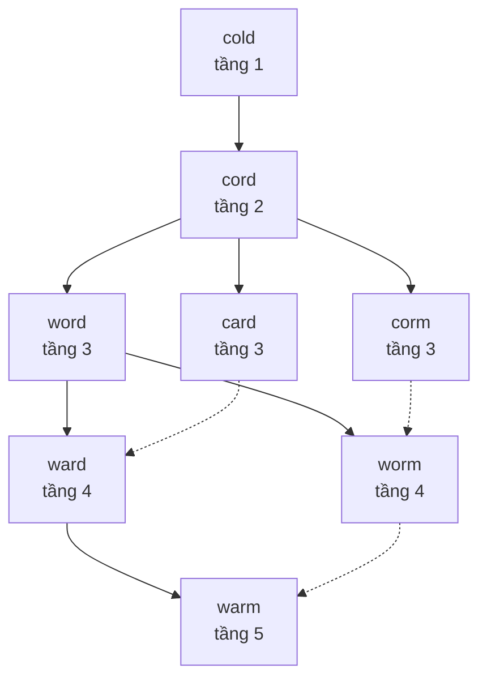
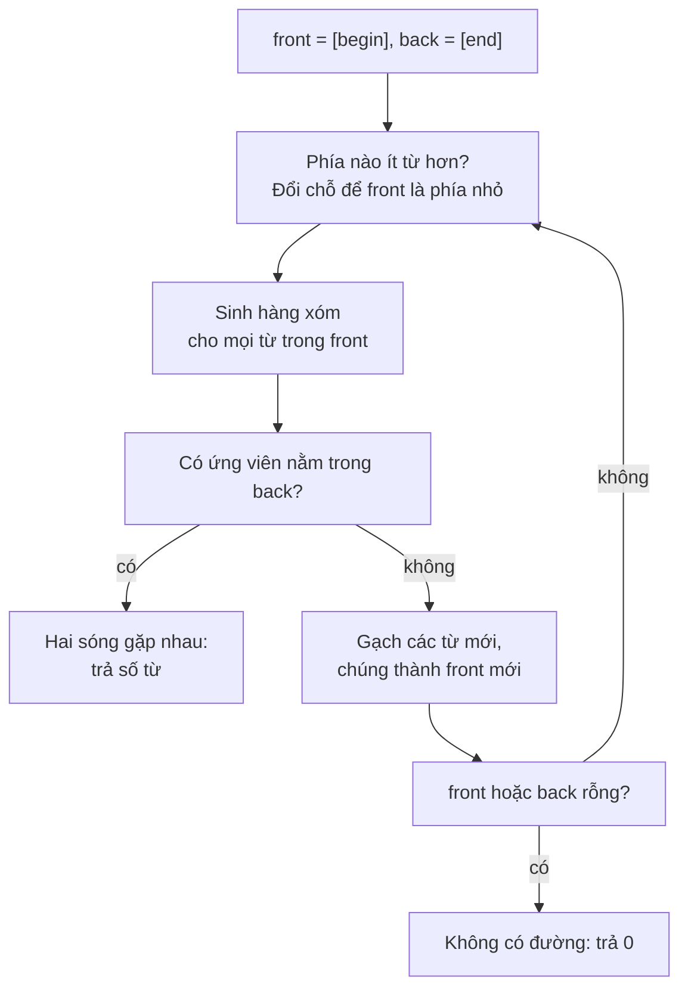

> [!tldr] Đọc nhanh
> - Mỗi từ là một đỉnh. Hai từ khác nhau đúng **một chữ** thì có cạnh nối. Đề hỏi đường ngắn nhất, nên dùng [[concepts/breadth-first-search|BFS]], không dùng DFS.
> - Không ai đưa sẵn danh sách cạnh. Đây là một [[concepts/implicit-graph|đồ thị ẩn]]: mình **sinh hàng xóm khi cần**, bằng cách đổi từng chữ thành `a`…`z` rồi hỏi tập từ.
> - Đáp án đếm **số từ** trên đường, kể cả từ đầu và từ cuối, không đếm số bước. Từ đích không có trong danh sách thì trả `0`.
> - [[concepts/mark-on-enqueue|Gạch từ ngay lúc đưa vào hàng đợi]]. Gạch muộn vẫn ra đúng đáp án nhưng làm hàng đợi phình gần gấp bốn.
> - Trên 5 000 từ, so từng cặp mất 236–1 990 ms. Gom theo mẫu `c*ld` mất 7–15 ms. [[concepts/bidirectional-bfs|BFS hai đầu]] chỉ lấy ra 222 thay vì 5 000 từ.

> [!info] Bối cảnh
> Bài LeetCode 127 (Hard), thuộc [[posts/2026-11-26-neetcode-graph-bfs|ga 2: Duyệt đồ thị và BFS]] trên **tuyến NeetCode: Đồ thị**. Ở [[posts/2026-11-26-neetcode-grid-traversal|ga 1]], hàng xóm của một ô là bốn ô kề cạnh, nhìn là thấy. Ở bài này, hàng xóm của một từ phải đi tìm. Bạn chỉ cần biết vòng lặp, hàng đợi và tập hợp; BFS được giải thích lại ngay dưới.

> [!abstract]- Từ điển nhanh cho bài này (bấm để mở)
> - **Đỉnh, cạnh**: đỉnh là một "điểm" (ở đây là một từ), cạnh là một đường nối hai điểm (hai từ khác nhau đúng một chữ).
> - [[concepts/breadth-first-search|BFS]] (duyệt theo chiều rộng): đi hết các đỉnh cách gốc 1 bước, rồi 2 bước, rồi 3 bước… Tập các đỉnh cùng khoảng cách gọi là một **tầng**.
> - **Hàng đợi**: danh sách vào trước ra trước. BFS lấy đỉnh ở đầu, thêm hàng xóm vào cuối.
> - [[concepts/hash-set|Tập băm]] (`Set`): hỏi "từ này có trong tập không?" mất thời gian gần như hằng số.
> - [[concepts/implicit-graph|Đồ thị ẩn]]: đồ thị không lưu cạnh, chỉ có quy tắc để tính ra hàng xóm của một đỉnh.
> - [[concepts/adjacency-list|Danh sách kề]]: cách lưu đồ thị thường gặp, mỗi đỉnh giữ danh sách hàng xóm. Bài này cố tình không dựng nó.
> - **Xô mẫu**: nhóm các từ cùng khớp một mẫu có một chữ bị che, ví dụ `c*ld` chứa `cold` và `cald`.

## Hình dung trước: ném đá xuống hồ

Ném một hòn đá xuống hồ, sóng lan ra thành từng vòng. Vòng thứ nhất chạm những điểm gần nhất, vòng thứ hai chạm những điểm xa hơn một chút. Điểm nào bị sóng chạm trước thì ở gần hơn. Muốn biết điểm đích cách bao xa, mình chỉ cần đếm xem **vòng sóng thứ mấy** chạm tới nó đầu tiên.

Ở bài này, mỗi từ là một điểm trên mặt hồ. Hai từ chỉ khác nhau một chữ thì nằm sát nhau. Ném đá ở từ đầu, đếm vòng sóng tới từ đích.

| Đời thường | Khái niệm |
|---|---|
| Một điểm trên mặt hồ | Một từ, tức một đỉnh |
| Hai điểm sát nhau | Hai từ khác đúng một chữ, tức một cạnh |
| Ném đá ở từ đầu | Đưa `beginWord` vào hàng đợi |
| Vòng sóng thứ k | Tầng k của BFS: các từ cần đúng k từ trên đường đi |
| Điểm đã ướt thì sóng sau không làm ướt lại | Gạch từ khỏi tập ngay lúc đưa vào hàng đợi |
| Mặt hồ không vẽ sẵn, phải nhìn quanh mới thấy điểm sát bên | Đồ thị ẩn: sinh hàng xóm bằng cách đổi từng chữ |
| Ném hai hòn đá ở hai đầu, chờ hai vòng sóng gặp nhau | BFS hai đầu |
| Trên hồ không có điểm đích | `endWord` không có trong danh sách, trả `0` |

Lấy ví dụ đi từ `cold` tới `warm` với danh sách `cord, card, ward, warm, corm, worm, word`. Các vòng sóng trông như sau:



Mũi tên liền là lần sóng chạm một từ **lần đầu**. Mũi tên đứt là lúc sóng tới một từ đã ướt, nên bỏ qua. `warm` nằm ở tầng 5, vậy chuỗi ngắn nhất có **5 từ**, ví dụ `cold → cord → card → ward → warm`.

## Vấn đề: đếm từ trên chuỗi đổi chữ ngắn nhất

Đề cho từ đầu `beginWord`, từ đích `endWord` và một danh sách từ `wordList`. Tất cả cùng độ dài, chỉ gồm chữ thường. Mỗi bước được đổi **đúng một chữ** ở một vị trí, và từ mới phải nằm trong `wordList`. Từ đầu không cần có trong danh sách. Trả về số từ của chuỗi ngắn nhất từ `beginWord` tới `endWord`, tính cả hai đầu, hoặc `0` nếu không có chuỗi nào. [Đề LC-0127](https://leetcode.com/problems/word-ladder/)

Giới hạn (mình đối chiếu với LeetCode ngày 26/11/2026): độ dài từ từ 1 tới 10; danh sách có từ 1 tới 5 000 từ, không trùng nhau; `beginWord` khác `endWord`.

Ba điểm dễ trượt ngay từ đề:

| Câu hỏi | Trả lời | Ví dụ |
|---|---|---|
| Đếm từ hay đếm bước? | Đếm **từ**. Đổi một lần là 2 từ. | `ab → cb` trả `2`, không phải `1` |
| `endWord` không có trong danh sách? | Trả `0`, dù nó chỉ cách một chữ. | `cat → dog` với `[cot, cog]` trả `0` |
| `beginWord` có trong danh sách? | Được, chỉ cần không đi lại vào nó. | `pen → pin` với `[pen, pin]` trả `2` |

## Cơ chế

<figure class="figure-map" style="--ar: 3 / 4">
<div class="frame"><iframe data-archify="../diagrams/neetcode-word-ladder/worked-example.html" title="Word Ladder: BFS đi từng tầng từ cold tới warm" loading="lazy"></iframe></div>
<figcaption><span><b>Hình 1.</b> BFS đi hết tầng này mới sang tầng sau, nên tầng đầu tiên chứa <code>warm</code> cho ngay độ dài ngắn nhất.</span><a href="../diagrams/neetcode-word-ladder/worked-example.html" target="_blank" rel="noopener">Mở toàn màn hình</a></figcaption>
</figure>

<details>
<summary>Đọc từng bước</summary>
<ol>
<li>Tầng 1: bắt đầu ở cold, gạch cold khỏi tập chưa thăm. <code>hàng đợi: [cold]</code></li>
<li>Đổi từng chữ của cold thành a…z. Trong 104 từ thử, chỉ cord có trong tập. <code>tầng 2: [cord]</code></li>
<li>Từ cord: đổi chữ đầu ra word, chữ thứ hai ra card, chữ cuối ra corm. <code>tầng 3: [word, card, corm]</code></li>
<li>word tìm ra ward và worm. Tới lượt card và corm, hai từ đó đã bị gạch nên không thêm gì. <code>tầng 4: [ward, worm]</code></li>
<li>ward đổi chữ cuối ra warm. <code>tầng 5: [warm]</code></li>
<li>Lấy warm ra khỏi hàng đợi: đúng từ đích. <code>đáp án = 5 từ</code></li>
</ol>
</details>

### Vì sao DFS không dùng được

DFS (duyệt theo chiều sâu) đi thật sâu theo một nhánh rồi mới quay lại. Nó **tìm được một đường**, nhưng không có gì bảo đảm đó là đường ngắn nhất. Với `aa → bb` và danh sách `[ca, cb, bb, ab]`, DFS thử đổi chữ đầu trước, nên đi `aa → ca → cb → ab → bb` và trả `5`. Đường ngắn nhất là `aa → ab → bb`, chỉ `3` từ. File chạy thử ghi lại đúng lỗi này: `wrongDfsFirstPath` sai 2/8 ca.

BFS thì khác: nó xử lý hết mọi từ ở tầng k rồi mới chạm tầng k + 1. Vì vậy lần đầu tiên `endWord` xuất hiện, nó nằm ở tầng nhỏ nhất có thể. Không cần đi tiếp để so.

### Cách 1: so từng cặp từ, O(n²·L)

Cách thẳng nhất: với mỗi từ lấy ra khỏi hàng đợi, duyệt cả danh sách, từ nào khác đúng một chữ và chưa thăm thì thêm vào. Với `n` từ dài `L`, mỗi từ so với `n` từ khác, mỗi lần so tốn `L` phép so chữ: tổng `O(n²·L)`.

```ts
for (const candidate of wordList) {
  if (!seen.has(candidate) && differByOne(word, candidate)) {
    seen.add(candidate) // đánh dấu lúc đưa vào
    next.push(candidate)
  }
}
```

Cách này đúng, và với vài chục từ thì đủ nhanh. Nhưng với 5 000 từ, mỗi từ lấy ra phải so với cả 5 000 từ: 25 triệu lần so.

### Cách 2: đổi từng chữ thành a…z, O(26·n·L²)

Đảo câu hỏi lại. Thay vì hỏi "trong 5 000 từ, từ nào sát mình?", hỏi "những từ nào **có thể** sát mình?". Một từ dài `L` chỉ có `25·L` từ khác đúng một chữ. Mình sinh hết chúng (đổi chữ thứ `i` thành `a`, `b`, …, `z`), rồi hỏi [[concepts/hash-set|tập băm]] từng từ một. Đây chính là cách đi trên một [[concepts/implicit-graph|đồ thị ẩn]]: cạnh không lưu ở đâu cả, chỉ được tính ra khi cần.

| Tầng | Lấy ra | Từ thử có trong tập | Thêm vào tầng sau |
|---|---|---|---|
| 1 | cold | cord | cord |
| 2 | cord | word, card, corm | word, card, corm |
| 3 | word | ward, worm (cord đã gạch) | ward, worm |
| 3 | card, corm | chỉ gặp từ đã gạch | không |
| 4 | ward | warm | warm |
| 5 | warm | là đích | trả 5 |

Mỗi từ sinh `26·L` ứng viên, mỗi ứng viên tốn `O(L)` để dựng chuỗi và băm. Tổng `O(26·n·L²)`. Với `L ≤ 10`, con số này nhỏ hơn nhiều so với `n²·L` khi `n` lớn.

Chỗ quan trọng nhất là **gạch từ ngay khi đưa vào hàng đợi** (`unseen.delete(candidate)`), giống vùng nước đã ướt thì sóng sau không tính lại. Nếu đợi lúc lấy ra mới gạch, cùng một từ có thể được nhiều từ ở tầng trước đưa vào. Đáp án vẫn đúng, nhưng trên từ điển 5 000 từ của file chạy thử, hàng đợi nhận **19 234** lượt đưa vào thay vì tối đa 5 000.

### Cách 3: gom từ theo mẫu có dấu sao

Hai từ khác đúng một chữ ở vị trí `i` thì **giống hệt nhau khi che chữ thứ `i`**. `cold` và `cord` cùng khớp mẫu `co*d`. Vậy mình dựng trước một bảng: mỗi mẫu (che một chữ) trỏ tới danh sách từ khớp nó. Đó là một [[concepts/hash-map|bảng băm]] từ mẫu sang "xô" từ.

```ts
for (const word of wordList) {
  for (let i = 0; i < word.length; i++) {
    const key = word.slice(0, i) + "*" + word.slice(i + 1)
    if (!buckets.has(key)) buckets.set(key, [])
    buckets.get(key)!.push(word)
  }
}
```

Hàng xóm của một từ là mọi từ trong `L` xô của nó. Mẹo giữ tốc độ: **mở mỗi xô một lần rồi xóa nó** (`buckets.delete(key)`). Mọi từ trong xô đã được thêm vào hàng đợi ở lần mở đầu, nên lần sau mở lại chỉ toàn từ đã gạch. Không xóa thì một xô chứa `k` từ sẽ bị mở `k` lần, tốn `k²` lần kiểm.

Dựng bảng tốn `O(n·L²)` (mỗi từ `L` mẫu, mỗi mẫu dài `L`). BFS sau đó cũng chỉ chạm mỗi xô một lần. Đây là cách nhanh nhất trong các cách duyệt một phía ở phép đo dưới.

### Cách 4: BFS hai đầu

Quay lại hình ảnh mặt hồ: ném **hai** hòn đá, một ở `beginWord`, một ở `endWord`, rồi để hai vòng sóng lớn dần cho tới khi chạm nhau. Một vòng sóng bán kính `d` phủ số điểm tăng rất nhanh theo `d`. Hai vòng bán kính `d/2` thường phủ ít điểm hơn hẳn một vòng bán kính `d`.

[[concepts/bidirectional-bfs|BFS hai đầu]] giữ hai tầng: `front` (đang lan từ đầu này) và `back` (đang lan từ đầu kia). Mỗi vòng, mình **nới phía nào có tầng nhỏ hơn**, vì nới tầng nhỏ tốn ít công nhất. Khi sinh ứng viên, nếu ứng viên nằm trong tầng của phía bên kia thì hai sóng đã gặp nhau: trả số từ hiện tại.



Đếm từ ở đây cần cẩn thận. `words` bắt đầu bằng 2, vì nếu `begin` sinh ra ngay `end` thì chuỗi có 2 từ. Mỗi lần nới một tầng, chuỗi nối hai phía dài thêm một từ. Thời gian xấu nhất vẫn như Cách 2, nhưng trên dữ liệu thật nó thường chạm ít từ hơn nhiều.

### Đo trên 5 000 từ

File chạy thử dựng hai từ điển 5 000 từ dài 6 chữ. Từ điển **dày** gồm từ ngẫu nhiên chỉ dùng chữ `a`…`e`, nên mỗi từ có nhiều hàng xóm. Từ điển **thưa** được sinh dần trên `a`…`z`, mỗi từ mới đổi một chữ của một từ có sẵn, nên trông như một cái cây nhiều nhánh. Đích là từ xa `list[0]` nhất, để ba cách một phía phải đi hết đồ thị.

| Từ điển dày, đáp án 9 từ | Số từ lấy ra | TS | Python | Go | Java |
|---|---:|---:|---:|---:|---:|
| Cách 1: so từng cặp | 5 000 | 463 ms | 1 420 ms | 314 ms | 236 ms |
| Cách 2: đổi a…z | 5 000 | 92 ms | 46 ms | 21 ms | 12 ms |
| Cách 3: xô mẫu | 5 000 | 14 ms | 15 ms | 9 ms | 7 ms |
| Cách 4: hai đầu | **222** | 5 ms | 3 ms | 1,4 ms | 1,4 ms |

| Từ điển thưa, đáp án 17 từ | Số từ lấy ra | TS | Python | Go | Java |
|---|---:|---:|---:|---:|---:|
| Cách 1: so từng cặp | 5 000 | 513 ms | 1 990 ms | 345 ms | 265 ms |
| Cách 2: đổi a…z | 5 000 | 91 ms | 45 ms | 22 ms | 25 ms |
| Cách 3: xô mẫu | 5 000 | 9 ms | 15 ms | 8 ms | 12 ms |
| Cách 4: hai đầu | **233** | 4,5 ms | 2,7 ms | 1,9 ms | 1,5 ms |

Số đo thời gian đổi theo máy và theo lần chạy; cột "số từ lấy ra" thì giống hệt nhau ở cả năm ngôn ngữ. Hai điều đáng nhớ:

- Cách 1 chậm hơn Cách 3 từ 20 tới 130 lần. Khoảng cách này tăng theo `n`, vì Cách 1 tăng theo `n²`.
- BFS hai đầu chỉ lấy ra khoảng **4–5 %** số từ so với BFS một phía, vì hai sóng nhỏ gặp nhau sớm hơn một sóng lớn.

Ở TypeScript, Cách 2 chậm hơn hẳn Python. Thủ phạm là cách dựng từ ứng viên; xem mục bẫy bên dưới.

## Ví dụ chạy được

Mỗi file chạy cùng 8 ca: ví dụ `cold → warm`, đích không có trong danh sách, không có đường, từ một chữ, từ đầu nằm trong danh sách, và ca `aa → bb` làm DFS đi vòng. File còn đối chiếu bốn cách đúng trên 2 000 từ điển ngẫu nhiên, đo hai từ điển 5 000 từ, và đếm lượt đưa vào hàng đợi khi gạch muộn. Bên dưới là ba cách nhanh; Cách 1 và các bản sai nằm trong file đầy đủ.

[TypeScript](../code/neetcode-word-ladder/word-ladder.ts) · [Python](../code/neetcode-word-ladder/word_ladder.py) · [Go](../code/neetcode-word-ladder/word_ladder.go) · [Java](../code/neetcode-word-ladder/word-ladder.java) · [JavaScript](../code/neetcode-word-ladder/word-ladder.js)

```ts
// Cách 2: BFS, sinh hàng xóm bằng cách đổi từng chữ thành a..z. O(n·L·26).
function ladderLetters(begin: string, end: string, wordList: string[]): number {
  const unseen = new Set(wordList)
  if (!unseen.has(end)) return 0
  unseen.delete(begin)
  const queue = [begin]
  const dist = new Map([[begin, 1]])
  for (let head = 0; head < queue.length; head++) {
    const word = queue[head]
    expanded++
    const d = dist.get(word)!
    if (word === end) return d
    const chars = word.split("")
    for (let i = 0; i < chars.length; i++) {
      const original = chars[i]
      for (let c = 97; c <= 122; c++) {
        chars[i] = String.fromCharCode(c)
        const candidate = chars.join("")
        if (unseen.has(candidate)) {
          unseen.delete(candidate)
          dist.set(candidate, d + 1)
          queue.push(candidate)
        }
      }
      chars[i] = original
    }
  }
  return 0
}

// Cách 3: gom từ theo mẫu có dấu *, ví dụ "c*ld" chứa cold và cald.
function ladderBuckets(begin: string, end: string, wordList: string[]): number {
  if (!wordList.includes(end)) return 0
  const buckets = new Map<string, string[]>()
  for (const word of wordList) {
    for (let i = 0; i < word.length; i++) {
      const key = word.slice(0, i) + "*" + word.slice(i + 1)
      if (!buckets.has(key)) buckets.set(key, [])
      buckets.get(key)!.push(word)
    }
  }
  const seen = new Set([begin])
  let level = [begin]
  for (let words = 1; level.length > 0; words++) {
    const next: string[] = []
    for (const word of level) {
      expanded++
      if (word === end) return words
      for (let i = 0; i < word.length; i++) {
        const key = word.slice(0, i) + "*" + word.slice(i + 1)
        for (const candidate of buckets.get(key) ?? []) {
          if (!seen.has(candidate)) {
            seen.add(candidate)
            next.push(candidate)
          }
        }
        buckets.delete(key) // một xô chỉ cần mở một lần
      }
    }
    level = next
  }
  return 0
}

// Cách 4: BFS hai đầu, luôn nới bên có tầng nhỏ hơn.
function ladderBidirectional(begin: string, end: string, wordList: string[]): number {
  const unseen = new Set(wordList)
  if (!unseen.has(end)) return 0
  unseen.delete(begin)
  unseen.delete(end)
  // mỗi phía: một mảng giữ thứ tự duyệt, một Set để hỏi "có trong tầng này không"
  let front = [begin], frontSet = new Set(front)
  let back = [end], backSet = new Set(back)
  for (let words = 2; front.length > 0 && back.length > 0; words++) {
    if (front.length > back.length) {
      [front, back] = [back, front];
      [frontSet, backSet] = [backSet, frontSet]
    }
    const next: string[] = []
    for (const word of front) {
      expanded++
      const chars = word.split("")
      for (let i = 0; i < chars.length; i++) {
        const original = chars[i]
        for (let c = 97; c <= 122; c++) {
          chars[i] = String.fromCharCode(c)
          const candidate = chars.join("")
          if (backSet.has(candidate)) return words // hai phía gặp nhau
          if (unseen.has(candidate)) {
            unseen.delete(candidate)
            next.push(candidate)
          }
        }
        chars[i] = original
      }
    }
    front = next
    frontSet = new Set(next)
  }
  return 0
}
```

```python
# Cách 2: BFS, đổi từng chữ thành a..z. O(n·L·26).
def ladder_letters(begin, end, word_list):
    global expanded
    unseen = set(word_list)
    if end not in unseen:
        return 0
    unseen.discard(begin)
    queue = deque([(begin, 1)])
    while queue:
        word, d = queue.popleft()
        expanded += 1
        if word == end:
            return d
        for i in range(len(word)):
            prefix, suffix = word[:i], word[i + 1:]
            for ch in LETTERS:
                candidate = prefix + ch + suffix
                if candidate in unseen:
                    unseen.remove(candidate)
                    queue.append((candidate, d + 1))
    return 0


# Cách 3: gom từ theo mẫu có dấu *, ví dụ "c*ld".
def ladder_buckets(begin, end, word_list):
    global expanded
    if end not in word_list:
        return 0
    buckets = defaultdict(list)
    for word in word_list:
        for i in range(len(word)):
            buckets[word[:i] + "*" + word[i + 1:]].append(word)
    seen = {begin}
    level = [begin]
    words = 1
    while level:
        nxt = []
        for word in level:
            expanded += 1
            if word == end:
                return words
            for i in range(len(word)):
                key = word[:i] + "*" + word[i + 1:]
                for candidate in buckets.pop(key, ()):  # một xô chỉ mở một lần
                    if candidate not in seen:
                        seen.add(candidate)
                        nxt.append(candidate)
        level = nxt
        words += 1
    return 0


# Cách 4: BFS hai đầu, luôn nới bên có tầng nhỏ hơn.
def ladder_bidirectional(begin, end, word_list):
    global expanded
    unseen = set(word_list)
    if end not in unseen:
        return 0
    unseen.discard(begin)
    unseen.discard(end)
    front, front_set = [begin], {begin}
    back, back_set = [end], {end}
    words = 2
    while front and back:
        if len(front) > len(back):
            front, back = back, front
            front_set, back_set = back_set, front_set
        nxt = []
        for word in front:
            expanded += 1
            for i in range(len(word)):
                prefix, suffix = word[:i], word[i + 1:]
                for ch in LETTERS:
                    candidate = prefix + ch + suffix
                    if candidate in back_set:
                        return words  # hai phía gặp nhau
                    if candidate in unseen:
                        unseen.remove(candidate)
                        nxt.append(candidate)
        front, front_set = nxt, set(nxt)
        words += 1
    return 0
```

```go
// Cách 2: BFS, đổi từng chữ thành a..z. O(n·L·26).
// Dùng []byte để sửa một chữ tại chỗ; string(buf) tạo một chuỗi mới cho mỗi lần tra.
func ladderLetters(begin, end string, wordList []string) int {
	unseen := toSet(wordList)
	if !unseen[end] {
		return 0
	}
	delete(unseen, begin)
	queue := []string{begin}
	dist := map[string]int{begin: 1}
	for head := 0; head < len(queue); head++ {
		word := queue[head]
		expanded++
		d := dist[word]
		if word == end {
			return d
		}
		buf := []byte(word)
		for i := range buf {
			original := buf[i]
			for c := byte('a'); c <= 'z'; c++ {
				buf[i] = c
				candidate := string(buf)
				if unseen[candidate] {
					delete(unseen, candidate)
					dist[candidate] = d + 1
					queue = append(queue, candidate)
				}
			}
			buf[i] = original
		}
	}
	return 0
}

// Cách 3: gom từ theo mẫu có dấu *, ví dụ "c*ld".
func ladderBuckets(begin, end string, wordList []string) int {
	if !contains(wordList, end) {
		return 0
	}
	buckets := map[string][]string{}
	for _, word := range wordList {
		for i := range word {
			key := word[:i] + "*" + word[i+1:]
			buckets[key] = append(buckets[key], word)
		}
	}
	seen := map[string]bool{begin: true}
	level := []string{begin}
	for words := 1; len(level) > 0; words++ {
		var next []string
		for _, word := range level {
			expanded++
			if word == end {
				return words
			}
			for i := range word {
				key := word[:i] + "*" + word[i+1:]
				for _, candidate := range buckets[key] {
					if !seen[candidate] {
						seen[candidate] = true
						next = append(next, candidate)
					}
				}
				delete(buckets, key) // một xô chỉ mở một lần
			}
		}
		level = next
	}
	return 0
}

// Cách 4: BFS hai đầu, luôn nới bên có tầng nhỏ hơn.
func ladderBidirectional(begin, end string, wordList []string) int {
	unseen := toSet(wordList)
	if !unseen[end] {
		return 0
	}
	delete(unseen, begin)
	delete(unseen, end)
	front, frontSet := []string{begin}, map[string]bool{begin: true}
	back, backSet := []string{end}, map[string]bool{end: true}
	for words := 2; len(front) > 0 && len(back) > 0; words++ {
		if len(front) > len(back) {
			front, back = back, front
			frontSet, backSet = backSet, frontSet
		}
		var next []string
		for _, word := range front {
			expanded++
			buf := []byte(word)
			for i := range buf {
				original := buf[i]
				for c := byte('a'); c <= 'z'; c++ {
					buf[i] = c
					candidate := string(buf)
					if backSet[candidate] {
						return words // hai phía gặp nhau
					}
					if unseen[candidate] {
						delete(unseen, candidate)
						next = append(next, candidate)
					}
				}
				buf[i] = original
			}
		}
		front, frontSet = next, toSet(next)
	}
	return 0
}
```

```java
// Cách 2: BFS, đổi từng chữ thành a..z. O(n·L·26).
// Sửa một chữ trong char[], rồi new String(chars) chép cả mảng thành chuỗi mới.
static int ladderLetters(String begin, String end, List<String> wordList) {
    Set<String> unseen = new HashSet<>(wordList);
    if (!unseen.contains(end)) return 0;
    unseen.remove(begin);
    ArrayDeque<String> queue = new ArrayDeque<>(List.of(begin));
    Map<String, Integer> dist = new HashMap<>(Map.of(begin, 1));
    while (!queue.isEmpty()) {
        String word = queue.pollFirst();
        expanded++;
        int d = dist.get(word);
        if (word.equals(end)) return d;
        char[] chars = word.toCharArray();
        for (int i = 0; i < chars.length; i++) {
            char original = chars[i];
            for (char c = 'a'; c <= 'z'; c++) {
                chars[i] = c;
                String candidate = new String(chars);
                if (unseen.remove(candidate)) { // remove trả true nếu từ có trong tập
                    dist.put(candidate, d + 1);
                    queue.addLast(candidate);
                }
            }
            chars[i] = original;
        }
    }
    return 0;
}

// Cách 3: gom từ theo mẫu có dấu *, ví dụ "c*ld".
static int ladderBuckets(String begin, String end, List<String> wordList) {
    if (!wordList.contains(end)) return 0;
    Map<String, List<String>> buckets = new HashMap<>();
    for (String word : wordList) {
        for (int i = 0; i < word.length(); i++) {
            String key = word.substring(0, i) + "*" + word.substring(i + 1);
            buckets.computeIfAbsent(key, k -> new ArrayList<>()).add(word);
        }
    }
    Set<String> seen = new HashSet<>(List.of(begin));
    List<String> level = new ArrayList<>(List.of(begin));
    for (int words = 1; !level.isEmpty(); words++) {
        List<String> next = new ArrayList<>();
        for (String word : level) {
            expanded++;
            if (word.equals(end)) return words;
            for (int i = 0; i < word.length(); i++) {
                String key = word.substring(0, i) + "*" + word.substring(i + 1);
                List<String> bucket = buckets.remove(key); // một xô chỉ mở một lần
                if (bucket == null) continue;
                for (String candidate : bucket) {
                    if (seen.add(candidate)) next.add(candidate);
                }
            }
        }
        level = next;
    }
    return 0;
}

// Cách 4: BFS hai đầu, luôn nới bên có tầng nhỏ hơn.
static int ladderBidirectional(String begin, String end, List<String> wordList) {
    Set<String> unseen = new HashSet<>(wordList);
    if (!unseen.contains(end)) return 0;
    unseen.remove(begin);
    unseen.remove(end);
    List<String> front = new ArrayList<>(List.of(begin)), back = new ArrayList<>(List.of(end));
    Set<String> frontSet = new HashSet<>(front), backSet = new HashSet<>(back);
    for (int words = 2; !front.isEmpty() && !back.isEmpty(); words++) {
        if (front.size() > back.size()) {
            List<String> t = front; front = back; back = t;
            Set<String> ts = frontSet; frontSet = backSet; backSet = ts;
        }
        List<String> next = new ArrayList<>();
        for (String word : front) {
            expanded++;
            char[] chars = word.toCharArray();
            for (int i = 0; i < chars.length; i++) {
                char original = chars[i];
                for (char c = 'a'; c <= 'z'; c++) {
                    chars[i] = c;
                    String candidate = new String(chars);
                    if (backSet.contains(candidate)) return words; // hai phía gặp nhau
                    if (unseen.remove(candidate)) next.add(candidate);
                }
                chars[i] = original;
            }
        }
        front = next;
        frontSet = new HashSet<>(next);
    }
    return 0;
}
```

```js
// Cách 2: BFS, sinh hàng xóm bằng cách đổi từng chữ thành a..z. O(n·L·26).
function ladderLetters(begin, end, wordList) {
    const unseen = new Set(wordList);
    if (!unseen.has(end))
        return 0;
    unseen.delete(begin);
    const queue = [begin];
    const dist = new Map([[begin, 1]]);
    for (let head = 0; head < queue.length; head++) {
        const word = queue[head];
        expanded++;
        const d = dist.get(word);
        if (word === end)
            return d;
        const chars = word.split("");
        for (let i = 0; i < chars.length; i++) {
            const original = chars[i];
            for (let c = 97; c <= 122; c++) {
                chars[i] = String.fromCharCode(c);
                const candidate = chars.join("");
                if (unseen.has(candidate)) {
                    unseen.delete(candidate);
                    dist.set(candidate, d + 1);
                    queue.push(candidate);
                }
            }
            chars[i] = original;
        }
    }
    return 0;
}

// Cách 3: gom từ theo mẫu có dấu *, ví dụ "c*ld" chứa cold và cald.
function ladderBuckets(begin, end, wordList) {
    if (!wordList.includes(end))
        return 0;
    const buckets = new Map();
    for (const word of wordList) {
        for (let i = 0; i < word.length; i++) {
            const key = word.slice(0, i) + "*" + word.slice(i + 1);
            if (!buckets.has(key))
                buckets.set(key, []);
            buckets.get(key).push(word);
        }
    }
    const seen = new Set([begin]);
    let level = [begin];
    for (let words = 1; level.length > 0; words++) {
        const next = [];
        for (const word of level) {
            expanded++;
            if (word === end)
                return words;
            for (let i = 0; i < word.length; i++) {
                const key = word.slice(0, i) + "*" + word.slice(i + 1);
                for (const candidate of buckets.get(key) ?? []) {
                    if (!seen.has(candidate)) {
                        seen.add(candidate);
                        next.push(candidate);
                    }
                }
                buckets.delete(key); // một xô chỉ cần mở một lần
            }
        }
        level = next;
    }
    return 0;
}

// Cách 4: BFS hai đầu, luôn nới bên có tầng nhỏ hơn.
function ladderBidirectional(begin, end, wordList) {
    const unseen = new Set(wordList);
    if (!unseen.has(end))
        return 0;
    unseen.delete(begin);
    unseen.delete(end);
    // mỗi phía: một mảng giữ thứ tự duyệt, một Set để hỏi "có trong tầng này không"
    let front = [begin], frontSet = new Set(front);
    let back = [end], backSet = new Set(back);
    for (let words = 2; front.length > 0 && back.length > 0; words++) {
        if (front.length > back.length) {
            [front, back] = [back, front];
            [frontSet, backSet] = [backSet, frontSet];
        }
        const next = [];
        for (const word of front) {
            expanded++;
            const chars = word.split("");
            for (let i = 0; i < chars.length; i++) {
                const original = chars[i];
                for (let c = 97; c <= 122; c++) {
                    chars[i] = String.fromCharCode(c);
                    const candidate = chars.join("");
                    if (backSet.has(candidate))
                        return words; // hai phía gặp nhau
                    if (unseen.has(candidate)) {
                        unseen.delete(candidate);
                        next.push(candidate);
                    }
                }
                chars[i] = original;
            }
        }
        front = next;
        frontSet = new Set(next);
    }
    return 0;
}
```

Kết quả chạy `node word-ladder.ts` (bốn bản còn lại in cùng các dòng ca đúng, cùng số từ lấy ra; chỉ thời gian khác):

```text
ladderPairwise       8/8 ca đúng
ladderLetters        8/8 ca đúng
ladderBuckets        8/8 ca đúng
ladderBidirectional  8/8 ca đúng
wrongDfsFirstPath    6/8 ca đúng; sai ở từ một chữ → 3, DFS đi vòng → 5
wrongCountEdges      2/8 ca đúng; sai ở cold → warm → 4, cat → dog → 3, một bước → 1, từ đầu nằm trong danh sách → 1, từ một chữ → 1, DFS đi vòng → 2
wrongSkipEndCheck    7/8 ca đúng; sai ở đích không có trong danh sách → 4
ngẫu nhiên: 2000/2000 bộ từ điển, bốn cách khớp nhau
từ điển dày, 5000 từ: cdecae → eedbba
  ladderPairwise       đáp án 9, lấy ra 5000 từ, 463.2 ms
  ladderLetters        đáp án 9, lấy ra 5000 từ, 91.6 ms
  ladderBuckets        đáp án 9, lấy ra 5000 từ, 14.3 ms
  ladderBidirectional  đáp án 9, lấy ra 222 từ, 5.2 ms
từ điển thưa, 5000 từ: bkarpa → gstmeb
  ladderPairwise       đáp án 17, lấy ra 5000 từ, 513.1 ms
  ladderLetters        đáp án 17, lấy ra 5000 từ, 90.7 ms
  ladderBuckets        đáp án 17, lấy ra 5000 từ, 9.2 ms
  ladderBidirectional  đáp án 17, lấy ra 233 từ, 4.5 ms
từ điển dày, đánh dấu lúc lấy ra: đáp án 9, 19234 lượt đưa vào hàng đợi; đánh dấu lúc đưa vào: đáp án 9, tối đa 5000 lượt
sinh 780000 từ ứng viên (68466 = 68466 lần trúng): split/join 85.5 ms, ghép slice 30.6 ms
```

## Hiểu lầm và bẫy hay gặp

- **Dùng DFS vì "duyệt nào cũng được".** DFS tìm ra *một* đường, không phải đường ngắn nhất. Ca `aa → bb` trả `5` thay vì `3`, ca `a → c` trả `3` thay vì `2`.
- **Đếm bước thay vì đếm từ.** Trả `số tầng − 1` sai 6/8 ca. Một lần đổi chữ cho chuỗi 2 từ.
- **Thấy đích cách một chữ là trả về.** Nếu `endWord` không có trong danh sách thì không được bước vào nó. Bản `wrongSkipEndCheck` trả `4` cho `cat → dog` với `[cot, cog]`, đáp án đúng là `0`.
- **Gạch từ lúc lấy ra thay vì lúc đưa vào.** Đáp án không đổi, nhưng hàng đợi nhận 19 234 lượt thay vì tối đa 5 000. Trên đồ thị dày hơn, khoảng cách còn lớn hơn.
- **Không gạch từ đã thăm.** Hai từ sát nhau sẽ đưa nhau vào hàng đợi mãi: vòng lặp không dừng.
- **Không xóa xô sau khi mở** (Cách 3). Vẫn đúng, nhưng một xô `k` từ bị mở `k` lần.
- **TypeScript và JavaScript: dựng ứng viên bằng `split("")` rồi `join("")`.** `join` tạo một chuỗi mới từ cả mảng ở mỗi lần thử. Ghép `prefix + chữ + suffix` (cắt sẵn `prefix`, `suffix` một lần cho mỗi vị trí) nhanh hơn gần 3 lần: file đo 780 000 ứng viên mất 85 ms với `join` và 31 ms với ghép `slice`.
- **Python: `list.pop(0)` làm hàng đợi.** Mỗi lần lấy đầu phải dời cả danh sách. Dùng `collections.deque` và `popleft()`.
- **Java: `contains` rồi `remove`.** `Set.remove` trả `true` nếu phần tử có trong tập, nên một lần gọi vừa hỏi vừa gạch. `new String(chars)` chép cả mảng ký tự cho mỗi ứng viên; với `L ≤ 10`, chi phí này nhỏ.
- **Go: sửa thẳng `string`.** Chuỗi trong Go không sửa được. Đổi sang `[]byte` một lần, sửa từng byte, rồi `string(buf)` để tra map.

## Câu hỏi tự kiểm tra

> [!question]- Đổi `cold` sang `warm`, đáp án là 5. Vì sao không phải 4?
> Đề đếm số từ trên chuỗi, kể cả hai đầu: `cold, cord, card, ward, warm` là 5 từ. Số lần đổi chữ là 4.

> [!question]- Vì sao BFS dừng được ngay khi lấy `endWord` ra, không cần đi tiếp để so đường?
> BFS xử lý hết tầng k rồi mới sang tầng k + 1. Lần đầu `endWord` xuất hiện, nó ở tầng nhỏ nhất có thể, nên không còn đường nào ngắn hơn.

> [!question]- Danh sách có 5 000 từ dài 10 chữ. Cách 1 và Cách 2 mỗi từ tốn bao nhiêu phép thử?
> Cách 1 so với 5 000 từ, mỗi lần tối đa 10 phép so chữ. Cách 2 sinh `26 × 10 = 260` ứng viên, mỗi ứng viên dựng và băm 10 chữ. 260 nhỏ hơn 5 000 nhiều, nên Cách 2 thắng khi danh sách lớn.

> [!question]- Trong BFS hai đầu, vì sao luôn nới phía có tầng nhỏ hơn?
> Công nới một tầng tỉ lệ với số từ trong tầng đó. Nới phía nhỏ thì tốn ít công mà vẫn kéo hai sóng lại gần nhau thêm một bước.

> [!question]- `beginWord` không có trong danh sách thì có sao không?
> Không sao. Từ đầu chỉ là điểm xuất phát; chỉ những từ đi qua sau đó mới phải có trong danh sách.

## Tham khảo

- [LeetCode · Word Ladder](https://leetcode.com/problems/word-ladder/): quy tắc đổi chữ và giới hạn đầu vào.
- [Princeton · Breadth-first paths](https://github.com/kevin-wayne/algs4/blob/master/src/main/java/edu/princeton/cs/algs4/BreadthFirstPaths.java): BFS đánh dấu đỉnh lúc đưa vào hàng đợi và cho đường ngắn nhất trên đồ thị không trọng số.
- [Python · collections.deque](https://docs.python.org/3/library/collections.html#collections.deque): `popleft()` lấy đầu trong O(1).
- [Java · Set.remove](https://docs.oracle.com/en/java/javase/21/docs/api/java.base/java/util/Set.html#remove(java.lang.Object)): trả `true` khi tập có chứa phần tử.
- [Go · Chuyển đổi giữa string và []byte](https://go.dev/ref/spec#Conversions_to_and_from_a_string_type).
